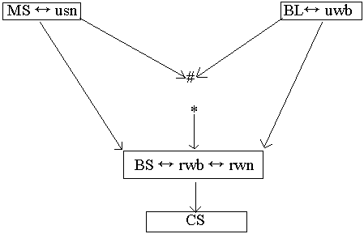

# prisoner-dilemma — guide（supplement）

> （《prisoner-dilemma》词条补充材料，源：plato.stanford.edu/entries/prisoner-dilemma/guide.html）

#### Supplement to Prisoner’s Dilemma

## Stability Concepts in Evolutionary Games

Logical relations among concepts of stability used in discussions of the EPD and other evolutionary games are established in a series of papers by Bendor and Swistak. Some conditions on game payoffs and some conditions on the course of evolution are described below. Logical relations among these conditions are represented in the diagram that follows.

### Conditions on payoffs

($V(i,j)$ is the total payoff that $i$ gets playing against $j$.)

| CS | Axelrod (“Collective Stability”) | $\forall j [V(i,i) \ge V(j,i)]$ |
| --- | --- | --- |
| MS | Maynard Smith | $\forall j[V(i,i) \gt V(j,i)$ or $(V(i,i)=V(j,i)$ & $V(i,j) \gt V(j,j))]$ |
| BL | Boyd and Lorberbaum | $\forall j[V(i,i) \gt V(j,i)$ or $(V(i,i)=V(j,i)$ & $\forall k(V(i,k) \ge V(j,k)))]$ |
| BS | Bendor and Swistak | $\forall j[V(i,i) \gt V(j,i)$ or $(V(i,i)=V(j,i)$ & $V(i,j) \ge V(j,j))]$ |

### Conditions on the course of evolution

$u$ and $r$ (“universal” and “restricted”) indicates that the condition obtains under any rule of evolution or merely under the replication dynamics. $s$ and $w$ (“strong” and “weak”) indicate that the strategy eradicates invasions or merely survives them. $n$ and $b$ (“narrow” and “broad”) indicate that the invaders are homogeneous (i.e., they all employ the same strategy), or heterogeneous. For example $i$ has $uwb$ (universal weak broad) stability if, under any rule of evolution, it survives sufficiently small heterogeneous invasions.

### Relations among stability conditions

Logical implications are indicated by chains of arrows (and by relative vertical position). Conditions stronger than # cannot be satisfied by any EPD and conditions weaker than \* are satisfied by EPDs with all levels of cooperation from 0% to 100%.

