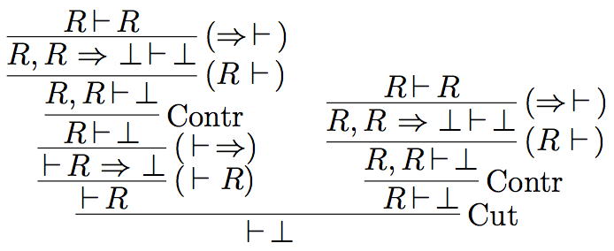

# proof-theoretic-semantics — definitional-reflection（supplement）

> （《proof-theoretic-semantics》词条补充材料，源：plato.stanford.edu/entries/proof-theoretic-semantics/definitional-reflection.html）

#### Supplement to Proof-Theoretic Semantics

## Definitional Reflection and Paradoxes

The theory of definitional reflection is most conveniently framed in a sequent-style system. If the definition of $A$ has the form

$$ \mathbb{D}_A\ \left\{ \begin{array}{rcl} A & \Leftarrow & \Delta_1 \\ & \vdots & \\ A & \Leftarrow & \Delta_n \end{array} \right. $$

and the $\Delta_i$ have the form ‘$B_{i1}, \ldots, B_{ik_i}$’, then the right-introduction rules for $A$ (definitional closure) are

$$ (\vdash A)\frac{\Gamma \vdash B_{i1} \quad \ldots \quad \Gamma \vdash B_{ik_i}}{\Gamma \vdash A} $$

or, in short,

$$ \frac{\Gamma \vdash \Delta_i}{\Gamma \vdash A}\quad (1 \le i \le n). $$

and the left-introduction rule for $A$ (definitional reflection) is

$$ (A \vdash)\frac{\Gamma, \Delta_1 \vdash C \quad \ldots \quad \Gamma, \Delta_n \vdash C}{\Gamma, A \vdash C} $$

If $\bot$ is an atom for which no definitional clause in given, then $\bot \vdash C$ is derivable for any $C$ — we just have to apply definitional reflection with the empty set $(n = 0)$ of premisses. “$\Rightarrow$” denotes a structural implication for which we assume that the rules

$$ \frac{\Gamma, A \vdash B}{\Gamma \vdash A \Rightarrow B}(\vdash \Rightarrow) \qquad \frac{\Gamma\vdash A}{\Gamma,(A \Rightarrow B)\vdash B}(\Rightarrow \vdash) $$

are available. They can be obtained immediately from Gentzen’s sequent-rules for implication.

Following Hallnäs (1991), we now consider the following definition which consists of a single clause defining $R$ in terms of its own negation:

$$ \mathbb{D}_R \left\{ R \Leftarrow (R \Rightarrow \bot) \right. $$

Then we can derive absurdity, if the following structural principles are at our disposal: (i) initial sequents of the form $A \vdash A$, (ii) the contraction of identical formulas in the antecedent and (iii) the cut rule.

There are various strategies to deal with this phenomenon, depending on which structural principle one wants to tackle.

(i) We may restrict initial sequents $A\vdash A$ to those cases, where there is no definitional clause for $A$ available, i.e. where $A$ cannot be introduced by definitional closure or definitional reflection. The rationale behind this proposal is that, if $A$ has a definitional meaning, then $A$ should be introduced according to its meaning and not in an unspecific way. This corresponds to the idea of the logical sequent calculus, in which one often restricts initial sequents to the atomic case, i.e., to the case, where no meaning-determining right and left introduction rules are available. If we impose this restriction on the definition of $R$, then the above derivation is no longer well-formed. As there is a definitional rule for $R$, we are not entitled to use the initial sequent $R \vdash R$. On the other hand, the initial sequent is not reducible to any other, more elementary initial sequent which is permitted. This way of proceeding was proposed by Kreuger (1994) and is related to using a certain three-valued semantics for logic programming (see Jäger and Stärk, 1998).

(ii) If we disallow contraction, the above derivation again breaks down. This is not very surprising, as, since the work of Fitch and Curry, it is well-known that choosing a logic without contraction prevents many paradoxes (see the entry on Curry’s paradox, and the entry on paradoxes and contemporary logic). It would actually be sufficient to restrict contraction by forbidding only those cases in which the two expressions being contracted have been introduced in semantically different ways. This means the following: In the definitional framework an expression $A$ can be introduced either by means of an initial sequent $A \vdash A$ or by one of the two definitional principles $(\vdash A)$ or $(A\vdash)$. In the first case, $A$ is introduced in an *unspecific* way, i.e., independent of its definition, whereas in the second case, $A$ is introduced in a *specific* way, namely according to its meaning as given by the definition of $A$. It can be shown that contraction is only critical (with respect to cut elimination) if a specific occurrence of $A$ is identified with an unspecific one. This is exactly the situation in the above derivation: An $R$ coming from an initial sequent is contracted with an $R$ coming from definitional reflection.

(iii) If we disallow cut, then again we are not able to derive absurdity. In fact, it is questionable, why we should assume cut at all. In standard logic cut is not needed as a primitive rule, since it is admissible. We can simply read the above example as demonstrating that the rule of cut is not admissible in the system without cut, as there is no other rule that can generate $\vdash \bot$. Instead of discussing whether we should force cut by making it a primitive rule, we can inversely use the admissibility or non-admissibility of cut to be a feature by means of which we classify definitions. Certain definitions admit cut, others do not. It is a main task of the theory of definitional reflection to sort definitions according to whether they render cut admissible. As stressed by Hallnäs (1991), this is comparable to the situation in recursion theory where one considers partial recursive functions. There the fact that a well-defined partial recursive function is total is a behavioral feature of the function defined and not a syntactic feature of its recursive definition (in fact, it is undecidable in general). For example, one sufficient condition for cut with cut formula $A$ to be admissible is that the definition of $A$ is well-founded, i.e. every chain of definitional successors starting with $A$ terminates. Another condition is that the bodies of the definitional clauses for $A$ do not contain structural implication. Giving up well-foundedness as a definitional principle is not so strange as it might appear at first sight. In the revision theory of truth (see the entry on the revision theory of truth), the investigations that have started with the works of Kripke, Gupta, Herzberger and Belnap have shown that the exclusion of non-wellfoundedness obstructs the view on interesting phenomena.

In a typed version, where cut takes the form of a substitution rule:

$$ \frac{\Gamma \vdash t : A \quad \Delta,x : A \vdash s : B}{ \Gamma, \Delta \vdash s[x / t] : B } $$

one might consider to restrict cut locally to those cases in which it generates a normalizable term $s[x/ t]$. This can be seen as an argument for the sequent calculus as the appropriate formal model of deductive reasoning, since only the sequent calculus has this local substitution rule. In natural deduction, where one would have to restrict the application of modus ponens to non-critical cases, substitution is built into the general framework as a global principle. Within a natural-deduction framework, Tranchini (2016) has proposed to consider derivations of absurdity to be “arguments” rather than “proofs”, understanding arguments as senses of derivations and proofs as their denotations, so that a non-normalizable derivation of absurdity is meaningful, but lacks a denotation. This approach, which builds on Prawitz’s (1965, App. B) observation that the derivation of Russell’s paradox is non-normalizable and Tennant’s (1982) corresponding analysis of many well-known paradoxes, contributes to the research programme to apply Frege’s semantical distinction between sense and denotation to proofs (see Ayhan, 2021) and thus belongs to what might be called “intensional proof-theoretic semantics” (see section 3.7).
