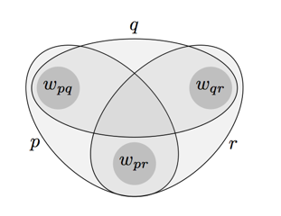

# Questions
**First published Tue Feb 11, 2014; substantive revision Tue May 26, 2026**

*Cross, Charles, Roelofsen, Floris*

The philosophy of language since Frege has emphasized propositions and declarative sentences, but it is clear that questions and interrogative sentences are just as important. Scientific investigation and explanation proceed in part through the posing and answering of questions, and human dialogues as well as human-computer interactions are often structured in terms of questions and answers.

After going over some preliminaries we will focus on three lines of work on questions: one located at the intersection of philosophy of language and formal semantics, focusing on the semantics of what Belnap and Steel (1976) call *elementary questions*; a second located at the intersection of philosophy of language and philosophy of science, focusing on why-questions and the notion of explanation; and a third located at the intersection of philosophy of language and epistemology, focusing on embedded questions.

## 1. Preliminaries

R.G. Collingwood (1939)[^collingwood-1939] was an early advocate of taking questions seriously. In the decades since the publication of Collingwood’s autobiography the topic of questions has regularly received attention from linguists, logicians, and philosophers of language, but few have joined Collingwood (1939, 36–37)[^collingwood-1939] in suggesting that propositional logic be replaced by a logic of question and answer in which neither question nor proposition is more basic. Instead, most work on questions in the philosophy of language and in formal semantics fits squarely within a reductive paradigm inspired by (if not perfectly reflective of) Frege in which propositions, declarative sentences, and assertion have primacy. The primacy of the assertoric is especially evident in the work of many who write on the semantics of what Belnap and Steel (1976) call elementary questions and who regard any such question as being identifiable with a set or function involving the propositions that are the question’s answers. Only relatively recently, an alternative to this reductive paradigm, taking up Collingwood’s suggestion to replace classical logic with a logic of questions and propositions in which neither question nor proposition is seen as more basic, has gained traction under the heading of *inquisitive semantics* (Ciardelli *et al*. 2018)[^ciardelli-2018].

### 1.1 Questions, answers, and presuppositions

Familiar considerations from the philosophy of language make it clear that one should distinguish interrogative sentences from their contents and distinguish both of these from the speech acts that can be performed via the utterance of interrogative sentences. For example, Belnap and Steel (1976, 3) understand a question to be an abstract thing for which an interrogative sentence is a piece of notation. This parallels the distinction between propositions and the declarative sentences that express them. The structure and composition of a question (understood as the abstract content of an interrogative sentence) vary from theory to theory. The speech act of asking a question is standardly regarded, e.g., by Searle (1969, 69)[^searle-1969], as a special case of the illocutionary act of requesting. Searle distinguishes requesting information (asking a real question) from requesting that the hearer display knowledge (asking an exam question). Åqvist (1965)[^åqvist-1965] connects questions with speaker knowledge rather than hearer knowledge by proposing that to ask a question is to command the hearer to cause the speaker to know the question’s answer.

As is already clear, an important concept in many theories of questions is that of an answer, sometimes called a *direct answer*. Many theorists agree that an answer is a piece of language or semantic object that, as Belnap and Steel (1976, 3) put it, “completely, but just completely, answers the question.” A sentence or proposition need not be true to be a direct answer. Whether each question can be associated with a definite set of direct answers is a controversial matter, however. Most authors require answers to be sentences or propositions, so that answers to a question are the kind of thing that is true or false. Tichy (1978)[^tichy-1978] is a striking exception and argues that answers can be of any logical type. Consider this example:

**(1)**

Who was the President of the USA in 1978? a. Jimmy Carter was the President of the USA in 1978.

**b.**

Gerald Ford was the President of the USA in 1978.

**c.**

Jimmy Carter

**d.**

Gerald Ford

**e.**

Someone over three inches tall was the President of the USA in 1978.

Most theorists would say that (1a) is the correct answer to (1), that (1b) is an answer but not the correct answer, and that (1c–e) are not answers to (1) at all. Tichy would say that, among (1a–e), only (1c–d) are answers, and (1c) is the correct answer. Braun (2006)[^braun-2006] would count (1a–b) as answers and include (1e) as both an answer and a correct answer. What these different theoretical interpretations of the notion of an answer show is there is no univocal pre-theoretical notion of an answer. The notion should rather be seen as a technical one, which can differ from one theory to another. Some theorists make explicit what they understand answers to be, but some leave this implicit. This can be problematic: without explication of which pre-theoretical construct the technical notion of an answer in a given theory is intended to capture, the theory cannot be evaluated empirically.

A second important basic concept connected with questions is that of a *presupposition*. Belnap and Steel (1976, 5) define a question as presupposing a statement if and only if the truth of the statement is a logically necessary condition for there being a true (i.e., correct) answer to the question. For example, (1a) presupposes the following:

**(2)**

The USA had exactly one President in 1978.

To deny a presupposition of a question is to give a *corrective answer* to the question, but most theorists join Belnap and Steel in not counting corrective answers as direct answers.

### 1.2 Kinds of questions

Several kinds of questions have been distinguished in the literature.

*Whether-questions* are questions like ‘Was there a quorum at the meeting?’ and ‘Does Jones live in Italy, in Spain, or in Germany?’. These examples illustrate that whether-questions come in two varieties: a whether-question may be of the yes-or-no variety, or it may present two or more alternative direct answers other than yes and no. In either case, a whether-question explicitly presents a finite number of direct answers. Consider the first example:

**(3)**

Was there a quorum at the meeting? a. There was a quorum at the meeting.

**b.**

There was no quorum at the meeting.

The answers to (3) are (3a–b), and (3) presupposes that the meeting occurred. Thus (4) is a corrective answer to (3):

**(4)**

The meeting did not take place.

Question (5) is ambiguous:

**(5)**

Does Jones live in Italy, in Spain, or in Germany? a. Jones lives in Italy.

**b.**

Jones lives in Spain.

**c.**

Jones lives in Germany.

Question (5) can be read as a yes-no question having two direct answers, but it also has a reading on which it presents exactly three direct answers, namely (5a–c). On the latter reading, (5) presupposes that Jones lives in Italy, in Spain, or in Germany; thus (6) is a corrective answer to (5):

**(6)**

Jones does not live in Italy, in Spain, or in Germany.

*Which*-questions are questions like ‘What is the smallest prime number greater than 12?’, ‘Which cardinal was elected Pope in 2013?’, and ‘Who shot J.R.?’ Unlike a whether-question, a which-question may have an indefinite or infinite number of direct answers.

Belnap and Steel (1976) refer to whether- and which-questions as *elementary questions*. We consider these kinds of questions in detail in section 2.

Another major category of questions are *why*-questions. It has long been recognized that why-questions are intimately linked with the concept of explanation. For example, Hempel and Oppenheim (1948, 334) write as follows:

> A scientific explanation may be regarded as an answer to a why-question, such as “Why do the planets move in elliptical orbits with the sun at one focus?”

We consider why-questions in detail in section 3.

Yet another major category of questions are *embedded* or *indirect* questions, which occur as complements of clause-embedding predicates such as ‘know’ and ‘wonder’:

**(7)**

John knows / wonders *who spoke to Mary*.

The issue of how to understand embedded questions lies at the intersection of the philosophy of language and epistemology and will be treated in section 4.

## 2. The semantics of elementary questions

This section provides an overview of some of the most prominent treatments of elementary questions at the intersection of philosophy of language and formal semantics.

### 2.1 Classical semantic theories of questions

#### 2.1.1 Hamblin semantics

A common starting point for many formal semantic treatments of questions is the idea that “questions set up a choice-situation between a set of propositions, namely those propositions that count as answers to it” (Hamblin 1973, 48)[^hamblin-1973]. One way to implement this idea is to take a question to denote, in a world $w$, the set of propositions that correspond to a possible answer to the question (Hamblin 1973)[^hamblin-1973]. Another way to implement the same idea is to let a question denote, in a world $w$, the set of propositions that correspond to its *true* answers in $w$ (Karttunen 1977)[^karttunen-1977]. In both systems, the *meaning* of a question is a function from worlds to sets of propositions. In Hamblin’s system, this function maps every possible world to the same set of propositions, corresponding to the set of all possible answers; in Karttunen’s system, every world is mapped to a subset of all possible answers, namely those that are true in the given world. As acknowledged by Karttunen (1977, 10)[^karttunen-1977], the difference is inessential. In both cases, the meaning of a question is fully determined by—and could be identified with—the set of all propositions that correspond to a possible answer.

A fundamental problem with these accounts is that they do not specify in more detail what “possible answers” are supposed to be. Of course, they do provide a compositional semantics for a fragment of English, and thereby specify what they take to be the possible answers to the questions in that fragment. But in order for these theories to be evaluated, we first need to know what the notion of a “possible answer” is intended to capture. To illustrate this point, consider the following example:

**(8)**

Who is coming for dinner tonight? a. Paul is coming.

**b.**

Only Paul and Nina are coming.

**c.**

Some girls from my class are coming.

**d.**

I don’t know.

In principle, all the responses in (8a–d) could be seen as possible answers to (8). For Hamblin and Karttunen, only (8a) counts as such. However, it is not clear what the precise criteria are for being considered a possible answer, and on which grounds (8a) is to be distinguished from (8b–d).

#### 2.1.2 Partition semantics

Groenendijk and Stokhof (1984) take a question to denote, in each world, a single proposition embodying the *true exhaustive* answer to the question in that world. For instance, if $w$ is a world in which Paul and Nina are coming for dinner, and nobody else is coming, then the denotation of (8) in $w$ is the proposition expressed by (8b).

The *meaning* of a question, then, is a function from worlds to propositions. These propositions have two special properties: they are *mutually exclusive* (since two different exhaustive answers are always incompatible), and together they form a *cover* of the entire logical space (since every world is compatible with at least one exhaustive answer). So the meaning of a question can be identified with a set of propositions which form a *partition* of the logical space.

In many cases, it is intuitively clear what the “true exhaustive answer” to a question in a given world is, at least much clearer than what all the “possible answers” to that question are. This means that a partition semantics can in many cases be tested against clear intuitions, unlike a Hamblin semantics.

However, in some cases it is not so clear what the “true exhaustive answer” to a question in a given world is. Consider the following examples (in (10) we use $\uparrow$ and $\downarrow$ to indicate rising and falling intonation, respectively):

**(9)**

If Ann is coming, will Bill come as well? [conditional question]

**(10)**

Is Ann$\uparrow$ coming, or Bill$\downarrow$? [alternative question]

What is the true exhaustive answer to (9) in a world where Ann is coming and Bill is coming as well? One option is the proposition $\{w$: Ann and Bill are both coming in $w\}$, but another option is the proposition $\{w$: if Ann is coming in $w$ then Bill is also coming in $w\}$. It is not quite clear pre-theoretically which of these two options is more suitable. Notice that if we pick the second option, then we must assume that the true exhaustive answer to (9) in a world where Ann is coming but Bill is not coming is $\{w$: if Ann is coming in $w$ then Bill is not coming in $w\}$. And this would mean that these two ‘exhaustive’ answers actually overlap (they both contain all worlds where Ann is not coming) and thus do not form a partition. This may be considered a reason to pick the first option instead. However, this line of reasoning is purely theory-internal; it seems impossible to decide on theory-external grounds what the true exhaustive answers to a conditional question should be taken to be.

Conditional questions like (9) also present another challenge for a partition semantics, concerning answers that deny the antecedent of the conditional (in this case the answer that Ann is not coming). Intuitively, such answers dispel the issue raised by the question, but do not resolve the issue as intended. Their status differs from answers that do resolve the issue as intended (in this case the answer that Bill is coming if Ann is coming, and the answer that Bill is not coming if Ann is coming). In a basic partition semantics it is impossible to capture this. In worlds where Ann is not coming, the answer that Ann is not coming presumably is the true exhaustive answer. Its special status, however, cannot be captured.

A similar problem arises with alternative questions like (10). In this case, the answer that neither Ann nor Bill is coming and the answer that Ann and Bill are both coming have a different status than the answer that only Ann is coming and the answer that only Bill is coming. Again, this difference in status cannot be captured in a simple partition semantics.

### 2.2 Questions in dynamic semantics

#### 2.2.1 Updating equivalence relations

We now turn our attention to a line of work that aims to capture the semantics of questions in a *dynamic* framework. The first theories in this line of work were developed by Jäger (1996)[^jäger-1996], Hulstijn (1997)[^hulstijn-1997], and Groenendijk (1999)[^groenendijk-1999]. Aloni *et al*. (2007b) contains a collection of papers elaborating on these early proposals. All these theories essentially reformulate the partition theory of questions in the format of an update semantics (Veltman 1996)[^veltman-1996]. This means that they explicitly identify meanings with *context change potentials*, i.e., functions over discourse contexts. However, unlike a simple update semantics where discourse contexts are modeled as sets of worlds—embodying the information established in the discourse so far—these theories provide a more refined model of discourse contexts, one that also embodies the issues that have been raised so far. More specifically, a discourse context is modeled as an *equivalence relation* $R$ over a set of worlds $C$. The set of worlds $C$, i.e., the domain of $R$, can be thought of as the *context set*, i.e., the set of all worlds that are compatible with the information established in the discourse so far. $R$ itself induces a partition on $C$, and can thus be taken to encode the issues that have been raised so far. More specifically, we can think of $R$ as relating two worlds $w$ and $v$ just in case the difference between $w$ and $v$ is not (yet) at issue, i.e., the discourse participants have not yet expressed an interest in information that would distinguish between $w$ and $v$. In other words, $R$ can be conceived of as a relation encoding *indifference* (Hulstijn 1997)[^hulstijn-1997].

Both assertions and questions can then be taken to have the potential to change the context in which they are uttered. Assertions restrict the context set $C$ to those worlds in which the asserted sentence is true (strictly speaking, they remove all pairs of worlds $\langle w,v\rangle$ from $R$ such that the asserted sentence is false in at least one of the two worlds). Questions *disconnect* worlds, i.e., they remove a pair $\langle w,v\rangle$ from $R$ just in case the true exhaustive answer to the question in $w$ differs from the true exhaustive answer to the question in $v$.

Thus, the dynamic framework of Jäger (1996)[^jäger-1996], Hulstijn (1997)[^hulstijn-1997], and Groenendijk (1999)[^groenendijk-1999] provides a notion of context and meaning that embodies both informative and inquisitive content in a uniform way. However, the framework inherits several issues from the classical partition theory of questions, in particular those discussed above concerning conditional and alternative questions.

Moreover, there is a conceptual issue concerning the equivalence relation $R$. Namely, if $R$ is primarily thought of as a relation encoding *indifference*, then it is not clear why it should always be an *equivalence relation*. In particular, it is not clear why $R$ should always be *transitive*. The discourse participants could very well be interested in information that distinguishes $w$ from $v$, while they are not interested in information that distinguishes either $w$ or $v$ from a third world $u$. To model such a situation, we would need an indifference relation $R$ such that $\langle w,u\rangle \in R$ and $\langle u,v\rangle \in R$ but $\langle w,v\rangle \not\in R$. This is impossible if we require $R$ to be transitive.

#### 2.2.2 Giving up transitivity

These concerns have been addressed by Groenendijk (2009)[^groenendijk-2009][^groenendijk-2009-2] and Mascarenhas (2009)[^mascarenhas-2009]. The overall architecture of their system is very much like that of the early dynamic systems discussed above, only indifference relations are no longer defined as equivalence relations, but rather as reflexive and symmetric (not necessarily transitive) relations.

Groenendijk and Mascarenhas argued that this adjustment, besides addressing the conceptual issue concerning indifference relations discussed above, also allows for a better analysis of conditional questions and alternative questions. However, Ciardelli (2009)[^ciardelli-2009] and Ciardelli and Roelofsen (2011) show that, although the proposed system indeed behaves better for simple cases, it does not scale up to more complex cases in a suitable way. In particular, whereas alternative questions with two disjuncts, like (10) above, are dealt with satisfactorily, or at least more satisfactorily than in a partition semantics, alternative questions with three or more disjuncts are still problematic.

The gist of the problem can be illustrated with a simple example. Consider a language with three atomic sentences, $p, q$, and $r$, and an information state consisting of three worlds, $w_{pq}, w_{qr}$, and $w_{pr}$, where the subscripts of each world indicate which atomic sentences are true at that world. Note that in this information state none of the atomic sentences is known to hold. Now consider an issue which is resolved just in case at least one of the atomic sentences is established, i.e., just in case we know that the actual world is located within one of the ovals depicted in figure 1.

*Figure 1:* An issue that cannot be represented in the pair-semantics.

The problem with the system of Groenendijk (2009)[^groenendijk-2009][^groenendijk-2009-2] and Mascarenhas (2009)[^mascarenhas-2009] is manifested by the fact that this issue cannot be represented by means of an indifference relation. An indifference relation over the information state $\{w_{pq},w_{qr},w_{pr}\}$ necessarily contains all reflexive world-pairs, and possibly one, two, or three non-reflexive pairs. In either case, however, the resulting issue does not correspond to the one depicted in Figure 1.

The general conclusion that has been drawn from this problem, as discussed in detail by Ciardelli and Roelofsen (2011), is that question meanings cannot be suitably modeled in terms of indifference relations, even if these indifference relations are allowed to be non-transitive. This insight has led to the development of an alternative logical notion of question meanings, which forms the cornerstone of the framework of *inquisitive semantics*, to be discussed below.

### 2.3 Inquisitive semantics

#### 2.3.1 The basic system

Recall from section 2.1.1 that a fundamental problem with the classical semantic theories of Hamblin (1973)[^hamblin-1973] and Karttunen (1977)[^karttunen-1977] is that they do not specify clear criteria for when a response should count as a “possible answer”. Partition semantics (Groenendijk and Stokhof 1984)[^groenendijk-1984] does specify explicitly which responses should count as possible answers, namely only those that are true and exhaustive. In many cases, it is clear what the true and exhaustive responses to a given question are. However, this is not always the case, as witnessed by conditional and alternative questions. A natural way to proceed, then, is to consider another criterion for what should count as a possible answer.

One natural criterion is the following. We could say that a response to a question counts as a proper answer just in case it *resolves* the issue that the question raises. If we adopt this criterion then we also have to impose a certain structural condition on question-meanings. That is, question-meanings cannot just be defined as arbitrary sets of propositions, as in the theories of Hamblin (1973)[^hamblin-1973] and Karttunen (1977)[^karttunen-1977]. Rather, they should be defined as *downward closed* sets of propositions. That is, if a question meaning contains a certain proposition *α*, then it must also contain all stronger propositions $\beta \subseteq \alpha$. After all, suppose that *α* is an element of the meaning of a question $Q$. Given our answerhood criterion, this means that *α* corresponds to an issue-resolving response to $Q$. But then every $\beta \subseteq \alpha$ corresponds to an even more informative, and therefore also issue-resolving response. So, given our answerhood criterion, *β* must also be an element of the meaning of $Q$.

This conception of question meanings forms the cornerstone of the most basic implementation of *inquisitive semantics*, the system $\Inq_B$ (Groenendijk and Roelofsen 2009, Ciardelli 2009, Ciardelli and Roelofsen 2011, Roelofsen 2013, Ciardelli 2016, Ciardelli *et al.* 2018)[^ciardelli-2009][^ciardelli-2016][^ciardelli-2011][^ciardelli-2013][^ciardelli-2018][^groenendijk-2009][^groenendijk-2009-2][^roelofsen-2013]. In this system, question meanings are defined as downward closed sets of propositions that together cover the entire logical space.[^note-1] We will refer to such sets as *inquisitive* *question* *meanings*.[^note-2]

Partitions correspond to a specific kind of inquisitive question meanings. That is, for every partition $\rP$, there is a corresponding inquisitive question meaning $I_{\rP}$, consisting of all propositions that are contained in one of the blocks in $\rP$:

$$ I_{\rP} : = \{\alpha \subseteq \beta \mid \beta \in \rP\} $$

However, not every inquisitive question meaning corresponds to a partition. In fact, an inquisitive question meaning $I$ corresponds to a partition if and only if for every subset $I'\subseteq I$ such that $\cap I'\ne \varnothing$, $\cup I'$ is also in $I$. There are many inquisitive question meanings that do not have this special property. Thus, the notion of question meanings in $\Inq_B$ is more general than the notion of question meanings in partition semantics.

The set of all meanings in $\Inq_B$, together with a suitable notion of entailment, form a Heyting algebra, just like the set of all meanings in classical logic ordered by classical entailment (Roelofsen 2013)[^roelofsen-2013]. Thus, the basic connectives (disjunction, conjunction, implication, and negation) can be associated with the basic algebraic operations on meanings (join, meet, and (relative) pseudo-complementation), just as in classical logic. This is indeed how the connectives are treated in $\Inq_B$, although other treatments of the connectives are also conceivable in this setting (see, e.g., Ciardelli *et al*. 2015)[^ciardelli-2015][^ciardelli-2015-2].

#### 2.3.2 Some extensions

In recent work, the basic system sketched above has been extended in several directions. Below are pointers to some of these extensions.

Ciardelli *et al*. (2012) consider a notion of meaning that is very much like the one adopted in $\Inq_B$, but also has a *presuppositional* component. Such a notion of meaning is needed to suitably deal with alternative questions and *which*-questions.

Ciardelli *et al*. (2017) develop a type-theoretic inquisitive semantics, which is needed for a compositional semantic analysis of questions.

Roelofsen and Farkas (2015) develop an inquisitive semantics in which the meaning of a question does not only capture what is needed to resolve the issue raised by that question, but also which propositions are made available by the question for subsequent anaphoric reference. These propositions may serve as antecedents for polarity particles (e.g. *Is Paul coming? Yes/No* ) and other anaphoric expressions (e.g. *Is Paul coming? Then/otherwise I’ll make pasta* ).

Farkas and Roelofsen (2017) integrate inquisitive semantics with a commitment-based model of discourse, in order to capture the special discourse effects of non-canonical types of questions, such as tag-questions (*Paul is coming, isn’t he?* ) and declarative questions (*Paul is coming?* ).

Finally, Ciardelli and Roelofsen (2015)[^roelofsen-2015], Ciardelli (2016)[^ciardelli-2016], and van Gessel (2016)[^gessel-2016] develop a system that integrates inquisitive semantics with *dynamic epistemic logic* (van Ditmarsch *et al*. 2007)[^ditmarsch-2007], in order to formally model the information states and inquisitive states of the participants of a discourse, and how these states change when a question is asked or a statement is made. It also provides a semantics for question-embedding predicates like ‘know’ and ‘wonder’ (see also section 4).

### 2.4 Structured question meanings

The theories discussed above all construe question meanings as sets of propositions, and are therefore referred to as *proposition set* theories. It has been argued that question meanings as construed by proposition set theories are all too coarse-grained to account for certain linguistic phenomena. In order to address this issue, several theories have been developed that adopt more fine-grained, *structured* notions of question meanings. Such theories have been couched in different semantic frameworks, which are all more fine-grained than the standard possible world framework. For instance, the proposal of Krifka (2001)[^krifka-2001] is couched in a structured meanings framework, that of Ginzburg and Sag (2000) in situation semantics, that of Ginzburg (2005)[^ginzburg-2005], Cooper and Ginzburg (2012)[^ginzburg-2012] in type theory with records, that of Aloni *et al.* (2007a) in dynamic semantics, and that of Blutner (2012)[^blutner-2012] in ortho-algebraic semantics. We will illustrate the general approach here by focusing on the proposal of Krifka (2001)[^krifka-2001], which in turn has its roots in earlier work of Hull (1975)[^hull-1975], Tichy (1978)[^tichy-1978], Hausser (1978)[^hausser-1978], von Stechow and Zimmermann (1984), von Stechow (1991)[^stechow-1991], and Ginzburg (1992)[^ginzburg-1992].

The central idea is that question meanings are pairs $\langle B,R\rangle$, where $B$ is called the *background* and $R$ the *restriction*. $B$ is a function that, when applied to the semantic value of an appropriate term answer to the question, yields a proposition. $R$ specifies what appropriate term answers are, i.e., what the semantic entities are that $B$ can be applied to.

For instance, the meaning assigned to (11a) is (11b):[^note-3]

**(11)**

a. Which student called?

**b.**

$\langle \lambda x.\lambda w.called(x)(w),\text{ students}\rangle$

In this case, $B$ is a function that maps every individual $x$ to the proposition $\{w: x$ called in $w\}$, and $R$ is the set of students. In the case of a polar question, $R$ is taken to be a set consisting of two functions on propositions, the identity function and the function that maps every proposition to its complement, which are assumed to be expressed by *yes* and *no*, respectively. For instance:

**(12)**

a. Did Mary call?

**b.**

$\langle \lambda f.f(\lambda w.called(m)(w)),\{\lambda p.p,\lambda p.\neg p\}\rangle$

From a structured question meaning it is always possible to obtain the corresponding proposition set meaning, by applying $B$ to all the elements of $R$ (and taking the downward closure of the resulting set of propositions in case we want an inquisitive question meaning in the sense of $\Inq_B$. It is not possible to go in the other direction, which means that structured question meanings have strictly more expressive power than proposition set meanings (e.g., von Stechow 1991, Krifka 2001)[^krifka-2001][^stechow-1991].

This additional expressive power is needed to account for certain phenomena. For instance, the questions in (13) and (14) have exactly the same set of exhaustive/resolving answers, which means that they receive exactly the same semantic value in any of the proposition set accounts discussed above.

**(13)**

Is the door open? Yes. / No.

**(14)**

Is the door open or closed? \*Yes. / \*No.

Yet, the two questions differ in that the first licenses answer particles like ‘yes’ and ‘no’ while the second doesn’t. In a structured-meanings approach, the two questions are semantically distinguishable. This additional semantic fine-grainedness forms the basis for an account of polarity particle responses.

Note that some of the extended implementations of inquisitive semantics (e.g., Roelofsen and Farkas 2015)[^roelofsen-2015] are also fine-grained enough to account for answer particles. As mentioned above, in these implementations the meaning of a question does not only capture what is needed to resolve the issue that the question raises, but also which propositions are made available by the question for subsequent anaphoric reference, for instance by answer particles. In effect, capturing anaphoric potential also adds structure to question meanings. Thus, these implementations maintain a proposition set perspective, but at the same time address the need for richer semantic structures as well. Such a synthesis is also achieved in Aloni *et al.* (2007a).

### 2.5 Pointers to further reading

The overview provided here of semantic theories of elementary questions is of course not exhaustive. There are a number of excellent recent handbook articles, each focusing on different aspects. Groenendijk and Stokhof (1997) provide a thorough review of the literature up to 1997, focusing on the partition theory, but also supplying an in-depth discussion of the epistemic-imperative approach (Åqvist 1965, Hintikka 1976, Hintikka 1983)[^åqvist-1965][^hintikka-1976][^hintikka-1983] and the treatment of questions in speech act theory (Searle 1969, Vanderveeken 1990)[^searle-1969][^vanderveeken-1990].

Ginzburg (2010)[^ginzburg-2010] provides a concise overview of several more recent analyses of questions, including, besides the ones discussed here, the *inferential erotetic logic* of Wisniewski (2001), the treatment of questions in modal logic by Nelken and Francez (2002) and Nelken and Shan (2006), the dialogue-based approach of Ginzburg (1996)[^ginzburg-1996], Ginzburg (2012)[^ginzburg-2012], Roberts (1996)[^roberts-1996], Larsson (2002)[^larsson-2002], among others, the SDRT based approach of Asher and Lascarides (1998), and the treatment of questions in *dynamic epistemic logic* developed by van Benthem and Minică (2012). For comparison of the latter approach with inquisitive semantics, see Ciardelli and Roelofsen (2015)[^roelofsen-2015] and Ciardelli (2016)[^ciardelli-2016].

Finally, Krifka (2011)[^krifka-2011] provides an overview of the classical proposition set accounts, early implementations of inquisitive semantics, and the structured meanings approach, taking a more linguistic perspective than other overview articles. Krifka does not only discuss the semantics of questions, but also their possible syntactic configurations and intonation patterns, supplying examples from a wide range of languages.

## 3. Why-questions

For whether-questions (indeed, for all elementary questions in the view of some), the question-answer relationship can be defined in purely formal terms. One approach to why-questions is to try to make the question-answer relationship formal in that case, too, or at least as formal as possible. The main proponent of this approach is Bromberger (1966)[^bromberger-1966], whose account is also the first influential account of why-questions. Van Fraassen (1980)[^van-1980] takes an opposite view, theorizing that the question-answer relationship is almost purely pragmatic. Skow (2016)[^skow-2016] proposes a theory that is neither formal nor pragmatic but is instead metaphysical, claiming that answers to lower-level why-questions always identify causes or grounds. We consider all three theories in some detail below.

### 3.1 A formal approach: abnormic laws

If we follow Hempel in regarding an explanation as an answer to a why-question, Bromberger’s theory of why-questions can be seen also as a theory of explanation, indeed, one that incorporates Hempel’s deductive-nomological model while aiming to improve on it.

Bromberger introduces several concepts for use in his account: the *presupposition* of a why-question, *abnormic laws* and their *antonymic predicates*, and *general rules*, focusing especially on general rules that are *completed by* abnormic laws.

Bromberger supposes that (15) is the general form of a why-question:

**(15)**

Why is it the case that $p$?

The presupposition of (15) is $p$, and this agrees with the usual concept of presupposition for questions, since if $p$ is not the case then (15) has no correct answer. A *general rule* is a (true or false) law-like statement of the form:

$$\forall x(Fx \rightarrow Gx),$$

where $Fx$ and $Gx$ may, in the general case, be conjunctions. A *special abnormic law* is a true, law-like statement of the form:

$$\forall x(Fx \rightarrow(Ex \leftrightarrow(A_1 x \vee \ldots \vee A_n x))).$$

Special abnormic laws satisfy five additional conditions of non-triviality and non-redundancy that we need not get into, and Bromberger (1966, 98)[^bromberger-1966] introduces the more complicated notion of a general abnormic law, which we may also ignore for present purposes. The predicate $E$ appearing in a special abnormic law and $E$’s negation are the *antonymic predicates* of the abnormic law. Bromberger (1966, 98)[^bromberger-1966] illustrates the concept of an abnormic law with the following example:

> No sample of gas expands unless its temperature is kept constant but its pressure decreases, or its pressure is kept constant but its temperature increases, or its absolute temperature increases by a larger factor than its pressure, or its pressure decreases by a larger factor than its absolute temperature.

The antonymic predicates of this special abnormic law are ‘expands’ and ‘does not expand’, and the logical form that Bromberger’s theory postulates for this abnormic law is as follows:[^note-4]

**(16)**

$\forall x(Gx \rightarrow(Ex \leftrightarrow (Tx \vee Px \vee Ax \vee Dx)))$

Bromberger (1966, 99)[^bromberger-1966] defines the completion of a general rule by an abnormic law as follows:

> An abnormic law is the completion of a general rule if and only if the general rule is false and is obtainable by dropping the “unless” qualifications. ([…] this requires negating the predicate substituted for $E$—or dropping the negation if it is already negated—deleting the biconditional connective, and making the obvious bracketing adjustments.)

Abnormic law (16) is the completion of the (false) general rule ‘No gas expands’:

**(17)**

$\forall x(Gx \rightarrow \neg Ex)$

Bromberger (1966, 100)[^bromberger-1966] goes on to define the correct answer to a why question as follows: $q$ is the correct answer to (15) if and only if (i) there is an abnormic law $L$ (which may be general or special) and $p$ is the proposition that results from predicating of some individual one of the antonymic predicates of $L$; and (ii) $q$ together with $L$ and other premises $r_1 ,\ldots ,r_j$ constitute a deductive-nomological explanation with conclusion $p$; and (iii) there is a false proposition $s$ such that $s$ and $p$ are contraries and, were it not for the falsity of $s$ and $L$, premises $r_1 ,\ldots ,r_j$ and the general rule completed by $L$ would count as a deductive-nomological explanation of $s$; and (iv) the general rule completed by $L$ is such that if one of the conjuncts of its antecedent is removed, the resulting general rule cannot be completed by an abnormic law.

Here is an illustration of Bromberger’s theory based on abnormic law (16). Suppose $a$ is a sample of gas that expanded, and suppose its pressure was kept constant but its temperature increased, i.e., $Ga$, $Ea$, and $Pa$ are all true. Now consider the question:

**(18)**

Why did $a$ expand?

On Bromberger’s theory, the correct answer is $Pa$, i.e.,

**(19)**

The pressure of $a$ was kept constant while the temperature of $a$ increased.

This is the correct answer because $Pa$, along with $Ga$ and abnormic law (16) form the premises of a deductive-nomological explanation with conclusion $Ea$, but when $Pa$ is deleted as a premise (leaving $Ga$ as a premise) and general rule (17) is substituted for abnormic law (16) as a premise, we obtain argument (20), which would count as a deductive-nomological explanation of $\neg Ea$, were it not for the fact that (17) and $\neg Ea$ are not true:

**(20)**

$a$ is a sample of gas; no sample of gas expands; therefore $a$ did not expand, i.e., $Ga$; $\forall x(Gx\rightarrow \neg Ex)$; therefore $\neg Ea$.

So, in this application of Bromberger’s theory, $p$ is $Ea$, $q$ is $Pa$, $L$ is (16), the general rule completed by $L$ is (17), $r_1$ is $Ga$, and $s$ is $\neg Ea$.

Intuitively, Bromberger’s account makes $Pa$ the correct answer to (18) in virtue of the idea that $Pa$ is a full specification of the special (or “abnormal”) circumstances triggering the expansion of $a$. Notice that one of the premises of the deductive-nomological explanation of $Ea$, namely $Ga$, is not part of the triggering package and is not part of the correct answer to (18). Two factors in Bromberger’s account jointly keep $Ga$ from being included. The first is that $Ga$ is a premise not only in the actual deductive-nomological explanation of $Ea$ but also in the fictitious deductive-nomological explanation (20) of $\neg Ea$. So relative to (16) and (17), $Ga$ is not a special or abnormal circumstance. Is there another abnormic law/general rule pair relative to which $Ga$ would be included in the correct answer to (18)? Apparently not, which brings us to the second factor excluding $Ga$ from the correct answer to (18): if $Gx$ is dropped from (17) we obtain the general rule ‘Nothing expands’, which it seems that no abnormic law completes.[^note-5].

Bromberger’s theory was aimed at saving certain intuitions about what should and should not count as correct answers to why-questions. For example, consider a straight, 40-foot high utility pole standing perpendicular to the ground. A taut 50-foot wire is fastened to the top of the pole and to a point on the ground 30 feet from the base of the pole. Now consider the question:

**(21)**

Why is the height of the pole 40 feet?

and the intuitively incorrect answer

**(22)**

Because there is a 50 foot wire that is tautly stretched between the top of the pole and a point 30 feet from the base of the pole.

Bromberger (1966, 105)[^bromberger-1966] argues that (22) does not count as a correct answer to (21) on his theory in part because the following is not an abnormic law:

**(23)**

No pole that is straight and perpendicular to the ground is 40 feet high unless there is a 50 foot wire that is tautly stretched between the top of the pole and a point 30 feet from the base of the pole.

Nor would (23) become an abnormic law if additional disjuncts were added after ‘unless’.

Teller (1974)[^teller-1974] argues that while (22) may not count as a correct answer to (21) on Bromberger’s theory, other answers that are as objectionable as (22) do get counted as correct answers, such as this “dispositional” answer to (21):

**(24)**

Because if a 50 foot wire were tautly stretched from the top of the pole to the ground, it would touch the ground at a point 30 feet from the base of the pole.

Teller (1974, 375)[^teller-1974] argues that Bromberger’s theory requires that (24) count as a correct answer in virtue of the following abnormic law:

**(25)**

No pole that is straight and perpendicular to the ground is 40 feet high unless it is such that if a 50 foot wire were tautly stretched from the top of the pole to the ground, it would touch the ground at a point 30 feet from the base of the pole.

Teller proposes other counterexamples by devising a method for turning examples showing that Hempel’s deductive-nomological theory of explanation is too permissive into examples showing that Bromberger’s theory of why-questions is also too permissive. Teller’s method exploits the fact that when abnormic laws are rewritten in certain logically equivalent ways, the resulting statements must then also count as abnormic laws.

### 3.2 A pragmatic approach: explanatory contrast

A second major development in the theory of why-questions is the account of van Fraassen (1980, ch. 5). Van Fraassen’s theory is motivated by the idea that explanation is not a special relationship between theory and reality. Rather, an explanation is just a *description* of reality that serves a contextually determined purpose, namely that of answering a why-question. Van Fraassen’s theory is thus an erotetic (i.e., question-theoretic) theory of explanation, as opposed to an account of why-questions in terms of explanation. He offers this theory in the context of developing his account of Constructive Empiricism.

For van Fraassen, a why-question $Q$ can be identified with a triple $\langle P,X,R\rangle$, where $P$ is a true proposition (the *topic* of the question); $X$ is a set of propositions to which $P$ belongs and of which $P$ is the only member that is true (*the contrast class* of $Q)$; and $R$ is a contextually determined relation of explanatory relevance, which holds between a proposition and the topic/contrast-class pair $\langle P,X\rangle$. The standard linguistic expression of $Q$ is:

**(26)**

Why $P$ in contrast to the rest of $X$?

For example, consider ‘Why do birds in the northern hemisphere go south for the winter, whereas mammals and reptiles do not?’ In this case, $P$ is the proposition that birds in the northern hemisphere go south for the winter, and $X$ is the set containing $P$ along with the proposition that mammals in the northern hemisphere go south for the winter and the proposition that reptiles in the northern hemisphere go south for the winter. The contrast class parameter allows one to distinguish different why-questions that have the same topic. Thus one can ask why northern hemisphere *birds* (rather than mammals or reptiles) go south for the winter, and this is different from asking why northern hemisphere birds go *south* (rather than north or west) for the winter. Until one specifies a contrast class, van Fraassen argues, a particular why-question has not been identified or posed. Like van Fraassen, Garfinkel (1981)[^garfinkel-1981] advances a view on which explanatory contrast takes center stage, but we will focus here on the details of van Fraassen’s account. See Temple 1988 for a comparison of van Fraassen’s and Garfinkel’s respective treatments of explanatory contrast.

Suppose that $X=\{P,P_1 ,\ldots ,P_k,(\ldots)\}$, and that $P$ is not one of the $P_k$s. (Note that $X$ may be finite or infinite.) Then, where $A$ is any proposition, van Fraassen (1980, 144) defines a direct answer to $Q$ to be any proposition having the following truth conditions:

**(27)**

$P$ and, for all $k\ge 1$, $\neg P_k$, and $A$.

The standard wording of a direct answer (28) to $Q$ uses the word ‘because’ in place of the second ‘and’ in (27):

**(28)**

$P$, in contrast to the rest of $X$, because $A$.

On van Fraassen’s view, the contribution of ‘because’ to the truth conditions of (28) is simply boolean conjunction, as reflected in (27). The role of ‘because’ in (28) is to perform the pragmatic function of indicating that (27) is being used for an explanatory purpose, not to give a non-truth-functional dimension to the truth conditions of (28). Proposition $A$ (the core of answer (27)/(28)) is said to be relevant to $Q$ iff $A$ bears the relevance relation $R$ to $\langle P,X\rangle$. In general, to ask why is to ask for a reason, and $R$ varies according to the kind of reason that is being requested in a given context. One can ask why in order to request causal factors, to request a justification, to request a purpose, to request a motive, to request a function, and so on.

A why-question, according to van Fraassen (1980, 144–145) presupposes (i) that its topic is true, (ii) that, in its contrast class, only its topic is true, and (iii) that at least one proposition bearing the explanatory relevance relation to the topic/contrast-class pair is true. When the first or second presupposition fails (because the contextually determined body of background knowledge in play does not entail both (i) and (ii)), the why-question *does not arise*. When the third presupposition fails, the why-question has no answer even if it arises. For example, suppose that paresis indeterministically strikes some people who have untreated syphilis. Then, if ten people have untreated syphilis, and exactly one of them, John, goes on to contract paresis, there may be no answer to the question ‘Why did John, in contrast to the other nine, contract paresis?’ Since paresis develops indeterministically from syphilis, nothing favors John (in contrast to the other nine syphilis patients) as being likely to develop paresis. On the other hand, if Bill and Sarah never had syphilis, the question ‘Why did John, in contrast to Bill and Sarah, develop paresis?’ does have an answer: ‘John developed paresis, in contrast to Bill and Sarah, because John had syphilis but Bill and Sarah did not.’ In this case, as in the first, the why-question requests causal factors that led to John’s getting paresis while the others mentioned in the contrast class did not. In both cases, then, the same relevance relation $R$ is in play because the same kind of information is requested, namely causal factors leading to the truth of the topic in contrast to the other members of the contrast class. If there are no such causal factors, as in the first version of the paresis case, the question is to be rejected. If, as in the second version of the paresis case, there are such factors, so that at least one proposition bears the relevance relation to the topic/contrast-class pair, then a candidate answer $A$ is evaluated according to three criteria: how acceptable or likely $A$ is, the degree to which $A$ favors $P$ over other members of $X$, and whether $A$ is made irrelevant by other answers.

#### 3.2.1 How-questions and explanatory contrast

Van Fraassen’s theory of why-questions is intended as a theory of explanation, but why-explanation seems not to be the only kind of explanation there is. Cross (1991)[^cross-1991] argues that answers to how-questions are explanations, too, and, building on van Fraassen’s theory of why-questions, Cross offers a theory of how-questions that ultimately unifies why- and how-explanation in a single theory of explanatory questions.

Firstly, it must be noted that not every how-question requests an explanation. For example, ‘How far is it to Cleveland?’ asks for a distance, not an explanation. In general, according to Cross (1991, 248)[^cross-1991], a how-question is explanation-seeking whenever ‘how’ can be paraphrased as ‘in what way’.

Secondly, ways, like reasons, come in a variety of kinds (Cross 1991, 248–9)[^cross-1991]:

**(29)**

a. By what road (How did you get here?)

**b.**

In what manner (How did you behave at the party?)

**c.**

By what argument (How will you justify this?)

**d.**

By what method (How do you perform an appendectomy?)

**e.**

By what means (How did you get that money?)

**f.**

In what respect (How do these differ?)

**g.**

By what process (How do DNA molecules replicate?)

Thirdly, Cross argues that one can see phenomena of explanatory contrast in how-questions in such examples as the following:

**(30)**

a. How do DNA molecules (in contrast to molecules of benzene and hexane) replicate?

**b.**

How do reptiles (in contrast to mammals and birds) reproduce?

The linguistic form (31) of a how-question and its answer (32), according to Cross, are as follows, where, as in van Fraassen’s theory, the contrast class $X$ is a set of propositions containing $P$:

**(31)**

How is $P$ (in contrast to the rest of $X)$ the case?

**(32)**

$P$ (as contrasted with the rest of $X)$ in this way: $A$.

Notice, however, that whereas in (30a) the propositions in $X$ other than $P$ are false, in (30b) all three members of $X$ are true: birds, mammals, and reptiles reproduce. This, Cross argues, reflects the fact that how-questions can exhibit two different kinds of explanatory contrast. By asking (30a) one requests an answer that highlights those special qualities of DNA that enable it to replicate and that benzene and hexane do not possess. By asking (30b), on the other hand, one requests an answer that highlights the differences between the way in which reptiles reproduce and the ways in which mammals and birds reproduce. The latter kind of explanatory contrast also appears to be at play when (30b) is re-worded this way:

**(33)**

I know how mammals and birds reproduce, but how do *reptiles* reproduce?

In view of this, Cross introduces a contextual parameter in his account of how-questions to indicate whether a given how-question presupposes that all members of the contrast class are true or whether it presupposes that all members of the contrast class other than $P$ are false. In the resulting account, a how-question is an ordered quadruple $\langle P,X,R,n\rangle$, where $P$ is the topic of the question; $X$ is the contrast class, which is a set of propositions to which $P$ belongs; $R$ is a contextually determined relation of explanatory relevance, which holds between a proposition and the topic/contrast-class pair $\langle P,X\rangle$, and $n$ is the contrast value 0 or 1. If $n = 0$, the question presupposes that in $X$ only $P$ is true; if $n = 1$, the question presupposes that all of the members of $X$ are true. The explanatory relevance relation $R$ is to be understood as varying from context to context depending on what kind of way is being requested in that context. Finally, Cross (1991, 252)[^cross-1991] defines a direct answer to a how-question as follows:

**(34)**

A proposition $B$ is a direct answer to $\langle P,X,R,n\rangle$ iff there is some proposition $A$ such that $A$ is relevant to $\langle P,X,n\rangle$ and if $n = 0$, then $B$ is the proposition which is true iff $A$ and $P$ are true and every $C$ such that $C\in X$\\$\{P\}$ is false, and if $n= 1$, then $B$ is the proposition which is true iff $A$ and all members of $X$ are true.

Having found examples in which how-questions have contrast value 1, Cross argues that why-questions, too, can presuppose that the other members of their contrast classes are true. Consider a therapy meeting for alcoholics in which each member of the group is asked the following question:

**(35)**

Why did *you* (in contrast to the other members of the group) start drinking too much?

In this case it appears that the asker is requesting an answer that highlights factors that distinguish the alcoholism of the person to whom the question is addressed from that of the others in the group. This and other evidence leads Cross to conclude that how- and why-questions are the same kind of question—both are *explanatory* questions—and both can be represented as having the structure $\langle P,X,R,n\rangle$. If a proposition $A$ must be a *reason* for $P$ (in contrast to the rest of $X)$ in order to bear relation $R$ to $\langle P,X,n\rangle$, then the question is worded with ‘why’ and the answer with ‘because’; if $A$ must be a *way* for $P$ to be the case (in contrast to the rest of $X)$ in order to bear relation $R$ to $\langle P,X,n\rangle$, then the question is worded with ‘how’ and the answer with ‘by’, ‘in this way’, or similar wording.

It is possible to accept Cross’s theory as a theory of how-questions only and to resist the final move of unifying how- and why-questions into a single species of question. The unification that Cross proposes assumes that why-questions can have contrast value 1, but Risjord (2000, 73–4)[^risjord-2000] argues that instead of accepting that (35) is a why-question with contrast value 1, one can instead analyze it as a why-question with contrast value 0 that makes reference to the topics of other why-questions (also having contrast value 0) that have been or could be raised in the given context.

#### 3.2.2 Criticisms of the pragmatic/contrastivist approach

Kitcher and Salmon (1987) were early critics of van Fraassen’s theory of why-questions as a theory of explanation. They object (1987, 319) that the lack of constraints on the relevance relation $R$ “allows just about anything to count as the answer to just about any [why-]question.” Other critics of van Fraassen’s theory include Ruben (1987)[^ruben-1987] and Temple (1988)[^temple-1988], who argue that explanatory contrast is an unnecessary complication because any contrastive why-question ‘why $P$ (in contrast to $Q)$?’ is equivalent to the non-contrastive why-question ‘why P&$\neg$Q?’. Risjord (2000, 70)[^risjord-2000] rebuts this reduction of the contrastive to the non-contrastive by arguing that it leads to the untenable result that whenever $P$ entails both $\neg$Q and $\neg$R, ‘why $P$ (in contrast to $Q)$?’ must then be logically equivalent to ‘why $P$ (in contrast to $R)$?’, since $P \amp \neg Q$ is logically equivalent to $P \amp \neg R$ if $P$ entails $\neg Q$ and $\neg R$. But questions of these forms need not be equivalent, since they may call for different answers. For example, if Art is a vegan and is allergic to chocolate, a correct answer to ‘Why did Art eat fruit for dessert (rather than eating ice cream and skipping the fruit)?’ will cite his being a vegan and not his chocolate allergy, whereas a correct answer to ‘Why did Art eat fruit for dessert (rather than eating chocolate and skipping the fruit)?’ will cite his chocolate allergy but not his being a vegan.

#### 3.2.3 Other versions of the contrastivist approach

Where van Fraassen’s theory places few restrictions on the contrast class or *foils* of a why-question, some authors have argued that the set of possible foils is constrained in various ways. One example is Sober (1986)[^sober-1986], who contends that the presuppositions of ‘Why $P$ rather than $Q$?’ include a two-part common cause presupposition, namely that (1) the truth of $P$ and the falsity of $Q$ trace back to a common cause, and (2) the common cause discriminates $P$ from $Q$ in the sense that it makes $P$ more likely than $Q$. Both presuppositions fail for Sober’s (1986, 145)[^sober-1986] example of the unanswerable question, ‘Why is Kodaly a Hungarian rather than a vegetarian?’ Another author who argues for additional constraints on foils is Lipton (1990)[^lipton-1990], who aims in part to improve on Lewis’s (1986)[^lewis-1986] account of causal explanation. Lipton contends that a causal answer to ‘Why $P$ rather than $Q$?’ must cite a cause of $P$ and the absence of a corresponding event in the history of $\neg Q$, i.e., a causal difference between $P$ and $\neg Q$. Lipton (1990, 256)[^lipton-1990] calls this The Difference Condition. The central requirement for a sensible contrastive question is that fact and (negated) foil have a similar causal history against which the differences stand out (Lipton 1990, 258)[^lipton-1990]. According to Barnes (1994)[^barnes-1994], Lipton is correct that fact and (negated) foil must have a similar causal history, but Barnes goes further and claims that a why-question presupposes that the fact and foil can be viewed as culminating outcomes of some single type of natural causal process (Barnes 1994, 50)[^barnes-1994].

### 3.3 A metaphysical approach: answers as reasons-why

A notable recent development in the discussion of why-questions is Skow 2016, which begins with two key ideas: first, that a theory of explanation ought to be a theory of answers to why-questions, and, second, that a theory of answers to why-questions is a theory of reasons-why. Skow goes on to defend the view that all reasons-why are causes or grounds, and he argues that reasons-why come in levels. At one level there are reasons why $P$, and at a higher level there are reasons why $Q$ is a reason why $P$. For example, if I strike a match and the match lights, my striking the match is a reason why the match lit, and the relevant physical laws are reasons why striking the match is a reason why it lit. These physical laws are not lower-level reasons (i.e., reasons why the match lit); thus the higher and lower levels are distinct. The levels are not strictly disjoint, however, as the presence of oxygen in the air is both a reason why the match lit and a reason why striking the match is a reason why it lit.

In the history of theorizing about explanation, Skow argues, the higher and lower levels of reasons-why have been conflated as far back as the Deductive-Nomological theory of Hempel and Oppenheim (1948). According to the D-N model, an answer to the question of why an event occurred must cite both prior conditions and a law of nature, and the occurrence of the explanandum event must be deducible from the latter jointly. For example, certain physical laws are involved in the lighting of a match when it is struck. According to the D-N model, but not according to the account of reasons-why in Skow 2016, those laws are part of the explanation of why the match lit.

While acknowledging the distinction between first- and second-level reasons-why, Lawler (2019)[^lawler-2019] argues that second-level reasons (in particular, the laws of nature that mediate cause and effect) are properly included in answers to why-questions. If Lawler is right, then, contrary to the account in Skow 2016, an answer to a why-question need not be a cause or ground.

Another critic of Skow 2016 is Väyrynen (2019)[^väyrynen-2019], who argues that while Skow’s theory ought to apply to normative explanation as well as to empirical explanation, the theory does not account for reason-enablers that are important in normative explanation. Consider the question of why I ought to shovel the snow from my neighbor’s sidewalk. That I can do it, Väyrynen argues, enables other facts to be reasons why I ought to, but that I can do it may be neither a reason why I ought to do it nor a reason why some other fact is a reason why I ought to do it.

### 3.4 Pointers to further reading

Aside from the formal, pragmatic, and metaphysical approaches, the topic of why-questions has been somewhat neglected by philosophers, at least compared to other topics in the theory of questions. A notable exception is Hintikka and Halonen 1995, which develops a theory of why-questions in the context of Hintikka’s interrogative model of inquiry.

## 4. Embedded (or indirect) questions

Interrogative expressions can serve as the argument of certain clause-embedding predicates, as when someone is said to know, tell, care, or wonder who, what, whether, how, or why. Where the attitude predicate is knowledge, these sorts of examples are called cases of *knowledge-wh*. Knowledge-how in the sense of skill-possession, as in ‘Smith knows how to ride a bicycle’, has generated a literature of its own and is treated elsewhere (see the entry on knowledge how).

The discussion of knowledge-wh has focused mostly on whether-, what-, which-, and who-complements, as in these examples:

**(36)**

John knows whether the closet is empty.

**(37)**

John knows what is in the closet.

**(38)**

John knows who came to the meeting.

**(39)**

John knows where the meeting was held.

Groenendijk and Stokhof (1982) provide a rich source of examples of intuitively valid and invalid inferences involving wh-complements, such as the following intuitively valid inference (179):

**(40)**

John believes that Bill and Suzy walk; only Bill walks; hence, John doesn’t know who walks.

### 4.1 Knowledge-wh and the imperative-epistemic theory of wh-questions

Knowledge-wh figures explicitly in the *imperative-epistemic theory of wh-questions* developed by Åqvist (1965)[^åqvist-1965]. The imperative-epistemic account is further developed by Hintikka (1975, 1976)[^hintikka-1976] and has been influential among philosophers of science interested in models of inquiry and discovery, such as Kleiner (1993)[^kleiner-1993].

According to the imperative-epistemic account, to ask a question is to issue an imperative requiring the addressee to bring it about that the speaker knows the answer to the question. Knowledge-wh comes into it because to know the answer is to be in a state that can be described using a knowledge-wh sentence. For example, according to the imperative-epistemic account, question (41) is to be understood as imperative (42):

**(41)**

Is the cat on the mat?

**(42)**

Bring it about that I know whether the cat is on the mat!

and question (43) is to be understood as imperative (44):

**(43)**

When does the meeting begin?

**(44)**

Bring it about that I know when the meeting begins!

### 4.2 Wh-complements as meaningful units

If a wh-complement is part of a longer sentence, then what is its contribution to the semantic value of that sentence? Formal semantic theories of wh-complements can be organized around answers to this question.

One option (Groenendijk and Stokhof 1982)[^groenendijk-1982] is to take a wh-complement to denote a proposition, just like a that-complement. A second option (Karttunen 1977)[^karttunen-1977] is to take wh-complements to denote sets of propositions. In either case, John’s knowing who walks consists in the obtaining of a relation between John and the denotation of the expression ‘who walks’. On the view that wh-complements denote single propositions, wh-complements and that-complements are treated uniformly, and Groenendijk and Stokhof (1982) contend that this uniform treatment is a virtue of their theory. Lewis (1982)[^lewis-1982] favors the same sort of account, but he applies it only to whether-complements. Theiler *et al.* (2018) propose a uniform analysis of that- and wh-complements in the inquisitive semantics framework, overcoming certain limitations of Groenendijk and Stokhof’s partition semantics.

Karttunen, a proponent of the second option, takes wh-complements to denote sets of true propositions, so that ‘what John reads’ denotes (Karttunen 1977, 20)[^karttunen-1977] “a set which contains, for each thing that John reads, the proposition that he reads it.” On Groenendijk and Stokhof’s account, by contrast, ‘what John reads’ denotes the proposition that is true in a possible world if and only if the set of things that John reads in that world equals the set of things John in fact reads. That is, ‘what John reads’ denotes a proposition that entails for each thing John reads that he reads it and for each thing John does not read that he does not read it. Thus if one knows what John reads, it follows on Groenendijk and Stokhof’s account (but not on Karttunen’s) that one knows what John does not read. Also, on Groenendijk and Stokhof’s account, the difference between knowing-that and knowing-wh amounts to a difference in what we might call the *rigidity* of the complement. Consider the claim that I know that John reads *Moby Dick* and the claim that I know what John reads. The term ‘that John reads *Moby Dick* ’ refers to the same proposition at every possible world; the term ‘what John reads’ refers to different propositions at worlds at which John reads different things (and refers to the proposition that John reads *Moby Dick* at those worlds at which *Moby Dick* is the one and only thing that John reads).

### 4.3 Wh-complements contextually defined

If wh-complements are not meaningful units of the sentences in which they occur, one option is to interpret wh-complements “contextually”, as Russell interpreted definite descriptions. Indeed, Hintikka (1976, Chapter 4) argues that knowledge-wh sentences like (37)–(39) are ambiguous between two readings: a universal reading and an existential reading. In the case of (37), Hintikka’s two readings are as follows:

**(45)**

a. $\exists x(x$ is in the closet & John knows that $x$ is in the closet)

**b.**

$\forall x(x$ is in the closet $\rightarrow$ John knows that $x$ is in the closet)

Karttunen (1977, 7)[^karttunen-1977] disputes the existence of Hintikka’s ambiguity, but a version of this ambiguity that sets aside the details of Hintikka’s analysis of (37) has gained acceptance, namely, the distinction between *mention-some* and *mention-all* readings of a question or wh-complement. For example, under a mention-some reading of ‘What is in the closet?’, an answer must mention at least one item, whereas under a mention-all reading an answer must mention all items. A perhaps clearer example of a question for which a mention-some reading is natural is (51), which is discussed below in section 4.7 in connection with false-belief sensitivity.

### 4.4 Information provision versus contextualism

Braun (2006)[^braun-2006] offers a very different account of knowledge-wh on which the question-answer relationship underlying knowledge-wh is much less formal, and this makes it very easy to have knowledge-wh on Braun’s account.

Consider this example:

**(46)**

Who is Hong Oak Yun?

Examples like (46) are *identity questions*, which seem intuitively to call for a dimension of context-dependence that standard theories of the question-answer relationship do not accommodate. The idea is that different ways of identifying Hong Oak Yun are relevant in different contexts; accordingly, different propositions count as answers (or as correct answers) to (46) in different contexts. Aloni (2005)[^aloni-2005] provides a recent example of a theory designed to accommodate this idea.

Braun (2006)[^braun-2006], however, rejects the idea entirely. According to Braun’s (2006, 26)[^braun-2006] *information provision* account of questions, “to answer a question is simply to provide information about the subject matter of the question.” That is, (46) is answered by any proposition that provides information about Hong Oak Yun, even the proposition expressed by ‘Hong Oak Yun is a person who is over three inches tall’. This answer may not satisfy or be useful to or be informative for the speaker who poses (46), but it counts as an answer despite these purely pragmatic failings, according to Braun’s theory. To *know who Hong Oak Yun is*, according to Braun, is simply to know the truth of a proposition that answers (46), which is to say, to know the truth of any proposition that provides information about Hong Oak Yun. Braun’s view contrasts with the contextualism of Boër and Lycan (1986) according to which knowing who Hong Oak Yun is requires knowing a proposition that provides contextually relevant information about Hong Oak Yun. Another contextualist alternative to Braun’s view is the view of Masto (2010)[^masto-2010], according to which (46) denotes a contextually determined set of possible answers, and knowing who Hong Oak Yun is consists in being able to choose or recognize the correct answer from that contextually determined set.

### 4.5 Question-relativity

Where Boër and Lycan view knowing-wh as context-relative, Schaffer (2007)[^schaffer-2007] views it as question-relative. The problem, according to Schaffer, is that if knowledge-wh is reduced to knowledge-that and is not question-relative, then cases of knowledge-wh that should be distinguished will not be distinguished. Schaffer calls this the Problem of Convergent Knowledge. For example, suppose that (47) is true:

**(47)**

John knows that the cat is on the mat.

On a non-question-relative account of knowledge-wh that reduces knowledge-wh to knowledge-that, all three of the following will be equivalent because all three can be reduced to (47):

**(48)**

a. John knows whether the cat is on the mat or in the garage.

**b.**

John knows where the cat is.

**c.**

John knows what is on the mat.

Schaffer argues that sentences like (48a–c) are not equivalent. According to Schaffer’s account, assuming the cat is indeed on the mat, to know where the cat is is to know that the cat is on the mat relative to the question ‘Where is the cat?’, whereas to know what is on the mat is to know that the cat is on the mat relative to the question ‘What is on the mat?’. Schaffer argues, in the end, that all knowledge, including knowledge-that, is question-relative. Aloni and Égré (2010) offer a different take on Schaffer’s Problem of Convergent Knowledge, arguing that it reveals a pragmatic ambiguity concerning what it means to know the answer to a wh-question.

### 4.6 Wh-complements as predicates

Brogaard (2009)[^brogaard-2009] rejects both reductionist views (which, like Hintikka’s, reduce knowledge-wh to knowledge-that) and anti-reductionist views (which, like Schaffer’s, analyze knowledge-wh as question-relative knowledge-that), arguing instead that wh-complements are predicates and knowledge-wh is a special kind of de re knowledge. For example, on Brogaard’s view, the logical form of (48c) is:

**(49)**

$\exists x$ (John knows that $x$ is what is on the mat)

A disadvantage of Brogaard’s de re approach, Masto (2016)[^masto-2016] argues, is that the de re approach does not generalize to certain other attitude verbs that take wh-clauses as complements. For example, there is no de re reading of (50):

**(50)**

John wonders what is on the mat.

That is, (50) cannot be read as meaning that there is a particular x about which John has some relevant de re attitude of wonder. Part of the problem is that whereas ‘know’ takes both propositional and interrogative complements, ‘wonder’ takes interrogative complements but not propositional complements. This difference between ‘know’ and ‘wonder’ is the distinction between responsive and rogative predicates, which will be discussed in detail in section 4.9, below.

### 4.7 False-belief sensitivity

Another basis for rejecting the reducibility of knowledge-wh to knowledge-that is the view that knowledge-wh is sensitive to false beliefs. On this view, it is possible for there to be two subjects who know the truth of exactly the same answer-propositions but exhibit a difference in knowledge-wh because one subject has a false belief that the other subject lacks. George (2013)[^george-2013] argues for this possibility using an example in which there are two shops: Newstopia and PaperWorld. Newstopia sells newspapers, including ones from Italy, whereas PaperWorld is a stationery shop and does not sell newspapers. Consider the following question:

**(51)**

Where can one buy an Italian newspaper?

(51) is to be read as a “mention-some” question, so that a less-than-exhaustive answer is considered appropriate. That is, to answer (51) it suffices to name one place where one can buy an Italian newspaper. Suppose, next, that the epistemic and doxastic states of two individuals, Janna and Rupert, are as follows:

**(52)**

a. Janna and Rupert know that one can buy an Italian newspaper at Newstopia.

**b.**

Rupert believes (falsely) that one can buy an Italian newspaper at PaperWorld.

**c.**

Neither Rupert nor Janna has any other beliefs or knowledge concerning the availability of Italian newspapers.

In the scenario described in (52), George (2013)[^george-2013] argues, we can fix the relevant contextual parameters and standards governing knowledge-wh in such a way that (53a) is true, yet, relative to the same contextual parameters and standards, (53b) is false, and its falsity is a consequence of Rupert’s false belief about PaperWorld:

**(53)**

a. Janna knows where one can buy an Italian newspaper.

**b.**

Rupert knows where one can buy an Italian newspaper.

The difference between Janna and Rupert can be described this way: whereas Janna knows the truth of each answer to (51) that she believes, the same cannot be said of Rupert.

Phillips and George (2018) present experimental empirical evidence supporting the false-belief sensitivity of knowledge-wh. There is also a substantial discussion of false-belief sensitivity in Theiler *et al.* 2018, where it is referred to as false answer sensitivity.

### 4.8 Knowledge-wh with infinitival complements

In addition to knowledge-wh examples like (36)–(39) that embed interrogatives, there are examples of knowledge-wh that instead embed infinitival questions (e.g., ‘whom to invite’ as opposed to ‘who was invited’). These kinds of cases have to do with action and deliberation and report something identified by Farkas (2017)[^farkas-2017][^farkas-2017-2] as *practical knowledge-wh* and by Jerzak and Kocurek (2025) as *know+IQ*:

**(54)**

John knows whether to empty the closet.

**(55)**

John knows what to store in the closet.

**(56)**

John knows whom to invite to the meeting.

**(57)**

John knows where to hold the meeting.

Farkas (2017)[^farkas-2017][^farkas-2017-2] calls attention to a category of examples worded with ‘how’ but which are not the usual sort of knowing-how examples:

**(58)**

The potter knows how much pressure to apply to the sides of the pot.

**(59)**

The potter knows how fast to turn the wheel.

The latter two examples also fall within Jerzak and Kocurek’s (2025) discussion.

Jerzak and Kocurek (2025) focus on examples of know+IQ that count as reports of “knowing what to do”, and they argue that this class of know+IQ is not reducible to “knowledge-that” but is instead closely related to “knowledge-to”. For example, according to their account, there are circumstances under which (55) would be true partly in virtue of the truth of

**(60)**

John knows to store coats in the closet.

In other circumstances, (55) might be true partly in virtue of the truth of

**(61)**

John knows to store file boxes in the closet.

The circumstances that can mediate the relation between (55) and either (60), (61), or an alternative, according to Jerzak and Kocurek (2025), include facts about John’s intentions and normative knowledge. A crucial stage in Jerzak and Kocurek’s account of know+IQ is their (2025, 172) final analysis of *knowing what to do*:

**(62)**

$S$ knows what to do in decision situation $D$ iff (1) $S$ knows to $C$ in $D$, where $C$ is the disjunction of the options $O_1 ,\ldots ,O_n$ that are compatible with what $S$ should do in $D$, and (2) for some $O_i$, $S$ intends to $O_i$ in $D$.

Consider Jerzak and Kocurek’s (2025, 171–3) example of Parry, who faces a decision between ($O_A$) going to Ann’s party, ($O_B$) going to Ben’s party, or ($O_H$) staying home. We may suppose that as a matter of circumstantial fact, these three choices, which make up decision situation $D$, are mutually exclusive and jointly exhaustive. Parry’s social obligations are such that he should go to one of the parties, either of which will do, and he knows this. So in the example, $C$ is the disjunction $O_A\vee O_B$ of the options in $D$ compatible with what Parry should do in $D$, and Parry knows to $C$. On Jerzak and Kocurek’s (2025) view, given what is so far stipulated in the example, if Parry has not yet formed an intention that decides between the two parties, he cannot be said to know what to do, since the last condition in (62) is not yet satisfied. Once Parry intends to go, let’s say, to Ann’s party, he finally counts as knowing what to do in $D$, though he would also have counted as knowing what to do in $D$ if he had instead formed the intention to go to Ben’s party.

As Jerzak and Kocurek (2025) note, it remains to be seen whether their account of know+IQ can be extended to other verbs that take both interrogative and infinitival question complements, such as ‘forget’, ‘remember’, ‘decide’, and ‘wonder’.

### 4.9 Responsive, rogative, and anti-rogative predicates

Knowledge is only one of a broader category of attitudes corresponding to what Lahiri (2002)[^lahiri-2002] calls *responsive predicates*. It is characteristic of responsive predicates that they accept both interrogative and declarative complements, as in ‘Mary knows/remembers/forgets who runs’ and ‘Mary knows/remembers/forgets that John runs’. Responsive predicates contrast with what Lahiri (2002)[^lahiri-2002] calls *rogative* predicates, such as ‘wonder’, ‘be curious’, and ‘inquire’, and with what Theiler *et al.* (2019) call *anti-rogative* predicates, such as ‘suspect’ and ‘hope’. Rogative predicates accept interrogative complements but do not accept declarative complements. For example, one can inquire who ate the last doughnut, but one cannot inquire that John ate the last doughnut. Anti-rogative predicates on the other hand, accept declarative complements but not interrogative complements. For instance, one can suspect that John ate the last doughnut but one cannot suspect who ate the last doughnut.

The distinction between rogative and responsive predicates has epistemological significance, as it underlies Friedman’s (2013)[^friedman-2013] argument that there is a category of attitudes that have *questions*, not propositions, as their contents. Friedman calls these the *interrogative* attitudes, and they are precisely the attitudes denoted by rogative predicates.

Within the category of responsive predicates Lahiri (2002, 287)[^lahiri-2002] distinguishes the *veridical* from the *non-veridical*. Veridical-responsive predicates include ‘know’, ‘remember’, and ‘forget’; non-veridical-responsive predicates include ‘be certain’, ‘agree (about)’, and ‘conjecture (about)’. Whereas a veridical-responsive predicate expresses a relation to the correct answer to its interrogative complement, a non-veridical-responsive predicate expresses a relation to a possible (but not necessarily the correct) answer. For example, ‘Jane remembers who won the lottery’ entails that Jane has knowledge that correctly answers the question ‘Who won the lottery?’, whereas ‘Jane is certain about who won the lottery’ entails that Jane is certain of the truth of a proposition that may or may not correctly answer that same question.

Recent work in formal semantics has attempted to derive the fact that rogative predicates do not accept declarative complements and the fact that anti-rogative predicates do not accept interrogative complements from independently observable semantic properties of such predicates (see, e.g., Theiler *et al.* 2019, Uegaki 2019, Roelofsen 2019)[^roelofsen-2019][^theiler-2019][^uegaki-2019].

### 4.10 Pointers to further reading

A detailed uniform treatment of declarative and interrogative complements of responsive predicates in the context of inquisitive semantics can be found in Theiler *et al.* 2018. On this theory, declarative and interrogative complements are of the same semantic type, which allows each responsive verb to have a single lexical entry.

For a detailed critique of the recent literature on knowledge-wh, see Chapter 2 of Stanley 2011. Parent (2014)[^parent-2014] provides a survey of the recent literature about knowledge-wh organized around three issues: the reducibility of knowledge-wh to knowledge-that, the relativity of knowledge-wh to a contrast proposition, and the issue of whether the context-sensitivity of knowing-wh is to be understood as a semantic or a pragmatic phenomenon. Uegaki (2019)[^uegaki-2019] provides an overview of recent work on the semantics of responsive predicates generally and is organized around four approaches: the reduction of questions to propositions, the reduction of propositions to questions, the uniformity approach (on which declarative and interrogative complements of a responsive predicate are of the same semantic type), and the ambiguity approach (which postulates distinct proposition-taking and question-taking readings of a given responsive predicate).

## References（引用注释）

> 原文参考文献已转为脚注引用：文内“作者-年份”引用组后附 [^key] 标记，完整条目见本文末脚注定义。

## Academic Tools

> |   | [How to cite this entry](https://plato.stanford.edu/cgi-bin/encyclopedia/archinfo.cgi?entry=questions). |
> | --- | --- |
> |   | [Preview the PDF version of this entry](https://leibniz.stanford.edu/friends/preview/questions/) at the [Friends of the SEP Society](https://leibniz.stanford.edu/friends/). |
> |   | [Look up topics and thinkers related to this entry](https://www.inphoproject.org/entity?sep=questions&redirect=True) at the Internet Philosophy Ontology Project (InPhO). |
> |   | [Enhanced bibliography for this entry](https://philpapers.org/sep/questions/) at [PhilPapers](https://philpapers.org/), with links to its database. |

## Other Internet Resources

[Please contact the authors with suggestions.]

## Related Entries

knowledge: analysis of | meaning, theories of | propositions | semantics: dynamic

### Acknowledgments

The authors are listed alphabetically. Cross wrote sections 1, 3, and 4; Roelofsen wrote section 2.

## Notes（原文脚注）

[^note-1]: The latter condition ensures that questions can be truthfully resolved in every possible world. That is, if the propositions that make up a question meaning are required to cover the entire logical space, then for any question meaning $I$ and any world $w$, there is always at least one proposition *α* in $I$ that contains $w$. This proposition corresponds to a response that is true in $w$ and resolves the given question. The condition that questions can be truthfully resolved in every possible world is weakened in *presuppositional* extensions of $\Inq_B$, see section 2.3.2.

[^note-2]: A note on terminology: the term *inquisitive semantics* was initially used to refer to the system developed in Groenendijk 2009 and Mascarenhas 2009, discussed in section 2.2.2 above, but is currently generally used to refer to the system $\Inq_B$ and its extensions. Here, to avoid confusion, we use it only to refer to the latter.

[^note-3]: As is commonly done in formal semantics, we use expressions from the lambda calculus here to describe functions. For instance, $\lambda x.mother(x)$ is a function that takes an individual $x$ as its input and yields $x$’s mother as its output. Similarly, $\lambda x.\lambda w.called(x)(w)$ is a function that takes an individual $x$ as its input and then yields as its output another function, $\lambda w.called(x)(w)$, which takes a world $w$ as its input and yields a truth value, either 1 or 0, depending on whether the individual $x$ called in the world $w$. The latter function is the characteristic function of the set of all worlds in which $x$ called, i.e., the proposition that $x$ called. It is common practice to identify propositions with their characteristic functions.

[^note-4]: The predicates are to be interpreted as follows: $Gx$ stands for ‘$x$ is a sample of gas’; $Ex$ stands for ‘$x$ expands’; $Tx$ stands for ‘the temperature of $x$ is kept constant while the pressure decreases’; $Px$ stands for ‘the pressure of $x$ is kept constant while the temperature increases’; $Ax$ stands for ‘the absolute temperature of $x$ increases by a larger factor than its pressure’; and $Dx$ stands for ‘the pressure of $x$ decreases by a larger factor than its absolute temperature’. Given the English wording in the passage from which (16) derives, one might argue that the material biconditional in (16) should be replaced with a material conditional, but it is clear that (16) is the logical form that Bromberger intends.

[^note-5]: One might wonder whether (16) is an abnormic law that completes ‘Nothing expands’, but (16) is of the wrong form. An abnormic law completing ‘Nothing expands’ would have the form ‘Nothing expands unless it is *φ*’. (16) is of the form ‘No gas expands unless it is *ψ*’, but notice that this is not equivalent to ‘Nothing expands unless it is a gas and *ψ*’. Indeed, the latter is sure to be false (and therefore not an abnormic law) no matter what replaces *ψ*, since things other than gases expand. In order for an abnormic law of the form ‘Nothing expands unless it is *φ*’ to complete the general rule ‘Nothing expands’, *φ* would have to be a disjunction exhaustively specifying every type of thing that expands. Thus, *φ* would have to contain a disjunct mentioning gases (and the conditions under which gases expand) as well as a disjunct for each type of thing that is capable of expanding (along with the conditions under which that type of thing expands). The correctness of $Pa$ as an answer to (18) depends on there not being such a *φ*, and this could conceivably be disputed, but it is at least plausible that there is no such *φ*.

[^aloni-2005]: Aloni, M., 2005, “A Formal Treatment of the Pragmatics of Questions and Attitudes”, *Linguistics and Philosophy*, 28 (5): 505–539.

[^aloni-2007a]: Aloni, M., D. Beaver, B. Clark, and R. van Rooij, 2007a, “The Dynamics of Topics and Focus”, in *Questions in Dynamic Semantics*, M. Aloni, A. Butler, and P. Dekker (eds.), Amsterdam: Elsevier, pp. 123–45.

[^aloni-2007b]: Aloni, M., A. Butler, and P. Dekker (eds.), 2007b, *Questions in Dynamic Semantics*, Amsterdam: Elsevier.

[^aloni-2010]: Aloni, M. and P. Égré, 2010, “Alternative Questions and Knowledge Attributions”, *Philosophical Quarterly*, 60 (238): 1–27.

[^åqvist-1965]: Åqvist, L., 1965, *A New Approach to the Logical Theory of Interrogatives*, Uppsala: University of Uppsala; reprinted with a new Preface in 1975 as *A New Approach to the Logical Theory of Interrogatives* (Tübinger Beiträge zur Linguistik; 65), Tübingen: TBL Verlag Gunter Narr.

[^asher-1998]: Asher, N. and A. Lascarides, 1998, “Questions in Dialogue”, *Linguistics and Philosophy*, 21 (3): 237–309.

[^barnes-1994]: Barnes, E., 1994, “Why $P$ rather than $Q$? The Curiosities of Fact and Foil”, *Philosophical Studies*, 73 (1): 35–53.

[^belnap-1982]: Belnap, N., 1982, “Questions and Answers in Montague Grammar”, in *Processes, Beliefs, and Questions: Essays on Formal Semantics of Natural Language and Natural Language Processing*, *Synthese Language Library, Vol. 16*, S. Peters and E. Saarinen (eds.), Dordrecht:D. Reidel, pp. 165–98.

[^belnap-1976]: Belnap, N. and T. Steel, 1976, *The Logic of Questions and Answers*, New Haven: Yale University Press.

[^benthem-2012]: van Benthem, J. and Ş. Minică, 2012, “Toward a Dynamic Logic of Questions”, *Journal of Philosophical Logic*, 41 (4): 633–69.

[^blutner-2012]: Blutner, R., 2012, “Questions and Answers in an Orthoalgebraic Approach”, *Journal of Logic, Language and Information*, 21 (3): 237–77.

[^boër-1986]: Boër, S. and W. Lycan, 1986, *Knowing Who*, Cambridge, MA: The MIT Press.

[^braun-2006]: Braun, D., 2006, “Now You Know Who Hong Oak Yun Is”, *Philosophical Issues*, 16 (1): 24–42.

[^brogaard-2009]: Brogaard, B., 2009, “What Mary Did Yesterday: Reflections on Knowledge-Wh”, *Philosophy and Phenomenological Research*, 78 (2): 439–67.

[^bromberger-1966]: Bromberger, S., 1966, “Why-Questions”, in *Mind and Cosmos: Essays in Contemporary Science and Philosophy*, R. Colodny (ed.), Pittsburgh: University of Pittsburgh Press, pp. 68–111.

[^ciardelli-2009]: Ciardelli, I., 2009, “Inquisitive Semantics and Intermediate Logics”, Masters Thesis, University of Amsterdam, Institute for Logic, Language, and Computation.

[^ciardelli-2016]: –––, 2016, *Questions in Logic*, Ph.D. dissertation, Institute for Logic, Language, and Computation, University of Amsterdam.

[^ciardelli-2011]: Ciardelli, I. and F. Roelofsen, 2011, “Inquisitive Logic”, *Journal of Philosophical Logic*, 40 (1): 55–94.

[^ciardelli-2015]: –––, 2015, “Inquisitive Dynamic Epistemic Logic”, *Synthese*, 192 (6): 1643–687.

[^ciardelli-2013]: Ciardelli, I., J. Groenendijk and F. Roelofsen, 2013, “Inquisitive Semantics: A New Notion of Meaning”, *Language and Linguistics Compass*, 7 (9): 459–76.

[^ciardelli-2015-2]: –––, 2015, “On the Semantics and Logic of Declaratives and Interrogatives,”, *Synthese*, 192 (6): 1689–728.

[^ciardelli-2018]: –––, 2018, *Inquisitive Semantics*, Oxford: Oxford University Press.

[^ciardelli-2017]: Ciardelli, I., F. Roelofsen and N. Theiler, 2017, “Composing alternatives”, *Linguistics and Philosophy*, 40 (1): 1–36.

[^collingwood-1939]: Collingwood, R., 1939, *An Autobiography*, Oxford: Oxford University Press.

[^cooper-2012]: Cooper, R. and J. Ginzburg, 2012, “Negative Inquisitiveness and Alternatives-Based Negation”, in *Logic, Language, and Meaning. Selected papers from the 18th Amsterdam Colloquium*, M. Aloni, V. Kimmelman, F. Roelofsen, G. Weidmann-Sassoon, K. Schulz, and M. Westera (eds.), Berlin: Springer, pp. 32–41.

[^cross-1991]: Cross, C., 1991, “Explanation and the Theory of Questions”, *Erkenntnis*, 34 (2): 237–60.

[^ditmarsch-2007]: van Ditmarsch, H., W. van der Hoek, and B. Kooi, 2007, *Dynamic Epistemic Logic*, Berlin: Springer.

[^farkas-2017]: Farkas, K., 2017, “Practical Know-Wh”, *Noûs*, 51 (4): 855–70.

[^farkas-2017-2]: Farkas, D. and F. Roelofsen, 2017, “Division of Labor in the Interpretation of Declaratives and Interrogatives”, *Journal of Semantics*, 34 (2): 237–89.

[^friedman-2013]: Friedman, J., 2013, “Question-Directed Attitudes”, *Philosophical Perspectives*, 27 (1): 145–174.

[^garfinkel-1981]: Garfinkel, A., 1981, *Forms of Explanation: Rethinking the Questions in Social Theory*, New Haven: Yale University Press.

[^george-2013]: George, B., 2013, “Knowing-‘wh’, Mention-Some Readings, and Non-Reducibility”, *Thought*, 2 (2): 166–77.

[^gessel-2016]: van Gessel, T., 2016, “Action Models in Inquisitive Logic”, Masters Thesis, Institute for Logic, Language, and Computation, University of Amsterdam.

[^ginzburg-1992]: Ginzburg, J., 1992, *Questions, Queries and Facts: a Semantics and Pragmatics for Interrogatives*, Ph.D. thesis, Stanford University, Department of Linguistics.

[^ginzburg-1995]: –––, 1995, “Resolving Questions, I,” *Linguistics and Philosophy*, 18 (5): 459–527.

[^ginzburg-1996]: –––, 1996, “Dynamics and the Semantics of Dialogue”, in *Language, Logic, and Computation*, volume 1, J. Seligman and D. Westerståhl (eds.), Stanford, CA: CSLI Publications, pp. 221–37.

[^ginzburg-2005]: –––, 2005, “Abstraction and Ontology: Questions as Propositional Abstracts in Type Theory with Records,” *Journal of Logic and Computation*, 15 (2): 113–30.

[^ginzburg-2010]: –––, 2010, “Questions: Logic and Interaction”, in *Handbook of Logic and Language, Second Edition*, J. van Benthem and A. ter Meulen (eds.), Amsterdam: Elsevier, pp. 1133–45.

[^ginzburg-2012]: –––, 2012, *The Interactive Stance: Meaning for Conversation*, Oxford: Oxford University Press.

[^ginzburg-2000]: Ginzburg, J. and I.A. Sag, 2000, *Interrogative Investigations*, Stanford, CA: CSLI Publications.

[^groenendijk-1999]: Groenendijk, J., 1999, “The Logic of Interrogation”, in *Semantics and Linguistic Theory*, T. Matthews and D. Strolovitch (eds.), Cornell University Press, pp. 109–26.

[^groenendijk-2009]: Groenendijk, J., 2009, “Inquisitive Semantics: Two Possibilities for Disjunction”, in *Seventh International Tbilisi Symposium on Language, Logic, and Computation*, P. Bosch, D. Gabelaia, and J. Lang (eds.), Berlin: Springer-Verlag.

[^groenendijk-2009-2]: Groenendijk, J. and F. Roelofsen, 2009, “Inquisitive Semantics and Pragmatics”, presented at the Workshop on Language, Communication, and Rational Agency at Stanford, May 2009.

[^groenendijk-1982]: Groenendijk, J. and M. Stokhof, 1982, “Semantic Analysis of ‘Wh’-Complements”, *Linguistics and Philosophy*, 5 (2): 175–233.

[^groenendijk-1984]: –––, 1984, *Studies on the Semantics of Questions and the Pragmatics of Answers*, Joint Ph.D. thesis, University of Amsterdam, Department of Philosophy.

[^groenendijk-1997]: –––, 1997, “Questions”, in *Handbook of Logic and Language*, J. van Benthem and A. ter Meulen (eds.), Amsterdam: Elsevier, pp. 1055–124.

[^hamblin-1973]: Hamblin, C.L., 1973, “Questions in Montague English,” *Foundations of Language*, 10 (1): 41–53.

[^hausser-1978]: Hausser, R. and D. Zaefferer, 1978, “Questions and Answers in a Context-Dependent Montague Grammar”, in *Formal Semantics and Pragmatics for Natural Languages*, F. Guenthner and S. J. Schmidt (eds.), Dordrecht: Reidel, pp. 339–58.

[^hempel-1965]: Hempel, C., 1965, *Aspects of Scientific Explanation and Other Essays in the Philosophy of Science*, New York: The Free Press.

[^hempel-1948]: Hempel, C. and P. Oppenheim, 1948, “Aspects of Scientific Explanation”, *Philosophy of Science*, 15 (2): 135–75; page reference is to the reprint in Hempel 1965.

[^hintikka-1974]: Hintikka, J., 1974, “Questions about Questions”, in *Semantics and Philosophy*, M. Munitz (ed.), New York: NYU Press.

[^hintikka-1976]: –––, 1976, *The Semantics of Questions and the Questions of Semantics: Case Studies in the Interrelations of Logic, Semantics, and Syntax* (*Acta Philosophica Fennica*, 28 (4)), Amsterdam: North-Holland Publishing Company.

[^hintikka-1983]: –––, 1983, “New Foundations for a Theory of Questions and Answers”, in *Questions and Answers*, Ferenc Kiefer (ed.), Dordrecht: Reidel, pp. 159–90.

[^hintikka-1995]: Hintikka, J. and I. Halonen, 1995, “Semantics and Pragmatics for Why-Questions”, *Journal of Philosophy* 92 (12): 636–57.

[^hiz-1978]: Hiz, Henry (ed.), 1978, *Questions* (Synthese Language Library, Volume 1), Dordrecht: D. Reidel.

[^hull-1975]: Hull, R., 1975, “A Semantics for Superficial and Embedded Questions in Natural Language”, in *Formal Semantics of Natural Language*, E. Keenan (ed.), Cambridge: Cambridge University Press, pp. 33–45.

[^hulstijn-1997]: Hulstijn, J., 1997, “Structured Information States: Raising and Resolving Issues”, in *Proceedings of MunDial ’97* (CIS Technical Report 106), A. Benz and G. Jäger (eds.), Munich: Centrum für Informations- und Sprachverarbeitung München, pp. 99–117.

[^jäger-1996]: Jäger, G., 1996, “Only Updates: on the Dynamics of the Focus Particle *Only*”, in *Proceedings of the 10th Amsterdam Colloquium*, P. Dekker and M. Stokhof (eds.), Amsterdam: ILLC, pp. 105–22.

[^jerzak-2025]: Jerzak, E. and A. Kocurek, 2025, “Knowing What To Do,” *Noûs*, 59 (1): 160–90.

[^karttunen-1977]: Karttunen, L., 1977, “Syntax and Semantics of Questions,” *Linguistics and Philosophy*, 1 (1): 3–44.

[^kitcher-1987]: Kitcher, P. and W. Salmon, 1987, “Van Fraassen on Explanation”, *Journal of Philosophy*, 84 (6): 315–30.

[^kleiner-1993]: Kleiner, S., 1993, *The Logic of Discovery: a Theory of the Rationality of Scientific Research*, *Synthese Library* 231, Dordrecht: Kluwer Academic Publishers.

[^knowles-1990]: Knowles, D. (ed.), 1990, *Explanation and Its Limits*, Cambridge: Cambridge University Press.

[^krifka-2001]: Krifka, M., 2001, “For a Structured Meaning Account of Questions and Answers”, in *Audiatur Vox Sapientia. A Festschrift for Arnim von Stechow*, C. Féry, W. Sternefeld (eds.), Berlin: Akademie Verlag, pp. 287–319.

[^krifka-2011]: –––, 2011, “Questions”, in *Semantics: an international handbook of Natural Language Meaning*, K. von Heusinger, C. Maienborn, and P. Portner (eds.), Berlin: Mouton de Gruyter, pp. 1742–85.

[^lahiri-2002]: Lahiri, U., 2002, *Questions and Answers in Embedded Contexts*, Oxford: Oxford University Press.

[^larsson-2002]: Larsson, S., 2002, *Issue-based Dialogue Management*, Ph.D. thesis, Goteborg University, Department of Linguistics.

[^lawler-2019]: Lawler, I., 2019, “Levels of Reasons Why and Answers to Why Questions”, *Philosophy of Science*, 86 (1): 168–77.

[^lewis-1982]: Lewis, D., 1982, “‘Whether’ Report”, in *Philosophical Essays Dedicated to Lennart Åqvist on his Fiftieth Birthday*, T. Pauli (ed.), Uppsala: Filosofiska Studier, pp. 194–206; reprinted in Lewis 1998, pp. 45–56.

[^lewis-1986]: –––, 1986, “Causal Explanation”, in *Philosophical Papers* (Volume II), New York: Oxford University Press, pp. 214–40.

[^lewis-1998]: –––, 1998, *Papers on Philosophical Logic*, Cambridge: Cambridge University Press.

[^lipton-1990]: Lipton, P., 1990, “Contrastive Explanation”, in Knowles 1990, pp. 247–66.

[^lipton-1991]: –––, 1991, *Inference to the Best Explanation*, London and New York: Routledge.

[^mascarenhas-2009]: Mascarenhas, S., 2009, “Inquisitive Semantics and Logic”, Masters Thesis, University of Amsterdam, Institute for Logic, Language, and Computation.

[^masto-2010]: Masto, M., 2010, “Questions, Answers, and Knowledge-wh”, *Philosophical Studies*, 147 (3): 395–413.

[^masto-2016]: –––, 2016, “Knowledge-The and Knowledge-Wh”, *American Philosophical Quarterly*, 53 (3): 295–306.

[^nelken-2002]: Nelken, R. and N. Francez, 2002, “Bilattices and the Semantics of Natural Language Questions”, *Linguistics and Philosophy*, 25 (1): 37–64.

[^nelken-2006]: Nelken, R. and C.C. Shan, 2006, “A Modal Interpretation of the Logic of Interrogation”, *Journal of Logic, Language, and Information*, 15 (3): 251–71.

[^parent-2014]: Parent, T., 2014, “Knowing-Wh and Embedded Questions”, *Philosophy Compass*, 9 (2): 81–95.

[^phillips-2018]: Phillips, J. and B. George, 2018, “Knowledge-why and False Beliefs: Experimental Investigations”, *Journal of Semantics*, 35 (3): 467–94.

[^risjord-2000]: Risjord, M., 2000, *Woodcutters and Witchcraft*, Albany, NY: SUNY Press.

[^roberts-1996]: Roberts, C., 1996, “Information Structure in Discourse,” in *OSU Working Papers in Linguistics*, volume 49, J. Yoon and A. Kathol (eds.), Ohio State University, pp. 91–136.

[^roelofsen-2013]: Roelofsen, F., 2013, “Algebraic Foundations for the Semantic Treatment of Inquisitive Content”, *Synthese*, 190 (1): 79–102.

[^roelofsen-2019]: –––, 2019, “Semantic Theories of Questions”, *Oxford Research Encyclopedia of Linguistics*, Oxford: Oxford University Press.

[^roelofsen-2015]: Roelofsen, F. and D. Farkas, 2015, “Polarity particle responses as a window onto the interpretation of questions and assertions”, *Language*, 91 (2): 359–414.

[^ruben-1987]: Ruben, D., 1987, “Explaining Contrastive Facts”, *Analysis*, 47 (1): 35–7.

[^schaffer-2007]: Schaffer, J., 2007, “Knowing the Answer”, *Philosophy and Phenomenological Research*, 75 (2): 383–403.

[^searle-1969]: Searle, J., 1969, *Speech Acts*, Cambridge: Cambridge University Press.

[^skow-2016]: Skow, B., 2016, *Reasons Why*, Oxford: Oxford University Press.

[^sober-1986]: Sober, E., 1986, “Explanatory Presupposition”, *Australasian Journal of Philosophy*, 64 (2): 143–49.

[^stanley-2011]: Stanley, J., 2011, *Know How*, Oxford: Oxford University Press.

[^stechow-1991]: von Stechow, A., 1991, “Focusing and Backgrounding Operators”, in *Discourse Particles: Descriptive and Theoretical Investigations on the Logical, Syntactic and Pragmatic Properties of Discourse Particles in German*, W. Abraham (ed.), Amsterdam: John Benjamins, pp. 37–84.

[^stechow-1984]: von Stechow, A. and T.E. Zimmermann, 1984, “Term Answers and Contextual Change”, *Linguistics*, 22 (1): 3–40.

[^teller-1974]: Teller, P., 1974, “On Why-Questions”, *Noûs*, 8 (4): 371–80.

[^temple-1988]: Temple, D., 1988, “The Contrast Theory of Why-Questions,” *Philosophy of Science*, 55 (1): 141–51.

[^theiler-2018]: Theiler, N., F. Roelofsen and M. Aloni, 2018, “A Uniform Semantics for Declarative and Interrogative Complements”, *Journal of Semantics*, 35 (3): 409–66.

[^theiler-2019]: –––, 2019, “Picky Predicates: Why Believe Doesn’t Like Interrogative Complements, and Other Puzzles”, *Natural Language Semantics*, 27 (2): 95–134.

[^tichy-1978]: Tichy, P., 1978, “Questions, Answers, and Logic,” *American Philosophical Quarterly*, 15 (4): 275–284.

[^uegaki-2019]: Uegaki, W., 2019, “The Semantics of Question-Embedding Predicates”, *Language and Linguistics Compass*, 13 (1) e12308 (17pp). doi:10.1111/lnc3.12308

[^vanderveeken-1990]: Vanderveeken, D., 1990, *Meaning and Speech Acts: Principles of Language Use*, Cambridge: Cambridge University Press.

[^van-1980]: Van Fraassen, B., 1980, *The Scientific Image*, Oxford: Clarendon Press.

[^väyrynen-2019]: Väyrynen, P., 2019, “Reasons Why in Normative Explanation”, *Inquiry*, 62 (6): 607–23.

[^veltman-1996]: Veltman, F., 1996, “Defaults in Update Semantics,” *Journal of Philosophical Logic*, 25 (3): 221–61.

[^wiśniewski-2001]: Wiśniewski, A., 2001, “Questions and Inferences,” *Logique et Analyse*, 173 (175): 5–43.
