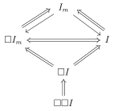
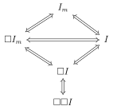

# Ruth Barcan Marcus
**First published Tue Mar 5, 2024**

*Ballarin, Roberta*

Ruth Barcan Marcus (1921–2012) was one of the most influential philosophers of the second half of the twentieth century. Her first 1946 publication contains the first published construction of formal systems of quantified modal logic.[^note-1] Her pioneering formal work in quantified modal logic contributed crucially to the initial development of the intensional logics. It also helped to lay the foundation for the inception and blossoming of modal metaphysics, a fertile field of inquiry to which she also made substantial philosophical contributions. Marcus’s influential philosophical work extends beyond logic and metaphysics. She has published significant work in epistemology, on belief and rationality, and in ethics, on moral dilemmas and deontic logic, and has contributed to Spinozian and Russellian scholarship. Her philosophical views—about language, essentialism, belief, and moral dilemmas—are deeply naturalistic and eschew rationalistic idealizations.

Barcan Marcus was an actively engaged and authoritative participant in some of the main and most-heated philosophical debates taking place from the 1950s to the end of the last century. In the fifties and sixties, in formidable opposition to Quine, she crucially contributed to establishing the legitimacy of modal logic and thus of modal metaphysics. Her work bridges two very different philosophical eras and paves the way for the philosophical revolutions, in philosophy of language and metaphysics, of the seventies. As a rare female logician and philosopher, and of a rare caliber too, she was also a pioneer academic, an active participant in the life of the profession, determined to reform and improve its institutions.

This entry focuses on Ruth Barcan Marcus’s key contributions to formal logic, metaphysics, epistemology and ethics. It engages with the controversies in which she was involved only insofar as they are relevant to her philosophical development. In this entry Ruth Barcan Marcus is sometimes called Barcan, sometimes Marcus, and sometimes Barcan Marcus, mainly according to the temporal context, in a way that should sound natural and generate no confusion.

## 1. Life

The main written source of information on Ruth Barcan Marcus’s personal and professional life is her Dewey Lecture “A Philosopher’s Calling” delivered at the Eastern APA meeting on December 29, 2009 (Marcus 2010).

Marcus was born Ruth Charlotte Barcan in New York on August 2, 1921 to secular Jews of Eastern European descent. The third of three daughters, she grew up in the Bronx in an activist socialist household. She describes 1930 as a catastrophic year when her father died in the midst of the Great Depression, leaving the now all-female family in economic and emotional distress but also freer to follow unconventional paths. Marcus emerges from her own recollection as a vivacious, unruly, athletic and intelligent child with a voracious appetite for knowledge. After high-school, she enrolled at New York University, instead of attending a college for women as expected. At NYU she majored in philosophy and mathematics. Of her teachers at the time, the most influential was J.C.C. McKinsey who, clearly aware of her talent, tutored her in advanced mathematical logic. She developed an interest in C.I. Lewis’s modal systems, and McKinsey advised her to continue her studies at Yale under the supervision of F.B. Fitch. She started Yale’s graduate program in 1942 and received her PhD in 1946. At Yale, she met her future husband, Jules A. Marcus, at the time a graduate student in physics who was, like her, an accomplished fencer. They married in 1942, had four children, and divorced in 1976. At the time Yale accepted women in its graduate school but not as undergraduates. Marcus recollects the paradoxical situation of female graders prohibited from entering the classrooms for the undergraduate courses they assisted, and the embarrassment of a library room accessible only to men. In this discriminatory environment she was nonetheless elected president of the philosophy students’ club. She reports receiving a letter from the chair of the department suggesting that she decline as well as having to work around the logistic difficulties she faced as female president of an association used to meeting in a location closed to women. Her attitude in the face of such difficulties seems to have been one of healthy disregard. Marcus completed her dissertation *A Strict Functional Calculus* in 1946, and that same year she started publishing parts of it as articles in the *Journal of Symbolic Logic*, under Alonzo Church’s editorship.

Starting in 1944 Marcus followed her husband who pursued his academic career as a physicist. In 1947 they moved to Chicago where she held a post-doctoral fellowship from the American Association of University Women and took the opportunity to study with Rudolf Carnap, who in those years was also working on the modalities and quantification. In 1949 her husband was hired at Northwestern University and they moved to Evanston. Marcus reports that at the time Northwestern University had an anti-nepotism policy excluding the regular appointment of faculty spouses and that for some years she did not seek a regular full-time academic position. She held instead various part-time and visiting positions, while continuing to work on intensionality and the interpretation of modal languages. In 1953 she received a Guggenheim Fellowship. Beyond Carnap, Marcus recollects philosophically fruitful exchanges with Leonard Linsky at Chicago University, as well as David Kaplan who visited Chicago in those years, and Arthur Prior whose seminar she attended in 1961. That same year, she presented the paper “Modalities and Intensional Languages” at the Boston Colloquium in Philosophy of Science, followed by a discussion with Quine, Kripke, Føllesdal and McCarthy. In 1962 she presented a paper on sets and attributes at the famed Helsinki “Colloquium on Modal and Many-Valued Logics”. In 1964, the University of Illinois opened its Chicago campus, and Marcus was hired to chair its new department of philosophy. For six years, she played a leading role in building a strong graduate department. From 1970 to 1973 she was a professor at Northwestern University.

In 1973 Marcus agreed to join and help rebuild the Yale philosophy department, a department she describes as unsettled and uneven, but also as her academic home, a home she never left despite flattering competing offers and much travel for temporary positions at other institutions. Marcus had by now built a distinguished philosophical reputation as a leading figure in her field. Throughout the rest of her career she received numerous awards, fellowships, and honors, like the Medal of the Collège de France in 1986, an honorary doctorate of humane letters by the University of Illinois in 1995, and the Yale Graduate School’s Wilbur Cross Medal in 2000. She was the first recipient of the APA Quinn Prize for service to the profession in 2007, and the first female recipient of the Lauener Prize for an Outstanding Ouevre in Analytical Philosophy in 2008. Marcus retired from Yale in 1992, but remained active in the profession and held a regular one-term-per-year Distinguished Visiting Professor position at the University of California, Irvine. Aside from the crucial roles she played in building the philosophy departments of the University of Illinois Chicago and Yale, throughout her career Marcus was committed to service to the profession. Notably, starting in 1961 she served for fifteen years in the American Philosophical Association, first as secretary and then president of its Central Division, and finally as chair of its National Board of Officers (1977–1983). She was also vice president (1980–83) and president (1983–86) of the Association of Symbolic Logic. She died in New Haven on February 19, 2012.

In her Dewey Lecture Marcus recollects fondly the joy of teaching to undergraduates, some of whom, like some of her graduate students, went on to distinguished philosophical careers. Concerning her philosophical style, she describes herself as a philosopher not drawn to big philosophical questions, but driven instead by “common sense observations, couched in our common, ordinary language”. Unfond of philosophical labels, she found herself naturally inclined to naturalistic views. Despite her active academic life, her collegial attitude and her many philosophical friendships, she ultimately regarded herself as “essentially a loner” who was “not driven to publish” unless she thought she had something useful, interesting and clear to say.

On Marcus’s life and work, see also Marcus 1993: ix–xi, Lauener 1999: 173–177, Marcus 2005 which contains an interview on Marcus’s formal work, Hull 2013, Williamson 2013a, and Frauchiger 2015 which contains a biographical proem by Frauchiger, a *Laudatio* by Williamson and an interview with Marcus. Cresswell 2001 is a brief summary of the main topics of Marcus’s philosophy.

*Note*: For the remainder of the entry, at the beginning of each section (or subsection), Marcus’s papers most relevant to the topic of the section are listed. This does not imply that Marcus treated that topic exclusively in those papers. On the contrary, throughout her published work Marcus often returns to the central, interconnected themes of her philosophy.

This entry examines Barcan Marcus’s work mostly as originally published. It does not scrupulously track later revisions and does not attempt to reconstruct whether those revisions simply clarify or marginally alter the original points.

## 2. Early Formal Work

This section surveys Marcus’s early formal papers, published from 1946 to 1953 in *The Journal of Symbolic Logic*, and examines two of their key results: the proofs of the deduction theorem for S4 and of the necessity of identity. The most relevant papers are: “A Functional Calculus of First Order Based on Strict Implication” (1946a), “The Deduction Theorem in a Functional Calculus of First Order Based on Strict Implication” (1946b), “The Identity of Individuals in a Strict Functional Calculus of Second Order” (1947) and “Strict Implication, Deducibility and the Deduction Theorem” (1953). This is the most technical section of the entry, and may be skipped by readers who are less concerned with Marcus’s achievements in modal logic.

### 2.1 Quantified Modal Logic

1946 was a good year for modal logic. Barcan’s “A Functional Calculus of First Order Based on Strict Implication” appeared in the first issue of the 1946 volume of *The Journal of Symbolic Logic*, soon followed by Carnap’s “Modalities and Quantification” in the second, and Barcan’s “The Deduction Theorem in a Functional Calculus of First Order Based on Strict Implication” in the fourth. Barcan’s first paper extends the propositional system S2, which C.I. Lewis had singled out as the best system for formalizing the notion of deduction in the object language (Appendix of Lewis & Langford 1932)[^lewis-1932].

For the propositional part, Barcan follows exactly Lewis’s axiomatization of the system, which she supplements with axioms and rules for quantification. Most of the axioms are versions of standard propositional and quantified axioms, but formulated for strict instead of material implication.[^note-2]

Barcan uses Greek letters in the metalanguage: upper case Greek letters represent well-formed formulas (wff’s) and lower case Greek letters represent (individual, propositional and functional) variables. Axioms are given as schemata, thus eliminating the need for Lewis’s rule of uniform substitution. Negation, conjunction, the existential quantifier and the possibility operator (the diamond $\modalD$) are taken as primitive. Disjunction, material implication (the conditional), material equivalence (the biconditional), the universal quantifier and the necessity operator (the box $\modalB$) are defined in their terms. $(A \Rightarrow B)$ is defined as $\nsim\modalD (A \land \nsim B)$, which is equivalent to $\modalB (A \rightarrow B)$.

*Barcan’s 1946 Quantified S2 System*

- *Axiom Schemata*
- $(A\land B)\Rightarrow(B\land A)$
- $(A\land B)\Rightarrow A$
- $A \Rightarrow (A \land A)$
- $((A\land B) \land \Gamma) \Rightarrow (A\land (B \land \Gamma))$
- $((A\Rightarrow B) \land (B\Rightarrow \Gamma)) \Rightarrow (A\Rightarrow \Gamma)$
- $((A\land (A\Rightarrow B) )\Rightarrow B$
- $\modalD (A\land B) \Rightarrow \modalD A$
- $(\forall \alpha) A \Rightarrow B$, where *α* and *β* are individual variables, no free occurrence of *α* in $A$ is in a wf’d part of $A$ of the form $(\forall \beta)\Gamma$ and $B$ results from the substitution of *β* for all free occurrences of *α* in $A$.
- $(\forall \alpha) (A \rightarrow B) \Rightarrow ((\forall \alpha) A \rightarrow (\forall \alpha B))$
- $A \Rightarrow (\forall \alpha) A$, where *α* is not free in $A$.
- $\modalD (\exists \alpha)A \Rightarrow (\exists\alpha)\modalD A$
- *Rules of Inference*
- Modus Ponens for $\Rightarrow$: from $A$ and $(A \Rightarrow B)$ infer $B$.
- Adjunction: from $A$ and $B$ infer $(A \land B)$.
- Substitution of Strict Equivalents: if $$(\forall\alpha_1)(\forall\alpha_2) \ldots (\forall\alpha_n) (\Gamma\Leftrightarrow E)$$ (where $\alpha_1$, $\alpha_2$, …, $\alpha_n$ are all the free variables in *Γ* and $E$) and $B$ results from $A$ by substituting $E$ for one or more occurrences of *Γ* in $A$, then infer $A$ from $B$ and $B$ from $A$.
- Generalization: if $B$ is the result of substituting the individual variable *β* for all free occurrences of *α* in $A$, then infer $(\forall\beta)B$ from $A$.

Though formulated for strict implication ($\Rightarrow$), most axioms, as well as the rules, are standard for non-modal systems. The purely modal additions are Axiom 7, the so-called consistency axiom characteristic of S2, and Axiom 11, the Barcan formula, as Prior will later dub it (1956: 60).

The rest of the paper proceeds purely syntactically. Among other results, Barcan proves the converse of the Barcan formula:

$$\tag*{37.} \vdash (\exists\alpha)\modalD A \Rightarrow \modalD (\exists\alpha)A $$

System S2 is not strong enough to prove BF, which is thus assumed as an axiom. In these early papers, Barcan does not discuss the semantic significance of the Barcan formula (BF) and its converse (CBF).

The paper ends with a brief discussion of the stronger system S4 which extends S2 by the addition of its characteristic axiom $\vdash\modalD\modalD A \Rightarrow \modalD A$ (axiom 4 in current terminology) equivalent to $\vdash\modalB A \Rightarrow \modalB\modalB A$, and includes the proof of a key theorem (XIX\*) which together with axiom 4 will be employed to prove the deduction theorem for S4.

### 2.2 Deducibility and the Deduction Theorem

In her second 1946 paper, “The Deduction Theorem in a Functional Calculus of First Order Based on Strict Implication”, Barcan proves that the deduction theorem fails for S2 both for material and for strict implication. She proves this for the quantified system S2¹, but her result holds already for propositional S2, and is independent from quantification.

The deduction theorem holds for a system S if whenever $A_1, A_2, \ldots , A_n \vdash B$ holds for S, so does $A_1, A_2, \ldots , A_{n-1} \vdash A_n \rightarrow B$, and *vice versa*. Marcus’s focus is on the left-to-right direction (explicitly stated here). The deduction theorem is standardly stated for the material conditional, but in her papers Marcus is chiefly concerned with the deduction theorem for the strict conditional, that is, whether in her modal systems it is the case that given $A_1, A_2, \ldots , A_n \vdash B$, then $A_1, A_2, \ldots , A_{n-1} \vdash A_n \Rightarrow B$ also holds. Her interest in the theorem is not proof-theoretical, i.e., it is not related to conditional derivations, which the deduction theorem justifies, and the possibility of devising natural deduction systems for modal logics. Rather, her focus is on the interpretation of strict implication. On the history and significance of the deduction theorem, see Franks 2021; on the deduction theorem in modal logic, see Hakli and Negri 2012; on natural deduction for modal logic see Fitch 1952: ch. 3; Fitting 2007; Zeman (1973: 197)[^zeman-1973] is critical of the whole idea of a deduction theorem for the strict conditional.

Barcan’s proof that the deduction theorem does not hold for S2 employs a matrix by Parry (1934)[^parry-1934] which satisfies all the axioms and rules of S2, but not the characteristic axiom of S3:

$$\vdash (A \Rightarrow B) \Rightarrow (\modalB A \Rightarrow \modalB B).$$

Parry’s result establishes that S3 is a stronger system than S2. Barcan points out that it also establishes that the deduction theorem fails for S2, given that in S2 the following holds:

$$(A \Rightarrow B) \vdash (\modalB A \Rightarrow \modalB B);$$

but

$$\vdash (A \Rightarrow B) \Rightarrow (\modalB A \Rightarrow \modalB B)$$

does not hold.

The failure of the deduction theorem for S2 means that for some formulas $A_1$, $A_2$, …, $A_n$ and $B$, (1) holds, but neither (2) nor (3) does:

$$ \begin{align} A_1, A_2, \ldots , A_n & \vdash B\label{eq1}\\ A_1, A_2, \ldots , A_{n-1} & \vdash A_n \rightarrow B\label{eq2}\\ A_1, A_2, \ldots , A_{n-1} & \vdash A_n \Rightarrow B.\label{eq3}\\ \end{align} $$

For S4 (S4¹) instead, Barcan proves the full deduction theorem for the material conditional, i.e., for S4 (2) holds whenever (1) does.

For the strict conditional, Barcan proves the following restricted deduction theorem for S4:

XXIX\*.

If $A_1, A_2, \ldots , A_n \vdash B$ and if $$\begin{align*} \vdash A_1 & \Leftrightarrow \modalB\Gamma_1,\\ \vdash A_2 & \Leftrightarrow \modalB\Gamma_2,\\ &\;\;\vdots\\ \vdash A_n &\Leftrightarrow \modalB\Gamma_n,\\ \end{align*}$$ then $A_1, A_2, \ldots , A_{n-1} \vdash A_n \Rightarrow B$.

Thus, Barcan concludes that the proof of the deduction theorem for strict implication goes through only for arguments whose premises are provably equivalent to necessities.

In her 1953 paper “Strict Implication, Deducibility and the Deduction Theorem” Barcan focuses exclusively on S4 and distinguishes three forms of the deduction theorem for any notion $\notionI$ of implication, including the material and strict conditional:

**I.**

If $A_1, A_2, \ldots , A_n \vdash B$ then $A_1, A_2, \ldots , A_{n-1} \vdash A_n \notionI B$

**II.**

If $A_1, A_2, \ldots , A_n \vdash B$ then $\vdash (A_1\land A_2 \land \ldots \land A_{n-1} \land A_n) \notionI B$

**III.**

If $A_1\vdash B$ then $\vdash A_1 \notionI B$

In 1946 her focus was just on theorem I. She now proves that II and III hold unrestrictedly for strict implication too, that is, they hold even from premises that are not provably equivalent to necessities. The stronger form of the deduction theorem I instead cannot be similarly proved and the restriction to necessary premises remains in place.

In her 1953 paper, Barcan also discusses interpretative questions. In these early papers she, like Lewis, interprets modal systems as designed to represent and formalize a system-independent, proof-theoretic notion of deducibility or entailment. Strict implication ($\Rightarrow$) represents this target notion. In the formal systems, the notion of consistency, represented by the $\modalD$ sign, is taken as primitive, and strict implication is defined in its terms: if $(A \land \nsim B)$ is inconsistent, i.e., $\neg\modalD (A \land \nsim B)$, then $A$ strictly implies $B$, i.e., $(A\Rightarrow B)$. Necessity is similarly defined in terms of (in)consistency: if $\nsim A$ is inconsistent, i.e., $\nsim\modalD\nsim A$, then $A$ is necessary, i.e., $\modalB A$. The interpretative focus on strict implication as deducibility explains why Lewis and Barcan did not set apart the non-modal base from the modal part of the systems, given that deducibility—the notion the systems aim to formalize—is represented as strict implication, which is not defined in terms of material implication. It also explains the focus on the weaker non-normal systems.

In contrast, in his 1946 paper developing a system of quantified modal logic Carnap starts by briefly mentioning that $\necessityN p$ (where “N” is the necessity operator) can be defined in terms of Lewis’s $\modalD$, but then immediately proceeds to define all the logical modalities in terms of N and clearly takes the idea of logical necessity as the fundamental one also from an interpretative point of view. Carnap also distinguishes the propositional and the functional calculus from the modal calculi “constructed by the addition of ‘N’” (1946: 33). This interpretative concern leads Carnap to focus on S5 and propels his formal semantics. It is fair to say that Barcan and Carnap developed independently the first quantified systems of modal logic in the early 1940s, but at the time Barcan’s focus was syntactical and her first published philosophical considerations (in 1953) were still driven by Lewis’s interpretative concerns about deducibility, itself a syntactic notion. However, in later work Barcan underlines also Lewis’s informal interpretation of the modalities in terms of possible worlds (see 1968: 88; 1981b: 279; 1990a: 232; and Frauchiger 2015: 149–150)[^frauchiger-2015].

The 1953 paper challenges Lewis’s claim that S2 is the right system to represent deducibility. Lewis had argued that S3 was too strong and settled on S2. Barcan instead claims that the correct system must be such that at least some form of the deduction theorem for strict implication holds for it. Thus, to be adequate a system must be at least as strong as S4. In fact, only a normal system with the rule of necessitation will have the strength to prove some version of the deduction theorem for the strict conditional. However, Barcan does not elaborate on why she thinks that the deduction theorem must hold if deducibility is to be properly represented.

### 2.3 The Necessity of Identity

In the third paper derived from her dissertation, “The Identity of Individuals in a Strict Functional Calculus of Second Order” (1947), Barcan proves a series of results concerning the necessity of identity in S2² and S4², the second order extensions of S2¹ and S4¹.

The paper starts by extending the previous systems by allowing the quantifiers to bind propositional and first-order functional variables. Definitions, axioms and rules are correspondingly extended. The abstraction operator $\hat{}$ is introduced to abstract terms for properties and relations from formulas, with this axiom:

**$2.3$**

$\hat\alpha_1\hat\alpha_2 \ldots \hat\alpha_n A(\beta_1\beta_2 \ldots \beta_n) \Leftrightarrow B$ where $\alpha_1$, $\alpha_2$, …, $\alpha_n$ are distinct individual variables occurring freely in $A$, no free occurrence of $\alpha_m (1\leqq m \leqq n)$ in $A$ is in a wf part of $A$ of the form $(\beta_m)\Gamma$, and $B$ results from $A$ by replacing all free occurrences of $\alpha_1$ by $\beta_1$, all free occurrences of $\alpha_2$ by $\beta_2$, …, all free occurrences of $\alpha_n$ by $\beta_n$ in $A$. (1947: 13)

If $A$ and $B$ are as in 2.3, $\hat\alpha_1\hat\alpha_2 \ldots \hat\alpha_n A$ is the abstract of $B$. For example, starting from a formula $A\beta$ (corresponding to $B$ in 2.3), $\hat\alpha A\alpha$ is its abstract, and $\hat\alpha A\alpha(\beta)$ is strictly equivalent to $A\beta$.

Barcan introduces two identity relations (and their negations), material identity and unqualified identity, defined as follows in terms of indiscernibility:

$$ \begin{align*} \mID &=_{\df} \hat\alpha_1\hat\alpha_2 (\forall \theta)(\theta(\hat\alpha_1)\rightarrow \theta(\hat\alpha_2))\\ \uID & =_{\df} \hat\alpha_1\hat\alpha_2 (\forall \theta)(\theta(\hat\alpha_1)\Rightarrow \theta(\hat\alpha_2)).\\ \end{align*}$$

From which the following theorems follow:[^note-3]

$$\vdash\beta_1\mID\beta_2 \Leftrightarrow (\forall \theta) (\theta(\beta_1)\leftrightarrow\theta(\beta_2))$$

and

$$\tag*{2.5} \vdash\beta_1\uID\beta_2 \Leftrightarrow (\forall \theta) (\theta(\beta_1)\Leftrightarrow\theta(\beta_2)). \label{th2.5}$$

So, by definition an object $\beta_2$ is materially identical to $\beta_1$ just in case it has all the properties of $\beta_1$; and $\beta_2$ is identical to $\beta_1$ just in case for any property of $\beta_1$ it is necessary that $\beta_2$ bears it too.[^note-4] From this it follows, given symmetry, that material identity consists in actually sharing all properties and identity consists in necessarily sharing all properties. Various other theorems are stated without proof, including the reflexivity, symmetry and transitivity of both material identity and identity.

The following are the S2² results pertaining to (the necessity of) identity and material identity proved or stated by Barcan.

$$ \begin{align} \tag*{2.6} \vdash \beta \uID \beta\label{th2.6}\\ \tag*{2.18} \vdash \beta \mID \beta\label{th2.18}\\ \tag*{2.24} \vdash \modalB (\beta \mID \beta)\label{th2.24}\\ \end{align} $$

Barcan does not take identity as primitive, so neither \\ref{th2.6} nor \\ref{th2.18} are axioms. The proof of \\ref{th2.6} must clearly start from $\vdash (\Phi \beta \Leftrightarrow \Phi \beta)$ (recall that Barcan’s systems are axiomatized for strict implication) and make use of second-order universal generalization and of theorem \\ref{th2.5}. \\ref{th2.18} can be similarly derived but using also $\vdash (\modalB A \Rightarrow A)$ (a theorem of S2 for Barcan, now standardly assumed as axiom T) to get $\vdash (\Phi \beta \leftrightarrow \Phi \beta)$. Finally, \\ref{th2.24} can be derived from \\ref{th2.6} using this instance of the second-order Barcan formula (not by necessitation of \\ref{th2.18} as necessitation is not a valid S2 rule):

$$\vdash (\forall \theta) \modalB (\theta(\beta)\rightarrow\theta(\beta)) \Rightarrow \modalB (\forall \theta) (\theta(\beta)\rightarrow\theta(\beta).$$

Recall that $(\forall \theta) \modalB (\theta(\beta)\rightarrow\theta(\beta))$ is none but $(\forall \theta) (\theta(\beta)\Rightarrow\theta(\beta))$, the definiens of (strict) identity. The consequent is the necessitation of the definiens of material identity. Barcan states without proof these ‘unexciting’ results. She doesn’t even prove the strict equivalence of identity to the necessity of material identity:

$$\tag*{2.23} \vdash \modalB (\beta_1 \mID \beta_2) \Leftrightarrow \beta_1 \uID \beta_2\label{ex2.23}$$

as its proof clearly depends just on the second-order BF and CBF, given that by definition $\modalB (\beta_1 \mID \beta_2)$ and $(\beta_1 \uID \beta_2)$ are equivalent to $\modalB (\forall \theta) (\theta(\beta_1)\leftrightarrow \theta(\beta_2))$ and $(\forall \theta) \modalB (\theta(\beta_1)\leftrightarrow\theta(\beta_2))$, respectively. So, by the second-order CBF (the left-to-right direction) if it is necessary that $\beta_1$ and $\beta_2$ are indiscernible, namely that they share all their properties, then it strictly follows that all properties are necessarily shared by them, i.e., no property can differentiate them. And by the second-order BF (the right-to-left direction) if no property can differentiate $\beta_1$ and $\beta_2$, then it strictly follows that they are necessarily indiscernible. This result is model-theoretically guaranteed if the second-order quantifiers range over an invariant domain of properties (and relations) assigned to all the worlds of a model.

This must have been Barcan’s assumed reading as it matches her reading of the first-order quantifiers (see section 6 of this entry) and is quite natural in the second-order case. On an alternative reading, assigning to each world its domain of properties and relations, the result holds if the world-relative domains are constant: in this case \\ref{ex2.23} can be read as stating the equivalence between the possibility that a property distinguishes $\beta_1$ and $\beta_2$ and some actual property possibly distinguishing them.

Barcan’s focus is on the more interesting result that identity can be proved to be equivalent to material identity (and not just to the necessity of material identity as in \\ref{ex2.23}). Their equivalence is material ($\leftrightarrow$) in S2² and strict ($\Leftrightarrow$) in S4² (1947: 15). The following is Barcan’s proof of the material equivalence of material identity and identity in S2².[^note-5]

$$\tag*{2.31} \vdash (\beta_1 \mID \beta_2) \leftrightarrow (\beta_1 \uID \beta_2)\label{ex2.31}$$

Proof:

1. $(\beta_1 \mID \beta_2) \rightarrow ((\beta_1 \uID \beta_1)\rightarrow (\beta_1 \uID \beta_2))$
2. $(\beta_1 \mID \beta_2) \rightarrow (\beta_1 \uID \beta_2)$
3. $(\beta_1 \uID \beta_2) \rightarrow (\beta_1 \mID \beta_2)$
4. $(\beta_1 \mID \beta_2) \leftrightarrow (\beta_1 \uID \beta_2)$

The first step of the proof follows from the definition of $\mID$. If $\beta_2$ is materially identical to $\beta_1$, it has all the properties of $\beta_1$. So, if one of $\beta_1$’s properties is to be strictly, that is, necessarily identical to $\beta_1$, i.e., $\hat\alpha(\beta_1 \uID \alpha)$, then $\beta_2$ has that property too. The abstraction axiom is also needed to transform expressions like $\hat\alpha(\beta_1 \uID \alpha)(\beta)$ into $(\beta_1 \uID \beta)$. Given \\ref{th2.6}, that is $\vdash \beta_1 \uID \beta_1$, step 2 follows from 1. Step 3 follows from $\vdash \modalB (\beta_1 \mID \beta_2) \Rightarrow (\beta_1 \mID \beta_2)$ and \\ref{ex2.23}, the equivalence of identity to the necessity of material identity: if the necessity of material identity strictly and so materially implies material identity so does identity, by substitutivity of equivalents. Step 4 combines 2 and 3.

The interesting part of the proof is the first two steps proving the left-to-right direction, where we move from the statement that $\beta_1$ and $\beta_2$ are actually indiscernible to their being necessarily indiscernible (as far as actual properties are concerned, if the domain of properties is world-relative). This direction is the one for which in S2² only the material conditional holds. Barcan’s proof of this result will inevitably remind us of Kripke’s proof of the necessity of identity in the opening pages of “Identity and Necessity” (1971). Barcan’s and Kripke’s proofs have a similar structure. We start with (some form of) identity between *x* and *y* implying their indiscernibility, and given that one of the properties of *x* is to be (in some sense) necessarily identical to *x* we conclude that *y* too bears that property. But there are differences too. Kripke’s starting point is primitive identity which implies indiscernibility (by Leibniz Law) but is not defined in its terms. So, Kripke derives the unqualified necessity of identity. Barcan’s starting point is material identity defined as indiscernibility, no property differentiates the two objects, from which it is derived that no property can differentiate them. Moreover, Kripke’s proof is not stated in terms of properties at all, rather necessary statements. Barcan’s is in terms of properties, though as referents of abstracts derived from formulas (on this point see Wiggins 1976a and 1976b)[^wiggins-1976a][^wiggins-1976b]. Also, as far as Barcan’s result is concerned, the objects may indeed still be two if *I* as defined is still not genuine identity, i.e., should necessary indiscernibility not suffice for identity.

Next, Barcan proves the following results which hold only in the stronger system S4²: the strict equivalence of identity and the necessity of identity (theorem \\ref{ex2.32}) and the strict equivalence of identity and material identity (theorem \\ref{ex2.33}).

Concerning the strict equivalence of identity and the necessity of identity, the proof makes use of the characteristic axiom of S4. Given the strict equivalence in S4 of $\modalB A$ and $\modalB\modalB A$, we have that the necessity of the necessity of material identity is strictly equivalent to the necessity of material identity $\vdash \modalB \modalB (\beta_1 \mID \beta_2)\Leftrightarrow\modalB(\beta_1 \mID \beta_2)$. And since the necessity of material identity is strictly equivalent to identity (theorem \\ref{ex2.23}) $(\beta_1 \uID \beta_2)$ can replace $\modalB (\beta_1 \mID \beta_2)$ in the above equivalence, resulting in:

$$\tag*{2.32*} \vdash \modalB (\beta_1 \uID \beta_2) \Leftrightarrow \beta_1 \uID \beta_2.\label{ex2.32}$$

Concerning the strict equivalence of identity and material identity:

$$\tag*{2.33*} \vdash (\beta_1 \mID \beta_2) \Leftrightarrow (\beta_1 \uID \beta_2)\label{ex2.33}$$

this is simply the necessitation of \\ref{ex2.31} and necessitation is a valid S4 rule, though Barcan does not appear to be aware of the validity of necessitation in 1947. She first mentions the rule with a reference to McKinsey and Tarski (1948) in her 1953 paper, when she uses it to extend her results on the deduction theorem for S4. So, her proof of \\ref{ex2.33} is more complex and starts similarly to her proof of \\ref{ex2.31}. For the hard left-to-right side, we start from

$$\vdash (\beta_1 \mID \beta_2) \Rightarrow ((\beta_1 \uID \beta_1)\rightarrow (\beta_1 \uID \beta_2))$$

from which, given $\vdash(\beta_1 \uID \beta_1)$, in S4 we can derive

$$\vdash ((\beta_1 \mID \beta_2) \land (\beta_1 \uID \beta_1))\Rightarrow(\beta_1 \uID \beta_2).$$

Then given $\vdash\modalB (\beta_1 \uID \beta_1)$, whose proof requires \\ref{ex2.32}, we can prove

$$\vdash (\beta_1 \mID \beta_2) \Rightarrow (\beta_1 \uID \beta_2).$$

From \\ref{ex2.32} and \\ref{ex2.33} it also follows that material identity is necessarily equivalent to the necessity of identity:

$$\vdash \modalB (\beta_1 \uID \beta_2) \Leftrightarrow \beta_1 \mID \beta_2.$$

Figures 1 and 2 graphically represent the results holding for S2² and S4² respectively.

*Figure 1:* Valid implications in S2²

*Figure 2:* Valid implications in S4²

To sum up, in 1947 Barcan proves that in S4² the material identity of two objects necessarily implies not just their strict identity and the necessity of their material identity, but also the necessity of their strict identity, because $(\forall \theta) (\theta(\beta_1)\leftrightarrow\theta(\beta_2))$ strictly implies $\modalB(\forall \theta) \modalB(\theta(\beta_1)\leftrightarrow\theta(\beta_2))$. This means that the actual indiscernibility of $\beta_1$ and $\beta_2$ implies the impossibility that any property might distinguish them.

It is unclear which of Barcan’s two main theorems, that material identity implies strict identity or that strict identity implies the necessity of strict identity, best deserves to be called the necessity of identity. The $\beta_1 \mID \beta_2$ to $\beta_1 \uID \beta_2$ implication moves from a non-modal notion to a modal one, yet the starting point, material identity, can hardly be regarded as identity. On the other hand, the $\beta_1 \uID \beta_2$ to $\modalB(\beta_1 \uID \beta_2)$ implication proves the necessity of a relation that has a stronger claim to be called identity, but that is already a form of necessity to start with, and hence requires axiom 4 to be established.

This however does not detract from the fact that Barcan’s proofs incorporate the key idea that given the indiscernibility of two objects, their modal profiles will also go hand in hand, so that necessary properties (including the necessary identity to one of them) will also be shared.[^note-6] Moreover, Barcan immediately understood her result to simply be the necessity of identity. For example already in her Review of Smullyan she states and makes use of the following results: “$N(\alpha = \alpha)$, $(\alpha = \beta)\Rightarrow(N(\alpha = \alpha)\rightarrow N(\alpha = \beta))$, $(\alpha = \beta)\Rightarrow N(\alpha = \beta)$” (1948: 150).

Burgess (2014)[^burgess-2014] emphasizes the differences between Barcan’s and Kripke’s proofs of the necessity of identity and argues that Kripke’s distinct proof may ultimately derive from Quine’s (1953b, 1953c, 1961)[^quine-1953b][^quine-1953c][^quine-1961] search for a simpler proof than Barcan’s. Kripke too attributes the simpler, more standard proof to Quine (2017a: 233, fn. 9).

## 3. The Dispute with Quine

Marcus’s papers most relevant to this section are: “Review of ‘Modality and Description’ by Arthur Francis Smullyan” (1948), “Modalities and Intensional Languages” (1961), “Discussion on the Paper of Ruth B. Marcus” (1962a), “Modal Logic” (1968), “Modal Logic, Modal Semantics and their Applications” (1981b), and “A Backward Look at Quine’s Animadversions on Modalities” (1990a).

Starting in the early sixties, Ruth Barcan Marcus’s work became focused on the interpretation of modal systems. Much of this work was in explicit opposition to what Marcus eventually called “Quine’s Animadversions on Modalities” (1990a). Quine (1946, 1947b and 1947c) had originally reviewed her first three papers, and the friction with Quine was probably triggered by his initial review of her 1947 paper on the identity of individuals in modal systems, of which he said:

> Two relations of “identity” between individuals are then defined. There is a weak one which holds between $x$ and $y$ wherever $(F)(Fx \rightarrow Fy)$, and a strong one which holds only where $(F) (Fx \Rightarrow Fy)$. Various theorems concerning the two kinds of identity are derived. *As is to be expected, only the strong kind of identity is subject to a law of substitutivity valid for all modal contexts.*
>
> *It should be noted that only the strong identity is therefore interpretable as identity in the ordinary sense of the word.* The system is accordingly best understood by reconstruing the so-called individuals as “individual concepts”. (Quine 1947c: 95–96, emphasis added)[^quine-1947c]

Marcus was justifiably unhappy with Quine’s failure to acknowledge that she had proved the equivalence of the two kinds of identity. The frustration is explicitly voiced in her 1960 paper “Extensionality”:

> I am not (as Quine insists in his review of two of my papers on quantified modal logic) proposing that there be more than one kind of identity, but only that the distinctions between stronger and weaker equivalences be made explicit before, for one avowed purpose or another, they are obliterated. (1960: 58)

Marcus voices her annoyance with Quine’s original review as late as her final, posthumously-published interview with Frauchiger (2015: 151)[^frauchiger-2015] despite Quine’s admittedly rather laconic correction more than fifty years earlier, of which this is the full text:

> Correction to the review XII 95(4). Through some lapse, or possibly the loss of a second proof sheet, the reviewer missed the last twenty lines of the paper. As a result the first two sentences of page 96 in the review are wrong. They should be supplanted by this: “It is shown that the strong and weak identity are actually coextensive; even strictly equivalent, on one choice of axioms”. (Quine 1958: 342)[^quine-1958]

The recanted two sentences are those emphasized in the previous quotation from Quine’s original review.

The rest of this section focuses on Marcus’s *philosophical* disputes with Quine, setting aside the misunderstandings and frustrations that at times accompanied the philosophical exchange. Yet, the existence of some friction with Quine and its apparent initial cause needed to be made explicit before, in Marcus’s own words, being obliterated for “one avowed purpose or another”—in our case a dispassionate examination of Marcus’s impressive achievements in philosophy. A reconstruction of the history of this particular initial misunderstanding on identity, plausibly caused by the loss of a proof sheet, can be found in Burgess (2014)[^burgess-2014]; Strassfeld (2022)[^strassfeld-2022] emphasizes the sociological and arguably gendered aspects of this impasse.

In her published work Marcus more than once voiced her overall disheartenment with Quine’s criticisms of the modalities, which she felt were like a moving target impossible to pin down. The mirror frustration that his most basic points did not come across is expressed by Quine (1961)[^quine-1961]. Still, Marcus often presents her views in explicit or implicit opposition to Quine’s and acknowledges that Quine’s “criticisms and the continuing debate were a catalyst for some of my subsequent work” (1993: x). Thus, some knowledge of Quine’s criticisms of the modalities is required in order to situate and better understand Marcus’s own thought which stands in systematic contraposition to Quine’s on a cluster of interrelated topics, mainly the fruitfulness of modal logic, the distinction between extensionality and intensionality, the semantics of proper names and quantifiers, the interpretation of the modalities and essentialism.

Quine first fully voiced his objections to intensional discourse in his 1943 “Notes on Existence and Necessity” where he pointed out that the law of substitutivity, according to which coreferential expressions are substitutable salva veritate, fails in these contexts. This is problematic as the law of substitutivity is the linguistic counterpart of the indisputable logico-metaphysical principle of the indiscernibility of identicals, according to which if *a* is the same as *b* and *a* is *F* then *b* is *F*. Indeed Quine identifies the two principles (1943: 113). Clear problematic contexts are quotations, where “‘Tully’ has 6 letters” does not follow from “Cicero = Tully” and “‘Cicero’ has 6 letters”; and epistemic contexts like “knows that” and “believes that”, where for example “Philip is unaware that Tully denounced Catiline” may be true even if “Philip is unaware that Cicero denounced Catiline” is false. To these contexts Quine adds modal contexts when the modalities are interpreted as analytic or logical. From the true statements “The number of planets = 9” and “9 is necessarily greater than 7”, understood as “‘9 is greater than 7’ is analytic”, the truth of “The number of planets is necessarily greater than 7” does not follow given that “The number of planets is greater than 7” is not an analytic statement.

Additionally, Quine regards quantification across intensional operators as meaningless. For example, assuming that the existential quantifier expresses existence—a given for Quine (1943: 116)[^quine-1943]—“$\exists x$ (Philip is unaware that $x$ denounced Catiline)” cannot be properly interpreted, for “What is this object, that denounced Catiline without Philip yet having become aware of the fact? Tully, i.e., Cicero?” (1943: 118). Quine claims that for quotations “this paradox resolves itself immediately. The fact is that [“‘Cicero’ contains six letters”] is not a statement about the person Cicero, but simply about the word ‘Cicero’” (1943: 114). Quotations induce a shift of reference, from the object to its name, thus substitutivity between expressions that refer to the same name, as well as quantification over names, can be reinstated. Quine however does not extend this kind of solution to the other problematic contexts, of which he says:

> The effect of these considerations is rather to raise questions than to answer them. The one important result is the recognition that any intensional mode of statement composition … must be carefully examined in relation to its susceptibility to quantification. (1943: 124–125)

For more details on Quine’s criticisms of modal logic, Marcus (1990a) offers her own historical reconstruction. See also Kaplan 1986, Fine 1990, Burgess 1997, Neale 2000, and Ballarin 2004, 2012, and 2021. On the Quine-Marcus debate see Janssen-Lauret 2016 and 2022.

Alonzo Church, in his 1943 review of Quine’s “Notes on Existence and Necessity”, pointed out the affinity of Quine’s opaque contexts to Frege’s oblique ones in “Sense and Reference” (1892 [1948]) and suggested a Fregean solution to Quine’s concerns, namely, a shift of reference: variables within an intensional context can be bound to quantifiers external to the intensional operator if they range over intensional entities, e.g., attributes rather than classes (1943: 46). Quine, though himself skeptical of intensions, came to accept the Fregean solution as adequate to reconcile the logico-analytic modalities with quantification, before eventually rejecting it as inadequate to the task. This explains Quine’s suggestion in his initial review of Barcan’s identity paper that her “system is … best understood by reconstruing the so-called individuals as individual ‘concepts’”.

Yet, Marcus never endorsed indirect, Fregean interpretations of the modalities, of which she said:

> The swelling of ontology was for Quine a *prima facie* ground for rejection. For me the ground for rejection was the systematic ambiguity. (1990a: 233)

And

> A forced Fregean shift relative to context would itself be a criticism and a sufficient deterrent. I took reference as univocal in and out of modal contexts. (1990a: 233)

Her work is embedded in the Russellian tradition and she strongly resists the claim that intensional entities are required to interpret modal discourse. In fact, Marcus immediately subscribed to Smullyan’s (1947 and 1948) claim that Quine’s problems of substitutivity in intensional contexts are spurious. When the singular terms are genuine proper names they can be substituted within intensional contexts too. When they are descriptions, the sentences in which they occur should be analyzed Russell’s way and there will be scope ambiguities. For example, “Necessarily 9 is greater than 7” is true and any other name of 9 can be replaced *salva veritate*. Yet, from it we cannot derive “Necessarily the number of planets is greater than 7” by substitution as “the number of planets” is not a name. Moreover, the analysis of this last statement uncovers two distinct readings: the true “There is a unique thing that numbers the planets and it is necessarily greater than 7” and the false “Necessarily there is a unique thing that numbers the planets and it is greater than 7”. This Russellian solution was anticipated, though not endorsed, by Church (1942)[^church-1942] and will be later endorsed by Fitch (1949)[^fitch-1949] too. Marcus claims:

> In the reviewer’s opinion, Smullyan is justified in his contention that the solution of Quine’s dilemma does not require any radical departure from a system such as that of *Principia Mathematica*. Indeed, since such a solution is available, it would seem to be an argument in favor of Russell’s method of introducing abstracts and descriptions. (1948: 150)

Prompted by Marcus herself, Quine eventually came to recognize this and finally stated:

> The system presented in Miss Barcan’s pioneer papers on quantified modal logic differed from the systems of Carnap and Church in imposing no special limitations on the values of variables. (1953b: 156)

However, he immediately added:

> That she was prepared, moreover, to accept the essentialist presuppositions seems rather hinted in her theorem:
>
> $$(x)(y) ((x=y)\rightarrow (\textit{necessarily} (x=y))),$$
>
> for this is as if to say that some at least (and in fact at most …) of the traits that determine an object do so necessarily. (1953b: 156)

The real problem for Quine is not substitutivity, of names or descriptions, but the interpretation of quantification across intensional operators. In the case of the modalities, the problem, he claims, is ontological and the result is Aristotelian essentialism. Section 4 of this entry analyzes Marcus’s views of intensionality, names, and quantifiers; section 5 discusses her interpretation of Aristotelian essentialism. We will see that on all these topics Marcus explicitly dissents from Quine. But before we do that, let us be clear on the very fundamental nature of their disagreement.

One of the few things on which Quine and Marcus agree is the value of formal logic, and they both oppose philosophers like Strawson who are skeptical of it. Yet, Marcus sharply criticizes Quine’s strictures against the development of formal systems beyond first-order logic, which he regards as philosophically unhelpful (Quine 1990)[^quine-1990]. These strictures weaken the position of the formal philosophers and are detrimental to philosophical progress. Of her own stand on logic, she says: “I for one have no aversion for any kind of logic” (1963b: 327).

In the opening section of her seminal 1961 paper “Modalities and Intensional Languages”—which anticipates many of her central insights on the modalities further developed in subsequent work—in open opposition to Quine’s defeatist attitude towards the new quantified modal systems, Marcus states:

> I do claim that modal logic is worthy of defense, for it is useful in connection with many interesting and important questions such as the analysis of causation, entailment, obligation and belief statements, to name only a few.
>
> If we insist on equating formal logic with strongly extensional functional calculi then Strawson is correct in saying that “the analytical equipment (of the formal logician) is inadequate for the dissection of most ordinary types of empirical statement”. (1961: 303)

This theme permeates also Marcus’s 1962 paper “Interpreting Quantification”.

Of Quine’s attitude towards opaque contexts, Marcus says:

> All such contexts are dumped indiscriminately onto a shelf labelled “referential opacity” or more precisely “contexts which confer referential opacity”, and are disposed of. But the contents of that shelf are of enormous interest to some of us and we would like to examine them in a systematic and formal manner. (1961: 306)

In “Modal Logic” (1968) and “Modal Logic, Modal Semantics and their Applications” (1981b), Marcus offers her own reconstruction of the development of modal logic from C.I. Lewis on. She also mentions the controversies that accompanied the early development of quantified modal logic (QML)—failure of substitutivity, problems with quantification, commitment to essentialism, an intensional ontology etc.—and sketches some replies. But most importantly, she always stresses her persuasion that the development of different systems of modal logic, and of formal semantics, is essential to philosophical progress on a cluster of topics. In her view, one of the primary motivations for the syntactic construction of modal systems “was to give a more systematic account of some intuitive conceptions of logical or more generally, metaphysical necessity and possibility” (1981b: 281); similarly for alternative interpretations of the operators: causal, temporal, epistemic, deontic, etc. Moreover, the formal semantics of these systems is essential to philosophical progress on these topics:

> The adequacy of such systems was generally tested against their intuitive acceptability when translated into ordinary language. How well for example did they fit “moral facts” or “epistemic facts”? The development of model theoretic semantics for modal logic provided a new perspicuous approach to the variant interpretations of the modalities. (1981b: 290)

Additionally, Marcus emphasizes that not just ordinary but also scientific languages employ natural-kind terms and thus seem to require “languages within which essentialist truths can be framed” (1981b: 285). In her mind, Quine is not only wrong about logic, he is wrong about (the alleged extensionality of) science too.

## 4. Intensionality, Ontology, Names and Quantifiers

### 4.1 Intensionality and Extensionality

Marcus’s papers most relevant to this subsection are: “Extensionality” (1960), “Modalities and Intensional Languages” (1961) and “Does the Principle of Substitutivity Rest on a Mistake?” (1975). Of marginal interest is also the short 1950 paper “The Elimination of Contextually Defined Predicates in a Modal System” where Marcus replies to Bergmann’s (1948: 141)[^bergmann-1948] claim that contextually defined predicates are not eliminable in non-extensional languages. In reply, Marcus shows that contextually defined predicates can be eliminated from modal languages if (i) we abandon the principle of extensionality that takes materially equivalent predicates to be identical, (ii) replace it with the intensional principle that the identity of predicates requires their necessary equivalence, and (iii) take definitions to give rise to necessary equivalences. She proves the result for the modal functional calculus of fourth order S4⁴.

According to Marcus, there is no absolute principle of extensionality, rather there are degrees of extensionality, and correspondingly of intensionality. A language or theory is extensional insofar as it reduces a stronger equivalence relation to a weaker one. For objects, this means reducing identity to some form of indiscernibility:

> Our notion of intensionality does not divide languages into mutually exclusive classes but rather orders them loosely as strongly or weakly intensional. A language is explicitly intensional to the degree to which it does not equate the identity relation with some weaker form of equivalence. (1961: 304)

Marcus holds that identity applies only to objects/things/individuals. However, “the identity relation does not *confer* thinghood” (1986b: 118). Things must exists before they can enter into any relation, including identity. Interestingly, in the 1960s Marcus uses the standard identity sign “=” for equality, and reserves “*I*” for identity. Classes and attributes instead may be equal (to a certain degree) but not identical:

> The concept of identity in *Principia* is systematically ambiguous not only as prescribed by the theory of types, but on the same type level. In the second order predicate calculus, “identity” means something different for classes than for attributes, and has still another import for individuals. My preference is for the alternative procedure of giving uniform meaning to “identity” and to talk of attributes and classes as being equal, but not identical. (1960: 58)

She additionally claims that a language confers “thinghood” to attributes, classes or propositions if it allows identity to hold between them (1961: 304).

Concerning identity, a theory is extensional to the degree to which it reduces it to some form of indiscernibility, either material or strict. A theory that reduces identity to material indiscernibility is more extensional than a theory that reduces identity to strict indiscernibility. Further reductions are possible too: a language with a limited stock of predicates may be unable to distinguish congruent objects or objects that weigh the same, etc. Additionally, the reduction of identity to a particular form of equivalence can be more or less strong. For example, the claim that if *x* and *y* are strictly indiscernible then they are identical is more or less strong according to the strength of the conditional, which can be interpreted as material, strict or even as metalinguistic. So, her own modal languages S2² and S4² were to a certain degree extensional insofar as they defined identity as strict indiscernibility. They were also more extensional than languages with epistemic operators, insofar as strictly equivalent expressions are intersubstitutable in modal but not epistemic contexts:

> [E]ven on the level of propositions, we cannot talk of the thesis of extensionality but only of stronger and weaker extensionality principles. I will call a principle extensional if it … directly or indirectly imposes restrictions on the possible values of the functional variables such that some intensional functions are prohibited … (1960: 56–57)

A language that explicitly excludes certain operators, e.g., epistemic, is directly extensional. Indirectly, languages are implicitly extensional according to the substitutivity theorems they endorse (1961: 306). For example, a language where truth-functionally equivalent sentences are intersubstitutable is more extensional than a language with contexts where truth-functional equivalence does not warrant substitutivity. The less strict substitutivity principle of the first language implies an exclusion of modal predicates. And in turn a language where strict equivalence warrants substitutivity is more extensional than a language with contexts where strictly equivalent expressions are not interchangeable, as it implicitly excludes epistemic predicates.

Of particular interest is not only Marcus’s endorsement of degrees of extensionality, but also her tendency to treat, so to speak, intensionality as the default position, to which principles of extensionality are added with their concomitant criteria: the reduction of identity to weaker (and weaker) forms of equivalence and the elimination of some predicates (epistemic or modal). The starting point after all is natural language in all its richness, and Marcus (1975) ties precise formulations of the principle of substitutivity to the search for the logical form of fragments of ordinary language. On this role for logic see also the opening paragraphs of “Quantification and Ontology” (1972).

### 4.2 Ontology: Individuals, Classes and Attributes

Marcus’s papers most relevant to this subsection are: “Classes and Attributes in Extended Modal Systems” (1963a), “Classes, Collections, and Individuals” (1974) and “Nominalism and the Substitutional Quantifier” (1978a).

According to Marcus, “that any language must countenance some entities as things would appear to be a precondition for language” (1961: 309). Though Marcus cannot be classified as a nominalist, given her endorsement of both classes and attributes, when it comes to individual things she has nominalistic leanings. She characterizes nominalism not just as insisting on only one category of “individuatable objects” but also as having an “empirical thrust”:

> The nominalist’s individuals are of a kind which can be confronted or in the least, make up such confrontable or encounterable individuals. They can, so to speak, put in an appearance. Encounterability by the mind’s eye is not generally counted in the spirit of nominalism. (1974: 352)

Insofar as she appears to be rejecting non-empirically-encounterable (basic) individuals, though accepting type theory, Marcus satisfies one of her criteria for nominalism. In “Nominalism and the Substitutional Quantifier” (1978a: 353–354) options for a nominalistic account of predicates are considered, but it is not clear that Marcus subscribes to them.

In “Classes and Attributes in Extended Modal Systems” Marcus develops a modal calculus for abstracts, where the abstracts can be indifferently taken to stand for classes or for attributes. This is not to be understood as a Fregean move, i.e., as the claim that in extensional non-modal contexts the abstracts may be taken to refer to classes (their extensions) while in modal contexts they must refer to attributes (their intensions). In fact in her earlier paper “Extensionality” we find the quite surprising statement:

> I am not disturbed by the possibility of equal, non-identical classes or attributes, e.g. man and featherless biped. To me it seems reasonable that there are many empty classes of the same type, e.g. mermaids and Greek gods, equal but not identical. (1960: 58–9)

Marcus distinguishes different meanings of the term “class”. In the first intuitive, “atavistic” sense classes are aggregates or collections of objects. This suggests the idea of finitely many objects physically gathered together and observable. The second, more abstract, mathematical notion of class does not presuppose finitude or physical proximity, and is tied to the idea that classes are determined by properties:

> Attendant to this way of looking at classes, is the assumption that every property or condition delimits a class; every class may be delimited by a property or condition; and if no object satisfies a property or condition, then it delimits the null class. (1963a: 129)

This second notion, claims Marcus, is closer to the notion of attribute, in contrast to the first extensional but quite limited interpretation. For Marcus the classical functional calculus (first-order logic) focuses on attributes, not on the too limited notion of classes as aggregates, and “the thesis of extensionality must be superimposed” (1963a: 130). Clearly, she is not considering a set-theoretic, non-limited, abstract, but non-predicative notion of class. Later, she will deem this last, logical conception of classes, to be useful in mathematics, but guilty of obliterating “the distinction between an itemization of elements and a statement of conditions for membership” (1974: 229). Clearly, this last set-theoretic conception—favored by Quine—is required to regard first-order logic as fully extensional. On the “extensionalization” of first-order logic see also 1986b: 116.

Marcus’s distinction between the itemized and predicative notions focuses on epistemic and linguistic rather than metaphysical features. She ties the notion of class, versus attribute, to the possibility of observing and listing its members by proper names. Such classes can be the referents of abstracts in modal contexts, and the abstracts will be intersubstitutable in such contexts too despite the extensional nature of their referents, similarly to the way in which proper names are so intersubstitutable while maintaining their ordinary referents. Indeed, the substitutibility of abstracts of the form “$\hat\alpha((\alpha I \mu_1)\vee (\alpha I \mu_2) \vee \ldots (\alpha I \mu_n))$ where $I$ names the identity relation, and $\mu_1$, $\mu_2$ … $\mu_n$ are individual constants” (1963: 131) follows from the intersubstitutivity of names in modal contexts. Attributes like $\hat\alpha(\alpha I \mu_1)$ (being identical to $\mu_1$) are not regarded as genuine predicative attributes.

In the later “Classes, Collections, and Individuals”—published in 1974 but completed in 1965—Marcus returns to the same topic. She now uses the term “assortment” for classes in the intuitive sense, reserving “class” for the attributive notion, and claims: “an equivalence relation between assortments is never contingent but an equivalence relation between classes may be” (1974: 230). Attributes, like *planet named after the goddess of beauty* and *planet between Mercury and Earth* may be accidentally coextensive. But *planet identical to Venus* and *planet identical to Evening Star* are necessarily coextensive. The necessity of the equivalence of assortments with the same members follows from the necessity of identity for objects; and the intersubstitutability in modal contexts of abstracts that list their members by name, rather than describing them via properties, follows from the intersubstitutivity of names.

### 4.3 Names

Marcus’s papers most relevant to this subsection are: “Modalities and Intensional Languages” (1961), “Discussion on the Paper of Ruth B. Marcus” (1962a), and “Review of *Names and Descriptions* by Leonard Linsky” (1978b).

One key theme of Marcus’s philosophy anticipated in “Modalities and Intensional Languages” is her famous classification of proper names as tags:

> This tag, a proper name, has no meaning. It simply tags. (1961: 310)

The contrast once again is with Quine (1948)[^quine-1948] who endorses, and actually radicalizes (insofar as he envisions non-descriptive descriptions like “the pegaziser”) Russell’s idea that the proper names of the natural languages—in contrast to logically proper names—abbreviate descriptions. We have seen how Russellian logically proper names were employed by Smullyan in reply to Quine’s problems of substitutivity. But Russellian logically proper names are not the ordinary names of natural languages.

One interesting, debated question is whether back in 1961 Marcus was already proposing, though not fully developing, the referential theory of *ordinary* proper names which will dominate analytic philosophy in the seventies, thanks to the work of Donnellan (1970)[^donnellan-1970], Kripke (1972)[^kripke-1972], and Kaplan on direct reference (1989, delivered 1977). The answer to this question seems to be neither an unqualified yes nor a simple no.

On the one hand, Marcus’s mention of ideal names and of making recourse to a dictionary seems to indicate that she is still, like Smullyan, thinking not of ordinary names, which are not defined in ordinary dictionaries, but of Russell’s logical ones. The use of Russellian names presupposes a special form of acquaintance with their referents that preserves the *a priori* status of necessarily true statements of the form “$a=b$”, in line with the logical and analytic interpretation of the modalities on which Quine, Smullyan and Marcus were focused at the time. If $a$ and $b$ are ideal Russellian names, then “$a=b$” is necessary but *a priori* too. Marcus is also thinking of logical constants, which belong to formal languages and do not have an ordinary interpretation in a natural language. Here are some expressions of the Russellian vein of Marcus’s view:

> We are here talking of proper names in the ideal sense, as tags and not descriptions. Presumably, if a single object had more than one tag, there would be a way of finding out such as having recourse to a dictionary or some analogous inquiry, which would resolve the question as to whether the two tags denote the same thing. (1962a: 142)

> And to discover that we have alternative proper names for the same object we turn to a lexicon, or, in the case of a formal language, to the meaning postulates. (1963a: 132)

A lexicon which does for names what meaning postulates do for constants can hardly be claimed to be the sort of biographical dictionary or encyclopedia of which Marcus speaks in later work (e.g., in 1980a: 503).

On the other hand, Marcus displays from the very beginning a very keen ear for ordinary languages and the changes to which they are subject:

> In fact it often happens, in a growing, changing language, that a descriptive phrase comes to be used as a proper name - an identifying tag - and the descriptive meaning is lost or ignored. Sometimes we use certain devices such as capitalization and dropping the definite article, to indicate the change in use. “The evening star” becomes “Evening Star”, “the morning star” becomes “Morning Star”, and they may come to be used as names for the same thing. (1962a: 139)

In fact, Marcus attributes to Russell himself a tendency to treat ordinary proper names as referential, despite his official doctrine, see for example “On Some Post-1920s Views of Russell” (1986a).

Given the bitter controversy that took place on these questions in the nineties (see Humphreys & Fetzer 1998, Holt 1996, and Neale 2001)[^holt-1996][^humphreys-1998][^neale-2001], it is worth quoting in full the balanced assessment of this issue offered by Marcus herself in 1978:

> I argued that unlike descriptions, ordinary proper names function like “tags;” that proper names are indifferent to scope in some contexts of indirect discourse where singular descriptions are not; that unlike different but coreferential descriptions, two proper names of the same object were intersubstitutable in modal contexts; that singular descriptions might sometimes be used as if they were proper names which can be measured by our use of the description to refer to the object whether or not the object had the defining properties; that such a shift, if institutionalized, could be marked syntactically by capitalization, *vide* “The Evening Star is not a star”. …
>
> What was lacking in 1961 was a theory within which such claims could be given a coherent account. How can an ordinary proper name used over time by a wide community of speakers, in the absence of opportunities for direct ostension, have a semantically noncircuitous route to its referent. How is it possible to properly name an object in its absence. How do we account for those “proper” names which have a common use and which do not refer, such as “Santa Claus”; …
>
> Kripke provided us with a “picture” which is far more coherent than what had been available. It preserves the crucial differences between names and descriptions implicit in the theory of descriptions. By distinguishing between fixing the meaning and fixing the reference, between rigid and nonrigid designators, many nagging puzzles find a solution. The causal or chain of communications theory of names (imperfect and rudimentary as it is) provides a plausible genetic account of how ordinary proper names can acquire unmediated referential use. (1978b: 502–503)

### 4.4 Quantifiers

Marcus’s papers most relevant to this subsection are: “Interpreting Quantification” (1962b), “Reply to Dr. Lambert” (1963b), “Quantification and Ontology” (1972) and “Nominalism and the Substitutional Quantifier” (1978a).

One of the major topics of Marcus’s philosophy is the interpretation of the quantifiers, and on this too she stands in stark opposition to Quine. The one thing on which they agree is that the interpretation of the quantifiers must be atemporal: “the operation of quantification is more fruitfully interpreted as independent of tense considerations” (1962b: 256). Quine had made the same point in 1953a. In 1962b Marcus appears to be joining Quine against Strawson (1952)[^strawson-1952] while arguing that her interpretation of the quantifiers is best equipped to dismiss Strawson’s challenges. Similarly, in response to objections moved by Martin (1962)[^martin-1962] against the suitability of logic to formalize ordinary philosophical discourse, based on the difficulty of clearly specifying the domain of quantification, she replies that in her substitutional interpretation of the quantifiers no such specification is needed (1963b: 326; 1972: 244–245).

According to the substitutional interpretation of the quantifiers, $(\exists x)Fx$ is true just in case a substitution instance of $Fx$ is true. Substitution instances of $Fx$ are formulas like $Fa$, $Fb$, etc. where $a$ and $b$, etc. are individual constants of the language. Similarly, $(\forall x)Fx$ is true just in case all substitution instances of $Fx$ are true. In the standard objectual or referential interpretation instead, $(\exists x)Fx$ is true just in case at least an element of the domain satisfies $Fx$ and $(\forall x)Fx$ is true just in case all elements of the domain satisfy $Fx$.

The substitutional account, which is found already in Russell and Whitehead’s *Principia Mathematica* (Marcus 1962b: 254), is preferred by Marcus chiefly because it separates questions of generality from questions of ontology, and in so doing it better represents ordinary uses of expressions of quantification in natural language. Moreover, being free of ontological commitments, it permits, so to speak, the existential generalization of empty names: from “A statue of Venus is in the Louvre” we can derive “$(\exists x)$ (a statue of $x$ is in the Louvre)” (1972: 245); a statue of Venus (the goddess) is after all a statue of something. The substitutional interpretation has also additional benefits: it bypasses Quine’s ontological concerns about quantification in and out of modal contexts, and it accommodates nominalistic inclinations thus allowing quantification to be extended to other syntactical categories (higher-order and propositional quantification) free of ontological commitments to properties or propositions—another qualm of Quine. In “Quantification and Ontology” Marcus contrasts substitutional interpretations of the quantifiers in modal logic not only to Fregean interpretations that require the domain of quantification to include intensions, but also to Kripke’s and Hintikka’s (1963)[^hintikka-1963] possible world semantics that associate alternative domains of quantification to merely possible worlds, thus encompassing merely possible entities (1972: 243).

Marcus dismisses the objection that if there are unnamed objects then the substitutional account of the quantifiers may verify a universal sentence like $(\forall x)Fx$ even if not all objects are $F$, as long all named objects are. This is inevitable for non-denumerable domains, given that the stock of names is denumerable. In her reply, she points out that this criticism has no bite against nominalists who are skeptical of non-denumerable collections to start with. She is speaking on behalf of the nominalist, so it remains unclear whether she shares the skepticism. More interestingly, referring to the downward Löwenhein-Skolem theorem, Marcus also claims that

> the fact that every *referential* first order language which has a nondenumerable model must have a denumerable one gives little advantage to the referential view. (1978a: 360)

Marcus’s point does not apply to second-order logic where the theorem fails, but her main referentialist opponent is Quine who recognizes only first-order logic as genuine. So, against him, the point seems well taken.

While Quine denied reference to proper names and made the (quantifiers and) variables play the role of referring to (a domain of) individuals, Marcus reverses the picture. It is the names that are referential, not the quantifiers:

> On a substitutional semantics of the same first order language, a domain of objects is not specified. Variables do not range over objects. They are place markers for substituends. Satisfaction relative to objects is not defined. Atomic sentences are assigned truth values. (1978b: 357)

The substitutional interpretation is for Marcus the default, general one. It is just in the specific case when the names in the substitution class for the quantifiers are genuinely referential that the quantifiers can be read ontologically or existentially, but the direct referential link is always played by the genuine, non-empty names (1978b: 358). On substitutional quantification see Dunn and Belnap 1968, Linsky 1972, and Kripke 1976.

## 5. Essentialism

Marcus’s papers most relevant to this section are: “Essentialism in Modal Logic” (1967) and “Essential Attribution” (1971).

### 5.1 Quantified Modal Logic and Essentialism

Quine’s ultimate criticism of quantified modal logic was its (alleged) commitment to Aristotelian essentialism, a world view that he rejected on philosophical grounds. Against Quine, Marcus argues that Quine’s characterization of Aristotelian essentialism is wrong, that modal logic is not committed to Aristotelian essentialism correctly understood, and that in any case Aristotelian essentialism is not to be rejected.

For Quine it seems that even the necessity of identity is an essentialist thesis insofar as it presupposes the meaningfulness of the distinction between necessary and non-necessary attributes (as opposed to truths). However, Marcus points out that Aristotelian essentialism is not simply the predication of *de re* necessities:

> What has gone wrong in recent discussions of essentialism is the assumption of surface synonymy between ‘is essentially’ and *de re* occurrences of ‘is necessarily’. (1971: 193)

This means that regardless of their *de dicto* (in front of a closed sentence) or *de re* (in front of a predicate or an open sentence) employment, different interpretations of the modal operators are possible. In her work, Marcus focuses on two such interpretations: logical necessity and natural (causal, nomological, physical) necessity.

Marcus argues that Quine’s characterization of Aristotelian essentialism is wrong because the *de re* predication of necessary attributes derived from logical or analytical necessities does not suffice for essentialism. Yet, somewhat incongruously, Marcus seems to be conceding something to Quine’s understanding of essentialism when, perhaps inadvertently, she will later state: “identity is an essential feature of things” (1986b: 118). In any case, Marcus defines a weak and a strong form of (alleged) essentialism in line with, and even stricter than, Quine’s understanding of essentialism.

According to weak essentialism (WE) there is some non-universal, necessary attribute $\hat{y}Ay$ that only some objects bear. According to strong essentialism (SE) some attribute applies to some objects necessarily and to others only contingently (1967: 93):

$$\tag{WE} (\exists x)(\exists z)(\modalB (x\in \hat{y}Ay) \land \neg\modalB (z\in \hat{y}Ay))$$ $$\tag{SE} (\exists x)(\exists z)(\modalB (x\in \hat{y}Ay) \land (z\in \hat{y}Ay)\land \neg\modalB (z\in \hat{y}Ay))$$

Both weak and strong essentialism can be proved in a system of QML like S5² with identity and abstracts, under the assumption that there are at least two individuals. Given that $a$ and $b$ are distinct objects, the property of being necessarily identical to $a$ applies to $a$ but not to $b$, i.e., the following holds: $\modalB (a\in \hat{y}(aIy))$ and $\neg\modalB (b\in \hat{y}(aIy))$ (1967: 94). This satisfies weak essentialism.

Strong essentialism is also provable under the assumption that there are two objects $a$ and $b$ such that $Fa$ and $\neg Fb$ hold (where $F$ is an atomic contingent predicate). In this case, the quite unnatural attribute of *being F or being such that b is not F*, namely, $\hat{y}(Fy\vee\neg Fb)$, this complex attribute holds necessarily of $b$ but only contingently of $a$, given that $(Fb\vee\neg Fb)$ is a logical truth, but $(Fa\vee\neg Fb)$ is just empirically true (1967: 95).

These however are benign forms of ‘essentialism’ which can be explained away as ultimately reducible to the necessity of universal attributes like $\hat{y}(yIy)$ and $\hat{y}(Fy\vee\neg Fy)$, which Marcus labels “vacuous” (1967: 94–95; 1971: 196), whose necessity is ultimately derived from the logical necessity or truth of closed sentences like $(\forall x)(xIx)$ and $(\forall x)(Fx\vee\neg Fx)$.[^note-7] Genuinely essentialist claims instead, like that Socrates is necessarily human, can surely be symbolized in modal systems, thus their logical relations to other claims can be more perspicuously represented, but are not theorems of any standard modal system. Parsons (1967 and 1969) further develops these arguments; Kaplan (1986)[^kaplan-1986] defends a similar position; see also Fine 1990 and Kripke 2017a and 2017b.

### 5.2 Genuine Aristotelian Essentialism

Genuine Aristotelian essentialism, claims Marcus, is sortal and general. Neither universal, tautological attributes (like self-identity) nor fully individuative predicates (like a full description down to uniqueness) are essential. Essential sortal attributes are properties like *man* or *mammal* which no object can have *per accidens*. Moreover, not all properties of an object are essential to it. Marcus proposes the following as a definition of Aristotelian essentialism (1971: 198): $$\tag{AE} (\forall x)(Fx\rightarrow\modalB Fx)\land (\exists x)(\modalB Fx \land Gx \land \neg\modalB Gx)\land (\exists x)\neg\modalB Fx$$ Marcus claims that Aristotelian essentialism is concerned with a form of natural necessity. Rather than being an obscure old metaphysical theory, as Quine thought, Aristotelian essentialism is presupposed by scientific discourse. Essential properties are dispositional properties that an object cannot cease to have without ceasing to exist. As an example she considers the case

1. of a sample $s$ of gold ($Gs$) which when immersed in aqua regia ($Rs$) will necessarily dissolve ($Ds$).

Reading the necessity as causal necessity, it follows that

1. being (a sample of) gold disposes $s$ to dissolve (if immersed) in aqua regia and that
2. being immersed in aqua regia causes (sample $s$ of) gold to dissolve.

Formally:

$$\tag{1} \modalB ((\textit{Gs} \land \textit{Rs})\rightarrow \textit{Ds})$$ $$\tag{2} \modalB (\textit{Gs}\rightarrow (\textit{Rs}\rightarrow \textit{Ds}))\label{ex5_2}$$ $$\tag{3} \modalB (\textit{Rs}\rightarrow (\textit{Gs}\rightarrow \textit{Ds}))\label{ex5_3}$$

However, from (\\ref{ex5_2}) it also follows that being immersed in aqua regia causes $s$, which is a piece of gold, to dissolve:

$$\tag{4} \modalB (\textit{Rs}\rightarrow \textit{Ds});\label{ex5_4}$$

but from (\\ref{ex5_3}) it does not follow that being a sample of gold causes $s$ to dissolve:

$$\tag{5} \neg \modalB (\textit{Gs}\rightarrow Ds).\label{ex5_5}$$

How so? The reason is that being gold is an essential property of $s$, $\modalB \textit{Gs}$, and from this and (\\ref{ex5_2}) the necessity of the consequent, i.e., (\\ref{ex5_4}), follows; but being immersed in aqua regia is not essential to $s$, $\neg\modalB \textit{Rs}$, hence the necessity of the consequent of (\\ref{ex5_3}) cannot be proved, and (\\ref{ex5_5}) holds. Thus, dissolving if put in aqua regia $\hat{y}(Ry\rightarrow Dy)$ is an essential property of gold; but dissolving if made of gold $\hat{y}(Gy\rightarrow Dy)$ is not an essential property of things immersed in aqua regia. There is no natural kind *things put in aqua regia* that might ground such a bizarre disposition (1971: 200–202). On Aristotelian essentialism see also Marcus 1975/76: 44–45.

## 6. Actualism and the Barcan Formula

Marcus’s papers most relevant to this subsection are: “Dispensing with Possibilia” (1975/76), “Possibilia and Possible Worlds” (1986b), “Barcan Formula” (1991) and “Are Possible, Non Actual Objects Real?” (1997).

In Barcan’s S2¹ and S4¹ 1946 systems the quantifiers and the modal operators interact in the most straightforward way (Deutsch 1994; Linsky & Zalta 1994)[^deutsch-1994][^linsky-1994]. The rules of the propositional modal systems and of predicate logic are just combined with no modification. For example, the proof of the converse Barcan formula:

$$\tag{CBF} (\exists\alpha)\modalD A \Rightarrow \modalD (\exists\alpha)A$$

starts from the first-order-logic theorem $\vdash A \Rightarrow (\exists\alpha)A$, to which it applies first a modal rule of propositional S2 (if $\vdash A \Rightarrow B$ then $\vdash \modalD A \Rightarrow \modalD B$) to derive $\vdash \modalD A \Rightarrow \modalD (\exists\alpha)A$, and then a standard first-order-logic rule to get the final result.

These systems are not strong enough to prove the Barcan formula:

$$\tag{BF} \modalD (\exists \alpha)A \Rightarrow (\exists\alpha)\modalD A$$

which is thus assumed as an axiom.

In a variable domain semantics, like in Kripke 1963, where each world is assigned its own domain of individuals—the individuals which are assumed to exist in that world—CBF is valid in models where the domains of the worlds possible relative to a given world *w* (accessible from *w*) do not diminish, that is, they contain all the individuals in the domain of *w*, and possibly more. Symmetrically, BF is valid in models where the domains of the worlds which are possible relative to a given world *w* do not grow, that is, they are subsets of *w*’s domain. Hence, the combination of the two formulas is valid when the world domains are constant. And clearly, both CBF and BF are valid in simpler semantics where one unique non-world-relative domain is associated to a model, as in Kripke 1959 and in the semantic construction used by Barcan Marcus to argue for BF (1961: 319–320).

The addition of BF as an axiom in her 1946 systems seems to indicate that Barcan found it a natural assumption.[^note-8] This might have been due to Barcan’s semantic preference for a unique domain and the philosophical predilection for actualism she explicitly expresses in her later work. Yet, if Barcan had semantic considerations in mind at this early stage in her work, they remained unvoiced. In the early papers, at least CBF appears to be a syntactically-driven result. Moreover, Barcan’s explicit interpretative considerations at the time have to do with strict implication interpreted as deducibility. Indeed, one may regard BF and CBF in Barcan’s early papers as BF and CBF for strict implication as deducibility. Only later, when the main philosophical debates around the interpretation of the modal systems moved away from implication and logical consistency towards necessity, first logical and then metaphysical, talk of possible worlds became widespread and the use of the $\Rightarrow$ operator became somewhat obsolete.

In her later work, Marcus strongly supports the Barcan formula based on philosophical considerations, and often states that her commitment to actualism is driven by a Russellian strong sense of reality which also “guided [her] original formalizations of quantified modal logic” to start with (1975/76: 42). In her view, the “modalities in their primary use concern counterfactuals about actual objects” (1986b: 114). Marcus interprets BF as expressing a commitment to actualism insofar as it seems to be saying that if no (actual) thing can be *F* then it is impossible that there be an *F*. Of BF and CBF she says:

> Interpreted semantically, that came to assigning the same domain of objects to every world in the structure. Since this world is one among them, the domain of each world was coextensive with this one. Nothing non-actual has been admitted. (1975/76: 42)

The rejection of merely possible entities (possibilia) is one of the few theses Marcus shares with Quine. However, she is very critical of Quine’s (1948)[^quine-1948] arguments against possibilia. Her main dissatisfaction is with Quine’s claim that merely possible objects lack clear criteria of individuation. She interprets this claim as fundamentally epistemological, rather than metaphysical, and in any case indecisive given that actual objects too may lack identity (identification) criteria (1986b: 118). For her instead the fact is simply that these putative objects do not exist: “It is not the absence of criteria that makes us dubious. It is rather that what is absent is the individual” (1986b: 127). At times her arguments against possibilia are mixed with linguistic considerations, suggesting that both the existence of a material object and its nameability require that it be reachable by ostension, namely, empirically encounterable.

Marcus concedes that there are two reasons to favor possibilia. The first is the intuitive plausibility of the claim that there might have been more, or different, objects than there actually are (1975/76: 43); the second is that there are some plausible candidates. These are those possibilia that are embedded in the history of the actual world, like a half-built house or an alternative chess move that was not taken (a particular event). Even them however are eventually rejected:

> These are on the threshold of being candidates for ostension since we can trace a relevant partial history. But finally, they have no location in the actual order. (1997: 255)

See also 1975/76: 46.

Marcus is somewhat critical of Kripke’s variable domain semantics:

> Although in setting up his quantificational structures, Kripke singled out the actual world as worthy of special designation among alternatives, his syntax and semantics are as I will suggest too impoverished to make any use of that special role. (1986b: 113)

This is quite a bold claim that is hard to support, especially considering how Kripke (1965)[^kripke-1965] gives a special role to the actual world in the semantics of non-normal systems. Her more specific concern seems to be that variable domains open the door to possibilia, non-ostensible entities that are nonetheless assigned to variables. Moreover, these formal assignments fall short of the actual way in which natural-language names are given to actual objects. Her own substitutional account of the quantifiers mitigates these concerns, and affords us the possibility of combining a variable-domain semantics with a rejection of possibilia, since in the substitutional interpretation the quantifiers are associated to world-relative stocks of names available for substitution, not to domains of individuals. Nonetheless, for the actual world the quantifiers can be given an objectual reading:

> Indeed we can reintroduce full fledged reference by associating a domain of objects with the actual world and view our quantifiers as mixed; referential for this world and substitutional otherwise. We can thus dispense with the artifice of domains of possibilia. (1975/76: 47)

On the BF see Parsons 1995; on BF and the possible worlds model theory see Williamson 2013b: Chapters 2 and 3. In contrast to Marcus, Linsky and Zalta 1996, and Williamson 1995 and 1998 interpret BF as committed to the existence of possibilia. Simchen 2013 supports Marcus’s actualist reading; Williamson 2013b rejects both interpretations.

## 7. Belief and Rationality

Marcus’s papers most relevant to this subsection are: “A Proposed Solution to a Puzzle about Belief” (1981a), “Rationality and Believing the Impossible” (1983b), “Some Revisionary Proposals about Belief and Believing” (1990c) and “The Anti-Naturalism of Some Language Centered Accounts of Belief” (1995). The theme of the empirical complexity of doxastic states is anticipated in “Hilpinen’s Interpretations of Modal Logic” (1980a), a commentary on Hilpinen 1980.

In “A Proposed Solution to a Puzzle about Belief”, Marcus puts forward a naturalistic account of belief in contrast to the linguistic or quasi-linguistic accounts predominant in analytic philosophy. We discuss the main points of this short but extremely rich paper. “A Proposed Solution” centers on Kripke’s extremely influential “A Puzzle about Belief” (1979), where Kripke proposes a disquotational principle linking linguistic assent to belief:

**(DQ)**

If a normal, reflective speaker of English sincerely assents to an English sentence “*p*”, then he believes that *p*.[^note-9]

Assuming the direct reference theory of proper names, Kripke presents his famous puzzle. If a speaker, let us say Kripke’s own bilingual Pierre, is ignorant of some facts—like that Cicero is Tully, that “Londres” is the French name of London, or that Paderewski was both a pianist and a politician—he may sincerely assent both to “Cicero was bald” and “Tully was not bald”, “Londres est jolie”[^note-10] and “London is not pretty”, “Paderewski has musical talent” and “Paderewski does not have musical talent”, and even to their conjunctions like “Cicero was bald and Tully was not bald”. The propositions expressed by the two members of each pair are contradictory: in the “Londres”-“London” case we have the singular proposition containing London itself and prettiness, and then its negation. Yet Pierre, in the case presented by Kripke, is not irrational, just ignorant of the fact that the two names co-refer. But then how can it possibly be right to attribute to him contradictory beliefs? And, Kripke asks, “Does Pierre, or does he not, believe that London is pretty?” (Kripke 1979: 259)[^kripke-1979]. This is the puzzle.

Kripke’s paper focuses on belief reports, our practices of ascribing beliefs. In her proposed solution to Kripke’s puzzle, Marcus’s focus switches to the metaphysics of belief. Her solution is very radical insofar as it is not just the proposal of some modifications to Kripke’s theory, or the advancement of a distinct but similarly language-centered theory. Instead, Marcus rejects the entire framework of theories of belief within which such puzzles emerge. In a Russellian spirit, she points out that propositions—the objects of belief and other epistemic attitudes—are not linguistic entities, namely interpreted sentences, nor quasi-linguistic ones, like Fregean thoughts. They are instead states of affairs, actual, possible, or even impossible. Thus, her first thesis is that: “knowing and believing are attitudes towards states of affairs” (1981a: 504).

Her second main thesis is that, as knowledge presupposes truth, belief presupposes possibility: “If *x* believes that p, then possible p” (1981a: 505). Clearly, this is an external constraint, one of whose obtaining the believer need not be aware. Pierre, for example, doesn’t know that “Londres is pretty and London is not pretty” (importing “Londres” into English) expresses a contradiction. But if only the possible can be believed, it is then the case that, his sincere assent to this sentence notwithstanding, Pierre does not believe it. So, Kripke’s DQ fails, and Marcus puts forward a modified version:

**(MDQ)**

If a normal, reflective speaker of English sincerely assents to an English sentence “*p*”, and *p* is possible, then he believes that *p.*[^note-11]

Marcus’s argument for the thesis that only the possible can be believed is simply that this seems intuitively right to her, though she is aware that many do not find this plausible. For example, she claims that if she were in Pierre’s situation, and then came to know that London is Londres, her reaction would not be to say that she has now changed her beliefs, having relinquished her past belief that Londres is pretty and London is not pretty; but rather that—despite her past assent—she never really believed that Londres is pretty and London is not pretty, as she never believed that one thing was both pretty and not pretty. Something else in the vicinity may have been what she believed, maybe that “Londres”, but not “London”, is the name of a pretty city. Marcus also points out that if Kripke’s and Putnam’s (1973)[^putnam-1973] referential theory of natural kind terms is correct, and so “water is H₂O” is necessarily true, then it is impossible to believe that water is not H₂O, and similarly for mathematical necessities (1981a: 509). In “Some Revisionary Proposals about Belief and Believing”, Marcus qualifies her controversial thesis that it is impossible to believe the impossible by granting that though speakers cannot relinquish their alleged beliefs in impossible states of affairs, as such beliefs were not there to start with, there is something that they were mistaken about and can relinquish, that is their (past) claims to have such beliefs (1990c: 150).

One consequence of Marcus’s second thesis is that Pierre believes that Londres is pretty and he believes that London is not pretty, but he does not believe their conjunction. This however, claims Marcus, is not too unusual a conclusion. It is similar to the lottery paradox where we believe to a very high degree that the first ticket will not win, and so on for each ticket. Yet, we do not believe the conjunction of these beliefs. Quite the contrary, we may be certain that one of the tickets will win. (However, the fact that in Pierre’s case the beliefs are absolute undermines the analogy with the lottery case). Marcus also points out that though belief comes in degrees, assent is absolute. Thus, even if one believes that the first ticket will not win, they may still be reluctant to assent to this. This undermines the connection between assent and belief.

One of the most interesting consequences of Marcus’s account is the following:

> If we take seriously that the objects of beliefs are states of affairs, then for a speaker to believe that *p* he must be in a certain psychological and behavioral state relative to that state of affairs. He thinks, behaves, *has dispositions to respond as if he believed that that state of affairs obtained*. (1981a: 508, emphasis added)

It is unclear why Marcus doesn’t simply state that the speaker *has dispositions to respond as if that state of affairs obtained*, and her original formulation seems to generate a regress. In later papers, she rephrases it as an attribution of dispositions to respond as if that belief state obtained (1983b: 330) or to act as if the believed state of affairs obtained (1990c: 140). Some of these dispositions will be linguistic, like being disposed to assent to sentences that (the speaker takes to) express the proposition that they believe. But many dispositions will not be linguistic. For example, someone who believes that London is pretty will be disposed to take a trip there, if they desire to visit pretty cities, do not mind the expense, are not afraid of flying, etc. This basic dispositional account of belief is also further tightened, for example to require that the sentence assented to is fully interpreted, thus excluding sentences with empty names (1990c: 152).

Additionally, linguistic assent turns out not to be required for belief, and Marcus rejects the strengthened principle of disquotation which she attributes to Kripke, which assumes also the converse of DQ, or of MDQ, i.e., that if a normal, reflective, sincere speaker of English believes that *p* (and *p* is possible) then he assents to the English sentence “p”. Marcus points out that we must reject the requirement of assent given that:

> Higher animals and infants seem clearly to have beliefs, however rudimentary. To deny higher animals beliefs is as absurd as Descartes’s denying them pain. (1981a: 509)

However, Kripke’s strengthened disquotation principle is weaker than what Marcus attributes to him; it requires not assent but disposition to assent:

> A normal English speaker who is not reticent will *be disposed* to sincere reflective assent to “*p*” if and only if he believes that *p*. (Kripke 1979: 429, emphasis added)[^kripke-1979]

Later Marcus will claim that even the disposition to assent is not required (1983b: 333, fn. 17). Non-speaking animals are not just unable to assent to linguistic sentences, they are also unable to have dispositions to assent. But if the disposition to assent is not required for animals to have beliefs, then it is also not required for “normal language users”. Even for them

> there is no reason to suppose that for every belief they have there is a sentence that “captures” the belief and to which they would assent. (1981a: 509)

In the later papers, Marcus develops some of the key points of her dispositional theory of belief. She also considers in detail the views of other philosophers (especially in Marcus 1990c and 1995). These papers also criticize the very limited view of rationality, as tied to logical reasoning abilities, that underpins linguistic accounts of belief:

> But this language-centered account is an impoverished view of rationality. It lacks explanatory force. Why should we dissent from known contradictions or inconsistent sets of sentences? A computer would pay no price for that, nor presumably would a brain in a vat. (1990c: 142)

In contrast, according to her object-centered (i.e., directed to states of affairs) dispositional account of mental states, rationality does not just consist in eschewing logical contradictions and drawing logical conclusions, but in overall coherent behavior, where what one assents to matches their choices and actions: “Rationality is a feature of behavior writ large” (1995: 129). No matter how coherent our avowals are, dissonant behavior, where our actions do not match our avowals, is a form of irrationality. Once assent to “*p*” (a speech act) is seen as just one of the many actions an agent is disposed to perform if he believes that *p*, then the door is open to reject not only the necessity of assent for belief, but also its sufficiency. Hence, the overall behavioral dispositions of an agent to act as if *p* did not obtain may indicate that they do not believe that *p*, despite their assent to *p* (1995: 113).

## 8. Moral Dilemmas

Marcus’s papers most relevant to this subsection are: “Iterated Deontic Modalities” (1966), “Moral Dilemmas and Consistency” (1980b) and “More about Moral Dilemmas” (1996).

In “Moral Dilemmas and Consistency”, Marcus puts forward a theory of moral dilemmas that eschews idealizations and takes into account that our actions are embedded in a world that we only partially control. Marcus criticizes the dominant view of moral dilemmas which is based on an excessively demanding notion of consistency. She attributes this view in some form or other to W.D. Ross, John Lemmon, Hare, Rawls and Davidson. According to the standard view, a moral code, a set of moral rules or principles, is inconsistent if there are situations, actual or possible, where not all the moral demands generated by the principles can be met. For example, a moral code that comprises both the duty to keep one’s promises and the duty of preventing harm requires from us incompatible courses of action if we have promised to return weapons to a party whose intentions are to hurt innocents. This basic moral code is thus deemed inconsistent. Nonetheless, the *prima facie* inconsistency is supposed to be resolvable by, so to speak, theoretical means. The principles and rules need to be qualified, or ranked, or otherwise modified to iron out all dilemmas, for example by giving more weight to the demands of benevolence than to the duty of keeping promises. Alternatively, on a particularist view, the inconsistency can be solved by a moral intuition that will indicate the right course of action in a particular case. One consequence of this standard view is that the agent who chooses rightly according to the complete code (or by her moral intuition), e.g., does not keep her promise of returning weapons to a malevolent party, is cleared of all guilt.

According to Marcus:

> What is incredible in such solutions is the supposition … that where, on any occasion, doing *x* conflicts with doing *y*, the rules with qualifications or priorities will yield better clear reasons for doing one than for doing the other. (1980b: 124)

This is incredible because the underneath assumption that an idealized agent, with complete knowledge and a perfect will, won’t be subject to moral dilemmas forgets that agents act in the real world and that:

> The circumstances of the world conspire against us. However perfect our will, the contingencies are such that situations arise where, if we are to follow one course of action, we will be unable to follow another. (1980b: 127, fn. 6)

Moral dilemmas are thus, to a certain extent, inescapable; and not because of our moral and cognitive limits, nor due to a fault in the moral code, but just because we cannot escape our condition of agents set in a world that we do not control. But then, claims Marcus, the demand that a consistent moral theory make all moral dilemmas impossible is too strong and impossible to be met—in fact not even a theory with just one principle can avoid dilemmas, as we may find ourselves in a symmetrical situation where we owe the same to two parties but can satisfy only one demand.

This calls for a revision of the notion of consistency for moral theories. The notion of consistency used by Marcus in her moral papers is a “semantic” notion akin to satisfiability. She claims that like a set of sentences (a theory) is logically consistent if there are possible circumstances in which all the sentences are true, the consistency of a moral code requires only that there be possible circumstances in which all its demands can be met (1980b: 128). Moreover, when we face a moral conflict between doing *x* or doing *y*, the unmet demand stays in place. When we refuse to return weapons to a malevolent party, we have still broken a promise: our duty to keep our word stays in place because we could indeed have kept our word. If we ought to have kept our promise to start with, and could have done so, then we ought to have done so, even if we could not have done so while also preventing harm. That we cannot do *y* because we have chosen to do *x* does not suffice to remove the duty to do *y*. Guilt is thus the appropriate moral response, even when the intractability of the circumstances is not our fault.

The inevitability of guilt is not for Marcus a tragic conclusion, as guilt and the associated unpleasant feelings play the important role of motivating us to satisfy the second-order demand “to arrange our lives and institutions so as to minimize or avoid dilemmas” (1980b: 131). And this is what we ought to do. Even if this second-order ought cannot be fully realized, as the world won’t fully cooperate, it stays in place as a regulative principle. Thus, rather than attempt to fix a code that isn’t broken, as if it were a defective theory, Marcus calls us to improve the world we act in. “Moral Dilemmas and Consistency” ends with the intriguing suggestion that the choice we make, do *x* or do *y*, when both choices are morally acceptable, may be legitimately driven by appraisals that are not of a moral nature but have to do instead with the kind of person we want to be and the kind of life we want to lead (1980b: 135–136). Williams (1973)[^williams-1973] is a precursor of the view that dilemmas arise from contingent circumstances. Foot (1983)[^foot-1983] is critical of Marcus on guilt.

In the later paper “More about Moral Dilemmas” Marcus recognizes that the second-order regulative principle is burdensome and supererogatory. It generates its own practical dilemmas as there is some tension between the “pursuit of a rich and fulfilling life” and the “pursuit of a life without moral conflicts” (1996: 29). For Marcus not all practical demands are moral demands and not “all determinations of values are open to moral scrutiny” (1996: 35).

Additionally, in this later paper Marcus criticizes a basic axiom and a rule of standard deontic systems (see Chellas 1980: Chapter 6)[^chellas-1980]. She finds such systems unsurprisingly defective “devised as they were for a kingdom of ends” (1996: 32). In “Iterated Deontic Modalities” (1966) she had already pointed out some ambiguities of interpretation of the deontic operators and urged that the operator “$O$” (ought) be interpreted as expressing an obligation. She now criticizes the axiom $\neg (OA \land O\neg A)$ as false to the facts of moral dilemmas. The closure rule—from $(A_1\land A_2 \land \ldots \land A_n\rightarrow B$) to $(OA_1\land OA_2 \land \ldots \land OA_n \rightarrow OB)$—is also invalid given the intensionality of deontic operators. Indeed starting from the trivial $((A\land\neg A)\rightarrow (A\land\neg A))$ it gives us the false $((OA\land O\neg A)\rightarrow O(A\land\neg A))$. Additionally, deontic operators, like epistemic ones, are more intensional than operators for causal and logical necessity. Even when $B$ is a logical or causal consequence of $A$, it is not necessarily the case that $OA$ implies $OB$, as deontic operators are sensitive to the way an action is described. Deontic operators like epistemic ones are not closed under logical consequence (1996: 29–30).

Like her metaphysical views and her extended view of rationality, Marcus’s take on moral dilemmas and her down-to-earth definition of consistency for a moral theory—which calls for a practical rather than theoretical solution to dilemmas—appear to be driven by Russell’s admonition that a logician must not abandon her strong sense of reality. No moral code can cover all possible circumstances and no moral agent can escape the moral choices and practical responsibilities inherent to the human condition. One last remark of Marcus, on guilty feelings and the impulse to organize one’s life so as to avoid moral dilemmas, is a vivid reminder of the attunement to real life underpinning her philosophical work:

> Such considerations are particularly appropriate to the question of the inevitability of dirty hands in public life. We want in public life those who are moved by such feelings and who would therefore try to avoid such conflicts, yet who are willing to take the moral risk of entering into public life. It is in such cases that we see the tension between life choices and moral risk. (1996: 33)

## References（引用注释）

> 原文参考文献已转为脚注引用：文内“作者-年份”引用组后附 [^key] 标记，完整条目见本文末脚注定义。

### Barcan Marcus’s Corpus

#### Published as Ruth C. Barcan

#### Published as Ruth Barcan Marcus

#### Coauthored Work

#### Festschriften

### Secondary Literature

## Academic Tools

> |   | [How to cite this entry](https://plato.stanford.edu/cgi-bin/encyclopedia/archinfo.cgi?entry=ruth-barcan-marcus). |
> | --- | --- |
> |   | [Preview the PDF version of this entry](https://leibniz.stanford.edu/friends/preview/ruth-barcan-marcus/) at the [Friends of the SEP Society](https://leibniz.stanford.edu/friends/). |
> |   | [Look up topics and thinkers related to this entry](https://www.inphoproject.org/entity?sep=ruth-barcan-marcus&redirect=True) at the Internet Philosophy Ontology Project (InPhO). |
> |   | [Enhanced bibliography for this entry](https://philpapers.org/sep/ruth-barcan-marcus/) at [PhilPapers](https://philpapers.org/), with links to its database. |

## Other Internet Resources

- [Ruth Barcan Marcus Papers (Yale)](https://archives.yale.edu/repositories/12/resources/5229)
- [Ruth Barcan Marcus (The Shalvi/Hyman Encyclopedia of Jewish Women)](https://jwa.org/encyclopedia/article/marcus-ruth-barcan)
- [Ruth Barcan Marcus (We Remember, Jewish Women’s Archive)](https://jwa.org/weremember/marcus-ruth)
- [Ruth Barcan Marcus (UC Irvine)](https://www.lib.uci.edu/library/publications/philosophy/marcus.html)

## Related Entries

belief | Carnap, Rudolf | essential vs. accidental properties | existence | identity | Lewis, Clarence Irving | logic, history of: modal logic | logic: classical | logic: deontic | logic: intensional | logic: modal | moral dilemmas | names | natural deduction systems in logic | natural kinds | nominalism: in metaphysics | possibilism-actualism debate | possible worlds | *Principia Mathematica* | quantifiers and quantification | Quine, Willard Van Orman | Russell, Bertrand

### Acknowledgments

I corresponded with Ruth Barcan Marcus in 1999 and then 2006. During the 1998–99 academic year, Marcus attended some meetings of the UCLA weekly workshop in philosophy of language run by David Kaplan, Joseph Almog and Tony Martin. She was kind enough to read some of my work and in March 1999 she sent me a generous and supportive hand-written letter of comments where she also expounded some of her views. In 2006 we corresponded by email about the Barcan formula and on that occasion she sent me copies of some of her correspondence with Quine, *inter alia*. Her last email to me ended with the self-standing sentence “Perhaps you might want to do that”. This I took to be an invitation to write about some of her work.

I thank Graham Moore who has assisted me in the early stages of preparation of this entry.

## Notes（原文脚注）

[^note-1]: We are concerned with logical systems that meet contemporary standards of formality and systematicity. Lewis and Langford (1932: 178–198) put forward a postulate which quantifies over propositions, but do not develop first-order modal systems. Carnap 1946, which was published just a few months after Barcan’s paper, fully develops a first-order quantified modal system.

[^note-2]: This entry adopts $\rightarrow$ for material implication in place of Lewis’s and Barcan’s horseshoe, $\Rightarrow$ for strict implication in place of their fishhook sign, $\leftrightarrow$ for material equivalence in place of the triple bar, $\Leftrightarrow$ for strict equivalence in place of the quadruple bar, and $\land$ in place of $\cdot$ for conjunction. Additional divergences from various authors, including Barcan, won’t be signalled unless needed to avoid confusion. With a few exceptions, the formal symbols are also used to refer to themselves, as in this note.

[^note-3]: Barcan does not write down this theorem, so it is not numbered.

[^note-4]: We set aside the question that if in the forties Barcan’s interpretation of strict implication is in terms of deducibility, then also the definition of identity should be read in terms of deducibility. In any case, the notion of necessity at stake is logical.

[^note-5]: In what follows Barcan’s proofs are reported without the detailed formal justifications of the steps. Justifications are discussed informally. Barcan does not informally discuss her proofs.

[^note-6]: In this paragraph talk of two objects is useful to keep track of the two variables in the theorems. But it is also not trivial that indiscernibility, even necessary indiscernibility, should hold only between an object and itself.

[^note-7]: In her early writings, when her focus is on logical necessity, Barcan like most philosophers at the time, does not explicitly distinguish the notions of logical truth, logical necessity, tautology, and analyticity.

[^note-8]: So does Carnap (1946)[^carnap-1946] who explicitly assumes one unique denumerable domain.

[^note-9]: This is a slightly reformulated version of the principle. In the rest of this discussion we drop all qualifications (reflective, sincere etc.) but they remain in place. In our discussion we greatly simplify Kripke’s account, which is not the focus of this entry.

[^note-10]: Kripke appeals also to a principle of translation which justifies our reporting that Pierre believes that London is pretty based on his assent to the French sentence.

[^note-11]: This too is a slightly rephrased version of Marcus’s formulation.

[^ruth-barcan-marcus-1946a]: 1946a, “A Functional Calculus of First Order Based on Strict Implication”, *Journal of Symbolic Logic*, 11(1): 1–16. doi:10.2307/2269159

[^ruth-barcan-marcus-1946b]: 1946b, “The Deduction Theorem in a Functional Calculus of First Order Based on Strict Implication”, *Journal of Symbolic Logic*, 11(4): 115–118. doi:10.2307/2268309

[^ruth-barcan-marcus-1947]: 1947, “The Identity of Individuals in a Strict Functional Calculus of Second Order”, *Journal of Symbolic Logic*, 12(1): 12–15. doi:10.2307/2267171

[^ruth-barcan-marcus-1948]: 1948, “Review of ‘Modality and Description’, by Arthur Francis Smullyan [Smullyan 1948]”, *Journal of Symbolic Logic*, 13(3): 149–150. Reprinted with revisions in Marcus 1993: 36–38. doi:10.2307/2267830

[^ruth-barcan-marcus-1950]: 1950, “The Elimination of Contextually Defined Predicates in a Modal System”, *Journal of Symbolic Logic*, 15(2): 92. doi:10.2307/2266968

[^ruth-barcan-marcus-1953]: 1953, “Strict Implication, Deducibility and the Deduction Theorem”, *Journal of Symbolic Logic*, 18(3): 234–236. Reprinted with revisions in Marcus 1993: 71–73. doi:10.2307/2267407

[^ruth-barcan-marcus-1960]: 1960, “Extensionality”, *Mind*, 69(273): 55–62. doi:10.1093/mind/LXIX.273.55

[^ruth-barcan-marcus-1961]: 1961, “Modalities and Intensional Languages”, *Synthese*, 13(4): 303–322. Reprinted with revisions in Marcus 1993: 3–23. doi:10.1007/BF00486629

[^ruth-barcan-marcus-1962a]: 1962a, “Discussion on the Paper of Ruth B. Marcus”, with W. V. Quine, Saul A. Kripke, J. McCarty, and Dagfinn Føllesdal, *Synthese*, 14(2–3): 132–143. Reprinted with revisions in Marcus 1993: 24–35. doi:10.1007/BF00881990

[^ruth-barcan-marcus-1962b]: 1962b, “Interpreting Quantification”, *Inquiry*, 5(1–4): 252–259. doi:10.1080/00201746208601353

[^ruth-barcan-marcus-1963a]: 1963a, “Classes and Attributes in Extended Modal Systems”, *Proceedings of a Colloquium on Modal and Many-Valued Logics, Helsinki, 23–26 August, 1962*, in *Acta Philosophica Fennica*, 16: 123–136.

[^ruth-barcan-marcus-1963b]: 1963b, “Reply to Dr. Lambert”, *Inquiry*, 6(1–4): 325–327. doi:10.1080/00201746308601386

[^ruth-barcan-marcus-1965]: 1965, “Review of *Aristotle’s Modal Syllogisms*, by Storrs McCall”, *The Philosophical Review*, 74(4): 539–541. doi:10.2307/2183133

[^ruth-barcan-marcus-1966]: 1966, “Iterated Deontic Modalities”, *Mind*, 75(300): 580–582. Reprinted with revisions in Marcus 1993: 39–43. doi:10.1093/mind/LXXV.300.580

[^ruth-barcan-marcus-1967]: 1967, “Essentialism in Modal Logic”, *Noûs*, 1(1): 91–96. Reprinted with revisions in Marcus 1993: 45–51. doi:10.2307/2214714

[^ruth-barcan-marcus-1968]: 1968, “Modal Logic”, in *Contemporary Philosophy: Logic and Foundations of Mathematics*, Vol 1, Raymond Klibansky (ed.), Firenze: La Nuova Italia, pp. 87–101.

[^ruth-barcan-marcus-1971]: 1971, “Essential Attribution”, *The Journal of Philosophy*, 68(7): 187–202. Reprinted with revisions in Marcus 1993: 53–70. doi:10.2307/2024901

[^ruth-barcan-marcus-1972]: 1972, “Quantification and Ontology”, *Noûs*, 6(3): 240–250. doi:10.2307/2214772

[^ruth-barcan-marcus-1974]: 1974, “Classes, Collections, and Individuals”, *American Philosophical Quarterly*, 11(3): 227–232. Reprinted with revisions as “Classes, Collections, Assortments, and Individuals”, in Marcus 1993: 89–100.

[^ruth-barcan-marcus-1975]: 1975, “Does the Principle of Substitutivity Rest on a Mistake?”, in Anderson, Marcus, and Martin 1975: 31–38. Reprinted with revisions in Marcus 1993: 101–109.

[^ruth-barcan-marcus-1975-2]: 1975/76, “Dispensing with *Possibilia*”, *Proceedings and Addresses of the American Philosophical Association*, 49: 39–51. Reprinted in Richard H. Hull (ed.), *The American Philosophical Association Centennial Series*, 2013: 401–412. doi:10.2307/3129990 doi:10.5840/apapa2013260

[^ruth-barcan-marcus-1976]: 1976, “Wiggins on Identity, Necessity, and Physicalism”, in *Philosophy of Logic: Papers and Discussions*, Stephan Körner (ed.), Berkeley, CA: University of California Press, pp. 132–146.

[^ruth-barcan-marcus-1978a]: 1978a, “Nominalism and the Substitutional Quantifier”, *Monist*, 61(3): 351–362. Reprinted with revisions in Marcus 1993: 111–124. doi:10.5840/monist197861331

[^ruth-barcan-marcus-1978b]: 1978b, “Review of *Names and Descriptions* by Leonard Linsky”, *The Philosophical Review*, 87(3): 497–504.

[^ruth-barcan-marcus-1980a]: 1980a, “Hilpinen’s Interpretations of Modal Logic”, in Georg H. von Wright (ed.), *Logic and Philosophy / Logique et Philosophie*, Dordrecht: Springer, pp. 31–36. doi:10.1007/978-94-009-8820-0_4

[^ruth-barcan-marcus-1980b]: 1980b, “Moral Dilemmas and Consistency”, *The Journal of Philosophy*, 77(3): 121–136. Reprinted with revisions in Marcus 1993: 125–141. doi:10.2307/2025665

[^ruth-barcan-marcus-1981a]: 1981a, “A Proposed Solution to a Puzzle about Belief”, in *The Foundations of Analytic Philosophy* (Midwest Studies in Philosophy, 6), Peter A. French, Theodore E. Uehling, and Howard K. Wettstein (eds), Minneapolis, MN: University of Minnesota Press, pp. 501–510.

[^ruth-barcan-marcus-1981b]: 1981b, “Modal Logic, Modal Semantics and Their Applications”, in *Tome 1 Philosophie du Langage, Logique Philosophique / Volume 1 Philosophy of Language, Philosophical Logic*, Guttorm Fløistad and G. H. Von Wright (eds), Dordrecht: Springer Netherlands, 279–298. doi:10.1007/978-94-009-8356-4_11

[^ruth-barcan-marcus-1983a]: 1983a, “Bar-On on Spinoza’s Ontological Proof”, in *Spinoza: His Thought and Work*, Nathan Rotenstreich and Norma Schneider (eds), Jerusalem: The Israel Academy of Sciences and Humanities, pp. 110–119.

[^ruth-barcan-marcus-1983b]: 1983b, “Rationality and Believing the Impossible”, *The Journal of Philosophy*, 80(6): 321–338. Reprinted with revisions in Marcus 1993 143–161. doi:10.2307/2026334

[^ruth-barcan-marcus-1985]: 1985, “Is There Irrationality in the Existence of a Plurality of Philosophical Theories”, *Dialectica*, 39(4): 321–328. doi:10.1111/j.1746-8361.1985.tb01600.x

[^ruth-barcan-marcus-1986a]: 1986a, “On Some Post-1920s Views of Russell on Particularity, Identity, and Individuation”, In Jules Vuillemin (ed.), *Mérites et Limites des Méthodes Logiques en Philosophie*, Paris: J. Vrin. Reprinted with revisions in Marcus 1993: 177–188.

[^ruth-barcan-marcus-1986b]: 1986b, “Possibilia and Possible Worlds”, *Grazer Philosophische Studien*, 25/26: 107–133. Reprinted with revisions in Marcus 1993: 189–213. doi:10.5840/gps1985/8625/265

[^ruth-barcan-marcus-1986c]: 1986c, “Spinoza and the Ontological Proof”, in *Human Nature and Natural Knowledge* (Boston Studies in the Philosophy of Science 89), Alan Donagan, Anthony N. Perovich, and Michael V. Wedin (eds), Dordrecht: Springer Netherlands, 153–166. Reprinted with revisions in Marcus 1993: 163–176. doi:10.1007/978-94-009-5349-9_8

[^ruth-barcan-marcus-1988a]: 1988a, “F.B. Fitch 1908–1987”, *Proceedings and Addresses of the American Philosophical Association*, 61(3): 551–553.

[^ruth-barcan-marcus-1988b]: 1988b, “Letter to the Editor”, *Proceedings and Addresses of the American Philosophical Association*, 61(5): 867–868.

[^ruth-barcan-marcus-1989]: 1989, “Introduction”, in *Themes from Kaplan*, Joseph Almog, John Perry, and Howard K. Wettstein (eds), Oxford: Oxford University Press: pp. 3–4.

[^ruth-barcan-marcus-1990a]: 1990a, “A Backward Look at Quine’s Animadversions on Modalities”, in *Perspectives on Quine*, Robert B. Barrett and Roger F. Gibson (eds), Oxford/Cambridge, MA: Blackwell, pp. 230–243. Reprinted with revisions in Marcus 1993: 215–232.

[^ruth-barcan-marcus-1990b]: 1990b, “Max Black (1909–1988)”, *Dialectica*, 44(1–2): 5–8. doi:10.1111/j.1746-8361.1990.tb01647.x

[^ruth-barcan-marcus-1990c]: 1990c, “Some Revisionary Proposals about Belief and Believing”, *Philosophy and Phenomenological Research*, 50(supplement): 133–153. Reprinted with revisions in Marcus 1993: 233–255. doi:10.2307/2108036

[^ruth-barcan-marcus-1991]: 1991, “Barcan Formula”, in *Handbook of Metaphysics and Ontology*, Hans Burkhardt and Barry Smith (eds), Munich: Philosophia Verlag, pp. 76–77.

[^ruth-barcan-marcus-1993]: 1993, *Modalities: Philosophical Essays*, New York: Oxford University Press. doi:10.1093/0195096576.001.0001

[^ruth-barcan-marcus-1995]: 1995, “The Anti-Naturalism of Some Language Centered Accounts of Belief”, *Dialectica*, 49(2–4): 113–130. doi:10.1111/j.1746-8361.1995.tb00157.x

[^ruth-barcan-marcus-1996]: 1996, “More about Moral Dilemmas”, in *Moral Dilemmas and Moral Theory*, Homer E. Mason (ed.), Oxford: Oxford University Press, pp. 23–35. doi:10.1093/oso/9780195096811.003.0003

[^ruth-barcan-marcus-1997]: 1997, “Are Possible, Non Actual Objects Real?”, *Revue Internationale de Philosophie*, 51(200/2): 251–257.

[^ruth-barcan-marcus-2005]: 2005, “Ruth Barcan Marcus”, in *Formal Philosophy*, Vincent F. Hendricks and John Symons (eds), USA: Automatic Press, 131–140. A short interview with Marcus.

[^ruth-barcan-marcus-2010]: 2010, “A Philosopher’s Calling” (Dewey lecture, Eastern 2009), *Proceedings and Addresses of the American Philosophical Association*, 84(2): 75–92. Reprinted in Frauchiger 2015: 17–37.

[^ruth-barcan-marcus-2011]: 2011, “C. I. Lewis on Intensional Predicate Logic: A Letter Dated May 11, 1960”, *History and Philosophy of Logic*, 32(2): 103–106. doi:10.1080/01445340.2010.522368

[^anderson-1975]: Anderson, Alan Ross, Ruth Barcan Marcus, and Richard M. Martin (eds), 1975, *The Logical Enterprise*, New Haven, CT: Yale University Press.

[^marcus-1979]: Marcus, Ruth B., Bruce Kuklick, and Sacvan Bercovitch, 1979, “Letter on Uninformed Consent”, *Science*, 205(4407, 17 August): 644. doi:10.1126/science.205.4407.644.b

[^marcus-1986]: Marcus, Ruth Barcan, Georg Dorn, and Paul Weingartner (eds), 1986, *Logic, Methodology, and Philosophy of Science, VII: Proceedings of the Seventh International Congress of Logic, Methodology, and Philosophy of Science, Salzburg, 1983*, (Studies in Logic and the Foundations of Mathematics 114), Amsterdam/New York: North-Holland.

[^sinnott-armstrong-1995]: Sinnott-Armstrong, Walter, Diana Raffman, and Nicholas Asher (eds), 1995, *Modality, Morality, and Belief: Essays in Honor of Ruth Barcan Marcus*, Cambridge/New York: Cambridge University Press.

[^lauener-1999]: Lauener, Henri (ed.), 1999, *Festschrift zu Ehren von Ruth Barcan Marcus*, special issue of *Dialectica*, 53(3/4).

[^marti-2013]: Marti, Genoveva (ed.), 2013, “Monographic Section on Ruth Barcan Marcus (1921–2012)”, *Theoria: A Revista de Teoría y Fundamentos de la Ciencia*, 28/3(78): 353–436.

[^frauchiger-2015]: Frauchiger, Michael (ed.), 2015, *Modalities, Identity, Belief, and Moral Dilemmas: Themes from Barcan Marcus* (Lauener Library of Analytical Philosophy 3), Berlin: De Gruyter. doi:10.1515/9783110429558

[^ballarin-2004]: Ballarin, Roberta, 2004, “The Interpretation of Necessity and the Necessity of Interpretation”, *Journal of Philosophy*, 101(12): 609–638. doi:10.5840/jphil20041011210

[^ballarin-2012]: –––, 2012, “Quine on Intensional Entities: Modality and Quantification, Truth and Satisfaction”, *Journal of Applied Logic*, 10(3): 238–249. doi:10.1016/j.jal.2012.04.001

[^ballarin-2021]: –––, 2021, “Quine on Modality”, in *The Routledge Handbook of Modality*, Otávio Bueno and Scott A. Shalkowski (eds), London: Routledge, pp. 390–399.

[^bergmann-1948]: Bergmann, Gustav, 1948, “Contextual Definitions in Nonextensional Languages”, *Journal of Symbolic Logic*, 13(3): 140. doi:10.2307/2267815

[^burgess-1997]: Burgess, John P., 1997, “Quinus Ab Omni Nævo Vindicatus”, in *Meaning and Reference*, Ali A. Kazmi (ed.), *Canadian Journal of Philosophy Supplementary Volume 23*, 25–65. doi:10.1080/00455091.1997.10715961

[^burgess-2014]: –––, 2014, “On a Derivation of the Necessity of Identity”, *Synthese*, 191(7): 1567–1585. doi:10.1007/s11229-013-0351-8

[^carnap-1946]: Carnap, Rudolf, 1946, “Modalities and Quantification”, *Journal of Symbolic Logic*, 11(2): 33–64. doi:10.2307/2268610

[^chellas-1980]: Chellas, Brian Farrell, 1980, *Modal Logic: An Introduction*, Cambridge/New York: Cambridge University Press. doi:10.1017/CBO9780511621192

[^church-1942]: Church, Alonzo, 1942, “Review of ‘Whitehead and the Rise of Modern Logic’, by Willard V. Quine“, *Journal of Symbolic Logic*, 7(2): 100–101. doi:10.2307/2266316

[^church-1943]: –––, 1943, “Review of ‘Notes on Existence and Necessity’, by Willard V. Quine [Quine 1943]”, *Journal of Symbolic Logic*, 8(2): 45–47. doi:10.2307/2267994

[^cresswell-2001]: Cresswell, Max J., 2001, “Ruth Barcan Marcus (1921–)”, in *A Companion to Analytic Philosophy* (Blackwell Companions to Philosophy 20), A. P. Martinich and David Sosa (eds), Oxford/Malden, MA: Blackwell, 357–360. doi:10.1002/9780470998656.ch29

[^deutsch-1994]: Deutsch, Harry, 1994, “Logic for Contigent Beings”, *Journal of Philosophical Research*, 19: 273–329. doi:10.5840/jpr_1994_6

[^donnellan-1970]: Donnellan, Keith S., 1970, “Proper Names and Identifying Descriptions”, *Synthese*, 21(3–4): 335–358. doi:10.1007/BF00484804

[^dunn-1968]: Dunn, J. Michael and Nuel D. Belnap, 1968, “The Substitution Interpretation of the Quantifiers”, *Noûs*, 2(2): 177–185. doi:10.2307/2214704

[^feys-1965]: Feys, Robert, 1965, *Modal Logics* (Collection de Logique Mathématique, Sér. B, 4), Louvain: E. Nauwelaerts.

[^fine-1990]: Fine, Kit, 1990, “Quine on Quantifying In”, in *Propositional Attitudes. The Role of Content in Logic, Language, and Mind* (CSLI Lecture Notes 20), C. Anthony Anderson and Joseph Owens (eds), Stanford, CA: CSLI Publications, pp. 1–25.

[^fitch-1949]: Fitch, Frederic B., 1949, “The Problem of the Morning Star and the Evening Star”, *Philosophy of Science*, 16(2): 137–141. doi:10.1086/287026

[^fitch-1952]: –––, 1952, *Symbolic Logic. An Introduction*, New York: The Ronald Press Company.

[^fitting-2007]: Fitting, Melvin, 2007, “Modal Proof Theory”, in *Handbook of Modal Logic* (Studies in Logic and Practical Reasoning 3), Patrick Blackburn, Johan van Benthem, and Frank Wolter (eds), Amsterdam/Boston: Elsevier, 85–138. doi:10.1016/S1570-2464(07)80005-X

[^føllesdal-2004]: Føllesdal, Dagfinn, 2004, *Referential Opacity and Modal Logic* (Studies in Philosophy), New York: Routledge. His 1961 PhD thesis as modified in 1963 with an extensive introduction added. doi:10.4324/9780203337295

[^foot-1983]: Foot, Philippa, 1983, “Moral Realism and Moral Dilemma”, *The Journal of Philosophy*, 80(7): 379–398. doi:10.2307/2026455

[^franks-2021]: Franks, Curtis, 2021, “The Deduction Theorem (Before and After Herbrand)”, *History and Philosophy of Logic*, 42(2): 129–159. doi:10.1080/01445340.2021.1889117

[^frege-1892]: Frege, Gottlob, 1892 [1948], “Über Sinn und Bedeutung”, *Zeitschrift für Philosophie und philosophische Kritik*, 100: 25–50. English translation, 1948, “Sense and Reference”, Max Black (trans.), *The Philosophical Review*, 57(3): 209–230. doi:10.2307/2181485

[^hakli-2012]: Hakli, Raul and Sara Negri, 2012, “Does the Deduction Theorem Fail for Modal Logic?”, *Synthese*, 187(3): 849–867. doi:10.1007/s11229-011-9905-9

[^hilpinen-1980]: Hilpinen, Risto, 1980, “Some Epistemological Interpretations of Modal Logic”, in *Logic and Philosophy / Logique et Philosophie*, G. H. Von Wright (ed.), Dordrecht: Springer Netherlands, 19–29. doi:10.1007/978-94-009-8820-0_3

[^hintikka-1963]: Hintikka, Jaakko, 1963, “The Modes of Modality”, *Acta Philosophica Fennica*, 16: 65–81.

[^holt-1996]: Holt, Jim, 1996, “Whose Idea Is It, Anyway? A Philosophers’ Feud”, *Lingua Franca*, February 1996: 28–39.

[^hull-2013]: Hull, Richard, 2013, “Biography: Ruth Charlotte Barcan Marcus”, in *The American Philosophical Association Centennial Series*, Richard H. Hull (ed.), 2013: 397–400.

[^humphreys-1998]: Humphreys, Paul W. and James H. Fetzer (eds), 1998, *The New Theory of Reference: Kripke, Marcus, and Its Origins* (Synthese Library 270), Dordrecht/Boston: Kluwer Academic Publishers. doi:10.1007/978-94-011-5250-1

[^janssen-lauret-2016]: Janssen-Lauret, Frederique, 2016, “Meta-Ontology, Naturalism, and the Quine-Barcan Marcus Debate”, in *Quine and His Place in History* (History of Analytic Philosophy), Frederique Janssen-Lauret and Gary Kemp (eds), London: Palgrave Macmillan UK, 146–167. doi:10.1057/9781137472519_12

[^janssen-lauret-2022]: –––, 2022, “Ruth Barcan Marcus and Quantified Modal Logic”, *British Journal for the History of Philosophy*, 30(2): 353–383. doi: 10.1080/09608788.2021.1984872

[^kaplan-1986]: Kaplan, David, 1986, “Opacity”, in *The Philosophy of W.V. Quine* (Library of Living Philosophers 18), Lewis Edwin Hahn and Paul Arthur Schilpp (eds), La Salle, IL: Open Court, 229–289.

[^kaplan-1989]: –––, 1989, “Demonstratives. An Essay on the Semantics, Logic, Metaphysics, and Epistemology of Demonstratives and Other Indexicals”, in *Themes from Kaplan*, Joseph Almog, John Perry, and Howard Wettstein (eds.), New York: Oxford University Press, 481–563.

[^kripke-1959]: Kripke, Saul A., 1959, “A Completeness Theorem in Modal Logic”, *Journal of Symbolic Logic*, 24(1): 1–14. doi:10.2307/2964568

[^kripke-1963]: –––, 1963, “Semantical Considerations on Modal Logic”, *Acta Philosophica Fennica*, 16: 83–94.

[^kripke-1965]: –––, 1965, “Semantical Analysis of Modal Logic II. Non-Normal Modal Propositional Calculi”, in *The Theory of Models: Proceedings of the 1963 International Symposium at Berkeley* (Studies in Logic and the Foundations of Mathematics), John W. Addison, Leon Henkin, and Alfred Tarski (eds), Amsterdam/New York: North-Holland, 206–220. doi:10.1016/B978-0-7204-2233-7.50026-5

[^kripke-1971]: –––, 1971, “Identity and Necessity”, in *Identity and Individuation* (Studies in Contemporary Philosophy), Milton Karl Munitz (ed.), New York: New York University Press, 135–164.

[^kripke-1972]: –––, 1972 [1980], “Naming and Necessity”, in *Semantics of Natural Language*, Donald Davidson and Gilbert Harman (eds.), (Synthese Library), Dordrecht: Reidel. Originally lectures given at Princeton University in 1970. Reprinted and enlarged as a book in 1980, *Naming and Necessity*, Cambridge, MA: Harvard University Press.

[^kripke-1976]: –––, 1976, “Is There a Problem About Substitutional Quantification?”, in *Truth and Meaning: Essays in Semantics*, Gareth Evans and John McDowell (eds), Oxford: Clarendon Press, 324–419.

[^kripke-1979]: –––, 1979, “A Puzzle about Belief”, in *Meaning and Use: Papers Presented at the Second Jerusalem Philosophical Encounter* (Studies in Linguistics and Philosophy 3), Avishai Margalit (ed.), Dordrecht/Boston: D. Reidel, 239–283. doi:10.1007/978-1-4020-4104-4_20

[^kripke-2017a]: –––, 2017a, “Quantified Modality and Essentialism”, *Noûs*, 51(2): 221–234. doi:10.1111/nous.12126

[^kripke-2017b]: –––, 2017b, “Quantified Modal Logic and Quine’s Critique: Some Further Observations”, *Noûs*, 51(2): 235–237. doi:10.1111/nous.12127

[^lemmon-1957]: Lemmon, Edward John, 1957, “New Foundations for Lewis Modal Systems”, *Journal of Symbolic Logic*, 22(2): 176–186. doi:10.2307/2964179

[^lewis-1918]: Lewis, Clarence Irving, 1918, *A Survey of Symbolic Logic*, Berkeley, CA: University of California Press.

[^lewis-1932]: Lewis, Clarence Irving and Cooper Harold Langford, 1932, *Symbolic Logic*, London: Century. Second edition 1959, New York: Dover.

[^linsky-1994]: Linsky, Bernard and Edward N. Zalta, 1994, “In Defense of the Simplest Quantified Modal Logic”, *Philosophical Perspectives*, 8: 431–458. doi:10.2307/2214181

[^linsky-1996]: –––, 1996, “In Defense of the Contingently Nonconcrete”, *Philosophical Studies*, 84(2–3): 283–294. doi:10.1007/BF00354491

[^linsky-1971]: Linsky, Leonard (ed.), 1971, *Reference and Modality* (Oxford Readings in Philosophy), London: Oxford University Press.

[^linsky-1972]: –––, 1972, “Two Concepts of Quantification”, *Noûs*, 6(3): 224. doi:10.2307/2214771

[^martin-1962]: Martin, Richard M., 1962, “Existential Quantification and the ‘Regimentation’ of Ordinary Language”, *Mind*, 71(284): 525–529. doi:10.1093/mind/LXXI.284.525

[^mckinsey-1948]: McKinsey, John C.C. and Alfred Tarski, 1948, “Some Theorems About the Sentential Calculi of Lewis and Heyting”, *Journal of Symbolic Logic*, 13(1): 1–15.

[^neale-2000]: Neale, Stephen, 2000, “On a Milestone of Empiricism”, in *Knowledge, Language and Logic: Questions for Quine* (Boston Studies in the Philosophy and History of Science 210), Alex Orenstein and Petr Kotatko (eds), Boston: Kluwer Academic, 237–346. doi:10.1007/978-94-011-3933-5_18

[^neale-2001]: –––, 2001, “No Plagiarism Here. The Originality of Saul Kripke. Review of ‘The New Theory of Reference’ by P.W. Humphreys and J.H. Fetzer (eds.) [Humphreys & Fetzer 1998]”, *Times Literary Supplement*, issue 5106 (9 February 2001): 12–13.

[^parry-1934]: Parry, William Tuthill, 1934, “The Postulates for ‘Strict Implication’”, *Mind*, 43(169): 78–80. doi:10.1093/mind/XLIII.169.78

[^parsons-1967]: Parsons, Terence, 1967, “Grades of Essentialism in Quantified Modal Logic”, *Noûs*, 1(2): 181–191. doi:10.2307/2214584

[^parsons-1969]: –––, 1969, “Essentialism and Quantified Modal Logic”, *The Philosophical Review*, 78(1): 35–52.

[^parsons-1995]: –––, 1995, “Ruth Barcan Marcus and the Barcan Formula”, in Sinnott-Armstrong, Raffman, and Asher 1995: 3–11.

[^prior-1956]: Prior, Arthur N., 1956, “Modality and Quantification in S5”, *Journal of Symbolic Logic*, 21(1): 60–62. doi:10.2307/2268488

[^putnam-1973]: Putnam, Hilary, 1973, “Meaning and Reference”, *The Journal of Philosophy*, 70(19): 699–711. doi:10.2307/2025079

[^quine-1943]: Quine, Willard V., 1943, “Notes on Existence and Necessity”, *The Journal of Philosophy*, 40(5): 113–127. doi:10.2307/2017458

[^quine-1946]: –––, 1946, “Review of ‘A Functional Calculus of First Order Based on Strict Implication’, by Ruth C. Barcan [Barcan 1946a]”, *Journal of Symbolic Logic*, 11(3): 96–97. doi:10.2307/2266766

[^quine-1947a]: –––, 1947a, “The Problem of Interpreting Modal Logic”, *Journal of Symbolic Logic*, 12(2): 43–48. doi:10.2307/2267247

[^quine-1947b]: –––, 1947b, “Review of ‘The Deduction Theorem in a Functional Calculus of First Order Based on Strict Implication’, by Ruth C. Barcan [Barcan 1946b]”, *Journal of Symbolic Logic*, 12(3): 95–95. doi:10.2307/2267231

[^quine-1947c]: –––, 1947c, “Review of ‘The Identity of Individuals in a Strict Functional Calculus of Second Order’, by Ruth C. Barcan [Barcan 1947]”, *Journal of Symbolic Logic*, 12(3): 95–96. doi:10.2307/2267230

[^quine-1948]: –––, 1948, “On What There Is”, *The Review of Metaphysics*, 2(5): 21–38.

[^quine-1953a]: –––, 1953a, “Mr. Strawson on Logical Theory”, *Mind*, 62(248): 433–451. doi:10.1093/mind/LXII.248.433

[^quine-1953b]: –––, 1953b, “Reference and Modality”, in *From a Logical Point of View: 9 Logico-Philosophical Essays*, Cambridge, MA: Harvard University Press, pp. 139–159.

[^quine-1953c]: –––, 1953c, “Three Grades of Modal Involvement”, in *Proceedings of the 11th International Congress of Philosophy*, Volume 14, Amsterdam: North-Holland, pp. 65–81. doi:10.5840/wcp11195314450

[^quine-1958]: –––, 1958, “Corrections to the Review of ‘The Identity of Individuals in a Strict Functional Calculus of Second Order’, by Ruth C. Barcan [Barcan 1947]”, *Journal of Symbolic Logic*, 23(3): 342. doi:10.2307/2964293

[^quine-1961]: –––, 1961, “Reply to Professor Marcus”, *Synthese*, 13(4): 323–330. doi:10.1007/BF00486630

[^quine-1990]: –––, 1990, “Comment on Marcus”, in *Perspectives on Quine*, Robert B. Barrett and Roger F. Gibson (eds), Oxford/Cambridge, MA: Blackwell, p. 244.

[^russell-1910]: Russell, Bertrand and Alfred N. Whitehead, 1910, 1912, 1913, *Principia Mathematica*, 3 volumes, Cambridge: Cambridge University Press.

[^simchen-2013]: Simchen, Ori, 2013, “The Barcan Formula in Metaphysics”, *THEORIA. An International Journal for Theory, History and Foundations of Science*, 28(3): 375–392. doi:10.1387/theoria.6918

[^smullyan-1947]: Smullyan, Arthur Francis, 1947, “Review of ‘The Problem of Interpreting Modal Logic’, by W. V. Quine [Quine 1947a]”, *The Journal of Symbolic Logic*, 12(4): 139–141. doi:10.2307/2266498

[^smullyan-1948]: –––, 1948, “Modality and Description”, *Journal of Symbolic Logic*, 13(1): 31–37. doi:10.2307/2268137

[^strassfeld-2022]: Strassfeld, Jonathan, 2022, “‘I Am Aware That This Letter May Be Offensive’: The Unapologetic Achievements of Ruth Barcan Marcus and Marjorie Glicksman Grene”, *Journal of the History of Ideas*, 83(4): 579–600. doi:10.1353/jhi.2022.0038

[^strawson-1952]: Strawson, Peter F., 1952, *Introduction to Logical Theory*, London: Methuen.

[^wiggins-1976a]: Wiggins, David, 1976a, “Identity, Necessity and Physicalism”, in *Philosophy of Logic: Papers and Discussions*, Stephan Körner (ed.), Berkeley, CA: University of California Press, pp. 96–132.

[^wiggins-1976b]: –––, 1976b, “Reply to Comments”, in *Philosophy of Logic: Papers and Discussions*, Stephan Körner (ed.), Berkeley, CA: University of California Press, 159–179.

[^williams-1973]: Williams, Bernard, 1973, *Problems of the Self*, Cambridge: Cambridge University Press. doi:10.1017/CBO9780511621253

[^williamson-1995]: Williamson, Timothy, 1995, “Review of *Modalities. Philosophical Essays*, by Ruth Barcan Marcus [Marcus 1993]”, *Philosophical Books*, 36(2): 120–122. doi:10.1111/j.1468-0149.1995.tb02919.x

[^williamson-1998]: –––, 1998, “Bare Possibilia”, *Erkenntnis*, 48(2/3): 257–273. doi:10.1023/A:1005331819843

[^williamson-2013a]: –––, 2013a, “In Memoriam: Ruth Barcan Marcus 1921–2012”, *The Bulletin of Symbolic Logic*, 19(1): 123–126. doi:10.2178/bsl.1901070

[^williamson-2013b]: –––, 2013b, *Modal Logic as Metaphysics*, Oxford: Oxford University Press. doi:10.1093/acprof:oso/9780199552078.001.0001

[^zeman-1973]: Zeman, Joseph Jay, 1973, *Modal Logic: The Lewis-Modal Systems*, London: Clarendon Press.
