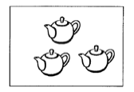
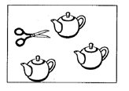

# Situations in Natural Language Semantics
**First published Mon Feb 12, 2007; substantive revision Wed Oct 13, 2021**

*Kratzer, Angelika*

Situation semantics was developed as an alternative to possible worlds semantics. In situation semantics, linguistic expressions are evaluated with respect to partial, rather than complete, worlds. There is no consensus about what situations are, just as there is no consensus about what possible worlds or events are. According to some, situations are structured entities consisting of relations and individuals standing in those relations. According to others, situations are particulars. In spite of unresolved foundational issues, the partiality provided by situation semantics has led to some genuinely new approaches to a variety of phenomena in natural language semantics. In the way of illustration, this article includes relatively detailed overviews of a few selected areas where situation semantics has been successful: implicit quantifier domain restrictions, donkey pronouns, and exhaustive interpretations. It moreover addresses the question of how Davidsonian event semantics can be embedded in a semantics based on situations. Other areas where a situation semantics perspective has led to progress include attitude ascriptions, questions, tense, aspect, nominalizations, implicit arguments, point of view, counterfactual conditionals, and discourse relations.

## 1. Situations in direct perception reports

Situations entered natural language semantics with Jon Barwise’s paper *Scenes and Other Situations* (Barwise 1981)[^barwise-1981], followed by Barwise and Perry’s *Situations and Attitudes* (Barwise & Perry 1983)[^barwise-1983]. *Scenes and Other Situations* is about the meaning of direct (or epistemically neutral) perception reports, a construction illustrated in (1):

**(1)**

Beryl saw Meryl feed the animals.

Direct perception reports contrast with indirect (or epistemically positive) perception reports, which typically have finite embedded clauses, as in (2):

**(2)**

Beryl saw that Meryl fed the animals.

Both (1) and (2) presuppose that Meryl fed the animals. But (1) and (2) still differ with respect to the interpretation of their embedded complements: the embedded complement in (1) can only be interpreted as transparent, and this is not so for the embedded complement in (2). The transparency of the embedded complement in (1) is shown by the validity of inferences like that in (3), for example:

**(3)**

| Beryl saw Meryl sprinkle the white powder on Cheryl’s dinner. |
| --- |
| The white powder was the most deadly poison. |
| Beryl saw Meryl sprinkle the most deadly poison on Cheryl’s dinner. |

In contrast to (3), the first sentence in (4) has an interpretation that renders the inference in (4) invalid.

**(4)**

| Beryl saw that Meryl sprinkled the white powder on Cheryl’s dinner. |
| --- |
| The white powder was the most deadly poison. |
| Beryl saw that Meryl sprinkled the most deadly poison on Cheryl’s dinner. |

A semantic analysis of direct perception reports has to explain what it is that forces their complements to be transparent. Barwise 1981 proposes to analyze direct perception reports like (1) along the lines of (5):

**(5)**

There is an actual past situation *s* that Beryl saw, and *s* supports the truth of *Meryl feed the animals*.

The virtues of Barwise’s analysis can be appreciated even without seeing the exact details of how situations might support the truth of sentences. In (5) the verb *see* semantically selects situations rather than propositions as its first argument, and this has the desirable effect that the truth value of those sentences does not change when the description of the perceived situation is replaced by an extensionally equivalent one. If Meryl fed the animals just once in the actual world, and she fed them hay, then the set of actual situations that support the truth of *Meryl feed the animals* is expected to be the same as the set of actual situations that support the truth of *Meryl feed the animals hay*. But then (5) and (6) must have the same actual truth-value, and Barwise’s analysis predicts correctly that (1) and (7) must, too.

**(6)**

There is an actual past situation *s* that Beryl saw, and *s* supports the truth of *Meryl feed the animals hay*.

**(7)**

Beryl saw Meryl feed the animals hay.

The publication of Barwise 1981 in the *Journal of Philosophy* was followed by two papers providing commentary: Higginbotham 1983 in the same journal, and Vlach 1983 in *Synthese*. The peer verdict on situations was that they were not needed for the semantics of direct perception reports: the facts could just as well be explained by Davidsonian event semantics. (Davidson 1967a, 1980. See the entries Donald Davidson and events.)[^davidson-1967a][^davidson-1980] In fact, Barwise’s argument showing that direct perception *see* selects a situation is very much like Davidson’s argument showing that the verb *cause* expresses a relation between events (Davidson 1967b, 1980)[^davidson-1967b][^davidson-1980]. Comparison with Davidsonian event semantics has been an issue for situation semantics throughout its history. The relation between situation semantics and Davidsonian event semantics will be taken up in section 9.

## 2. States of affairs, infons, and information content

Later developments in situation semantics emphasized its role as a general theory of information content. The key concept is the notion of a state-of-affair or “infon” (see the entry states of affairs). State-of-affairs are non-linguistic formal objects that come in various stages of complexity (see Gawron & Peters 1990 for a brief overview, Devlin 1991, 2006 for a more detailed exposition, and Ginzburg & Sag 2000 for a system based on a richer ontology)[^devlin-1991][^devlin-2006][^gawron-1990][^ginzburg-2000][^gawron-1991]. The simplest kinds of state-of-affairs consist of a relation, individuals related by the relation, and a polarity, and might be represented as in (8):

**(8)**

a. << bothering, Nina, Stella; no >>

**b.**

<< helping, Stella, Nina; yes >>

Arguments of a relation may be parameterized, as in (9):

**(9)**

<< bothering, *x*, Stella; no >>

Parameterized roles can be anchored to individuals. In (9), the parameterized botherer role may be anchored to Nina, for example, and in that case, the result is the unparameterized state-of-affairs in 8(a). Parameterized states-of-affairs can be restricted by other parameterized state-of-affairs, as in (10), where the subject role for the property of taking a shower is restricted to individuals who are singing:

**(10)**

<< showering, *x* _{<< singing, *x*; yes >>}; no >>

Properties and relations can be produced from parameterized states-of-affairs by absorbing parameters:

**(11)**

[ *x* | << bothering, *x*, Stella; no >>]

Parameter absorption is the situation theory analogue of λ-abstraction. (11) corresponds to the property of not bothering Stella. There are additional operations that build complex states-of-affairs from simpler ones, including analogues of conjunction, disjunction, and existential and universal quantification (see Devlin 1991, 2006, and Ginzburg & Sag 2000)[^devlin-1991][^devlin-2006][^ginzburg-2000]. The ultimate goal is to provide the necessary tools for a theory of information content (see the entry semantic conceptions of information). Barwise 1988 mentions a wide range of applications, including “a theory of information to account for the role information pickup plays in the life of the frog, how the information it detects is related to the actions it takes, actions like flicking its tongue and hopping about” (Barwise 1988, 257)[^barwise-1988]. Other applications mentioned are theories of vision, databases, robot design, mathematical proofs, information exchange between speakers of particular language, and cognitive science as a whole. Finally, the theory should be able “to be turned on itself, and provide an account of its own information content, or rather, of the statements made by the theorist using the theory” (Barwise 1988, 258)[^barwise-1988].

When Barwise and Perry started their joint work, a new, more fine-grained, notion of information content seemed to be urgently needed in natural language semantics, because of a known challenge facing possible worlds semantics, which, under the influence of Lewis 1972 and Montague 1974, was the framework of choice for most formal semanticists at the time (see the entry on possible worlds). In possible worlds semantics, propositions are identified with the set of possible worlds where they are true (see the entry propositions). Consequently, propositions that are true in the same possible worlds are identical, and we seem to predict wrongly that a person who believes a proposition *p* should also believe any proposition that is true in the same worlds as *p* (see the entry propositional attitude reports). To distinguish logically equivalent propositions, we seem to need a more fine-grained notion of what the information content of a sentence is, and the state-of-affairs or infons of situation semantics were marketed to provide just that.

The solution that situation semantics offered for the puzzle of logically equivalents in attitude ascriptions encountered competition from the very start: state-of-affairs and infons looked suspiciously like structured propositions (see the entry structured propositions). Intensional versions of structured propositions had already been offered as remedies for the attitude ascription problem by Carnap 1947, Lewis 1972, Cresswell & von Stechow 1982, and were also appealed to for the analysis of information structure and intonational meaning. The structured meanings of Carnap, Lewis, and Cresswell & von Stechow are tree structures whose end nodes are intensions, rather than lexical items. They are thus objects that are independent of the vocabularies of particular languages, but are nevertheless hierarchically structured in the way sentences are. Differences between structured propositions in various frameworks and the state-of-affairs or infons of situation theory seem to largely boil down to foundational matters regarding the status of possibilia (see the entries on possible objects and possible worlds) and the nature of properties and relations (see properties).

There is currently no consensus about the semantics of attitude ascriptions, and it is not clear whether situation semantics has a privileged place in the family of accounts that have been proposed. Perhaps more importantly, for most empirical generalizations in linguistic semantics, propositions construed as sets of possible worlds or situations provide the right level of abstraction. There seems to be no need to posit unwieldy information contents in areas where simpler notions provide more elegant accounts. Since this article is not about theories of information, the concern to provide a general theory of information content will now have to be set aside, even though it is central to some areas in situation semantics and situation theory (Devlin 1991, 2006; Ginzburg and Sag 2000; see also Barwise & Seligman 1997)[^barwise-1997][^devlin-1991][^devlin-2006][^ginzburg-2000]. The remainder of this article will review situation-based accounts of selected topics that are currently under active investigation in linguistics and philosophy: Austinian topic situations, domain restrictions, donkey sentences, exhaustive interpretations, and Davidsonian event predication. None of those phenomena requires a more fine-grained notion of information content. The discussion will thus be cast within a possibilistic framework (Kratzer 1989, 2002, 2012; Elbourne 2005, 2013)[^elbourne-2005][^elbourne-2013][^kratzer-1989][^kratzer-2002][^kratzer-2012]. Possibilistic versions of situation semantics are conservative extensions of possible worlds semantics that construe propositions as sets of world parts, rather than complete possible worlds (see Barwise 1988, chapter 11, for an overview of the major branch points in situation semantics)[^barwise-1988]. There are many areas that situation semantics has contributed to that could not be reviewed here for reasons of space, including knowledge ascriptions, questions, discourse relations, counterfactuals, viewpoint aspect, gerunds, and implicit arguments. Stojanovich 2012 and Zucchi 2015 are recent general overviews of situation semantics. Additional references to work on various phenomena within a situation-based semantics are given below under the heading *references not mentioned in the text*.

## 3. Austinian topic situations

A core feature of many actual analyses of natural language phenomena within situation semantics is the idea attributed to John L. Austin 1950 that utterances are about particular situations, with the actual world being the limiting case (see the entry on John Langshaw Austin.) Barwise & Etchemendy 1987 illustrate the idea with an imagined utterance of sentence (12):

**(12)**

Claire has the three of clubs.

Whether an utterance of (12) is true or false depends, among other things, on what situation the utterance is about.

> We might imagine, for example, that there are two card games going on, one across town from the other: Max is playing cards with Emily and Sophie, and Claire is playing cards with Dana. Suppose someone watching the former game mistakes Emily for Claire, and claims that Claire has the three of clubs. She would be wrong on the Austinian account, even if Claire had the three of clubs across town. (Barwise and Etchemendy 1987, p. 122)[^barwise-1987]

If assertions are about particular situations, reports of assertions might not be accurate unless they take into account the situations the assertions were about. And there are more repercussions of Austinian reasoning: if assertions are about particular situations, beliefs should be, too, and this means that our belief ascriptions might not be accurate unless they take into account the situations the beliefs are about. That those situations do indeed matter for belief ascriptions is illustrated by the story of the Butler and the Judge from Kratzer 1998 (see Ogihara 1996, Kratzer 1990 (Other Internet Resources), 2002, 2012; Portner 1992, Récanati 2000, for relevant work on the role of topic situations in attitude ascriptions and other embedded constructions):

The judge was in financial trouble. He told his butler that he had been ready to commit suicide, when a wealthy man, who chose to remain anonymous, offered to pay off his debts. The butler suspected that Milford was the man who saved his master’s life by protecting him from financial ruin and suicide. While the butler was away on a short vacation, the judge fell into a ditch, drunk. Unconscious and close to death, he was pulled out by a stranger and taken to the local hospital, where he recovered. When the butler returned to the village, he ran into a group of women who were speculating about the identity of the stranger who saved the judge’s life by taking him to the hospital. One of the women said she thought that Milford saved the judge’s life. The butler, who hadn’t yet heard about the accident and thought the women were talking about the judge’s financial traumas, reacted with (13):

**(13)**

I agree. I, too, suspect that Milford saved the judge’s life.

The next day, when discussion of the judge’s accident continued, somebody said:

**(14)**

The butler suspects that Milford saved the judge’s life.

Given that the butler’s suspicion is not about the accident, there is a sense in which this belief attribution is not true. It seems infelicitous, if not outright false. This suggests that our imagined assertion of (14) makes a claim about a particular situation that the suspicion is about. In the context of the story, that situation is the one everyone was talking about, and where the judge was rescued from the ditch. Since the butler has no suspicion about such a situation, the person who uttered (14) said something infelicitous or false. If (14) simply said that the butler suspected that there was a situation where Milford saved the judge’s life, the assertion would be true. There is support for the Austinian perspective on assertions and attitude ascriptions, then.

Austinian topic situations (also referred to as “focus situations”, “described situations”, or “reference situations” in the literature) are often non-overt, but the tense of a sentence might give them away. A close look at tenses tells us that topic situations do not always coincide with the situations described by the main predication of a sentence. Klein (1994, 4)[^klein-1994] imagines a witness who is asked by a judge what she noticed when she looked into the room. The witness answered with (15):

**(15)**

There was a book on the table. It was in Russian.

It is surprising that there is a past tense in the second sentence, even though the book must have still been in Russian when the witness was called for testimony. Even more surprising is the fact that the witness could not have said (16) instead of (15).

**(16)**

\# There was a book on the table. It is in Russian.

Translated into a situation semantics (Klein himself talks about topic times, rather than topic situations), Klein’s explanation is that tense relates utterance situations to topic situations, which do not necessarily coincide with the situations described by the main predication of a sentence. In Klein’s scenario, the topic situation for the second part of the witness’s answer was the past situation that she saw when she looked into the room. Since the topic situation was past, tense marking in the second sentence of (16) has to be past, too. Via their temporal locations, topic situations play an important role in the semantics of both tense and aspect (see the entry on tense and aspect; also Smith 1991, Kamp & Reyle 1993, and Cipria & Roberts 2000)[^cipria-2000][^kamp-1993][^smith-1991].

If Austinian topic situations play a role in the grammars of natural languages, there should be grammatical devices in at least some languages that track them. Recent work by Andrew McKenzie (McKenzie 2012, 2015)[^mckenzie-2012][^mckenzie-2015] has suggested that certain Switch Reference systems in a number of genetically unrelated languages seem to track Austinian topic situations. For example, the North American language Kiowa (Tanoan, spoken in Oklahoma) uses different forms for certain sentential connectives (including conjunction), depending on whether the topic situations of the conjoined conjuncts changes or stays the same.

## 4. Situation semantics and implicit domain restrictions

Among the most innovative ideas in Barwise & Perry 1983 is the proposal to exploit the Austinian perspective on utterances to account for implicit quantifier restrictions and so-called “incomplete” definite descriptions (see the entry descriptions):

> Suppose that I am in a room full of people, some of whom are sleeping, some of whom are wide awake. If I say, “no one is sleeping,” have I told the truth or not? Again, it depends on which situation I am referring to. If I am referring to the whole situation including all the people in the room, then what I have said is false. However, one can well imagine situations where I am clearly referring only to a part of that situation. Imagine, for example, that I am conducting an experiment which requires an assistant to monitor sleeping people, and I look around the sleep lab to see if all of my assistants are awake and ready to go. Surely, then I may truly and informatively say, “No one is asleep. Let’s begin.” …. The crucial insight needed goes back to Austin … As Austin put it, a statement is true when the actual situation to which it refers is of the type described by the statement. (Barwise & Perry 1983, 160)[^barwise-1983]

A similar example discusses incomplete definite descriptions:

> Suppose my wife and I collaborate on cooking for a party. And suppose that at a certain point in the party I say, “I am the cook,” referring to *l*. Is what I said true or not?

The answer is, “It depends on which situation I am describing.” First, suppose someone comes up to me and says, “The food at this party is delicious! Who is the cook?” If I say “I am the cook,” I have clearly not described things accurately. I have claimed to be *the* person who did the cooking for the party. But suppose instead someone comes up to me eating a piece of my famous cheesecake pastry and says, “Who made this?” Then I may truly say that I am the cook. (Barwise & Perry 1983, 159)[^barwise-1983]

On the Austinian perspective, at least certain kinds of implicit restrictions for quantification domains are a direct consequence of the fact that assertions are about particular actual situations, and that those situations can be smaller or bigger parts of the actual world.

The Austinian answer to implicit domain restrictions was endorsed and developed in Récanati (1986/87, 1996, 2004a) and Cooper 1996. An influential attack on the situation semantics approach to “incomplete” definite descriptions came from Soames 1986, who concluded that “the analysis of definite descriptions is not facilitated by the kind of partiality that situation semantics provides” (Soames 1986, 368)[^soames-1986]. Soames’ reservations against the Austinian approach to domain restrictions come from two major potential counterarguments, both of which are directed against particular implementations of the approach. One of the potential problems discussed by Soames concerns attributive readings of definite descriptions. However, as Soames is careful to note (Soames 1986, 359)[^soames-1986], this problem does not necessarily affect possibilistic versions of situation semantics. Since Soames’ qualification is not elaborated in his article, it might be useful to look at a concrete example illustrating his point. Suppose the two of us observe a bear crossing the road one night in Glacier National Park. Since it is dark, we can’t see the bear very well, and I say to you:

**(17)**

The bear might be a grizzly.

I am aware that the bear we see is not the only bear in the world, so my assertion relies on an implicit domain restriction. On the Austinian view, my assertion is about a particular situation located somewhere in Glacier National Park at a particular time in August 2006. Call that situation “Bear Sighting”. Bear Sighting has a particular bear in it, the bear we see. Call that bear “Bruno”. On the intended attributive reading, what I want to get across to you is not that Bruno may be a grizzly, but that our evidence about Bear Sighting is compatible with the assumption that the bear there—whoever he is—is a grizzly. There is a legitimate question whether we can get that reading on the Austinian approach to domain restrictions. If Bear Sighting has to give us the restriction for *bear*, it seems that all it can do is restrict the bears we are talking about to Bruno. But that wouldn’t produce the attributive reading we are after. For that reading, so it might seem, domain restrictions must be properties.

The above conclusion might look inevitable, but it is not. It is true that on the Austinian view, my utterance of (17) is interpreted as a claim about Bear Sighting. To see that we can nevertheless get the desired interpretation, we need to look at technical details. 18(a) gives a plausible interpretation of the possibility modal in (17) within a possibilistic situation semantics. 18(b) is the interpretation of the whole sentence (17) before the Austinian component comes into play:

**(18)**

| a. | [[*might*]]^{*c*} | λ*p*λ*s* ∃*s*′[Acc_{*c*}(*s*)(*s*′) & *p*(*s*′)] |
| --- | --- | --- |
| b. | [[(17)]]^{*c*} | λ*s* ∃*s*′ [Acc_{*c*}(*s*)(*s*′) & grizzly(ι*x* bear(*x*)(*s*′))(*s*′)] |

(18) assumes an intensional semantics that is based on possible situations. In possible situation semantics, propositions are sets of possible situations, or characteristic functions of such sets, and all predicates are evaluated with respect to a possible situation. 18(b) is the proposition expressed by (17) in context *c*. That proposition is a property that is true of a situation *s* iff there is a situation *s*′ that is accessible from *s* and the unique bear in *s*′ is a grizzly in *s*′. The modal *might* introduces existential quantification over possible situations that are accessible from the evaluation situation *s* (see the entry modal logic). The kind of accessibility relation is determined by the lexical meaning of the modal in interaction with properties of the utterance context *c* (see the entry indexicals). In our example, the modality is a particular kind of epistemic modality that relates two situations *s* and *s*′ in a context *c* just in case *s* and *s*′ are equivalent with respect to the information available in *c*, that is, whatever evidence about *s* is available in *c* isn’t specific enough to distinguish between *s* and *s*′ (*epistemic contextualism*). Evidence that counts as available for epistemic modals might include the distributed knowledge of the discourse participants (see von Fintel & Gillies 2011)[^fintel-2011], other available sources of information like ship’s logs or computer printouts (Hacking 1967, von Fintel & Gillies 2011)[^fintel-2011][^hacking-1967], but, interestingly, not necessarily information that happens to be hidden from sight like test results in sealed envelopes (de Rose 1991)[^rose-1991], babies in wombs (Teller 1972)[^teller-1972], weather conditions behind drawn curtains (Gillies 2001)[^gillies-2001], or details of animals obscured by darkness. Suppose the actual bear in Bear Sighting is in fact a black bear, and not a grizzly. Since it is night and we can’t see the bear very well, the evidence we have about Bear Sighting when I utter (17) cannot distinguish the real situation from many merely possible ones, including some where the bear is a grizzly and not a black bear. This is what makes my utterance of (17) true.

When I uttered (17), I claimed that the proposition in 18(b) was true of Bear Sighting. Applying 18(b) to Bear Sighting yields the desired attributive interpretation. Bear Sighting is exploited to provide implicit domain restrictions, but it doesn’t do so directly. We are considering epistemic alternatives of Bear Sighting. The epistemic alternatives are alternatives of Bear Sighting, hence are partial, just as Bear Sighting itself is. They have no more than a single bear in them. This suggests that the analysis of definite descriptions *is* facilitated by the kind of partiality that situation semantics provides. Austinian topic situations can give us domain restrictions for attributive definite descriptions.

Soames’ second major objection against the Austinian approach to domain restrictions relates to the fact that there are instances of domain restrictions that can’t seem to come from Austinian topic situations (see also Westerståhl 1985)[^westerståhl-1985]. One of Soames’ examples is (19) below (Soames 1986, 357)[^soames-1986], which is a variation of Barwise and Perry’s sleep lab example quoted above.

**(19)**

Everyone is asleep and is being monitored by a research assistant.

If all quantifier domains were provided by Austinian topic situations, (19) would seem to make contradictory demands on such a situation. Assuming that there is just a single topic situation for utterances of (19), we seem to predict that those utterances imply that the research assistants are among those who are asleep. But there is no such implication. Soames is aware that proponents of the Austinian approach are not committed to the assumption that *all* domain restrictions are directly provided by Austinian topic situations (Soames 1986, footnote 17, 371)[^soames-1986], and he therefore emphasizes that he is only commenting on the particular account of domain restrictions offered in Barwise and Perry (1983, 1985). Soames’ objection does not apply to Cooper 1996, for example, who allows quantifier domains to be determined by different resource situations, which he distinguishes from the Austinian topic situation (his “described situation”). The objection also does not apply to possibilistic versions of situation semantics, where every predicate is necessarily evaluated with respect to an actual or possible situation. Different predicates in one and the same sentence can then be evaluated with respect to different situations (Heim 1990, Percus 2000, Elbourne 2002, 2005, 2013)[^elbourne-2002][^elbourne-2005][^elbourne-2013][^heim-1990][^percus-2000]. A possible interpretation for (19) might be (20):

**(20)**

λ*s* ∀*x* [ [person(*x*)(*s*′) & *s*′ ≤_{*p*} *s*] → [asleep(*x*)(*s*) & ∃*y* [research-assistant(*y*)(*s*) & monitoring(*x*)(*y*)(*s*)] ] ]

When the doctor of the sleep lab utters (19), she claims that the proposition in (20) is true of a particular situation, call it “Sleep Lab”. Sleep Lab is the Austinian topic situation, but it is not the situation that picks out the sleepers. The sleepers might be recruited from a contextually salient (possibly scattered) situation *s*′ that is related to Sleep Lab via the part relation ≤_{*p*} and functions as a resource situation for the evaluation of the predicate *person* introduced by the quantifier phrase *everyone*. This situation could be the sum of the patients in the lab, for example.

Neither topic nor resource situations have to be posited for the exclusive need of domain restriction. In a possibilistic situation semantics resource situations are the kind of entities that the evaluation of any predicate routinely depends on. Topic situations, too, are independently needed: they are the situations that assertions and beliefs are about, and they are key players in the semantics of tense and aspect. This means that the contribution of topic and resource situations to domain restriction comes entirely for free. Many instances of domain restrictions can thus be explained without positing any special devices. Some of the remaining cases might also be accounted for by independently attested mechanisms including syntactic ellipsis, presupposition projection and conversational implicatures. But there is also exaggeration, taboo related omissions, and some such. The implicit domain restriction in the following sentence, which appeared on a note posted in a bathroom in York (England), might very well fall in the last-mentioned category:

**(21)**

Please do not dispose of anything down the toilet, except toilet paper.

It is hard to see how any theory would want to literally prevent any kind of pragmatic enrichment processes (Récanati 1993, 2002, 2004)[^récanati-1993][^récanati-2002] from contributing to implicit quantifier restrictions, given that humans are able to “interpret utterances replete with irony, metaphor, elision, anacoluthon, aposiopesis, and on top of all of this …identify what a speaker is *implying* as well as saying” (Neale 2004, 123)[^neale-2004]. Implicit domain restrictions are likely to be the byproducts of a number of independently attested mechanisms, then.

## 5. Situation variables or unarticulated constituents?

An important question in situation semantics is how exactly situations enter the semantic interpretation process. Are they articulated via syntactically represented variables, or are they “unarticulated constituents” (Perry 1986, Récanati 2002)[^perry-1986][^récanati-2002], possibly mere indices of evaluation? The issue is well explored for times and possible worlds (see the entry on ontological commitment). Kripke’s semantics for modal logic allows quantification over possible worlds only in the metalanguage (see the entry modal logic), for example. Likewise, in Prior’s tense logic (see the entry Arthur Prior), quantification over times is confined to the metalanguage (see the entry time).

**(22)**

a. [[*must* α]]^{*w*} = 1 iff [[α]]^{*w*′} = 1 for all *w*′ that are accessible from *w*.

**b.**

[[*past* α]]^{*t*} = 1 iff [[α]]^{*t*′} = 1 for some *t*′ that precedes *t*.

Montague’s language of intensional logic (Montague 1974) was developed in the tradition of Kripke and Prior, and does not have variables ranging over times or worlds: tense and modal operators shift evaluation indices, as illustrated in (22), but do not bind variables in the object language. Quantification over worlds and times is treated differently from quantification over individuals, then. The distinction was made deliberately because it predicts differences that were thought correct at the time. Once an evaluation index is shifted, it is gone for good, and can no longer be used for the evaluation of other expressions. This constrains temporal and modal anaphora. Until the early seventies anaphoric reference to times and worlds in natural languages was believed to be constrained in precisely the way predicted by the evaluation index approach. The belief was challenged by work on temporal anaphora (Kamp 1971, Partee 1973, Vlach 1973, van Benthem 1977)[^benthem-1977][^kamp-1971][^partee-1973][^vlach-1973], however. Cresswell 1990 presented parallel arguments for modal anaphora, and showed more generally that natural languages have the full expressive power of object language quantification over worlds and times. Quantification over worlds or times is thus no different from quantification over individuals, and should be accounted for in the same way.

Exact analogues of Cresswell’s examples can be constructed to show that natural languages have the full expressive power of object language quantification over situations. Here is a first taste of the kind of example we have to look at.

**(23)**

If, whenever it snowed, it had snowed much more than it actually did, the town plow would have removed the snow for us.

Suppose (23) is uttered to make a claim about the town of Amherst during the last 20 years. We are looking at the snowfalls during the relevant period. For each of those actual snowfalls *s*, we are considering counterfactual situations *r* where it snowed much more than it did in *s*. The claim is that each of those counterfactual situations is part of a situation where the town plow removed the snow for us. To formalize what was said, we have to be able to consider for each actual snowfall *s* a set of counterfactual alternatives and compare the amount of snow in each of them to the actual amount of snow in *s*. This means that we have to be able to “go back” to the actual snowfall situations after considering corresponding counterfactual situations. To do so we have to keep track of the original situations. The available bookkeeping tools are either evaluation indices, or else situation variables and binding relations in the object language. If we want to avoid possibly unpronounced situation variables, we need two shiftable evaluation indices for (23). In the long run, even two indices wouldn’t be enough, though. Here is an example that requires three:

**(24)**

Whenever it snowed, some local person dreamed that it snowed more than it actually did, and that the local weather channel erroneously reported that it had snowed less, but still more than it snowed in reality.

It is not hard to see that we can complicate such examples indefinitely, and that there would be no end to the number of evaluation indices needed. But that suggests that natural languages have the full power of object language quantification over situations. Quantification over situations is no different from quantification over individuals, then, as far as expressive power is concerned. Since natural languages have syntactically represented individual variables and it would be surprising if they used two different equally powerful quantification mechanisms, it seems to be at least a good bet that there are syntactically represented situation variables in natural languages (but see Cresswell 1990 and Jacobson 1999 for dissenting opinions)[^cresswell-1990][^jacobson-1999]. But then the situations quantified over or referred to in (23), (24) and their kin do not necessarily correspond to “unarticulated constituents”. They are syntactically represented, even though they might happen to be unpronounced. The syntactic representation of situation variables is investigated in Percus 2000, Keshet (2008, 2010)[^keshet-2008][^keshet-2010], and F. Schwarz (2008, 2012)[^schwarz-2008][^schwarz-2012].

## 6. Situations, minimality, and donkey sentences

One of the most frequent uses of situation-based frameworks is in the analysis of “donkey” pronouns, that is, anaphoric pronouns that are interpreted as definite descriptions (see *descriptive theories of anaphora* under the entry descriptions and the entry anaphora).

**(25)**

a. Whenever a donkey appeared, it was greeted enthusiastically.

**b.**

Whenever a donkey appeared, the donkey was greeted enthusiastically.

The pronoun *it* in 25(a) is an instance of a descriptive pronoun that is interpreted like the corresponding definite description in 25(b). Suppose I use 25(a) or (b) to talk about a particular situation, call it “Donkey Parade”. The situations that *whenever* quantifies over are then all part of Donkey Parade. They are precisely those subsituations of Donkey Parade that are minimal situations in which a donkey appeared. Those must then be situations with a single donkey in them. The claim is that all those situations are part of situations where the donkey was greeted enthusiastically. More formally, my claim about Donkey Parade is (26):

**(26)**

λ*s* ∀*s*′ [ [*s*′ ≤_{*p*} *s* & *s*′ ∈ Min(λ*s* ∃*x* [donkey(*x*)(*s*) & appeared(*x*)(*s*)])] → ∃*s*″[ *s*′ ≤_{*p*} *s*″ & greeted-enthusiastically (ι*x* donkey(*x*)(*s*′))(*s*″)] ]

(26) reflects the standard analysis of adverbs of quantification and descriptive pronouns in a possibilistic situation semantics (Berman 1987; Heim 1990; Portner 1992; von Fintel 1994, 2004b; Elbourne 2002, 2005, 2013, 2016)[^berman-1987][^elbourne-2002][^elbourne-2005][^elbourne-2013][^elbourne-2016][^fintel-1994][^fintel-2004b][^heim-1990][^portner-1992]. All resource situations that are introduced in (26) are directly or indirectly related to the topic situation via the part relation ≤_{*p*}. The topic situation is the ultimate anchor for all resource situations. It indirectly restricts the donkeys being talked about to those that are present in Donkey Parade. The antecedent of the conditional introduces a further restriction: we are considering only those subsituations of Donkey Parade that are minimal situations in which a donkey appeared. Those situations have just one donkey in them, and they can thus be used as resource situations for the definite description *the donkey* or a corresponding descriptive pronoun.

The crucial feature of any analysis of donkey sentences within a situation semantics is that quantification is over minimal situations satisfying conditions imposed by the antecedent of the conditional. The minimality condition is crucial for the analysis of descriptive pronouns. Without it, we wouldn’t be able to analyze those pronouns as definite descriptions:

**(27)**

Whenever a man saw a donkey, the man greeted the donkey.

We have to make sure that the situations or events quantified over have just one man and just one donkey in them, because definite descriptions have to be unique with respect to their resource situations. The minimality condition is a source of potential trouble, however (Reinhart 1986, Dekker 2004; von Fintel 2004a,b)[^dekker-2004][^fintel-2004a][^reinhart-1986]. When the antecedent of a conditional contains a mass noun, negative quantifiers, or certain kinds of modified quantifier phrases, quantification over minimal situations or events seems to yield unwelcome results or isn’t possible at all:

**(28)**

a. When snow falls around here, it takes ten volunteers to remove it.

**b.**

When a cat eats more than one can of Super Supper in a day, it gets sick.

**c.**

Whenever there are between 20 and 2000 guests at a wedding, a single waiter can serve them.

**d.**

Whenever nobody showed up, we canceled the class.

28(a) raises the question whether there ever are minimal situations or events in which snow falls. But even if there are, we do not quantify over them in this case. We also do not seem to rely on discrete scales for measuring portions of Super Supper. But even if we did, this would not help with 28(b). This sentence does not necessarily quantify over situations in which a cat eats just a little more than a can of Super Supper. Minimality also doesn’t seem to play a role for 28(c). If 28(c) quantified over minimal situations that have between 20 and 2000 wedding guests, it would quantify over situations or events with exactly 20 wedding guests, and might very well be true. 28(d) is even more dramatic. What would a minimal situation or event look like in which nobody showed up? If any event- or situation-based analysis of donkey sentences is to succeed, then, it must keep the events or situations that are quantified over small enough to contain just one man and one donkey in cases like (27), but it has to accomplish this without minimizing the amount of snow, Super Supper, or wedding guests in cases like 28(a) to (c). And it should not mess with negative constructions at all. When we are quantifying over situations in donkey sentences, then, we need to relate possibly very complex sentences to exemplifying situations in a way that is responsive to the different behavior of different kinds of antecedents illustrated by (27) and 28(a) to (d).

There are several proposals in the literature that elucidate the relation between a sentence and the situations or events that exemplify it by positing a special recursive mechanism that relates sentences to the set of exemplifying events or situations (see Schein 1993, chapters 9 and 10 for discussion of this issue)[^schein-1993]. Possibilistic versions of situation semantics typically start out with a recursive truth definition that relates utterances of sentences to the sets of possible situations in which the utterances are true, the propositions expressed. The situations or events that exemplify a proposition can then be defined as the “minimal” situations in which the proposition is true (see the entries on events, facts, states of affairs, and truthmakers). The challenge presented by sentences (27) and 28(a) to (d) is that they suggest that a naïve notion of minimality won’t do. A more flexible notion of minimality seems to be needed. The following section will document in some detail how the desired notion of minimality might emerge from a simple definition of exemplification in interaction with independently justified sentence denotations. The issue is under active investigation, however, and cannot be considered settled before a wide range of different constructions has been looked at. Whatever the ultimate outcome may be, the following discussion will provide the opportunity to illustrate how the shift from possible worlds to situations affects the denotations we might want to posit for an expression. In a situation semantics, there are often several ways of assigning denotations to an expression that are hard to distinguish on truth-conditional grounds. Looking at the situations that exemplify a sentence as well as its truth-conditions helps with the choice.

## 7. Minimality and exemplification

In possibilistic versions of situation semantics, possible situations are parts of possible worlds. Some authors also assume that the parts of a possible world *w* form a join semi-lattice with maximal element *w* (Bach 1986; Lasersohn 1988, 1990; Portner 1992; see also the entry mereology)[^bach-1986][^lasersohn-1988][^lasersohn-1990][^portner-1992][^lasersohn-1990-2]. The part relation ≤_{*p*} and the sum operation + are then related as usual: *s* ≤_{*p*} *s*′ iff *s* + *s*′ = *s*′. Propositions are sets of possible situations or their characteristic functions (see the entry propositions). The notion of a situation that exemplifies a proposition might be defined as in (29), which is a variation of a definition that appears in Kratzer 1990 (Other Internet Resources), 1998, 2002:

**(29)**

**Exemplification** A situation *s* exemplifies a proposition *p* if whenever there is a part of *s* in which *p* is not true, then *s* is a minimal situation in which *p* is true.

Intuitively, a situation that exemplifies a proposition *p* is one that does not contain anything that does not contribute to the truth of *p*. The first part of (29) allows two possibilities for a situation *s* to exemplify *p*. Either *p* is true in all subsituations of *s* or *s* is a minimal situation in which *p* is true. The notion of minimality appealed to in (29) is the standard one: A situation is a minimal situation in which a proposition *p* is true iff it has no proper parts in which *p* is true. The situation Mud (Case One below) gives a first illustration of what (29) does.

**Case One: Mud**

|  | Mud is a situation that consists of mud and only mud. |
| --- | --- |

Assuming that Mud and all of its parts are mud, Mud and all of its parts exemplify the proposition in 30(b), since there are no parts of Mud where there is no mud.

**(30)**

a. There is mud.

**b.**

λ*s* ∃*x* mud(*x*)(*s*)

30(b) is not exemplified by Mud & Moss (Case Two below), however:

**Case Two: Mud & Moss**

|  | Mud & Moss is a situation that consists of some mud and some moss and nothing else. |
| --- | --- |

Mud & Moss has parts where 30(b) is not true: the parts where there is only moss. But Mud & Moss is not a minimal situation in which 30(b) is true.

Next, consider (31):

**(31)**

a. There are three teapots.

**b.**

λ*s* ∃*x* [*x* ≤_{*p*} *s* & |{*y*: *y* ≤_{*p*} *x* & teapot(*y*)(*w*_{*s*})}| = 3]

31(b) describes situations *s* that have at least three teapots (individuals that are teapots in the world of *s*) in them. The proposition in 31(b) seems to be exemplified by the situation Teapots (Case Three below).

**Case Three: Teapots**

|  | Teapots has three teapots and nothing else in it. |
| --- | --- |

There is no proper subsituation of Teapots in which 31(b) is true. Since Teapots has nothing but three teapots in it, any proper subsituation of Teapots would have to be one where a part of at least one of the three teapots is missing. But 31(b) is true in Teapots itself, and Teapots is thus a minimal situation in which 31(b) is true.

There is a potential glitch in the above piece of reasoning. It assumes that when an individual is a teapot in a world, no proper part of that individual is also a teapot in that world. This assumption can be questioned, however. Following Geach 1980 (p. 215; see entries identity, problem of many), we might reason as follows: My teapot would remain a teapot if we chipped off a tiny piece. Chipping off pieces from teapots doesn’t create new teapots, so there must have been smaller teapots all along. We might feel that there is just a single teapot sitting on the table, but upon reflection we might have to acknowledge that there are in fact many overlapping entities that all have legitimate claims to teapothood. The unexpected multitude of teapots is a source of headaches when it comes to counting. A fundamental principle of counting says that a domain for counting cannot contain non-identical overlapping individuals (Casati & Varzi 1999, 112)[^casati-1999]:

**(32)**

**Counting Principle** A counting domain cannot contain non-identical overlapping individuals.

(32) implies that just one of the many overlapping teapots on the table over there can be counted, and the question is which one. If we are that liberal with teapothood, we need a counting criterion that tells us which of the many teapots in our overpopulated inventory of teapots we are allowed to count.

With spatiotemporal objects like teapots, humans seem to rely on counting criteria that privilege maximal self-connected entities (Spelke 1990, Casati & Varzi 1999)[^casati-1999][^spelke-1990]. A self-connected teapot is one that cannot be split into two parts that are not connected. In contrast to parthood, which is a mereological concept, connectedness is a topological notion (see Casati and Varzi 1999 for discussion of various postulates for a “mereotopology”, a theory that combines mereology and topology)[^casati-1999]. The maximality requirement prevents counting teapots that are proper parts of other teapots, and the self-connectedness requirement disqualifies sums of parts from different teapots. Casati and Varzi point out that not all kinds of entities, not even all kinds of spatiotemporal entities, come with counting criteria that involve topological self-connectedness. Obvious counterexamples include bikinis, three-piece suits, and broken glasses that are shattered all over the floor. We have to recognize a wider range of counting criteria, then, that guarantee compliance with (32) in one way or other.

Assuming counting criteria, the proposition expressed by 31(a) would still be exemplified by Teapots, even if we grant that teapots can have proper parts that are also teapots. The specification of denotations for sentences with numerals would now have to make reference to teapots that can be counted, call them “numerical teapots”. Representations like 31(b) and its kin should then be understood along the lines of 33(b):

**(33)**

a. There are three teapots.

**b.**

λ*s* ∃*x* [*x* ≤_{*p*} *s* & |{*y*: *y* ≤_{*p*} *x* & numerical-teapot(*y*)(*w*_{*s*})}| = 3]

If Teapots contains nothing but three individuals that are numerical teapots in the actual world, 33(b) is true in Teapots. But then none of the proper subsituations of Teapots can contain three individuals that are numerical teapots in the actual world. Any such situation contains at least one teapot that is a proper part of one of the teapots in Teapots, hence can no longer contain three numerical teapots.

In contrast to Teapots, Teapots & Scissors (Case Four below) does not exemplify 31(b). Teapots & Scissors has parts where 31(b) is not true: take any part that has just the scissors or just a part of the scissors in it, for example. But Teapots & Scissors is not a minimal situation in which 31(b) is true.

**Case Four: Teapots and Scissors**

|  | Teapots & Scissors has three teapots and a pair of scissors and nothing else in it. |
| --- | --- |

Definition (29) has the consequence that Teapots does not exemplify the proposition 34(b) below, even though 34(b) is true in Teapots.

**(34)**

a. There are two teapots.

**b.**

λ*s* ∃*x* [*x* ≤_{*p*} *s* & |{*y*: *y* ≤_{*p*} *x* & teapot(*y*)(*w*_{*s*})}| = 2]

34(b) is true in Teapots, since Teapots contains a plural individual that contains exactly two teapots. However, 34(b) is not exemplified by Teapots. Teapots has parts in which 34(b) is not true without being a minimal situation in which 34(b) is true. More generally, if sentences of the form *there are n teapots* denote propositions of the kind illustrated by 34(b), then those propositions can only be exemplified by situations that have exactly *n* teapots. Likewise, if *there is a teapot* is interpreted as in 35(b) below, the proposition it expresses can only be exemplified by situations with exactly one teapot, even though it can be true in situations with more teapots.

**(35)**

a. There is a teapot.

**b.**

λ*s* ∃*x* [*x* ≤_{*p*} *s* & |{*y*: *y* ≤_{*p*} *x* & teapot(*y*)(*w*_{*s*})}| = 1]

The predicted exemplification properties of sentences with numerals are welcome, since they suggest that (29) might indeed capture the relation between propositions and situations that we are after: The situations exemplifying the proposition expressed by *there is a teapot* are all situations that have a single teapot in them, hence are literally minimal situations containing a teapot. In contrast, the situations exemplifying the proposition expressed by *there is mud* are all situations that contain mud and nothing else, hence do not have to be minimal situations containing mud.

The major consequence of (29) is that if a proposition has exemplifying situations at all, the set of its exemplifying situations must be either homogeneous or quantized in the sense of Krifka 1992. A set of situations is quantized iff it doesn’t contain both a situation *s* and a proper part of *s*. A set of situations is homogeneous iff it is closed under the parthood relation, that is, whenever it contains a situation *s*, it also contains all parts of *s*. As argued in Krifka’s work, algebraic notions like homogeneity and quantization might capture linguistically important aspectual distinctions like that illustrated in (36) (see the entry on tense and aspect).

**(36)**

a. Josephine built an airplane.

**b.**

Josephine flew an airplane.

The proposition expressed by 36(a) seems to be exemplified by minimal past situations in which Josephine built an airplane, and this set of situations is quantized. On the other hand, the proposition expressed by 36(b) seems to be exemplified by all past situations that contain airplane flying by Josephine and nothing else, and this set of situations is homogeneous. Homogeneous sets cannot be used as counting domains, however, and this requires adjustments with examples like 37(b).

**(37)**

a. Josephine built an airplane just once.

**b.**

Josephine flew an airplane just once.

37(b) cannot quantify over all situations that exemplify the proposition *Josephine flew an airplane*, since this would give us a quantification domain that violates the Counting Principle (32). We have to impose a counting criterion, then, and the topological notion of self-connectedness seems to be relevant here, too (see von Fintel 2004a,b)[^fintel-2004a]. As a result, 37(b) might quantify over maximal self-connected situations exemplifying the proposition expressed by *Josephine flew an airplane*.

We are now in a position to see how exemplification can be used for the analysis of donkey sentences. Look again at (38) and (39):

**(38)**

Whenever a man saw a donkey, the man greeted the donkey.

**(39)**

Whenever snow falls around here, it takes ten volunteers to remove it.

(38) and (39) quantify over parts of a contextually salient topic situation. The antecedents of the conditionals tell us more about what those parts are. In (38) quantification is over situations exemplifying the proposition expressed by *a man saw a donkey*, which are all situations that contain a single man and a single donkey. Those situations can then be taken to be resource situations for the definite descriptions *the man* and *the donkey* in the consequent of (38). (39) also quantifies over parts of the topic situation that exemplify the antecedent proposition, but as in the case of 37(b), considering all exemplifying situations would violate the Counting Principle, and we therefore need a counting criterion. (39) might then quantify over maximal self-connected situations exemplifying the proposition expressed by *snow falls around here*. Those situations include complete snowfalls, then, and if it does indeed snow a lot around here whenever it snows, (39) might very well wind up true.

Not all propositions that look like perfectly acceptable candidates for sentence denotations have exemplifying situations. Consider 40(b), for example:

**(40)**

a. There is more than five tons of mud.

**b.**

λ*s* ∃*x* [mud(*x*)(*s*) & *f*ₜₒₙ(*x*) > 5]

Whenever there is a situation that has more than five tons of mud in it, there are parts that have just five tons or less. But none of those parts can be part of any minimal situation with more than five tons of mud, since there are no such situations.

In a situation semantics, it often happens that there are several options for assigning subtly different propositions to sentences, and sometimes the options are hard to distinguish on truth-conditional grounds. Insisting on both adequate truth-conditions and adequate exemplification conditions might help narrow down the field of candidates. 40(a) can also be paraphrased as saying that the total amount of mud in some contextually salient resource situation weighs more than five tons. The denotation of 40(a) could be (41), then, which includes a contextualized maximalization condition:

**(41)**

λ*s* ∃*x* [*x* ≤_{*p*} *s* & [*x* = σ*z* mud(*z*)(*s*′)] & *f*ₜₒₙ(*x*) > 5]

(41) is true in a situation *s* if it contains all the mud of some salient resource situation *s*′ (possibly the actual world as a whole), and that mud weighs more than 5 tons. (41) is exemplified by the mud in *s*′, provided it weighs more than five tons. Sentences may contain noun phrases that provide anchors for the maximalization condition. (42) is a case in question:

**(42)**

a. There is more than five tons of mud in this ditch.

**b.**

λ*s* ∃*x* [*x* ≤_{*p*} *s* & *x* = σ*z* [mud(*z*)(*w*_{*s*}) & in(this ditch)(*z*)(*w*_{*s*})] & *f*ₜₒₙ(*x*) > 5]

42(b) is exemplified by the mud in this ditch, as long as it weighs more than five tons.

Maximalized interpretations for *more than n* and similar kinds of indefinites like *at least n* are discussed in Reinhart 1986, Kadmon (1987, 1990, 2001)[^kadmon-1987][^kadmon-1990][^kadmon-2001], Schein 1993, and Landman (2000, 2004)[^landman-2000][^landman-2004]. Some of the original observations go back to Evans 1977. As noted by Reinhart and Kadmon, *more than n* noun phrases produce maximality effects of the kind illustrated in (43):

**(43)**

There was more than 5 tons of mud in this ditch. The mud was removed.

(43) would be considered false in a situation where there was in fact 7 tons of mud in this ditch, but only six tons were removed. This judgment can be accounted for by assuming that utterances of the second sentence in (43) are about a particular past situation that exemplifies the first sentence. This situation can then serve as a resource situation for the interpretation of the definite description *the mud*. If sentences like 42(a) have maximalized interpretations, it follows that the mud that was removed was all the mud in the ditch.

There are other numeral expressions that trigger maximalization. (44) is an example:

**(44)**

a. There were between two and four teapots on this shelf.

**b.**

λ*s* ∃*x* [ *x* ≤_{*p*} *s* & *x* = σ*z* [teapots(*z*)(*w*_{*s*}) & on(this shelf)(*z*)(*w*_{*s*})] & 2 ≤ |{*z*: teapot(*z*)(*w*_{*s*}) & *z* ≤_{*p*} *x* }| ≤ 4]

**c.**

There were between two and four teapots on this shelf. They were defective.

44(c), too, would be considered false in situations where only some of the teapots on the shelf are defective. Even simple numeral phrases like *four teapots* can have maximalized interpretations.

**(45)**

There were four teapots on the shelf. They were defective.

Intuitions for (45) are not so clear, but (46) brings out a sharp difference between simple and complex numeral phrases.

**(46)**

a. Every time I sell two teapots on a single day, I am entitled to a \$5 bonus.

**b.**

Every time I sell more than two teapots on a single day, I am entitled to a \$5 bonus.

**c.**

Every time I sell between two and five teapots on a single day, I am entitled to a \$5 bonus.

Imagine that I sold exactly four teapots yesterday. 46(a) has an interpretation where I am entitled to a \$10 bonus. On this reading, our quantification domain is some set of non-overlapping situations that are minimal situations in which I sold two teapots on the same day. Regardless of how we pair up yesterday’s four teapot sales to construct an acceptable counting domain, we always end up with exactly two bonus-qualifying situations. This shows that numeral expressions like *two teapots* do not obligatorily have maximalized interpretations. 46(a) contrasts with 46(b) and (c). 46(c) has no interpretation where I qualify for a \$10 bonus if I sold four teapots yesterday. And 46(b) has no interpretation where I get \$10 dollars if I sold six, for example. We can conclude, then, that numeral expressions of the form *more than n NP* or *between n and m NP* trigger denotations that are obligatorily maximalized, but this is not the case for simple numerals of the form *n NP*.

Returning to the donkey sentences we looked at earlier, we now understand why 47(a) and (b) (repeated from above) do not simply quantify over minimal situations in a naïve sense:

**(47)**

a. When a cat eats more than one can of Super Supper in a day, it gets sick.

**b.**

Whenever there are between 20 and 2000 guests at a wedding, a single waiter can serve them.

The antecedents of 47(a) and (b) involve maximalization. For 47(a), for example, the proposition expressed by the antecedent could be 48(b):

**(48)**

a. When a cat eats more than one can of Super Supper in a day … When the amount of Super Supper a cat eats within a day is more than one can …

**b.**

λ*s* ∃*x* ∃*y* [cat(*x*)(*s*) & *f*_{day}(*s*) = 1 & *y* = σ*z* [Super-Supper(*z*)(*w*_{*s*}) & eat(*z*)(*x*)(*s*)] & *f*_{can}(*y*) > 1]

48(b) restricts the situations quantified over to those whose temporal extension is a day, which could be a calendar day, or, more plausibly, a 24-hour period. The maximality condition can then pick out all the food eaten during such a period by the relevant cats, regardless of whether they ate just a little more than what comes in a can or much more than that. There is no pressure to keep the portions small. However, Fox & Hackl (2006) have drawn attention to a class of cases where there *is* pressure to keep amounts small in sentences with *more than n* noun phrases. (49) below would be such a case:

**(49)**

Whenever the ballot count showed that a candidate had won more than 50% of all votes, the winning candidate appeared on TV five minutes later.

(49) suggests that candidates appeared on TV five minutes after it became clear that they had won the majority of votes. If 500 votes were cast in all, for example, and the ballot count showed at 8:00 pm that one of the candidates had won 251 votes, the winning candidate is claimed to have appeared on TV at 8:05 pm. This judgment is expected if (49) quantifies over situations that exemplify the proposition expressed by its antecedent. Factoring in maximalization triggered by *more than 50% of all votes*, the antecedent can be paraphrased as (50):

**(50)**

The ballot count showed that the number of votes won by a candidate was more than 50% of all votes.

The exemplifying situations for the proposition expressed by (50) are minimal ballot count situations that establish that one of the candidates has carried the majority of votes. If there are 500 ballots in all, the exemplifying situations are all situations where 251 ballots have been counted.

The last case to discuss concerns negative quantifiers.

**(51)**

a. There is no teapot.

**b.**

λ*s* ¬∃*x* teapot(*x*)(*s*)

51(b) is exemplified by the situations in which it is true. This makes the situations exemplifying negative sentences a rather disparate batch that do not resemble each other in any intuitive sense. If we want to quantify over situations exemplifying the propositions expressed by negative sentences, as we do in (52) below (repeated from above), contextual restrictions for the topic situation must play a major role, including those contributed by the topic-focus articulation and presuppositions (Kratzer 1989, 2012; von Fintel 1994, 2004a)[^fintel-1994][^fintel-2004a][^kratzer-1989][^kratzer-2012]. Exemplification is not expected to make any contribution here, which is the result we want to derive.

**(52)**

Whenever nobody showed up, we canceled the class.

This section discussed and tested a particular possibilistic account of the relation between a proposition and its exemplifying situations. The test cases were conditionals that quantify over situations that are “minimal” in a way that is responsive to specific properties of their antecedents: the presence of count nouns versus mass nouns, telic versus atelic verb phrases, modified versus unmodified numerals, negative versus positive quantifiers. The account showed the right responsiveness in interaction with independently motivated interpretations for the sentences involved. Interestingly, once possible maximalizations are factored into sentence denotations, the exemplification account spelled out in definition (29) coincides with the naïve minimalization account in most cases. The only systematic exceptions seem to be atelic antecedents, including those involving negation. Contrary to initial appearance, then, the naïve minimalization accounts found in most existing analyses of donkey sentences within a possibilistic situation semantics are close to correct (but see section 9 for discussion of another potentially problematic case, example (61)).

## 8. Exemplification and exhaustive interpretations

Minimal interpretations of sentences are a common phenomenon and are not only found in the antecedents of donkey sentences. Among the most widely discussed cases are exhaustive answers to questions, or more generally, exhaustive interpretations (Groenendijk & Stokhof 1984, Bonomi & Casalegno 1993, Sevi 2005, Schulz and van Rooij 2006, Spector 2006, Fox 2007, Fox & Hackl 2006; see also the entry implicature)[^bonomi-1993][^fox-2007][^fox-2006][^groenendijk-1984][^schulz-2006][^sevi-2005][^spector-2006]. Here is an illustration.

**(53)**

| Josephine: | Who caught anything? |
| --- | --- |
| Beatrice: | Jason and Willie did. |

We tend to understand Beatrice’s answer as suggesting that Jason and Willie were the only ones who caught something. This is the exhaustive interpretation of Beatrice’s answer. Non-exhaustive or “mention some” answers are often marked with special intonation or particles, as in (54), for example:

**(54)**

| Josephine: | Who caught anything? |
| --- | --- |
| Beatrice: | Jason and Willie did for sure. |

In this case, Beatrice indicates that she does not mean her answer to be understood exhaustively. In combination with Groenendijk and Stokhof’s 1984 analysis of questions, the exemplification relation allows a strikingly simple characterization of exhaustive and non-exhaustive answers. If we import Groenendijk and Stokhof’s analysis into a situation semantics, the extension of Josephine’s question in (54) is the proposition in (55):

**(55)**

λ*s* [λ*x* ∃*y* caught(*y*)(*x*)(*s*) = λ*x* ∃*y* caught(*y*)(*x*)(*w*₀)]

(55) describes possible situations in which the set of those who caught something is the same as the set of those who caught something in the actual world. Since question extensions are propositions, they can be exemplified. Suppose Jason, Willie, and Joseph are the only ones who caught anything in the actual world. Then (55) is exemplified by all minimal situations in which Jason, Willie, and Joseph caught something. If nobody caught anything in the actual world, then any actual situation exemplifies (55). Bringing in the Austinian perspective, we can now say that answers to questions are always understood as claims about the actual situations that exemplify the question extension. Via their exemplifying situations, then, question extensions determine possibly multiple topic situations that answers are understood to make claims about. When an answer is interpreted as exhaustive, the proposition it expresses is understood as *exemplified* by the topic situations. When an answer is interpreted as non-exhaustive, the proposition it expresses is understood as being merely *true* in the topic situations. We have, then:

**(56)**

| **Question extension** | A proposition. The set of situations that answer the question in the same way as the actual world does. |
| --- | --- |
| **Austinian topic situations** | All actual situations that exemplify the question extension. |
| **Exhaustive answers** | Propositional answers that are understood as exemplified by the topic situations. |
| **Non-exhaustive answers** | Propositional answers that are understood as true in the topic situations. |

The proposition expressed by Beatrice’s exhaustive answer in (53) is understood as exemplified by the topic situations determined by Josephine’s question, and that implies that Jason and Willie were the only ones who caught anything. In contrast, Beatrice’s non-exhaustive answer in (54) is understood as being true in the topic situations, and that allows for the possibility that there were others who caught something.

It might be useful to consider a few more possible answers that Beatrice might have given in response to Josephine’s question and find out what the exemplification approach would predict if the answers are understood exhaustively:

**(57)**

a. Two cats did.

**b.**

Between two and five cats did.

**c.**

Nobody did.

The proposition expressed by 57(a) is exemplified by minimal situations in which two cats caught something. If the topic situations are of this kind, they, too, are minimal situations in which two cats caught something. But then the only ones who caught anything in the actual world are two cats. Building in maximalization, the proposition expressed by 57(b) is exemplified by minimal situations in which a bunch of two to five cats that consisted of all the cats that caught something in some salient resource situation caught something. If the topic situations are of this kind, then only cats caught something, and there were between two and five of them. For 57(c), the set of situations that exemplify the proposition it expresses coincides with the set of situations in which it is true. Consequently, there is no difference between an exhaustive and a non-exhaustive interpretation. The topic situations include the actual world, and what is being claimed about them is that nobody caught anything.

The examples discussed suggest that the notion of minimality that is needed for the analysis of donkey conditionals also accounts for exhaustive interpretations of answers. A third area where what looks like the same notion of minimality shows up is Davidsonian event predication.

## 9. Situation semantics and Davidsonian event semantics

Situations and events seem to be the same kinds of things. If situations are particulars, so are events. If situations are built from relations and individuals standing in those relations, so are events. We don’t seem to need both of those things. We don’t seem to need both situation semantics and Davidsonian event semantics (see entries Donald Davidson and events).

The core of a Davidsonian event semantics are predications like the following:

**(58)**

swim(Ewan)(*e*)

(58) is the classical Davidsonian formalization of the tenseless sentence *Ewan swim*. The predication in (58) is standardly read as “*e* is a swim by Ewan”. Crucially, this formula is not understood as ‘*e* is an event that contains a swim by Ewan’ or as “*e* is an event *in* which Ewan is swimming”. In other words, unlike the basic predications in situation semantics, Davidsonian basic predications have a built-in minimality condition. This is a major difference between situation semantics and Davidsonian event semantics, maybe *the* difference. Without the minimality condition, we couldn’t do many things we want to do with a Davidsonian semantics. As an illustration, consider the following example:

**(59)**

a. Ewan swam for 10 hours.

**b.**

∃*e* [swim(Ewan)(*e*) & *f*ₕₒᵤᵣ(*e*) = 10]

If the simple predication *swim(Ewan)(e)* in 59(b) could be understood as “*e* is an event in which Ewan swims”, then 59(b) could describe an event where Ewan swam for just five minutes, but a lot of other things went on as well in that event: He rode his bike, his sister slept, his mother harvested shallots, his father irrigated fields, and taken together, those activities took a total of 10 hours. 59(a) doesn’t describe events of this kind, hence 59(b) couldn’t be a formalization of 59(a). The standard way of understanding 59(b) is as saying that there was a swim by Ewan that took 10 hours.

But what is a swim by Ewan? A swim is typically a self-connected situation in which someone is swimming, and which is “minimal” in a sense that it excludes other activities like riding a bike, sleeping or farm work. It doesn’t exclude parts of the actual swimming, like movement of arms and legs. Most importantly, a swim by Ewan doesn’t *literally* have to be a minimal situation in which Ewan is swimming, which would be a very short swim, if there are minimal swimming situations at all. The relevant notion of minimality is by now familiar: a swim by Ewan is a situation that exemplifies the proposition “Ewan is swimming”. This suggests that the exemplification relation can be used to actually define basic Davidsonian event predications within a situation semantics. The exemplification relation relates possibly very complex sentences to their exemplifying situations. Davidsonian event predications emerge as those special cases where the sentences that are related to exemplifying situations are atomic.

If verbs have an event argument, as Davidson proposed, then simple sentences consisting of a verb and its arguments always involve Davidsonian event predication, and hence exemplification. Importing Davidsonian event semantics into situation semantics, the proposition expressed by 59(a), for example, might be formalized as follows:

**(60)**

λ*s* [past(*s*) & ∃*e* [*e* ≤_{*p*} *s* & swim(Ewan)(*e*) & *f*ₕₒᵤᵣ(*e*) = 10] ]

The formula in (60) incorporates the usual notation for Davidsonian event predication. Within a situation semantics, this notation is just a convenient way to convey that *swim(Ewan)(e)* is to be interpreted in terms of exemplification: we are not talking about situations in which Ewan swims, but about situations that exemplify the proposition “Ewan swims”.

If Davidsonian event predication is part of the antecedent of a conditional, exemplification may come in more than once when determining the situations the conditional quantifies over. This is crucial for examples like (61):

**(61)**

Whenever a man rides a donkey, the man gives a treat to the donkey.

(61) quantifies over situations that contain just one man and just one donkey, but it does not seem to quantify over minimal donkey rides. There is no pressure to keep the rides short and multiply the treats accordingly. A single shift from descriptions of merely verifying to exemplifying situations would not yield the correct quantification domain for (61). If we tried to keep the situations small enough so as to contain no more than a single man and a single donkey we would have to keep the rides short as well. However, if the antecedent of (61) contains Davidsonian event quantification, we can keep the situations quantified over small enough to prevent the presence of more than one man or donkey, but still big enough to contain complete donkey rides. The proposition expressed by the antecedent of (61) would be (62):

**(62)**

λ*s* ∃*x* ∃*y* [man(*x*)(*s*) & donkey(*y*)(*s*) & ∃*e* [*e* ≤_{*p*} *s* & ride(*y*)(*x*)(*e*)] ]

If the domain for the event quantifier in (62) is established on the basis of some suitable counting criterion, it could quantify over maximal spatiotemporally connected donkey rides. The proposition in (62) can then be exemplified by minimal situations that contain a single man *x* and a single donkey *y* and a maximal spatiotemporally connected event of riding *y* by *x*.

The goal of bringing together situation semantics and Davidsonian event semantics, at least in certain areas, is pursued in a number of works, including Lasersohn (1988, 1990)[^lasersohn-1988][^lasersohn-1990][^lasersohn-1990-2], Zucchi (1988)[^zucchi-1988], Portner (1992)[^portner-1992], Cooper (1997)[^cooper-1997], and Kratzer (1998)[^kratzer-1998].

## References（引用注释）

> 原文参考文献已转为脚注引用：文内“作者-年份”引用组后附 [^key] 标记，完整条目见本文末脚注定义。

### References mentioned in the text

### References not mentioned in the text

Additional suggestions are most welcome.

## Academic Tools

> |   | [How to cite this entry](https://plato.stanford.edu/cgi-bin/encyclopedia/archinfo.cgi?entry=situations-semantics). |
> | --- | --- |
> |   | [Preview the PDF version of this entry](https://leibniz.stanford.edu/friends/preview/situations-semantics/) at the [Friends of the SEP Society](https://leibniz.stanford.edu/friends/). |
> |   | [Look up topics and thinkers related to this entry](https://www.inphoproject.org/entity?sep=situations-semantics&redirect=True) at the Internet Philosophy Ontology Project (InPhO). |
> |   | [Enhanced bibliography for this entry](https://philpapers.org/sep/situations-semantics/) at [PhilPapers](https://philpapers.org/), with links to its database. |

## Other Internet Resources

- Evans, W., 2005, [*Small Worlds of Discourse and the Spectrum of Accommodation*](http://semanticsarchive.net/Archive/TY5MjVkZ/Evans_Smallworlds_2005.pdf), Honors Thesis, Linguistics Department, University of Massachusetts/Amherst.
- Kratzer, A., 1990, “[How Specific is a Fact?](http://semanticsarchive.net/Archive/mQwZjBjO/facts.pdf),” delivered at the Conference on Theories of Partial Information, Austin, TX: Center for Cognitive Science, University of Texas/Austin.

## Related Entries

anaphora | Austin, John Langshaw | contextualism, epistemic | Davidson, Donald | descriptions | events | facts | identity | implicature | indexicals | information: semantic conceptions of | logic: modal | many, problem of | mereology | ontological commitment | possible objects | possible worlds | Prior, Arthur | properties | propositional attitude reports | propositions | propositions: structured | states of affairs | tense and aspect | time | truthmakers

[^austin-1950]: Austin, J. L., 1950, *Truth. Philosophical Papers* (3rd ed. 1979): 117–33. Oxford: Oxford University Press.

[^bach-1986]: Bach, E., 1986, “The Algebra of Events,” *Linguistics and Philosophy*, 9: 5–16.

[^barwise-1981]: Barwise, J., 1981, “Scenes and Other Situations,” *The Journal of Philosophy*, 78: 369–97.

[^barwise-1988]: –––, 1988, *The Situation in Logic*. Stanford: CSLI.

[^barwise-1983]: Barwise, J. & Perry, J., 1983, *Situations and Attitudes*. Cambridge, MA: The MIT Press.

[^barwise-1987]: Barwise, J. & Etchemendy, J., 1987, *The Liar*. Oxford: Oxford University Press.

[^barwise-1997]: Barwise, J. & Seligman, J., 1997, *Information Flow*. *The Logic of Distributed Systems*. Cambridge: Cambridge University Press.

[^benthem-1977]: Benthem, J. F. A. K. van, 1977, “Tense Logic and Standard Logic,” *Logique et Analyse*, 80: 395–437.

[^berman-1987]: Berman, S., 1987, “Situation-Based Semantics for Adverbs of Quantification,” *Issues in Semantics* (University of Massachusetts Occasional Papers in Linguistics, Volume 12), J. Blevins & A. Vainikka (eds.), Amherst, MA: Graduate Linguistics Student Association (GSLA), University of Massachusetts/Amherst, 45–68.

[^bonomi-1993]: Bonomi, A. & Casalegno, P., 1993, “*Only*: Association with Focus in Event Semantics,” *Natural Language Semantics*, 2: 1–45.

[^carnap-1947]: Carnap, R., 1947, *Meaning and Necessity*, Chicago: Chicago University Press.

[^casati-1999]: Casati, R. & Varzi, A., 1999, *Parts and Places*. *The Structures of Spatial Representation*. Cambridge/Mass.: The MIT Press.

[^cipria-2000]: Cipria, A. and Roberts, C., 2000, “Spanish Imperfecto and Pretérito: Truth Conditions and Aktionsart Effects in a Situation Semantics,” *Natural Language Semantics*, 8: 297–347.

[^cooper-1996]: Cooper, R., 1996, “The Role of Situations in Generalized Quantifiers,” *Handbook of Contemporary Semantic Theory*, ed. by S. Lappin: 65–86. Oxford: Blackwell Publishers.

[^cooper-1997]: –––, 1997, “Austinian Propositions, Davidsonian Events and Perception Complements,” *The Tbilisi Symposium on Language, Logic and Computation: Selected Papers*, J. Ginzburg, Z. Khasidashvili, J. J. Levy & E. Vallduví (eds.), Stanford: CSLI Publications, 19–34.

[^cresswell-1990]: Cresswell, M., 1990, *Entities and Indices*. Dordrecht: Kluwer Academic Publishers.

[^cresswell-1982]: Cresswell, M. & Stechow, A. von, 1982, “*De re* Belief Generalized,” *Linguistics and Philosophy*, 5: 503–35.

[^davidson-1967a]: Davidson, D., 1967a, “The Logical Form of Action Sentences,” *The Logic of Decision and Action*, N. Rescher (ed.), Pittsburgh: University of Pittsburgh Press, 81–95.

[^davidson-1967b]: –––, 1967b, “Causal Relations,” *Journal of Philosophy*, 64: 691–703.

[^davidson-1980]: –––, 1980, *Essays on Actions and Events*. Oxford: Clarendon Press.

[^dekker-2004]: Dekker, P., 2004, “Cases, Adverbs, Situations, and Events,” *Context Dependence in the Analysis of Linguistic Meaning*, Hans Kamp and Barbara Partee (eds.), Amsterdam: Elsevier, 383–404.

[^devlin-1991]: Devlin, K., 1991, *Logic and Information*. Cambridge: Cambridge University Press.

[^devlin-2006]: –––, 2006, “Situation Theory and Situation Semantics,” *Handbook of the History of Logic*. Volume 7, D. Gabbay and J. Woods (eds.), Amsterdam: Elsevier North-Holland, 601–64.

[^elbourne-2002]: Elbourne, P., 2002, *Situations and Individuals*, (Ph.D. Thesis, Department of Linguistics and Philosophy, MIT), Cambridge, MA: MIT Press, 2005.

[^elbourne-2005]: –––, 2005, *Situations and Individuals*. Cambridge/Mass: The MIT Press.

[^elbourne-2013]: –––, 2013, *Definite Descriptions*, Oxford: Oxford University Press.

[^elbourne-2016]: –––, 2016, “Incomplete Descriptions and Indistinguishable Participants,” *Natural Language Semantics*, 24: 1–43.

[^evans-1977]: Evans, G., 1977, “Pronouns, Quantifiers, and Relative Clauses,” *Canadian Journal of Philosophy*, 7: 467–536.

[^fintel-1994]: Fintel, K. von., 1994, *Restrictions on Quantifier Domains*, Ph.D. Thesis, Linguistics Department, University of Massachusetts/Amherst, [Preprint available online](http://semanticsarchive.net/Archive/jA3N2IwN/fintel-1994-thesis.pdf), and [reprint available](http://proquest.umi.com/pqdlink?Ver=1&Exp=06-08-2014&FMT=7&DID=740968301&RQT=309&attempt=1) from ProQuest UMI.

[^fintel-2004a]: –––, 2004a, “A Minimal Theory of Adverbial Quantification,” *Context Dependence in the Analysis of Linguistic Meaning*, H. Kamp & B. Partee (eds.), Amsterdam: Elsevier, 137–175.

[^fintel-2004b]: –––, 2004b. “Minimal Replies to Dekker, Hajičová & Sgall, Berman and de Swart,” *Context-Dependence in the Analzsis of Linguistic Meaning*, H. Kamp and B. Partee (eds.), Amsterdam: Elsevier, 542–47.

[^fintel-2011]: Fintel, K. von & Gillies, A. S., 2011, “‘Might’ Made Right,” in *Epistemic Modality*, A. Egan and B. Weatherson (eds.), Oxford: Oxford University Press, 108–113.

[^fox-2007]: Fox, D., 2007, “Free Choice and the Theory of Scalar Implicatures,” *Presupposition and Implicature in Compositional Semantics*, in U. Sauerland and D. Penka (eds.), New York: Palgrave, 542–47.

[^fox-2006]: Fox, D. & Hackl, M., 2006, “The Universal Density of Measurement,” *Linguistics and Philosophy*, 29: 71–120.

[^gawron-1990]: Gawron, J. M. & Peters, S., 1990, *Anaphora and Quantification in Situation Semantics*, Stanford: CSLI.

[^geach-1980]: Geach, P. T., 1980, *Reference and Generality*, 3ʳᵈ edition. Ithaca: Cornell University Press.

[^gillies-2001]: Gillies, T., 2001, “A New Solution to Moore’s Paradox,” *Philosophical Studies*, 105: 237–50.

[^ginzburg-2000]: Ginzburg, J. & Sag, I., 2000, *Interrogative Investigations*. Stanford: CSLI.

[^groenendijk-1984]: Groenendijk, J. & Stokhof, M., 1984, *Studies on the Semantics of Questions and Pragmatics of Answers*. Ph.D. Thesis, University of Amsterdam, available online, [Chapters I–IV](http://dare.uva.nl/document/23983), [Chapters V–VI](http://dare.uva.nl/document/23984), from the University of Amsterdam Digital Academic Repository.

[^hacking-1967]: Hacking, I., 1967, “Possibility,” *The Philosophical Review*, 76: 143–68.

[^heim-1990]: Heim, I., 1990, “E-Type Pronouns and Donkey Anaphora,” *Linguistics and Philosophy*, 13: 137–78.

[^higginbotham-1983]: Higginbotham, J., 1983, “The Logic of Perceptual Reports: An Extensional Alternative to Situation Semantics,” *The Journal of Philosophy*, 80: 100–27.

[^jacobson-1999]: Jacobson, P., 1999, “Towards a Variable-Free Semantics,” *Linguistics and Philosophy*, 22: 117–84.

[^kadmon-1987]: Kadmon, N., 1987, *On Unique and Non-Unique Reference and Asymmetric Quantification*, (Ph.D. Thesis, Linguistics Department, University of Massachusetts/Amherst), New York: Garland, 1992.

[^kadmon-1990]: –––, 1990, “Uniqueness,” *Linguistics and Philosophy*, 13: 273–324.

[^kadmon-2001]: –––, 2001, *Formal Pragmatics*. Oxford: Blackwell Publishers.

[^kamp-1971]: Kamp, H., 1971, “Formal Properties of ‘now’,” *Theoria*, 37: 227–73.

[^kamp-1993]: Kamp, H. & Reyle, U., 1993, *From Discourse to Logic*. Dordrecht: Kluwer.

[^keshet-2008]: Keshet, E., 2008, *Good Intensions: Paving Two Roads to a Theory of the De re/De dicto Distinction*, Ph.D. Thesis, Department of Linguistics and Philosophy, MIT, [Preprint available online](https://dspace.mit.edu/bitstream/handle/1721.1/45622/320472279-MIT.pdf).

[^keshet-2010]: –––, 2010, “Situation Economy,” *Natural Language Semantics*, 18: 385–434.

[^klein-1994]: Klein, W., 1994, *Time in Language*. London: Routledge.

[^kratzer-1989]: Kratzer, A., 1989, “An Investigation of the Lumps of Thought,” *Linguistics and Philosophy*, 12: 607–53.

[^kratzer-1998]: –––, 1998, “Scope or Pseudoscope? Are There Wide-Scope Indefinites?,” *Events and Grammar*, S. Rothstein (ed.), Dordrecht: Kluwer Academic Publishers, 163–96.

[^kratzer-2002]: –––, 2002, “Facts: Particulars or Information Units?,” *Linguistics and Philosophy*, 25: 655–70.

[^kratzer-2012]: –––, 2012, *Modals and Conditionals*, Oxford: Oxford University Press.

[^krifka-1992]: Krifka, M., 1992, “Thematic Relations as Links between Nominal Reference and Temporal Constitution,” *Lexical Matters*, I. Sag and A. Szabolcsi (eds.), Stanford: CSLI Publications, 29–53.

[^landman-2000]: Landman, F., 2000, *Events and Plurality*. *The Jerusalem Lectures*. Dordrecht: Kluwer Academic Publishers.

[^landman-2004]: –––, 2004, *Indefinites and the Type of Sets*. Oxford: Blackwell Publishers.

[^lasersohn-1988]: Lasersohn, P., 1988, *A Semantics for Groups and Events*, (Ph.D. Thesis, Ohio State University), New York: Garland, 1990.

[^lasersohn-1990]: –––, 1990, *A Semantics for Groups and Events*. New York: Garland Publishing.

[^lewis-1972]: Lewis, D., 1972, “General Semantics,” *Semantics of Natural Language*, D. Davidson and G. Harman (eds.), Dordrecht: Reidel, 169–218.

[^mckenzie-2012]: McKenzie, A., 2012, *The Role of Contextual Restriction in Reference Tracking*, Ph.D. Thesis, Department of Linguistics, U. Massachusetts/Amherst, [Preprint available online](http://scholarworks.umass.edu/open_access_dissertations/585/).

[^mckenzie-2015]: –––, 2015, “A Survey of Switch-Reference in North America,” *International Journal of American Linguistics*, 81: 409–448.

[^neale-2004]: Neale, S., 2004, “This, That, and The Other,” *Descriptions and Beyond*, M. Reimer & A. Bezuidenhout (eds.), Oxford: Clarendon Press, 68–182.

[^ogihara-1996]: Ogihara, T., 1996, *Tense, Attitudes and Scope*. Dordrecht: Kluwer Academic Publishers.

[^partee-1973]: Partee, B., 1973, “Some Structural Analogies Between Tenses and Pronouns in English,” *The Journal of Philosophy*, 70: 601–09.

[^percus-2000]: Percus, O., 2000, “Constraints on Some Other Variables in Syntax,” *Natural Language Semantics*, 8: 173–229.

[^perry-1986]: Perry, J., 1986, “Thought without Representation,” *Proceedings of the Aristotelian Society*, Supplementary Volume 60: 263–83.

[^portner-1992]: Portner, P., 1992, Situation Theory and the Semantics of Propositional Expressions, Ph.D. Thesis, Linguistics Department, University of Massachusetts/Amherst, [Preprint available online](http://proquest.umi.com/pqdlink?did=745451881&Fmt=14&VType=PQD&VInst=PROD&RQT=309&VName=PQD&TS=1244523442&clientId=79356), and [reprint available](http://proquest.umi.com/pqdlink?Ver=1&Exp=06-08-2014&FMT=7&DID=745451881&RQT=309&attempt=1) from ProQuest UMI.

[^récanati-1986]: Récanati, F., 1986/87, “Contextual Dependence and Definite Descriptions,” *Proceedings of the Aristotelian Society*, 87: 57–73.

[^récanati-1993]: –––, 1993, *Direct Reference: From Language to Thought*. Oxford: Blackwell.

[^récanati-1996]: –––, 1996, “Domains of Discourse,” *Linguistics and Philosophy*, 19: 445–75.

[^récanati-2000]: –––, 2000, *Oratio Obliqua, Oratio Recta*. Cambridge/Mass: The MIT Press.

[^récanati-2002]: –––, 2002, Unarticulated Constituents, *Linguistics and Philosophy*, 25: 299–345.

[^récanati-2004a]: –––, 2004a, “Descriptions and Situations,” *Descriptions and Beyond*, M. Reimer & A. Bezuidenhout (eds.), Oxford: Clarendon Press, 15–40.

[^récanati-2004b]: –––, 2004b, *Literal Meaning*, Cambridge: Cambridge University Press.

[^reinhart-1986]: Reinhart, T., 1986, “On the Interpretation of ‘Donkey’ sentences,” in *On Conditionals*, E. Cross Traugott, A. ter Meulen, J. Snitzer Reilly & C. A. Ferguson (eds.), Cambridge: Cambridge University Press, 103–22.

[^rose-1991]: Rose, K. de, 1991, “Epistemic Possibilities,” *The Philosophical Review*, 100: 581–605.

[^schein-1993]: Schein, B., 1993, *Plurals and Events*. Cambridge/Mass.: MIT Press.

[^schulz-2006]: Schulz, K. & Rooij, R. van, 2006, “Pragmatic Meaning and Non-Monotonic Reasoning: The Case of Exhaustive Interpretation,” *Linguistics and Philosophy*, 29: 205–50.

[^schwarz-2008]: Schwarz, F., 2008, *Two Types of Definites in Natural Language*, Ph.D. Thesis, Department of Linguistics, U. Massachusetts/Amherst, [Preprint available online](http://scholarworks.umass.edu/open_access_dissertations/122/).

[^schwarz-2012]: –––, 2012, “Situation Pronouns in Determiner Phrases,” *Natural Language Semantics*, 20: 431–75.

[^sevi-2005]: Sevi, A., 2005, *Exhaustivity. A Semantic Account of “Quantity” Implicatures*, Ph.D. Thesis, University of Tel Aviv, [available online](http://www.scribd.com/doc/8635537/Aldo-Sevi-Exhaustivity-A-Semantic-Account-of-Quantity-Implicatures-PHd-2005) at scribd.com.

[^smith-1991]: Smith, C. S., 1991, *The Parameter of Aspect*. Dordrecht: Kluwer Academic Publishers.

[^soames-1986]: Soames, S., 1986, “Incomplete Definite Descriptions,” *Notre Dame Journal of Formal Logic*, 27: 349–75.

[^spector-2006]: Spector, B., 2006, *Aspects de la Pragmatique des Opérateurs Logiques*, Ph.D. Thesis, Linguistics Department, University of Paris 7 (Denis Diderot), [available online](https://sites.google.com/site/bspectorpage/dissertation), from the Cognitive Science Department, École Normal Supérieur.

[^spelke-1990]: Spelke, E., 1990, “Principles of Object Perception,” *Cognitive Science*, 14: 29–56.

[^stojanovich-2012]: Stojanovich, I., 2012, “Situation Semantics,” in *Identity, Language and Mind*: *An Introduction to the Philosophy of John Perry*, A. Newen & R. van Riel (eds.), Stanford: CSLI Publications, 67–86.

[^teller-1972]: Teller, P., 1972, “Epistemic Possibility,” *Philosophia*, 2: 302–20.

[^vlach-1973]: Vlach, F., 1973, *“Now” and “Then”: A Formal Study in the Logic of Tense Anaphora*, Ph.D. Thesis, Philosophy Department, University of California/Los Angeles, [PDF preview available online](http://proquest.umi.com/pqdweb?index=1&sid=2&srchmode=2&vinst=PROD&fmt=14&startpage=-1&clientid=12498&vname=PQD&did=761281961&scaling=FULL&ts=1244527426&vtype=PQD&rqt=309&TS=1244527437&clientId=12498), [reprint available](http://proquest.umi.com/pqdweb?index=1&did=761281961&SrchMode=2&sid=2&Fmt=1&VInst=PROD&VType=PQD&RQT=309&VName=PQD&TS=1244527426&clientId=12498) from ProQuest UMI.

[^vlach-1983]: –––, 1983, “On Situation Semantics for Perception,” *Synthese*, 54: 129–52.

[^westerståhl-1985]: Westerståhl, D., 1985, “Determiners and Context Sets,” in *Generalized Quantifiers in Natural Language*, J. van Benthem and A. ter Meulen (eds.), Dordrecht: Foris, 45–71.

[^zucchi-1988]: Zucchi, A., 1988, *The Language of Propositions and Events: Issues in the Syntax and Semantics of Nominalization*, (Ph.D. Thesis, Linguistics Department, University of Massachusetts/Amherst), Dordrecht: Kluwer, 1993.

[^zucchi-2015]: –––, 2015, “Events and Situations,” *Annual Review of Linguistics*, 1: 85–106.

[^alonso-ovalle-2002]: Alonso-Ovalle, L., 2002, “Aspect and Situations: a Situation Semantics Account of the Semantic Variability of Spanish *al*-clauses,” *From Words to Discourse*. *Trends in Spanish Semantics and Pragmatics*, J. Gutiérrez-Rexach (ed.), Amsterdam: Elsevier, 119-27.

[^asher-1985]: Asher, N. & Bonevac, D., 1985, “Situations and Events,” *Philosophical Studies*, 47: 57–77.

[^asher-1987]: –––, 1987, “Determiners and Resource Situations,” *Linguistics and Philosophy*, 10: 567–96.

[^barwise-1991]: Barwise, J., 1991, “Situationen und kleine Welten,” *Semantik/Semantics*, A. von Stechow & D. Wunderlich (eds.), Berlin: Walter de Gruyter, 80–89.

[^barwise-1981a]: Barwise, J. & Perry, J., 1981a, “Situations and Attitudes,” *The Journal of Philosophy*, 78: 668–91.

[^barwise-1981b]: –––, 1981b, “Semantic Innocence and Uncompromising Situations,” *Midwest Studies in the Philosophy of Language* VI, P. French, T. Uehling, & H. Wettstein (eds.), Minneapolis: University of Minnesota Press, 387–403.

[^barwise-1985]: –––, 1985, “Shifting Situations and Shaken Attitudes,” *Linguistics and Philosophy*, 8: 105–61.

[^barwise-1993]: Barwise, J. & Cooper, R., 1993, “Extended Kamp Notation: A Graphical Notation for Situation Theory,” *Situation Theory and its Applications*. Volume 3, P. Aczel, D. Israel, Y. Katagiri & S. Peters (eds.), Stanford: CSLI Publications, 29–53.

[^büring-2004]: Büring, D., 2004, “Crossover Situations,” *Natural Language Semantics*, 12: 23–62.

[^cooper-1986]: Cooper, R., 1986, “Tense and Discourse Location in Situation Semantics,” *Linguistics and Philosophy*, 9: 17–36.

[^cooper-1987a]: –––, 1987a, “Preliminaries to the Treatment of Generalized Quantifiers in Situation Semantics,” *Generalized Quantifiers: Linguistic and Logical Approaches*, P. Gärdenfors (ed.), Dordrecht: D. Reidel, 73–91.

[^cooper-1987b]: –––, 1987b, “Meaning Representation in Montague Grammar and Situation Semantics,” *Computational Intelligence*, 3: 35–44.

[^cooper-1988]: –––, 1988, “Facts in Situation Theory: Representation, Psychology or Reality?,” *Mental Representations: The Interface between Language and Reality*, R. Kempson (ed.), Cambridge: Cambridge University Press, 49–61.

[^cooper-1990]: –––, 1990, “Information in the Early Stages of Language Acquisition,” *Situation Theory and its Applications*, Volume 1, R. Cooper, K. Mukai & J. Perry (eds.), Stanford: CSLI Publications, 343–54.

[^cooper-1992]: –––, 1992, “A Working Person’s Guide to Situation Theory,” *Topics in Semantic Interpretation*, S. L. Hansen & F. Soerensen (eds.), Frederiksberg: Samfundslitteratur.

[^cooper-1993]: –––, 1993, “Generalized Quantifiers and Resource Situations,” *Situation Theory and its Applications*, Volume 3, P. Aczel, D. Israel, Y. Katagiri & S. Peters (eds.), Stanford: CSLI Publications.

[^cooper-1996-2]: –––, 1996, “The Attitudes in Discourse Representation Theory and Situation Semantics,” *Logic, Language, and Computation*, Volume 1, J. Seligman & D. Westerståhl (eds.), Stanford: CSLI Publications, 137–50.

[^cooper-1999]: –––, 1999, “Using Situations to Reason about Speech Events,” *Computing Meaning*, Volume 1, H. Bunt & R. Muskens (eds.), Dordrecht: Kluwer.

[^cooper-1991]: Cooper, R. & Kamp, H., 1991, “Negation in Situation Semantics and Discourse Representation Theory,” *Situation Theory and its Applications*, Volume II, J. Barwise, M. Gawron, G. Plotkin and S. Tutiya (eds.), Stanford: CSLI Publications, 311–33.

[^cooper-1993-2]: Cooper, R. & Barwise, J., 1993, “Extended Kamp Notation: a Graphical Notation for Situation Theory,” *Situation Theory and Its Applications* 3, P. Aczel, D. Israel, Y. Katagiri & S. Peters (eds.), Stanford: CSLI Publications.

[^cooper-1996-3]: Cooper, R. & Ginzburg, J., 1996, “A Compositional Situation Semantics for Attitude Reports,” *Logic, Language, and Computation*, Volume 1, J. Seligman & D. Westerståhl (eds.), Stanford: CSLI Publications, 151–65.

[^cooper-2004]: –––, 2004, “Clarification, Ellipsis, and the Nature of Contextual Updates in Dialogue,” *Linguistics and Philosophy*, 27: 297–365.

[^cresswell-1991]: Cresswell, M., 1991, “Die Weltsituation,” *Semantik/Semantics*, A. von Stechow & D. Wunderlich (eds.), Berlin: de Gruyter, 71–80.

[^doron-1990]: Doron, E., 1990, “Situation semantics and free indirect discourse with examples from contemporary Hebrew fiction,” *Hebrew Linguistics*, 28: 21–29.

[^doron-1991]: –––, 1991, “Point of View as a Factor of Content,” *Proceedings of SALT 1*, S. Moore & A. Z. Wyner (eds.), Ithaca: CLC Publications, 51–64.

[^elbourne-2001]: Elbourne, P., 2001, “E-Type Anaphora as NP-Deletion,” *Natural Language Semantics*, 9: 241–88.

[^elbourne-2009]: –––, 2009, “Bishop Sentences and Donkey Cataphora: A Response to Barker and Shan,” *Semantics & Pragmatics*, 2: 1–7.

[^engdahl-1990]: Engdahl, E., 1990, “Argument Roles and Anaphora,” *Situation Theory and its Applications*, Volume 1, R. Cooper, K. Mukai & J. Perry (eds.), Stanford: CSLI Publications, 379–93.

[^frazier-2018]: Frazier, L. & Clifton, C., 2018, “Topic Situations: Coherence by Inclusion,” *Journal of Memory and Language*, 103: 176–190.

[^fox-1997]: Fox, D. & Sauerland, U., 1997, “Illusive Wide Scope of Universal Quantifiers,” *Interfaces in Linguistic Theory*, G. Matos, *et al*. (eds.), Lisbon: Edições Colibri/Associação Portuguesa de Linguistica, 149–76.

[^gawron-1986]: Gawron, J. M., 1986, “Situations and Prepositions,” *Linguistics and Philosophy*, 9: 327–82.

[^gawron-1996]: –––, 1996, “Quantificational domains,” *The Handbook of Contemporary Semantic Theory*, S. Lappin (ed.), Oxford: Blackwell Publishers, 247–67.

[^gawron-1990a]: Gawron, J. M. & Peters, S., 1990a, “Some Puzzles About Pronouns,” *Situation Theory and its Applications*, Volume 1, R. Cooper, K. Mukai & J. Perry (eds.), Stanford: CSLI Publications, 395–431.

[^gawron-1991]: Gawron, J. M., Nerbonne, J. & Peters, S., 1991, “The Absorption Principle and E-Type Anaphora,” *Situation Theory and its Applications*, volume 2, J. Barwise, J. M. Gawron, G. Plotkin & S. Tutiya (eds.), Stanford: CSLI Publications, 335–62.

[^ginzburg-1991]: Ginzburg, J., 1991, “Questions without Answers, *Wh*-Phrases without Scope: A Semantics for Direct *Wh*-Questions and their Responses,” *Situation Theory and its Applications*, volume 2, J. M. Gawron, G. Plotkin & S. Tutiya (eds.), Stanford: CSLI Publications, 363–404.

[^ginzburg-1996a]: –––, 1996a, “Dynamics and the Semantics of Dialogue,” *Logic, Language and Computation*, volume 1, J. Seligman and D. Westerståhl (eds.), Stanford: CSLI Publications, 221–37.

[^ginzburg-1996b]: –––, 1996b, “The Semantics of Interrogatives,” *Handbook of Contemporary Semantic Theory*, S. Lappin (ed.), Oxford: Blackwell, 385–22.

[^ginzburg-2011]: –––, 2011, “Situation Semantics and the Ontology of Natural Language,” in *Semantics. An International Handbook of Natural Language Meaning* (Volume 1), C. Maienborn, K. von Heusinger & P. Portner (eds.), Berlin: de Gruyter, 830–51.

[^glasbey-1996a]: Glasbey, S., 1996a, “Towards a Channel-Theoretic Account of the Progressive,” *Logic, Language and Computation*, volume 1, J. Seligman & D. Westerståhl (eds.), Stanford: CSLI Publications, 239–54.

[^glasbey-1996b]: –––, 1996b, “The Progressive: a Channel-Theoretic Analysis,” *Journal of Semantics*, 13: 331–361.

[^glasbey-1998]: –––, 1998, “A Situation-Theoretic Interpretation of Bare Plurals,” *The Tbilisi Symposium on Logic, Language and Computation: Selected Papers*, J. Ginzburg, Z. Khasidashvili, C. Vogel, J-J. Levy, & E. Vallduví (eds.), Stanford: CSLI Publications, 35–54.

[^glasbey-1999]: –––, 1999, “Bare plurals, situations, and discourse context,” *Logic, Language and Computation*, volume 2, L. Moss, J. Ginzburg & M. de Rijke (eds.), Stanford: CSLI Publications, 85–105.

[^hallman-2009]: Hallman, P., 2009, “Proportions in time: interactions of quantification and aspect,” *Natural Language Semantics*, 17: 29–61.

[^hinrichs-1983]: Hinrichs, E., 1983, “The Semantics of the English Progressive: a Study in Situation Semantics,” *Proceedings of the 19th Regional Meeting of the Chicago Linguistics Society*, in J. Richardson *et al*. (eds.), Chicago: Chicago Linguistics Society, pp. 171–182.

[^hinterwimmer-2008]: Hinterwimmer, S., 2008, *Q-Adverbs as Selective Binders: The Quantificational Variability of Free Relatives and Definite DPs*, Berlin: Mouton de Gruyter.

[^hinterwimmer-2010]: Hinterwimmer, S. & Ebert, C., 2010, “Quantificational Variability Effects with Plural Definites: Quantification over Individuals or Situations?,” *Journal of Semantics*, 27: 139–176.

[^hornstein-1986]: Hornstein, N., 1986, “Review of *Situations and Attitudes*,” *The Journal of Philosophy*, 83: 168–84.

[^iida-1996]: Iida, M., 1996, *Context and Binding in Japanese*. Stanford: CSLI Publications.

[^landman-1986]: Landman, F., 1986, *Towards a Theory of Information: The Status of Partial Objects in Semantics*. Dordrecht: Foris.

[^larson-1983]: Larson, R. K., 1983, *Restrictive Modification: Relative Clauses and Adverbs*. University of Wisconsin PhD dissertation.

[^larson-1988]: –––, 1988, “Implicit Arguments in Situation Semantics,” *Linguistics and Philosophy*, 11: 131–68.

[^lasersohn-1990-2]: Lasersohn, P., 1990, “Group Action and Spatio-Temporal Proximity,” *Linguistics and Philosophy*, 13: 179–206.

[^lasersohn-1995]: –––, 1995, *Plurality, Conjunction and Events*. Dordrecht: Kluwer Academic Publishers.

[^lawlor-2018]: Lawlor, K., 2018, “Ordinary Language Philosophy Needs Situation Semantics (or, why Grice Needs Austin),” *Context, Truth, and Objectivity: Essays on Radical Contextualism,* E. Marchesan & D. Zapero (eds.), London: Routledge, 35–58.

[^mitchell-1986]: Mitchell, J., 1986, *The Formal Semantics of Point of View*, Ph.D. Thesis, Linguistics Department, University of Massachusetts/Amherst, available [in PDF preview](http://proquest.umi.com/pqdlink?did=749589721&Fmt=14&VType=PQD&VInst=PROD&RQT=309&VName=PQD&TS=1244520560&clientId=79356) from ProQuest UMI.

[^moltmann-1997]: Moltmann, F., 1997, *Parts and Wholes in Semantics*. Oxford: Oxford University Press.

[^moltmann-2005]: –––, 2005, “Part Structures in Situations: The Semantics of *Individual* and *Whole*,” *Linguistics and Philosophy*, 28: 599–641.

[^muskens-1995]: Muskens, R., 1995, *Meaning and Partiality*. Stanford: CSLI Publications.

[^partee-1985]: Partee, B., 1985, “Situations, Worlds, and Contexts,” *Linguistics and Philosophy*, 8: 53–58.

[^partee-1989]: –––, 1989, “Binding Implicit Variables in Quantified Contexts,” *Papers from the 25th Regional Meeting of the Chicago Linguistic Society*, C. Wiltshire, B. Music, & R. Graczyk (eds.), Chicago: Chicago Linguistic Society, 342–365.

[^perry-1986a]: Perry, J., 1986a, “From Worlds to Situations,” *Journal of Philosophical Logic*, 15: 83–107.

[^perry-2000]: –––, 2000, *The Problem of the Essential Indexical and Other Essays*. *Expanded Edition*. Stanford: CSLI Publications. (Contains several essays on situation semantics.)

[^portner-1997]: Portner, P., 1997, “The Semantics of Mood, Complementation, and Conversational Force,” *Natural Language Semantics*, 5: 167–212.

[^ramchand-2018]: Ramchand, G., 2018, *Situations and Syntactic Structures: Auxiliaries and Ordering in English*, Cambridge/Mass.: The MIT Press.

[^romero-2002]: Romero, M., 2002, “Quantification over Situation Variables in LTAG: Some Constraints,” *Proceedings of the Sixth International Workshop on Tree Adjoining Grammar and Related Frameworks (TAG+6)*: 101–14. Università di Venezia.

[^rooth-1987]: Rooth, M., 1987, “Noun phrase interpretation in Montague Grammar, File Change Semantics, and Situation Semantics,” *Generalized Quantifiers*, P. Gärdenfors (ed.), Dordrecht: Reidel, 237–69.

[^schaffer-2014]: Schaffer, J. & Szabo, Z., 2014, “Epistemic Comparativism: a Contextualist Semantics for Knowledge Ascriptions,” *Philosophical Studies*, 168: 491–543.

[^schueler-2008]: Schueler, D., 2008, *The Syntax and Semantics of Implicit Conditionals: Filling in the Antecedent*, Ph.D. Thesis, Department of Linguistics, UCLA, [Preprint available online](http://www.linguistics.ucla.edu/people/grads/daschuel/SchuelerDissertation.pdf).

[^schwarz-1998]: Schwarz, B., 1998, “Reduced Conditionals in German,” *Natural Language Semantics*, 6: 271–301.

[^soames-1990]: Soames, S., 1990, “Lost Innocence,” *Linguistics and Philosophy*, 8: 59–71.

[^stalnaker-1986]: Stalnaker, R., 1986, “Possible Worlds and Situations,” *Journal of Philosophical Logic*, 15: 109–23.

[^stojnic-2013]: Stojnic, U., Stone, M. & Lepore, E., 2013, “Deixis (Even Without Pointing),” *Philosophical Perspectives*, 27 (Philosophy of Language): 1–24.

[^wolter-2006]: Wolter, L. K., 2006, *That’s That: The Semantics and Pragmatics of Demonstrative Phrases*, Ph.D. Dissertation, Department of Linguistics, University of California/Santa Cruz.

[^zalta-1993]: Zalta, E., 1993, “Twenty-Five Basic Theorems in Situation and World Theory,” *Journal of Philosophical Logic*, 22: 385–428.

[^zucchi-2015-2]: Zucchi, S., 2015, “Events and Situations,” *Annual Review of Linguistics*, 1: 85–106.

[^zweig-2006]: Zweig, E., 2006, “When the Donkey lost its fleas: Persistence, Contextual Restriction, and Minimal Situations,” *Natural Language Semantics*, 14: 283–296.
