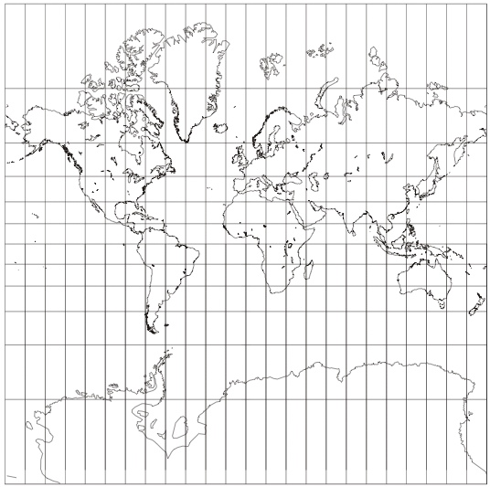
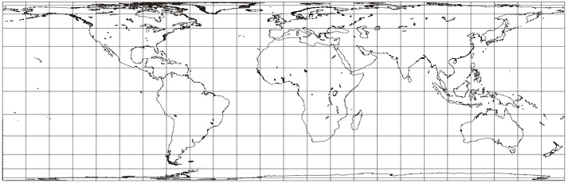
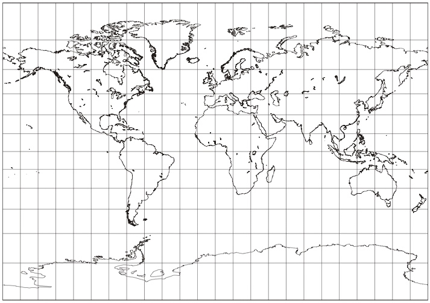

# spacetime-holearg — leibniz_equivalence（supplement）

> （《spacetime-holearg》词条补充材料，源：plato.stanford.edu/entries/spacetime-holearg/leibniz_equivalence.html）

#### Supplement to The Hole Argument

## Visualizing Leibniz Equivalence Through Map Projections

Leibniz Equivalence tells us that different spreadings of metrical and matter fields on the spacetime manifold represent the same physical spacetime. That notion can be somewhat hard to grasp if one is not comfortable with the abstract ideas of metric fields and manifolds.

It turns out, however that most of us are already familiar with something that is pretty close to Leibniz equivalence. That is the notion of different map projections of the earth's surface. We are all familiar with the principal problem. The earth is round, but our maps are flat sheets of paper. So any attempt to draw a map of the earth on a flat sheet of paper will end up distorting the geography of the earth.

One of the most familiar map projections of the earth's surface is the Mercator projection:

> 

Its problems are well-known. It renders the sizes of the land masses well enough near the equator. The further we get from the equator, the more it exaggerates. So both Greenland in the far north and Antarctica in the far south are very much bigger in the map than they are in relation to the other continents in reality.

We learn pretty quickly how to read these projections. The key idea is not to take distances on the page seriously. An inch on the map near the equator corresponds to a very different distance on the earth's surface than an inch on the map somewhere near the poles.

To start the analogy to spacetime theories:

- The *paper* is analogous to the spacetime *manifold*: the paper just provides points that will be used to describe the earth. We don't take the distance between the points seriously.
- The *grid of inked lines* printed on the paper is analogous to the *metric field*. Those inked lines tell us what the real distances are between different points on the map. If we know how to read them, we quickly see that Greenland is not really as big as Africa.

Different map projections are possible and cartographers have been trying to devise ones that will render more correctly the different areas of the land masses. Here are two more.

The first is a Cylindrical Equal-area projection:

> 

The second is an Umayev cylindrical projection:

> 

To complete the analogy, these different projections correspond to different spreadings of the metric field over the spacetime manifold. All three projections agree in their invariant properties; that is, they agree in real spatial distances measured. All of them tell us the correct size of Greenland and that Greenland is smaller than Africa. However that same invariant information is represented by spreading the same grid of inked lines differently over the page.

My thanks to Michel Janssen, who, through a fortuitious misunderstanding, suggested this analogy without realizing it.

Map projections downloaded from <[A Gallery of Map Projections](http://spatial.ucsb.edu/archive/map-projections/)> August 27, 2007. Graphics created and released into the Public Domain by Paul B. Anderson.

The SEP Editors would like to thank Gintautas Miliauskas (Vilnius University) for noticing that the graphics were not being displayed in this supplementary document.
