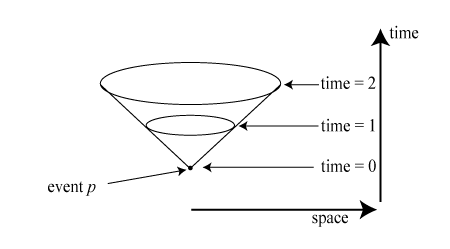
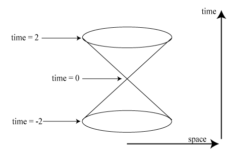
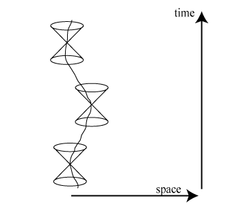
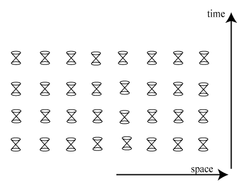
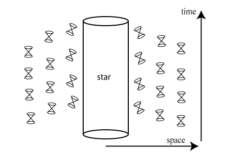
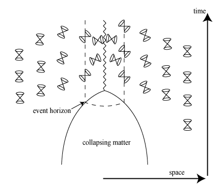

# spacetime-singularities — lightcone（supplement）

> （《spacetime-singularities》词条补充材料，源：plato.stanford.edu/entries/spacetime-singularities/lightcone.html）

#### Supplement to Singularities and Black Holes

## Light Cones and Causal Structure

In attempting to diagram relativistic spacetimes, one of the most important features to capture is the *causal structure* of the spacetime. This structure specifies which events (that is, which points of space and time) can be connected by trajectories that are slower than light, which events can be connected by trajectories traveling *at* the speed of light, and which events cannot be connected by anything traveling at or below light speed. Events in the first group are said to be “timelike related”, because a physical clock could travel from one event to the other. Events in the second group are “lightlike related” because a light ray can travel from one to the other. Events in the third group are “spacelike related”. Given that it is physically impossible (on the standard interpretation of relativity theory) for any causal process to exceed the speed of light, these three possible ways of being connected tell us whether one event is able to influence another.

We can depict these three spatiotemporal relationships by drawing in the “light cone” of an event. Given an event *p*, the light cone of *p* consists of all the points that can be connected to *p* by a straight ray of light. Imagine that event *p* is someone flashing a bright light from a particular location. Then one second later, there will be a sphere of points that is currently occupied by the outgoing light pulse. Two seconds later, a larger sphere, farther out, will be illuminated, and so on. We can depict these spheres at progressive times in a spacetime if we ignore one dimension of space so that we can draw in the points occupied by the light pulse as a circle, as in the following figure:

We can likewise depict the points in the past that are connected to point *p* by light rays. For a given time, these points will again form a sphere, which will grow larger the farther into the past we look. Thus the full light cone looks like this:

We can now use these light cones to depict the causal structure of spacetime. Anything outside of the light cone of *p* cannot causally interact with *p*. The “causal future” of *p* consists of the points on and inside the future half of the light cone. Likewise, the causal past is picked out by the bottom half of the light cone. Note that because nothing can go faster than light, the trajectory of any object will always remain within the light cone of each event along that trajectory—the path will “thread” the cones:

We depict flat spacetime by keeping all the light cones oriented in the same direction, as in the following figure.

The curvature of spacetime, then, will be depicted by the tilting of these light cones. This reflects the fact that the causal structure of such spacetimes is different from that of flat spacetimes. So, for example, the spacetime around a massive body like a star will be depicted as follows.

We have a black hole when the curvature of spacetime becomes so severe that, for some region, there is no path *out* of that region that remains inside its own light cones. That is, the causal structure of the spacetime is such that one cannot escape from that region without traveling faster than light. Such a region is by definition a black hole; the border of that region is the event horizon.

