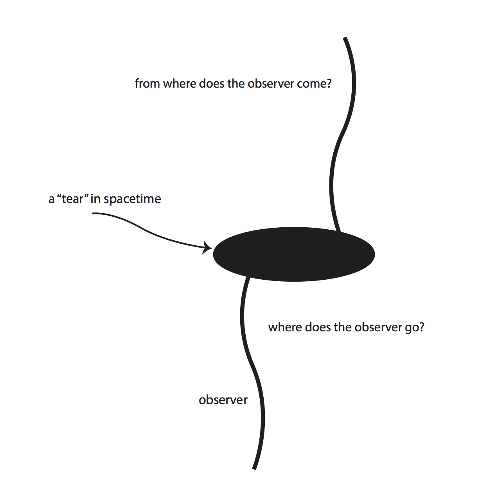
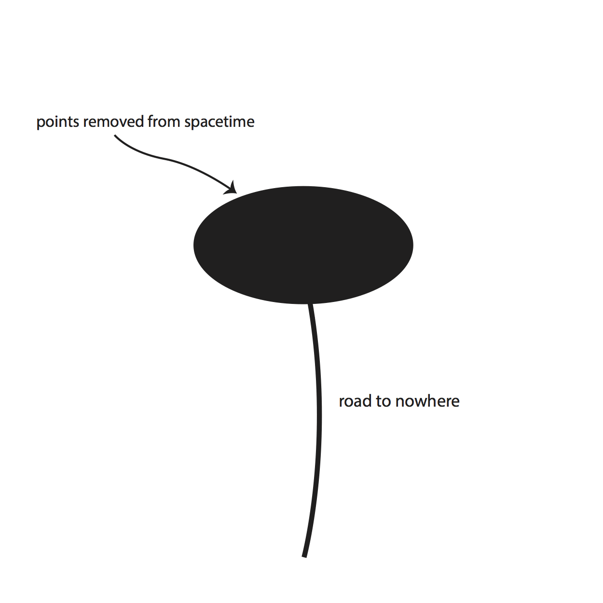
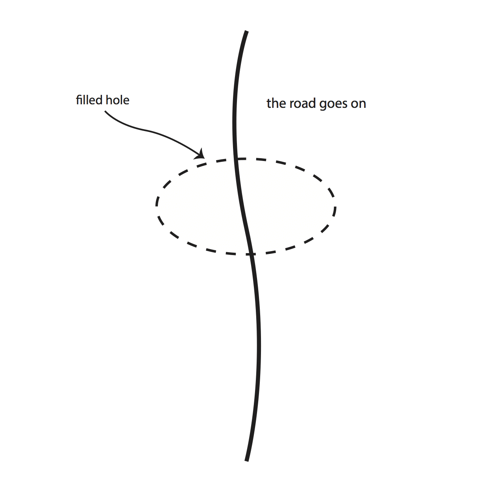

# Singularities and Black Holes
**First published Mon Jun 29, 2009; substantive revision Sun Jul 13, 2025**

*Curiel, Erik, Visser, Manus, Doboszewski, Juliusz*

A spacetime singularity is a breakdown in spacetime, either in its geometry or in some other basic physical structure. It is a topic of ongoing physical and philosophical research to clarify both the nature and significance of such pathologies. When it is the fundamental geometry that breaks down, spacetime singularities are often viewed as an end, or “edge”, of spacetime itself. Numerous difficulties, however, arise when one tries to make this notion more precise. Breakdowns in other physical structures pose other problems, just as difficult. Our current theory of spacetime, general relativity, not only allows for singularities, but tells us that they are unavoidable in some real-world circumstances. Thus we apparently need to understand the ontology of singularities if we are to grasp the nature of space and time in the actual universe. The possibility of singularities also carries potentially important implications for the issues of physical determinism and the scope of physical laws.

Black holes are regions of spacetime from which nothing, not even light, can escape. A typical black hole is the result of the gravitational force becoming so strong that one would have to travel faster than light to escape its pull. Such black holes generically contain a spacetime singularity at their center; thus we cannot fully understand a black hole without also understanding the nature of singularities. Black holes, however, raise several additional conceptual problems and questions on their own. When quantum effects are taken into account, black holes, although they are nothing more than regions of spacetime, appear to become thermodynamical entities, with a temperature and an entropy. This seems to point to a deep and hitherto unsuspected connection among our three most fundamental theories, general relativity, quantum field theory and thermodynamics. It is far from clear, however, what it may mean to attribute thermodynamical properties to black holes. At the same time, some of these thermodynamical properties of black holes now seem amenable to direct testing in terrestrial laboratories by observing the behavior of “analogue” systems composed of ordinary material. This all raises problems about inter-theory relations, in particular about relations between the “same” quantity as it appears in different theories. It also bears on the meaning and status of the Second Law of thermodynamics, with possible implications for characterizing a cosmological arrow of time.

Finally, the entropy attributed to black holes seems to be a quantum gravitational property, since both the gravitational constant and Planck’s constant appear in the standard formula for black hole entropy. Indeed, as purely gravitational entities with striking quantum properties, what we know about black holes lies at the heart of and guides many attempts to formulate a theory of quantum gravity. This has led to a debate over what seemingly fundamental physical principles are likely to be preserved in, or violated by, a full quantum theory of gravity.

Because so few philosophers have worked on these issues, many questions and problems of great possible interest have not been investigated philosophically at all; others have had only the barest starts made on them; consequently, several sections discussed in this article merely raise questions and point to problems that deserve philosophical attention. The field is wide open for expansive and intensive exploration.

All the technical material required to delve more deeply into the subject of this entry can be found in any of a number of excellent classic and recent sources, including: Hawking and Ellis (1973); Geroch and Horowitz (1979); Wald (1984, 1994)[^wald-1984][^wald-1994]; Brout *et al.* (1995); Malament (2007, 2012)[^malament-2007][^malament-2012]; and Manchak (2013, 2020)[^manchak-2013][^manchak-2020]. The reader unfamiliar with general relativity may find it helpful to review the Hole Argument entry’s [Modern Spacetime Theories: A Beginner’s Guide](https://plato.stanford.edu/entries/spacetime-holearg/#ModeSpacTheoBegiGuid), which presents a brief and accessible introduction to the concepts of a spacetime manifold, a metric, and a worldline.

## 1. Spacetime Singularities

General relativity, Einstein’s theory of space, time, and gravity, allows for the existence of singularities. Everyone agrees on this. When it comes to the question of how, precisely, singularities are to be defined, however, there is widespread disagreement. Singularities in some way signal a breakdown of the geometry of spacetime itself, but this presents an obvious difficulty in referring to a singularity as a “thing” that resides at some *location* in spacetime: without a well-behaved geometry, there can be no location. For this reason, some philosophers and physicists have suggested that we should not speak of “singularities” at all, but rather of “singular spacetimes”. In this entry, the two formulations will generally be treated as equivalent, but the distinction will be highlighted when it becomes significant.

Singularities are often conceived of metaphorically as akin to a tear in the fabric of spacetime. The most common attempts to define singularities center on one of two core ideas that this image readily suggests. The first is that a spacetime has a singularity if it contains an incomplete path, one that cannot be continued indefinitely, but draws up short, as it were, with no possibility of extension. (“Where is the path supposed to go after it runs into the tear? Where did it come from when it emerged from the tear?”) The second is that a spacetime is singular just in case there are points “missing from it”. (“Where are the spacetime points that should be where the tear is?”)

Another common thought, often adverted to in discussion of the two primary notions, is that singular structure, whether in the form of missing points or incomplete paths, must be related to pathological behavior of some sort in the singular spacetime’s curvature, that is, the fundamental deformation of spacetime that manifests itself as “the gravitational field”. For example, some measure of the intensity of the curvature (“the strength of the gravitational field”) may increase without bound as one traverses the incomplete path.

In recent years it was realized that there is another kind of singular behavior that spacetimes may manifest, distinct conceptually and physically from the idea that singularities come in the form of incomplete curves or missing points. These are known as ‘sudden singularities’, and are particularly important in cosmological contexts. Besides their intrinsic interest, they also call into question much of the standard, traditional conceptions and claims made about singular structure in general relativity.

Finally, there is considerable disagreement over the significance of singularities. Many physicists believe that general relativity’s prediction of singular structure signals a serious deficiency in the theory: singularities are an indication that the description offered by general relativity is breaking down. Others believe that singularities represent an exciting new possibility for physicists to explore in astrophysics and cosmology, holding out the promise of physical phenomena differing so radically from any that we have yet experienced as to signal, in our attempt to observe, quantify and understand them, a profound advance in our comprehension of the physical world.

Each of these issues will be considered in turn below.

The history of singular structure in general relativity is fascinating, with debate over it dating back to the earliest days of the theory, but discussion of it is beyond the scope of this article; the interested reader should consult Earman (1999)[^earman-1999][^earman-1999-2], Earman and Eisenstaedt (1999), Senovilla and Garfinkle (2015), and references therein.

### 1.1. Path Incompleteness

While there are competing definitions of spacetime singularities, the most central and widely accepted criterion rests on the possibility that some spacetimes contain incomplete, inextendible paths. Indeed, the rival definitions (in terms of missing points or curvature pathology), as we will see, rely on the notion of path incompleteness.

A path in spacetime is a continuous chain of events through space and time. If you snap your fingers continually, without pause, then the collection of snaps forms a path. The paths used in the most important singularity theorems represent possible trajectories of particles and observers. Such paths are known as world-lines; they consist of the continuous sequence of events instantiated by an object’s existence at each instant of its lifetime. That the paths be incomplete and inextendible means, roughly speaking, that, after a finite amount of time, a particle or observer following that path would “run out of world”, as it were—it would hurtle into the tear in the fabric of spacetime and vanish. (See Figure 1.) Alternatively, a particle or observer could leap out of the tear to follow such a path. While there is no logical or physical contradiction in any of this, it appears on the face of it physically suspect for an observer or a particle to be allowed to pop in or out of existence right in the middle of spacetime, so to speak—if that does not suffice for concluding that the spacetime is singular, it is difficult to imagine what else would. At the same time as this criterion for singularities was first proposed, the ground-breaking work predicting the existence of such pathological paths (Penrose 1965, 1968; Hawking 1965, 1966a, 1966b, 1966c, 1966d; Geroch 1966, 1967, 1968b, 1970; Hawking and Penrose 1970)[^geroch-1966][^geroch-1967][^geroch-1968b][^geroch-1970][^hawking-1965][^hawking-1966a][^hawking-1966b][^hawking-1966c][^hawking-1966d][^hawking-1970][^penrose-1965][^penrose-1968] produced no consensus on what ought to count as a necessary condition for singular structure according to this criterion, and thus no consensus on a fixed definition for it.

*Figure 1:* a tear in spacetime

In this context, an incomplete path in spacetime is one that is both inextendible and of finite proper length, which means that any particle or observer traversing the path would experience only a finite interval of existence that in principle cannot be continued any longer. For this criterion to do the work we want it to, however, we will need to limit the class of spacetimes under discussion. Specifically, we shall be concerned with spacetimes that are maximally extended (or just ‘maximal’, for short). In effect, this condition says that one’s representation of spacetime is “as big as it possibly can be”. There is, from the mathematical point of view, no way to treat the spacetime as being a proper subset of a larger, more extensive spacetime. (See figure 2.)

*Figure 2:* a non-maximal spacetime

If there is an incomplete path in a spacetime, goes the thinking behind the requirement, then perhaps the path is incomplete only because one has not made one’s model of spacetime big enough. If one were to extend the spacetime manifold maximally, then perhaps the previously incomplete path could be extended into the new portions of the larger spacetime, indicating that no physical pathology underlies the incompleteness of the path. The inadequacy would merely have resided in the incomplete physical model we had been using to represent spacetime.

An example of a non-maximally extended spacetime can be easily had, along with a sense of why they intuitively seem in some way or other deficient. For the moment, imagine spacetime is only two-dimensional, and flat, like a sheet of paper. Now, excise from somewhere on this plane a closed set of any shape whatsoever. Any path that had passed through one of the points in the removed set is now incomplete.

In this case, the maximal extension of the resulting spacetime is obvious, and does indeed fix the problem of all such incomplete paths: re-incorporate the previously excised set. (See Figure 3.) The seemingly artificial and contrived nature of such examples, along with the ease of rectifying them, seems to militate in favor of requiring spacetimes to be maximal. Also, inextendibility is sometimes argued for on the grounds that there is no known physical process that could cause spacetime to draw up short, as it were, and not continue on as it could have, were it to have an extension (Clarke 1975; Ellis and Schmidt 1977)[^clarke-1975][^ellis-1977].

*Figure 3:* a non-maximal spacetime made maximal by filling its holes

In recent important work, Manchak has questioned the need and even the reasonableness of requiring spacetimes to be maximal (*i.e.*, inextendible), pointing out problems with the condition’s epistemic status (Manchak 2011)[^manchak-2011], its conceptual cogency (Manchak 2016a)[^manchak-2016a], and its metaphysical character (Manchak 2016b)[^manchak-2016b]. Because inextendibility is the most common assumption made in the physics literature when singular structure is discussed, however, we will continue to assume it for the purposes of this discussion, Manchak’s interesting arguments notwithstanding. (Manchak’s arguments will be discussed further in section 4 below.)

Once we have established that we are interested in maximal spacetimes, the next issue is what sort of path incompleteness is relevant for singularities. Here we find a good deal of controversy. Criteria of incompleteness typically look at how some parameter naturally associated with the path (such as its proper length) grows. One generally also places further restrictions on the paths that one considers—for example, one may rule out paths that could be traversed only by particles undergoing unbounded acceleration in a finite period of time. A spacetime, then, is said to be *singular* if it possesses a path such that the specified parameter associated with that path cannot increase without bound as one traverses the entirety of the maximally extended path. The idea is that the parameter at issue will serve as a marker for some manifestly physical property, such as the time experienced by a particle or observer, and so, if the value of that parameter remains finite along the whole path, then we have run out of path in a finite amount of time, as it were. We have hit an edge or a “tear” in spacetime.

For a path that is everywhere timelike, *i.e.*, that does not involve speeds at or above that of light, it is natural to take as the parameter the proper time a particle or observer would experience along the path, that is, the time measured along the path by a natural clock, such as one based on the vibrational frequency of an atom. (There are also natural choices that one can make for spacelike paths, *e.g.*, those that consist of points at a single “time”, and for null paths, those followed by light signals; however, because the spacelike and null cases add yet another level of technical complexity, we shall not discuss them here.) The physical interpretation of this sort of incompleteness for timelike paths is more or less straightforward: a timelike path incomplete with respect to proper time in the future direction would represent the possible trajectory of a massive body that would never age beyond a certain point in its existence. (An analogous statement can be made, *mutatis mutandis*, if the path were incomplete in the past direction.)

We cannot, however, simply stipulate that a maximal spacetime is singular just in case it contains paths of finite proper time that cannot be extended. Such a criterion would imply that even the flat spacetime described by special relativity is singular, which is surely unacceptable. This would follow because, even in flat spacetime, there are timelike paths with unbounded acceleration that have only a finite proper time and are also inextendible.

The most obvious option is to define a spacetime as singular if and only if it contains incomplete, inextendible timelike geodesics, *i.e.*, paths representing the possible trajectories of inertial observers, those in free-fall. This criterion, however, seems too permissive, in that it would count as non-singular some spacetimes whose geometry seems otherwise pathological. For example, Geroch (1968c)[^geroch-1968c] describes a spacetime that is geodesically complete and yet possesses an incomplete timelike path of bounded total acceleration—that is to say, an inextendible path in spacetime traversable by a rocket with a finite amount of fuel, along which an observer could experience only a finite amount of proper time. Surely the intrepid astronaut in such a rocket, who would never age beyond a certain point, would have just cause to complain that something was singular about this spacetime.

When deciding whether a spacetime is singular, therefore, we want a definition that is not restricted to geodesics. We need, however, some way of overcoming the fact that non-singular spacetimes include inextendible paths of finite proper length that are not *prima facie* pathological (*e.g.*, flat spacetimes with inextendible paths of unbounded total acceleration). The most widely accepted solution to this problem makes use of a slightly different, technically complex notion of length, known as ‘generalized affine length’ (Schmidt 1971)[^schmidt-1971].[^note-1] Unlike proper time, this generalized affine length depends on some arbitrary choices. (Roughly speaking, the length will vary depending on the coordinates one chooses to compute it; see [note 1](notes.html#note-1).) If the length is infinite for one such choice, however, it will be infinite for all other choices. Thus the question of whether a path has a finite or infinite generalized affine length is a well-defined question, and that is all we will need.

The definition that has won the most widespread acceptance—leading Earman (1995, p. 36) to dub this the *semiofficial definition* of singularities—is the following:

> A spacetime is *singular* if and only if it is maximal and contains an inextendible path of finite generalized affine length.

To say that a spacetime is singular then is to say that there is at least one maximally extended path that has a bounded (generalized affine) length. To put it another way, a spacetime is nonsingular when it is complete in the sense that the only reason any given path might not be extendible is that it’s already infinitely long (in this technical sense).

The chief problem facing this definition of singularities is that the physical significance of generalized affine length is opaque, and thus it is unclear what the physical relevance of singularities, defined in this way, might be. It does nothing, for example, to clarify the physical status of the spacetime described by Geroch (geodesically complete but containing incomplete paths of bounded total acceleration), which it classifies as *non-singular*, as the curve at issue indeed has infinite generalized affine length, even though it has only a finite total proper time (to the future). The new criterion does nothing more than sweep the troubling aspects of such examples under the rug. It does not explain why we ought not to take such *prima facie* puzzling and troubling examples as physically pathological; it merely declares by fiat that they are not.

Manchak (2014a)[^manchak-2014a] proposed a condition spacetimes may satisfy, manifestly relevant to the issue of what characterizes singular behavior, which he calls ‘effective completeness’. The idea is to try to give what may be thought of as a quasi-local characterization of path incompleteness.[^note-2] Manchak (2014a, p. 1071) describes the intended physical significance as follows: “If a space-time fails to be effectively complete, then there is a freely falling observer who never records some particular watch reading but who ‘could have’ in the sense that nothing in her vicinity precludes it.” This condition has the pleasant property of being logically intermediate between the condition of geodesic incompleteness for spacetime, on the one hand, generally conceded to be too strong to capture the general idea of singular behavior (because of examples such that of Geroch 1968c, discussed above)[^geroch-1968c], and, on the other hand, the condition of being extendible, generally conceded to be too weak, for effective completeness is implied by geodesic completeness and in turn implies inextendibility. While this new condition appears promising as a clear and useful characterization of singular structure (in the sense of path incompleteness), and does so in a way that avoids the problems of physical opacity plaguing the semi-official definition, one wants to know, among other things, whether it can be used to prove novel theorems with the same physical depth and reach as the standard singularity theorems (Penrose 1965, 1968; Hawking 1965, 1966a, 1966b, 1966c, 1966d; Geroch 1966, 1967, 1968b, 1970; Hawking and Penrose 1970)[^geroch-1966][^geroch-1967][^geroch-1968b][^geroch-1970][^hawking-1965][^hawking-1966a][^hawking-1966b][^hawking-1966c][^hawking-1966d][^hawking-1970][^penrose-1965][^penrose-1968], and whether it can shed real light on the philosophical issues discussed below in section 2. So far, “hole freeness” conditions were unable to provide that.

So where does all this leave us? The consensus seems to be that, while it is easy in specific examples to conclude that incomplete paths of various sorts represent singular structure, no entirely satisfactory, strict definition of singular structure in their terms has yet been formulated (Joshi 2014)[^joshi-2014]. Moreover, spacetimes can evince entirely different kinds of behavior that manifestly are singular in an important sense, and yet which are independent of path incompleteness (as discussed in the Supplementary Document: [Non-Standard Singularities](spacetime-singularities.non-standard-singularities.md)). For a philosopher, the issues offer deep and rich veins for those contemplating, among other matters, the role of explanatory power in the determination of the adequacy of physical theories, the role of metaphysics and intuition in the same, questions about the nature of the existence attributable to physical entities in spacetime and to spacetime itself, and the status of mathematical models of physical systems in the determination of our understanding of those systems as opposed to the mere representation of our knowledge of them. All of these issues will be touched upon in the following.

### 1.2. Boundary Constructions

We have seen that one runs into difficulties if one tries to define singularities as “things” that have locations, and how some of those difficulties can be avoided by defining singular spacetimes using the idea of incomplete paths. It would be desirable for many reasons, however, to have a characterization of a spacetime singularity in general relativity as, in some sense or other, a spatiotemporal “place”. If one had a precise characterization of a singularity based on points that are missing from spacetime, one might then be able to analyze the structure of the spacetime “locally at the singularity”, instead of taking troublesome, perhaps ill-defined, limits along incomplete paths. Many discussions of singular structure in relativistic spacetimes, therefore, are premised on the idea that a singularity represents a point or set of points that in some sense or other is missing from the spacetime manifold, that spacetime has a “hole” or “tear” in it that we could fill in, or patch, by attaching a boundary to it.

In trying to determine whether an ordinary web of cloth has a hole in it, for example, one would naturally rely on the fact that the web exists in space and time. In this case one can point to a hole in the cloth by specifying points of space at a particular moment of time not currently occupied by any of the cloth, but which would complete the cloth were they so occupied. When trying to conceive of a singular spacetime, however, one does not have the luxury of imagining it embedded in a larger space with respect to which one can say there are points missing from it. In any event, the demand that the spacetime be maximal rules out the possibility of embedding the spacetime manifold in any larger spacetime manifold of any ordinary sort. It would seem, then, that making precise the idea that a singularity is a marker of missing points ought to involve some idea of intrinsic structural incompleteness in the spacetime manifold rather than extrinsic incompleteness with respect to an external structure.

The most obvious route, especially in light of the previous discussion, and the one most often followed, is to define a spacetime to have points missing from it if and only if it contains incomplete, inextendible paths, and then try to use these incomplete paths to construct in some fashion or other new, properly situated points for the spacetime, the addition of which will make the previously inextendible paths extendible. These constructed points would then be our candidate singularities. Missing points on this view would correspond to a boundary for a singular spacetime—actual points of a (non-standard) extended spacetime at which paths incomplete in the original spacetime would terminate. (We will, therefore, alternate between speaking of *missing points* and speaking of *boundary points*, with no difference of sense intended.) The goal then is to construct this extended space using the incomplete paths as one’s guide.

Now, in trivial examples of spacetimes with missing points such as the one offered before, flat spacetime with a closed set excised from it, one does not need any technical machinery to add the missing points back in. One can do it by hand. Many spacetimes with incomplete paths, however, do not allow missing points to be attached in any obvious way by hand, as that example does. For this program to be viable, which is to say, in order to give substance to the idea that there really are points that in some sense ought to have been included in the spacetime in the first place, we require a physically natural completion procedure that can be applied to incomplete paths in arbitrary spacetimes. There are several proposals for such a construction (Hawking 1966c, Geroch 1968a, Schmidt 1971)[^geroch-1968a][^hawking-1966c][^hawking-1971][^schmidt-1971].[^note-3]

Several problems with this kind of program make themselves felt immediately. Consider, for example, a spacetime representing the final state of the complete gravitational collapse of a spherically symmetric body resulting in a black hole. (See section 3 below for a description of black holes in general, and Figure 6 for a representation of a body collapsing to form a black hole.) In this spacetime, any timelike path entering the black hole will necessarily be extendible for only a finite amount of proper time—it then “runs into the singularity” at the center of the black hole. In its usual presentation, however, there are no obvious points missing from the spacetime at all. By any standard measure, as a manifold in its own right it is as complete as the Cartesian plane, excepting only the existence of incomplete curves, no class of which indicates by itself a place in the manifold at which to add a point so as to make the paths in the class complete. Likewise, in our own spacetime every inextendible, past-directed timelike path is incomplete (and our spacetime is singular): they all run into the Big Bang. Insofar as there is no moment of time at which the Big Bang occurred (no moment of time at which time began, so to speak), there is no point to serve as the past endpoint of such a path. We can speak of the cosmic epoch, the time after the Big Bang. That makes it easy to imagine that cosmic time zero is some initial event. That, however, is an illusion of our labeling. Cosmic time “zero” is a label attached to no event. If instead we had labeled epochs with the logarithm of cosmic time, then the imaginary moment of the Big Bang would be assigned the label of minus infinity and its fictional character would be easier to accept. (One can make the point a little more precise: the global structure of our universe, as modeled by our best cosmological theories, is essentially the same as a well known mathematical space, either $\mathbb{R}^4$ or $\mathbb{S}^3 \times \mathbb{R}$, which are both complete and inextendible as manifolds independent of any spacetime metrical structure, in every reasonable sense of those terms.)

Even more troublesome examples are given by topologically compact regions of spacetimes containing incomplete, inextendible paths, as in a simple example due to Misner (1967)[^misner-1967]. In a sense that can be made precise, compact sets, from a topological point of view, “contain every point they could possibly be expected to contain”, one manifestation of which is that a compact manifold cannot be embedded as an open submanifold of any other manifold, a necessary prerequisite for attaching a boundary to a singular spacetime. It is not only with regard to the attachment of a boundary, however, that compact sets already contain all points they possibly could: every sequence of points in a compact set has a subsequence that converges to a point in the set. Non-convergence of sequences is the standard way that one probes geometrical spaces for “missing” points that one can add in by hand, as it were, to complete the space; thus, compact sets, in this natural sense, *cannot* have any missing points.

Perhaps the most serious problem facing all the proposals for attaching boundary points to singular spacetimes, however, is that the boundaries often end up having physically pathological properties (Geroch *et al.* 1982)[^geroch-1982]: in a sense one can make precise, the boundary points end up being arbitrarily “near” to every point in the interior of the spacetime. (The argument, however, might be circumvented; a boundary construction with the best known separation properties can be found in Flores *et al.* 2016.)[^flores-2016] Attaching boundary points to our own universe, therefore, to make the Big Bang into a real “place”, ends up making the Big Bang arbitrarily close to every neuron in my brain. Far from making tractable the idea of localizing singular structure in a physically fruitful way, then, all the proposals only seem to end up making the problems worse.

The reaction to the problems faced by these boundary constructions is varied, to say the least, ranging from blithe acceptance of the pathology (Clarke 1993)[^clarke-1993], to the attitude that there is no satisfying boundary construction currently available while leaving open the possibility of better ones in the future (Wald 1984)[^wald-1984], to not even mentioning the possibility of boundary constructions when discussing singular structure (Joshi 1993, 2007b, 2014)[^joshi-2014][^joshi-1993][^joshi-2007b], to rejection of the need for such constructions at all (Geroch *et al.* 1982; Curiel 1999)[^curiel-1999][^geroch-1982].

Nonetheless, many eminent physicists seem convinced that general relativity stands in need of such a construction, and have exerted extraordinary efforts in trying to devise one. This fact raises several philosophical problems. Though physicists sometimes offer as strong motivation the possibility of gaining the ability to analyze singular phenomena locally in a mathematically well-defined manner, they more often speak in terms that strongly suggest they suffer a metaphysical itch that can be scratched only by the sharp point of a localizable, spatiotemporal entity serving as the locus of their theorizing. Even were such a construction forthcoming, however, what sort of physical and theoretical status could accrue to these missing points? They would not be idealizations of a physical system in any ordinary sense of the term, since they would not represent a simplified model of a system formed by ignoring various of its physical features, as, for example, one may idealize the modeling of a fluid by ignoring its viscosity. Neither would they seem necessarily to be only convenient mathematical fictions, as, for example, are the physically impossible dynamical evolutions of a system one integrates over in the variational derivation of the Euler-Lagrange equations. To the contrary, as we have remarked, many physicists and philosophers seem eager to find such a construction for the purpose of bestowing substantive and clear ontic status on singular structure. What sorts of theoretical entities, then, could they be, and how could they serve in physical theory?

While the point of this project may seem at bottom identical to the path-incompleteness account discussed in section 1.1, insofar as singular structure will be defined by the presence of incomplete, inextendible paths, there is a crucial conceptual and logical difference between the two. Here, the existence of the incomplete path does not constitute the singular structure, but rather serves only as a marker for the presence of singular structure in the sense of missing points: the incomplete path is incomplete because it “runs into a hole” in the spacetime that, were it filled, would allow the path to be continued; this hole is the singular structure, and the points constructed to fill it constitute its locus. Indeed, every known boundary construction relies on the existence of incomplete paths to “probe” the spacetime, as it were, looking for “places” where boundary points should be appended to the spacetime; the characterization of singular structure by incomplete paths seems, therefore, logically, perhaps even conceptually, prior to that by boundary points, at least, again, for all known constructions of boundary points.

Currently, there seems to be even less consensus on how (and whether) one should define singular structure based on the idea of missing points than there is regarding definitions based on path incompleteness. Moreover, this project also faces even more technical and philosophical problems. For these reasons, path incompleteness is generally considered the default definition of singularities. For the remainder of this article, therefore, singular structure will be assumed to be characterized by incomplete, inextendible paths.

There is, however, one special case in which it seems a boundary can be placed on singular spacetimes in such a way as to localize the singularity in a physically meaningful way: for so-called conformal singularities. Their properties are discussed at the end of section 1.3, and their physical and philosophical significance explored in more detail in section 5.5.

### 1.3. Curvature Pathology

While path incompleteness seems to capture an important aspect of the intuitive picture of singular structure, it completely ignores another seemingly integral aspect of it: curvature pathology. If there are incomplete paths in a spacetime, it seems that there should be a reason that the path cannot go further. The most obvious candidate explanation of this sort is that something is going wrong with the dynamical structure of the geometry of spacetime, which is to say, with the curvature of the spacetime. This suggestion is bolstered by the fact that local measures of curvature do in fact blow up as one approaches the singularity of a standard black hole or the Big Bang singularity. There is, however, one problem with this line of thought: no species of curvature pathology we know how to define is either necessary or sufficient for the existence of incomplete paths. (For a discussion of foundational problems attendant on attempts to define singularities based on curvature pathology, see Curiel 1999; for a recent survey of technical issues, see Joshi 2014.)[^curiel-1999][^joshi-2014]

To make the notion of curvature pathology more precise, we will use the manifestly physical idea of tidal force. Tidal force is generated by the difference in intensity of the gravitational field at neighboring points of spacetime. For example, when you stand, your head is farther from the center of the Earth than your feet, so it feels a (practically negligible) smaller pull downward than your feet. Tidal forces are a physical manifestation of spacetime curvature, and one gets direct observational access to curvature by measuring the resultant relative difference in accelerations of neighboring test bodies. For our purposes, it is important that in regions of extreme curvature tidal forces can grow without bound.

It is perhaps surprising that the state of motion of an object as it traverses an incomplete path (*e.g.*, whether it is accelerating or spinning) can be decisive in determining its physical response to curvature pathology. Whether an object is spinning or not, for example, or accelerating slightly in the direction of motion, may determine whether the object gets crushed to zero volume along such a path or whether it survives (roughly) intact all the way along it, as shown by examples offered by Ellis and Schmidt (1977). Indeed, the effect of the observer’s state of motion on his or her experience of tidal forces can be even more pronounced than this. There are examples of spacetimes in which an observer cruising along a certain kind of path would experience unbounded tidal forces and so be torn apart, while another observer, in a certain technical sense approaching the same limiting point as the first observer, accelerating and decelerating in just the proper way, would experience a perfectly well-behaved tidal force, though she would approach as near as she likes to the other fellow who is in the midst of being ripped to shreds.[^note-4]

Things can get stranger still. There are examples of incomplete geodesics contained entirely within a well-defined, bounded region of a spacetime, each having as its limiting point an honest-to-goodness point of spacetime, such that an observer freely falling along such a path would be torn apart by unbounded tidal forces; it can easily be arranged in such cases, however, that a separate observer, who actually travels through the limiting point, will experience perfectly well-behaved tidal forces.[^note-5] Here we have an example of an observer being ripped apart by unbounded tidal forces right in the middle of spacetime, as it were, while other observers cruising peacefully by could reach out to touch him or her in solace during the final throes of agony. This example also provides a nice illustration of the inevitable difficulties attendant on attempts to localize singular structure in the senses discussed in section 1.2.

It would seem, then, that curvature pathology as characterized based on the behavior of tidal forces is not in any physical sense a well-defined property of a region of spacetime *simpliciter*. When we consider the physical manifestations of the curvature of spacetime, the motion of the device that we use to probe a region (as well as the nature of the device) becomes crucially important for the question of whether pathological behavior manifests itself. This fact raises questions about the nature of quantitative measures of properties of entities in general relativity, and what ought to count as observable, in the sense of reflecting the underlying physical structure of spacetime. Because apparently pathological phenomena may occur or not depending on the types of measurements one is performing, it seems that purely geometrical pathology does not necessarily reflect anything about the state of spacetime itself, or at least not in any localizable way. What then does it reflect, if anything? Much work remains to be done by both physicists and by philosophers in this area, *i.e.*, the determination of the nature of physical quantities in general relativity and what ought to count as an observable with intrinsic physical significance. See Bertotti (1962)[^bertotti-1962], Bergmann (1977)[^bergmann-1977], Rovelli (1991, 2001 in Other Internet Resources, henceforth OIR, 2002), Curiel (1999)[^curiel-1999] and Manchak (2009a)[^manchak-2009a] for discussion of many different topics in this area, approached from several different perspectives.

There is, however, one form of curvature pathology associated with a particular form of an apparently important class of singularities that has been clearly characterized and analyzed, that associated with so-called conformal singularities, also sometimes called isotropic singularities (Goode and Wainwright 1985; Newman 1993a, 1993b; Tod 2002)[^goode-1985][^newman-1993a][^newman-1993b][^tod-2002]. The curvature pathology of this class of singularities can be precisely pinpointed: it occurs solely in the conformal part of the curvature; thus, what is singular in one spacetime will not necessarily be so in a conformally equivalent spacetime.[^note-6] This property allows for a boundary to be attached to the singular spacetime in a way that seems to be physically meaningful (Newman 1993a, 1993b; Tod 2002)[^newman-1993a][^newman-1993b][^tod-2002]. Many physicists hold that, in a sense that can be made precise, all “purely gravitational degrees of freedom” in general relativity are encoded in the conformal structure (Penrose 1979; Gomes *et al.* 2011)[^gomes-2011][^penrose-1979]. These properties, along with the fact that the Big Bang singularity almost certainly seems to be of this form, make conformal singularities particularly important for the understanding and investigation of many issues of physical and philosophical interest in contemporary cosmology.

Finally, we should mention that general relativity admits even more kinds of singularities than those discussed so far! See the Supplementary Document: [Non-Standard Singularities](spacetime-singularities.non-standard-singularities.md) for an introduction.

## 2. The Significance of Singularities

When considering the implications of spacetime singularities, it is important to note that we have good reasons to believe that the spacetime of our universe is singular. In the late 1960s, Penrose, Geroch, and Hawking proved several singularity theorems, using path incompleteness as a criterion (Penrose 1965, 1968; Hawking 1965, 1966b, 1966c, 1966d; Geroch 1966, 1967, 1968b, 1970; Hawking and Penrose 1970)[^geroch-1966][^geroch-1967][^geroch-1968b][^geroch-1970][^hawking-1965][^hawking-1966b][^hawking-1966c][^hawking-1966d][^hawking-1970][^penrose-1965][^penrose-1968]. These theorems showed that if certain physically reasonable premises were satisfied, then in certain circumstances singularities could not be avoided. Notable among these conditions is the positive energy condition, which captures the idea that energy is never negative. These theorems indicate that our universe began with an initial singularity, the Big Bang, approximately 14 billion years ago. They also indicate that in certain circumstances (discussed below) collapsing matter will form a black hole with a central singularity. According to our best current cosmological theories, moreover, two of the likeliest scenarios for the end of the universe is either a global collapse of everything into a Big Crunch singularity, or the complete and utter diremption of everything, down to the smallest fundamental particles, in a Big Rip singularity. (See Joshi 2014 for a recent survey of singularities in general, and Berger 2014 for a recent survey of the different kinds of singularities that can occur in cosmological models.)[^berger-2014][^joshi-2014]

Should these results lead us to believe that singularities are real? Many physicists and philosophers resist this conclusion. Some argue that singularities are too repugnant to be real. Others argue that the singular behavior at the center of black holes and at the beginning (and possibly the end) of time indicates the limit of the domain of applicability of general relativity. Some are inclined to take general relativity at its word, however, and simply accept its prediction of singularities as a surprising but perfectly consistent account of the possible features of the geometry of our world. (See Curiel 1999 and Earman 1995, 1996 for discussion and comparison of these opposing points of view.)[^curiel-1999][^earman-1995][^earman-1996] In this section, we review these and related problems and the possible responses to them.

### 2.1. Definitions and Existence of Singularities

Let us summarize the results of section 1: there is no commonly accepted, strict definition of singularity; there is no physically reasonable characterization of missing points; there is no necessary connection between singular structure, at least as characterized by the presence of incomplete paths, and the presence of curvature pathology; and there is no necessary connection between other kinds of physical pathology (such as divergence of pressure) and path incompleteness.

What conclusions should be drawn from this state of affairs? There seem to be two basic kinds of response, illustrated by the views of Clarke (1993)[^clarke-1993] and Earman (1995)[^earman-1995] on the one hand, and those of Geroch *et al.* (1982) and Curiel (1999)[^curiel-1999] on the other. The former holds that the mettle of physics and philosophy demands that we find a precise, rigorous and univocal definition of singularity. On this view, the host of philosophical and physical questions surrounding general relativity’s prediction of singular structure would best be addressed with such a definition in hand, so as better to frame and answer these questions with precision, and thus perhaps find other, even better questions to pose and attempt to answer. The latter view is perhaps best summarized by a remark of Geroch *et al.* (1982): “The purpose of a construction [of ‘singular points’], after all, is merely to clarify the discussion of various physical issues involving singular space-times: general relativity as it stands is fully viable with no precise notion of ‘singular points’.” On this view, the specific physics under investigation in any particular situation should dictate which definition of singularity to use in that situation if, indeed, any at all.

In sum, the question becomes the following: is there a need for a single, blanket definition of singularity or does the urge for one betray only an old Aristotelian, essentialist prejudice? This question has obvious connections to the broader question of natural kinds in science. One sees debates similar to those canvassed above when one tries to find, for example, a strict definition of biological species. Clearly, part of the motivation for searching for a single exceptionless definition is the impression that there is some real feature of the world (or at least of our spacetime models) that we can hope to capture precisely. Further, we might hope that our attempts to find a rigorous and exceptionless definition will help us to better understand the feature itself. Nonetheless, it is not clear why we should not be happy with a variety of types of singular structure, taking the permissive attitude that none should be considered the “right” definition of singularities, but each has its appropriate use in context.

Even without an accepted, strict definition of singularity for relativistic spacetimes, the question can be posed: what would it mean to ascribe existence to singular structure under any of the available open possibilities? It is not far-fetched to think that answers to this question may bear on the larger question of the existence of spacetime points in general (Curiel 1999, 2016; Lam 2007)[^curiel-1999][^curiel-2016][^lam-2007]. (See the entries on The Hole Argument and absolute and relational theories of space and motion for discussions of the question of the existence of spacetime itself.)

It would be difficult to argue that an incomplete path in a maximal relativistic spacetime does not exist in at least some sense of the term. It is not hard to convince oneself, however, that the *incompleteness* of the path does not exist at any particular point of the spacetime in the same way, say, as this glass of beer exists at this point of spacetime. If there were a point on the manifold where the incompleteness of the path could be localized, surely that would be the point at which the incomplete path terminated. But if there were such a point, then the path could be extended by having it pass through that point. It is perhaps this fact that lies behind much of the urgency surrounding the attempt to define singular structure as missing points.

The demand that singular structure be localized at a particular place bespeaks an old Aristotelian substantivalism that invokes the maxim, “To exist is to exist in space and time” (Earman 1995, p. 28)[^earman-1995]. *Aristotelian substantivalism* here refers to the idea contained in Aristotle’s contention that everything that exists is a substance and that all substances can be qualified by the Aristotelian categories, two of which are location in time and location in space. Such a criterion, however, may be inappropriate for features and properties of spacetime itself. Indeed, one need not consider anything so *outré* as incomplete, inextendible paths in order to produce examples of entities that seem undeniably to exist in some sense of the term or other, and yet which cannot have any even vaguely determined location in time and space predicated of them. Several essential features of a relativistic spacetime, singular or not, cannot be localized in the way that an Aristotelian substantivalist would demand. For example, the Euclidean (or non-Euclidean) nature of a space is not something with a precise location. (See Butterfield 2006 for discussion of these issues.)[^butterfield-2006] Likewise, various spacetime geometrical structures (such as the metric, the affine structure, the topology, etc.) cannot be localized in the way that the Aristotelian would demand, whether that demand be for localization at a point, localization in a precisely determinate region, or even just localization in a vaguely demarcated region. The existential status of such entities *vis-à-vis* more traditionally considered objects is an open and largely ignored issue (Curiel 1999, 2016; Butterfield 2006)[^butterfield-2006][^curiel-1999][^curiel-2016]. Because of the way the issue of singular structure in relativistic spacetimes ramifies into almost every major open question in relativistic physics today, both physical and philosophical, it provides a peculiarly rich and attractive focus for these sorts of questions.

An interesting point of comparison, in this regard, would be the nature of singularities in other theories of gravity besides general relativity. Weatherall’s (2014)[^weatherall-2014] characterization of singularities in geometrized Newtonian gravitational theory, therefore, and his proof that the theory accommodates their prediction, may serve as a possible testing ground for ideas and arguments on these issues.

Many of these questions, in the end, turn upon the issue of what constitutes “physically reasonable” spacetime structure. General relativity admits spacetimes exhibiting a vast and variegated menagerie of structures and behaviors, even over and above singularities, that most physicists and philosophers would consider, in some sense or other, not reasonable possibilities for physical manifestation in the actual world. But what is to count as “reasonable” here: who is to decide, and on what basis (Curiel 1999)[^curiel-1999]? Manchak (2011)[^manchak-2011] has argued that there cannot be purely empirical grounds for ruling out the seemingly unpalatable structures, for there always exist spacetimes that are, in a precise sense, observationally indistinguishable from our own (Malament 1977; Manchak 2009a)[^malament-1977][^manchak-2009a] that have essentially any set of properties one may stipulate. Norton (2011)[^norton-2011] argues that this constitutes a necessary failure of inductive reasoning in cosmology, no matter what one’s account of induction. Butterfield (2012)[^butterfield-2012] discusses the relation of Manchak’s results to standard philosophical arguments about under-determination of theory by data.

The philosopher of science interested in the definition and status of theoretical terms in scientific theories has at hand here a rich possible case-study, enlivened by the opportunity to watch eminent scientists engaged in fierce, ongoing debate over the definition of a term—indeed, over the feasibility of and even need for defining it—that lies at the center of attempts to unify our most fundamental physical theories, general relativity and quantum field theory.

### 2.2. The Breakdown of General Relativity?

At the heart of all of our conceptions of a spacetime singularity is the notion of some sort of failure: a path that disappears, points that are torn out, spacetime curvature or some other physical quantity such as pressure whose behavior becomes pathological. Perhaps the failure, though, lies not in the spacetime of the actual world (or of any physically possible world), but rather in our theoretical description of the spacetime. That is, perhaps we should not think that general relativity is accurately describing the world when it posits singular structure—it is the theory that breaks down, not the physical structure of the world.

Indeed, in most scientific arenas, singular behavior is viewed as an indication that the theory being used is deficient, at least in the sense that it is not adequate for modeling systems in the regime where such behavior is predicted (Berry 1992)[^berry-1992]. It is therefore common to claim that general relativity, in predicting that spacetime is singular, is predicting its own demise, and that classical descriptions of space and time break down at black hole singularities and the Big Bang, and all the rest (Hawking and Ellis 1973; Hawking and Penrose 1996)[^hawking-1996][^hawking-1973]. Such a view denies that singularities are real features of the actual world, and rather asserts that they are merely artifacts of our current, inevitably limited, physical theories, marking the regime where the representational capacities of the theory at issue breaks down. This attitude is widely adopted with regard to many important cases, *e.g.*, the divergence of the Newtonian gravitational potential for point particles, the singularities in the equations of motion of classical electromagnetism for point electrons, the singular caustics in geometrical optics, and so on. No one seriously believes that singular behavior in such models in those classical theories represents truly singular behavior in the physical world. We should, the thought goes, treat singularities in general relativity in the same way.

One of the most common arguments that incomplete paths and non-maximal spacetimes are physically unacceptable, and perhaps the most interesting one, coming as it does from physicists rather than from philosophers, invokes something very like the Principle of Sufficient Reason: if whatever creative force responsible for spacetime could have continued on to create more of it, what possible reason could there have been for it to have stopped at any particular point (Penrose 1969; Geroch 1970)[^geroch-1970][^penrose-1969]?[^note-7] An opponent of this view could respond that it implicitly relies on a certain picture of physics that may not sit comfortably with general relativity, that of the dynamical evolution of a system. An advocate of this viewpoint would argue that, from a point of view natural for general relativity, spacetime does not evolve at all. It just sits there, once and for all, as it were, a so-called block universe (Putnam 1967; the entries on time machines, time travel, and being and becoming in modern physics)[^putnam-1967]. If it happens to sit there non-maximally, well, so be it. This kind of response, however, has problems of its own, such as with the representation of our subjective experience, which seems inextricably tied up with ideas of evolution and change. Those sorts of problems, however, do not seem peculiar to this dispute, but arise from the character of general relativity itself: “dynamical evolution” and “time” are subtle and problematic concepts in the theory no matter what viewpoint one takes (Stein 1968, 1970, 1991)[^stein-1968][^stein-1970][^stein-1991].

One can produce other metaphysical arguments against the view that spacetime must be maximal. To demand maximality may lead to Buridan’s Ass problems, for it can happen that global extensions exist in which one of a given set of incomplete curves is extendible, but no global extension exists in which *every* curve in the set is extendible (Ellis and Schmidt 1977)[^ellis-1977]. Also, there may exist several physically quite different global extensions: the spacetime covered by the usual Schwarzschild coordinates outside the Schwarzschild radius, for instance, can be extended analytically to Kruskal-Schwarzschild spacetime with a spacetime “tunnel” or “bridge” to an otherwise disconnected part of the universe (Hawking and Ellis 1973, sec. 5.5)[^hawking-1973], or it can be extended to a solution representing the interior of a massive spherical body. It is, in any event, difficult to know what to make of the invocation of such overtly metaphysical considerations in arguments in this most hard of all hard sciences. See Curiel (1999)[^curiel-1999] and Earman (1996)[^earman-1996] for critical survey of such arguments, and Doboszewski (2017)[^doboszewski-2017] for a recent comprehensive survey of all these issues, including discussion of the most recent technical results.

A common hope is that when quantum effects are taken into account in the vicinity of such extreme conditions of curvature where singularities are predicted by the classical theory, the singular nature of the spacetime geometry will be suppressed, leaving only well behaved spacetime structure. Advocates of various programs of quantum gravity also argue that in such a complete, full theory, singularities of the kinds discussed here will not appear. Recent important work by Wall (2013a, 2013b)[^wall-2013a][^wall-2013b] shows that these hopes face serious problems. We pick up these issues below, in section 5.4.4 and section 6.3 respectively, for it is in those contexts that many of the explicit debates play out over the limits of general relativity.

In any event, it is well to keep in mind that, even if singularities are observed one day, and we are able to detect regularity in their behavior of a sort that lends itself to formulation as physical law, it seems likely that this law will not be a consequence of general relativity but will rather go beyond its bounds in radical ways, for, as we have seen, general relativity by itself does not have any mechanism for constraining the possible behavior that singular structure of various types may manifest. It is perhaps just this possibility that excites a frisson of pleasure in those of the libertine persuasion at the same time as it makes the prudish shudder with revulsion.

For a philosopher, the issues mooted here offer deep and rich veins for those contemplating, among other matters: the role of explanatory power in the assessment of physical theories; the interplay among observation, mathematical models, physical intuition and metaphysical predilection in the genesis of scientific knowledge; questions about the nature of the existence attributable to physical entities in spacetime and to spacetime itself; and the role of mathematical models of physical systems in our understanding of those systems, as opposed to their role in the mere representation of our knowledge of them.

## 3. Black Holes

### 3.1. Standard Definition and Properties

The simplest picture of a black hole is that of a system whose gravity is so strong that nothing, not even light, can escape from it. Systems of this type are already possible in the familiar Newtonian theory of gravity. The escape velocity of a body is the velocity at which an object would have to begin to travel to escape the gravitational pull of the body and continue flying out to infinity, without further acceleration. Because the escape velocity is measured from the surface of an object, it becomes higher if a body contracts and becomes more dense. (Under such contraction, the mass of the body remains the same, but its surface gets closer to its center of mass; thus the gravitational force at the surface increases.) If the object were to become sufficiently dense, the escape velocity could therefore exceed the speed of light, and light itself would be unable to escape.

This much of the argument makes no appeal to relativistic physics, and the possibility of such Newtonian black holes was noted in the late 18th Century by Michell (1784)[^michell-1784] and Laplace (1796, part ii, p. 305). These Newtonian objects, however, do not precipitate the same sense of crisis as do relativistic black holes. Although light emitted at the surface of the collapsed body cannot escape, a rocket with powerful enough motors firing could still push itself free. It just needs to keep firing its rocket engines so that the thrust is equal to or slightly greater than the gravitational force. Since in Newtonian physics there is no upper bound on possible velocities, moreover, one could escape simply by being fired off at an initial velocity greater than that of light.

Taking relativistic considerations into account, however, we find that black holes are far more exotic entities. Given the usual understanding that relativity theory rules out any physical process propagating faster than light, we conclude that not only is light unable to escape from such a body: *nothing* would be able to escape this gravitational force. That includes the powerful rocket that could escape a Newtonian black hole. Further, once the body has collapsed down to the point where its escape velocity is the speed of light, no physical force whatsoever could prevent the body from continuing to collapse further, for that would be equivalent to accelerating something to speeds beyond that of light. Thus once this critical point of collapse is reached, the body will get ever smaller, more and more dense, without limit. It has formed a relativistic black hole. Here is where the intimate connection between black holes and singularities appears, for general relativity predicts that, under physically reasonable and generic conditions, a spacetime singularity will form from the collapsing matter once the critical point of black-hole formation is reached (Penrose 1965; Schoen and Yau 1983; Wald 1984)[^penrose-1965][^schoen-1983][^wald-1984].

For any given body, this critical stage of unavoidable collapse occurs when the object has collapsed to within its so-called Schwarzschild radius, which is proportional to the mass of the body. Our sun has a Schwarzschild radius of approximately three kilometers; the Earth’s Schwarzschild radius is a little less than a centimeter; the Schwarzschild radius of your body is about 10⁻²⁷ cm—ten times smaller than a neutrino and 10¹⁰ times smaller than the scale characteristic of quark interactions. This means that if you could collapse all the Earth’s matter down to a sphere the size of a pea, it would form a black hole.

It is worth noting, however, that one does not need an extremely high density of matter to form a black hole if one has enough mass. If all the stars in the Milky Way gradually aggregate towards the galactic center while keeping their proportionate distances from each other, they will all fall within their joint Schwarzschild radius and so form a black hole long before they are forced to collide. Or if one has a couple hundred million solar masses of water at its standard density (1 gm/cm³)—so occupying in total a region of about 10²⁷ cubic kilometers, the approximate size of the smallest sphere containing the orbit of Uranus—it will be contained within its Schwarzschild radius. (In this case, of course, the water would indeed eventually collapse on itself to arbitrarily high densities.) Some supermassive black holes at the centers of galaxies are thought to be even more massive than the example of the water, at several billion solar masses, though in these cases the initial density of the matter thought to have formed the black holes was extraordinarily high.

According to the standard definition (Hawking and Ellis 1973; Wald 1984)[^hawking-1973][^wald-1984], the event horizon of a black hole is the surface formed by the points of no return. That is, it is the boundary of the collection of all events in the spacetime closest to the singularity at which a light signal can still escape to the external universe. Everything including and inside the event horizon is the black hole itself. (See section 3.5 for a discussion of different ways to define a black hole, and the problems these competing definitions raise.) For a standard (uncharged, non-rotating) black hole, the event horizon lies at the Schwarzschild radius. A flash of light that originates at an event inside the black hole will not be able to escape, but will instead end up in the central singularity of the black hole. A light flash originating at an event outside of the event horizon will escape (unless it is initially pointed towards the black hole), but it will be red-shifted strongly to the extent that it started near the horizon. An outgoing beam of light that originates at an event on the event horizon itself, by definition, remains on the event horizon until the temporal end of the universe.

General relativity tells us that clocks running at different locations in a gravitational field will, in a sense that can be made precise, generally not agree with one another. In the case of a black hole, this manifests itself in the following way. Imagine someone falls into a black hole, and, while falling, she flashes a light signal to us every time her watch hand ticks. Observing from a safe distance outside the black hole, we would find the times between the arrival of successive light signals to grow larger without limit, because it takes longer for the light to escape the black hole’s gravitational potential well the closer to the event horizon the light is emitted. (This is the red-shifting of light close to the event horizon.) That is, it would appear to us that time were slowing down for the falling person as she approached the event horizon. The ticking of her watch (and every other process as well) would seem to go ever more slowly as she approached ever more closely to the event horizon. We would never actually see the light signals she emits when she crosses the event horizon; instead, she would seem to be eternally “frozen” just above the horizon. (This talk of seeing the person is somewhat misleading, because the light coming from the person would rapidly become severely red-shifted, and soon would not be practically detectable.)

From the perspective of the infalling person, however, nothing unusual happens at the event horizon. She would experience no slowing of clocks, nor see any evidence that she is passing through the event horizon of a black hole. Her passing the event horizon is simply the last moment in her history at which a light signal she emits would be able to escape from the black hole. The concept of an event horizon is a *global* one that depends on the overall structure of the spacetime, and in particular on how processes physically evolve into the indefinite future. Locally there is nothing noteworthy about the points on the event horizon. In particular, locating the event horizon by any combination of strictly local measurements is impossible *in principle*, no matter how ingeniously the instruments are arranged and precisely the measurements made. The presence of an event horizon in this global sense is a strictly unverifiable hypothesis. One need not be a verificationist about scientific knowledge to be troubled by this state of affairs (Curiel 2019)[^curiel-2019]. Indeed, the global nature of the event horizon manifests in an even more striking way: they are “prescient”, in the sense that where the event horizon is located today depends on what I will throw in the black hole tomorrow. How should a good empiricist feel about all of this?

The global and geometrical nature of black holes also raises interesting questions about the sense in which one may or should think of them as physical objects or systems (Curiel 2019)[^curiel-2019]. A black hole is simply a geometrically characterized surface in spacetime, with no ordinary matter at the event horizon, and no other local feature that would allow one to detect it. The same questions as with singularities (section 2.1), therefore, force themselves on us here: in what sense, if any, should we attribute existence to black holes, in so far as, considered locally, they are an undistinguished region of spacetime whose physically important properties manifest only as global structure?

### 3.2. Observations of Black Holes

Because of the peculiar nature of black holes as physical systems, the attempt to observe them also raises interesting epistemic problems about, *inter alia*, under-determination of theoretical models by data, the way that theoretical assumptions play ineliminable roles in the interpretation of data, and what it means at all to “observe” a physical system that is, in principle, able to emit no signal directly. Eckart *et al.* (2017) provide an important survey of the issues in the context of determining whether Sagittarius A\*, the center of our galaxy, is indeed a supermassive black hole. We also refer to Collmar *et al.* (1998) for the record of a round-table discussion on these questions by a group of theoreticians and observational astronomers. In recent years important novel lines of evidence involving black holes opened up, allowing tests of various aspects of classical black holes. Many of them involve long periods of data collection, sophisticated calibration and processing procedures. Moreover, modeling and theoretical assumptions often play substantial roles in the generation of evidence. Many of these issues are explored in a recent collected volume on philosophy of astrophysics, see Boyd *et al.* (2023).

In 2016 the LIGO collaboration “directly” detected gravitational waves by precisely measuring variation in the strain of the interferometer’s arms. The signature indicated the gravitational waves were generated by a binary black-hole system coalescing (Abbott *et al*. 2016, and many subsequent detections, at the moment about 90 total; see The Gravitational-wave Transient Catalog, OIR)[^abbott-2016]. An important aspect of these detections is their reliance on gravitational wave templates to match the expected signal with the data, which in turns requires an extent of epistemic control of the dynamics of strong gravitational fields. This, currently, can only be investigated numerically, and requires patching together very different modeling approaches and approximations. We refer to Elder (2023, 2025)[^elder-2023][^elder-2025] for a philosophical discussion of the epistemic challenges LIGO faces, and Patton (2020)[^patton-2020] for investigation of the notions of confirmation and theory testing in this context. An excellent history of ups and downs in the searches for gravitational waves can be found in Kennefick (2007)[^kennefick-2007].

*Figure 4:* Plots of the first detected gravitational wave event ever, GW150914. Top row shows strain data at the two detectors; the signal arrived first at L1. Second row presents numerical relativity waveform with parameters matching those of the event. Third row shows residuals after subtracting the numerical waveform. Bottom row shows signal frequency increasing over time. Image source: Figure 1 of Abbott et al 2016, see p. 2 of that paper for the complete description.

In 2019 and 2022 the Event Horizon Telescope collaboration presented two highly publicized images of black holes, M87\* in Messier 87 galaxy (Event Horizon Telescope Collaboration 2019)[^event-2019] and Sagittarius A\* (Event Horizon Telescope Collaboration 2022)[^event-2022]. These images are reconstructed from high frequency radio waves collected with a virtual Earth-sized radio-telescope array. To appreciate the feat, the angular resolution required for producing these images is comparable to taking an Earth-based photo of a hypothetical orange located on the surface of the Moon, assuming it emitted radio waves at 220 GHz. The central dark part of EHT images is consistent with the “shadow” generated by a Kerr black hole. Future observations will allow for more precise tests of not only the black hole spacetimes, but also, or perhaps primarily, of associated astrophysical phenomena such as accretion disks and astrophysical jets.

*Figure 5:* 2019 image of the supermassive black hole M87\*. Shape and size of the central dark region can be used to make inferences about the mass of the object. Many further tests of general relativity as well as of astrophysical frameworks can be done with such images. Image source: [EHT Press Release](https://eventhorizontelescope.org/press-release-april-10-2019-astronomers-capture-first-image-black-hole) (April 10, 2019)

Similarly to gravitational wave astronomy, EHT methodology is a rich and still underexplored area of philosophical study, in which many philosophy of science themes arise, including roles of simulations, relationship between reliability and opacity, distinction between experiment and observation and their relative merits, and ways in which theory and measurement are intertwined. For example, EHT imaging procedures invoke various forms of consilience or robustness, in which convergence of independent lines of evidence are seen as increasing confidence in the conclusions (Doboszewski and Elder 2024)[^doboszewski-2024][^elder-2024]. However, some aspects of both LIGO and EHT inferences are theory-laden or, if you wish, theory-mediated (Doboszewski and Elder 2025)[^doboszewski-2025][^elder-2025]: numerical relativity and simulations of relativistic plasma are, so far, essential for inferences about their targets. Philosophical discussions of these topics often invoke themes from Smith’s (2014)[^smith-2014] magisterial account of theory testing in Newtonian gravity, but time will tell whether this even more complex general relativistic loop truly closes. Skulberg and Sparre (2023) discuss the history of black hole imaging with its roots in Jean-Pierre Luminet first hand-drawn image of a realistic black hole from 1978; and Muhr (2024)[^muhr-2024] provides a further media studies perspective on these images. Moreover, some of the future extensions of the EHT observations will involve humanities scholars in various capacities (Galison *et al*. 2023)[^galison-2023], from weighing in on ethical factors in telescope site selection, through ways of structuring the collaboration, to explorations of more traditional philosophy of science and foundations of physics questions.

Both present and future observations of black holes involve multi-messenger astronomy, in which different types of signals emitted from the same region or event are combined. For example, just the gravitational wave event GW170817 and its electromagnetic follow up measurement strongly constrained many modified theories of gravity, and improved measurements of important physical parameters by around ten orders of magnitude. Combining many lines of evidence raises even more philosophical questions concerning analogies between astrophysics and historical sciences, value of variety of evidence, falsification, and many others; see Abelson (2022)[^abelson-2022] and Elder (2024)[^elder-2024] for a discussion of these issues.

Finally, a critical analysis of the term “direct” observation (or detection, evidence, etc.) was recently carried out by Skulberg and Elder (2025)[^elder-2025], who isolate six different notions of directness used by astrophysicists in various contexts and for various purposes: 1. a strict view (observation of entity itself, rather than its effect on some other physical system); 2. transmission of a signal without interference; 3. a closer-in view concerned with how close to the entity a signal was generated; 4. the number of steps used in an inference; 5. unambiguous signatures, or placing tighter constraints on the source being observed; and 6. a notion relying on whether a model of the target system was used (or whether the model of the measurement was sufficient in making the detection claim).

And yet, much more remains to be done. To give just a few examples, whole lines of observations and modeling of black holes were not investigated by the philosophers at all, including: many of the inferences made in the X-ray astronomy; microlensing evidence for isolated stellar black holes; tidal disruption events when a star dramatically interacts with a supermassive black hole; and the whole issue of primordial black holes.

### 3.3. The Most Perfect Objects in the Cosmos

One of the most remarkable features of relativistic black holes is that they are purely gravitational entities: the prominent black-hole spacetime models, Schwarzschild and Kerr, contain no matter whatsoever. They are vacuum solutions to the Einstein field equation, which just means a solution in which the matter density is everywhere zero. (Of course, one can also consider a black hole with matter present, as standard astrophysical models do for the supermassive black holes that are believed to live at the center of most galaxies, which are thought to be surrounded by strong magnetic fields and accretion disks of super-heated matter.) In pre-relativistic physics we think of gravity as a force produced by the mass associated with some matter. In the context of general relativity, however, we do away with gravitational force, and instead postulate a curved spacetime geometry that produces all the effects we standardly attribute to gravity. One of the most characteristic features of general relativity that sets it apart from Newtonian gravitational theory is that it admits the possibility of such curvature (“gravitational effects”) in the absence of matter, such as at the boundary of a black hole. Thus a black hole is not a thing *in* spacetime; it is instead a feature of spacetime itself.

A careful definition of a relativistic black hole will therefore rely only on the geometrical features of spacetime. We will need to be a little more precise about what it means to be “a region from which nothing, not even light, can escape”. First, there will have to be someplace to escape *to* if our definition is to make sense. The most common method of making this idea precise and rigorous employs the notion of escaping to infinity. The idea is that if a particle or light ray cannot travel arbitrarily far from a definite, bounded region in the interior of spacetime but must remain always in the region, then that region is one of no escape, and is thus a black hole. The boundary of the region is the event horizon. Once a physical entity crosses the event horizon into the black hole, it never crosses it again.

Second, we will need a clear notion of the kind of geometry that allows for escape, or makes such escape impossible. For this, we need the notion of the causal structure of spacetime. At any event in the spacetime, the possible trajectories of all light signals form a cone (or, more precisely, the four-dimensional analogue of the boundary of a cone). Since light travels at the fastest speed allowed in the spacetime, these cones map out the boundaries of the propagation of possible causal processes in the spacetime. If an occurrence at an event *A* is able to causally affect another occurrence at event *B*, there must be a continuous trajectory in spacetime from event *A* to event *B* such that the trajectory lies in or on the light cones of every event along it. (For more discussion, see the Supplementary Document: [Light Cones and Causal Structure](spacetime-singularities.lightcone.md).)

Figure 6 is a spacetime diagram of a sphere of matter collapsing to form a black hole. The curvature of the spacetime is represented by the tilting of the light cones away from 45 degrees. Notice that the light cones tilt inwards more and more as one approaches the center of the black hole. The jagged line running vertically up the center of the diagram depicts the central singularity inside the black hole. As we emphasized in Section 1, this is not actually part of the spacetime, but might be thought of as the “place” where the structure of spacetime breaks down. Thus, one should not imagine the possibility of traveling through the singularity; this would be as nonsensical as something leaving the diagram (*i.e.*, the spacetime) altogether.

![At the bottom there is a large arrow pointing to the right labeled 'space' and on the right edge a large arrow pointing up labeled 'time'. Two curved lines come together in the middle of the figure; the space between the curved lines is labeled 'collapsing matter'. From the point where the curved lines meet, there is a squiggly line that runs up to the top of the figure. 28 small double-cones are arranged across the top half of the figure; at the left and right edges the cones are vertical but the cones closer to the center are more and more tilted towards a squiggly line at the center; a dashed line that surrounds the squiggly line is labeled 'event horizon'.](../assets/spacetime-singularities/lightcone-bh.gif)

*Figure 6:* a spacetime diagram of black hole formation

What makes this a black hole spacetime is the fact that it contains a region from which it is impossible to exit while traveling at or below the speed of light. This region is marked off by the events at which the outside edge of the forward light cone points straight upward. As one moves inward from these events, the light cone tilts so much that one is always forced to move inward toward the central singularity. This set of points of no return is, of course, the event horizon; and the spacetime region inside it is the black hole. In this region, one inevitably moves towards the singularity; the impossibility of avoiding the singularity is just the impossibility of preventing ourselves from moving forward in time. (Again, see section 3.5 for a discussion of other ways to define a black hole.)

Notice that, as represented in Figure 6, the matter of the collapsing star eventually disappears into the black hole singularity. All the details of the matter are then completely lost; all that is left is the geometrical properties of the black hole. Astonishingly, those properties can be identified with a small, fixed set of physical quantities. Indeed, the remarkable No-Hair Theorems (Israel 1967, 1968; Carter 1971, 1973, 1997 [Other Internet Resources]; Robinson 1975; Mazur 1982; Heusler 1996; Chruściel *et al*. 2012)[^carter-1971][^carter-1973][^chruściel-2012][^israel-1967][^israel-1968][^mazur-1982][^robinson-1975][^heusler-1996] make rigorous the idea that a black hole in equilibrium is entirely characterized by just three numbers, *viz*., its mass, its angular momentum, and its electric charge.[^note-8] This has the remarkable consequence that no matter what the particulars may be of any body that collapses to form a black hole—it may be as intricate, complicated and Rococo as one likes, composed of the most exotic materials—the final result after the system has settled down to equilibrium will be identical in every respect to a black hole that formed from the collapse of *any other body* having the same total mass, angular momentum and electric charge (Carter 1997 [Other Internet Resources]). Because of this extremity of simplicity, Chandrasekhar (1983, Prologue, p. xxiii) called black holes “the most perfect macroscopic objects … in the universe.” (The fact that their physical state is entirely characterized by only three numbers plays an important role in the ascription of thermodynamical properties to black holes, discussed in 5.2 below. But one should also be aware that although the no hair theorems are valid when the matter side of the Einstein field equation consists of electromagnetic fields, a generalized no hair conjecture encounters various counterexamples already in the classical theory; see section 5 of Chruściel *et al.* 2012.)

Remarkably, not only are black holes in and of themselves objects of the utmost simplicity. They enforce simplicity on all else in the universe as well, no matter how far away from themselves. In a sense that can be made precise, one of the most basic structures of the spacetime manifold itself, its topology, is as simple as possible everywhere outside a well behaved black hole.[^note-9] This is known as the Topological Censorship Theorem (Friedman *et al*. 1983; Chruściel and Wald 1994; Galloway 1995)[^chruściel-1994][^friedman-1983][^galloway-1995][^wald-1994]. As its name suggests, it bears on the larger question of the Cosmic Censorship Hypothesis (Galloway and Woolgar 1997)[^galloway-1997], discussed in section 4 below. In itself, though, it raises fascinating questions about the relation of topological to metrical structure in a spacetime, questions almost completely unexplored by philosophers. (See Geroch and Horowitz 1979 for a long list of conceptual and technical problems and questions about this relation.)[^geroch-1979] For a philosopher interested in the nature of spacetime, however, the way that its different structures relate to and constrain each other must be of fundamental importance.

### 3.4. Quasi-Local Black Holes

For the reasons discussed in section 3.1, the standard definition of a black hole, based on the idea of a global event horizon, has limited application to the modeling of real astrophysical systems (except in so far as one can idealize them as essentially isolated). In an attempt to rectify this situation, Hayward (1994)[^hayward-1994] offered a generalized definition of a black hole, not requiring any of the special global structures that the traditional definition relies on. Hayward defines a black hole based on what he calls a trapping horizon. This is, roughly speaking, a surface on which all inward-directed light rays are converging, and to which all outward-directed light rays are tangent. This definition tries to capture the idea that a black hole is a surface at which the gravitational intensity is such that not even light can escape: any light ray incident on the surface the smallest bit inward will get sucked in; otherwise, light rays can be only tangent to the surface. The surface does not admit incident light rays traveling away from its interior. This definition has the virtue that the boundary of the black hole now has clear, local physical significance in principle: an observer could determine when she crossed it by making only local measurements. (More precisely, a team of synchronized observers, whose combined instrumental reach encompasses the entire surface at a given moment of time, could jointly make this determination, with enough background knowledge of the spacetime geometry outside the boundary.)

Ashtekar *et al*. (1999, 2000) offer a different, related generalization of the idea of a black hole, based on what they call isolated horizons. This definition is somewhat more restrictive than Hayward’s in so far as, as the name suggests, it requires that no stress-energy cross such a horizon. Subsequent work by Ashtekar and Krishnan (2003), Ashtekar (2007)[^ashtekar-2007] and Hayward (2006, in OIR, 2009) clarified the relationship between the two, showing that the isolated horizon can be considered, in a sense, a special case of the trapping horizon. (See Hayward 2013 for a recent comprehensive review, and Faraoni 2013 for one with special attention to its relevance to cosmology.)[^faraoni-2013][^hayward-2013] For lack of a better term, we shall call black holes defined by trapping or isolated horizons “quasi-local black holes”. (‘Local’ because they are not global objects in the sense that black holes as traditionally defined are, and ‘quasi’ because they still can extend arbitrarily far throughout spacetime.)

The status of these competing definitions of a quasi-local black hole and of the differences among them, and what their respective virtues and demerits may be, appear to be open questions, though both Hayward and Ashtekar *et al*., in the works just cited, go some way towards answering some of them by using their respective definitions to prove generalizations of the so-called laws of black hole mechanics (section 5.1 below). Hayward also demonstrates that analogues to some of the classical singularity theorems hold for his definition as well. Still, many questions remain open. To take one example, it is not clear whether or not the new definitions coincide with the traditional definition in those spacetimes in which the traditional definition can be formulated, or whether collateral conditions must be met for the two to coincide. It is also not clear whether the analogues to the classical No Hair Theorems hold using the new definitions or even what those analogues may be.

Perhaps the most fascinating feature of quasi-local black holes is the fact that, in a sense that can be made precise, they are “clairvoyant”: they are aware of and respond to changes in the geometry in spacetime regions that they cannot be in causal contact with (Bengtsson and Senovilla 2011)[^bengtsson-2011]. Indeed, they can encompass regions whose entire causal past is flat! This subject exemplifies the exuberant weirdness that causal structure in general relativity can manifest.

### 3.5. Different Definitions of Black Holes

Besides the standard definition of a black hole based on the presence of a global event horizon, and the quasi-local definitions just discussed, there is an enormous and greatly variegated menagerie of different definitions and conceptions of a black hole that physicists in different fields (and sometimes those in the same field) use in their day to day work, none agreeing with the standard or quasi-local definitions, many of them manifestly inconsistent with each other (Curiel 2019)[^curiel-2019]. However one views this situation, it is clear, as a brute fact about the practice of physics today, that there is no single definition of “black hole” that will serve all investigative purposes in all fields in which black holes are objects of study. Table 1 lists the core concepts most commonly used in definitions and characterizations of black holes across several different fields of physics, sketched with only the broadest and crudest of brushes. It should be kept in mind that many investigators in each of these fields do not use, or even accept as reasonable, what is given in the table.

| **Field** | **Core Concepts** |
| --- | --- |
| astrophysics | compact object region of no escape engine for enormous power output |
| classical relativity | causal boundary of the past of future null infinity (event horizon) apparent horizon quasi-local horizon |
| mathematical relativity | apparent horizon singularity |
| semi-classical relativity | same as classical relativity thermodynamical system of maximal entropy |
| quantum gravity | particular excitation of quantum field ensemble or mixed state of maximal entropy no good definition to be had |
| analogue gravity | region of no escape for finite time, or for low energy modes |

*Table 1:* core concepts in different definitions of black holes common to different fields

What seems to be the most common practice today is, during the course of an investigation, to fix a list of important, characteristic properties of and phenomena associated with black holes required for one’s purposes in the context of interest, and then to determine which of the known definitions imply the members of that list. If no known definition implies the list, one either attempts to construct a new definition that does (and is satisfactory in other ways), or else one concludes that there is an internal inconsistency in one’s list, which may already be of great interest to learn. Examining the way the idea of black holes are used across physics—in astrophysics, cosmology, classical general relativity, semi-classical gravity, particle physics, various programs in quantum gravity, fluid mechanics, condensed matter, and analogue gravity—yields a list of potentially characteristic properties and phenomena, some subset of which may plausibly be required or wanted in a characterization of a black hole in a given investigative context (Curiel 2019)[^curiel-2019]:

- possesses a horizon that satisfies the four laws of black hole mechanics;
- possesses a locally determinable horizon;
- possesses a horizon that is, in a suitable sense, vacuum;
- is vacuum with a suitable set of symmetries;
- defines a region of no escape, in some suitable sense, for some minimum period of time;
- defines a region of no escape for all time;
- is embedded in an asymptotically flat spacetime;
- is embedded in a topologically simple spacetime;
- encompasses a singularity;
- satisfies the No-Hair Theorem;
- is the result of evolution from initial data satisfying an appropriate Hadamard condition (stability of evolution);
- allows one to predict that final, stable states upon settling down to equilibrium after a perturbation correspond, in some relevant sense, to the classical stationary black hole solutions (Schwarzschild, Reissner-Nordström, Kerr, Kerr-Newman);
- agrees with the classical stationary black hole solutions when evaluated in those spacetimes;
- allows one to derive the existence of Hawking radiation from some set of independent principles of interest (see section 6.1);
- allows one to calculate in an appropriate limit, from some set of independent principles of interest, an entropy that accords with the Bekenstein entropy (*i.e.*, is proportional to the area of a relevant horizon, with corrections of the order of ℏ;—see section 5.2 and section 5.3);
- possesses an entropy that is, in some relevant sense, maximal;
- has a lower-bound on possible mass;
- is relativistically compact.

This list is not meant to be exhaustive. There are many other such properties and phenomena that might be needed for a given purpose. It is already clear from this partial list, however, that no single definition can accommodate all of them. It is also clear from examining the literature, moreover, that, even within the same communities, different workers will choose different subsets of these properties for different purposes in their thinking about black holes.

As in the case of singularities, these alternative definitions of black holes raise philosophical questions about the relations among the different definitions that attempt to capture different aspects of, intuitively speaking, the “same kind” of physical object. One can, for instance, view the standard definition of a black hole, with its global event horizon, as an extreme idealization of an isolated system (one with no neighboring systems at all), and the definitions based on isolated or trapping horizons as trying to capture a more general, less idealized representation of an isolated system, one that has neighboring systems at a finite remove, or a representation of a system that may be non-trivially interacting with other systems. For the looser, less precise definitions used by astrophysicists, for example, and some of the gestures at definitions proposed in some programs of quantum gravity, however, it is difficult to know how even to begin to compare them to the precise global and quasi-local ones. It is simply not clear that the same type of physical system is being characterized.

This situation provides a fascinating case study, from both a physical and a philosophical point of view, for questions about the nature of idealization and de-idealization, and the definition of theoretical entities more generally. On what grounds, *e.g.*, could one ascertain the relative merits of each type of definition on its own, and each as proposed for a particular sort of investigation, in the absence of empirical data? In what sense do the different definitions characterize the “same” type of physical system, if they do so at all? Is there a need to settle on a single canonical definition of a black hole? What would be gained or lost with or without one? The situation is closely analogous to that of the lack of a canonical definition of a singularity, except it is even more extreme here: the different definitions of singularities used by different physicists are (almost always) not actually *inconsistent* with each other.

For the remainder of this encyclopedia entry, unless explicitly stated otherwise, when we speak of a black hole it should be understood that we mean one as determined by the standard definition of a global event horizon, because this is the one most often used in current foundational work.

## 4. Naked Singularities, the Cosmic Censorship Hypothesis, and Indeterminism

While spacetime singularities in general are frequently viewed with suspicion, physicists often offer the reassurance that, even if they are real, we expect most of them to be hidden away behind the event horizons of black holes. Such singularities therefore could not affect us unless we were actually to jump into the black hole. A naked singularity, on the other hand, is one that is not hidden behind an event horizon. Such singularities appear much more threatening because they are uncontained, freely accessible to the rest of spacetime.

The heart of the worry is that singular structure seems to signify so profound a breakdown in the fundamental structure of spacetime that it could wreak havoc on any region of the universe that it were visible to. Because the structures that break down in singular spacetimes are in general required for the formulation of our known physical laws, and of initial-value problems for individual physical systems in particular, one such fear is that determinism would collapse entirely wherever the singular breakdown were causally visible. In Earman’s (1995, pp. 65–6) evocative conceit, nothing would seem to stop the singularity from disgorging any manner of unpleasant jetsam, from TVs showing Nixon’s Checkers Speech to old lost socks, in a way completely undetermined by the state of spacetime in any region whatsoever. As a result, there could be no reasonable expectation of determinism, nor even just predictability, for any region in causal contact with what it spews out.

One form that such a naked singularity could take is that of a *white hole*, which is a time-reversed black hole. Imagine taking a film of a black hole forming from the collapse of a massive object, say, a star, with light, dust, rockets, astronauts and old socks falling into it during its subsequent evolution. Now imagine that film being run backwards. This is the picture of a white hole: one starts with a naked singularity, out of which might appear people, rockets, socks—anything at all—with eventually a star bursting forth. Absolutely nothing in the causal past of such a white hole would determine what would pop out of it, since, as follows from the No Hair Theorems (section 3.3), items that fall into a black hole leave no trace on the future outside of it. (This description should feel familiar to the canny reader: it is the same as the way that increase of entropy in ordinary thermodynamics as embodied in the Second Law makes retrodiction impossible; the relationship of black holes to thermodynamics is discussed in section 5.) Because the field equation of general relativity does not pick out a preferred direction of time, if the formation of a black hole is allowed by the laws of spacetime and gravity, then those laws also permit white holes.[^note-10]

Roger Penrose (1969, 1973)[^penrose-1969][^penrose-1973] famously suggested that although naked singularities are compatible with general relativity, in physically realistic situations they will never form; that is, any process that results in a singularity will safely ensconce that singularity behind an event horizon. This conjecture, known as the Cosmic Censorship Hypothesis, has met with some success and popularity; however, it also faces several difficulties. As in our previous discussions of singularities and black holes, there are questions about how exactly to formulate the hypothesis, and, once formulated, about whether or not it holds in general relativity as a whole, or at least in some physically reasonable subset of spacetimes—where, again, “physically reasonable” will likely be a vague and controversial notion.

Penrose’s original formulation relied on black holes: a suitably generic singularity will always be contained in a black hole (and so causally invisible outside the black hole). This is sometimes called the *weak cosmic censorship*, investigated in the context of gravitational collapse. (The term *strong cosmic censorship* is used for a conjecture about determinism, or uniqueness of past and future evolution of solutions to the Einstein field equation.) As the counter-examples to various ways of articulating the weak cosmic censorship hypothesis have accumulated over the years, however, it has gradually been abandoned (Geroch and Horowitz 1979; Krolak 1986; Penrose 1998; Christodoulou 1994, 1999; Joshi *et al*. 2002; Joshi 2003, 2007a; Joshi and Malafarina 2011a, 2011b)[^christodoulou-1994][^christodoulou-1999][^joshi-2003][^joshi-2007a][^joshi-2002][^joshi-2011a][^joshi-2011b][^penrose-1998][^geroch-1979]. More recent approaches either begin with an attempt to provide necessary and sufficient conditions for cosmic censorship itself, yielding an indirect characterization of a naked singularity as any phenomenon violating those conditions, or else they begin with an attempt to provide a characterization of a naked singularity without reference to black holes and so conclude with a definite statement of cosmic censorship as the absence of such phenomena (Geroch and Horowitz 1979)[^geroch-1979]. The variety of proposals made using both approaches is too great to canvass here; the interested reader is referred to Ringström (2010)[^ringström-2010] for a review of the current state of the art for standard black holes, Nielsen (2012)[^nielsen-2012] for cosmic censorship regarding Hayward’s quasi-local black holes (section 3.4), Ringström (2010)[^ringström-2010] for a review of the bearing of the initial-value problem in general relativity on cosmic censorship, and to Earman (1995, ch. 3) and Curiel (1999)[^curiel-1999] for philosophical discussion of many of the earlier proposals. Manchak (2011)[^manchak-2011] gives reasons for thinking that the question of providing a completely satisfactory formulation of the Cosmic Censorship Hypothesis may never be settled, on the grounds that the idea of what counts as “physically reasonable” is not an empirically determinable question. Still, the possibility may remain open that there be several different, inequivalent formulations of the Cosmic Censorship Hypothesis, each having its own advantages and problems, none “canonical” in a definitive sense, as may be the case for definitions of singularities and black holes themselves.

Recent mathematical physics literature tends to sidestep many of these issues and formulates Cosmic Censorship as a dynamical problem, investigating it in the context of the initial value formulation of general relativity and with the use of partial differential equations methods. This assumes the causal condition of global hyperbolicity, but instead of seeing it as a fundamental assumption, one could perhaps interpret it as a precondition for the validity of a certain style of mathematically precise analysis, and view this body of work as exploring the extent to which the initial value formulation remains valid. The aim, then, is proving that for generic initial datasets, their well-behaved developments are inextendible. Many subtleties of this statement are discussed in Landsman (2021)[^landsman-2021]; a recent overview can be found in Van de Moortel (2025). In isolation, some of these results might not seem very compelling, for example, concerning decay rate of a linearized scalar wave equation on a fixed background spacetime. However, many of them would be better seen as parts of a larger program of understanding the dynamics of the Einstein field equation in successively de-idealized situations. As with many topics discussed here, this philosophically woefully underexplored area of sophisticated mathematical physics often opens more conceptual questions than it closes, including the issue of significance of weak extensions of spacetimes, many standards of stability at play, their interpretation (as epistemic or physical), and, ultimately, possible justification for the requirement of stability as such.

Many curious features of general relativistic spacetimes arise in various toy models, seemingly unphysical situations, or in separate regions of the solution space. So it is of quite some importance that the Kerr spacetime displays most of them in a single solution (Doboszewski 2022)[^doboszewski-2022]. More specifically, subextremal (*i.e.* ones which do not rotate too fast) Kerr black holes contain in their interiors Cauchy horizons. They are defined as the boundary of the domain of dependence of a spatial slice: intuitively, events on and past the Cauchy horizon cannot be determined solely on the basis of physical data defined on that slice. Any extension through this Cauchy horizon will have the Malament-Hogarth property. That is, a future complete timelike curve (and in fact a whole infinite exterior region of the black hole) is contained in the timelike past of a point located on the Cauchy horizon (see entry on [Supertasks](https://plato.stanford.edu/entries/spacetime-supertasks/) for a discussion of these spacetimes). And the most natural extension (with the same symmetries as the Kerr spacetime) contains closed timelike curves. In this sense, indeterminism, supertasks, and time travel arise jointly in this class of spacetimes. And yet, the exterior Kerr solution is the most plausible model of every isolated rotating black hole in our universe! One hopes that these Cauchy horizons are unstable as an artifact of the perfect axisymmetry, and if the Strong Cosmic Censorship is true, then these properties might be constrained. But validity of SCC remains open, and partial results suggest that some versions of it may in fact be false in various contexts (Hintz and Vasy 2017, Dafermos and Luk 2017, Cardoso *et al.* 2018)[^cardoso-2018][^dafermos-2017][^hintz-2017]. Perhaps some form of quantum effects needs to be invoked to restore it (Hollands et al 2020)[^hollands-2020]. In any case, in the absence of any conceivable observational data about the interior of black holes, the only means of approaching these issues are mathematical methods and conceptual analysis.

Issues of determinism, from an epistemic perspective, are intimately bound up with the possibility of reliable prediction. (See the entry on causal determinism.) The general issue of predictability itself in general relativity, even apart from the specific problems that singular structure may raise, is fascinating, philosophically rich, and very much unsettled. One can make a *prima facie* strong argument, for example, that prediction is possible in general relativity only in spacetimes that *possess* singularities (Hogarth 1997; Manchak 2013)[^hogarth-1997][^manchak-2013]! See Geroch (1977)[^geroch-1977], Glymour (1977)[^glymour-1977], Malament (1977)[^malament-1977], and Manchak (2008, 2013)[^manchak-2008][^manchak-2013] for discussion of these and many other related issues. Another area of investigation intimately related to issues of Cosmic Censorship in general, and issues of determinism in general relativity in particular: whether or not spacetime is “hole-free”. For further discussion, see the Supplementary Document: [Spacetimes With Holes](spacetime-singularities.holes-in-spacetime.md).

Here again, as with almost all the issues discussed up to this point in this entry regarding singularities and black holes, is an example of a sizable subculture in physics working on matters that have no clearly or even unambiguously defined physical parameters to inform the investigations and no empirical evidence to guide or even just constrain them, the parameters of the debate imposed by and large by the intuitions of a handful of leading researchers. From sociological, physical, and philosophical vantage points, one may well wonder, then, why so many physicists continue to work on it, and what sort of investigation they are engaged in. Perhaps nowhere else in general relativity, or even in physics, can one observe such a delicate interplay of, on the one hand, technical results, definitions and criteria, and, on the other hand, conceptual puzzles and even incoherence, largely driven by the inchoate intuitions of physicists. Not everyone views the situation with excitement or even equanimity, however: see Curiel (1999)[^curiel-1999] for a somewhat skeptical discussion of the whole endeavor.

## 5. Black Holes and Thermodynamics

The challenge of uniting quantum theory and general relativity in a successful theory of quantum gravity has arguably been the greatest challenge facing theoretical physics for the past eighty years. One avenue that has seemed particularly promising is the attempt to apply quantum theory to black holes. This is in part because, as purely gravitational entities, black holes present an apparently simple but physically important case for the study of the quantization of gravity. Further, because the gravitational force grows without bound as one nears a standard black-hole singularity, one would expect quantum gravitational effects (which should come into play at extremely high energies) to manifest themselves in the interior of black holes.

In the event, studies of quantum mechanical systems in black hole spacetimes have revealed several surprises that threaten to overturn the views of space, time, and matter that general relativity and quantum field theory each on their own suggests or relies on. Since the ground-breaking work of Wheeler, Penrose, Bekenstein, Hawking, and others in the late 1960s and early 1970s, it has become increasingly clear that there are profound connections among general relativity, quantum field theory, and thermodynamics. This area of intersection has become one of the most active and fruitful in all of theoretical physics, bringing together workers from a variety of fields such as cosmology, general relativity, quantum field theory, particle physics, fluid dynamics, condensed matter, and quantum gravity, providing bridges that now closely connect disciplines once seen as largely independent.

In particular, a remarkable parallel between the laws of black holes and the laws of thermodynamics indicates that gravity and thermodynamics may be linked in a fundamental (and previously unimagined) way. This linkage strongly suggests, among many things, that our fundamental ideas of entropy and the nature of the Second Law of thermodynamics must be reconsidered, and that the standard form of quantum evolution itself may need to be modified. While these suggestions are speculative, they nevertheless touch on deep issues in the foundations of physics. Indeed, because the central subject matter of all these diverse areas of research lies beyond the reach of current experimentation and observation, they are all speculative in a way unusual even in theoretical physics. In their investigation, therefore, physical questions of a technically sophisticated nature are inextricable from subtle philosophical considerations spanning ontology, epistemology, and methodology, again in a way unusual even in theoretical physics.

Because this is a particularly long and dense section of the article, we begin with an outline of it. Section 5.1 states the laws of black holes in classical general relativity, and expounds the formal analogy they stand in with the laws of ordinary thermodynamics. Section 5.2 briefly describes how taking account of quantum effects in the neighborhood of a black hole leads to the prediction of Hawking radiation and the subsequent conclusion that the analogy with the laws of ordinary thermodynamics is more than just formal, but represents a true and intimate physical connection. Section 5.3 discusses the puzzles that arise when trying to understand the attribution of entropy to a black hole. Section 5.4 consists of several subsections, each examining a different puzzling aspect of the so-called Generalized Second Law: the hypothesis that the total entropy of the universe, that of ordinary matter plus that of black holes, never decreases. We conclude in Section 5.5 with a brief account of attempts to extend the attribution of a physical entropy to gravitational systems more general than just black holes.

### 5.1. The Classical Laws of Black Holes

Suppose one observes a quiescent black hole at a given moment, ignoring any possible quantum effects. As discussed above in section 3.3, there are three physical quantities of dynamical interest the black hole possesses that are, more or less, amenable to measurement, and that completely characterize the physical state of the black hole: its mass, its angular momentum, and its electric charge. These quantities, like those of systems in classical mechanics, stand in definite relation to each other as the black hole dynamically evolves, which is to say, they satisfy a set of equations characterizing their behavior.[^note-11]

**Zeroth Law**

The surface gravity of a stationary black hole is constant over its entire surface.

**First Law**

A change in the total mass of the black hole is determined in a fixed way by changes in its area, angular momentum, and electric charge, so that the total quantity is conserved.

**Second Law (The Area Theorem)**

The total surface area of a black hole never decreases.

**Third Law**

No physical process can reduce the surface gravity of a black hole to zero.

(A black hole is *stationary* if, roughly speaking, it does not change over time; more precisely, it is stationary if its event horizon is generated by an asymptotically timelike Killing field.)

On the face of it, the Zeroth, First and Third Laws are straightforward to understand. The Second Law, however, is not so “obvious” as it may at first glance appear. It may seem that, because nothing can escape from a black hole once it has entered, black holes can only grow larger or, at least, stay the same size if nothing further falls in. This assumes, however, that increased mass always yields increased surface area as opposed to some other measure of spatial extent. Surprising as it may sound, it is the case that, although nothing that enters a black hole can escape, it is still possible to extract energy (*i.e.*, mass) from a spinning black hole, by means of what is known as the Penrose process (Penrose and Floyd 1971)[^penrose-1971]. It is therefore not obvious that one could not shrink a black hole by extracting enough mass-energy or angular momentum from it. It also seems to be at least possible that a black hole could shrink by radiating mass-energy away as gravitational radiation, or that the remnant of two colliding black holes could have a smaller surface area than the sum of the original two. (This last possibility can now be confronted with observations in gravitational wave astronomy, and the area increase theorem seems to pass the test, at least in some individual events; see Cabero *et al* 2019 for an analysis of GW150914).

It is most surprising, therefore, to learn that the Second Law is a deep, rigorous theorem that follows only from the fundamental mathematics of relativistic spacetimes (Hawking 1971)[^hawking-1971], and does not depend in any essential way on the particulars of relativistic dynamics as encapsulated in the Einstein field equation (Curiel 2017)[^curiel-2017]. This is in strict opposition to the Second Law in classical thermodynamics, which stands as a more or less phenomenological principle derived by empirical generalization, perhaps justified in some sense by a “reduction” to statistical mechanics, with the temporal asymmetry of entropy non-decrease argued to hold based on the likelihood of initial states in conjunction with the forms of dynamical evolution “physically permissible” for matter fields. (See the entry on the philosophy of statistical mechanics.)

For those who know classical thermodynamics, the formal analogy between its laws and the laws of black hole as stated should be obvious. (For exposition and discussion of the laws of classical thermodynamics, see, *e.g.*: Fermi 1937 for a less technical, more physically intuitive approach; Fowler and Guggenheim 1939 for a more technical and rigorous one; and Uffink 2007 for a more historically and philosophically oriented one.)[^uffink-2007][^fowler-1939] One formulation of the Zeroth Law of thermodynamics states that a body in thermal equilibrium has constant temperature throughout. The First Law is a statement of the conservation of energy. It has as a consequence that any change in the total energy of a body is compensated for and measured by changes in its associated physical quantities, such as entropy, temperature, angular momentum and electric charge. The Second Law states that entropy never decreases. The Third Law, on one formulation, states that it is impossible to reduce the temperature of a system to zero by any physical process. Accordingly, if in the laws for black holes one takes ‘stationary’ to stand for ‘thermal equilibrium’, ‘surface gravity’ to stand for ‘temperature’, ‘mass’ to stand for ‘energy’, and ‘area’ to stand for ‘entropy’, then the formal analogy is perfect.

Indeed, relativistically mass just *is* energy, so at least the First Law seems already to be more than just a formal analogy. Also, the fact that the state of a stationary black hole is entirely characterized by only a few parameters, completely independent of the nature and configuration of any micro-structures that may underlie it (*e.g.*, those of whatever collapsed to form the thing), already makes it sound more than just a little thermodynamical in character. (Recall the discussion of the No Hair Theorems in section 3.3 above.) Still, although the analogy is extremely suggestive *in toto*, to take it seriously would require one to assign a non-zero temperature to a black hole, which, at the time Bardeen, Carter and Hawking first formulated and proved the laws in 1973, almost everyone agreed was absurd. All hot bodies emit thermal radiation (like the heat given off from a stove, or the visible light emitted by a burning piece of charcoal); according to general relativity, however, a black hole ought to be a perfect sink for energy, mass, and radiation, insofar as it absorbs everything (including light), and emits nothing (including light). So it seems the only temperature one might be able to assign it would be absolute zero. (See section 5.4.2 below for more detailed arguments to this effect.)

In the early 1970s, nonetheless, Bekenstein (1972, 1973, 1974)[^bekenstein-1972][^bekenstein-1973][^bekenstein-1974] argued that the Second Law of thermodynamics requires one to assign a finite entropy to a black hole. His worry was that one could collapse any amount of highly entropic matter into a black hole—which, as we have emphasized, is an extremely simple object—leaving no trace of the original disorder associated with the high entropy of the original matter. This seems to violate the Second Law of thermodynamics, which asserts that the entropy (disorder) of a closed system—such as the exterior of an event horizon—can never decrease. Adding mass to a black hole, however, will increase its size, which led Bekenstein to suggest that the area of a black hole is a measure of its entropy. This conjecture received support in 1971 when Hawking proved that the surface area of a black hole, like the entropy of a closed system, can never decrease (Hawking 1971)[^hawking-1971]. Still, essentially no one took Bekenstein’s proposals seriously at first, because all black holes manifestly have temperature absolute zero, as mentioned above, if it is even meaningful to ascribe temperatures to them in the first place.[^note-12]

Thus it seems that the analogy between black holes and thermodynamical objects, when treated in the purely classical theory of general relativity, is merely a formal one, without real physical significance.

### 5.2. Black Hole Thermodynamics

The “obvious fact” that the temperature of a black hole can be, at best, only absolute zero was shown to be illusory when Hawking (1974, 1975)[^hawking-1974][^hawking-1975] demonstrated that black holes are not completely black after all. His analysis of the behavior of quantum fields in black-hole spacetimes revealed that black holes will emit radiation with a characteristically thermal spectrum: a black hole generates heat at a temperature that is proportional to its surface gravity. For a nonrotating, uncharged black hole, that quantity is inversely proportional to black hole’s mass. It glows like a lump of smoldering coal even though light should not be able to escape from it! The temperature of this Hawking radiation is extremely low for stellar- and galactic-scale black holes, but for very, very small black holes the temperatures would be high. (The Hawking temperature of the black hole at the center of the Milky Way, Sagittarius A^{\*}, having a mass of approximately 4 million solar masses, is approximately 10⁻¹⁴ Kelvin; for a black hole to be room temperature, it would have to have a mass of about 10¹⁸ kg—about 1000 times the mass of Mt. Everest—and so be about 10⁻⁷ m across, the size of a virus.) This means that a very, very small black hole should rapidly evaporate away, as all of its mass-energy is emitted in high-temperature Hawking radiation. Thus, when quantum effects are taken into account, black holes will not satisfy the Area Theorem, the second of the classical laws of black hole mechanics, as their areas shrink while they evaporate. (Hayward *et al*. 2009 discuss the status of deriving a “local” flux of Hawking radiation for quasi-local black holes; Nielsen 2009 discusses this along with the status of attempts to prove the laws of black hole mechanics for quasi-local black holes.)[^hayward-2009][^hayward-2009-2][^nielsen-2009]

These results—now referred to collectively as the Hawking effect—were taken to establish that the parallel between the laws of black holes and the laws of thermodynamics was not a mere formal fluke: it seems they really are getting at the same deep physics. The Hawking effect establishes that the surface gravity of a black hole can, indeed must, be interpreted as a physical temperature. (The surface gravity, therefore, is often referred to as the ‘Hawking temperature’.) Connecting the two sets of laws also requires linking the surface area of a black hole with entropy, as Bekenstein had earlier suggested: the entropy of a black hole is proportional to the area of its event horizon, which is itself proportional to the square of its mass for a nonrotating, uncharged black hole. (The area, therefore, is often referred to as the ‘Bekenstein entropy’.) Furthermore, mass in black hole mechanics is mirrored by energy in thermodynamics, and we know from relativity theory that mass and energy are identical, so the black hole’s mass *is* its thermodynamical energy. The overwhelming consensus in the physics community today, therefore, is that black holes truly are thermodynamical objects, and the laws of black hole mechanics just are the laws of ordinary thermodynamics extended into a new regime, to cover a new type of physical system.

We will return to discuss Hawking radiation in more detail in section 6.1 below, but for now we note that this all raises deep questions about inter-theoretic relations that philosophers have not yet come to grips with: although it seems undeniable, what does it mean to say that a purely gravitational system is also “a thermodynamical object”?[^note-13] How can the concepts and relations of one theory be translated so as to be applicable in the context of a radically different one? (See the entries on scientific unity and intertheory relations in physics.)

Although it is still orthodoxy today in the physics community that there is no consistent theory of thermodynamics for purely classical black holes (Unruh and Wald 1982; Wald 1999, 2001)[^unruh-1982][^wald-1999][^wald-2001], *i.e.*, when quantum effects are not taken into account, primarily because it seems that they must be assigned a temperature of absolute zero, if any at all. Curiel (2017a, Other Internet Resources) argues, to the contrary, that there is a consistent way of treating purely classical black holes as real thermodynamical systems, that they should be assigned a temperature proportional to their surface gravity, and, in fact, that not to do so leads to the same kinds of inconsistencies as occur if one does not do so for black holes emitting Hawking radiation.

Dougherty and Callender (2019) challenge the orthodoxy from the opposite direction. They argue that we should be far more skeptical of the idea that the laws of black holes are more than just a formal analogy, and that, indeed, there are strong reasons to think that they are not physically the laws of thermodynamics extended into a new domain. Their main argument is that the Zeroth Law of black holes cannot do the work that the standard formulation of the Zeroth Law does in classical thermodynamics. In classical thermodynamics, the standard formulation of the Zeroth Law is transitivity of equilibrium: two bodies each in equilibrium with a third will be in equilibrium with each other. They point out that this transitivity of equilibrium underlies many of the most important constructions and structures in classical thermodynamics, which mere constancy of temperature (surface gravity) for a single system in equilibrium does not suffice for. Curiel (2018, Other Internet Resources), however, proposed a strengthened version of the Zeroth Law for black holes, based on a characterization of transitivity of equilibrium among them, in an attempt to address this challenge. But it suffers from several problems, most importantly the fact that it relies on a notion of “approximate symmetry” in general relativity that is not well defined. This is an area of active dispute.

Wallace (2018, 2019)[^wallace-2018][^wallace-2019] provides a more comprehensive exposition and defense of the claim that black holes truly are thermodynamical objects, attacking the problem from several different directions, and offers specific rejoinders to several of the other arguments made by Dougherty and Callender (2019).

### 5.3. What Is Black Hole Entropy?

The most initially plausible and promising way to explain what the entropy of a black hole measures, and why a black hole has such a property in the first place, is to point to the Hawking radiation it emits, and in particular the well defined temperature the radiation has. Indeed, it is not uncommon to see such “explanations”, not only in popular accounts but even in serious research papers. There are, however, many technical and conceptual reasons why such an explanation is not viable (Visser 1998b, 2003)[^visser-1998b][^visser-2003], summed up in the slogan that Hawking radiation is a strictly kinematical effect, whereas black hole entropy is a dynamical phenomenon. (This fact is discussed in more detail in section 7 below.) What, then, is the origin and nature of the entropy we attribute to a black hole?

In classical thermodynamics, that a system possesses entropy is often attributed to the fact that in practice we are never able to give it a “complete” description (Jaynes 1967)[^jaynes-1967]. When describing a cloud of gas, we do not specify values for the position and velocity of every molecule in it; we rather describe it using quantities, such as pressure and temperature, constructed as statistical measures over underlying, more finely grained quantities, such as the momentum and energy of the individual molecules. On one common construal, then, the entropy of the gas measures the incompleteness, as it were, of the gross description. (See the entry on the philosophy of statistical mechanics.) In the attempt to take seriously the idea that a black hole has a true physical entropy, it is therefore natural to attempt to construct such a statistical origin for it. The tools of classical general relativity cannot provide such a construction, for it allows no way to describe a black hole as a system whose physical attributes arise as gross statistical measures over underlying, more finely grained quantities. Not even the tools of quantum field theory on curved spacetime can provide it, for they still treat the black hole as an entity defined entirely in terms of the classical geometry of the spacetime (Wald 1994)[^wald-1994]. Any such statistical accounting, therefore, must come from a theory that attributes to the classical geometry itself a description based on an underlying, perhaps discrete collection of microstates, themselves describing the fine-grained dynamics of “entities”, presumably quantum in nature, underlying the classical spacetime description of the black hole. Note that a program aimed at “counting black-hole microstates” need not accept a subjectivist interpretation of entropy *à la* Jaynes. In any event, on any view of the nature of entropy, there arises a closely related problem, *viz*., to locate “where” black hole entropy resides: inside, on, or outside the event horizon? See Jacobson *et al*. (2005) for a thoughtful dialogue among three eminent physicists with different points of view on the matter.

Explaining what these microstates are that are counted by the Bekenstein entropy has been a challenge that has been eagerly pursued by quantum gravity researchers. In 1996, superstring theorists were able to give an account of how non-perturbative string theory generates the number of microstates underlying a certain class of classical black holes, and this number matched that given by the Bekenstein entropy (Strominger and Vafa 1996)[^strominger-1996]. Recently, philosophers (De Haro *et al.* 2020) have given a conceptual analysis of the derivations of black hole entropy in string theory, clarifying the assumptions and inter-theoretic relations on which it depends, and the idealizations that are made in the derivations. In a separate paper (Van Dongen *et al.* 2020)[^van-2020] they assessed whether the black hole should be considered as emergent from the non-perturbative string theory system, and discussed the role  of the quantum-to-classical correspondence principle in the context of string theory black holes. Around the same time as in string theory, a counting of black-hole states using loop quantum gravity also recovered the Bekenstein entropy (Rovelli 1996)[^rovelli-1996]. It is philosophically noteworthy that this is treated as a significant success for these programs (*i.e.*, it is presented as a reason for thinking that these programs are on the right track), even though no quantum effect in the vicinity of a black hole, much less Hawking radiation itself, has ever been experimentally observed. (Sadly, we have no black holes in terrestrial laboratories, and those we do have good reason to think we indirectly observe are too far away for anything like these effects to be remotely detectable, given their minuscule temperatures.) It is also the case that all known derivations in string theory held only for a very special class of black holes (“extremal” and “near-extremal” ones), which everyone agrees are unphysical. There are no convincing derivations for more general, physically relevant black holes.

Nonetheless, the derivation of the Bekenstein entropy by the counting of “microstates” has become something of a *sine qua non* for programs of quantum gravity, even if only for the special case of extremal black holes: if one cannot do it from something like the first principles of one’s program, no one will take them seriously. This is noteworthy because it poses a *prima facie* problem for traditional accounts of scientific method, and underscores the difficulties faced by fundamental physics today, that in many important areas it cannot make contact with empirical data at all. How did a theoretically predicted phenomenon, derived by combining seemingly incompatible theories in a novel way so as to extend their reach into regimes that we have no way of testing in the foreseeable future, become the most important touchstone for testing novel ideas in theoretical physics? Can it play that role? Philosophers have not yet started to grapple seriously with these issues.

In a thoughtful survey, Sorkin (2005)[^sorkin-2005] concisely and insightfully characterizes in ten theses what seems to be a popular view on the nature of black hole entropy when studied as an essentially quantum phenomenon, which is distilled into the essential parts for our purposes as follows. The entropy:

1. derives from degrees of freedom associated only with the geometry of the event horizon, not degrees of freedom associated with matter or spacetime geometry inside or outside the black hole;
2. is finite because the fundamental structure of spacetime is discrete;
3. is “objective” because there is a distinguished coarse-graining based on the fact that the horizon itself has a distinguished geometry;
4. and obeys the Second Law of thermodynamics because the effective dynamics of stuff outside the black hole does not obey the rules for standard quantum evolution.

These theses concisely capture how radically different black hole entropy is from ordinary thermodynamical entropy. The first, as is already obvious from the Second Law of black hole mechanics, underscores the fact that black hole entropy is proportional to the surface area of the system, not to the bulk volume as for ordinary thermodynamical systems. The second articulates the fact that the underlying entities whose statistics are conjectured to give rise to the entropy are the constituents of perhaps the most fundamental structure in contemporary physics, spacetime itself, not high-level, derivative entities such as atoms, which are not fundamental in our deepest theory of matter, quantum field theory. The third emphasizes the fact that, contrary to the way that there is no “natural” coarse-graining of underlying micro-degrees of freedom in the statistical mechanics of ordinary matter, there is a unique natural one here, intimately related to the fact that the geometry of the event horizon is unique, and the Planck scale provides a measure of units of area thought by many to be physically privileged (albeit in a sense never made entirely clear). The fourth states that the Second Law of black hole thermodynamics, generalized to include contributions from both black holes and ordinary matter (as discussed in section 5.4 below), is not a phenomenologically derived empirical generalization, as is the Second Law for ordinary matter; rather, it follows directly from the most fundamental dynamical principle, quantum evolution, in conjunction with the basic geometry of spacetimes in general relativity. (This will be discussed further in section 6.2 below.) This is of a piece with the fact that the Second Law for black holes in the classical regime is a theorem of pure differential geometry (section 5.1).

In so far as one takes Bekenstein entropy seriously as a true thermodynamical entropy, then, these differences strongly suggest that the extension of entropy to black holes should modify and enrich our understanding not only of entropy as a physical quantity, but temperature and heat as well, all in ways perhaps similar to what that of the extension of those classical quantities to electromagnetic fields did at the end of the 19th century (Curiel 2017a, Other Internet Resources). This raises immediate questions concerning the traditional philosophical problems of inter-theoretic relations among physical quantities and physical principles as formulated in different theories, and in particular problems of emergence, reduction, the referential stability of physical concepts, and their possible incommensurability across theories. One could not ask for a more novel case study to perhaps enliven these traditional debates. (See the entries on scientific unity, scientific reduction, and intertheory relations in physics.)

Dougherty and Callender (2019) have challenged orthodoxy here, as well, by arguing that the many ways in which the area of a black hole does not behave like classical entropy strongly suggests that we should be skeptical of treating it as such. Curiel (2017b, Other Internet Resources) attempts to rebut them using exactly the idea that any extension of a known physical quantity into a new regime will inevitably lead to modifications of the concept itself, and emendations in the relations it may enter into with other physical quantities. Thus, we should expect that black hole entropy will not behave like ordinary entropy, and it is exactly those differences that may yield physical and philosophical insight into old puzzles.

### 5.4. The Generalized Second Law of Thermodynamics

In the context of thermodynamic systems containing black holes, one can easily construct apparent violations of both the ordinary laws of thermodynamics and the laws of black holes if one applies these laws independently of each other. So, for example, if a black hole emits radiation through the Hawking effect, then it will lose mass—in apparent violation of the classical Second Law of black hole mechanics. Likewise, as Bekenstein argued, we could violate the ordinary Second Law of thermodynamics simply by dumping matter with high entropy into a black hole: for then the outside of the black hole, a causally isolated system, spontaneously decreases in entropy. The price of dropping matter into the black hole, however, is that its event horizon will increase in size. Likewise, the price of allowing the event horizon to shrink by giving off Hawking radiation is that the entropy of external matter fields will increase. This suggests that we should formulate a combination of the two laws that stipulates that the sum of a black hole’s area and the entropy of external systems can never decrease. This is the Generalized Second Law of thermodynamics (Bekenstein 1972, 1973, 1974)[^bekenstein-1972][^bekenstein-1973][^bekenstein-1974].

The Second Law of ordinary thermodynamics has a long, distinguished, and contentious history in the Twentieth Century debates about the philosophical foundations of physics, ramifying into virtually every important topic in the philosophy of physics in particular, and into many important topics in philosophy of science in general, including: the relation between thermodynamics and statistical mechanics; the Measurement Problem of quantum mechanics, and the status and meaning of theories of quantum information and computation; the definition of various arrows of time and the relations among them; the so-called Past Hypothesis in cosmology; determinism; causation; prediction versus retrodiction; the nature of reasoning based on idealization and approximation; emergence and reduction; and problems with theory confirmation.

That black holes and other purely gravitational and geometrical systems possess an entropy naturally leads to the idea that the Second Law of thermodynamics ought to be modified in order to accommodate that fact. It is an almost completely unexplored issue how this Generalized Second Law itself may require modifications to the traditional questions about the Second Law, and possibly lead to new insights about them. Thus the postulation of the Generalized Second Law and its broad acceptance by the physics community raises many interesting puzzles and questions.

In the remainder of this section, we will review the issues raised by the Generalized Second Law that bear on those puzzles and questions, namely that: contrary to the case in classical thermodynamics, the Generalized Second Law admits not only of proof, but of many kinds of proof (Section 5.4.1); several different physically plausible mechanisms have been proposed that seem to violate the Generalized Second Law (Section 5.4.2) under relatively benign conditions; the Generalized Second Law seems to allow for the possibility of formulating and proving the existence of a universal bound on the amount of entropy any physical system can have, along with a related constellation of ideas known as ‘holography’ (Section 5.4.3); and, contrary to the Second Law of classical thermodynamics, the Generalized Second Law seems to imply novel and deep propositions of interest in their own right (Section 5.4.4).

#### 5.4.1. A Dizzying Variety of Proofs

The ordinary Second Law of thermodynamics is, at bottom, an empirical generalization based on observation of the behavior of ordinary material systems, albeit one with confirmation and thus entrenchment more profound than probably any other single principle in all of physics. One of the most remarkable features of the Generalized Second Law, by contrast, is that it seems to admit of proof in ways much more mathematically rigorous than does the ordinary Second Law (such as, *e.g.*, the proof of Flanagan *et al*. 2000, in the context of classical general relativity and theories of matter)[^flanagan-2000]. That already raises interesting philosophical questions about the relations between what seems *prima facie* to be the “same” fundamental principle as formulated, evaluated and interpreted in different physical theories.

At least as interesting, from both a physical and a philosophical point of view, is the fact that the Generalized Second Law in fact admits a wide variety of different ways of being proven (Wall 2009)[^wall-2009]. Some of those ways are more mathematically rigorous than others, some more physically perspicuous and intuitive, some more general, and almost all have their respective validity in different regimes than the others, using different types of physical systems, different approximations and idealizations, and different physical and mathematical starting points. “Proofs” have been given, for example, in the classical, hydrodynamic, semiclassical, and full quantum gravity regimes of black holes. Currently, the most general and widely accepted proof of the Generalized Second Law in semiclassical gravity is by Wall (2012)[^wall-2012], which holds for rapidly changing quantum fields and arbitrary horizon slices.

Although the results of all those proofs are called by the same name—the Generalized Second Law—they seem *prima facie* to be different physical principles, just because of the extreme differences in the assumptions and content of their respective proofs. Here is just a sample of some of the many questions and issues one must take a stand on in order to formulate a version of the Generalized Second Law and attempt to prove it.

- Black holes have different physically significant horizons apart from the event horizon (e.g., the so-called apparent horizon)—which horizon should one attribute entropy to?
- For statistical proofs, should one use the Gibbs or the Boltzmann entropy?
- What physical underpinning of black hole entropy should one use (quantum entanglement entropy, quantum “atoms” of spacetime, *etc*.)?
- Should one assume an entropy bound? (See Section 5.4.3 below.)
- If the approximation or representation one uses to model the area of the chosen horizon admits quantum fluctuations, should one use the average area, or some other way of massaging it so that it has something like a well defined classical area?
- What definition of “quasi-stationary” should one use?
- What definition of “adiabatic” should one use?

The dizzying variety of proofs on offer, which can be roughly classified by how each answers these (and other related) questions, thus prompts the question: what is the relation among all the different principles actually derived by each proof? Do they represent the same physical principle as it manifests itself in different regimes, and as it is viewed from different perspectives? Again, the answer one gives to this question will depend sensitively on, *inter alia*, one’s views on inter-theoretic relations. Indeed, because different answers to these questions can lead to “proofs” that have, respectively, contradictory assumptions, one may well worry that the derived principle, if it is to be the same in all cases, will turn out to be a tautology!

Even putting aside the contradictory assumptions used in different derivations, one should, in any event, note that one cannot try to justify the multifariousness of proofs by using an argument based on something like consilience, for it will not be consilience in anything like the standard form. (See the entry on scientific discovery.) This is not a case in which the same equations or relations or model, or values of quantities, are being derived for a given phenomenon based on studies of different types of interactions among different types of physical systems, as in the classic case of Perrin’s calculation of Avogadro’s number. This is rather a case in which different physical assumptions are made about the very same class of physical systems and interactions among them, and calculations and arguments made in very different physical and mathematical frameworks, with no clear relation among them.

#### 5.4.2. Possible Violations

When Bekenstein first proposed that a black hole should possess entropy, and that it should be proportional to its area, difficulties that appeared insurmountable immediately appeared. In a colloquium given at Princeton at 1970, Geroch proposed a mechanism that seemed to show that, if one could attribute a temperature to a black hole at all, it should be absolute zero; an immediate consequence of the working of the mechanism showed that to do otherwise would seem to allow arbitrarily large violations of what was to become known as the Generalized Second Law.[^note-14] Far away from a black hole, prepare an essentially massless box to be full of energetic radiation with a high entropy; then the mass of the radiation will be attracted by the black hole’s gravitational force. One can use this weight to drive an engine to produce energy (*e.g.*, to produce friction from the raising of a counter-weight) while slowly lowering the box towards the event horizon of the black hole. This process extracts energy, but not entropy, from the radiation in the box. One can then arrange for all the mass-energy of the radiation to have been exhausted when the box reaches the event horizon. If one then opens the box to let the radiation fall into the black hole, the size of the event horizon will not increase (because the mass-energy of the black hole does not increase), but the thermodynamic entropy outside the black hole has decreased. Thus we seem to have violated the Generalized Second Law. Many ways to try to defuse the problem have been mooted in the literature, from entropy bounds (discussed below in section 5.4.3) to the attribution of an effective buoyancy to the object being lowered due to its immersion in radiation generated by its acceleration (Unruh and Wald 1982)[^unruh-1982], a consequence of the so-called Unruh effect (for an account of which, see [note 16](notes.html#note-16)). None of them is completely satisfying.

The question of whether we should be troubled by this possible violation of the Generalized Second Law touches on several issues in the foundations of physics. The status of the ordinary Second Law is itself a thorny philosophical puzzle, quite apart from the issue of black holes. Many physicists and philosophers deny that the ordinary Second Law holds universally, so one might question whether we should insist on its validity in the presence of black holes. On the other hand, the Second Law clearly captures *some* significant feature of our world, and the analogy between black holes and thermodynamics seems too rich to be thrown out without a fight. Indeed, the Generalized Second Law is the only known physical law that unites the fields of general relativity, quantum mechanics, and thermodynamics. As such, it seems currently to be the most promising window we have into the most fundamental structures of the physical world (for discussion of which, see section 6.3 below).

#### 5.4.3. Entropy Bounds and the Holographic Principle

In response to the apparent violation of the Generalized Second Law consequent on Geroch’s proposed process, Bekenstein postulated a limit to how much entropy can be contained in a given region of spacetime in order to try to avoid such seeming violations, the limit being given by the entropy of a black hole whose horizon would encompass the region. Current physics imposes no such limit, so Bekenstein (1981)[^bekenstein-1981] postulated that the limit would be enforced by the underlying theory of quantum gravity that, it is hoped, black hole thermodynamics provides our best current insight into. There is, moreover, a further, related reason that one might think that black hole thermodynamics implies a fundamental upper bound on the amount of entropy that can be contained in a given spacetime region. Suppose that there were more entropy in some region of spacetime than the Bekenstein entropy of a black hole of the same size. Then one could collapse that entropic matter into a black hole, which obviously could not be larger than the size of the original region (or the matter would have already collapsed to form a black hole). But this would violate the Generalized Second Law, for the Bekenstein entropy of the resulting black hole would be less than that of the matter that formed it. Thus the Generalized Second Law itself appears to imply a fundamental limit on how much entropy a region can contain (Bekenstein 1983; Bousso 1999a, 2006)[^bekenstein-1983][^bousso-1999a][^bousso-2006]. If this is right, it seems to be a deep insight into the fundamental structure of the world, and in particular it should provide an important clue to the nature of an adequate theory of quantum gravity.

Arguments along these lines led ’t Hooft (1993, in OIR) to postulate the Holographic Principle (though the name is due to Susskind 1995)[^susskind-1995]. This principle claims that the number of fundamental degrees of freedom in any spherical spatial region is given by the Bekenstein entropy of a black hole of the same size as that region. The Holographic Principle is notable not only because it postulates a well-defined, finite number of degrees of freedom for any region, but also because this number grows in proportion to the area surrounding the region, not the volume. This flies in the face of the standard picture of the dynamics of all other known types of physical systems, whether particles or fields. According to that picture, the entropy is measured by the number of possible ways something can be, and that number of ways increases as the volume of any spatial region. To the contrary, if the Holographic Principle is correct then one spatial dimension of any physical system can, in a sense, be viewed as superfluous: the fundamental “physical story” of a spatial region is actually a story that can be told merely about the boundary of the region (Luminet 2016)[^luminet-2016].

Still, there are reasons to be skeptical of the validity of the proposed universal entropy bounds, and the corresponding Holographic Principle. Unruh and Wald (1982), in response to Bekenstein’s postulated entropy bound, argued convincingly that there is a less *ad hoc* way to save the Generalized Second Law, namely by exploiting the Unruh effect (for an explanation of which, see [note 16](notes.html#note-16)).[^note-15] Flanagan *et al*. (2000), moreover, have offered strong arguments that the validity of the Generalized Second Law is independent of Bousso’s proposed entropy bound (widely thought to be superior to Bekenstein’s original one), thus removing much of the primary historical and conceptual motivation for the Holographic Principle.

A more modern version of the Holographic Principle is given by gauge/gravity dualities. These are (conjectured) dualities between  a quantum gravity theory in a bulk spacetime and a gauge theory living on the boundary of that spacetime. The best understood example of a gauge/gravity duality is the so-called Anti-de Sitter/Conformal Field Theory correspondence, which was originally discovered by Maldacena (1998)[^maldacena-1998]. Gauge/gravity dualities realize the Holographic Principle in the sense that one spatial dimension is superfluous to describe a gravitational theory. One particularly interesting feature of these dualities is that black hole entropy can be computed in the boundary theory using standard techniques in statistical mechanics, and matched to the Bekenstein entropy. This has been understood both qualitatively and quantitatively in various setups in the Anti-de Sitter/Conformal Field Theory correspondence, thus providing evidence that black hole entropy has a statistical mechanical underpinning (see e.g. Harlow 2016, Hartman 2015 and Wallace 2019)[^wallace-2019][^harlow-2016][^hartman-2015].

Again, all these questions are of great interest in their own right in physics, but there is strong reason to believe that their analysis may shed new light on several ongoing philosophical discussions about the nature of spacetime, with which they have obvious direct connections, especially concerning the dimensionality of space and spacetime, and the substantivalism-versus-relationalism debate. The interested reader should see de Haro *et al*. (2015) for a discussion of the relation of holography to gauge/gravity dualities in general, and a review of the philosophical issues that raises, and Castellani (2016)[^castellani-2016] for philosophical discussion of the ontological issues raised by these dualities.

#### 5.4.4. Possible Consequences of the Generalized Second Law

The ordinary Second Law has profound philosophical implications. It is, however, rarely if ever used to prove other physical principles or results of real depth, all of its important consequences being more or less immediate. Once again, the Generalized Second Law stands in contrast to the ordinary Law, for, as has recently been realized, it can be used to prove several physical results of deep interest, over and above heuristically motivating the Holographic Principle.

In a *tour de force* of physical argument, Wall (2013a, 2013b)[^wall-2013a][^wall-2013b] showed that assumption of the Generalized Second Law rules out traversable wormholes, other forms of faster-than-light travel between distant regions, negative masses for physical systems, and closed timelike curves. (See the entries on time machines and time travel, and Visser 1996.)[^visser-1996] Furthermore, if the Generalized Second Law is to be satisfied, then it is impossible for “baby universes” that eventually become causally independent of the mother universe to form. Such baby universes and their eventual independence, however, constitute the fundamental mechanism for currently popular “multiverse” scenarios in cosmology.

In the same work, Wall also shows that the Generalized Second Law has a striking positive conclusion: a “quantum singularity theorem”, which shows that, even when quantum effects are taken into account, spacetime will still be geodesically incomplete inside black holes and to the past in cosmological models (like the currently most well supported ones, which start with a Big Bang singularity). This flies directly in the face of the pious hopes of most physicists that quantum effects, and in particular the hoped-for theory of quantum gravity, will efface singularities from spacetime. (See, *e.g.*, Ashtekar and Bojowald 2006, Ashtekar *et al*. 2006, and Kiefer 2010 for typical sentiments along these lines, along with typical arguments forwarded to support them, in the context of canonical quantum gravity, and Roiban 2006 and Das 2007 for the same in the context of string theory; it is noteworthy that Roiban also discusses known cases where it appears that string theory does *not* necessarily efface singularities.)

Another striking positive consequence of the Generalized Second Law is that it allows one to derive energy conditions in the context of general relativity. An energy condition is, crudely speaking, a relation one demands the properties of matter to satisfy in order to try to capture the idea that “mass-energy should be positive”. Energy conditions play a central and fundamental role in general relativity, since they are needed as assumptions in essentially every deep, major result proven in the last 60 years, especially those pertaining to singularities and black holes (Curiel 2017)[^curiel-2017]. One thing that makes them unusual is the fact that, uniquely among the central and fundamental tenets of general relativity, they themselves do not admit of derivation or proof based on other such principles. At least, no such derivations or proofs were known until Wall (2010)[^wall-2010] argued that the Generalized Second Law implies one. There are several problematic aspects to Wall’s argument (Curiel 2017)[^curiel-2017], but the mere fact that he was able to produce a *prima facie* decent one at all is remarkable, showing that the Generalized Second Law may be a very deep physical principle indeed. One, however, may contrarily conclude that the argument shows rather that the Generalized Second Law is a contingent matter, depending sensitively on the kinds of matter fields that actually exist—if matter fields were such as to violate the energy condition Wall argued for, then his argument would show that the Generalized Second Law is not valid.

Bousso *et al*. (2016) showed that a form of the Generalized Second Law applicable to generalized horizons strongly suggests that causal geodesics in the regime where quantum field theory effects become important will focus and converge on each even when the standard energy conditions are violated. This is significant because it is propositions about the focusing properties of geodesics that lie at the heart of all the standard singularity theorems and most other results about horizons of all kinds, and all of the propositions that show focusing assume a standard energy condition. If this conjecture is correct, it would provide further strong evidence that quantum effects may not remove singularities from generic spacetimes. Another important recent extension of singularity theorems to at least a semi-classical domain is through Quantum Energy Inequalities, or bounded violations of classical energy conditions. In many cases QEIs can be derived from underlying quantum field theories, and replace the classical energy conditions in some proofs of singularity theorems; see Kontou and Sanders (2020) for an introduction to this important topic.

Nevertheless, many approaches to singularity resolution in a quantum gravity domain are actively pursued in various theoretical frameworks. The resolution often takes some form of a spacetime bounce - either a cosmological one, or in a form of black to white hole transition. The recent physics literature is too large to summarize here; but, in philosophy of physics context, Crowther and de Haro (2022) explore various attitudes towards GR singularities and their roles in the search for quantum gravity, and Thébault (2023)[^thébault-2023] explicates and evaluates a number of approaches to Big Bang singularity resolution in a particular class of quantum cosmology models.

### 5.5. General Gravitational Entropy

That black holes, purely gravitational objects, possess a physical entropy strongly suggests that the gravitational field itself in general may possess entropy, as Penrose (1979)[^penrose-1979] hypothesized. Indeed, there are a number of reasons to suspect that the thermodynamical character of gravity should extend to gravitational systems and structures beyond just those provided by black holes. Because gravitational “charge” (*i.e.*, mass-energy) comes with only one sign (as opposed, *e.g.*, to electromagnetic charge, which can be of either positive or negative sign), bits of matter tend to accelerate towards each other, other things being equal. This already suggests that gravity has a built-in thermodynamical character, since it provides an objective, invariant measure of a direction for time: it is characteristic of future time-flow that bits of matter tend to accelerate towards each other, and so become more inhomogeneous in the aggregate. From this perspective, the Generalized Second Law and the corresponding idea of general gravitational entropy might be seen as introducing a new possible arrow of time, the gravitational.  (See Zeh 2014 for a thorough recent review; see also the entry on thermodynamic asymmetry in time.)[^zeh-2014]

Since the work of Gibbons and Hawking (1977), Bekenstein (1981)[^bekenstein-1981], Smolin (1984)[^smolin-1984], Bousso (1999a)[^bousso-1999a], Jacobson and Parentani (2003), and Padmanabhan (2005)[^padmanabhan-2005], among others, it has been known that an entropy and a temperature can be attributed to spacetime horizons more general than just the event horizon of a black hole. This has led in recent years to several interesting proposals for a completely general measure of gravitational entropy, such as that of Clifton *et al*. (2013). Indeed, Anastopoulos and Savvido (2012) have even attempted to attribute entropy directly to non-cosmological singularities, those associated with collapse phenomena. Pavón and Zimdahl (2012), in a similar spirit, attempt to provide a thermodynamical analysis of future cosmological singularities and so characterize them by their thermodynamical properties.

From another direction, Penrose (1979)[^penrose-1979] did far more than just argue that the gravitational field itself possesses a generalized entropy.  He also proposed what has come to be known as the Conformal Curvature Hypothesis, which states that an entropy should be attributed to the gravitational field proportional to some measure of “purely gravitational” degrees of freedom, with a low entropy attributed to homogeneous and isotropic gravitational fields. It also suggests that the gravitational and cosmological arrows of time are driven, if not determined, by this generalized gravitational entropy. This Hypothesis also suggests that certain types of cosmological singularities, such as the Big Bang, should themselves be attributed an entropy.

Some work in subsequent decades has been done, primarily based on Goode and Wainwright (1985) and Newman (1993a, 1993b)[^newman-1993a][^newman-1993b], to try to generalize Penrose’s proposal and make it rigorous. Almost all this work has focused on the behavior of conformal singularities (characterized at the end of section 1.3) which are, in a natural sense, “early” cosmological singularities, such as the Big Bang, and on the behavior of various measures of gravitational degrees of freedom moving to the future away from such singularities. (There has been some work, such as Rudjord *et al*. 2008, attempting to link the Conformal Curvature Hypothesis directly to black hole entropy.)[^rudjord-2008] The idea is that the initial cosmological singularity, in accord with Penrose’s Conformal Curvature Hypothesis, had extraordinarily low entropy, thus compensating the high entropy of the homogeneous ordinary matter present then, making the early universe a state of low total entropy. As the universe develops over time, and matter clumps into individual system (stars, galaxies, clusters and superclusters of galaxies, *etc*.), the entropy of ordinary matter seems to drop, but, again, that is more than compensated for by the enormous increase in gravitational entropy, thus saving the Generalized Second Law. (And for competing perspectives about links between gravity and initial low entropy, or the Past Hypothesis, see Albert 2000, Earman 2006, Wald 2006, Callender 2010, and Wallace 2010.)[^albert-2000][^callender-2010][^earman-2006][^wald-2006][^wallace-2010]

These facts raise several fundamental puzzles about the nature of entropy as a physical quantity and the relations among the different theories that involve it. How can such a quantity, which hitherto has been attributed only to material systems such as fluids and Maxwell fields, be attributed to simple regions of spacetime itself? How does general gravitational entropy relate to more standard forms of entropy, and how may the nature of general gravitational entropy itself inform our understanding of the standard forms? Does it shed new light on traditional general philosophical topics of interest, such as questions about reduction and emergence of thermodynamics to and from statistical mechanics?

## 6. Black Holes and Quantum Theory

As discussed already in Section 5.2 and Section 5.3, it is the addition of quantum field theory to general relativity that definitively settles the issue of the thermodynamical character of black holes. There are, however, many other fascinating phenomena that arise when one adds quantum field theory to the mix of black holes and singularities, and general relativity in general, than just that, and a concomitant broadening and deepening of the philosophical issues and puzzles that confront us.

In Section 6.1, we discuss the Hawking effect (the predicted emission of thermal radiation by black holes) and its associated problems and puzzles in detail. One puzzle in particular that seems to follow the prediction of the Hawking effect has exercised physicists and philosophers the most, the so-called Information Loss Paradox: the evaporation of black holes by the emission of Hawking radiation seems to lead in the end to a violation of one of the most fundamental tenets of quantum mechanics. We discuss that in Section 6.2. We conclude in Section 6.3 with an examination of the claims that black hole thermodynamics provides the best evidence to guide us in the search for a theory of quantum gravity.

### 6.1. Hawking Radiation

In light of the notorious difficulty of constructing a theory that incorporates and marries quantum mechanics and general relativity—a theory of quantum gravity—it may come as a surprise to learn that there is a consistent, rigorous theory of quantum fields posed on the background of a classical relativistic spacetime. (Wald 1994 is a standard text on the subject; Jacobson [2003, in OIR] gives a less rigorous overview, discussing possible relations to proposed theories of quantum gravity; Wald [2006b, in OIR] gives a synoptic history of the technical aspects of the entire subject, and an exposition of the advances in the field subsequent to the publication of Wald 1994; and Hollands and Wald 2015 provides a technically sophisticated overview of the most recent results.) Quantum field theory on curved spacetime, however, differs from standard quantum field theory (set on the flat Minkowski spacetime of special relativity) in one profound respect, that difference ramifying into every part of the theory: a generic relativistic spacetime has no group of symmetries comparable to the Poincaré Group for special relativity. There is correspondingly no distinguished vacuum state and no natural notion of a particle. This means, for instance, that one cannot employ many familiar and useful techniques from standard quantum field theory, and one must take care in the use of most of the others.

One expects that such a framework would find its most natural application in the treatment of problems in which, in some sense or other, the curvature of spacetime is well above the Planck length, insofar as there are some theoretical grounds for suspecting that in this regime one can safely ignore any quantum properties of the spacetime geometry itself. (Hence, the framework is often called ‘the semi-classical approximation’ or ‘semi-classical gravity’.) In this vein, its most popular and successful applications have been to problems involving particle creation in the early universe and in the vicinity of black holes. Now, according to general relativity a black hole ought to be a perfect sink for energy, mass and radiation, in so far as it absorbs everything (including light), and emits nothing (including light). It was therefore more than shocking when Hawking (1974, 1975)[^hawking-1974][^hawking-1975] predicted that, when quantum effects are taken into account, a black hole ought to behave rather like a perfect black body, in the sense of ordinary statistical thermodynamics: a stationary black hole should emit thermal radiation with the Planckian power spectrum characteristic of a perfect blackbody at a fixed temperature. It glows like a lump of smoldering coal even though light should not be able to escape from it![^note-16]

As with the Generalized Second Law, one of the most fascinating aspects of Hawking radiation from a foundational point of view is the multiplicity and multifariousness of the derivations known for it. They also differ radically among themselves with regard to the mathematical rigor of the framework they adopt and the mathematical character of the structures they assume, and almost all are valid in different regimes than the others, using different types of physical systems and different approximations and idealizations, basing their arguments on different physical principles, with varying degrees of physical perspecuity and intuitiveness. In consequence, these different derivations seem to suggest different physical interpretations of Hawking radiation itself, both for its origin and for its character (Brout *et al*. 1995)[^brout-1995]. It is thus not even clear, at a foundational level, what the physical content of the prediction of Hawking radiation is. Indeed, as in the case of the Generalized Second Law, some of the derivations of Hawking radiation make assumptions that seem to contradict some of the assumptions of other derivations—but if *A* implies *B* and not-*A* implies *B*, then *B* must be a tautology. Since this is an unappealing attitude to take towards Hawking radiation, some other way must be found to reconcile the contrary derivations. Again, standard consilience cannot be invoked here, for the same reasons as discussed at the end of section 5.4.1 for different proofs of the Generalized Second Law.

Because the interpretation of quantum field theory itself, even in the flat spacetime of special relativity, is already so contested, fraught with problems, and just poorly understood in general (see the entry on quantum field theory), one may think that there is even less of a chance here to get a grip on such issues. Contrarily, one may also think that the very fact that the phenomena are so different here than in ordinary quantum field theory may suggest or afford us new avenues of approach to the traditional problems that have so long frustrated us.

### 6.2. Information Loss Paradox

The existence of Hawking radiation has a remarkable consequence: as Hawking (1976)[^hawking-1976] pointed out and Unruh (1976)[^unruh-1976] elaborated, the fact that a black hole radiates implies that it loses mass-energy, and so will shrink, in seeming violation of the Area Theorem. (The Area Theorem is not in fact violated; rather, one of its assumptions is, *viz*., that locally energy is always strictly positive.) Because there is no limit to this process except that imposed by the total initial mass of the black hole itself, eventually the black hole will radiate itself entirely away—it evaporates. This prediction clearly bears on the issue of cosmic censorship: if the end-state of the evaporation leaves the previously hidden singularity open for the rest of the universe to see, all the potential problems raised in section 4 can arise. In particular, it is now acknowledged that unless some novel physics kicks in, fully evaporating black holes violate a fairly weak causal property of future reflectivity (Lesourd 2018)[^lesourd-2018]. This result generalizes what became known as the Kodama-Wald theorem about the causal structure of evaporating black holes (see Kodama 1979, Manchak and Weatherall 2018)[^manchak-2018][^kodama-1979]; subsequently, Minguzzi (2020)[^minguzzi-2020] used these observations in weakening causal assumptions in Penrose’s 1965 singularity theorem.

There is, however, a seemingly even deeper problem posed by the possibility of black-hole evaporation, one that raises doubts about the possibility of describing black holes using any standard formulation of quantum theory. According to standard quantum theory, the entropy of a closed system never changes; this is captured formally by the nature of the evolution of a quantum system, by the technical property of unitarity. Unitary evolution guarantees that the initial conditions, together with the Schrödinger equation (the equation governing the temporal evolution of quantum systems), will fix the future state of the system. Likewise, a reverse application of the Schrödinger equation will take us from the later state back to the original initial state. In other words, the states at each time contain enough information to fix the states at all other times, given the unitarity of dynamical evolution for quantum systems. Thus there is a sense in which the *completeness* of the state is maintained by the standard time evolution in quantum theory. (See the entry on quantum mechanics.)

It is usual to characterize this feature by the claim that quantum evolution “preserves information”. If one begins with a system in a precisely known quantum state, then quantum theory guarantees that the details about that system will evolve in such a way that one can infer the precise state of the system at some later time, and vice versa. This quantum preservation of details implies that if we burn a chair, for example, it would in principle be possible to perform a complete set of measurements on all the outgoing radiation, the smoke, and the ashes, and reconstruct exactly what the chair looked like. If we were instead to throw the chair into a black hole, however, then orthodoxy holds that as a consequence of the No Hair Theorems (discussed in section 3.3 above) it would be physically impossible for the details about the chair ever to escape to the outside universe. This might not be a problem if the black hole continued to exist for all time, since one could then assume the information encoded in the chair still existed behind the event horizon, preserved by the unitary evolution in that region. The existence of Hawking radiation, however, tells us that the black hole is giving off energy, and thus it will shrink down and presumably will eventually disappear altogether, along with whatever stuff had fallen past the event horizon before that. At that point, the details about the chair will be irrevocably lost; thus such evolution cannot be described by the standard laws of quantum theory. This is the *Information Loss Paradox* of quantum black holes (Hawking 1976)[^hawking-1976].[^note-17] Although the paradox is usually formulated in terms of “information”, we will often speak of the issue as being the maintenance of correlations between different systems, as this is a physically more perspicuous notion that lies at the bottom of the paradox, and is much less problematic than the notoriously vexed and nebulous concept of “information”.

The attitude that individual physicists adopt towards this problem is strongly influenced by their intuitions about which theory, general relativity or quantum theory, will have to be modified to achieve a consistent theory of quantum gravity. Spacetime physicists tend to view non-standard quantum evolution as a fairly natural consequence of singular spacetimes: one would not expect all the details of systems at earlier times to be available at later times if they were lost in a singularity. Hawking (1976)[^hawking-1976], for example, argued that the paradox shows that the full theory of quantum gravity will be a theory that does not obey the standard dynamical principles of quantum theory, and he began working to develop such a theory very soon after first promulgating the paradox. (He has since abandoned this position.) Unruh and Wald (2017) develop an extended review and defense of this position. Particle physicists (including superstring theorists), however, tend to view black holes as being just another state of a quantum field. If two particles were to collide at extremely high energies, they would form a very small black hole. This tiny black hole would have a very high Hawking temperature, and thus it would very quickly give off many high-energy particles and disappear. (Recall, as discussed in section 5.2 above, that Hawking temperature is inversely proportional to the mass of black hole.) Such a process would look very much like a standard high-energy scattering experiment: two particles collide and their mass-energy is then converted into showers of outgoing particles. The fact that all known scattering processes obey the standard dynamical principles of quantum theory, and above all unitarity, then, seems to give us some reason to expect that black hole formation and evaporation should also do so.

The reactions to the puzzle are legion. (A helpful overview of earlier stages of this debate can be found in Belot *et al*. 1999.)[^belot-1999] It is useful to classify them as belonging to one of six broad groupings:

1. the argument for information loss is valid, and black hole evaporation violates the standard principle of quantum evolution;
2. the quantum correlations between physical systems that fall into the black hole and those that remain outside are not lost but are rather stored in a “remnant” of the black hole, which fails to evaporate entirely;
3. the correlations are not lost, but come out (slowly) as non-thermal correlations in the Hawking radiation itself;
4. the correlations are not lost, for one reason or another, but only appear to be lost depending on the state of the observer;
5. the conclusion of the argument for information loss is an artifact of the invalidity of the semi-classical approximation at relevant periods and scales of the evaporation, and a full, non-perturbative calculation will show that the correlations are not in fact lost;
6. the semi-classical calculation is valid, but its result does not bear on the issue of the nature of the fundamental equations of evolution; one should remain agnostic about whether or not correlations are lost.

In particular, today there are four main ways of trying to address the problem that have a fair amount of support in different segments of the physics community:

1. acceptance of the loss of unitarity (the first response);
2. black hole complementarity, an instance of the fourth kind of response;
3. firewalls, an instance of the fifth;
4. Hawking radiation’s deviation from perfect thermality, an instance of the third.

We will briefly sketch each of them, along with their pros and cons. Chakraborty and Lochan (2017), Bryan and Medved (2017), Marolf (2017)[^marolf-2017], and Unruh and Wald (2017) provide recent reviews of the most popular approaches, with Marolf’s emphasizing possible approaches that save unitarity, and Unruh and Wald’s emphasizing ones that violate it. (See Mathur 2009 and Chen *et al*. 2015 for recent discussions of approaches based on remnants, which we will not cover here.)[^chen-2015][^mathur-2009]

The arguments that we should accept the calculations that predict failure of unitarity at face value are straightforward (Unruh and Wald 2017)[^unruh-2017]. The calculations represent a regime (the semi-classical one) in which we have good theoretical grounds for trusting our theoretical machinery, and nothing is required that deviates from standard applications of quantum field theory and general relativity, respectively. Even though there is failure of unitarity, there is no violation of conservation of probability—all quantum probabilities sum to 1 over the course of the entire evolution—and there is no other manifest form of indeterminism present. Nor is there any violation of energy conservation attendant on the failure of unitarity, as some have alleged must happen. Unitary evolution, moreover, is arguably *not* a fundamental tenet of quantum theory: so long as probability is conserved, one can calculate with confidence. Indeed, there are examples of just such non-unitary, but probability-conserving and energy-conserving evolution in standard applications of ordinary quantum theory, with no need for anything as high-falutin’ as quantum field theory on curved spacetime and black hole thermodynamics (Unruh 2012)[^unruh-2012].

The conclusion, however—that what many still take to be one of the most fundamental principles of quantum theory is violated—is too distasteful for many physicists to swallow, especially those trained in the tradition of particle physics, where unitarity is taken to be inviolate. The sanguine acceptance of the loss of unitarity seems to come mostly from the trust the physicists in question have in general relativity. This raises the question why general relativity ought to be trusted enough in this regime to conclude that unitarity will fail in any deeper quantum theory, but not trusted enough when it comes to the prediction of singularities (section 2.2)—on what grounds do they pick and choose when and when not to trust it? This question becomes especially piquant when one considers that loss of unitarity is, on its face, an extraordinarily strong constraint to place on any proposed theory of quantum gravity, especially when it comes from a calculation made in the context of a merely effective and not a fundamental theory, and when it is exactly that still unknown fundamental theory that is supposed to efface singularities. In any event, Manchak and Weatherall (2018) have recently argued that, even if one does accept loss of unitarity—what seems to be a straightforward conclusion of the standard calculations—the state of affairs is still justly called paradoxical.

The idea of black-hole complementarity, initiated by Susskind *et al*. (1993), tries to resolve the paradox by pointing out that the self-description of the experience of an astronaut falling into a black hole will differ from the description made by an external observer, and then playing the contrary descriptions off each other in a dialectical fashion. It has been the subject of philosophical controversy because it includes apparently incompatible claims, and then tries to reconcile them by appeal to a form of so-called quantum complementarity, or (so charge the critics) simple-minded verificationism (Belot *et al*. 1999)[^belot-1999]. An outside observer will never see the infalling astronaut pass through the event horizon. Instead, she will seem to hover just above the horizon for all time (as discussed in section 3.1 above). But all the while, the black hole will also be giving off heat, shrinking, and getting ever hotter. The black hole complementarian therefore suggests that an outside observer should conclude that the infalling astronaut gets burned up before she crosses the event horizon, with the result that all the details about her state will be returned in the outgoing radiation, just as would be the case if she and her belongings were incinerated in a more conventional manner; thus the information (and standard quantum evolution) is saved.

This suggestion, however, flies in the face of the fact that for an infalling observer, nothing out of the ordinary would be experienced at the event horizon (as discussed in section 3.1 above). Indeed, in general she could not even know that she was passing through an event horizon at all, unless classical general relativity were very wrong in regimes where we expect no quantum effects to show themselves. This obviously contradicts the suggestion that she might be burned up as she passes through the horizon. The black hole complementarian tries to resolve this contradiction by *agreeing* that the infalling observer will notice nothing remarkable at the horizon, but then suggests that the account of the infalling astronaut should be considered to be complementary to the account of the external observer, rather in the same way that position and momentum are complementary descriptions of quantum particles (Susskind *et al*. 1993)[^susskind-1993]. The fact that the infalling observer cannot communicate to the external world that she survived her passage through the event horizon is supposed to imply that there is no *genuine* contradiction here. This solution to the information loss paradox has been criticized for making an illegitimate appeal to verificationism (Belot *et al*. 1999)[^belot-1999]. Bokulich (2005)[^bokulich-2005], to the contrary, argues that the most fruitful way of viewing black hole complementarity is as a novel suggestion for how a non-local theory of quantum gravity will recover the local behavior of quantum field theory while accommodating the novel physics of black holes.

Almheiri *et al*. (2013) have recently claimed that black hole complementarity is not viable on different, more physically oriented grounds. They argue that the following three statements, assumed by black-hole complementarity, cannot all be true: (i) Hawking radiation is in a pure state; (ii) the information carried by the radiation is emitted from the region near the horizon, with low energy effective field theory (*i.e.*, the standard semi-classical approximation) valid beyond some microscopic distance from the horizon; and (iii) the infalling observer encounters nothing unusual at the horizon. Based on powerful grounds for believing the first two propositions, they conclude that the appropriate response to the paradox is to posit that there is a “firewall” at the event horizon: the flux of Hawking radiation from the black hole becomes in general so intense that highly accelerated infalling bodies are themselves incinerated as soon as they enter the black hole.

Perhaps the physically most conservative—and correlatively the philosophically least thrilling—proposal is to deny the implicit assumption that during black-hole evaporation the deviations of Hawking radiation from exact thermality are negligible. Thus the problem *prima facie* does not ever arise, because all the quantum information does manage to escape in those non-thermal correlations. This proposal faces the serious challenge of showing that such non-thermal corrections are rich and large enough to carry away all possible information encoded in all possible bodies falling into black holes. Hawking *et al*. (2016) argue, in this vein, that black holes do indeed have hair, violating the No Hair theorems, which makes possible the maintenance of correlations between early and late time Hawking radiation in such a way as to preserve information. Dvali (2015) argues that exact thermality of Hawking radiation, in conjunction with other well established results about black hole thermodynamics and quantum field theory on curved spacetime, imply that the black hole entropy would be infinite; thus, he concludes, there must be large deviations from thermality. *Any* such argument, note, will have to conclude that the deviations from perfect thermality are large—otherwise there would be no hope of encoding enough information to record recovery data about every physical system that fell into the black hole before evaporation.

The evaporation of black holes has another startling consequence that raises far-reaching philosophical and physical problems for our current picture of quantum field theory and particle physics: it implies that baryon and lepton number need not be conserved. Suppose a neutron star composed of ∼10⁵⁷ baryons collapses to form a black hole. After evaporation, the resultant baryon number is essentially zero, since it is overwhelmingly likely that the black hole will radiate particles of baryon number zero. (The radiation is not energetic enough to produce baryons, until, perhaps, the very late stages of the evaporation.) This issue seems not to have agitated researchers in either the particle physics or the general relativity community so much as the idea of non-standard quantum evolution even though conservation of baryons and leptons are surely principles as well entrenched as that of the unitarity of quantum evolution.[^note-18] One could perhaps argue that they are even more entrenched, since our empirical evidence for the conservation principles is simple and immediate in a way that our evidence for standard evolution is not: one simply counts particles before and after an observed interaction—interpretational questions arising from the Measurement Problem in quantum theory and a possible “collapse” of the wave function do not bear on it. (See the entry on quantum mechanics.)

Okon and Sudarsky (2017) have in fact recently argued that there is an intimate connection between the Information Loss Paradox and the Measurement Problem in quantum mechanics. Their arguments raise further questions about the Information Loss Paradox. Why are physicists so exercised by the possible violation of unitarity seemingly entailed by black-hole evaporation, when almost all of those self-same physicists do not worry at all about the Measurement Problem of quantum mechanics, and the seeming violations of unitarity that happen every time a measurement is performed? One possible explanation is perhaps best described as “sociological”: most theoreticians, as the ones involved in this debate, never model experiments, and so do not face the Measurement Problem directly in their work. Thus it is generally not an issue that is at the forefront of their thought. Along the same lines, many theoreticians in this area also work in cosmology, in which one considers the “wave function of the universe”, an object that seems not to admit of external observers making measurements on it, and so the issue of collapse does not arise in their work. Perhaps a more intriguing explanation, one not discussed by Okon and Sudarsky, is that the Information Loss Paradox provides an explicit physical mechanism for violations of unitarity. It is perhaps easier to dismiss seeming violations of unitarity during measurements as an artifact of our lack of understanding of quantum mechanics, not as a reflection of what happens in the world. One cannot dismiss the possible violation of unitarity in the Information Loss Paradox with such equanimity: it appears to be an integral, explicit part of a model of the behavior of a physically possible system, with an articulated mechanism for bringing it about.

Further, Wallace (2020)[^wallace-2020] has introduced philosophers to another puzzle, intimately related to information loss in the context of black-hole evaporation. For lack of a better term, and so as to distinguish it from the standard problem, we call this ‘Page-time paradox’, as it was first formulated by Page (1993)[^page-1993], and turns on calculation of a distinguished time in the evolution of an evaporating black hole, the so-called Page time, that time at which half of the black hole’s original entropy has been radiated away. Page showed that there is a manifest inconsistency between a treatment of black hole evaporation that is wholly formulated in the terms of statistical mechanics, and the standard semi-classical treatment used in derivations of Hawking radiation. Wallace argues forcefully that this puzzle is incontrovertibly paradoxical, completely divorced from the issue of whether or not unitarity fails, and raises deep philosophical problems of its own.

Recently, there was considerable progress in resolving the Page-time paradox (see Almheiri *et al.* 2021 for a review)[^almheiri-2021]. In particular, in various works a new gravitational formula for calculating the fine-grained entropy of Hawking radiation has been proposed (culminating in the work Engelhardt-Wall 2015)[^engelhardt-2015] that seems to reproduce the Page curve (Pennington 2020). This formula involves a generalized entropy, *i.e.*, an area of a two-dimensional surface and the entropy of quantum matter fields outside the surface. The surface is roughly chosen such that the generalized entropy is minimized. For an evaporating black hole there are two such surfaces: a trivial surface with vanishing area, and a non-trivial surface just behind the horizon. At early times the generalized entropy of the trivial surface is lower than the entropy of the non-trivial surface, but around the Page time the entropy of the non-trivial surface becomes lower. By transitioning between these two contributions the entropy of Hawking radiation closely follows the Page curve. This construction has been made most explicit in two-dimensional dilaton-gravity toy models, and it is qualitatively understood in higher dimensions. Moreover, the gravitational formula was derived from a gravitational path integral approach by two different groups (Penington *et al.* 2022 and Almheiri *et al.* 2020)[^almheiri-2020][^penington-2020][^penington-2022].

In sum, the debate over the Information Loss Paradox highlights the conceptual importance of the relationship between different effective theories. At root, the debate is over where and how our effective physical theories will break down: where can they be trusted, and where must they be replaced by a more adequate theory? This has obvious connections to the issue of how we are to interpret the ontology of merely effective physical descriptions, and how we are to understand the problems of emergence and reduction they raise. (See, *e.g.*, Williams 2017 for an interesting survey of such issues in the context of quantum field theory on flat spacetime.)[^williams-2017] The Information Loss Paradox ramifies into questions of ontology in other ways as well. When matter forms a black hole, it is transformed into a purely gravitational entity. When a black hole evaporates, spacetime curvature is transformed into ordinary matter. Thus black holes appear to be crucial for our understanding of the relationship between matter and spacetime, and so provide an important arena for investigating the ontology of spacetime, of material systems, and of the relations between them.

### 6.3. A Path to Quantum Gravity?

Black hole thermodynamics and results concerning quantum fields in the presence of strong gravitational fields more generally are without a doubt the most widely accepted, most deeply trusted set of conclusions in theoretical physics in which our current best, deepest theories—general relativity and quantum field theory—work together in seemingly fruitful harmony. Indeed, that black holes possess a physical temperature and entropy, and correlatively that there is a hitherto unsuspected and profound connection among gravity, quantum field theory and thermodynamics, is now as widely accepted an idea in theoretical physics as an idea with no direct empirical substantiation can be. As such, the study of black hole thermodynamics *prima facie* holds out the most promise for guidance in our search for a deeper theory of quantum gravity, in which the two would be intimately combined in a unified account of all known physical phenomena, from the behavior of quarks at the scale of 10⁻¹⁷ cm, to the cosmological structure of superclusters of galaxies at the scale of 10³² cm. (See the entry on quantum gravity.) What is not widely shared is the vision of the path that this guidance purportedly shows us.

We list only a small sample of the many foundational and philosophical issues that arise here. A full discussion is beyond the scope of this article.

1. Given the apparent need for an underlying statistical mechanics to ground the thermodynamical behavior of black holes, does that imply that spacetime itself at the most fundamental levels must have a discrete structure? (See, *e.g.*, Sorkin 2005 and Oriti 2014.)[^oriti-2014][^sorkin-2005]
2. If so, in what sense does classical, continuous spacetime structure “emerge” from that underlying discrete structure? (See, *e.g.*, Oriti 2014, Wüthrich 2017 and Van Dongen *et al.* 2020.)[^oriti-2014][^van-2020][^wüthrich-2017]
3. Does the thermodynamical character of gravity suggest that the Einstein field equation of general relativity ought to be considered itself only an effective equation of state (*e.g.*, Jacobson 1995)[^jacobson-1995], and so therefore not itself an appropriate candidate to serve as the basis for an attempt to “quantize” gravity?
4. If so, can gravity itself be derived as a purely thermodynamical phenomenon (*e.g.*, Verlinde 2011, Padmanabhan 2015 and Jacobson 2016)[^jacobson-2016][^padmanabhan-2015][^verlinde-2011]?
5. How can a set of theoretical models derived by extending two seemingly mutually inconsistent theories into regimes far beyond our experimental reach, based on nothing but our intuitions about which fundamental physical principles to hold on to and which to let go, provide evidence for *anything*?

Wallace (2019)[^wallace-2019] provides an overview of the relation of black hole thermodynamics to a few programs in quantum gravity, especially those related to string theory and the AdS/CFT correspondence, and associated foundational problems.

## 7. Analogue Black Holes and Hawking Radiation

The Hawking temperature of a macroscopic black hole is unimaginably small. For the black hole at the center of the Milky Way (Sagittarius A^{\*}), approximately 4 million solar masses, it is approximately 10⁻¹⁴ Kelvin. Even a black hole of one solar mass would have a temperature of only about 60 billionths of a Kelvin. Direct experimental verification of its existence therefore seems beyond the realm of the imaginable, at least for macroscopic black holes. (If nothing else, it would be utterly swamped just by the ordinary cosmic microwave background radiation, itself approximately 2.7 Kelvin, a raging inferno in comparison.)

In 1981, Unruh pointed out that a direct analogue of Hawking radiation should occur in the most mundane and ordinary of physical systems, flowing water (under particular conditions). The physical basis for his idea is almost ridiculously simple: if water is flowing past a boundary more rapidly than its speed of sound, then an effective event horizon forms, for any disturbances in the water, which will propagate with the speed of sound, will necessarily be “trapped” behind the boundary. He then argued that the scattering of water wavelets at the boundary will occur with a thermalized spectrum, in exact accord with Hawking radiation (Unruh 1981, 2008)[^unruh-1981][^unruh-2008]. Since then, analogue models for Hawking radiation in a wide variety of fluid, solid-state, optical and quantum systems have been found. (See Barceló *et al*. 2011, Robertson 2012, Jacobson 2013, and Faccio *et al*. 2013 for reviews.)[^barceló-2011][^jacobson-2013][^robertson-2012][^faccio-2013]

The remarkable fact that is of most interest to us is that, because Unruh’s arguments relied only on simple physical properties of no-escape boundaries and the low-energy behavior of thermalized radiation caused by scattering of fields off of such boundaries, Unruh concluded that these so-called “dumb holes” (dumb because silent) could serve as experimentally viable proxies for testing the existence of Hawking radiation for black holes (Leonhardt and Philbin 2008)[^leonhardt-2008]. In particular, the validity of the analogue models is argued for on the grounds that the essential features of Hawking radiation are due solely to a few simple, formal kinematical conditions satisfied by a wide range of kinds of physical systems (Visser 1998a, 2013; Unruh and Schützhold 2005; Unruh 2014)[^unruh-2014][^unruh-2005][^visser-1998a][^visser-2013]. In particular, the manifestation of radiation-like behavior formally analogous to true Hawking radiation from a black hole has nothing to do with any specific, dynamical features of general relativity. Therefore, the thought goes, to detect the analogue of Hawking radiation in any of these systems provides indirect but strong confirmational support for the existence of actual Hawking radiation. There are, moreover, now several claims to have experimentally detected analogue Hawking radiation: Belgiorno *et al*. (2010) based on ultrashort laser pulse filaments, *i.e.*, intense laser pulses in a transparent Kerr medium (those with a third-order optical nonlinearity); Weinfurtner *et al*. (2011) based on obstructed supersonic fluid flow; Steinhauer (2014)[^steinhauer-2014] based on a “black-hole laser” composed of phonons in an Einstein-Bose condensate; and the list goes on. So, has Hawking radiation been experimentally confirmed, even if only indirectly?

From a philosophical angle, Dardashti *et al*. (2017) argue that such analogue models of event horizons and Hawking radiation can provide powerful confirmatory support for the existence of Hawking radiation around actual black holes. Indeed, they argue that these particular kinds of analogue model and the concomitant support they purport to provide are novel, both in the sense of being of a sort not investigated before in the philosophical literature and in the sense of representing an innovation in actual scientific practice. (See the entry on analogy and analogical reasoning.) They base their claim on the fact that these are not only theoretical models, but that they can be—and are—implemented as actual experiments, and thus constitute not merely analogical reasoning, but experimentally controlled physical simulation. If one accepts a certain kind of universality argument (Unruh and Schützhold 2005)[^unruh-2005], they claim, then it is this latter characteristic that lends the analogue models the possibility of strong confirmatory support of actual Hawking radiation; and to the contrary, without acceptance of that universality argument—if the models were based merely on standard analogical theoretical reasoning—no confirmatory support at all would be had.

Gryb *et al*. (2021) compare the kinds of universality argument seemingly needed in this case to the more standard, familiar form of such arguments made in the context of renormalization group methods. They conclude that all available universality arguments made to support taking analogue experiments to confirm the existence of Hawking radiation are wanting in at least one of six categories that they collectively deem necessary for such arguments to work (robustness, degree of universality, physical plausibility, comprehensiveness, empirical support, and integration or consistency of theoretical bases for both robustness and universality), with failure of integration being the most serious problem.

There is room, moreover, for yet more skepticism here. The arguments are *prima facie* strong that the analogue of Hawking radiation should manifest in a wide range of systems, as a purely kinematical effect following directly from a few simple kinematical principles that all those systems satisfy (Unruh 2014)[^unruh-2014]. Nonetheless, true gravitational black holes are radically different from all the proposed analogue systems, in a variety of extensive and deep ways, as is general relativity as a physical theory from all the theories governing those other types of systems. In a similar vein, Crowther *et al*. (2019) argue that the framework of confirmation by analogue experiments is circular, in the sense that the validity of the semi-classical framework (in which Hawking radiation is derived) is presupposed by the universality argument, but it is precisely its validity (about the astrophysical black holes) that should be determined through the experiments. Crowther *et al*. argument, however, is seen by some (*e.g.* Field 2025)[^field-2025] as a form of inductive skepticism.

Field (2025)[^field-2025] formulates two desiderata for a successful universality argument: one knows (1) that the micro-physics of the systems in question is all of the same type, and/or (2) that one can empirically test the macro-behavior of the system to compensate for the uncertainty about its micro-physics. She argues that although some small degree of confirmation for astrophysical Hawking radiation can be had on the basis of the existing analogue experiments, the limited understanding of the quantum gravity micro-physics—specifically, in how it affects the physical parameters that can be modeled in the analogue systems—blocks any significant degree of confirmation. (However, in a related work, Field (2021)[^field-2021] also points out that analogue experiments serve many more roles than just confirming the existence of Hawking radiation, including formation of a concept of generalized Hawking radiation, detecting instances of that more general concept, and facilitating exploratory experimentation.) Indeed, as the debate and dissension discussed in section 6.1 illustrates, the fundamental physics of Hawking radiation may not be well enough understood to have confidence that some confounding physical factor cannot be present in purely gravitational systems that is not present in any of the analogue systems, a factor that would block production of Hawking radiation by true black holes. In other words, there seems *prima facie* little reason to have faith that the universality condition holds, except on the basis of purely theoretical arguments pertaining to systems we have no empirical experience of nor access to whatsoever.

## References（引用注释）

> 原文参考文献已转为脚注引用：文内“作者-年份”引用组后附 [^key] 标记，完整条目见本文末脚注定义。

### Bibliography: Philosophy

### Bibliography: Physics

### Bibliography: Philosophy Reference

### Bibliography: Physics Reference

## Academic Tools

> |   | [How to cite this entry](https://plato.stanford.edu/cgi-bin/encyclopedia/archinfo.cgi?entry=spacetime-singularities). |
> | --- | --- |
> |   | [Preview the PDF version of this entry](https://leibniz.stanford.edu/friends/preview/spacetime-singularities/) at the [Friends of the SEP Society](https://leibniz.stanford.edu/friends/). |
> |   | [Look up topics and thinkers related to this entry](https://www.inphoproject.org/entity?sep=spacetime-singularities&redirect=True) at the Internet Philosophy Ontology Project (InPhO). |
> |   | [Enhanced bibliography for this entry](https://philpapers.org/sep/spacetime-singularities/) at [PhilPapers](https://philpapers.org/), with links to its database. |

## Other Internet Resources

- Curiel, Erik, 2017a, “[Are Classical Black Holes Hot or Cold?](http://strangebeautiful.com/papers/curiel-class-bhs-hot.pdf)”, unpublished manuscript.
- –––, 2017b, “[How Thermodynamical Are Black Holes?](https://www.youtube.com/watch?v=VorgJ3JvtnE)”, colloquium given at the Black Hole Initiative, Harvard University, 08 February 2017, youtube video available online (talk begins at 4:30 and ends at 52:30 of the video).
- –––, 2018, “[A Strengthened Zeroth Law for Black-Hole Thermodynamics](https://www.youtube.com/watch?v=KbqdL5gMyuM)”, colloquium given at the Black Hole Initiative, Harvard University, 27 February 2018, youtube video available online (talk begins at 41:30 of the video)
- Carter, Brandon, 1997, “[Has the Black Hole Equilibrium Problem Been Solved?](https://arxiv.org/abs/gr-qc/9712038)”, invited contribution to the Eighth Marcel Grossman Meeting, Jerusalem, 1997.
- Hayward, Sean A., 2006, “[Conservation Laws for Dynamical Black Holes](https://arxiv.org/abs/gr-qc/0607081)”, unpublished manuscript.
- ’t Hooft, Gerard, 1993, “[Dimensional Reduction in Quantum Gravity](http://xxx.lanl.gov/abs/gr-qc/9310026)”, unpublished manuscript.
- Jacobson, Ted,, 2003, “[Introduction to Quantum Fields in Curved Spacetime and the Hawking Effect](http://xxx.lanl.gov/abs/gr-qc/0308048)”, unpublished manuscript.
- Norton, John D., 2008, [*Einstein for Everyone*](http://www.pitt.edu/~jdnorton/teaching/HPS_0410/chapters/index.html), online manuscript.
- Rovelli, Carlo, 2001, “[A Note on the Foundation of Relativistic Mechanics. I: Relativistic Observables and Relativistic States](https://arxiv.org/abs/gr-qc/0111037)”, unpublished manuscript.
- [The Gravitational-wave Transient Catalog](https://gwosc.org/eventapi/html/GWTC/).
- Wald, Robert M., 2006b, “[The History and Present Status of Quantum Field Theory in Curved Spacetime](https://arxiv.org/abs/gr-qc/0608018)”, unpublished manuscript.

## Related Entries

[supertasks](https://plato.stanford.edu/entries/spacetime-supertasks/) | analogy and analogical reasoning | determinism: causal | physics: intertheory relations in | quantum mechanics | quantum theory: quantum field theory | quantum theory: quantum gravity | reduction, scientific | science: unity of | scientific discovery | space and time: absolute and relational space and motion, post-Newtonian theories | space and time: being and becoming in modern physics | space and time: inertial frames | space and time: the hole argument | statistical physics: philosophy of statistical mechanics | time: thermodynamic asymmetry in | time machines | time travel

### Acknowledgments

Parts of Sections 1.1–1.3, 2, 3.1–3.2, 5.2, and 6.2 are based on the [first version of this entry](https://plato.stanford.edu/archives/fall2012/entries/spacetime-singularities/), which was co-authored by Erik Curiel with Peter Bokulich. Erik Curiel thanks Jeremy Butterfield for supererogatorily detailed, thorough, and elegant comments on a draft of the 2019 version of this entry. We thank John Manchak for producing figures 1, 2, and 3.

## Notes（原文脚注）

[^note-1]: A generalized affine parameter is defined as follows. Fix a curve on spacetime and an arbitrary zero point on it; fix also an orthonormal frame at the zero point, *i.e.*, a basis for the vector space of tangent vectors at the point comprising four mutually orthogonal vectors (one timelike and three spacelike) each of unit length. Now, propagate this frame along the curve parallel to itself with respect to the affine structure of spacetime. The tangent vector to the curve can be written at each point as a weighted sum of the vectors in the frame at that point, the weighting factors being the components of the tangent vector in the coordinate system the frame defines in the tangent space over the point. We can define in this tangent space the Euclidean length of the vector by the standard formula in terms of the coordinate system, which will always be a positive number for a non-zero vector. The generalized affine length at that point, then, is the ordinary integral of those Euclidean lengths of the tangent vectors along the curve starting from the zero point. It is, in other words, just the ordinary, necessarily positive length of the curve according to the Euclidean distance function that the family of orthonormal frames along the curve determines.

[^note-2]: The technical definition is: a spacetime is *effectively complete* if, for every future or past incomplete timelike geodesic, and every open set containing the geodesic, there is no isometric embedding of the spacetime into another one such that the image of the incomplete curve has future and past endpoints.

[^note-3]: The ideal boundary of Geroch, Kronheimer and Penrose (1972), which uses equivalence classes of inextendible causal curves to define a causal boundary for spacetimes, suffers from topological problems, in that it is difficult to define any topology whatsoever on the spacetime manifold plus boundary. Another proposal, the so-called abstract boundary of Scott and Szekeres (1994), suffers from problems of physical relevance so profound it is difficult even to see how it makes any contact whatsoever with general relativity as a physical theory. See Curiel (1999)[^curiel-1999] for a discussion of its problems.

[^note-4]: Certain gravitational plane wave spacetimes provide good examples of this phenomenon: an observer traveling along the incomplete timelike geodesic constituting the singular structure would experience unbounded tidal acceleration, whereas *any* observer traveling arbitrarily close by would not (Ellis and Schmidt 1977)[^ellis-1977].

[^note-5]: This occurs in Taub-NUT (Newman, Unti and Tamburino) spacetime. See Hawking and Ellis (1973, pp. 170–178) for a technical exposition of the spacetime. Misner (1967)[^misner-1967] offers a delightful guide to the menagerie of exuberant weirdness this spacetime manifests.

[^note-6]: The conformal structure of spacetime captures that part of the spacetime metric that differentiates timelike, spacelike and null paths; like ordinary conformal geometry, it also allows one to calculate angles between vectors, but does not allow one to attribute lengths to vectors. Two spacetimes are conformally equivalent, roughly speaking, when they agree on the possible paths of light rays and on the possible paths of massive bodies in general (but not necessarily on the paths followed by freely falling bodies in particular).

[^note-7]: It is perhaps not malapropos to compare these arguments with those of Parmenides (ca. 500 BCE, DK fragment 8, lines 5–11).

[^note-8]: What one means by “angular momentum” for a black hole is difficult to explain, because a black hole is, after all, just a mathematically defined surface in spacetime, and it is not clear what physical significance one can attribute to the idea that a mathematical surface physically spins. Nonetheless, under special circumstances having a high degree of symmetry one can justify on physical grounds the use of the classical name ‘angular momentum’ for the designated property, and the generic usage is then analytically continued, as it were, to non-symmetrical cases.

[^note-9]: The topology of a spacetime manifold is all the structure that remains after one removes the metric and all matter fields, and all other geometrical structure definable by them. Topology, among other things, is what differentiates a plane from a ball from a donut. It governs the “shape” of a geometrical space, and determines what properties of the space remain the same no matter how one continuously deforms it (*i.e.*, even when the metrical properties among points change).

[^note-10]: But keep in mind that whether white holes count as naked singularities sensitively depends on how one defines the latter notion. One popular choice is to require that a singular path is visible for some observer: more precisely, that an inextendible future-directed causal path is contained in the causal past of either some spacetime point or of the future null infinity. In these senses white holes do not have to be nakedly singular, because in many white hole spacetimes the singularity is hidden behind the anti-trapping horizon (through which nothing can cross into the interior), and, more importantly, incomplete curves are all past-directed. But under other definitions white holes are nakedly singular, and in particular they are so in the same way that a Big Bang singularity is: namely, that a path emanating out of the singularity can reach a distant observer. See Manchak (2020)[^manchak-2020] and Landsman (2021)[^landsman-2021] for an in-depth discussion of various (inequivalent) definitions of naked singularities.

[^note-11]: The Zeroth, First and Second Laws as given here are the same as first stated and proven in Bardeen *et al.* (1973). See Wald and Gao (2001)[^gao-2001] for extended discussion and the most rigorous proofs currently known of the First and Second Laws, and Wald (1994)[^wald-1994] and Rácz and Wald (1996) for the same for the Zeroth. The form of the Third Law given here is due to Israel (1986)[^israel-1986]; see Wald (1997)[^wald-1997] for a discussion of its physical problems, which are much more severe than those of any of the others.

[^note-12]: See, for example, the remarks in Bardeen, Carter and Hawking (1973)[^hawking-1973], Carter (1973)[^carter-1973] and Israel (1973)[^israel-1973], which are not explicitly directed at Bekenstein though he was, as Israel (1987)[^israel-1987] reports, their unspoken target. In the same place Israel reports that, with the benefit of hindsight after the discovery of the Hawking mechanism, Bekenstein felt that his proposal had failed because it was not “crazy” enough: he had not been willing to identify the black hole’s physical temperature with its surface gravity. Geroch’s thought experiment, discussed in Section 5.4.2, had driven him to conclude that the identification was insupportable.

[^note-13]: This question should be carefully distinguished from that of whether thermodynamics and statistical mechanics can be meaningfully applied to model the behavior of self-gravitating systems composed of ordinary matter, such as galaxies; see, *e.g.*, Callender (2011)[^callender-2011].

[^note-14]: Geroch’s proposed process has become an infamous touchstone in the field, that all arguments about black hole thermodynamics must prove themselves against. The details of the 1970 colloquium were kindly verified by Wald and Bekenstein separately (both of whom were there), in private correspondence with the author (EC) of this entry. When the author asked Geroch about it, he demurred.

[^note-15]: There are other, more technical problems with Bekenstein’s (1981)[^bekenstein-1981] original proposal for a universal entropy bound, primarily that it is not covariantly defined, and so suffers serious ambiguity in its characterization of the “size” of a system. Bousso (1999a, 1999b)[^bousso-1999a][^bousso-1999b] subsequently proposed a covariantly defined bound, with stronger physical arguments in support of it. It is this bound that has now become the standard in discussions of holography.

[^note-16]: Vehement opposition to the idea arose before the ink was dry on its initial proposal in print. See, for example, Davies and Taylor (1974). It was only gradually over the next two years, after several alternative derivations were produced more consonant with conventional quantum field theory (*e.g.*, those of Wald 1975 and Hartle and Hawking 1976)[^hartle-1976][^hawking-1976][^wald-1975], that acceptance of Hawking’s result became widespread.

It seems not to be well known, though Hawking (1987)[^hawking-1987][^hawking-1987-2] himself has reported it, that the inspiration for the investigation that resulted in the discovery of Hawking radiation came from discussions he had had with Zeldovich and Starobinsky in September of 1973 in Moscow, in which they convinced him that the phenomenon known as super-radiance ought to induce a rotating black hole to radiate. (See, *e.g.*, Wald 1984 for an account of the phenomenon.)[^wald-1984] These discussion were themselves based on the previous work of Zeldovich (1970)[^zeldovich-1970] himself, Zeldovich and Pitaevskii (1971), and Misner (1972)[^misner-1972]. Page (2005)[^page-2005] gives an interesting discussion of the early history of the development and reception of Hawking radiation, as well as a brief introduction to its technical aspects, collecting in one convenient place the basic, useful formulae of the topic.

It is also worth remarking here that, as first pointed out by Davies (1975)[^davies-1975] (who was expanding on earlier work by Fulling 1973)[^fulling-1973], and clarified and explained by Unruh (1976)[^unruh-1976], a uniformly accelerating observer moving in the standard vacuum state in Minkowski spacetime will observe themselves to be immersed in a thermal bath of radiative particles, with a temperature proportional to the magnitude of their acceleration. This is known as the *Unruh Effect*. (See, *e.g.*, Wald 1994, ch.~5, for a thorough technical exposition, and Earman 2011 for one geared for a philosophical audience.)[^earman-2011][^wald-1994] The phenomenon is conceptually and physically distinct from that of Hawking radiation and, indeed, occurs so far from black holes as to manifest itself in Minkowski spacetime. One major difference is that the Unruh effect depends essentially on the presence of an accelerated object for the radiative phenomena to “appear”, whereas Hawking radiation occurs whether there are other observers present to detect it or not, and in particular does not depend on the state of motion of any other physical system such as an observer. This difference is most immediately and importantly reflected in the fact that black holes lose mass-energy—an invariant phenomenon— by the emission of Hawking radiation, whereas no physical system loses mass-energy in the Unruh effect. Still, the phenomena are intimately related in several ways; in fact, Unruh himself derived and explained the effect in an attempt to gain insight into Hawking’s then recent proposal of black-hole radiance. It also plays an important role in many contemporary arguments about gravitational entropy and the Generalized Second Law.

Finally, there is another remarkable phenomenon of seemingly anomalous radiance in the arena of quantum field theory and relativity. As Davies and Fulling (1977) showed, a mirror moving with non-uniform acceleration through Minkowski spacetime will, on account of the interaction between the mirror and zero-point fluctuations of a quantum field, emit a flux of negative energy in the direction of increasing acceleration, and (to conserve energy) a flux of positive energy in the opposite direction. In fact, this phenomenon is closely related to the Unruh Effect. Israel (1998)[^israel-1998], for example, sketches an intuitive, illuminating explanation of the Unruh Effect in its terms. It is, sadly, beyond the scope of this article to discuss these phenomena further.

[^note-17]: Here is a very brief technical explanation for those familiar with quantum theory. The parts of a quantum field in the interior and the exterior of the black hole will generally be entangled. Microcausality, however, implies that the entangled degrees of freedom in the black hole cannot coherently recombine with those in the external universe. Thus once the black hole has completely evaporated away, those entanglements will have vanished and the entropy of the universe will have increased, in violation of unitary evolution.

[^note-18]: Several speculative extensions of the Standard Model of quantum field theory, especially those with so-called chiral anomalies, predict that lepton and baryon number need not be conserved. There is no experimental evidence in favor of any of those extensions, however, and none of the predicted violations are on the scale that black-hole evaporation would seem to yield.

[^abelson-2022]: Abelson, Sylvie, 2022, “Variety of evidence in multimessenger astronomy”, *Studies in History and Philosophy of Science*, 94: 133–142. doi: 10.1016/j.shpsa.2022.05.006

[^albert-2000]: Albert, David Z., 2000, *Time and Chance,* Cambridge, MA: Harvard University Press.

[^belot-1999]: Belot, Gordon, John Earman, and Laura Ruetsche, 1999, “The Hawking Information Loss Paradox: The Anatomy of Controversy”, *British Journal for the Philosophy of Science*, 50(2): 189–229. doi:10.1093/bjps/50.2.189

[^bokulich-2005]: Bokulich, Peter, 2005, “Does Black Hole Complementarity Answer Hawking’s Information Loss Paradox?”, *Philosophy of Science*, 72(5): 1336–1349. doi:10.1086/508972

[^butterfield-2006]: Butterfield, Jeremy, 2006, “Against ‘Pointillisme’ in Geometry”, in Friedrich Stadler and Michael Stöltzner 2006, *Time and History: Proceedings of the 28. International Ludwig Wittgenstein Symposium, Kirchberg am Wechsel, Austria 2005*, Berlin: Walter de Gruyter, pp. 181–222.

[^butterfield-2012]: –––, 2012, “Underdetermination in Cosmology: An Invitation”, *Aristotelian Society Supplement Volume*, 86(11):1–18. doi:10.1111/j.1467-8349.2012.00205.x.

[^callender-2010]: Callender, Craig, 2010, “The Past Hypothesis Meets Gravity”, in Ernst and Hüttemann 2010: 34–58 (ch. 3). doi:10.1017/CBO9780511770777.003

[^callender-2011]: –––, 2011, “Hot and Heavy Matters in the Foundations of Statistical Mechanics”, *Foundations of Physics*, 41(6): 960–981. doi:10.1007/s10701-010-9518-z

[^castellani-2016]: Castellani, Elena, 2016, “Duality and ‘Particle’ Democracy”, *Studies in History and Philosophy of Modern Physics*, 59(August): 100–108. doi:10.1016/j.shpsb.2016.03.002

[^crowther-2022]: Crowther, Karen and Sebastian De Haro, 2022, “Four attitudes towards singularities in the search for quantum gravity”, in A. Vassallo (ed.) *The Foundations of Spacetime Physics: Philosophical Perspectives*, Routledge. doi:10.4324/9781003219019 [[Crowther and De Haro 2022 preprint available online](https://arxiv.org/abs/2112.08531)].

[^crowther-2019]: Crowther, Karen, Niels Linnemann, and Christian Wüthrich, 2019, “What we cannot learn from analogue experiments”, *Synthese* (S.I.: Reasoning in Physics), 198: 3701–3726. doi:10.1007/s11229-019-02190-0 [[Crowther, Linnemann, and Wüthrich 2019 preprint available online](https://arxiv.org/abs/1811.03859)].

[^curiel-1999]: Curiel, Erik, 1999, “The Analysis of Singular Spacetimes”, *Philosophy of Science*, 66(S1): S119–S145, Supplement: Proceedings of the 1998 Biennial Meetings of the Philosophy of Science Association, Part I: Contributed Papers. [A more recent, corrected, revised and extended version of the published paper is [Curiel 1999 available online](http://strangebeautiful.com/phil-phys.html).]

[^curiel-2016]: –––, 2016, “On the Existence of Spacetime Structure”, *British Journal for the Philosophy of Science*, published online, 17 August 2016. doi:10.1093/bjps/axw014 [[Curiel 2016 preprint available online](https://arxiv.org/abs/1503.03413)]. (A manuscript containing technical appendices working out details of some of the constructions and arguments is [available online](http://strangebeautiful.com/papers/curiel-exist-st-struct-tech-apdx.pdf).)

[^curiel-2017]: –––, 2017, “A Primer on Energy Conditions”, in Lehmkuhl et al. 2016: 43–104 (ch. 3). doi:10.1007/978-1-4939-3210-8_3 [[Curiel 2017 preprint available online](https://arxiv.org/abs/1405.0403)].

[^curiel-2019]: –––, 2019, “The Many Definitions of a Black Hole”, *Nature Astronomy*, 3:27–34. doi:10.1038/s41550-018-0602-1 [[Curiel 2019 preprint available online](https://arxiv.org/abs/1808.01507)].

[^dardashti-2017]: Dardashti, Radin, Karim P.Y. Thébault, and Eric Winsberg, 2017, “Confirmation via Analogue Simulation: What Dumb Holes Could Tell Us about Gravity”, *British Journal for the Philosophy of Science*, 68(1): 55–89. doi:10.1093/bjps/axv010

[^doboszewski-2017]: Doboszewski, Juliusz, 2017, “Non-Uniquely Extendible Maximal Globally Hyperbolic Spacetimes in Classical General Relativity: A Philosophical Survey”. In G. Hofer-Szabó and L. Wronski (Eds.), *Making it Formally Explicit: Probability, Causality and Indeterminism*, Volume 6 of European Studies in Philosophy of Science, Chapter 11, pp. 193–212. Berlin: Springer. doi:10.1007/978-3-319-55486-0_11

[^doboszewski-2020]: Doboszewski, Juliusz, 2020, “Epistemic Holes and Determinism in Classical General Relativity”, *The British Journal for the Philosophy of Science*, 71(3). doi:10.1093/bjps/axz011 [[Doboszewski 2020 available online](https://www.dropbox.com/s/fekwkl14xa29gtl/2019-onEHF.pdf)].

[^doboszewski-2022]: Doboszewski, Juliusz, 2022, “Rotating black holes as time machines: An interim report”, in A. Vassallo (ed.) *The Foundations of Spacetime Physics: Philosophical Perspectives*, Routledge. doi:10.4324/9781003219019 [[Doboszewski 2022 available online](https://www.dropbox.com/s/k0dmiyjdif81cv7/2022-kerr-tm.pdf)].

[^doboszewski-2024]: Doboszewski, Juliusz and Jamee Elder, 2024, “Robustness and the Event Horizon Telescope: the case of the first image of M87\*” Philosophy of Physics, 2(1) 3. doi:10.31389/pop.74 [[Doboszewski and Elder 2024 available in open access](https://philosophyofphysics.lse.ac.uk/articles/10.31389/pop.74)].

[^doboszewski-2025]: Doboszewski, Juliusz and Jamee Elder, 2025, “How Theory-laden are Observations of Black Holes?”, *Philosophy of Science*, doi:10.1017/psa.2025.13 [[Doboszewski and Elder 2025 preprint available online](https://arxiv.org/abs/2502.10541)].

[^dougherty-2019]: Dougherty, John and Craig Callender, 2019, “Black-Hole Thermodynamics: More Than an Analogy?”, forthcoming in A. Ijjas and B. Loewer (Eds.), *A Guide to the Philosophy of Cosmology*, Oxford: Oxford University Press [[Dougherty and Callender 2019 preprint available online](http://philsci-archive.pitt.edu/13195/)].

[^earman-1995]: Earman, John, 1995, *Bangs, Crunches, Whimpers and Shrieks: Singularities and Acausalities in Relativistic Spacetimes*, Oxford: Oxford University Press.

[^earman-1996]: –––, 1996, “Tolerance for Spacetime Singularities”, *Foundations of Physics*, 26(5): 623–640. doi:10.1007/BF02058236.

[^earman-1999]: –––, 1999, “The Penrose-Hawking Singularity Theorems: History and Implications”, in Goenner et al. 1999: 235–270.

[^earman-2006]: –––, 2006, “The ‘Past Hypothesis’: Not Even False”, *Studies in History and Philosophy of Modern Physics*, 37(3): 399–430. doi:10.1016/j.shpsb.2006.03.002

[^earman-2011]: –––, 2011, “The Unruh Effect for Philosophers”, *Studies in History and Philosophy of Science Part B: Studies in History and Philosophy of Modern Physics*, 42(2): 81–97. doi:10.1016/j.shpsb.2011.04.001

[^earman-1999-2]: Earman, John, and Jean Eisenstaedt, 1999, “Einstein and Singularities”, *Studies in History and Philosophy of Modern Physics*, 30(2): 185–235. doi:10.1016/S1355-2198(99)00005-2

[^elder-2023]: Elder, Jamee, 2023, “Black Hole Coalescence: Observation and Model Validation”, in L. Patton and E. Curiel (eds.), *Working Toward Solutions in Fluid Dynamics and Astrophysics: What the Equations Don’t Say*, Springer Briefs in History of Science and Technology. doi:10.1007/978-3-031-25686-8_5 [[Elder 2023 preprint available online](https://philsci-archive.pitt.edu/21987/)].

[^elder-2024]: Elder, Jamee, 2024, “Independent Evidence in Multi-messenger Astrophysics”, *Studies in History and Philosophy of Science*, 104: 119–129. doi:10.1016/j.shpsa.2024.02.006 [[Elder 2024 preprint available online](https://philsci-archive.pitt.edu/23082/)].

[^elder-2025]: –––, 2025, “On the ‘Direct Detection’ of Gravitational Waves”, *Studies in History and Philosophy of Science*, 110: 1–12. doi: 10.1016/j.shpsa.2025.01.002 [[Elder 2025 preprint available online](https://philsci-archive.pitt.edu/23880/)].

[^field-2021]: Field, Grace E., 2021, “The latest frontier in analogue gravity: New roles for analogue experiments”, [[Field 2021 preprint available online](https://philsci-archive.pitt.edu/20365/)].

[^field-2025]: Field, Grace E., 2025, “Putting Theory in Its Place: The Relationship between Universality Arguments and Empirical Constraints”, *The British Journal for the Philosophy of Science,* 76(1). doi:10.1086/718276 [[Field 2025 preprint available online](https://philsci-archive.pitt.edu/20052/)].

[^galison-2023]: Galison, Peter *et al.*, 2023, “The Next Generation Event Horizon Telescope Collaboration: History, Philosophy, and Culture”, *Galaxies* 11(1): 32. doi:10.3390/galaxies11010032, [[Galison et al. 2023 available in open access](https://www.mdpi.com/2075-4434/11/1/32)].

[^glymour-1977]: Glymour, Clark, 1977, “Indistinguishable Space-Times and the Fundamental Group”, in Earman, Clark, & Stachel 1977: 50–60. Freely available online: [http://mcps.umn.edu/philosophy/vol8.html](http://mcps.umn.edu/philosophy/vol8.html).

[^gryb-2021]: Gryb, Sean, Patricia Palacios, and Karim Thébault, 2021, “On the Universality of Hawking Radiation”, *The British Journal for the Philosophy of Science* 72(3), 809-837 [[Gryb, Palacios, and Thébault 2021 preprint available online](https://arxiv.org/abs/1812.07078)].

[^de-2015]: De Haro, Sebastian, Daniel R. Mayerson, and Jeremy N. Butterfield, 2015, “Conceptual Aspects of Gauge/Gravity Duality”, *Foundations of Physics*, 46(11): 1381–1425. doi:10.1007/s10701-016-0037-4 [[De Haro, Mayerson, and Butterfield 2015 preprint available online](https://arxiv.org/abs/1509.09231)].

[^de-2020]: De Haro, Sebastian, Jeroen van Dongen, Manus R. Visser and Jeremy N. Butterfield, 2020, “Conceptual Analysis of Black Hole Entropy in String Theory”, *Studies in History and Philosophy of Science Part B: Studies in History and Philosophy of Modern Physics,* 69: 82–111, doi:10.1016/j.shpsb.2019.11.001, [[De Haro et al. 2020 preprint available online](https://arxiv.org/abs/1904.03232)].

[^hogarth-1997]: Hogarth, Mark, 1997, “A remark concerning prediction and spacetime singularities”, *Studies in History and Philosophy of Science Part B: Studies in History and Philosophy of Modern Physics*, 28(1, March): 63–71. doi:10.1016/S1355-2198(96)00026-3.

[^jaynes-1967]: Jaynes, Edwin T., 1967, “Foundations of Probability and Statistical Mechanics”, in Mario Bunge (ed.) *Delaware Seminar in the Foundations of Physics*, Berlin: Springer, pp. 77–101. doi:10.1007/978-3-642-86102-4_6

[^lam-2007]: Lam, Vincent, 2007, “The Singular Nature of Spacetime”, *Philosophy of Science*, 74(5): 712–723. Proceedings of the 2006 Biennial Philosophy of Science Association conference, Part I: Contributed Papers, Edited by C. Bicchieri and J. Alexander. doi:10.1086/525616

[^malament-1977]: Malament, David, 1977, “Observationally Indistinguishable Spacetimes: Comments on Glymour’s Paper”, in Earman, Clark, & Stachel 1977: 61–80.

[^manchak-2008]: Manchak, John Byron, 2008, “Is Prediction Possible in General Relativity?”, *Foundations of Physics*, 38(4): 317–321. doi:10.1007/s10701-008-9204-6

[^manchak-2009a]: –––, 2009a, “Can We Know the Global Structure of Spacetime?”, *Studies in History and Philosophy of Modern Physics*, 40(1): 53–56. doi:10.1016/j.shpsb.2008.07.004

[^manchak-2011]: –––, 2011, “What is a Physically Reasonable Spacetime?”, *Philosophy of Science*, 78(3): 410–420. doi:10.1086/660301

[^manchak-2014a]: –––, 2014a, “On Space-Time Singularities, Holes, and Extensions”, *Philosophy of Science*, 81(5): 1066–1076. doi:10.1086/677696

[^manchak-2014b]: –––, 2014b, “Time (Hole?) Machines”, *Studies in History and Philosophy of Science Part B: Studies in History and Philosophy of Modern Physics*, 48(November): 124–127. doi:10.1016/j.shpsb.2014.07.007

[^manchak-2016a]: –––, 2016a, “Epistemic ‘Holes’ in Spacetime”, *Philosophy of Science*, 83(2): 265–276. doi:10.1086/684913

[^manchak-2016b]: –––, 2016b, “Is the Universe As Large As It Can Be?”, *Erkenntnis*, 81(6): 1341–1344. doi:10.1007/s10670-015-9799-x

[^manchak-2018]: Manchak, John, and James Weatherall, 2018, “(Information) Paradox Regained? A Brief Comment on Maudlin on Black Hole Information Loss”, *Foundations of Physics*, 48(6):611–627. doi:10.1007/s10701-018-0170-3 [[Manchak and Weatherall 2018 preprint available online](https://arxiv.org/abs/1801.05923)].

[^muhr-2024]: Muhr, Paula, 2024, “Establishing Trust in Algorithmic Results: Ground Truth Simulations and the First Empirical Images of a Black Hole”, in M. Resch, N. Formánek, A. Joshy, A. Kaminski (eds.) *The Science and Art of Simulation. Trust in Science*, DD: International Conference on Domain Decomposition Methods, Conference proceedings, pp 189–204, Springer, doi:10.1007/978-3-031-68058-8_13.

[^norton-2011]: Norton, John D., 2011, “Observationally Indistinguishable Spacetimes: A Challenge for Any Inductivist”, in Gregory J. Morgan, *Philosophy of Science Matters*, Oxford: Oxford University Press, pp. 164–176.

[^oriti-2014]: Oriti, Daniele, 2014, “Disappearance and Emergence of Space and Time in Quantum Gravity”, *Studies in History and Philosophy of Modern Physics*, 46:186–199. doi:j.shpsb.2013.10.006 [[Oriti 2014 preprint available online](https://arxiv.org/abs/1302.2849)].

[^parmenides-1984]: Parmenides (ca. 500 BCE), *Parmenides of Elea: Fragments*, translated by D. Gallop, Toronto: University of Toronto Press, 1984.

[^patton-2020]: Patton, Lydia, 2020, “Expanding theory testing in general relativity: LIGO and parametrized theories”, *Studies in History and Philosophy of Modern Physics*, 69: 142–153. doi:10.1016/j.shpsb.2020.01.001 [[Patton 2020 preprint available online](https://arxiv.org/abs/2002.06148)].

[^putnam-1967]: Putnam, Hilary, 1967, “Time and Physical Geometry”, *Journal of Philosophy*, 64(8): 240–247. doi:10.2307/2024493

[^skulberg-2025]: Skulberg, Emilie and Jamee Elder, 2025, “What is a ‘direct’ image of a shadow?: A history and epistemology of ‘directness’ in black hole research”, *Centaurus*, special issue: “Shaping a Multi-Messenger Universe: Historical Perspectives on the Changing Skyscape of Astronomical Inquiry”.

[^skulberg-2023]: Skulberg, Emilie and Martin Sparre, 2023, “A Black Hole in Ink: Jean-Pierre Luminet and ‘Realistic’ Black Hole Imaging”, *Historical Studies in the Natural Sciences*, 53(4): 389-424. doi:10.1525/hsns.2023.53.4.389 [[Skulberg and Sparre 2023 available in open access](https://pure.uva.nl/ws/files/145358727/hsns.2023.53.4.389.pdf)].

[^smith-2014]: Smith, George E., 2014, “Closing the Loop: Testing Newtonian Gravity, Then and Now”, in: Z. Biener and E. Schliesser (Eds.), *Newton and Empiricism*, chapter 10, pp. 262–351. Oxford University Press.

[^sorkin-2005]: Sorkin, Rafael D., 2005, “Ten Theses on Black Hole Entropy”, *Studies in History and Philosophy of Modern Physics*, 36(2): 291–301. doi:10.1016/j.shpsb.2005.02.002 [[Sorkin 2005 preprint available online](https://arxiv.org/abs/hep-th/0504037)].

[^stein-1968]: Stein, Howard, 1968, “On Einstein-Minkowski Space-Time”, *Journal of Philosophy*, 65(1): 5–23. doi:10.2307/2024512

[^stein-1970]: –––, 1970, “A Note on Time and Relativity Theory”, *Journal of Philosophy*, 67(9): 289–294. doi:10.2307/2024388

[^stein-1991]: –––, 1991, “On Relativity Theory and Openness of the Future”, *Philosophy of Science*, 58(2): 147–167. doi:10.1086/289609

[^thébault-2023]: Thébault, Karim P Y, 2023, “Big Bang Singularity Resolution In Quantum Cosmology”, *Classical and Quantum Gravity*, 40(5). doi:10.1088/1361-6382/acb752 [[Thébault 2023 preprint available online](https://arxiv.org/abs/2209.05905)].

[^uffink-2007]: Uffink, Jos, 2007, “Compendium of the Foundations of Classical Statistical Physics”, in Butterfield & Earman 2007: 923–1074.

[^van-2020]: Van Dongen, Jeroen, Sebastian de Haro, Manus R. Visser and Jeremy N. Butterfield, 2020, “Emergence and Correspondence for String Theory Black Holes”, *Studies in History and Philosophy of Science Part B: Studies in History and Philosophy of Modern Physics,* 69: 112–127. doi:10.1016/j.shpsb.2019.11.002 [[Van Dongen et al. 2020 preprint available online](https://arxiv.org/abs/1904.03234)].

[^wald-2006]: Wald, Robert M., 2006, “The Arrow of Time and the Initial Conditions of the Universe”, *Studies in History and Philosophy of Science Part B: Studies in History and Philosophy of Modern Physics*, 37(3): 394–398. doi:10.1016/j.shpsb.2006.03.005

[^wallace-2010]: Wallace, David, 2010, “Gravity, Entropy, and Cosmology: In Search of Clarity”, *British Journal for the Philosophy of Science*, 61(3): 513–540. doi:10.1093/bjps/axp048

[^wallace-2018]: –––, 2018, “The Case for Black Hole Thermodynamics, Part I: Phenomenological Thermodynamics”, *Studies in History and Philosophy of Modern Physics*, 64: 52–67 [[Wallace 2020 preprint available online](https://arxiv.org/abs/1710.02724)].

[^wallace-2019]: –––, 2019, “The Case for Black Hole Thermodynamics, Part II: Statistical Mechanics”, *Studies in History and Philosophy of Modern Physics*, 66: 103–117 [[Wallace 2019 preprint available online](https://arxiv.org/abs/1710.02725)].

[^wallace-2020]: Wallace, David, 2020, “Why Black Hole Information Loss Is Paradoxical”, in *Beyond Spacetime: The Foundations of Quantum Gravity*, Nick Huggett, Keizo Matsubara, and Christian Wüthrich (eds.), Cambridge: Cambridge University Press, pp. 209–236 [[Wallace 2020 preprint available online](https://arxiv.org/abs/1710.03783)].

[^weatherall-2014]: Weatherall, James Owen, 2014, “What Is a Singularity in Geometrized Newtonian Gravitation?”, *Philosophy of Science*, 81(5): 1077–1089. doi:10.1086/678239 [[Weatherall 2014 preprint available online](https://arxiv.org/abs/1308.1722)].

[^williams-2017]: Williams, Porter, 2017, “Scientific Realism Made Effective”, *British Journal for Philosophy of Science*, published online: 30 August 2017, doi:10.1093/bjps/axx043

[^wüthrich-2017]: Wüthrich, Christian, 2017, “Raiders of the Lost Spacetime”, in Lehmkuhl et al. 2017: 297–335 (ch. 11). doi:10.1007/978-1-4939-3210-8_11

[^abbott-2016]: Abbott, B. P., R. Abbott, T. D. Abbott, M. R. Abernathy, F. Acernese, K. Ackley, C. Adams et al., (LIGO Scientific Collaboration and Virgo Collaboration), 2016, “Observation of Gravitational Waves from a Binary Black Hole Merger”, *Physical Review Letters*, 116(6): 061102. doi:10.1103/PhysRevLett.116.061102 [[Abbott et al. 2016 preprint available online](https://arxiv.org/abs/1602.03837)].

[^almheiri-2013]: Almheiri, Ahmed, Donald Marolf, Joseph Polchinski, and James Sully, 2013, “Black Holes: Complementarity or Firewalls?”, *Journal of High Energy Physics*, 02, 062, doi:10.1007/JHEP02(2013)062 [[Almheiri et al. 2013 preprint available online](https://arxiv.org/abs/1207.3123)].

[^almheiri-2020]: Almheiri, Ahmed, Thomas Hartman, Juan Maldacena, Edgar Shaghoulian and Amirhossein Tajdini, 2020, “Replica Wormholes and the Entropy of Hawking Radiation”, *Journal of High Energy Physics*, 05, 013, doi:10.1007/JHEP05(2020)013 [[Almheiri et al. 2020 preprint available online](https://arxiv.org/abs/1911.12333)].

[^almheiri-2021]: –––, 2021, “The Entropy of Hawking Radiation”, Review of Modern Physics 93, 035002, doi:10.1103/RevModPhys.93.035002 [[Almheiri 2021 preprint available online](https://arxiv.org/abs/2006.06872)].

[^anastopoulos-2012]: Anastopoulos, Charis and Ntina Savvidou, 2012, “Entropy of Singularities in Self-Gravitating Radiation”, *Classical and Quantum Gravity*, 29(2): 025004. doi:10.1088/0264-9381/29/2/025004 [[Anastopoulos and Savvidou 2012 preprint available online](https://arxiv.org/abs/1103.3898)].

[^ashtekar-2007]: Ashtekar, Abhay, 2007, “Black Hole Dynamics in General Relativity”, *Pramana*, 69(1): 77–92. doi:10.1007/s12043-007-0111-8

[^ashtekar-1999]: Ashtekar, Abhay, Christopher Beetle, and Stephen Fairhurst, 1999, “Isolated Horizons: A Generalization of Black Hole Mechanics”, *Classical and Quantum Gravity*, 16(2): L1–L7. doi:10.1088/0264-9381/16/2/027 [[Ashtekar, Beetle, and Fairhurst 1999 preprint available online](https://arxiv.org/abs/gr-qc/9812065)].

[^ashtekar-2000]: –––, 2000, “Mechanics of Isolated Horizons”, *Classical and Quantum Gravity*, 17(2): 253–298. doi:10.1088/0264-9381/17/2/301 [[Ashtekar, Beetle, and Fairhurst 2000 preprint available online](https://arxiv.org/abs/gr-qc/9907068)].

[^ashtekar-2006]: Ashtekar, Abhay and Martin Bojowald, 2006, “Quantum Geometry and the Schwarzschild Singularity”, *Classical and Quantum Gravity*, 23(2): 391–411. doi:10.1088/0264-9381/23/2/008 [[Ashtekar and Bojowald preprint available online](https://arxiv.org/abs/gr-qc/0509075)].

[^ashtekar-2003]: Ashtekar, Abhay and Badri Krishnan, 2003, “Dynamical Horizons and Their Properties”, *Physical Review D*, 68(10): 104030. doi:10.1103/PhysRevD.68.104030 [[Ashtekar and Krishnan 2003 preprint available online](https://arxiv.org/abs/gr-qc/0308033)].

[^ashtekar-2006-2]: Ashtekar, Abhay, Tomasz Pawlowski, and Parampreet Singh, 2006, “Quantum Nature of the Big Bang”, *Physical Review Letters*, 96(14): 141301. doi:10.1103/PhysRevLett.96.141301 [[Ashtekar, Pawlowski, and Singh 2006 preprint available online](https://arxiv.org/abs/gr-qc/0602086)].

[^barceló-2011]: Barceló, Carlos, Stefano Liberati, and Matt Visser, 2011, “Analogue Gravity”, *Living Reviews in Relativity*, 14(1): 3. doi:10.12942/lrr-2011-3

[^bardeen-1973]: Bardeen, John, Brandon Carter, and Stephen Hawking, 1973, “The Four Laws of Black Hole Mechanics”, *Communications in Mathematical Physics*, 31(2):161–170. doi:10.1007/BF01645742.

[^barrow-2004a]: Barrow, John D., 2004a, “More General Sudden Singularities”, *Classical and Quantum Gravity*, 21(23): 5619–5622. doi:10.1088/0264-9381/21/23/020

[^barrow-2004b]: –––, 2004b, “Sudden Future Singularities”, *Classical and Quantum Gravity*, 21(11): L79–L82. doi:10.1088/0264-9381/21/11/L03

[^bekenstein-1972]: Bekenstein, Jacob D., 1972, “Black Holes and the Second Law”, *Lettere al Nuovo Cimento*, 4(15): 737–740. doi:10.1007/BF02757029

[^bekenstein-1973]: –––, 1973, “Black Holes and Entropy”, *Physical Review D*, 7(8): 2333–2346. doi:10.1103/PhysRevD.7.2333

[^bekenstein-1974]: –––, 1974, “Generalized Second Law of Thermodynamics in Black-Hole Physics”, *Physical Review D*, 9(12): 3292–3300. doi:10.1103/PhysRevD.9.3292

[^bekenstein-1981]: –––, 1981, “Universal Upper Bound on the Entropy-to-Energy Ratio for Bounded Systems”, *Physical Review D*, 23(2): 287–298. doi:10.1103/PhysRevD.23.287

[^bekenstein-1983]: –––, 1983, “Entropy Bounds and the Second Law for Black Holes”, *Physical Review D*, 27(10): 2262–2270. doi:10.1103/PhysRevD.27.2262

[^belgiorno-2010]: Belgiorno, F., S.L. Cacciatori, M. Clerici, V. Gorini, G. Ortenzi, L. Rizzi, E. Rubino, V.G. Sala, and D. Faccio, 2010, “Hawking Radiation from Ultrashort Laser Pulse Filaments”, *Physical Review Letters*, 105(20): 203901. doi:10.1103/PhysRevLett.105.203901 [[Belgiorno et al. 2010 preprint available online](https://arxiv.org/abs/1009.4634)].

[^bengtsson-2011]: Bengtsson, Ingemar and José M. M. Senovilla, 2011, “The Region with Trapped Surfaces in Spherical Symmetry, Its Core and Their Boundaries”, *Physical Review D*, 83(4): 044012. doi:10.1103/PhysRevD.83.044012 [[Bengtsson and Senovilla 2011 preprint available online](https://arxiv.org/abs/1009.0225)].

[^berger-2014]: Berger, Beverly K., 2014, “Singularities in Cosmological Spacetimes”, in Ashtekar & Petkov 2014: ch. 21, pp. 437–460. doi:10.1007/978-3-642-41992-8_21

[^bergmann-1977]: Bergmann, Peter G., 1977, “Geometry and Observables”, in Earman, Clark, & Stachel 1977: 275–280.

[^berry-1992]: Berry, Michael, 1992, “Rays, Wavefronts, and Phase: A Picture Book of Cusps”, in H. Blok, H. Ferwerda, and H. Kuiken (Eds.), *Huygens’ Principle 1690–1990: Theory and Applications*, pp. 97–111. Amsterdam: Elsevier Science Publishers B.V. Proceedings of a conference held at The Hague, Netherlands, 19–22 Nov 1990. doi:10.1002/zamm.19900700716.

[^bertotti-1962]: Bertotti, B., 1962, “The Theory of Measurement in General Relativity”, in Møller 1962: 174–201.

[^bousso-1999a]: Bousso, Raphael, 1999a, “A Covariant Entropy Conjecture”, *Journal of High Energy Physics*, 1999(7): 004. doi:10.1088/1126-6708/1999/07/004 [[Bousso 1999a preprint available online](http://xxx.lanl.gov/abs/hep-th/9905177)].

[^bousso-1999b]: –––, 1999b, “Holography in General Spacetimes”, *Journal of High Energy Physics*, 1999(6): 028. doi:10.1088/1126-6708/1999/06/028 [[Bousso 1999b preprint available online](http://xxx.lanl.gov/abs/hep-th/9906022)].

[^bousso-2006]: –––, 2006, “The Holographic Principle for General Backgrounds”, *Classical and Quantum Gravity*, 17(5): 997. doi:10.1088/0264-9381/17/5/309 [[Bousso 2006 preprint available online](http://xxx.lanl.gov/abs/hep-th/9911002)].

[^bousso-2016]: Bousso, Raphael, Zachary Fisher, Stefan Leichenauer, and Aron C. Wall, 2016, “A Quantum Focusing Conjecture”, *Physics Review D*, 92(6): 064044. doi:10.1103/PhysRevD.93.064044 [[Bousso et al. 2016 preprint available online](https://arxiv.org/abs/1506.02669)].

[^bryan-2002]: Bryan, K.L.H. and A.J.M. Medved, 2002, “Black Holes and Information: A New Take on an Old Paradox”, *Advances in High Energy Physics*, 2017: 7578462. doi:10.1155/2017/7578462 [[Bryan and Medved 2002 preprint available online](https://arxiv.org/abs/1603.07569)].

[^caldwell-2002]: Caldwell, Robert R., 2002, “A Phantom Menace? Cosmological Consequences of a Dark Energy Component with Super-Negative Equation of State”, *Physics Letters B*, 545(1–2): 23–29. doi:10.1016/S0370-2693(02)02589-3 [[Caldwell 2002 preprint available online](http://xxx.lanl.gov/abs/astro-ph/9908168)].

[^caldwell-2003]: Caldwell, Robert R., Marc Kamionkowski, and Nevin N. Weinberg, 2003, “Phantom Energy: Dark Energy with Causes a Cosmic Doomsday”, *Physical Review Letters*, 91(7): 071301. doi:10.1103/PhysRevLett.91.071301 [[Caldwell, Kamionkowski, and Weinberg 2003 preprint available online](http://xxx.lanl.gov/abs/astro-ph/0302506)].

[^cardoso-2018]: Cardoso, Vitor, João L. Costa, Kyriakos Destounis, Peter Hintz and Aron Jansen, 2018, “Quasinormal modes and Strong Cosmic Censorship”, *Physical Review Letters*, 120 3, 031103, doi:10.1103/PhysRevLett.120.031103 [[Cardoso et al. 2018 preprint available online](https://arxiv.org/abs/1711.10502)].

[^carter-1971]: Carter, Brandon, 1971, “Axisymmetric Black Hole Has Only Two Degrees of Freedom”, *Physical Review Letters*, 26(6): 331–333. doi:10.1103/PhysRevLett.26.331

[^carter-1973]: –––, 1973, “Black Hole Equilibrium States”, in DeWitt & DeWitt 1973: 56–214.

[^cabero-2018]: Cabero, Miriam et al., 2018, “Observational tests of the black hole area increase law”, *Physical Reviev D*, 97, 124069. doi:10.1103/PhysRevD.97.124069 [[Cabero et al. 2018 preprint available online](https://arxiv.org/abs/1711.09073)].

[^cattoën-2005]: Cattoën, Céline and Matt Visser, 2005, “Necessary and Sufficient Conditions for Big Bangs, Bounces, Crunches, Rips, Sudden Singularities and Extremality Events”, *Classical and Quantum Gravity*, 22(23): 4913–4930. doi:10.1088/0264-9381/22/23/001

[^chakraborty-2017]: Chakraborty, Sumanta and Kinjalk Lochan, 2017, “Black Holes: Eliminating Information or Illuminating New Physics?”, *Universe*, 3(3): 55. doi:10.3390/universe3030055

[^chen-2015]: Chen, P., Y. Ong, and D.-H. Yeom, 2015, “Black Hole Remnants and the Information Loss Paradox”, *Physics Reports*, 603(November): 1–45. doi:10.1016/j.physrep.2015.10.007 [[Chen, Ong, and Yeom 2015 preprint available online](https://arxiv.org/abs/1412.8366)].

[^chimento-2004]: Chimento, L.P. and Ruth Lazkoz, 2004, “On Big Rip Singularities”, *Modern Physics Letters A*, 19(33): 2479–2485. doi:10.1142/S0217732304015646 [[Chimento and Lazkoz 2004 preprint available online](http://xxx.lanl.gov/abs/gr-qc/0405020)].

[^christodoulou-1994]: Christodoulou, Demetrios, 1994, Examples of Naked Singularity Formation in the Gravitational Collapse of a Scalar Field, *Annals of Mathematics*, 140(3), doi:10.2307/2118619.

[^christodoulou-1999]: Christodoulou, Demetrios, 1999, The instability of naked singularities in the gravitational collapse of a scalar field, *Annals of Mathematics*, Second Series, 149(1), doi:10.2307/121023, [[Christodoulou 1999 preprint available online](https://arxiv.org/abs/math/9901147)].

[^chruściel-2012]: Chruściel, Piotr T., João Lopes Costa, and Markus Heusler, 2012, “Stationary Black Holes: Uniqueness and Beyond”, *Living Reviews in Relativity*, 15(1): 7. doi:10.12942/lrr-2012-7

[^chruściel-1994]: Chruściel, Piotr T. and Robert M. Wald, 1994, “On the Topology of Stationary Black Holes”, *Classical and Quantum Gravity*, 11(12): L147–L152. doi:10.1088/0264-9381/11/12/001 [[Chruściel and Wald 1994 preprint available online](https://arxiv.org/abs/gr-qc/9410004)].

[^clarke-1975]: Clarke, C.J.S., 1975, “Singularities in Globally Hyperbolic Space-Times”, *Communications in Mathematical Physics*, 41(1): 65–78. doi:10.1007/BF01608548

[^clifton-2013]: Clifton, Timothy, George F. R. Ellis, and Reza Tavakol, 2013, “A Gravitational Entropy Proposal”, *Classical and Quantum Gravity*, 30(12): 125009. doi:10.1088/0264-9381/30/12/125009 [[Clifton, Ellis, and Tavakol 2013 preprint available online](https://arxiv.org/abs/1303.5612)].

[^collmar-1998]: Collmar, W., N. Straumann, S. Chakrabarti, G. ’t Hooft, E. Seidel, and W. Israel, 1998, “Panel Discussion: The Definitive Proofs of the Existence of Black Holes” in Hehl, et al., 1998, Chapter 22, 481–489. doi:10.1007/978-3-540-49535-2 22.

[^cotsakis-2008]: Cotsakis, Spiros, 2008, “Talking about Singularities”, in *Proceedings of the Eleventh Marcel Grossmann Meeting on General Relativity*, World Scientific Publishing Company, pp. 758–777. doi:10.1142/9789812834300_0035 [[Cotsakis 2008 preprint available online](https://arxiv.org/abs/gr-qc/0703084)].

[^cotsakis-2005]: Cotsakis, Spiros and Ifigeneia Klaoudatou, 2005, “Future Singularities of Isotropic Cosmologies”, *Journal of Geometry and Physics*, 55(3): 306–316. doi:10.1016/j.geomphys.2004.12.012 [[Cotsakis and Klaoudatou 2005 preprint available online](https://arxiv.org/abs/gr-qc/0409022)].

[^dabrowski-2006]: Dabrowski, Mariusz P., 2006, “Future State of the Universe”, *Annalen Physik (Leipzig)*, 15(4–5): 352–363. doi:10.1002/andp.200510193 [[Dabrowski 2006 preprint available online](https://arxiv.org/abs/astro-ph/0606574)].

[^dabrowski-2009]: Dabrowski, Mariusz P. and Tomasz Denkiewicz, 2009, “Barotropic Index *w*-Singularities in Cosmology”, *Physical Review D*, 79(6): 063521. doi:10.1103/PhysRevD.79.063521 [[Dabrowski and Denkiewicz 2009 preprint available online](https://arxiv.org/abs/0902.3107)].

[^dafermos-2017]: Dafermos, Mihalis and Jonathan Luk, 2017, “The interior of dynamical vacuum black holes I: The C0-stability of the Kerr Cauchy horizon”. doi:10.48550/arXiv.1710.01722, [[Dafermos and Luk 2017 preprint available online](https://arxiv.org/abs/1710.01722)].

[^das-2007]: Das, Sumit, 2007, “String Theory and Cosmological Singularities” *Pramana* 69(1):93–108. doi:10.1007/s12043-007-0112-7.

[^davies-1975]: Davies, P.C.W., 1975, “Scalar Particle Production in Schwarzschild and Rindler Metrics”, *Journal of Physics A*, 8(4): 609–616. doi:10.1088/0305-4470/8/4/022

[^davies-1977]: Davies, P.C.W. and S.A. Fulling, 1977, “Radiation from Moving Mirrors and Black Holes”, *Proceedings of the Royal Society of London. Series A. Mathematical and Physical Sciences*, 356(1685): 237–257. doi:10.1098/rspa.1977.0130

[^davies-1974]: Davies, P.C.W. and J.G. Taylor, 1974, “Do Black Holes Really Explode?”, *Nature*, 250(5461): 37–38. doi:10.1038/250037a0

[^dvali-2016]: Dvali, Gia, 2016, “Non-Thermal Corrections to Hawking Radiation Versus the Information Paradox”, *Fortschritte Der Physik*, 64(1): 106–8, doi:10.1002/prop.201500096 [[Dvali 2016 preprint available online](https://arxiv.org/abs/1509.04645)].

[^eckart-2017]: Eckart, Andreas, Andreas Hüttemann, Claus Kiefer, Silke Britzen, Michal Zajaček, Claus Lämmerzahl, Manfred Stöckler, Monica Valencia-S, Vladimir Karas, and Macarena García-Marín, 2017, “The Milky Way’s Supermassive Black Hole: How Good a Case Is It?”, *Foundations of Physics*, 47(5): 553–624. doi:10.1007/s10701-017-0079-2 [[Eckart et al. 2017 preprint available online](https://arxiv.org/abs/1703.09118)].

[^ellis-1977]: Ellis, G.F.R. and B.G. Schmidt, 1977, “Singular Space-Times”, *General Relativity and Gravitation*, 8(11): 915–953. doi:10.1007/BF00759240.

[^engelhardt-2015]: Engelhardt, Netta and Aron Wall, 2015, “Quantum Extremal Surfaces: Holographic Entanglement Entropy beyond the Classical Regime”, *Journal of High Energy Physics*, 01, 073, doi:10.1007/JHEP01(2015)073 [[Engelhardt and Wall 2015 preprint available online](https://arxiv.org/abs/1408.3203)].

[^event-2019]: The Event Horizon Telescope Collaboration et al, 2019, “First M87 Event Horizon Telescope Results. I. The Shadow of the Supermassive Black Hole”, *The Astrophysical Journal Letters*, 875(1). doi:10.3847/2041-8213/ab0ec7 [[Event Horizon 2019 available in open access](https://iopscience.iop.org/article/10.3847/2041-8213/ab0ec7)].

[^event-2022]: The Event Horizon Telescope Collaboration et al, 2022, “First Sagittarius A\* Event Horizon Telescope Results. I. The Shadow of the Supermassive Black Hole in the Center of the Milky Way”, *The Astrophysical Journal Letters*, 930(2). doi:10.3847/2041-8213/ac6674 [[Event Horizon 2022 available in open access](https://iopscience.iop.org/article/10.3847/2041-8213/ac6674)].

[^faraoni-2013]: Faraoni, Valerio, 2013, “Evolving Black Hole Horizons in General Relativity and Alternative Gravity”, *Galaxies*, 1(3): 114–179. doi:10.3390/galaxies1030114

[^fermi-1936]: Fermi, Enrico, 1936, *Thermodynamics*, New York: Prentice-Hall.

[^fernández-jambrina-2014]: Fernández-Jambrina, L., 2014, “Grand Rip and Grand Bang/Crunch Cosmological Singularities”, *Physical Review D*, 90(6): 064014. doi:10.1103/PhysRevD.90.064014 [[Fernández-Jambrina 2014 preprint available online](https://arxiv.org/abs/1408.6997)].

[^fernández-jambrina-2004]: Fernández-Jambrina, L. and Ruth Lazkoz, 2004, “Geodesic Behavior of Sudden Future Singularities”, *Physical Review D*, 70(12): 121503(R, doi:10.1103/PhysRevD.70.121503 [[Fernández-Jambrina and Lazkoz 2004 preprint available online](https://arxiv.org/abs/gr-qc/0410124)].

[^fernández-jambrina-2007]: –––, 2007, “Geodesic Behavior around Cosmological Milestones”, *Journal of Physics: Conference Series*, 66(May): 012015. Proceedings of the 29th Spanish Relativity Meeting (ERE 2006). doi:10.1088/1742-6596/66/1/012015

[^flanagan-2000]: Flanagan, Éanna É., Donald Marolf, and Robert M. Wald, 2000, “Proof of Classical Versions of the Bousso Entropy Bound and of the Generalized Second Law”, *Physical Review D*, 62(8): 084035. doi:10.1103/PhysRevD.62.084035 [[Flanagan, Marolf, and Wald 2000 preprint available online](http://xxx.lanl.gov/abs/hep-th/9908070)].

[^flores-2016]: Flores, J. L., J. Herrera, and M. Sánchez, 2016, “Hausdorff separability of the boundaries for spacetimes and sequential spaces”, *Journal of Mathematical Physics*, 57, 022503. doi:10.1063/1.4939485 [[Flores, Herrera, and Sánchez 2016 preprint available online](https://arxiv.org/abs/1501.00689)].

[^fowler-1939]: Fowler, R.H. and E.A. Guggenheim, 1939, *Statistical Thermodynamics: A Version of Statistical Mechanics for Students of Physics and Chemistry*, Cambridge: Cambridge University Press.

[^friedman-1983]: Friedman, John L., Kristin Schleich, and Donald M. Witt, 1983, “Topological Censorship”, *Physical Review Letters*, 71(10): 1486–1489. doi:10.1103/PhysRevLett.71.1486 [[Friedman, Schleich, and Witt 1983 preprint available online](https://arxiv.org/abs/gr-qc/9305017)]. (Erratum: *Physics Review Letters*, 75(1995): 1872.)

[^fulling-1973]: Fulling, Stephen A., 1973, “Nonuniqueness of Canonical Field Quantization in Riemannian Space-Time”, *Physical Review D*, 7(10): 2850–2862. doi:10.1103/PhysRevD.7.2850

[^galloway-1995]: Galloway, Gregory J., 1995, “On the Topology of the Domain of Outer Communication”, *Classical and Quantum Gravity*, 12(10): L99–L101. doi:10.1088/0264-9381/12/10/002

[^galloway-1997]: Galloway, Gregory J. and E. Woolgar, 1997, “The Cosmic Censor Forbids Naked Topology”, *Classical and Quantum Gravity*, 14(1): L1–L7. doi:10.1088/0264-9381/14/1/001 [[Galloway and Woolgar 1997 preprint available online](https://arxiv.org/abs/gr-qc/9609007)].

[^gao-2001]: Gao, Sijie and Robert M. Wald, 2001, “‘Physical Process Version’ of the First Law and the Generalized Second Law for Charged and Rotating Black Holes”, *Physical Review D*, 64(8): 084020. doi:10.1103/PhysRevD.64.084020

[^geroch-1966]: Geroch, Robert P., 1966, “Singularities in Closed Universes”, *Physical Review Letters*, 17(8): 445–447. doi:10.1103/PhysRevLett.17.445

[^geroch-1967]: –––, 1967, *Singularities in the Spacetime of General Relativity: Their Definition, Existence, and Local Characterization*, Ph.D. thesis, Physics Department, Princeton University

[^geroch-1968a]: –––, 1968a, “Local Characterization of Singularities in General Relativity”, *Journal of Mathematical Physics*, 9(3): 450–465. doi:10.1063/1.1664599

[^geroch-1968b]: –––, 1968b, “The Structure of Singularities”, in DeWitt & Wheeler 1968: 236–241 (ch. 8).

[^geroch-1968c]: –––, 1968c, “What Is a Singularity in General Relativity?”, *Annals of Physics*, 48(3): 526–540. doi:10.1016/0003-4916(68)90144-9

[^geroch-1970]: –––, 1970, “Singularities”, in Carmeli, *et al.* 1970: 259–291. doi:10.1007/978-1-4684-0721-1_14

[^geroch-1977]: –––, 1977, “Prediction in General Relativity”, in Earman, Clark, & Stachel 1977: 81–93.

[^geroch-1982]: Geroch, Robert, Liang Can‐bin, and Robert M. Wald, 1982, “Singular Boundaries of Space-times”, *Journal of Mathematical Physics*, 23(3): 432–435. doi:10.1063/1.525365

[^geroch-1972]: Geroch, Robert, E.H. Kronheimer, and Roger Penrose, 1972, “Ideal Points in Space-time”, *Proceedings of the Royal Society of London. Series A. Mathematical and Physical Sciences*, 327(1571): 545–567. doi:10.1098/rspa.1972.0062

[^gibbons-1977]: Gibbons, G.W. and S.W. Hawking, 1977, “Cosmological Event Horizons, Thermodynamics, and Particle Creation”, *Physical Review D*, 15(10): 2738–2751. doi:10.1103/PhysRevD.15.2738

[^gomes-2011]: Gomes, Henrique, Sean Gryb, and Tim Koslowski, 2011, “Einstein Gravity as a 3D Conformally Invariant Theory”, *Classical and Quantum Gravity*, 28(4): 045005. doi:10.1088/0264-9381/28/4/045005 [[Gomes, Gryb, and Koslowski 2011 preprint available online](https://arxiv.org/abs/1010.2481)].

[^goode-1985]: Goode, S.W. and J. Wainwright, 1985, “Isotropic Singularities in Cosmological Models”, *Classical and Quantum Gravity*, 2(1): 99–115. doi:10.1088/0264-9381/2/1/010

[^harada-2018]: Harada, Tomohiro, B.J. Carr and Takahisa Igata, 2018, “Complete Conformal Classification of the Friedmann-Lemaitre-Robertson-Walker Solutions with a Linear Equation of State”, *Classical and Quantum Gravity*, 35(10): 105011, doi:10.1088/1361-6382/aab99f [[Harada, Carr, and Igata 2018 preprint available online](https://arxiv.org/abs/1801.01966)].

[^harlow-2016]: Harlow, Daniel, 2016, “Jerusalem Lectures on Black holes and Quantum Information”, Reviews of Modern Physics 88, 015002, doi:10.1103/RevModPhys.88.015002 [[Harlow 2016 preprint available online](https://arxiv.org/abs/1409.1231)].

[^hartle-1976]: Hartle, James, and Stephen Hawking, 1976, “Path-Integral Derivation of Black Hole Radiance”, *Physical Review D*, 13(8):2188–2203. doi:10.1103/PhysRevD.13.2188.

[^hartman-2015]: Hartman, Thomas, 2015, “Lectures on Quantum Gravity and Black Holes”, [[Hartman 2015 available online](https://www.hartmanhep.net/topics2015/gravity-lectures.pdf)].

[^hawking-1965]: Hawking, S.W., 1965, “Occurrence of Singularities in Open Universes”, *Physical Review Letters*, 15(17): 689–690. doi:10.1103/PhysRevLett.15.689

[^hawking-1966a]: –––, 1966a, “Singularities and the Geometry of Space-Time”, Adams Prize Essay (unpublished). Reprinted in *The European Physical Journal H*, 39(4): 413–503. doi:10.1140/epjh/e2014-50013-6

[^hawking-1966b]: –––, 1966b, “Singularities in the Universe”, *Physical Review Letters*, 17(8): 444–445. doi:10.1103/PhysRevLett.17.444

[^hawking-1966c]: –––, 1966c, “The Occurrence of Singularities in Cosmology”, *Proceedings of the Royal Society of London. Series A. Mathematical and Physical Sciences*, 294(1439): 511–521. doi:10.1098/rspa.1966.0221

[^hawking-1966d]: –––, 1966d, “The Occurrence of Singularities in Cosmology. II”, *Proceedings of the Royal Society of London. Series A. Mathematical and Physical Sciences*, 295(1443): 490–493. doi:10.1098/rspa.1966.0255

[^hawking-1971]: –––, 1971, “Gravitational Radiation from Colliding Black Holes”, *Physical Review Letters*, 26(21): 1344–1346. doi:10.1103/PhysRevLett.26.1344

[^hawking-1974]: –––, 1974, “Black Hole Explosions?”, *Nature*, 248(5443): 30–31. doi:10.1038/248030a0

[^hawking-1975]: –––, 1975, “Particle Creation by Black Holes”, *Communications in Mathematical Physics*, 43(3): 199–220. doi:10.1007/BF02345020

[^hawking-1976]: –––, 1976, “Breakdown of Predictability in Gravitational Collapse”, *Physical Review D*, 14(10): 2460–2473. doi:10.1103/PhysRevD.14.2460

[^hawking-1987]: –––, 1987, *From the Big Bang to Black Holes: A Brief History of Time*, New York: Bantam Books

[^hawking-1970]: Hawking, Stephen W. and Roger Penrose, 1970, “The Singularities of Gravitational Collapse and Cosmology”, *Philosophical Transactions of the Royal Society (London) A*, 314(1519): 529–548. doi:10.1098/rspa.1970.0021

[^hawking-1996]: –––, 1996, *The Nature of Space and Time*, Isaac Newton Institute Series of Lectures, Princeton: Princeton University Press

[^hawking-2016]: Hawking, Stephen W., Malcolm J. Perry, and Andrew Strominger, 2016, “Soft Hair on Black Holes”, *Physical Review Letters*, 116(23): 231301. doi:10.1103/PhysRevLett.116.231301 [[Hawking, Perry, and Strominger 2016 preprint available online](https://arxiv.org/abs/1601.00921)].

[^hayward-1994]: Hayward, Sean A., 1994, “General Laws of Black Hole Dynamics”, *Physical Review D*, 49(12): 6467–6474. doi:10.1103/PhysRevD.49.6467 [[Hayward 1994 preprint available online](https://arxiv.org/abs/gr-qc/9303006)].

[^hayward-2009]: –––, 2009, “Dynamics of Black Holes”, *Advanced Science Letters*, 2(2): 205–213. doi:10.1166/asl.2009.1027 [[Hayward 2009 preprint available online](https://arxiv.org/abs/0810.0923)].

[^hayward-2009-2]: Hayward, Sean, R. Di Criscienzo, M. Nadalini, L. Vanzo, and S. Zerbini, 2009, “Local Hawking Temperature for Dynamical Black Holes”, *AIP Conference Proceedings, 145, 2009)*, 1122(1): 145–151. Proceedings of the Spanish Relativity Meeting 2008: “Physics and Mathematics of Gravitation”, 15–19 September 2008, Salamanca, Spain doi:10.1063/1.3141237 [[Hayward et al. 2009 preprint available online](https://arxiv.org/abs/0812.2534)].

[^hintz-2017]: Hintz, Peter and András Vasy, 2017, “Analysis of linear waves near the Cauchy horizon of cosmological black holes”, *Journal of Mathematical Physics*, 58, 081509. doi:10.1063/1.4996575 [[Hintz and Vasy 2017 available in open access](https://pubs.aip.org/aip/jmp/article/58/8/081509/938949/Analysis-of-linear-waves-near-the-Cauchy-horizon)].

[^hollands-2015]: Hollands, Stephan, and Robert M. Wald, 2015, “Quantum Fields in Curved Spacetime”, *Physics Reports*, 574: 1–35. doi:10.1016/j.physrep.2015.02.001 [[Hollands and Wal 2015 preprint available online](https://arxiv.org/abs/1401.2026)].

[^hollands-2020]: Hollands, Stefan, Robert M Wald, and Jochen Zahn, 2020, “Quantum instability of the Cauchy horizon in Reissner–Nordström–deSitter spacetime”, *Classical and Quantum Gravity*, 37 (11). doi:10.1088/1361-6382/ab8052 [[Hollands, Wald, and Zahn 2020 available in open access](https://iopscience.iop.org/article/10.1088/1361-6382/ab8052)].

[^israel-1967]: Israel, Werner, 1967, “Event Horizons in Static Vacuum Space-Times”, *Physical Review*, 164(5): 1776–1779. doi:10.1103/PhysRev.164.1776

[^israel-1968]: –––, 1968, “Event Horizons in Static Electrovac Space-Times”, *Communications in Mathematical Physics*, 8(3): 245–260. doi:10.1007/BF01645859

[^israel-1973]: –––, 1973, “Entropy and Black-Hole Dynamics”, *Lettere al Nuovo Cimento*, 6(7): 267–269. doi:10.1007/BF02746447

[^israel-1986]: –––, 1986, “Third Law of Black Hole Mechanics: A Formulation of a Proof”, *Physical Review Letters*, 57(4): 397–399. doi:10.1103/PhysRevLett.57.397

[^israel-1987]: –––, 1987, “Dark Stars: The Evolution of an Idea”, in Hawking and Israel 1987: 199–276 (ch. 7).

[^israel-1998]: –––, 1998, “Gedanken Experiments in Black Hole Mechanics”, in Hehl et al. 1998: 339–363. doi:10.1007/978-3-540-49535-2_17

[^jacobson-1995]: Jacobson, Ted, 1995, “Thermodynamics of Spacetime: The Einstein Equation of State”, *Physical Review Letters*, 75(7): 1260–1263. doi:10.1103/PhysRevLett.75.1260 [[Jacobson 1995 preprint available online](https://arxiv.org/abs/gr-qc/9504004)].

[^jacobson-2013]: –––, 2013, “Black Holes and Hawking Radiation in Spacetime and Its Analogues”, in Faccio et al. 2013: 1–29. doi:10.1007/978-3-319-00266-8_1 [[Jacobson 2013 preprint available online](https://arxiv.org/abs/1212.6821)].

[^jacobson-2016]: –––, 2016, “Entanglement Equilibrium and the Einstein Equation”, *Physical Review Letters*, 116(20): 201101. doi:10.1103/PhysRevLett.116.201101 [[Jacobson 2016 preprint available online](https://arxiv.org/abs/1505.04753)].

[^jacobson-2005]: Jacobson, Ted, Donald Marolf, and Carlo Rovelli, 2005, “Black Hole Entropy: Inside or Out?”, *International Journal of Theoretical Physics*, 44(10): 1807–1837. doi:10.1007/s10773-005-8896-z [[Jacobson, Marolf, and Rovelli 2005 preprint available online](http://xxx.lanl.gov/abs/hep-th/0501103)].

[^jacobson-2003]: Jacobson, Ted and Renaud Parentani, 2003, “Horizon Entropy”, *Foundations of Physics*, 33(2): 323–348. doi:10.1023/A:1023785123428 [[Jacobson and Parentani 2003 preprint available online](http://xxx.lanl.gov/abs/gr-qc/0302099)].

[^jiménez-2016]: Jiménez, Jose, Ruth Lazkoz, Diego Sáez-Gómez, and Vincenzo Salzano, 2016, “ Observational Constraints on Cosmological Future Singularities”, *The European Physical Journal C*, 76(11), doi:10.1140/epjc/s10052-016-4470-5 [[Jiménez et al. 2016 preprint available online](https://arxiv.org/abs/1602.06211)].

[^joshi-2003]: Joshi, Pankaj S., 2003, “Cosmic Censorship: A Current Perspective”, *Modern Physics Letters A*, 17(15): 1067–1079. doi:10.1142/S0217732302007570 [[Joshi 2003 preprint available online](https://arxiv.org/abs/gr-qc/0206087)].

[^joshi-2007a]: –––, 2007a, “On the Genericity of Spacetime Singularities”, *Pramana*, 69(1): 119–135. doi:10.1007/s12043-007-0114-5 [[Joshi 2007a preprint available online](https://arxiv.org/abs/gr-qc/0702116)].

[^joshi-2014]: –––, 2014, “Spacetime Singularities”, in Ashtekar & Petkov 2014: 409–436 (ch. 20). doi:10.1007/978-3-642-41992-8_20 [[Joshi 2014 preprint available online](https://arxiv.org/abs/1311.0449)].

[^joshi-2002]: Joshi, Pankaj, Naresh Dadhich, and Roy Maartens, 2002, “Why Do Naked Singularities Form in Gravitational Collapse?”, *Physical Review D*, 65(10): 101501, doi:10.1103/PhysRevD.65.101501 [[Joshi, Dadhich, and Maartens 2002 preprint available online](https://arxiv.org/abs/gr-qc/0109051)].

[^joshi-2011a]: Joshi, Pankaj S. and Daniele Malafarina, 2011a, “Instability of Black Hole Formation in Gravitational Collapse”, *Physical Review D*, 83(2): 024009. doi:10.1103/PhysRevD.83.024009 [[Joshi and Malafarina 2011a preprint available online](https://arxiv.org/abs/1101.2084)].

[^joshi-2011b]: –––, 2011b, “Recent Developments in Gravitational Collapse and Spacetime Singularities”, *International Journal of Modern Physics D*, 20(14): 2641–2729. doi:10.1142/S0218271811020792 [[Joshi and Malafarina 2011b preprint available online](https://arxiv.org/abs/1201.3660)].

[^kiefer-2010]: Kiefer, C., 2010, “Can Singularities Be Avoided in Quantum Cosmology?”, *Annalen der Physik (Berlin)*, 19(3–5): 211–218. doi:10.1002/andp.201010417

[^kodama-1979]: Kodama, Hideo, 1979, “Inevitability of a Naked Singularity Associated with the Black Hole Evaporation”, *Progress of Theoretical Physics*, 62(5) 1434–1435, doi:10.1143/PTP.62.1434

[^kontou-2020]: Kontou, Eleni-Alexandra and Ko Sanders, 2020, “Energy conditions in general relativity and quantum field theory”, Classical and Quantum Gravity 37 (19). doi:10.1088/1361-6382/ab8fcf [[Kontou and Sanders 2020 preprint available online](https://arxiv.org/abs/2003.01815)].

[^krasnikov-2009]: Krasnikov, S., 2009, “Even the Minkowski Space Is Holed”, *Physical Review D*, 79(12): 124041. doi:10.1103/PhysRevD.79.124041 [[Krasnikov 2009 preprint available online](https://arxiv.org/pdf/0903.3991)].

[^królak-1986]: Królak, Andrzek, 1986, “Towards the Proof of the Cosmic Censorship Hypothesis”, *Classical and Quantum Gravity*, 3(3): 267–280. doi:10.1088/0264-9381/3/3/004

[^landsman-2021]: Landsman, Klaas, 2021, “Singularities, Black Holes, and Cosmic Censorship: A Tribute to Roger Penrose”, *Foundations of Physics*, 51:41. doi:10.1007/s10701-021-00432-1 [[Landsman 2021 preprint available online](https://arxiv.org/abs/2101.02687)].

[^laplace-1796]: de Laplace, Pierre-Simon, 1796, *Exposition du Système du Monde*, Volume I–II, Paris: De l’Imprimerie du Cercle-Social

[^leonhardt-2008]: Leonhardt, Ulf and Thomas G. Philbin, 2008, “The Case for Artificial Black Holes”, *Philosophical Transactions of the Royal Society of London A: Mathematical, Physical and Engineering Sciences*, 366(1877): 2851–2857. doi:10.1098/rsta.2008.0072

[^lesourd-2018]: Lesourd, Martin, 2018, “Causal structure of evaporating black holes”, *Classical and Quantum Gravity*, 36(2). doi:10.1088/1361-6382/aaf5f8 [[Lesourd 2018 preprint available online](https://arxiv.org/abs/1808.07303)].

[^luminet-2016]: Luminet, Jean-Pierre 2016, “The Holographic Universe”, *Inference: The International Review of Science*, 2(1), [Luminet 2016 available online](http://inference-review.com/article/the-holographic-universe) [[Luminet 2016 preprint available online](https://arxiv.org/abs/1602.07258)].

[^maldacena-1998]: Maldacena, Juan M., 1998, “The Large N Limit of Superconformal Field Theories and Supergravity”, *Advances in Theoretical and Mathematical Physics* 2, 231–232, doi:10.4310/ATMP.1998.v2.n2.a1 [[Maldacena 1998 preprint available online](https://arxiv.org/abs/hep-th/9711200)].

[^manchak-2009b]: Manchak, John Byron, 2009b, “Is Spacetime Hole-Free?”, *General Relativity and Gravitation*, 41(7): 1639–1643. doi:10.1007/s10714-008-0734-1

[^marolf-2017]: Marolf, Donald, 2017, “The Black Hole Information Problem: Past, Present, and Future”, *Reports on Progress in Physics*, 80(9): 092001. doi:10.1088/1361-6633/aa77cc [[Marolf 2017 preprint available online](https://arxiv.org/abs/1703.02143)].

[^mathur-2009]: Mathur, S., 2009, “The Information Paradox: A Pedagogical Introduction”, *Classical and Quantum Gravity*, 26(22):224001. doi:10.1088/0264-9381/26/22/224001 [[Mathur 2009 preprint available online](https://arxiv.org/abs/0909.1038)].

[^mazur-1982]: Mazur, P.O., 1982, “Proof of Uniqueness of the Kerr-Newman Black Hole Solution”, *Journal of Physics A*, 15(10): 3173–3180. doi:10.1088/0305-4470/15/10/021

[^michell-1784]: Michell, John, 1784, “On the Means of Discovering the Distance, Magnitude, etc., of the Fixed Stars, in Consequence of the Diminution of Their Light, in Case Such a Diminution Should Be Found to Take Place in Any of Them, and Such Other Data As Should Be Procured from Observations, As Would Be Further Necessary for That Purpose”, *Philosophical Transactions of the Royal Society (London)*, 74: 35–57. Reprinted in S. Detweiler, ed., *Black Holes: Selected Reprints*, American Association of Physics Teachers: Stony Brook, NY.

[^minguzzi-2020]: Minguzzi, Ettore, 2020, “A gravitational collapse singularity theorem consistent with black hole evaporation”, *Letters in Mathematical Physics*, 110: 2383–2396. doi:10.1007/s11005-020-01295-9 [[Minguzzi 2020 preprint available online](https://arxiv.org/abs/1909.07348)].

[^misner-1967]: Misner, C.W., 1967, “Taub-NUT Space As a Counterexample to Almost Anything”, in Ehlers 1967: 160–169.

[^misner-1972]: –––, 1972, “Interpretation of Gravitational Wave Radiation Observations”, *Physical Review Letters*, 28(15): 994–997. doi:10.1103/PhysRevLett.28.994.

[^van-2025]: Van de Moortel, Maxime, 2025, “The Strong Cosmic Censorship Conjecture”, *Comptes Rendus. Mécanique*, 353(G1): 415–454. doi:10.5802/crmeca.271 [[Van de Moortel 2025 preprint available online](https://arxiv.org/abs/2501.13180)].

[^newman-1993a]: Newman, Richard P.A.C., 1993a, “On the Structure of Conformal Singularities in Classical General Relativity”, *Proceedings of the Royal Society of London. Series A. Mathematical and Physical Sciences*, 443(1919): 473–492. doi:10.1098/rspa.1993.0158

[^newman-1993b]: –––, 1993b, “On the Structure of Conformal Singularities in Classical General Relativity. II Evolution Equations and a Conjecture of K. P. Tod”, *Proceedings of the Royal Society of London. Series A. Mathematical and Physical Sciences*, 443(1919): 493–515. doi:10.1098/rspa.1993.0159

[^nielsen-2009]: Nielsen, Alex B., 2009, “Black Holes and Black Hole Thermodynamics without Event Horizons”, *General Relativity and Gravitation*, 41(7): 1539–1584. doi:10.1007/s10714-008-0739-9 [[Nielsen 2009 preprint available online](https://arxiv.org/abs/0809.3850).

[^nielsen-2012]: –––, 2012, “Physical Aspects of Quasi-Local Black Hole Horizons”, *International Journal of Modern Physics: Conference Series*, 7(January): 67–83. From the Proceedings of the 2011 Shanghai Asia-Pacific School and Workshop on Gravitation. doi:10.1142/S2010194512004187

[^okon-2017]: Okon, Elias and Daniel Sudarsky, 2017, “Black Holes, Information Loss and the Measurement Problem”, *Foundations of Physics*, 47(1): 120–131. doi:10.1007/s10701-016-0048-1 [[Okon and Sudarsky 2017 preprint available online](https://arxiv.org/abs/1607.01255)].

[^padmanabhan-2005]: Padmanabhan, Thanu, 2005, “Gravity and the Thermodynamics of Horizons”, *Physics Reports*, 406(2): 49–125. doi:10.1016/j.physrep.2004.10.003 [[Padmanabhan 2005 preprint available online](https://arxiv.org/abs/gr-qc/0311036)].

[^padmanabhan-2015]: –––, 2015, “Distribution Function of the Atoms of Spacetime and the Nature of Gravity”, *Entropy*, 17(11): 7420–7452. doi:10.3390/e17117420 [[Padmanabhan 2015 preprint available online](https://arxiv.org/abs/1508.06286)].

[^page-1993]: Page, Don N., 1993, “Information in Black Hole Radiation” *Physical Review Letters*, 71(23):3743–3746. doi:10.1103/PhysRevLett.71.3743.

[^page-2005]: –––, 2005, “Hawking Radiation and Black Hole Thermodynamics”, *New Journal of Physics*, 7(September): 203. doi:10.1088/1367-2630/7/1/203 [[Page 2005 preprint available online](https://arxiv.org/abs/hep-th/0409024)].

[^pavón-2012]: Pavón, Diego and Winfried Zimdahl, 2012, “A Thermodynamic Characterization of Future Singularities?”, *Physics Letter B*, 708(3–5): 217–220. doi:10.1016/j.physletb.2012.01.074 [[Pavón and Zimdahl 2012 preprint available online](https://arxiv.org/abs/1201.6144)].

[^penington-2020]: Penington, Geoffrey, 2020, “Entanglement Wedge Reconstruction and the Information Paradox”, *Journal of High Energy Physics,* 09: 002, doi:10.1007/JHEP09(2020)002 [[Penington 2020 preprint available online](https://arxiv.org/abs/1905.08255)].

[^penington-2022]: Penington, Geoffrey, Stephen Shenker, Douglas Stanford and Zhenbin Yang, 2022, “Replica Wormholes and the Black Hole Interior”, *Journal of High Energy Physics,* 03, 205, doi:10.1007/JHEP03(2022)205 [[Penington et al. 2022 preprint available online](https://arxiv.org/abs/1911.11977)].

[^penrose-1965]: Penrose, Roger, 1965, “Gravitational Collapse and Space-Time Singularities”, *Physical Review Letters*, 14(3): 57–59. doi:10.1103/PhysRevLett.14.57

[^penrose-1968]: –––, 1968, “Structure of Spacetime”, in DeWitt & Wheeler 1968: 121–235 (ch. 7).

[^penrose-1969]: –––, 1969, “Gravitational Collapse: The Role of General Relativity”, *Revista del Nuovo Cimento*, Numero Speziale 1: 257–276. Reprinted 2002 in *General Relativity and Gravitation*, 34(7): 1141–1165. doi:10.1023/A:1016578408204

[^penrose-1973]: –––, 1973, “Naked Singularities”, *Annals of the New York Academy of Sciences*, 224(December): 125–134. Proceedings of the Sixth Texas Symposium on Relativistic Astrophysics. doi:10.1111/j.1749-6632.1973.tb41447.x

[^penrose-1979]: –––, 1979, “Singularities and Time-Asymmetry”, in Hawking and Israel 1979: 581–638.

[^penrose-1998]: –––, 1998, “The Question of Cosmic Censorship”, in Wald 1998: 103–112 (ch. 5).

[^penrose-1971]: Penrose, Roger and R.M. Floyd, 1971, “Extraction of Rotational Energy from a Black Hole”, *Nature Physical Science*, 229(8): 177–179. doi:10.1038/physci229177a0

[^rácz-1996]: Rácz, István and Robert M. Wald, 1996, “Global Extensions of Spacetimes Describing Asymptotic Final States of Black Holes”, *Classical and Quantum Gravity,* 13: 539–553, doi:10.1088/0264-9381/13/3/017 [[Rácz and Wald 1996 preprint available online](https://arxiv.org/abs/gr-qc/9507055)].

[^robertson-2012]: Robertson, Scott J., 2012, “The Theory of Hawking Radiation in Laboratory Analogues”, *Journal of Physics B*, 45(16): 163001. doi:10.1088/0953-4075/45/16/163001

[^robinson-1975]: Robinson, D.C., 1975, “Uniqueness of the Kerr Black Hole”, *Physical Review Letters*, 34(14): 905–906. doi:10.1103/PhysRevLett.34.905

[^roiban-2006]: Roiban, Radu, 2006, “Singularities, Effective Actions and String Theory”. Talk given at the conference “Quantum Gravity in the Americas iii”, 24–26 Aug 2006, at the Institute for Gravitational Physics and Geometry at Penn State University.

[^rovelli-1991]: Rovelli, Carlo, 1991, “What Is Observable in Classical and Quantum Gravity?”, *Classical and Quantum Gravity*, 8(2): 297–316. doi:10.1088/0264-9381/8/2/011

[^rovelli-1996]: –––, 1996, “Black Hole Entropy from Loop Quantum Gravity”, *Physical Review Letters*, 77(16): 3288–3291. doi:10.1103/PhysRevLett.77.3288 [[Rovelli 1996 preprint available online](https://arxiv.org/abs/gr-qc/9603063)].

[^rovelli-2002]: –––, 2002, “GPS Observables in General Relativity”, *Physical Review D*, 65: 044017., 10.1103/PhysRevD.65.044017 [[rovelli 2002 preprint available online](https://arxiv.org/abs/gr-qc/0110003)].

[^rudjord-2008]: Rudjord, Øystein, Øyvind Grøn and Sigbjørn Hervik, 2008, “The Weyl Curvature Conjecture and Black Hole Entropy”, *Physica Scripta*, 77(5): 055901. doi:10.1088/0031-8949/77/05/055901 [[Rudjord, Grøn, and Hervik 2008 preprint available online](https://arxiv.org/abs/gr-qc/0607064)].

[^schmidt-1971]: Schmidt, B.G., 1971, “A New Definition of Singular Points in General Relativity”, *General Relativity and Gravitation*, 1(3): 269–280. doi:10.1007/BF00759538

[^schoen-1983]: Schoen, Richard and Shing-Tung Yau, 1983, “The Existence of a Black Hole Due to Condensation of Matter”, *Communications in Mathematical Physics*, 90(4): 575–579. doi:10.1007/BF01216187

[^scott-1994]: Scott, Susan M. and Peter Szekeres, 1994, “The Abstract Boundary—A New Approach to Singularities of Manifolds”, *Journal of Geometry and Physics*, 13(3): 223–253. doi:10.1016/0393-0440(94)90032-9

[^senovilla-2015]: Senovilla, José M. M., and David Garfinkle, 2015, “The 1965 Penrose Singularity Theorem”, *Classical and Quantum Gravity*, 32(12):124008. doi:10.1088/0264-9381/32/12/124008 [[Senovilla and Garfinkle 2015 preprint available online](https://arxiv.org/abs/1410.5226)].

[^smolin-1984]: Smolin, Lee, 1984, “The Thermodynamics of Gravitational Radiation”, *General Relativity and Gravitation*, 16(3): 2015–210. doi:10.1007/BF00762535

[^steinhauer-2014]: Steinhauer, Jeff, 2014, “Observation of Self-Amplifying Hawking Radiation in an Analogue Black-Hole Laser”, *Nature Physics*, 10(11): 864–869. doi:10.1038/nphys3104 [[Steinhauer 2014 preprint available online](https://arxiv.org/abs/1409.6550)].

[^strominger-1996]: Strominger, Andrew and Cumrun Vafa, 1996, “Microscopic Origin of the Bekenstein-Hawking Entropy”, *Physical Letters B*, 379(1–4): 99–104. doi:10.1016/0370-2693(96)00345-0

[^susskind-1995]: Susskind, Leonard, 1995, “The World as a Hologram”, *Journal of Mathematical Physics*, 36(11): 6377–6396. doi:10.1063/1.531249 [[Susskind 1995 preprint available online](http://xxx.lanl.gov/abs/hep-th/9409089)].

[^susskind-1993]: Susskind, Leonard, Lars Thorlacius and John Uglum, 1993, “The Stretched Horizon and Black Hole Complementarity”, *Physical Review D*, 48(11): 3743–3761. doi:10.1103/PhysRevD.48.3743 [[Susskind, Thorlacius, and Uglum 1993 preprint available online](http://xxx.lanl.gov/abs/hep-th/9306069)].

[^tod-2002]: Tod, K. Paul, 2002, “Isotropic Cosmological Singularities”, in Frauendiener & Friedrich 2002: 123–134 (ch. 6). doi:10.1007/3-540-45818-2_6

[^unruh-1976]: Unruh, William G., 1976, “Notes on Black Hole Evaporation”, *Physical Review D*, 14(4): 870–892. doi:10.1103/PhysRevD.14.870

[^unruh-1981]: –––, 1981, “Experimental Black-Hole Evaporation?”, *Physical Review Letters*, 46(21): 1351–1353. doi:10.1103/PhysRevLett.46.1351

[^unruh-2008]: –––, 2008, “Dumb Holes: Analogues for Black Holes”, *Philosophical Transactions of the Royal Society of London A: Mathematical, Physical and Engineering Sciences*, 366(1877): 2905–2913. doi:10.1098/rsta.2008.0062

[^unruh-2012]: –––, 2012, “Decoherence without Dissipation”, *Proceedings of the Royal Society of London. Series A. Mathematical and Physical Sciences*, 370(1975):4454–4459. doi:10.1098/rsta.2012.0163 [[Unruh 2012 preprint available online](https://arxiv.org/abs/1205.6750)].

[^unruh-2014]: –––, 2014, “Has Hawking Radiation Been Measured?”, *Foundations of Physics*, 44(5): 532–545. doi:10.1007/s10701-014-9778-0 [[Unruh 2014 preprint available online](https://arxiv.org/abs/1401.6612)].

[^unruh-2005]: Unruh, William and Rolf Schützhold, 2005, “Universality of the Hawking Effect”, *Physical Review D*, 71(2): 024028. doi:10.1103/PhysRevD.71.024028 [[Unruh and Schützhold 2005 preprint available online](https://arxiv.org/abs/gr-qc/0408009)].

[^unruh-1982]: Unruh, William G. and Robert M. Wald, 1982, “Acceleration Radiation and the Generalized Second Law of Thermodynamics”, *Physical Review D*, 25(4): 942–958. doi:10.1103/PhysRevD.25.942

[^unruh-2017]: –––, 2017, “Information Loss”, *Reports on Progress in Physics*, 80(9): 092002. doi:10.1088/1361-6633/aa778e [[Unruh and Wald 1982 preprint available online](https://arxiv.org/abs/1703.02140)].

[^verlinde-2011]: Verlinde, Erik, 2011, “On the Origin of Gravity and the Laws of Newton”, *Journal of High Energy Physics*, 04, 029, doi:10.1007/JHEP04(2011)029 [[Verlinde 2011 preprint available online](https://arxiv.org/abs/1001.0785)].

[^visser-1998a]: Visser, Matt, 1998a, “Acoustic Black Holes: Horizons, Ergospheres and Hawking Radiation”, *Classical and Quantum Gravity*, 15(6): 1767–1791. doi:10.1088/0264-9381/15/6/024

[^visser-1998b]: –––, 1998b, “Hawking Radiation without Black Hole Entropy”, *Physical Review Letters*, 80(16): 3436–3439. doi:10.1103/PhysRevLett.80.3436 [[Visser 1998b preprint available online](https://arxiv.org/abs/gr-qc/9712016)].

[^visser-2003]: –––, 2003, “Essential and Inessential Features of Hawking Radiation”, *International Journal of Modern Physics D*, 12(4): 649–661. doi:10.1142/S0218271803003190 [[Visser 2003 preprint available online](https://arxiv.org/abs/hep-th/0106111)].

[^visser-2013]: –––, 2013, “Analogue Spacetimes”, in Faccio et al. 2013: 31–50. doi:10.1007/978-3-319-00266-8_2 [[Visser 2013 preprint available online](https://arxiv.org/abs/1206.2397)].

[^wald-1975]: Wald, Robert M., 1975, “On Particle Creation by Black Holes”, *Communications in Mathematical Physics* 45(1):9–34. doi:10.1007/BF01609863

[^wald-1997]: –––, 1997, “‘Nernst Theorem’ and Black Hole Thermodynamics”, *Physical Review D*, 56(10): 6467–6474. doi:10.1103/PhysRevD.56.6467 [[Wald 1997 preprint available online](http://xxx.lanl.gov/abs/gr-qc/9704008)].

[^wald-1999]: –––, 1999, “Gravitation, Thermodynamics and Quantum Theory”, *Classical and Quantum Gravity*, 16(12A): A177–A190. doi:10.1088/0264-9381/16/12A/309 [[Wald 1999 preprint available online](http://xxx.lanl.gov/abs/gr-qc/9901033)].

[^wald-2001]: –––, 2001, “The Thermodynamics of Black Holes”, *Living Reviews in Relativity*, 4(1): 6. doi:10.12942/lrr-2001-6 [[Wald 2001 preprint available online](http://xxx.lanl.gov/abs/gr-qc/9912119)].

[^wall-2009]: Wall, Aron C., 2009, “Ten Proofs of the Generalized Second Law”, *Journal of High Energy Physics*, JHEP06: 021. doi:10.1088/1126-6708/2009/06/021 [[Wall 2009 preprint available online](https://arxiv.org/abs/0901.3865)].

[^wall-2010]: –––, 2010, “Proving the Achronal Averaged Null Energy Condition from the Generalized Second Law”, *Physical Review D*, 81(2): 024038. doi:10.1103/PhysRevD.81.024038 [[Wall 2010 preprint available online](https://arxiv.org/abs/0910.5751)].

[^wall-2012]: –––, 2012, “A Proof of the Generalized Second Law for Rapidly Changing Fields and Arbitrary Horizon Slices”, *Physical Review D*, 85: 104049. doi:10.1103/PhysRevD.85.104049 [[Wall 2012 preprint available online](https://arxiv.org/abs/1105.3445)].

[^wall-2013a]: –––, 2013a, “The Generalized Second Law Implies a Quantum Singularity Theorem”, *Classical and Quantum Gravity*, 30(16): 165003. doi:10.1088/0264-9381/30/16/165003 [[Wall 2013a preprint available online](https://arxiv.org/abs/1010.5513)].

[^wall-2013b]: –––, 2013b, “Corrigendum: The Generalized Second Law Implies a Quantum Singularity Theorem”, *Classical and Quantum Gravity*, 30(19): 199501. doi:10.1088/0264-9381/30/19/199501

[^weinfurtner-2011]: Weinfurtner, Silke, Edmund W. Tedford, Matthew C. J. Penrice, William G. Unruh, and Gregory A. Lawrence, 2011, “Measurement of Stimulated Hawking Emission in an Analogue System”, *Physical Review Letters*, 106(2): 021302. doi:10.1103/PhysRevLett.106.021302 [[Weinfurtner et al. 2011 preprint available online](https://arxiv.org/abs/1008.1911)].

[^zeh-2014]: Zeh, H. Dieter, 2014, “The Nature and Origin of Time-Asymmetric Spacetime Structures”, in Ashtekar & Petkov 2014: 185–196 (ch. 10). doi:10.1007/978-3-642-41992-8_10

[^zeldovich-1970]: Zeldovich, Ya. B., 1970, “Generation of Waves by a Rotating Body”, *Journal of Experimental and Theoretical Physics Letters*, 14: 180–181

[^zeldovich-1971]: Zeldovich, Ya. B. and L.P. Pitaevskii, 1971, “On the Possibility of the Creation of Particles by a Classical Gravitational Field”, *Communications in Mathematical Physics*, 23(3): 185–188. doi:10.1007/BF01877740

[^batterman-2013]: Batterman, Robert (ed.), 2013, *The Oxford Handbook of Philosophy of Physics*, Oxford: Oxford University Press. doi:10.1093/oxfordhb/9780195392043.001.0001

[^boyd-2023]: Boyd, Nora Mills, De Baerdemaeker, Siska, Heng, Kevin, and Matarese, Vera (eds.), 2023, *Philosophy of Astrophysics: Stars, Simulations, and the Struggle to Determine What is Out There,* (Synthese Library, volume 472), Springer, doi:10.1007/978-3-031-26618-8 [[Boyd et al. 2023 available in Open Access](https://link.springer.com/book/10.1007/978-3-031-26618-8)].

[^butterfield-2007]: Butterfield, Jeremy and John Earman (eds.), 2007, *Philosophy of Physics, Part A*, (Handbook of the Philosophy of Science), Dordrecht: North Holland.

[^earman-1977]: Earman, John S., Clark N. Glymour and John J. Stachel (eds.), 1977, *Foundations of Space-Time Theories*, (Minnesota Studies in Philosophy of Science., 8), Minneapolis: University of Minnesota Press.

[^ernst-2010]: Ernst, Gerhard and Andreas Hüttemann (eds.), 2010, *Time, Chance, and Reduction: Philosophical Aspects of Statistical Mechanics*, Cambridge: Cambridge University Press. doi:10.1017/CBO9780511770777

[^goenner-1999]: Goenner, Hubert, Jürgen Renn, Jim Ritter, and Tilman Sauer (eds.), 1999, *The Expanding Worlds of General Relativity*, (Einstein Studies, 7), Boston: Birkhäuser.

[^kennefick-2007]: Kennefick, Daniel, 2007, *Traveling at the Speed of Thought: Einstein and the Quest for Gravitational Waves*, Princeton University Press.

[^lehmkuhl-2017]: Lehmkuhl, Dennis, Gregor Schiemann, and Erhard Scholz (eds.), 2017, *Towards a Theory of Spacetime Theories*, (Einstein Studies, 13), Basel: Birkhäuser. doi:10.1007/978-1-4939-3210-8.

[^malament-2007]: Malament, David, 2007, “Classical General Relativity”, in Butterfield & Earman 2007: 229–274 [[Malament 2007 preprint available online](https://arxiv.org/abs/gr-qc/0506065)].

[^malament-2012]: –––, 2012, *Topics in the Foundations of General Relativity and Newtonian Gravitational Theory*, Chicago: University of Chicago Press.

[^manchak-2013]: Manchak, John Byron, 2013, “Global Space Time Structure”, in Batterman 2013. doi:10.1093/oxfordhb/9780195392043.013.0017

[^manchak-2020]: Manchak, John Byron, 2020, *Global Space Time Structure*, (Elements in the Philosophy of Physics), Cambridge University Press. doi:10.1017/9781108876070

[^ashtekar-2014]: Ashtekar, Abhay and Vesselin Petkov (eds.), 2014, *Springer Handbook of Spacetime*, Berlin: Springer-Verlag. doi:10.1007/978-3-642-41992-8

[^brout-1995]: Brout, Robert, Serge Massar, Renaud Parentani, and Philippe Spindel, 1995, “A Primer for Black Hole Quantum Physics”, *Physics Reports*, 260(6): 329–446. doi:10.1016/0370-1573(95)00008-5 [[Brout et al. 1995 emended and updated version available online](https://arxiv.org/abs/0710.4345)].

[^carmeli-1970]: Carmeli, Moshe, Stuart I. Fickler, and Louis Witten (eds.), 1970, *Relativity*, New York: Plenum Press. doi:10.1007/978-1-4684-0721-1

[^chandrasekhar-1983]: Chandrasekhar, Subrahmanyan, 1983, *The Mathematical Theory of Black Holes*, Oxford: Oxford University Press.

[^clarke-1993]: Clarke, C.J.S., 1993, *The Analysis of Space-Time Singularities*, (Cambridge Lecture Notes in Physics, 1), Cambridge: Cambridge University Press. doi:10.1017/CBO9780511608155

[^dewitt-1973]: DeWitt, C. and B.S. DeWitt (eds.), 1973, *Black Holes*, New York: Gordon and Breach.

[^dewitt-1968]: DeWitt, Cécile M. and John Archibald Wheeler (eds.), 1968, *Battelle Rencontres*, New York: W. A. Benjamin.

[^ehlers-1967]: Ehlers, Jürgen (ed.), 1967, *Relativity Theory and Astrophysics: 1. Relativity and Cosmology*, (Lectures in Applied Mathematics, 8), Providence, RI: American Mathematical Society, Proceedings of the Fourth Summer Seminar on Applied Mathematics, Cornell University, July 26–August 20, 1965.

[^faccio-2013]: Faccio, Daniele, Francesco Belgiorno, Sergio Cacciatori, Vittorio Gorini, Stefano Liberati, and Ugo Moschella (eds.), 2013, *Analogue Gravity Phenomenology: Analogue Spacetimes and Horizons, from Theory to Experiment*, Number 870 in Lecture Notes in Physics., Berlin: Springer-Verlag. Proceedings of the IX SIGRAV School on “Analogue Gravity”, Como, Italy, 16–21 May 2011. doi:10.1007/978-3-319-00266-8

[^frauendiener-2002]: Frauendiener, Jörg and Helmut Friedrich (eds.), 2002, *The Conformal Structure of Space-Time: Geometry, Analysis, Numerics*, (Lecture Notes in Physics, 604), Berlin: Springer-Verlag. doi:10.1007/3-540-45818-2

[^geroch-1979]: Geroch, Robert P. and G.T. Horowitz, 1979, “Global Structure of Spacetimes”, in Hawking and Israel 1979: 212–293 (ch. 5).

[^hawking-1973]: Hawking, S.W. and G.F.R. Ellis, 1973, *The Large Scale Structure of Space-Time*, Cambridge: Cambridge University Press. doi:10.1017/CBO9780511524646

[^hawking-1979]: Hawking, S.W. and W. Israel (eds.), 1979, *General Relativity: An Einstein Centenary Survey*, Cambridge: Cambridge University Press.

[^hawking-1987-2]: ––– (eds.), 1987, *300 Years of Gravitation*, Cambridge: Cambridge University Press.

[^hayward-2013]: Hayward, Sean A. (ed.), 2013, *Black Holes: New Horizons*, Singapore: World Scientific.

[^hehl-1998]: Hehl, Friedrich, Claus Kiefer, and Ralph J.K. Metzler (eds.), 1998, *Black Holes: Theory and Observation*, Berlin: Springer-Verlag. Proceedings of the 179th W. E. Heraeus Seminar, Bad Honnef, Germany, 18–22 Aug 1997. doi:10.1007/b13593

[^heusler-1996]: Heusler, Markus, 1996, *Black Hole Uniqueness Theorems*, (Cambridge Lecture Notes in Physics, 6), Cambridge: Cambridge University Press. doi:10.1017/CBO9780511661396

[^joshi-1993]: Joshi, Pankaj S., 1993, *Global Aspects in Gravitation and Cosmology*, (International Series of Monographs on Physics, 87), Oxford: Oxford University Press.

[^joshi-2007b]: –––, 2007b, *Gravitational Collapse and Spacetime Singularities*, (Cambridge Monographs on Mathematical Physics), Cambridge: Cambridge University Press. doi:10.1017/CBO9780511536274

[^møller-1962]: Møller, Christian (ed.), 1962, *Evidence for Gravitational Theories*, volume 20 in the Proceedings of the International School of Physics “Enrico Fermi”, New York: Academic Press.

[^ringström-2009]: Ringström, Hans, 2009, *The Cauchy Problem in General Relativity*, ESI Lectures in Mathematics and Physics, Zürich: European Mathematical Society Publishing House.

[^ringström-2010]: –––, 2010, “Strong Cosmic Censorship”, *Living Reviews in Relativity*, 11, 2. doi:10.12942/lrr-2010-2

[^thorne-1986]: Thorne, Kip S., Richard H. Price and Douglas A. MacDonald (eds.), 1986, *Black Holes: The Membrane Paradigm*, New Haven, CT: Yale University Press.

[^visser-1996]: Visser, Matt, 1996, *Lorentzian Wormholes: From Einstein to Hawking*, Woodbury, NY: American Institute of Physics Press.

[^wald-1984]: Wald, Robert M., 1984, *General Relativity*, Chicago: University of Chicago Press.

[^wald-1994]: –––, 1994, *Quantum Field Theory in Curved Spacetime and Black Hole Thermodynamics*, Chicago: University of Chicago Press.

[^wald-1998]: ––– (ed.), 1998, *Black Holes and Relativistic Stars*, Chicago: University of Chicago Press.
