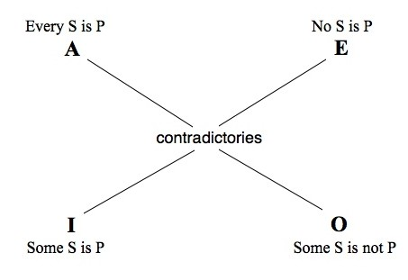

# The Traditional Square of Opposition
**First published Fri Aug 8, 1997; substantive revision Mon May 19, 2025**

*Parsons, Terence, Ciola, Graziana*

This entry traces the historical development of the Square of Opposition, a collection of logical relationships traditionally embodied in a square diagram. This body of doctrine provided a foundation for work in logic for over two millennia. For most of this history, logicians assumed that negative particular propositions (“Some *S* is not *P*”) are vacuously true if their subjects are empty. This validates the logical laws embodied in the diagram, and preserves the doctrine against modern criticisms. Certain additional principles (“contraposition” and “obversion”) were sometimes adopted along with the Square, and they genuinely yielded inconsistency. By the nineteenth century an inconsistent set of doctrines was widely adopted. Strawson’s 1952 attempt to rehabilitate the Square does not apply to the traditional doctrine; it does salvage the nineteenth century version but at the cost of yielding inferences that lead from truth to falsity when strung together.

## 1. Introduction

The doctrine of the square of opposition originated with Aristotle in the fourth century BC and has occurred in logic texts ever since. Although severely criticized in recent decades, it is still regularly referred to. The point of this entry is to trace its history from the vantage point of the early twenty-first century, along with closely related doctrines bearing on empty terms.

The square of opposition is a group of theses embodied in a diagram. The diagram is not essential to the theses; it is just a useful way to keep them straight. The theses concern logical relations among four logical forms:

| *Name* | *Form* | *Title* |
| --- | --- | --- |
| **A** | Every *S* is *P* | Universal Affirmative |
| **E** | No *S* is *P* | Universal Negative |
| **I** | Some *S* is *P* | Particular Affirmative |
| **O** | Some *S* is not *P* | Particular Negative |

The diagram for the traditional square of opposition is:

*Figure: The Traditional Square of Opposition*

The theses embodied in this diagram I call ‘SQUARE’. They are:

**SQUARE**

- ‘Every *S* is *P*’ and ‘Some *S* is not *P*’ are contradictories.

- ‘No *S* is *P*’ and ‘Some *S* is *P*’ are contradictories.

- ‘Every *S* is *P*’ and ‘No *S* is *P*’ are contraries.

- ‘Some *S* is *P*’ and ‘Some *S* is not *P*’ are subcontraries.

- ‘Some *S* is *P*’ is a subaltern of ‘Every *S* is *P*’.

- ‘Some *S* is not *P*’ is a subaltern of ‘No *S* is *P*’.

These theses were supplemented with the following explanations:

- Two propositions are contradictory iff they cannot both be true and they cannot both be false.

- Two propositions are contraries iff they cannot both be true but can both be false.

- Two propositions are subcontraries iff they cannot both be false but can both be true.

- A proposition is a subaltern of another iff it must be true if its superaltern is true, and the superaltern must be false if the subaltern is false.

Probably nobody before the twentieth century ever held exactly these views without holding certain closely linked ones as well. The most common closely linked view that is associated with the traditional diagram is that the **E** and **I** propositions *convert simply*; that is, ‘No *S* is *P*’ is equivalent in truth value to ‘No *P* is *S*’, and ‘Some *S* is *P*’ is equivalent in truth value to ‘Some *P* is *S*’. The traditional doctrine supplemented with simple conversion is a very natural view to discuss. Whether it was Aristotle’s view is a matter of contention, but the doctrine was widely endorsed (or at least not challenged) before the late 19th century. I call this total body of doctrine ‘[SQUARE]’:

[SQUARE] =_{df} SQUARE + “the **E** and **I** forms convert simply”

where

A proposition *converts simply* iff it is necessarily equivalent in truth value to the proposition you get by interchanging its terms.

So [SQUARE] includes the relations illustrated in the diagram plus the view that ‘No *S* is *P*’ is equivalent to ‘No *P* is *S*’, and the view that ‘Some *S* is *P*’ is equivalent to ‘Some *P* is *S*’.

### 1.1 The Modern Revision of the Square

Most contemporary logic texts symbolize the traditional forms as follows:

| Every *S* is *P* | ∀*x*(*Sx* → *Px*) |
| --- | --- |
| No *S* is *P* | ∀*x*(*Sx* → ¬*Px*) |
| Some *S* is *P* | ∃*x*(*Sx* & *Px*) |
| Some *S* is not *P* | ∃*x*(*Sx* & ¬*Px*) |

If this symbolization is adopted along with standard views about the logic of connectives and quantifiers, the relations embodied in the traditional square mostly disappear. The modern diagram looks like this:

*Figure: The Modern Revised Square*

This has too little structure to be particularly useful, and so it is not commonly used. According to Alonzo Church, this modern view probably originated sometime in the late nineteenth century.[^note-1] This representation of the four forms is now generally accepted, except for qualms about the loss of subalternation in the left-hand column. Most English speakers tend to understand ‘Every *S* is *P*’ as requiring for its truth that there be some *S*s, and if that requirement is imposed, then subalternation holds for affirmative propositions. Every modern logic text must address the apparent implausibility of letting ‘Every *S* is *P*’ be true when there are no *S*s. The common defense of this is usually that this is a logical notation devised for purposes of logic, and it does not claim to capture every nuance of the natural language forms that the symbols resemble. So perhaps ‘∀*x*(*Sx* → *Px*)’ does fail to do complete justice to ordinary usage of ‘Every *S* is *P*’, but this is not a problem with the logic. If you think that ‘Every *S* is *P*’ requires for its truth that there be *S*s, then you can have that result simply and easily: just represent the recalcitrant uses of ‘Every *S* is *P*’ in symbolic notation by adding an extra conjunct to the symbolization, like this: ∀*x*(*Sx* → *Px*) & ∃*xSx*.

This defense leaves logic intact and also meets the objection, which is not a logical objection, but merely a reservation about the representation of natural language.

Authors typically go on to explain that we often wish to make generalizations in science when we are unsure of whether or not they have instances, and sometimes even when we know they do not, and they sometimes use this as a defense of symbolizing the **A** form so as to allow it to be vacuously true. This is an argument from convenience of notation, and does not bear on logical coherence.

### 1.2 The Argument Against the Traditional Square

Why does the traditional square need revising at all? The argument is a simple one:[^note-2]

Suppose that ‘*S*’ is an empty term; it is true of nothing. Then the **I** form: ‘Some *S* is *P*’ is false. But then its contradictory **E** form: ‘No *S* is *P*’ must be true. But then the subaltern **O** form: ‘Some *S* is not *P*’ must be true. But that is wrong, since there aren’t any *S*s.

The puzzle about this argument is why the doctrine of the traditional square was maintained for well over 20 centuries in the face of this consideration. Were 20 centuries of logicians so obtuse as not to have noticed this apparently fatal flaw? Or is there some other explanation?

One possibility is that logicians previous to the 20th century must have thought that no terms are empty. You see this view referred to frequently as one that others held.[^note-3] But with a few very special exceptions (discussed below) I have been unable to find anyone who held such a view before the nineteenth century. Many authors do not discuss empty terms, but those who do typically take their presence for granted. Explicitly rejecting empty terms was never a mainstream option, even in the nineteenth century.

Another possibility is that the particular **I** form might be true when its subject is empty. This was a common view concerning *indefinite propositions* when they are read generically, such as ‘A dodo is a bird’, which (arguably) can be true now without there being any dodos now, because being a bird is part of the essence of being a dodo. But the truth of such indefinite propositions with empty subjects does not bear on the forms of propositions that occur in the square. For although the indefinite ‘A dodo ate my lunch’ might be held to be equivalent to the particular proposition ‘Some dodo ate my lunch’, generic indefinites like ‘A dodo is a bird’, are quite different, and their semantics does not bear on the quantified sentences in the square of opposition.

In fact, the traditional doctrine of [SQUARE] is completely coherent in the presence of empty terms. This is because on the traditional interpretation, the **O** form lacks existential import. The **O** form is (vacuously) true if its subject term is empty, not false, and thus the logical interrelations of [SQUARE] are unobjectionable. In what follows, I trace the development of this view.

## 2. Origin of the Square of Opposition

The *doctrine* that I call [SQUARE] can be traced to Aristotle. It begins in *De Interpretatione* 6–7, which contains three claims: that **A** and **O** are contradictories, that **E** and **I** are contradictories, and that **A** and **E** are contraries (17b.17–26):

> I call an affirmation and a negation contradictory opposites when what one signifies universally the other signifies not universally, e.g. every man is white—not every man is white, no man is white—some man is white. But I call the universal affirmation and the universal negation contrary opposites, e.g. every man is just—no man is just. So these cannot be true together, but their opposites may both be true with respect to the same thing, e.g. not every man is white—some man is white.

This gives us the following fragment of the square:

*Figure: Fragment of the Square*

But the rest is there by implication. For example, there is enough to show that **I** and **O** are subcontraries: they cannot both be false. For suppose that **I** is false. Then its contradictory, **E**, is true. So **E**’s contrary, **A**, is false. So **A**’s contradictory, **O**, is true. This refutes the possibility that **I** and **O** are both false, and thus fills in the bottom relation of subcontraries. Subalternation also follows. Suppose that the **A** form is true. Then its contrary **E** form must be false. But then the **E** form’s contradictory, **I**, must be true. Thus if the **A** form is true, so must be the **I** form. A parallel argument establishes subalternation from **E** to **O** as well. The result is SQUARE.

In *Prior Analytics* I.2, 25a.1–25 we get the additional claims that the **E** and **I** propositions convert simply. Putting this together with the doctrine of *De Interpretatione* we have the full [SQUARE].[^note-4]

### 2.1 The Diagram

The diagram accompanying and illustrating the doctrine shows up already in the second century CE; Boethius incorporated it into his writing, and it passed down through the dark ages to the high medieval period, and from thence to today. Diagrams of this sort were popular among late classical and medieval authors, who used them for a variety of purposes. (Similar diagrams for modal propositions were especially popular.)

### 2.2 Aristotle’s Formulation of the O Form

Ackrill’s translation contains something a bit unexpected: Aristotle’s articulation of the **O** form is *not* the familiar ‘Some *S* is not *P*’ or one of its variants; it is rather ‘Not every *S* is *P*’. With this wording, Aristotle’s doctrine automatically escapes the modern criticism. (This holds for his views throughout *De Interpretatione*.[^note-5]) For assume again that ‘*S*’ is an empty term, and suppose that this makes the **I** form ‘Some *S* is *P*’ false. Its contradictory, the **E** form: ‘No *S* is *P*’, is thus true, and this entails the **O** form in Aristotle’s formulation: ‘Not every *S* is *P*’, which must therefore be true. When the **O** form was worded ‘Some *S* is not *P*’ this bothered us, but with it worded ‘Not every *S* is *P*’ it seems plainly right. Recall that we are granting that ‘Every *S* is *P*’ has existential import, and so if ‘*S*’ is empty the **A** form must be false. But then ‘Not every *S* is *P*’ *should* be true, as Aristotle’s square requires.

On this view *affirmatives* have existential import, and *negatives* do not—a point that became elevated to a general principle in late medieval times.[^note-6] The ancients thus did not see the incoherence of the square as formulated by Aristotle because there was no incoherence to see.

### 2.3 The Rewording of the O Form

Aristotle’s work was made available to the Latin west principally via Boethius’s translations and commentaries, written a bit after 500 CE. In his translation of *De interpretatione*, Boethius preserves Aristotle’s wording of the **O** form as “Not every man is white.” But when Boethius comments on this text he illustrates Aristotle’s doctrine with the now-famous diagram, and he uses the wording ‘Some man is not just’.[^note-7] So this must have seemed to him to be a natural equivalent in Latin. It looks odd to us in English, but he wasn’t bothered by it.

Early in the twelfth century Abelard objected to Boethius’s wording of the **O** form,[^note-8] but Abelard’s writing was not widely influential, and except for him and some of his followers people regularly used ‘Some *S* is not *P*’ for the **O** form in the diagram that represents the square. Did they allow the **O** form to be vacuously true? Perhaps we can get some clues to how medieval writers interpreted these forms by looking at other doctrines they endorsed. These are the theory of the syllogism and the doctrines of contraposition and obversion.

## 3. The (Ir)relevance of Syllogistic

One central concern of the Aristotelian tradition in logic is the theory of the categorical syllogism. This is the theory of two-premised arguments in which the premises and conclusion share three terms among them, with each proposition containing two of them. It is distinctive of this enterprise that everybody agrees on which syllogisms are valid. The theory of the syllogism partly constrains the interpretation of the forms. For example, it determines that the **A** form has existential import, at least if the **I** form does. For one of the valid patterns (Darapti) is:

Every *C* is *B* Every *C* is *A* So, some *A* is *B*

This is invalid if the **A** form lacks existential import, and valid if it has existential import. It is held to be valid, and so we know how the **A** form is to be interpreted. One then naturally asks about the **O** form; what do the syllogisms tell us about it? The answer is that they tell us nothing. This is because Aristotle did not discuss weakened forms of syllogisms, in which one concludes a particular proposition when one could already conclude the coresponding universal. For example, he does not mention the form:

No *C* is *B* Every *A* is *C* So, some *A* is not *B*

If people had thoughtfully taken sides for or against the validity of this form, that would clearly be relevant to the understanding of the **O** form. But the weakened forms were typically ignored.

## 4. The Principles of Contraposition and Obversion

One other piece of subject-matter bears on the interpretation of the **O** form. People were interested in Aristotle’s discussion of “infinite” negation,[^note-9] which is the use of negation to form a term from a term instead of a proposition from a proposition. In modern English we use “non” for this; we make “non-horse,” which is true of exactly those things that are not horses. In medieval Latin “non” and “not” are the same word, and so the distinction required special discussion. It became common to use infinite negation, and logicians pondered its logic. Some writers in the twelfth and thirteenth centuries adopted a principle called “conversion by contraposition.” It states that

- ‘Every *S* is *P*’ is equivalent to ‘Every non-*P* is non-*S*’

- ‘Some *S* is not *P*’ is equivalent to ‘Some non-*P* is not non-*S*’

Unfortunately, this principle (which is not endorsed by Aristotle[^note-10]) conflicts with the idea that there may be empty or universal terms. For in the universal case it leads directly from the truth:

> Every man is a being

to the falsehood:

> Every non-being is a non-man

(which is false because the universal affirmative has existential import, and there are no non-beings). And in the particular case it leads from the truth (remember that the **O** form has no existential import):

> A chimera is not a man

to the falsehood:

> A non-man is not a non-chimera

These are Buridan’s examples, used in the fourteenth century to show the invalidity of contraposition. Unfortunately, by Buridan’s time the principle of contraposition had been advocated by a number of authors. The doctrine is already present in several twelfth century tracts,[^note-11] and it is endorsed in the thirteenth century by Peter of Spain,[^note-12] whose work was republished for centuries, by William Sherwood,[^note-13] and by Roger Bacon.[^note-14] By the fourteenth century, problems associated with contraposition seem to be well-known, and authors generally cite the principle and note that it is not valid, but that it becomes valid with an additional assumption of existence of things falling under the subject term. For example, in Paul of Venice’s eclectic and widely published *Logica Parva* dating from the end of the fourteenth century, the traditional, the square occurs with simple conversion;[^note-15] but Paul rejects conversion by contraposition, essentially for Buridan’s reasons.

A similar thing happened with the principle of obversion. This is the principle that states that you can change a proposition from affirmative to negative, or vice versa, if you change the predicate term from finite to infinite (or infinite to finite). Some examples are:

| Every *S* is *P* | = | No *S* is non-*P* |
| --- | --- | --- |
| No *S* is *P* | = | Every *S* is non-*P* |
| Some *S* is *P* | = | Some *S* is not non-*P* |
| Some *S* is not *P* | = | Some *S* is non-*P* |

Aristotle discussed some instances of obversion in *De Interpretatione*. It is apparent, given the truth conditions for the forms, that these inferences are valid when moving from affirmative to negative, but not in the reverse direction when the terms may be empty, as Buridan makes clear.[^note-16] Some medieval writers before Buridan accepted the fallacious versions, and some did not.[^note-17]

## 5. Later Developments

### 5.1 Empty Terms in Medieval Semantics

Empty terms are traditionally considered problematic in medieval logic, even beyond the issues involved in [SQUARE]. This is due to several factors related to the development of theories regarding the properties of terms in medieval semantics and in particular to the workings of supposition theory.

All empty terms lack a suppositum (roughly, “referent”), but they may do so to varying degrees. Some terms are contingently empty—that is, they might happen to be empty at present but have had or will have supposita at some point. This applies to presently empty natural classes, such as dodos. Medieval logicians often discussed examples like “roses in winter” and “thunder on a clear day” (Bur., *Q. Eth.* VI, q. 6).

Other terms will never be anything but empty due to the world’s inherent structure. Medieval authors regarded these terms as signifying natural or relative impossibilities. For instance, when we speak of ideal gases, we speak of entities that cannot be found in nature. Under the medieval Aristotelian worldview, “void” falls into this category (since nature abhors a vacuum), as do terms for mathematical entities (e.g., points, lines), instants, atoms, and all minima. These terms are not inherently flawed; they simply denote things that were not, are not, will not, and could not exist in nature—given the period’s understanding—but are not self-contradictory.

But there are also terms that are necessarily empty in a stronger sense because they signify what medieval authors called simple or absolute impossibilities, viz. something that is intrinsically contradictory. The first thing coming to the mind of a modern reader would be “the round square cupola on Berkeley College” (Quine 1948)[^quine-1948]. The standard medieval example is the Chimera, defined as a composite of incompossible essences. The semantics of necessarily empty terms has been a matter of contention since Late Antiquity and throughout the Middle Ages (Ebbesen 1986)[^ebbesen-1986]. Issues with empty terms in general were both recognized and discussed throughout the development of medieval semantics (Maierù 1972; de Libera 2002)[^libera-2002][^maierù-1972].

The semantics of necessarily empty terms has been a matter of contention since Late Antiquity and throughout the Middle Ages (Ebbesen 1986)[^ebbesen-1986]. Issues with empty terms in general were recognized and discussed throughout the development of medieval semantics (Maierù 1972; de Libera 2002)[^libera-2002][^maierù-1972].

### 5.2 Negative Propositions with Empty Terms

By the end of the 14th century there is a common understanding that negative propositions do not have existential import.

For example, Paul of Venice’s other major work, the *Logica Magna* (*circa* 1400), he gives some pertinent examples of particular negative propositions that follow from true universal negatives. His examples of true particular negatives with patently empty subject terms are these:[^note-18]

> Some man who is a donkey is not a donkey.
>
> What is different from being is not.
>
> Some thing willed against by a chimera is not willed against by a chimera.
>
> A chimera does not exist.
>
> Some man whom a donkey has begotten is not his son.

By the time of Paul of Venice, the **O** form definitely did not have existential import, and the logical theory, stripped of the incorrect special cases of contraposition and obversion, was coherent and immune to 20th century criticism.

### 5.3 Affirmative Propositions with Empty Terms

The case of emptiness that medieval authors discussed at length is that of affirmative statements with an empty subject term. Under the assumption of Existential Import, all these statements are false by default, including some sentences that you might want to be able to verify, namely:

1. Statements with subjects signifying natural classes empty at present. Typical medieval examples are: “rose is a flower” when, in winter, there are no roses; or “thunder is a sound made in the clouds” on a clear day. The same applies to “dodos are birds” or even “all dodos are dodos” since there are no presently existing dodos.
2. Statements with subjects signifying idealized or abstract items that are not possible in nature, but are not intrinsically contradictory. Typical medieval examples of such statements are: “the void is place with no matter”, which is naturally impossible in Aristotelian physics; “point is space with no extension”, along with all affirmative statements about geometrical entities and mathematical ficta, as well as instants, atoms, and minima. But the same would apply to “ideal gases are infinitely compressible” and other such statements about useful abstractions that are not given in nature.
3. Trivial identities with necessarily empty subjects signifying intrinsically contradictory items, such as the round square or the chimera. Statements such as “the round square is the round square” or “the chimera is the chimera” are unavoidably false. Most late-medieval logicians subscribe to this claim, including John Buridan (*TC* 1.5.3) and Albert of Saxony (*QcL* q. 13)

Note that subjects of (A) statements are merely presently empty but have had and can have referents at some point in time. Instead, there are no possibly actual referents for subjects of (B) and (C) statements, since those subjects signify what, by the mid-14th century, were considered respectively relative and absolute impossibilities. The default falsity of affirmative sentences with an empty subject term raises a plethora of serious problems for late medieval philosophers, who generally operate within an Aristotelian framework and have theological concerns. For instance, the fact that universal affirmatives with empty subject terms are false by default runs into a problem with the Aristotelian scientific theory. Aristotle held that ‘Every human is an animal’ is a necessary truth. If so, it is true at every time. So, at every time its subject is non-empty. And so, there are humans at every time. But the dominant theology held that before the last day of creation there were no humans. So, there is a contradiction.

Ockham avoids this problem by abandoning parts of Aristotle’s theory:

> Although it conflicts with the texts of Aristotle, yet according to the truth no proposition among those which concern precisely corruptible things [which is] entirely affirmative and entirely about the present is able to be a principle or a conclusion of a demonstration because any such is contingent. For if some such were necessary this would seem to be so especially for this one “A human is a rational animal”. But this is contingent because it follows “A human is a rational animal, therefore a human is an animal” and further “therefore a human is composed of a body and a sensitive soul”. But this is contingent because if there was no human that would be false because of the false [thing] implied because it would imply that something is composed from a body and soul which would then be false. [Ockham SL III-2.5 ll.34–45]

However, the broader problem affecting any affirmative statement with an empty subject remains. These affected statements include sentences that are relevant for scientific discourse, such as (A) and (B) statements. While trivial identities about chimeras or round squares might have limited impact on Aristotelian science, their default falsity still seems counterintuitive to ordinary language interpretation.

In the 14th century, logicians address these issues using different strategies. If you want to have your cake and eat it, you could either tweak the proper interpretation of empty affirmative statements or their domain of reference.

For example, one option is to claim that universal affirmatives are understood in scientific theory as conditionals, as they are understood today. This would not interfere with the fact that they are not conditionals in uses outside of scientific theory. Although De Rijk (1973, 52)[^de-1973] states that Ockham holds such a view, he seems to explicitly reject it, stating that ‘A human is a rational animal’ is not equivalent to ‘If it is a human, then it is a rational animal’ “because this is a conditional and not a categorical” [Ockham SL III-2.5 ll. 46–47]. This is a major concern for Ockham and any medieval Aristotelian philosopher, since scientific reasoning is articulated in scientific syllogisms, which are described in the *Posterior Analytics*. But scientific syllogisms require premises that are universal, affirmative, necessarily true, and categorical.

Another option is to claim that the copula in (some) scientific statements is not quite a proper copula; instead, it stands for something like “meaning” or “signifying”. Rather than normal predications, these sentences explain the use of an empty term like “void” or “point”. Albert of Saxony deploys this strategy, for example, in his *Questions on Physics* (e.g., IV q. 8).

Buridan’s view is more nuanced. He focuses on the reading of the copula and on the domain of reference. For Buridan, the copula remains a proper coupla and does its proper copulative job of subject and predicate. However, Buridan holds that when engaged in scientific theory, the subject matter is not limited to presently existing things. In other words, in general scientific statements, the copula is not importing the present only, *viz*. it is not predicating only present predicates of present subjects. In such cases, the sentences have their usual meanings, and the copula is a proper copula. But the tense of the copula in sentences like “dodos are birds” or “Every human is an animal” is not really the present tense. Instead of co-signifying the present, the copula is omnitemporal, signifying all times (De Rijk 1973)[^de-1973]. In this way, these sentences remain cases of proper categorical predication with an expanded subject matter (Ciola 2020)[^ciola-2020]. When the word “human” is used in “Every human is an animal”, one is discussing every human, past and future, and maybe even possible humans [Buridan *SdD* 4.3.4]. With such an understanding, the subject of “Every human is an animal” is not empty at all.

Another option expanding on the subject matter of affirmative sentences with empty subjects appeals to the doctrine of ampliation. Ampliation is one of the ways that medieval logicians use to treat tensed and modal contexts. In some versions of the doctrine, ampliation “expands” a term’s reference across tensed and modal contexts. These tensed and modal slices of the domain are all grouped as “distinctions of time” (*differentiae temporum*) and they usually include the present, the past, the future and the possible. In the third quarter of the 14th century, Marsilius of Inghen adds a fifth “distinction of time” – that of the impossible or the imaginable. This approach became widely adopted in the 15th century and in the 16th (Ashworth 1977)[^ashworth-1977]. With this addition, affirmative sentences with empty subject terms can receive a uniform semantic treatment that avoids default falsity across scientific statements and ordinary language (Ciola 2019; 2020)[^ciola-2019].

Work on logic continued for the next couple of centuries, though most of it was lost and had little influence. But the topic of empty terms was squarely faced, and solutions that were given within the Medieval tradition were consistent with [SQUARE]. Ashworth [1974, 201–02] reports the most common themes in the context of post-medieval discussions of contraposition. One theme is that contraposition is invalid when applied to universal or empty terms, for the sorts of reasons given by Buridan. The O form is explicitly held to lack existential import. A second theme, which Ashworth says was the most usual thing to say, is also found in Buridan: additional inferences, such as contraposition, become valid when supplemented by an additional premise asserting that the terms in question are non-empty.

### 5.4 An Oddity

There is one odd view that occurs a handfil of times, which entails the claim that there are no empty terms. In the 13th century, Lambert of Lagny (sometimes identified as Lambert of Auxerre) proposed that a term such as ‘chimera’ which stands for no existing thing must “revert to nonexistent things.” So if we suppose that no roses exist, then the term ‘rose’ stands for nonexistent things.[^note-19] In the first half of the 14th century, Richard Brinkley made this claim explicit: no term is empty (*Logica*, *Tractatus de Suppositione;* see Cesalli 2013)[^cesalli-2013]. A related view also occurs much later; Ashworth reports that Menghus Blanchellus Faventinus held that negative terms such as ‘nonman’ are true of non-beings, and he concluded from this that ‘A nonman is a chimera’ is true (apparently assuming that ‘chimera’ is also true of nonbeings).[^note-20] However, neither of these views seems to have been clearly developed, and neither was widely adopted.[^note-21] Nor is it clear that either of them is supposed to have the consequence that there are no empty terms, since true nonbeings can be proper referents for terms that would otherwise be necessarily empty.

### 5.5 Renaissance, Modern, and Nineteenth Centuries

According to Ashworth,[^note-22] serious and sophisticated investigation of logic ended at about the third decade of the sixteenth century. The *Port Royal Logic* of the following (seventeenth) century seems typical in its approach: its authors frequently suggest that logic is trivial and unimportant. Its doctrine includes that of the square of opposition, but the discussion of the **O** form is so vague that nobody could pin down its exact truth conditions, and there is certainly no awareness indicated of problems of existential import, in spite of the fact that the authors state that the **E** form entails the **O** form (4th corollary of chapter 3 of part 3). This seems to typify popular texts for the next while. In the nineteenth century, the apparently most widely used textbook in Britain and America was Whately’s *Elements of Logic*. Whately gives the traditional doctrine of the square, without any discussion of issues of existential import or of empty terms. He includes the problematic principles of contraposition (which he calls “conversion by negation”):

Every *S* is *P* = Every not-*P* is not-*S*

He also endorses obversion:[^note-23]

‘Some *A* is not *B*’ is equivalent to ‘Some *A* is not-*B*’, and thus it converts to ‘Some not-*B* is *A*’.

He says that this principle is “not found in Aldrich,” but that it is “in frequent use.”[^note-24] This “frequent use” continued; later nineteenth and early twentieth century text books in England and America continued to endorse obversion (also called “infinitation” or “permutation”), and contraposition (also called “illative conversion”).[^note-25] This full nineteenth century tradition is consistent only on the assumption that empty (and universal) terms are prohibited, but authors seem unaware of this; Keynes 1928, 126, says generously “This assumption appears to have been made implicitly in the traditional treatment of logic.” De Morgan is atypical in making the assumption explicit: in his 1847 text (p. 64) he forbids universal terms (empty terms disappear by implication because if *A* is empty, non-*A* will be universal), but later in the same text (p. 111) he justifies ignoring empty terms by treating this as an idealization, adopted because not all of his readers are mathmeticians.[^note-26]

In the twentieth century Łukasiewicz also developed a version of syllogistic that depends explicitly on the absence of empty terms; he attributed the system to Aristotle, thus helping to foster the tradition according to which the ancients were unaware of empty terms.

Today, logic texts divide between those based on contemporary logic and those from the Aristotelian tradition or the nineteenth century tradition, but even many texts that teach syllogistic teach it with the forms interpreted in the modern way, so that e.g. subalternation is lost. So the traditional square, as traditionally interpreted, is now mostly abandoned.

## 6. Strawson’s Defense

In the twentieth century there were many creative uses of logical tools and techniques in reassessing past doctrines. One might naturally wonder if there is some ingenious interpretation of the square that attributes existential import to the **O** form *and* makes sense of it all without forbidding empty or universal terms, thus reconciling traditional doctrine with modern views. Peter Geach, 1970, 62–64, shows that this can be done using an unnatural interpretation. Peter Strawson, 1952, 176–78, had a more ambitious goal. Strawson’s idea was to justify the square by adopting a nonclassical view of truth of statements, and by redefining the logical relation of validity. First, he suggested, we need to suppose that a proposition whose subject term is empty is neither true nor false, but lacks truth value altogether. Then we say that *Q* entails *R* just in case there are no instances of *Q* and *R* such that the instance of *Q* is true and the instance of *R* is false. For example, the **A** form ‘Every *S* is *P*’ entails the **I** form ‘Some *S* is *P*’ because there is no instance of the **A** form that is true when the corresponding instance of the **I** form is false. The troublesome cases involving empty terms turn out to be instances in which one or both forms lack truth value, and these are irrelevant so far as entailment is concerned. With this revised account of entailment, all of the “traditional” logical relations result, if they are worded as follows:

> | Contradictories: | The **A** and **O** forms entail each other’s negations, as do the **E** and **I** forms. The negation of the **A** form entails the (unnegated) **O** form, and *vice versa*; likewise for the **E** and **I** forms. |
> | --- | --- |
> | Contraries: | The **A** and **E** forms entail each other’s negations |
> | Subcontraries: | The negation of the **I** form entails the (unnegated) **O** form, and *vice versa*. |
> | Subalternation: | The **A** form entails the **I** form, and the **E** form entails the **O** form. |
> | Converses: | The **E** and **I** forms each entail their own converses. |
> | Contraposition: | The **A** and **O** forms each entail their own contrapositives. |
> | Obverses: | Each form entails its own obverse. |

These doctrines are not, however, the doctrines of [SQUARE]. The doctrines of [SQUARE] are worded entirely in terms of the possibilities of truth values, not in terms of entailment. So “entailment” is irrelevant to [SQUARE]. It turns out that Strawson’s revision of truth conditions *does* preserve the principles of SQUARE (these can easily be checked by cases),[^note-27] but not the additional conversion principles of [SQUARE], and also not the traditional principles of contraposition or obversion. For example, Strawson’s reinterpreted version of conversion holds for the **I** form because any **I** form proposition entails its own converse: if ‘Some *A* is *B*’ and ‘Some *B* is *A*’ both have truth value, then neither has an empty subject term, and so if neither lack truth value and if either is true the other will be true as well. But the original doctrine of conversion says that an *I* form and its converse always have the same truth value, and that is false on Strawson’s account; if there are *A*s but no *B*s, then ‘Some *A* is *B*’ is false and ‘Some *B* is *A*’ has no truth value at all. Similar results follow for contraposition and obversion.

The “traditional logic” that Strawson discusses is much closer to that of nineteenth century logic texts than it is to the version that held sway for two millennia before that.[^note-28] But even though he literally salvages a version of nineteenth century logic, the view he saves is unable to serve the purposes for which logical principles are formulated, as was pointed out by Timothy Smiley in a short note in *Mind* in 1967.[^note-29] People have always taken the square to embody principles by which one can reason, and by which one can construct extended chains of reasoning. But if you string together Strawson’s entailments you can infer falsehoods from truths, something that nobody in any tradition would consider legitimate. For example, begin with this truth (the subject term is non-empty):

> No man is a chimera.

By conversion, we get:

> No chimera is a man.

By obversion:

> Every chimera is a non-man.

By subalternation:

> Some chimera is a non-man.

By conversion:

> Some non-man is a chimera.

Since there are non-men, the conclusion is not truth-valueless, and since there are no chimeras it is false. Thus we have passed from a true claim to a false one. (The example does not even involve the problematic **O** form.) All steps are validated by Strawson’s doctrine. So Strawson reaches his goal of preserving certain patterns commonly identified as constituting traditional logic, but at the cost of sacrificing the application of logic to extended reasoning.

## References（引用注释）

> 原文参考文献已转为脚注引用：文内“作者-年份”引用组后附 [^key] 标记，完整条目见本文末脚注定义。

## Academic Tools

> |   | [How to cite this entry](https://plato.stanford.edu/cgi-bin/encyclopedia/archinfo.cgi?entry=square). |
> | --- | --- |
> |   | [Preview the PDF version of this entry](https://leibniz.stanford.edu/friends/preview/square/) at the [Friends of the SEP Society](https://leibniz.stanford.edu/friends/). |
> |   | [Look up topics and thinkers related to this entry](https://www.inphoproject.org/entity?sep=square&redirect=True) at the Internet Philosophy Ontology Project (InPhO). |
> |   | [Enhanced bibliography for this entry](https://philpapers.org/sep/square/) at [PhilPapers](https://philpapers.org/), with links to its database. |

## Other Internet Resources

- [Mediaeval Logic and Philosophy](http://pvspade.com/Logic/)

## Related Entries

Aristotle, General Topics: logic | Brentano, Franz: theory of judgement | contradiction | syllogism: medieval theories of | terms, properties of: medieval theories of

## Notes（原文脚注）

[^note-1]: Church 1965, 422 finds it first (implicitly) in Cayley 1871, explicitly in Brentano 1874, and in Peirce 1880, 15–57.

[^note-2]: This argument is given e.g. in Kneale & Kneale 1962, 55–60.

[^note-3]: Cf. Kneale & Kneale 1962, 60, and Keynes 1928, 126 note 1.

[^note-4]: *Prior Analytics* also contains the doctrine of conversion *per accidens*: that you can interchange the subject and predicate terms of either universal form if you also turn it into a particular. This is not an additional principle, since it follows from the rules of subalternation together with simple conversion.

[^note-5]: Cf. Wedin 1990.

[^note-6]: Ockham (SL I.72): “In affirmative propositions a term is always asserted to supposit for something. Thus, if it supposits for nothing the proposition is false. However, in negative propositions the assertion is either that the term does not supposit for something or that it supposits for something of which the predicate is truly denied. Thus a negative proposition has two causes of truth.” Loux 1974, 206.

[^note-7]: Paul Spade called these facts to my attention.

[^note-8]: Abelardus Petrus 1970, 186:

> And thus in categorical propositions, the only proper and rightly destroying contradiction to any affirmation seems to be a proposition that with a negation appended in front destroys the entire meaning, so that ‘not every human is human’, but not ‘some human is not human’ is the contradictory of ‘every human is human’. For the latter may happen to be false simultaneously with that. For a thing of ‘human’ not existing now, neither will this be true, namely ‘every human is human’ nor that which says ‘some human is not human’ …

[^note-9]: Aristotle, *De Interpretatione* 2 and 3.

[^note-10]: Church 1965, 419 quotes some apparent instances of contraposition endorsed by Aristotle. But the wordings he gives are not actually contraposition; their premises are apparently meant to be universal affirmatives (Every *A* is *B*) and their conclusions seem to be of a “nonstandard” negative form: Every non-*B* is not *A*. (Such conditionals, though not their converses, are valid.) These examples, however, might easily have been interpreted as contraposition by later commentators, just as Church did.

[^note-11]: Contraposition is discussed in several twelfth and early thirteenth century anonymous texts edited in De Rijk 1967. It is endorsed in *Excerpta Norimbergenses* (138–39), *Ars Burana* (190), *Tractatus Anagnini* (238), *Introductiones Parisienses* (362), *Logica “Ut dicit”* (385), *Logica “Cum sit nostra”* (426), *Dialectica Monacensis* (478). Another text, *Ars Emmerana* (157) endorses contraposition, but then says that it does not hold for the particular negative unless understood with “constancy,” a term that had to do with assuming instances of the terms in question.

[^note-12]: Peter of Spain, *Summulae* I.15 in Copenhaver, Normore, Parsons 2014, 112–115.

[^note-13]: 3.3 in Kretzmann 1966, 59.

[^note-14]: Roger Bacon, 2009, paragraph 279.

[^note-15]: 1.8–11 in Perreiah 1984, 127–130.

[^note-16]: “From every affirmative there follows a negative by changing the predicate from finite to infinite, other things remaining the same, but from a negative to an affirmative is not a formal consequence, but its is a consequence on the assumption that all of the terms supposit for something.” [*Tractatus de Consequentiis* I.8.107: Read 2015, 93.][^read-2015]

The good direction he gives as:

> Every *B* is *A*; therefore no *B* is non-*A*.

The fallacious direction is illustrated by

> A chimera is not a man; therefore a chimera is a non-man.

[^note-17]: Obversion is discussed in several twelfth and early thirteenth century anonymous texts edited in De Rijk 1967, where it is seen as a type of *equipollence*. It is endorsed in four of these: *Excerpta Norimbergenses* (138–39), *Logica “Ut dicit”* (385), *Logica “Cum sit nostra”* (426), *Dialectica Monacensis* (478). Three texts, *Ars Burana*, *Introductiones Parisienses*, *Tractatus Anagnini* omit it (while including a discussion of contraposition). One text, *Introductiones Montane Minores* (37–38) limits the principle to propositions without empty terms.

[^note-18]: Chapter 4 in Kretzmann 1979, 233.

[^note-19]: Kretzmann & Stump 1988, 118.

[^note-20]: Ashworth 1974, 201–02.

[^note-21]: These odd views should not be confused with a widely adopted theory which held that in certain circumstances a term is “ampliated” so as to stand for not presently existing things. For example, the past tense of ‘A donkey ran’ makes ‘donkey’ stand for both present and past donkeys, the ‘can’ in ‘A rose can be red’ makes ‘rose’ stand for both actual and possible roses, and the special nature of the predicate in ‘Every chimera is imaginable’ makes ‘chimera’ stand for (impossible but) merely intelligible chimeras. But this widely held doctrine does not apply to ‘A chimera is an animal’ since there is no “cause” of ampliation in that sentence; so the doctrine does not prohibit empty terms.

[^note-22]: Ashworth 1978, 147.

[^note-23]: Whately 1826, 84–85.

[^note-24]: Whately 1827, 85, referring to Aldrich 1692.

[^note-25]: Coppée 1882, 76, Jevons, 1888, 83–5, Davis, 1894, 91, Joseph, 1916, 237–38, R. W. Sellars, 1925, 107.

[^note-26]: The system of logic including obversion and contraposition *is* consistent if empty and universal terms are forbidden; see Miller 1938. Miller states that if the system is supplemented by all of the traditional nineteenth century rules for the syllogism, including rules of distribution, the system is inconsistent. But his proof involves applying the rules of distribution to syllogisms that are not in standard form. Miller thinks that authors intended this; I am not sure of that.

[^note-27]: The wording of SQUARE does not rule out the possibility of truth-valueless sentences—so Strawson’s view that empty subject terms lead to lack of truth value does not conflict with SQUARE. However, hardly anyone exploited the possibility of sentences without truth value. A few medieval writers appeared to have tried to solve the semantic paradoxes by holding that paradoxical sentences “say nothing,” but the idea was not taken seriously by most theorists. (Cf. Spade’s summary in Kretzmann, Kenny, and Pinborg 1982, 245–6.)[^kretzmann-1982] Nor does it occur in Renaissance or Modern or nineteenth century texts.

Paul Spade points out (personal communication) that a very few authors held that future contingent propositions are now without truth-value (and will stay that way until the future event comes out one way or the other). The most prominent mediaeval author to hold this was the Frenchman Peter Auriol (early 14th century). But the Englishman Roger Swyneshed (fl. 1330s) also appears to accept it in an offhand comment in one passage. Many authors (e.g., Ockham) thought it was Aristotle’s view of future contingents (*De interpretation*, ch. 7), but did not accept it themselves.

[^note-28]: Strawson 1952, 152 calls what he is discussing “traditional formal logic.” His source is Miller 1938, which bears the title *The Structure of Aristotelian Logic*, which might lead one to think he is discussing the ancient and medieval doctrine. But Miller makes explicit (pages 11–12) that the subject matter under discussion is the version of logic that existed when he wrote: in particular, “the system of deductive logic expounded in the principal introductory textbooks of logic; for example, the well-known manuals by Whately, Jevons, Joseph, Wolf, Creighton, Hibbons, and Sellars.” Miller’s logical work is excellent, but his historical remarks should not be trusted. For example, he sees the use of the notion of distribution in testing for the validity of syllogisms as part of a longstanding tradition (6), followed by the introduction of negative terms in the nineteenth century (3). In fact negative terms were in the original theory (they were in Aristotle), and the use of rules of distribution to test for validity were probably first used seventeen centuries later (by Buridan in the fourteenth century; perhaps earlier, but certainly no earlier than the twelfth century).

[^note-29]: Smiley 1967. Church 1965 also criticizes Strawson’s proposal, but without actually saying what is wrong with it.

[^abelardus-1970]: Abelardus, Petrus, 11th–12th century. *Dialectica*, L. M. de Rijk (ed.), Assen: Van Gorcum & Co., 1970.

[^albert-nd]: Albert of Saxony, 14th century. *Quaestiones in Octo libros Physicorum*, Paris 1516.

[^albert-2002]: –––, 14th century. *Quaestiones circa Logicam*, in: Fitzgerald 2002.

[^aldrich-1692]: Aldrich, Henry, 1692. *Artis Logicæ Compendium*, Oxonii: E. Theatro Sheldoniano.

[^aristotle-1984]: Aristotle, 4th century B.C.E., *De Interpretatione* and *Prior Analytics*, in Jonathan Barnes (ed.), *The Complete Works of Aristotle*, Princeton: Princeton University Press, 1984.

[^ashworth-1974]: Ashworth, E. J., 1974. *Logic and Language in the Post-Medieval Period*, Dordrecht: Reidel.

[^ashworth-1977]: –––, 1977. “Chimeras and Imaginary Objects: A Study in the Post-Medieval Theory of Signification,” *Vivarium*, 15(1): 57–77.

[^ashworth-1978]: –––, 1978. “Existential Assumptions in Late Medieval Logic,” *American Philosophical Quarterly*, 10: 141–47.

[^bacon-2009]: Bacon, Roger, 13th century. *The Art and Science of Logic*, translated by Thomas S. Maloney, Toronto: Pontifical Institute of Mediaeval Studies, 2009.

[^brentano-1874]: Brentano, Franz, 1874. *Psychologie vom Empirischen Standpunkte*, Leipzig: Dunker & Humbolt.

[^buridan-1957]: Buridan, John, 14ᵗʰ century. *Tractatus de Suppositionibus*, in Maria Elena Reina (ed.), “Giovanni Buridano: *Tractatus de Suppositionibus*,” *Rivista critica di storia della filosofia*, 12 (1957): 175–208. Translated in King 1985.

[^buridan-1976]: –––, 14ᵗʰ century. *Tractatus de Consequentiis*, in Hubert Hubien, *Iohannis Buridani tractatus de consequentiis: Édition critique* (*Philosophes médiévaux*: Volume XVI), Louvain: Publications universitaires, 1976. Translated in King 1985.

[^buridan-2001]: –––, 14ᵗʰ century. *Summulae de Dialectica*, translated in Klima, Gyula, *John Buridan: Summulae de Dialectica*, New Haven: Yale University Press, 2001.

[^burley-1972]: Burley, Walter, 14ᵗʰ century. “De Suppositionibus,” in Stephen Brown, “Walter Burleigh’s Treatise *De Suppositionibus* and Its Influence on William of Ockham,” *Franciscan Studies*, 32 (1972): 15–64; translated (part) in Spade 1997.

[^burley-1955]: –––, 14ᵗʰ century. *De puritate artis logicae tractatus longior*, in Philotheus Boehner (ed.), *Walter Burleigh: De puritate artis logicae tractatus longior* (with a Revised Edition of the Tractatus brevior), St. Bonaventure, NY: The Franciscan Institute, 1955; translated in Spade 2000.

[^cesalli-2013]: Cesalli, L., 2013. “Richard Brinkley on Supposition”. In *Medieval Supposition Theory Revisited*, Leiden: Brill. doi:10.1163/9789004260238_013

[^cayley-1871]: Cayley, A., 1871. “Note on the Calculus of Logic,” *The Quarterly Journal of Pure and Applied Mathematics*, 11: 282–83.

[^ciola-2019]: Ciola, G.S., 2019. “The void and the chimera: Marsilius of Inghen on Imaginabilia,” *Medioevo: Rivista di Storia della Filosofia Medievale*, XLIV, 142–160.

[^ciola-2020]: –––, 2020. “Hic sunt chimaerae? On absolutely impossible significates and referents in mid-14th-century nominalist logic,” *Recherches de Théologie et Philosophie Médiévales*, 87(2): 441–467.

[^church-1965]: Church, Alonzo, 1965. “The History of the Question of Existential Import of Categorical Propositions,” in Yehoshua Bar-Hillel (ed.), *Logic, Methodology, and Philosophy of Science* (Proceedings of the 1964 International Congress). Amsterdam: North-Holland, 417–24.

[^copenhaver-2014]: Copenhaver, Brian P., Calvin G. Normore and Terence Parsons, 2014. *Peter of Spain: Summaries of Logic*, text, translation, introduction, and notes, Oxford: Oxford University Press.

[^coppée-1882]: Coppée, Henry, 1882. *Elements of Logic*, New York: American Book Co.

[^davis-1894]: Davis, Noah, 1894. *Elements of Deductive Logic*, New York: Harper.

[^libera-2002]: de Libera, Alain, 2002. *La référence vide. Théories de la proposition*, Paris: PUF.

[^de-1847]: De Morgan, Augustus, 1847. *Formal Logic*, London: Open Court.

[^de-1860]: –––, 1860. *Syllabus of a Proposed System of Logic*, reprinted in A. De Morgan, *On the Syllogism and Other Logical Writings*, New Haven: Yale University Press, 1966.

[^de-1967]: De Rijk, L. M., 1967. *Logica Modernorum* (Volume II Part 2), Assen: Koninklijke Van Gorcum & Company N.V.

[^de-1973]: –––, 1973. “The Development of Suppositio naturalis in Mediaeval Logic”, *Vivarium*, 11: 43–79.

[^ebbesen-1986]: Ebbesen, Sten, 1986. “The Chimera’s Diary,” in S. Knuuttila and J. Hintikka (eds.), *The Logic of Being* (Synthese Historical Library: Volume 28), Dordrecht: Springer. doi:10.1007/978-94-009-4780-1_5

[^fitzgerald-2002]: Fitzgerald, Michael J., 2002. *Albert of Saxony’s Twenty-five Disputed Questions on Logic*, Leiden: Brill.

[^freddoso-1980]: Freddoso, Alfred J, and Henry Schuurman, 1980. *Ockham’s Theory of Propositions: Part II of the Summa Logicae*, Notre Dame: University of Notre Dame Press.

[^geach-1972]: Geach, Peter, 1972. *Logic Matters*, Berkeley and Los Angeles: University of California Press.

[^jevons-1888]: Jevons, W. Stanley, 1888. *Elementary Lessons in Logic*, London and New York: Macmillan.

[^joseph-1916]: Joseph, H. W. B., 1916. *An Introduction to Logic*, London: Oxford University Press.

[^keynes-1928]: Keynes, John Neville, 1928. *Studies and Exercises in Formal Logic*, London: Macmillan.

[^king-1985]: King, Peter, 1985. *Jean Buridan’s Logic: The Treatise on Supposition, The Treatise on Consequences*, Dordrecht: D. Reidel.

[^kneale-1962]: Kneale, William and Martha Kneale, 1962. *The Development of Logic*, Oxford: Oxford University Press.

[^kretzmann-1966]: Kretzmann, Norman, 1966. *William of Sherwood’s Introduction to Logic*, Minneapolis: University of Minnesota Press.

[^kretzmann-1979]: –––, 1979. *Pauli Veneti Logica Magna* (Prima Pars: Tractatus de Terminis), Oxford: Oxford University Press.

[^kretzmann-1982]: Kretzmann, Norman, Anthony Kenny, and Jan Pinborg, 1982. *The Cambridge history of Later Medieval Philosophy*, Cambridge: Cambridge University Press.

[^kretzmann-1988]: Kretzmann, Norman and Eleonore Stump, 1988. *The Cambridge Translations of Medieval Philosophical Texts*, Cambridge: Cambridge University Press.

[^maierù-1972]: Maierù, Alfonso, 1972. *Terminologia logica della tarda scolastica* (Lessico intellettuale europeo: 8), Roma: Edizioni dell’Ateneo.

[^londey-1984]: Londey, David and Carmen Johanson, 1984. “Apuleius and the Square of Opposition,” *Phronesis*, 29: 165–73.

[^loux-1974]: Loux, Michael, 1974. *Ockham’s Theory of Terms: Part I of the Summa Logicae*, Notre Dame: University of Notre Dame Press.

[^lukasiewicz-1929]: Lukasiewicz, J., 1929. *Elementy Logiki Matematycznej* (Nakl. Komisji wydawniczeij Kola matematyczno-fizycznego sluchaczow uniwersytetu warszawskiego), Warsaw.

[^lukasiewicz-1951]: –––, 1951, *Aristotle’s Syllogistic from the Standpoint of Modern Logic*, Oxford: Clarendon Press.

[^ockham-1974]: Ockham, William, 14th Century. *Summa Logicae*, in *Opera Philosophica*, St. Bonaventure, NY: The Franciscan Institute, 1974.

[^paul-1970]: Paul of Venice, 14th century. *Logica Parva* (1472 edition), Venice; reprinted Hildesheim: Georg Olms Verlag, 1970; translated in Perreiah 1984.

[^peirce-1880]: Peirce, Charles, 1880. “On the Algebra of Logic,” *American Journal of Mathematics*, 3: 15–57.

[^perreiah-1984]: Perreiah, Alan, 1984. *Logica Parva: Translation of the 1472 Edition*, Munich: Philosophia Verlag.

[^peter-1972]: Peter of Spain, 13th century. *Tractatus* (*Summule Logicales*), in L.M. De Rijk (ed.), *Tractatus Called Afterwards Summule Logicales*, Assen: Van Gorcum, 1972; translated in *Tractatus (or Summule Logicales)*, by Brian Copenhaver, Oxford: Oxford University Press, forthcoming.

[^quine-1948]: Quine, Willard V., 1948. “On What There Is,” *The Review of Metaphysics*, 2(5): 21–38.

[^read-2015]: Read, Stephen, 2015. *John Buridan: Treatise on Consequences*, translated, with an introduction, New York: Fordham University Press.

[^sellars-1925]: Sellars, Roy Wood, 1925. *The Essentials of Logic*, New York: Houghton Mifflin.

[^smiley-1967]: Smiley, Timothy, 1967. “Mr. Strawson on the Traditional Logic,” *Mind*, 76: 118–20.

[^spade-1997]: Spade, Paul Vincent, 1997. Translation of the beginning of Walter Burley’s *Treatise on the Kinds of Supposition (De Suppositionibus)*, translated from Stephen Brown, “Walter Burleigh’s Treatise *De Suppositionibus* and Its Influence on William of Ockham,” *Franciscan Studies*, 32 (1972): 15–64.

[^spade-2000]: –––, 2000. *Walter Burley: On the Purity of the Art of Logic* (The Shorter and the Longer Treatises), Yale University Press, New Haven.

[^strawson-1952]: Strawson, Peter, 1952. *Introduction to Logical Theory*, London: Methuen.

[^wedin-1990]: Wedin, Michael, 1990. “Negation and Quantification in Aristotle,” *History and Philosophy of Logic*, 11: 131–150.

[^westerståhl-2012]: Westerståhl, Dag, 2012. “Classical vs modern Squares of Opposition, and beyond”, in Jean-Yves Béziau & Gillman Payette (eds.), *The Square of Opposition: A General Framework for Cognition*, Bern: Peter Lang.

[^whately-1827]: Whately, Richard, 1827. *Elements of Logic*, Delmar, NY: Scholar’s Facsimiles & Reprints, 1975.

[^william-1983]: William of Sherwood, 13th century. “Introductiones in Logic,”, in Charles H. Lohr, Peter Kunze and Bernhard Mussler (ed.), “William of Sherwood, ‘Introductiones in logicam’: Critical Text,” *Traditio*, 39 (1983): 219–299. An earlier edition is translated in Kretzmann 1966. See also *Introductiones in logicam*, Martin Grabman (ed.), *Sitzungsberichte der Bayersichen Akademie der Wissenschaften*, Philosophisch-historische Abteilung, Heft 10. Munich, 1937.
