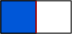
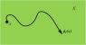
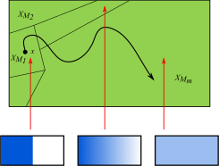

# Philosophy of Statistical Mechanics
**First published Tue Jan 10, 2023**

*Frigg, Roman, Werndl, Charlotte*

Statistical Mechanics is the third pillar of modern physics, next to quantum theory and relativity theory. Its aim is to account for the macroscopic behaviour of physical systems in terms of dynamical laws governing the microscopic constituents of these systems and probabilistic assumptions. Like other theories in physics, statistical mechanics raises a number of foundational and philosophical issues. But philosophical discussions in statistical mechanics face an immediate difficulty because unlike other theories, statistical mechanics has not yet found a generally accepted theoretical framework or a canonical formalism. In this entry we introduce the different theoretical approaches to statistical mechanics and the philosophical question that attach to them.

## 1. The Aims of Statistical Mechanics (SM)

Statistical Mechanics (SM) is the third pillar of modern physics, next to quantum theory and relativity theory. Its aim is to account for the macroscopic behaviour of physical systems in terms of dynamical laws governing the microscopic constituents of these systems and the probabilistic assumptions made about them. One aspect of that behaviour is the focal point of SM: equilibrium. Much of SM investigates questions concerning equilibrium, and philosophical discussions about SM focus on the foundational assumptions that are employed in answers to these questions.

Let us illustrate the core questions concerning equilibrium with a standard example. Consider a gas confined to the left half of a container with a dividing wall (see Figure 1a). The gas is in *equilibrium* and there is no manifest change in any of its macro properties like pressure, temperature, and volume. Now you suddenly remove the dividing wall (see Figure 1b), and, as result, the gas starts spreading through the entire available volume. The gas is now no longer in equilibrium (see Figure 1c). The spreading of the gas comes to an end when the entire available space is filled evenly (see Figure 1d). At this point, the gas has reached a new equilibrium. Since the process of spreading culminates in a new equilibrium, this process is an *approach to equilibrium*. A key characteristic of the approach to equilibrium is that it seems to be *irreversible*: systems move from non-equilibrium to equilibrium, but not *vice versa*; gases spread to fill the container evenly, but they do not spontaneously concentrate in the left half of the container. Since an irreversible approach to equilibrium is often associated with thermodynamics, this is referred to as *thermodynamic behaviour*. Characterising the state of equilibrium and accounting for why, and how, a system approaches equilibrium is the core task for SM. Sometimes these two problems are assigned to separate theories (or separate parts of a larger theory), which are then referred to as *equilibrium SM* and *non-equilibrium SM*, respectively.

(a)

(b)

(c)

(d)

*Figure 1* [An extended description of figure 1 is in the supplement.]

While equilibrium occupies centre stage, SM of course also deals with other issues such as phase transitions, the entropy costs of computation, and the process of mixing substances, and in philosophical contexts SM has also been employed to shed light on the nature of the direction of time, the interpretation of probabilities in deterministic theories, the state of the universe shortly after the big bang, and the possibility of knowledge about the past. We will touch on all these below, but in keeping with the centrality of equilibrium in SM, the bulk of this entry is concerned with an analysis of the conceptual underpinnings of both equilibrium and non-equilibrium SM.

Sometimes the aim of SM is said to provide a reduction of the laws of thermodynamics: the laws of TD provide a correct description of the macroscopic behaviour of systems and the aim of SM is to account for these laws in microscopic terms. We avoid this way of framing the aims of SM. Both the nature of reduction itself, and the question whether SM can provide a reduction of TD (in some specifiable sense) are matters of controversy, and we will come back to them in Section 7.5.

## 2. The Theoretical Landscape of SM

Philosophical discussions in SM face an immediate difficulty. Philosophical projects in many areas of physics can take an accepted theory and its formalism as their point of departure. Philosophical discussions of quantum mechanics, for instance, can begin with the Hilbert space formulation of the theory and develop their arguments with reference to it. The situation in SM is different. Unlike theories such as quantum mechanics, SM has not yet found a generally accepted theoretical framework or a canonical formalism. What we encounter in SM is a plurality of different approaches and schools of thought, each with its own mathematical apparatus and foundational assumptions. For this reason, a review of the philosophy of SM cannot simply start with a statement of the theory’s basic principles and then move on to different interpretations of the theory. Our task is to first classify different approaches and then discuss how each works; a further question then concerns the relation between them.

Classifying and labelling approaches raises its own issues, and different routes are possible. However, SM’s theoretical plurality notwithstanding, most of the approaches one finds in it can be brought under one of three broad theoretical umbrellas. These are known as “Boltzmannian SM” (BSM), the “Boltzmann Equation” (BE), and “Gibbsian SM” (GSM). The label “BSM” is somewhat unfortunate because it might suggest that Boltzmann, only (or primarily) championed this particular approach, whereas he has in fact contributed to the development of many different theoretical positions (for an overview of his contributions to SM see the entry on Boltzmann’s work in statistical physics; for detailed discussions see Cercignani (1998)[^cercignani-1998], Darrigol (2018)[^darrigol-2018], and Uffink (2007)[^uffink-2007]). These labels have, however, become customary and so we stick with “BSM” despite its historical infelicity. We will now discuss the theoretical backdrop against which these positions are formulated, namely dynamical systems, and then introduce the positions in §4, §5, and §6, respectively. Extensive synoptic discussion of SM can also be found in Frigg (2008b)[^frigg-2008b], Shenker (2017a, 2017b)[^shenker-2017a][^shenker-2017b], Sklar (1993)[^sklar-1993], and Uffink (2007)[^uffink-2007].

## 3. Dynamical Systems

Before delving into the discussion of SM, some attention needs to be paid to the “M” in SM. The mechanical background theory against which SM is formulated can be either classical mechanics or quantum mechanics, resulting in either classical SM or quantum SM. Foundational debates are by and large conducted in the context of classical SM. We follow this practice in the current entry, but we briefly draw attention to problems and issues that occur when moving from a classical to a quantum framework (§4.8). From the point of view of classical mechanics, the systems of interest in SM have the structure of *dynamical system*, a triple $(X,$ $\phi,$ $\mu).$ $X$ is the state space of the system (and from a mathematical point of view is a set). In the case of a gas with $n$ molecules this space has $6n$ dimensions: three coordinates specifying the position and three coordinates specifying the momentum of each molecule. *φ* is the time evolution function, which specifies how a system’s state changes over time, and we write $\phi_{t}(x)$ to denote the state into which $x$ evolves after time $t$. If the dynamic of the system is specified by an equation of motion like Newton’s or Hamilton’s, then *φ* is the solution of that equation. If we let time evolve, $\phi_{t}(x)$ draws a “line” in $X$ that represents the time evolution of a system that was initially in state $x$; this “line” is called a *trajectory*. Finally, $\mu$ is a measure on $X$, roughly a means to say how large a part of $X$ is. This is illustrated schematically in Figure 2. For a more extensive introductory discussion of dynamical systems see the entry on the ergodic hierarchy, section on dynamical systems, and for mathematical discussions see, for instance, Arnold and Avez (1967 [1968]) and Katok and Hasselblatt (1995).

*Figure 2* [An extended description of figure 2 is in the supplement.]

It is standard to assume that *φ* is deterministic, meaning, that every state $x$ has exactly one past and exactly one future, or, in geometrical terms, that trajectories cannot intersect (for a discussion of determinism see Earman (1986)[^earman-1986]). The systems studied in BSM are such that the volume of “blobs” in the state space is conserved: if we follow the time evolution of a “blob” in state space, this blob can change its shape but not its volume. From a mathematical point of view, this amounts to saying that the dynamics is *measure-preserving*: $\mu(A) = \mu(\phi_{t}(A))$ for all subsets $A$ of $X$ and for all times $t$. Systems in SM are often assumed to be governed by Hamilton’s equations of motion, and it is a consequence of Liouville’s theorem that the time evolution of a Hamiltonian system is measure-preserving.

## 4. Boltzmannian Statistical Mechanics (BSM)

In the current debate, “BSM” denotes a family of positions that take as their starting point the approach that was first introduced by Boltzmann in his 1877 paper and then presented in a streamlined manner by Ehrenfest and Ehrenfest-Afanassjewa in their 1911 [1959] review. In this section we discuss different contemporary articulations of BSM along with the challenges they face.

### 4.1 The Framework of BSM

To articulate the framework of BSM, we distinguish between micro-states and macro-states; for a discussion of the this framework see, for instance, Albert (2000)[^albert-2000], Frigg (2008b)[^frigg-2008b], Goldstein (2001)[^goldstein-2001], and Sklar (1993)[^sklar-1993]. The *micro-state* of a system at time $t$ is the state $x \in X$ in which the system is at time $t$. This state specifies the exact mechanical state of every micro-constituent of the system. As we have seen in the previous section, in the case of a gas $x$ specifies the positions and momenta of every molecule in the gas. Intuitively, the *macro-state* $M$ of a system at time $t$ specifies the macro-constitution of the system at $t$ in terms of variables like volume, temperature and other properties measurable, loosely speaking, at human scales, although, as we will see in Section 4.8, reference to thermodynamic variables in this context must be taken with a grain of salt. The configurations shown in Figure 1 are macro-states in this sense.

The core posit of BSM is that macro-states supervene on micro-states, meaning that any change in the system’s macro-state *must* be accompanied by a change in the system’s micro-state: every micro-state $x$ has exactly one corresponding macro-state $M$. This rules out that, say, the pressure of a gas can change while the positions and momenta of each of its molecules remain the same (see entry on supervenience). Let $M(x)$ be the unique macro-state that corresponds to microstate $x$. The correspondence between micro-states and macro-states typically is not one-to-one and macro-states are multiply realisable. If, for instance, we swap the positions and momenta of two molecules, the gas’ macro-state does not change. It is therefore natural to group together all micro-states $x$, that correspond to the same macro-state $M$:

$$X_{M} = \{ x \in X \text{ such that } M(x) = M\}.$$

$X_{M}$ is the *macro-region* of $M$.

Now consider a complete set of macro-states (i.e., a set that contains every macro-state that the system can be in), and assume that there are exactly $m$ such states. This complete set is $\{ M_{1},\ldots,M_{m}\}$. It is then the case that the corresponding set of macro-regions, $\{ X_{M_{1}},\ldots,X_{M_{m}}\}$, forms a partition of $X$, meaning that the elements of the set do not overlap and jointly cover $X$. This is illustrated in Figure 3.

*Figure 3* [An extended description of figure 3 is in the supplement.]

The figure also indicates that if the system under study is a gas, then the macro-states correspond to different states of the gas we have seen in Section 1. Specifically, one of the macro-states corresponds to the initial state of the gas, and another one corresponds to its final equilibrium state.

This raises two fundamental questions that occupy centre stage in discussions about BSM. First, what are macro-states and how is the equilibrium state identified? That is, where do we get the set $\{M_{1},\ldots,M_{m}\}$ from and how do we single out one member of the set as the equilibrium macro-state? Second, as already illustrated in Figure 3, an approach to equilibrium takes place if the time evolution of the system is such that a micro-state $x$ in a non-equilibrium macro-region evolves such that $\phi_{t}(x)$ lies in the equilibrium macro-region at a later point in time. Ideally one would want this to happen for all $x$ in any non-equilibrium macro-region, because this would mean that all non-equilibrium states would eventually approach equilibrium. The question now is whether this is indeed the case, and, if not, what “portion” of states evolves differently.

Before turning to these questions, let us introduce the *Boltzmann entropy* $S_{B}$, which is a property of a macro-state defined through the measure of the macro-states’ macro-region:

$$S_{B}(M_{i}) = k\log{\lbrack\mu(X_{M_{i}}})\rbrack$$

for all $i = 1,\ldots, m$, where $k$ is the so-called Boltzmann constant. Since the logarithm is a monotonic function, the larger the measure $\mu$ of a macro-region, the larger the entropy of the corresponding macro-state.

This framework is the backbone of positions that self-identify as “Boltzmannian”. Differences appear in how the elements of this framework are articulated and in how difficulties are resolved.

### 4.2 Defining Equilibrium: Boltzmann’s Combinatorial Argument

An influential way of defining equilibrium goes back to Boltzmann (1877)[^boltzmann-1877]; for contemporary discussion of the argument see, for instance, Albert (2000)[^albert-2000], Frigg (2008b)[^frigg-2008b], and Uffink (2007)[^uffink-2007]. The approach first focusses on the state space of one particle of the system, which in the case of a gas has six dimensions (three for the particle’s positions in each spatial dimension and a further three for the corresponding momenta). We then introduce a grid on this space—an operation known as *coarse-graining*—and say that two particles have the same *coarse-grained micro-state* if they are in the same grid cell. The state of the entire gas is then represented by an *arrangement*, a specification of $n$ points on this space (one for each particle in the gas). But for the gas’ macro-properties it is irrelevant which particle is in which state, meaning that the gas’ macro-state must be unaffected by a permutation of the particles. All that the macro-state depends on is the *distribution* of particles, a specification of how many particles are in each grid cell.

The core idea of the approach is to determine how many arrangements are compatible with a given distribution, and to define the equilibrium state as the one for which this number is maximal. Making the strong (and unrealistic) assumption that the particles in the gas are non-interacting (which also means that they never collide) and that the energy of the gas is preserved, Boltzmann offered a solution to this problem and showed that the distribution for which the number of arrangements is maximal is the so-called discrete Maxwell-Boltzmann distribution:

$$n_{i} = \alpha\exp\left({-\beta} E_{i} \right),$$

where $n_{i}$ is the number of particles in cell $i$ if the coarse-graining, $E_{i}$ is the energy of a particle in that cell, and *α* and *β* are constants that depend on the number of particles and the temperature of the system (Tolman 1938 [1979]: Ch. 4)[^tolman-1938]. From a mathematical point of view, deriving this distribution is a problem in combinatorics, which is why the approach is now known as the *combinatorial argument*.

As Paul and Tatiana Ehrenfest pointed out in their 1911 [1959] review, the mathematical structure of the argument also shows that if we now return to the state space $X$ of the entire system (which, recall, has $6n$ dimensions), the macro-region of the equilibrium state thus defined is the largest of all macro-regions. Hence, the equilibrium macro-state is the macro-state with the largest macro-region. In contemporary discussions this is customarily glossed as the equilibrium macro-state not only being larger than any other macro-state, but as being enormously larger and in fact taking up most of $X$ (see, for instance, Goldstein 2001)[^goldstein-2001]. However, as Lavis (2008)[^lavis-2008] points out, the formalism only shows that the equilibrium macro-region is larger than any other macro-region and it is not a general truism that it takes up most of the state space; there are in fact systems in which the non-equilibrium macro-regions taken together are larger than the equilibrium macro-region.

Since, as we have seen, the Boltzmann entropy is a monotonic function of the measure of a macro-region, this implies that the equilibrium microstate is also the macro-state with the largest Boltzmann entropy, and the approach to equilibrium is a process that can be characterised by an increase of entropy.

Two questions arise: first, is this a tenable general definition of equilibrium, and, second, how does it explain the approach to equilibrium? As regards the first question, Uffink (2007)[^uffink-2007] highlights that the combinatorial argument assumes particles to be non-interacting. The result can therefore be seen as a good approximation for dilute gases, but it fails to describe (even approximately) interacting systems like liquids and solids. But important applications of SM are to systems that are not dilute gases and so this is a significant limitation. Furthermore, from a conceptual point of view, the problem is that a definition of equilibrium in terms of the number of arrangements compatible with a distribution makes no contact with the thermodynamic notion of equilibrium, where equilibrium is defined as the state to which an isolated system converges when left to itself (Werndl & Frigg 2015b)[^werndl-2015b]. Finally, this definition of equilibrium is completely disconnected form the system’s dynamics, which has the odd consequence that it would still provide an equilibrium state even if the system’s time evolution was the identity function (and hence nothing ever changed and no approach to equilibrium took place). And even if one were to set thermodynamics aside, there is nothing truly macro about the definition, which in fact directly constructs a macro-region without ever specifying a macro-state.

A further problem (still as regards the first question) is the justification of coarse-graining. The combinatorial argument does not get off the ground without coarse-grained micro-states, and so the question is what legitimises the use of such states. The problem is accentuated by the facts that the procedure only works for particular kind of coarse-graining (namely if the grid is parallel to the position and momentum axes) and that the grid cannot be eliminated by taking a limit which lets the grid size tend toward zero. A number of justificatory strategies have been proposed but none is entirely satisfactory. A similar problem arises with coarse-gaining in Gibbsian SM, and we refer the reader to Section 6.5 for a discussion.

As regards the second question, the combinatorial argument itself is silent about why and how systems approach equilibrium and additional ingredients must be added to the account to provide such an explanation. Before discussing some of these ingredients (which is the topic of much of the remainder of this section), let us discuss two challenges that every explanation of the approach to equilibrium must address: the reversibility problem and the recurrence problem.

### 4.3 Two Challenges: Reversibility and Recurrence

In Section 2 we have seen that at bottom the physical systems of BSM have the structure of a dynamical system $(X,$ $\phi,$ $\mu)$ where *φ* is deterministic and measure preserving. Systems of this kind have two features that pose a challenge for an understanding of the approach to equilibrium.

The first feature is what is known as *time-reversal invariance*. Intuitively you can think of the time-reversal of a process as what you get when you play a movie of a process backwards. The dynamics of system is time-reversal invariant if every process that is allowed to happen in one direction of time is also allowed to happen the reverse direction of time. That is, for every process that is allowed by the theory it is that case that if you capture the process in a movie, then the process that you see when you play the movie backwards is also allowed by the theory; for detailed and more technical discussions see, for instance, Earman (2002)[^earman-2002], Malament (2004)[^malament-2004], Roberts (2022)[^roberts-2022], and Uffink (2001)[^uffink-2001].

Hamiltonian systems are time-reversal invariant and so the most common systems studied in SM have this property. A look at Figure 3 makes the consequences of this for an understanding of the approach to equilibrium clear. We consider a system whose micro-state initially lies in a non-equilibrium macro-region and then evolves into a micro-state that lies in the equilibrium macro-region. Obviously, this process ought to be allowed by the theory. But this means that the reverse process—a process that starts in the equilibrium macro-region and moves back into the initial non-equilibrium macro region—must be allowed too. In Section 1 we have seen that the approach to equilibrium is expected to be *irreversible*, prohibiting systems like gases to spontaneously leave equilibrium and evolve into a non-equilibrium state. But we are now faced with a contradiction: if the dynamics of the system is time-reversal invariant, then the approach to equilibrium cannot be irreversible because the evolution from the equilibrium state to a non-equilibrium state is allowed. This observation is known as *Loschmidt's reversibility objection* because it was first put forward by Loschmidt (1876)[^loschmidt-1876]; for a historical discussion of this objection, see Darrigol (2021)[^darrigol-2021].

The second feature that poses a challenge is *Poincaré recurrence*. The systems of interest in BSM are both measure-preserving and spatially bounded: they are gases in a box, liquids in a container and crystals on a laboratory table. This means that the system’s micro-state can only access a finite region in $X$. Poincaré showed that dynamical systems of this kind must, at some point, return arbitrarily close to their initial state, and, indeed do so infinitely many times. The time that it takes the system to return close to its initial condition is called the *recurrence time*. Like time-reversal invariance, *Poincaré recurrence* contradicts the supposed irreversibility of the approach to equilibrium: it implies that systems will return to non-equilibrium states at some point. One just has to wait for long enough. This is known as *Zermelo’s recurrence objection* because it was first put forward by Zermelo (1896)[^zermelo-1896]; for a historical discussion see Uffink (2007)[^uffink-2007].

Any explanation of the approach to equilibrium has to address these two objections.

### 4.4 The Ergodic Approach

A classical explanation of the approach to equilibrium is given within ergodic theory. A system is ergodic iff, in the long run (i.e., in the limit of time $t \rightarrow \infty$), for almost all initial conditions it is the case that the fraction of time that the system’s trajectory spends in a region $R$ of $X$ is equal to the fraction that $R$ occupies in $X$ (Arnold & Avez 1967 [1968])[^arnold-1967]. For instance, if $\mu(R)/\mu(X) = 1/3,$ then an ergodic system will, in the long run, spend 1/3 of its time in $R$ (for a more extensive discussion of ergodicity see entry on the ergodic hierarchy).

In Section 4.2 we have seen that if the equilibrium macro-region is constructed with the combinatorial argument, then it occupies the largest portion of $X$. If we now also assume that the system is ergodic, it follows immediately that the system spends the largest portion of time in equilibrium. This is then often given a probabilistic gloss by associating the time that a system spends in a certain part of $X$ with the probability of finding the system in that part of $X$, and so we get that we are overwhelmingly likely to find that system in equilibrium; for a discussion of this approach to probabilities see Frigg (2010)[^frigg-2010] and references therein.

The ergodic approach faces a number of problems. First, being ergodic is a stringent condition that many systems fail to meet. This is a problem because among those systems are many to which SM is successfully applied. For instance, in a solid the molecules oscillate around fixed positions in a lattice, and as a result the phase point of the system can only access a small part of the energy hypersurface (Uffink 2007: 1017)[^uffink-2007]. The Kac Ring model and a system of anharmonic oscillators behave thermodynamically but fail to be ergodic (Bricmont 2001)[^bricmont-2001][^bricmont-2001-2]. And even the ideal gas—supposedly the paradigm system of SM—is not ergodic (Uffink 1996b: 381)[^uffink-1996b]. But if core-systems of SM are not ergodic, then ergodicity cannot provide an explanation for the approach to equilibrium, at least not one that is applicable across the board (Earman & Rédei 1996; van Lith 2001)[^earman-1996][^lith-2001]. Attempts have been made to improve the situation through the notion of epsilon-ergodicity, where a system is epsilon-ergodic if it is ergodic only on subset $Y \subset X$ where $\mu(Y) \geq 1 - \varepsilon$, for small positive real number *ε* (Vranas 1998)[^vranas-1998]. While this approach deals successfully with some systems (Frigg & Werndl 2011)[^frigg-2011][^frigg-2011-2], it is still not universally applicable and hence remains silent about large classes of SM systems.

The ergodic approach accommodates Loschmidt’s and Zermelo’s objections by rejecting the requirement of strict irreversibility. The approach insists that systems, can, and actually do, move away from equilibrium. What SM should explain is not strict irreversibility, but the fact that systems spend most of the time in equilibrium. The ergodic approach does this by construction, and only allows for brief and infrequent episodes of non-thermodynamic behaviour (when the system moves out of equilibrium). This response is in line with Callender (2001)[^callender-2001] who argues that we should not take thermodynamics “too seriously” and see its strictly irreversible approach to equilibrium as an idealisation that is not empirically accurate because physical systems turn out to exhibit equilibrium fluctuations.

A more technical worry is what is known as the *measure zero problem*. As we have seen, ergodicity says that “almost all initial conditions” are such that the fraction of time spent in $R$ is equal to the fraction $R$ occupies in $X$. In technical terms this means that set of initial conditions for which this is not the case has measure zero (with respect to $\mu$). Intuitively this would seem to suggest that these conditions are negligible. However, as Sklar (1993: 182–88)[^sklar-1993] points out, sets of measure zero can be rather large (remember that set of rational numbers has measure zero in the real numbers), and the problem is to justify why a set of measure zero really is negligible.

### 4.5 Typicality

An alternative account explains the approach to equilibrium in terms of *typicality*. Intuitively something is typical if it happens in the “vast majority” of cases: typical lottery tickets are blanks, and in a typical series of a thousand coin tosses the ratio of the number of heads and the number of tails is approximately one. The leading idea of a typicality-based account of SM is to show that thermodynamic behaviour is typical and is therefore to be expected. The typicality account comes in different version, which disagree on how exactly typicality reasoning is put to use; different versions have been formulated, among others, by Goldstein (2001)[^goldstein-2001], Goldstein and Lebowitz (2004), Goldstein, Lebowitz, Tumulka, and Zanghì (2006), Lebowitz (1993a, 1993b)[^lebowitz-1993a][^lebowitz-1993b], and Volchan (2007)[^volchan-2007]. In its paradigmatic version, the account builds on the observation (discussed in Section 4.2) that the equilibrium macro-region is so large that $X$ consists almost entirely of equilibrium micro-states, which means that equilibrium micro-states are typical in $X$. The account submits that, for this reason, a system that starts its time-evolution in a non-equilibrium state can simply not avoid evolving into a typical state—i.e., an equilibrium state—and staying there for very long time, which explains the approach to equilibrium.

Frigg (2009, 2011)[^frigg-2009][^frigg-2011][^frigg-2011-2] and Uffink (2007)[^uffink-2007] argue that from the point of view of dynamical systems theory this is unjustified because there is no reason to assume that micro-states in an atypical set have to evolve into a typical set without there being any further dynamical assumptions in place. To get around this problem Frigg and Werndl (2012) formulate a version of the account that takes the dynamics of the system into account. Lazarovici and Reichert (2015) disagree that such additions are necessary. For further discussions of the use of typicality in SM, see Badino (2020)[^badino-2020], Bricmont (2022)[^bricmont-2022], Chibbaro, Rondoni and Vulpiani (2022), Crane and Wilhelm (2020), Goldstein (2012)[^goldstein-2012], Hemmo and Shenker (2015), Luczak (2016)[^luczak-2016], Maudlin (2020)[^maudlin-2020], Reichert (forthcoming), and Wilhelm (2022)[^wilhelm-2022]. As far as Loschmidt’s and Zermelo’s objections are concerned, the typicality approach has to make the same move as the ergodic approach and reject strict irreversibility as a requirement.

### 4.6 The Mentaculus and the Past-Hypothesis

An altogether different approach has been formulated by Albert (2000)[^albert-2000]. This approach focusses on the internal structure of macro-regions and aims to explain the approach to equilibrium by showing that the probability for system in a non-equilibrium macro-state to evolve toward a macro-state of higher Boltzmann entropy is high. The basis for this discussion is the so-called *statistical postulate*. Consider a particular macro-state $M$ with macro-region $X_{M}$ and assume that the system is in macro-state $M$. The postulate then says that for any subset $A$ of $X_{M}$ the probability of finding the system’s micro-state in $A$ is ${\mu(A)/\mu(X}_{M})$. We can now separate the micro-states in $X_{M}$ into those that evolve into a higher entropy macro-state and those that move toward macro-states of lower entropy. Let’s call these sets $X_{M}^{+}$ and $X_{M}^{-}$. The statistical postulate then says that the probability of a system in $M$ evolving toward a higher entropy macro-state is ${\mu(X}_{M}^{+})/\mu(X_{M})$.

For it to be likely that system approaches equilibrium this probability would have to be high. It now turns out that for purely mathematical reasons, if the system is highly likely to evolve toward a macro-state of higher entropy, then it is also highly likely to have evolved into the current macro-state $M$ from a macro-state of high entropy. In other words, if the entropy is highly likely to increase in the future, it is also highly likely to have decreased in the past. Albert suggests solving this problem by regarding the entire universe as the system being studied and then conditionalizing on the *Past-Hypothesis*, which is the assumption that

> that the world first came into being in whatever particular low-entropy highly condensed big-bang sort of macrocondition it is that the normal inferential procedures of cosmology will eventually present to us. (2000: 96)

Let $M_{p}$ be the *past state*, the state in which the world first came into being according to the Past-Hypothesis, and let $I_{t} = \phi_{t}(X_{M_{p}}) \cap X_{M}$ be the intersection of the time-evolved macro-region of the past state and the current macro-state. The probability of high entropy future is then ${\mu(I_{t} \cap X}_{M}^{+})/\mu(I_{t})$. If we further assume “abnormal” states with low entropy futures are scattered all over $X_{M}$, then a high entropy future can be highly likely without it a high entropy past also being highly likely.

This approach to SM is based on three core elements: the deterministic time evolution of the system given by $\phi_{t}$, the Past-Hypothesis, and the statistical postulate. Together they result in the assignment of a probability to propositions about the history of a system. Albert (2015)[^albert-2015] calls this assignment the *Mentaculus*. Albert regards the Mentaculus not only as an account of thermodynamic phenomena, but as the backbone of a complete scientific theory of the universe because the Mentaculus assigns probabilities to propositions in all sciences. This raises all kind of issues about the nature of laws, reduction, and the status of the special sciences, which are discussed, for instance, in Frisch (2011)[^frisch-2011], Hemmo and Shenker (2021) and Myrvold and others (2016).

Like the ergodic approach, the Mentaculus must accommodate Loschmidt’s and Zermelo’s objections by rejecting the requirement of strict irreversibility. Higher to lower entropy transitions are still allowed, but they are rendered unlikely, and recurrence can be tamed by noting that the recurrence time for a typical SM system is larger than age of the universe, which means that we won’t observe recurrence (Bricmont 1995; Callender 1999)[^bricmont-1995][^callender-1999]. Yet, this amounts to admitting that entropy increase is not universal and the formalism is compatible with there being periods of decreasing entropy at some later point in the history of the universe.

A crucial ingredient of the Mentaculus is the Past-Hypothesis. The idea of grounding thermodynamic behaviour in a cosmic low-entropy past can be traced back to Boltzmann (Uffink 2007: 990)[^uffink-2007] and has since been advocated by prominent physicists like Feynman (1965: Ch. 5) and R. Penrose (2004: Ch. 27). This raises two questions: first, can the Past-Hypothesis be given a precise formulation that serves the purpose of SM, and, second, what status does the Past-Hypothesis have and does the fact that the universe started in this particular state require an explanation?

As regards the first question, Earman has cast the damning verdict that the Past-Hypothesis is “not even false” (2006) because in cosmologies described in general relativity there is no well-defined sense in which the Boltzmann entropy has a low value. A further problem is that in the Mentaculus the Boltzmann entropy is a global quantity characterising the entire universe. But, as Winsberg points out, the fact that this quantity is low does not imply that the entropy of a particular small subsystem of interest is also low, and, worse just because the overall entropy of the universe increases it need not be the case that the entropy in a small subsystem also increases (2004a). The source of these difficulties is that the Mentaculus takes the entire universe to be the relevant system and so one might try get around them by reverting to where we started: laboratory systems like gases in boxes. One can then take the past state simply to be the state in which such a gas is prepared at the beginning of a process (say in the left half of the container). This leads to the so-called branch systems approach, because a system is seen as “branching off” from the rest of the universe when it is isolated from its environment and prepared in non-equilibrium state (Davies 1974; Sklar 1993: 318–32)[^davies-1974][^sklar-1993]. Albert (2000)[^albert-2000] dismisses this option for a number of reasons, chief among them that it is not clear why one should regard the statistical postulate as valid for such a state (see Winsberg (2004b)[^winsberg-2004b] for a discussion).

As regards the second question, Chen (forthcoming), Goldstein (2001)[^goldstein-2001], and Loewer (2001)[^loewer-2001] argue that Past-Hypothesis has the status of a fundamental law of nature. Albert seems to regard it as something like a Kantian regulative principle in that its truth must be assumed in order to make knowledge of the past possible at all. By contrast, Callender, Price, and Wald regard that the Past-Hypothesis a contingent matter of fact, but they disagree on whether this fact stands in need of an explanation. Price (1996, 2004)[^price-1996][^price-2004] argues that it does because the crucial question in SM is not why entropy increase, but rather why it ever got to be low in the first place. Callender (1998, 2004a, 2004b)[^callender-1998][^callender-2004a][^callender-2004b] disagrees: the Past-Hypothesis simply specifies initial conditions of a process, and initial conditions are not the kind of thing that needs to be explained (see also Sklar (1993: 309–18)[^sklar-1993]). Parker (2005)[^parker-2005] argues that conditionalising on the initial state of the universe does not have the explanatory power to explain irreversible behaviour. Baras and Shenker (2020)[^shenker-2020] and Farr (2022)[^farr-2022] analysed the notion of explanation that is involved in this debate and argue that different questions are in play that require different answers.

### 4.7 The Long-Run Residence Time Account

The long-run residence time account offers a different perspective both on the definition of equilibrium and the approach to it (Werndl & Frigg 2015a, 2015b)[^werndl-2015a][^werndl-2015b]. Rather than first defining equilibrium through combinatorial considerations (as in §4.2) and *then* asking why systems approach equilibrium thus defined (as do the accounts discussed in §§4.4–4.6), the long-run residence time account *defines* equilibrium through thermodynamic behaviour. The account begins by characterising the macro-states in the set $\{ M_{1},\ldots,M_{n}\}$ in purely macroscopic terms, i.e., through thermodynamic variables like pressure and temperature, and then identifies the state in which a system resides most of the time as the equilibrium state: among the $M_{i}$, the equilibrium macro-state is by definition the state in which a system spends most of its time in the long run (which gives the account its name).

This definition requires no assumption about the size of the equilibrium macro-region, but one can then show that it is a property of the equilibrium macro-state that its macro-region is large. This result is fully general in that it does not depend on assumptions like particles being non-interacting (which makes it applicable to all systems including liquids and solids), and it does not depend on combinatorial considerations at the micro-level. The approach to equilibrium is built into the definition in the sense that if there is no macro-state in which the system spends most of its time, then the system simply has no equilibrium. This raises the question of the circumstances under which an equilibrium exists. The account answers this question by providing a general existence theorem which furnishes criteria for the existence of an equilibrium state (Werndl & Frigg forthcoming-b). Intuitively, the existence theorem says that there is an equilibrium just in case the system’s state space is split up into invariant regions on which the motion is ergodic and the equilibrium macro-state is largest in size relative to the other macro-states on each such region.

Like the account previously discussed, the long-run residence time account accommodates Loschmidt’s and Zermelo’s objections by rejecting the requirement of strict irreversibility: it insists that being in equilibrium most of the time is as much as one can reasonably ask for because actual physical systems show equilibrium fluctuations and equilibrium is not the dead and immovable state that thermodynamics says it is.

### 4.8 Problems and Limitations

BSM enjoys great popularity in foundational debates due to its clear and intuitive theoretical structure. Nevertheless, BSM faces a number of problems and limitations.

The first problem is that BSM only deals with closed systems that evolve under their own internal dynamics. As we will see in Section 6, GSM successfully deals with systems that can exchange energy and even particles with their environments, and systems of this kind play an important role in SM. Those who think that SM only deals with the entire universe can set this problem aside because the universe (arguably) is a closed system. However, those who think that the objects of study in SM are laboratory-size systems like gases and crystals will have to address the issues of how BSM can accommodate interactions between systems and their environments, which is a largely ignored problem.

A second problem is that even though macro-states are ubiquitous in discussions about BSM, little attention is paid to a precise articulation of what these states are. There is loose talk about how a system looks from macroscopic perspective, or there is a vague appeal to thermodynamic variables. However, by the lights of thermodynamics, variables like pressure and temperature are defined *only* in equilibrium and it remains unclear how non-equilibrium states, and with them the approach to equilibrium, should be characterised in terms of thermodynamic variables. Frigg and Werndl (forthcoming-a) suggest solving this problem by defining macro-states in terms of local field-variables, but the issue needs further attention.

A third problem is that current formulations of BSM are closely tied to deterministic classical systems (§3). Some versions of BSM can be formulated based on classical stochastic system (Werndl & Frigg 2017)[^werndl-2017]. But the crucial question is whether, and if so how, a quantum version of BSM can be formulated (for a discussion see the entry on quantum mechanics). Dizadji-Bahmani (2011)[^dizadji-bahmani-2011] discusses how a result due to Linden and others (2009) can be used to construct an argument for the conclusion that an arbitrary small subsystem of a large quantum system typically tends toward equilibrium. Chen (forthcoming) formulates a quantum version of the Mentaculus, which he calls the *Wentaculus* (see also his 2022). Goldstein, Lebowitz, Tumulka, and Zanghì (2020) describe a quantum analogue of the Boltzmann entropy and argue that the Boltzmannian conception of equilibrium is vindicated also in quantum mechanics by recent work on thermalization of closed quantum systems. These early steps have not yet resulted in comprehensive and widely accepted formulation of quantum version of BSM, the formulation of a such a version of remains an understudied topic. Albert (2000: Ch. 7) suggested that the spontaneous collapses of the so-called GRW theory (for introduction see the entry on collapse theories), a particular approach quantum mechanics, could be responsible for the emergence of thermodynamic irreversibility. Te Vrugt, Tóth and Wittkowski (2021) put this proposal to test in computer simulations and found that for initial conditions leading to anti-thermodynamic behaviour GRW collapses do not lead to thermodynamic behaviour and that therefore the GRW does not induce irreversible behaviour.

Finally, there is no way around recognising that BSM is mostly used in foundational debates, but it is GSM that is the practitioner’s workhorse. When physicists have to carry out calculations and solve problems, they usually turn to GSM which offers user-friendly strategies that are absent in BSM. So either BSM has to be extended with practical prescriptions, or it has to be connected to GSM so that it can benefit from its computational methods (for a discussion of the latter option see §6.7).

## 5. The Boltzmann Equation

A different approach to the problem is taken by Boltzmann in his famous (1872 [1966 Brush translation]) paper, which contains two results that are now known as the Boltzmann Equation and the *H*-theorem. As before, consider a gas, now described through a distribution function $f_{t}(\vec{v})$, which specifies what fraction of molecules in the gas has a certain velocity $\vec{v}$ at time $t$. This distribution can change over time, and Boltzmann’s aim was to show that as time passes this distribution function changes so that it approximates the Maxwell-Boltzmann distribution, which, as we have seen in Section 4.2, is the equilibrium distribution for a gas.

To this end, Boltzmann derived an equation describing the time evolution of $f_{t}(\vec{v})$. The derivation assumes that the gas consists of particles of diameter $D$ that interact like hard spheres (i.e., they interact *only* when they collide); that all collisions are elastic (i.e., no energy is lost); that the number of particles is so large that their distribution, which in reality is discrete, can be well approximated by a continuous and differentiable function $f_{t}(\vec{v})$; and that the density of the gas is so low that only two-particle collisions play a role in the evolution of $f_{t}(\vec{v})$.

The crucial assumption in the argument is the so-called “*Stosszahlansatz*”, which specifies how many collisions of a certain type take place in certain interval of time (the German “*Stosszahlansatz*” literally means something like “collision number assumption”). Assume the gas has $N$ molecules per unit volume and the molecules are equally distributed in space. The type of collisions we are focussing on is the one between a particle with velocity $\vec{v}_{1}$ and one with velocity $\vec{v}_{2}$, and we want to know the number $N(\vec{v}_{1}, \vec{v}_{2})$ of such collisions during a small interval of time $\Delta t$. To solve this problem, we begin by focussing on one molecule with $\vec{v}_{1}$. The relative velocity of this molecule and a molecule moving with $\vec{v}_{2}$ is $\vec{v}_{2} - \vec{v}_{1}$ and the absolute value of that relative velocity is $\left\| \vec{v}_{2} - \vec{v}_{1} \right\|$. Molecules of diameter D only collide if their centres come closer than $D$. So let us look at a cylinder with radius $D$ and height $\left\| \vec{v}_{2} - \vec{v}_{1} \right\|\Delta t$, which is the volume in space in which molecules with velocity $\vec{v}_{2}$ would collide with our molecule during $\Delta t$. The volume of this cylinder is

$$\pi D^{2}\left\| \vec{v}_{2} - \vec{v}_{1} \right\|\Delta t .$$

If we now make the strong assumption that the initial velocities of colliding particles are independent, it follows that number of molecules with velocity $\vec{v}_{2}$ in a unit volume of the gas at time $t$ is $Nf_{t}(\vec{v}_{2})$, and hence the number of such molecules in our cylinder is

$$ N f_{t} (\vec{v}_{2}) \pi D^{2} \left\| \vec{v}_{1} - \vec{v}_{2} \right\| \Delta t.$$

This is the number of collisions that the molecule we are focussing on can be expected to undergo during $\Delta t$. But there is nothing special about this molecule, and we are interested in the number of *all* collisions between particles with velocities $\vec{v}_{1}$ and $\vec{v}_{2}$. To get to that number, note that the number of molecules with velocity $\vec{v}_{1}$ in a unit volume of gas at time $t$ is $Nf_{t}(\vec{v}_{1})$. That is, there are $Nf_{t}(\vec{v}_{1})$ molecules like the one we were focussing on. It is then clear that the total number of collisions can be expected to be the product of the number of collisions for each molecule with $\vec{v}_{1}$ times the number of molecules with $\vec{v}_{1}$:

$$ N\left( \vec{v}_{1}, \vec{v}_{2} \right) = N^{2} f_{t}(\vec{v}_{1}) f_{t}(\vec{v}_{2}) \left\| \vec{v}_{2} - \vec{v}_{1} \right\| \pi D^{2}\Delta t. $$

This is the *Stosszahlansatz*. For ease of presentation, we have made the mathematical simplification of treating $f_{t}(\vec{v})$ as a fraction rather than as density in our discussion of the *Stosszahlansatz*; for a statement of the *Stosszahlansatz* for densities see, for instance, Uffink (2007)[^uffink-2007]. Based on the *Stosszahlansatz*, Boltzmann derived what is now known as the Boltzmann Equation:

$$\frac{\partial f_{t}(\vec{v}_{1})}{\partial t} = {\pi D^{2}N}^{2} \int_{}^{} {d^{3}\vec{v}_{2}} \left\| \vec{v}_{2} - \vec{v}_{1} \right\| \left( f_{t} (\vec{v}_{1}) f_{t} (\vec{v}_{2}) - f_{t} (\vec{v}_{1}^{*}) f_{t} (\vec{v}_{2}^{*}) \right),$$

where $\vec{v}_{1}^{*}$ and $\vec{v}_{2}^{*}$ are the velocities of the particles *after* the collision. The integration is over the space of the box that contains the gas. This is a so-called integro-differential equation. The details of this equation need not concern us (and the mathematics of such equations is rather tricky). What matters is the overall structure, which says that the way the density $f_{t}(\vec{v})$ changes over time depends on the difference of the products of the densities of the incoming an of the outgoing particles. Boltzmann then introduced the quantity $H$,

$$H \left\lbrack f_{t}(\vec{v}) \right\rbrack = \int_{}^{} {d^{3}\vec{v}} f_{t}(\vec{v}) \ln \left(f_{t}(\vec{v})\right), $$

and proved that $H$ decreases monotonically in time,

$$\frac{dH\left\lbrack f_{t}(\vec{v}) \right\rbrack}{dt} \leq 0,$$

and that $H$ is stationary (i.e., $dH\lbrack f_{t}(\vec{v}) \rbrack/dt = 0$) iff $f_{t}(\vec{v})$ is the Maxwell-Boltzmann distribution. These two results are the *H*-Theorem.

The definition of $H$ bears formal similarities both to the expression of the Boltzmann entropy in the combinatorial argument (§4.3) and, as we will see, to the Gibbs entropy (§6.3); in fact $H$ looks like a negative entropy. For this reason the *H*-theorem is often paraphrased as showing that entropy increases monotonically until the system reaches the equilibrium distribution, which would provide a justification of thermodynamic behaviour based on purely mechanical assumptions. Indeed, in his 1872 paper, Boltzmann himself regarded it as a rigorous general proof of the Second Law of thermodynamics (Uffink 2007: 965; Klein 1973: 73)[^klein-1973][^uffink-2007].

The crucial conceptual questions at this point are: what exactly did Boltzmann prove with the *H*-theorem? Under which conditions is the Boltzmann Equation valid? And what role do the assumptions, in particular, the *Stosszahlansatz* play in deriving it? The discussion of these question started four years after the paper was published, when Loschmidt put forward his reversibility objection (§4.3). This objection implies that $H$ must be able to increase as well as decrease. Boltzmann’s own response to Loschmidt’s challenge and the question of the scope of the *H*-theorem is a matter of much debate; for discussions see, for instance, Brown, Myrvold, and Uffink (2009), Cercignani (1998)[^cercignani-1998], Brush (1976)[^brush-1976], and Uffink (2007)[^uffink-2007]. We cannot pursue this matter here, but the gist of Boltzmann’s reply would seem to have been that he admitted that there exists initial states for which $H$ decreases, but that these rarely, if ever, occur in nature. This leads to what is now known as a statistical reading of the *H*-theorem: the *H*-theorem shows entropy increase to be likely rather universal.

A century later, Lanford published a string of papers (1973, 1975, 1976, 1981) culminating in what is now known as Lanford’s theorem, which provides rigorous results concerning the validity of the Boltzmann Equation. Lanford’s starting point is the question whether, and if so in what sense, the Boltzmann equation is consistent with the underlying Hamiltonian dynamics. To this end, note that every point $x$ in the state space $X$ of a gas has a distribution $f_{x}(\vec{r}, \vec{v})$ associated with it, where $\vec{r}$ and $\vec{v}$ are, respectively, the location and velocity of one particle (recall from §3 that $X$ contains the position and momenta of all molecules). For a finite number of particles $f_{x}(\vec{r}, \vec{v})$ is not continuous, let alone differentiable. So as a first step, Lanford developed a way to obtain a differentiable distribution function distribution $f^{(x)}(\vec{r}, \vec{v})$, which involves taking the so-called Boltzmann-Grad limit. He then evolved this distribution forward in time both under the fundamental Hamiltonian dynamics, which yields $f_{\text{Ht}}^{(x)}(\vec{r}, \vec{v})$, and under the Boltzmann Equation, which yields $f_{\text{Bt}}^{(x)}(\vec{r}, \vec{v})$. Lanford’s theorem compares these two distributions and essentially says that for most points $x$ in $X$, $f_{\text{Ht}}^{(x)}(\vec{r}, \vec{v})$ and $f_{\text{Bt}}^{(x)}(\vec{r}, \vec{v})$ are close to each other for times in the interval $\left\lbrack 0, t^{*} \right\rbrack,$ where $t^{*}$ is a cut-off time (where “most” is judged by the so-called microcanonical measure on the phase space; for discussion of this measure see §6.1). For rigorous statements and further discussions of the theorem see Ardourel (2017)[^ardourel-2017], Uffink and Valente (2015), and Valente (2014)[^valente-2014].

Lanford's theorem is a remarkable achievement because it shows that a statistical and approximate version of the Bolzmann Equation can be derived from the Hamiltonian mechanics and most initial conditions in the Bolzmann-Grad limit for a finite amount of time. In this sense it can be seen as a vindication of Boltzmann’s statistical version of the *H*-theorem. At the same time the theorem also highlights the limitations of the approach. The relevant distributions are close to each other only up to time $t^{*}$, and it turns out that $t^{*}$ is roughly two fifths of the mean time a particle moves freely between two collisions. But this is a very short time! During the interval $\left\lbrack 0, t^{*} \right\rbrack$, which for a gas like air at room temperature is in the order of microseconds, on average 40% of the molecules in the gas will have been involved in one collision and the other 60% will have moved freely. This is patiently too short to understand macroscopic phenomena like the one that we described at the beginning of this article, which take place on a longer timescale and will involve many collisions for all particles. And like Boltzmann's original results, Lanford's theorem also depends on strong assumptions, in particular a measure-theoretic version of the *Stosszahlansatz* and Valente (cf. Uffink & Valente 2015)[^uffink-2015].

Finally, one of the main conceptual problems concerning Lanford’s theorem is where the apparent irreversibility comes from. Various opinions have been expressed on this issue. Lanford himself first argued that irreversibility results from passing to the Boltzmann-Grad limit (Lanford 1975: 110)[^lanford-1975], but later changed his mind and argued that the *Stosszahlansatz* for incoming collision points is responsible for the irreversible behaviour (1976, 1981). Cercignani, Illner, and Pulvirenti (1994) and Cercignani (2008)[^cercignani-2008] claim that irreversibility arises as a consequence of assuming a hard-sphere dynamics. Valente (2014)[^valente-2014] and Uffink and Valente (2015) argue that there is no genuine irreversibility in the theorem because the theorem is time-reversal invariant. For further discussions on the role of irreversibility in Lanford’s theorem, see also Lebowitz (1983)[^lebowitz-1983], Spohn (1980, 1991)[^spohn-1980][^spohn-1991], and Weaver (2021, 2022)[^weaver-2021][^weaver-2022]

## 6. Gibbsian Statistical Mechanics (GSM)

Gibbsian Statistical Mechanics (GSM) is an umbrella term covering a number of positions that take Gibbs’ (1902 [1981]) as their point of departure. In this section, we introduce the framework and discuss different articulations of it along with the issues they face.

### 6.1 The Framework of GSM

Like BSM, GSM departs from the dynamical system $(X,$ $\phi,$ $\mu)$ introduced in Section 3 (although, as we will see below, it readily generalises to quantum mechanics). But this is where the commonalities end. Rather than partitioning $X$ into macro-regions, GSM puts a probability density function $\rho(x)$ on $X$, often referred to as a “distribution”. This distribution evolves under the dynamics of the system through the law

$$\rho_{t}(x) = \rho_{0}(\phi_{- t}(x))$$

where $\rho_{0}$ is the distribution the initial time $t_{0}$ and $\phi_{- t}(x)$ is the micro-state that evolves into $x$ during $t$. A distribution is called stationary if it does not change over time, i.e., $\rho_{t}(x)= \rho_{0}(x)$ for all $t$. If the distribution is stationary, Gibbs says that the system is in “statistical equilibrium”.

At the macro-level, a system is characterised by macro-variables, which are functions $f:X\rightarrow \mathbb{R}$, where $\mathbb{R}$ are the real numbers. With the exception of entropy and temperature (to which we turn below), GSM takes all physical quantities to be represented by such functions. The so-called *phase average* of $f$ is

$$\left\langle f \right\rangle = \int_{X} f(x) \rho(x) dx.$$

The question now is how to interpret this formalism. The standard interpretation is in terms of what is known as an ensemble. An *ensemble* is an infinite collection of systems of the same kind that differ in their state. Crucially, this is a collection of copies of the *entire* system and not a collection of molecules. For this reason, Schrödinger characterised an ensemble as a collection of “mental copies of the one system under consideration” (1952 [1989: 3]). Hence the members of an ensemble do not interact with each other; an ensemble is not a physical object; and ensembles have no spatiotemporal existence. The distribution can then be interpreted as specifying “how many” systems in the ensemble have their state in certain region $R$ of $X$ at time $t$. More precisely, $\rho_{t}(x)$ is interpreted as giving the probability of finding a system in $R$ at $t$ when drawing a system randomly from the ensemble in much the same way in which one draws a ball from an urn:

$$p_{t}(R) = \int_{R} {\rho_{t}(x)} dx.$$

What is the right distribution for a given physical situation? Gibbs discusses this problem at length and formulates three distributions which are still used today: the *microcanonical distribution* for isolated systems, the *canonical distribution* for system with fluctuating energy, and the *grand-canonical distribution* for systems with both fluctuating energy and fluctuating particle number. For a discussion of the formal aspects of these distributions see, for instance, Tolman (1938 [1979]), and for philosophical discussions see Davey (2008, 2009)[^davey-2008][^davey-2009] and Myrvold (2016)[^myrvold-2016][^myrvold-2016-2].

Gibbs’ statistical equilibrium is a condition on an *ensemble* being in equilibrium, which is different from an *individual system* being in equilibrium (as introduced in §1). The question is how the two relate, and what an experimenter who measures a physical quantity on a system observes. A standard answer one finds in SM textbooks appeals to the *averaging principle*: when measuring the quantity $f$ on a system in thermal equilibrium, the observed equilibrium value of the property is the ensemble average $\langle f\rangle$ of an ensemble in ensemble-equilibrium. The practice of applying this principle is often called *phase averaging*. One of the core challenges for GSM is to justify this principle.

### 6.2 Equilibrium: Why Does Phase Averaging Work?

The standard justification of phase averaging that one finds in many textbooks is based on the notion of ergodicity that we have already encountered in Section 4.4. In the current context, we consider the *infinite time average* $f^{*}$of the function $f$. It is a mathematical fact that ergodicity as defined earlier is equivalent to it being the case that $f^{*} = \langle f \rangle$ for almost all initial states. This is reported to provide a justification for phase averaging as follows. Assume we carry out a measurement of the physical quantity represented by $f$. It will take some time to carry out the measurement, and so what the measurement device registers is the time average over the duration of the measurement. Indeed, the time needed to make the measurement is long compared to the time scale on which typical molecular processes take place, the measured result is approximately equal to the infinite time average $f^{*}$. By ergodicity, $f^{*}$ is equal to $\langle f\rangle$, which justifies the averaging principle.

This argument fails for several reasons (Malament & Zabell 1980; Sklar 1993: 176–9)[^malament-1980][^sklar-1993]. First, from the fact that measurements take time it does not follow that what is measured are time averages, and even if one could argue that measurement devices output time averages, these would be *finite* time averages and equating these finite time averages with infinite time averages is problematic because finite and infinite averages can assume very different values even if the duration of the finite measurement is very long. Second, this account makes a mystery of how we observe change. As we have seen in Section 1, we do observe how systems approach equilibrium, and in doing so we observe macro-variables changing their values. If measurements produced infinite time averages, then no change would ever be observed because these averages are constant. Third, as we already noted earlier, ergodicity is a stringent condition and many systems to which SM is successfully applied are not ergodic (Earman & Rédei 1996)[^earman-1996], which makes equating time averages and phase averages wrong.

A number of approaches have been designed to either solve or circumvent these problems. Malament and Zabell (1980) suggest a method of justifying phase averaging that still invokes ergodicity but avoids an appeal to time averages. Vranas (1998)[^vranas-1998] offers a reformulation of this argument for systems that are epsilon-ergodic (see §4.4). This accounts for systems that are “almost” ergodic, but remains silent about systems that are far from being ergodic. Khinchin (1949)[^khinchin-1949] restricts attention to systems with a large number of degrees of freedom and so-called sum functions (i.e., functions that can are a sum over one-particle functions), and shows that for such systems $f^{*} = \langle f\rangle$ holds on the largest part of $X$; for a discussion of this approach see Batterman (1998)[^batterman-1998] and Badino (2006)[^badino-2006]. However, as Khinchin himself notes, the focus on sum-functions is too restrictive to cover realistic systems, and the approach also has to revert to the implausible posit that observations yield infinite time averages. This led to a research programme now known as the “thermodynamic limit”, aiming to prove “Khinchin-like” results under more realistic assumptions. Classic statements are Ruelle (1969, 2004)[^ruelle-1969][^ruelle-2004]; for a survey and further references see Uffink (2007: 1020–8)[^uffink-2007].

A different approach to the problem insists that one should take the status of $\rho(x)$ as a probability seriously and seek a justification of averaging in statistical terms. In this vein, Wallace (2015)[^wallace-2015] insists that the quantitative content of statistical mechanics is exhausted by the statistics of observables (their expectation values, variances, and so on) and McCoy (2020)[^mccoy-2020] submits that $\rho(x)$ is the complete physical state of an individual statistical mechanical system. Such a view renounces the association of measurement outcomes with phase averages and insists that measurements are “an instantaneous act, like taking a snapshot” (O. Penrose 1970: 17–18)[^penrose-1970]: if a measurement of the quantity associated with $f$ is performed on a system at time $t$ and the system’s micro-state at time $t$ is $x(t)$, then the measurement outcome at time $t$ will be $f(x(t))$. An obvious consequence of this definition is that measurements at different times can have different outcomes, and the values of macro-variables can change over time. One can then look at how these values change over time. One way of doing this is to look at fluctuations away from the average:

$$\Delta(t) = f\left( x(t) \right) - \left\langle f \right\rangle,$$

where $\Delta(t)$ is the fluctuation away from the average at time $t$. One can then expect that a that the outcome of a measurement will be $\langle f\rangle$ if fluctuations turn out to be small and infrequent. Although this would not seem to be the received textbook position, something like it can be identified in some, for instance Hill (1956 [1987]) and Schrödinger (1952 [1989]). A precise articulation will have to use *ρ* to calculate the probability of fluctuations of a certain size, and this requires the system to meet stringent dynamical conditions, namely either the masking condition or the *f*-independence condition (Frigg & Werndl 2021)[^frigg-2021].

### 6.3 GSM and Approach to Equilibrium

As discussed so far, GSM is an equilibrium theory, and this is also how it is mostly used in applications. Nevertheless, a comprehensive theory of SM must also account for the approach to equilibrium. To discuss the approach to equilibrium, it is common to introduce the *Gibbs entropy*

$$S_{G} = - k\int_{X} \rho(x)\log\lbrack\rho(x)\rbrack dx.$$

The Gibbs entropy is a property of an ensemble characterised by a distribution *ρ*. One might then try to characterise the approach to equilibrium as a process in which $S_{G}$ increases monotonically to finally reach a maximum in equilibrium. But this idea is undercut immediately by a mathematical theorem saying that $S_{G}$ is a constant of motion:

$${S_{G}\lbrack\rho}_{t}(x)\rbrack = S_{G}\lbrack\rho_{0}(x)\rbrack$$

for all times $t$. So not only does $S_{G}$ fail to increase monotonically; it does not change at all! This precludes a characterisation of the approach to equilibrium in terms of increasing Gibbs entropy. Hence, either such a characterisation has to be abandoned, or the formalism has to be modified to allow $S_{G}$ to increase.

A second problem is a consequence of the Gibbsian definition of statistical equilibrium. As we have seen in §6.1, a system is in statistical equilibrium if *ρ* is stationary. A system away from equilibrium would then have to be associated with a non-stationary distribution and eventually evolve into the stationary equilibrium distribution. But this is mathematically impossible. It is a consequence of the theory’s formalism of GSM that a distribution that is stationary at some point in time has to be stationary at all times (past and future), and that a distribution that is non-stationary at some point in time will always be non-stationary. So an ensemble cannot evolve from non-stationary distribution to stationary distribution. This requires either a change in the definition of equilibrium, or a change in the formalism that would allow distributions to change in requisite way.

In what follows we discuss the main attempts to address these problems. For alternative approaches that we cannot cover here see Frigg (2008b: 166–68)[^frigg-2008b] and references therein.

### 6.4 Coarse-Graining

Gibbs was aware of the problems with the approach to equilibrium and proposed coarse-graining as a solution (Gibbs 1902 [1981]: Ch. 12)[^gibbs-1902]. This notion has since been endorsed by many practitioners (see, for instance, Farquhar 1964 and O. Penrose 1970)[^farquhar-1964][^penrose-1970]. We have already encountered coarse-graining in §4.2. The use of it here is different, though, because we are now putting a grid on the full state space $X$ and not just on the one-particle space. One can then define a coarse-grained density $\bar{\rho}$ by saying that at every point $x$ in $X$ the value of $\bar{\rho}$ is the average of *ρ* over the grid cell in which $x$ lies. The advantage of coarse-graining is that the coarse-grained distribution is not subject to the same limitations as the original distribution. Specifically, let us call the Gibbs entropy that is calculated with the coarse-grained distribution the coarse-grained Gibbs entropy. It now turns out that coarse-grained Gibbs entropy is not a constant of motion and it is possible for the entropy to increase. This re-opens the avenue of understanding the approach to equilibrium in terms of an increase of the entropy. It is also possible for the coarse-grained distribution to evolve so that it is spread out evenly over the entire available space and thereby comes to look like a micro-canonical equilibrium distribution. Such a distribution is also known as the quasi-equilibrium equilibrium distribution (Blatt 1959; Ridderbos 2002)[^blatt-1959][^ridderbos-2002].

Coarse-graining raises two questions. First, the coarse-grained entropy *can* increase and the system *can* approach a coarse-grained equilibrium, but under what circumstances will it actually do so? Second, is it legitimate to replace standard equilibrium by quasi-equilibrium?

As regards the first question, the standard answer (which also goes back to Gibbs) is that the system has to be *mixing*. Intuitively speaking, a system is mixing if every subset of $X$ ends up being spread out evenly over the entire state space in the long run (for a more detailed account of mixing see entry on the ergodic hierarchy). The problem is that mixing is a very demanding condition. In fact, being mixing implies being ergodic (because mixing is strictly stronger than ergodicity). As we have already noticed, many relevant systems are not ergodic, and hence *a fortiori* not mixing. Even if a system is mixing, the mixed state is only achieved in the limit for $t \rightarrow \infty$, but real physical systems reach equilibrium in finite time (indeed, in most cases rather quickly).

As regards the second question, the first point to note is that a silent shift has occurred: Gibbs initially defined equilibrium through stationarity while the above argument defines it through uniformity. This needs further justification, but in principle there would seem to be nothing to stop us from redefining equilibrium in this way.

The motivation for adopting quasi-equilibrium is that $\bar{\rho}$ and *ρ* are empirically indistinguishable. If the size of the grid is below the measurement precision, no measurement will be able to tell the difference between the two, and phase averages calculated with the two distributions agree. Hence, hence there is no reason to prefer *ρ* to $\bar{\rho}$.

This premise has been challenged. Blatt (1959)[^blatt-1959] and Ridderbos and Redhead (1998) argue that this is wrong because the spin-echo experiment (Hahn 1950)[^hahn-1950] makes it possible to empirically discern between *ρ* and $\bar{\rho}$. The weight of this experiment continues to be discussed controversially, with some authors insisting that it invalidates the coarse gaining approach (Ridderbos 2002)[^ridderbos-2002] and others insisting that coarse-graining can still be defended (Ainsworth 2005; Lavis 2004; Robertson 2020)[^ainsworth-2005][^lavis-2004][^robertson-2020]. For further discussion see Myrvold (2020b)[^myrvold-2020b].

### 6.5 Interventionism

The approaches we discussed so far assume that systems are isolated. This is an idealising assumption because real physical systems are not perfectly isolated from their environment. This is the starting point for the interventionist programme, which is based on the idea that real systems are constantly subject to outside perturbations, and that it is exactly these perturbations that drive the system into equilibrium. In other words, it’s these interventions from outside the system that are responsible for its approach to equilibrium, which is what earns the position the name *interventionism*. This position has been formulated by Blatt (1959)[^blatt-1959] and further developed by Ridderbos and Redhead (1998). The key insight behind the approach is that two challenges introduced in Section 6.3 vanish once the system is not assumed to be isolated: the entropy can increase, and a non-stationary distribution can be pushed toward a distribution that is stationary in the future.

This approach accepts that isolated systems do not approach equilibrium, and critics wonder why this would be the case. If one places a gas like the one we discussed in Section 1 somewhere in interstellar space where it is isolated from outside influences, will it really sit there confined to the left half of the container and not spread? And even if this were the case, would adding just *any* environment resolve the issue? Interventionist sometimes seem to suggest that this is the case, but in an unqualified form this claim cannot be right. Environments can be of very different kinds and there is no general theorem that says that any environment drives a system to equilibrium. Indeed, there are reasons to assume that there is no such theorem because while environments do drive systems, they need not drive them to equilibrium. So it remains an unresolved question under what conditions environments drive systems to equilibrium.

Another challenge for interventionism is that one is always free to consider a larger system, consisting of our original system plus its environment. For instance, we can consider the “gas + box” system. This system would then also approach equilibrium because of outside influences, and we can then again form an even larger system. So we get into a regress that only ends once the system under study is the entire universe. But the universe has no environment that could serve as a source of perturbations which, so the criticism goes, shows that the programme fails.

Whether one sees this criticism as decisive depends on one’s views of laws of nature. The argument relies on the premise that the underlying theory is a universal theory, i.e., one that applies to everything that there is without restrictions. The reader can find an extensive discussion in the entry on laws of nature. At this point we just note that while universality is widely held, some have argued against it because laws are always tested in highly artificial situations. Claiming that they equally apply outside these settings involves an inductive leap that is problematic; see for instance Cartwright (1999)[^cartwright-1999] for a discussion of such a view. This, if true, successfully undercuts the above argument against interventionism.

### 6.6 The Epistemic Account

The epistemic account urges a radical reconceptualization of SM. The account goes back to Tolman (1938 [1979]) and has been brought to prominence by Jaynes in a string of publications between 1955 and 1980, most of which are gathered in Jaynes (1983)[^jaynes-1983]. On this approach, SM is about our *knowledge* of the world and not about the world itself, and the probability distributions in GSM represents our state of knowledge about a system and not some matter of fact. The centre piece of this interpretation is the fact that the Gibbs entropy is formally identical to the Shannon entropy in information theory, which is a measure for the lack of information about a system: the higher the entropy, the less we know (for a discussion of the Shannon entropy see the entry on information, §4.2). The Gibbs entropy can therefore be seen as quantifying our lack of information about a system. This has the advantage that ensembles are no longer needed in the statement of GSM. On the epistemic account, there is only one system, the one on which we are performing our experiments, and *ρ* describes what we know about it. This also offers a natural criterion for identifying equilibrium distributions: they are the distributions with the highest entropy consistent with the external constraints on the system because such distributions are the least committal distributions. This explains why we expect equilibrium to be associated with maximum entropy. This is known as Jaynes’ *maximum entropy principle* (MEP).

MEP has been discussed controversially, and, to date, there is no consensus on its significance, or even cogency. For discussions see, for instance, Denbigh and Denbigh (1985)[^denbigh-1985], Howson and Urbach (2006), Lavis (1977)[^lavis-1977], Lavis and Milligan (1985), Seidenfeld (1986)[^seidenfeld-1986], Shimony (1985)[^shimony-1985], Uffink (1995, 1996a)[^uffink-1995][^uffink-1996a], and Williamson (2010)[^williamson-2010]. The epistemic approach also assumes that experimental outcomes correspond to phase averages, but as we have seen, this is a problematic assumption (§6.1). A further concern is that the system’s own dynamics plays no role in the epistemic approach. This is problematic because if the dynamics has invariant quantities, a system cannot access certain parts of the state space even though *ρ* may assign a non-zero probability to it (Sklar 1993: 193–4)[^sklar-1993].

The epistemic account’s explanation of the approach to equilibrium relies on making repeated measurements and conditionalizing on each measurement result; for a discussion see Sklar (1993: 255–257)[^sklar-1993]. This successfully gets around the problem that the Gibbs entropy is constant, because the value assignments now depend not only on the system’s internal dynamics, but also on the action of an experimenter. The problem with this solution is that depending on how exactly the calculations are done, either the entropy increase fails to be monotonic (indeed entropy decreases are possible) or the entropy curve will become dependent on the sequence of instants of time chosen to carry out measurements (Lavis & Milligan 1985)[^lavis-1985].

However, the most fundamental worry about the epistemic approach is that it fails to realise the fundamental aim of SM, namely to explain how and why processes in nature take place because these processes cannot possibly depend on what we know about them. Surely, so the argument goes, the boiling of kettles or the spreading of gases has something to do with how the molecules constituting these systems behave and not with what we happen (or fail) to know about them (Redhead 1995; Albert 2000; Loewer 2001)[^albert-2000][^loewer-2001][^redhead-1995]. For further discussions of the epistemic approach see Anta (forthcoming-a, forthcoming-b), Shenker (2020)[^shenker-2020], and Uffink (2011)[^uffink-2011].

### 6.7 The Relation between GSM and BSM

A pressing and yet understudied question in the philosophy of SM concerns the relation between the GSM and BSM. GSM provides the tools and methods to carry out a wide range of equilibrium calculations, and it is the approach predominantly used by practitioners in the field. Without it, the discipline of SM would not be able to operate (Wallace 2020)[^wallace-2020]. BSM is conceptually neat and is preferred by philosophers when they give foundational accounts of SM. So what we’re facing is a schism whereby the day-to-day work of physicists is in one framework and foundational accounts and explanations are given in another framework (Anta 2021a)[^anta-2021a]. This would not be worrisome if the frameworks were equivalent, or at least inter-translatable in relatively clear way. As the discussion in the previous sections has made clear, this is not the case. And what is more, in some contexts the formalisms do not even give empirically equivalent predictions (Werndl & Frigg 2020b)[^werndl-2020b]. This raises the question of how exactly the two approaches are related. Lavis (2005)[^lavis-2005] proposes a reconciliation of the two frameworks through giving up on the binary property of the system being or not being in equilibrium, which should be replaced by the continuous property of *commonness*. Wallace (2020)[^wallace-2020] argues that GSM is a more general framework in which the Boltzmannian approach may be understood as a special case. Frigg and Werndl suggest that BSM is a fundamental theory and GSM is an effective theory that offers means to calculate values defined in BSM (Frigg & Werndl 2019; Werndl & Frigg 2020a)[^frigg-2019][^werndl-2020a]. Goldstein (2019)[^goldstein-2019] plays down their difference and argues that the conflict between them is not as great as often imagined. Finally, Goldstein, Lebowitz, Tumulka, and Zanghì (2020) compare the Boltzmann entropy and the Gibbs entropy and argue that the two notions yield the same (leading order) values for the entropy of a macroscopic system in thermal equilibrium.

## 7. Further Issues

So far we have focussed on the questions that arise in the articulation of the theory itself. In this section we discuss some further issue that arise in connection with SM, explicitly excluding a discussion of the direction of time and other temporal asymmetries, which have their own entry in this encyclopedia (see the entry on thermodynamic asymmetry in time).

### 7.1 The Interpretation of SM Probabilities

How to interpret probabilities is a problem with a long philosophical tradition (for a survey of different views see the entry on interpretations of probability). Since SM introduces probabilities, there is a question of how these probabilities should be interpreted. This problem is particularly pressing in SM because, as we have seen, the underlying mechanical laws are deterministic. This is not a problem so long as the probabilities are interpreted epistemically as in Jaynes’ account (§6.6). But, as we have seen, a subjective interpretation seems to clash with the realist intuition that SM is a physical theory that tells us how things are independently of what we happen to know about them. This requires probabilities to be objective.

Approaches to SM that rely on ergodic theory tend to interpret probabilities as time-averages, which is natural because ergodicity provides such averages. However, long-run time averages are not a good indicator for how a system behaves because, as we have seen, they are constant and so do not indicate how a system behaves out of equilibrium. Furthermore, interpreting long-run time averages as probabilities is motivated by the fact the that these averages seem to be close cousins of long-run relative frequencies. But this association is problematic for a number of reasons (Emch 2005; Guttmann 1999; van Lith 2003; von Plato 1981, 1982, 1988, 1994)[^emch-2005][^guttmann-1999][^lith-2003][^plato-1981][^plato-1982][^plato-1988][^plato-1994]. An alternative is to interpret SM probabilities as propensities, but many regard this as problematic because propensities would ultimately seem to be incompatible with a deterministic underlying micro theory (Clark 2001)[^clark-2001].

Loewer (2001)[^loewer-2001] suggested that we interpret SM probabilities as Humean objective chances in Lewis’ sense (1980) because the Mentaculus (see §4.6) is a best system in Lewis’ sense. Frigg (2008a)[^frigg-2008a] identifies some problems with this interpretation, and Frigg and Hoefer (2015) formulate an alternative Humean account that is designed to overcome these issues. For further discussion of Humean chances in SM, see Beisbart (2014)[^beisbart-2014], Dardashti, Glynn, Thébault, and Frisch (2014), Hemmo and Shenker (2022),  Hoefer (2019)[^hoefer-2019], and Myrvold (2016, 2021)[^myrvold-2016][^myrvold-2021][^myrvold-2021-2][^myrvold-2016-2].

### 7.2 Maxwell’s Demon and the Entropy Costs of Computation

Consider the following scenario, which originates in a letter that Maxwell wrote in 1867 (see Knott 1911)[^knott-1911]. Recall the vessel with a partition wall that we have encountered in Section 1, but vary the setup slightly: rather than having one side empty, the two sides of the vessel are filled with gases of different temperatures. Additionally, there is now a shutter in the wall which is operated by a demon. The demon carefully observes all the molecules. Whenever a particle in the cooler side moves towards the shutter the demon checks its velocity, and if the velocity of the particle is greater than the mean velocity of the particles on the hotter side of the vessel he opens the shutter and lets the particle pass through to the hotter side. The net effect of the demon’s actions is that the hotter gas becomes even hotter and that the colder gas becomes even colder. This means that there is a heat transfer from the cooler to the hotter gas without doing any work because the heat transfer is solely due to the demon’s skill and intelligence in sorting the molecules. Yet, according to the Second Law of thermodynamics, this sort of heat transfer is not allowed. So we arrive at the conclusion that the demons’ action result in a violation of the Second Law of thermodynamics.

Maxwell interpreted this scenario as a thought experiment that showed that the Second Law of thermodynamics is not an exceptionless law and that it has only “statistical certainty” (see Knott 1911; Hemmo & Shenker 2010)[^hemmo-2010][^knott-1911]. Maxwell’s demon has given rise to a vast literature, some of it in prestigious physics journals. Much of this literature has focused on exorcising the demon, i.e., on showing that a demon would not be physically possible. Broadly speaking, there are two approaches. The first approach is commonly attributed to Szilard (1929 [1990]), but also goes also back to von Neumann (1932 [1955]) and Brillouin (1951 [1990]). The core idea of this approach is that gaining information that allows us to distinguish between $n$ equally likely states comes at a necessary minimum cost in thermodynamic entropy of $k \log(n)$, which is the entropy dissipated by the system that gains information. Since the demon has to gain information to decide whether to open the shutter, the second law of thermodynamics is not violated. The second approach is based on what is now called *Landauer’s principle*, which states that in erasing information that can discern between $n$ states, a minimum thermodynamic entropy of $k \log(n)$ is dissipated (Landauer 1961 [1990])[^landauer-1961]. Proponents of the principle argue that because a demon has to erase information on memory devices, Landauer’s principle prohibits a violation of the second law of thermodynamics.

In two influential articles Earman and Norton (1998, 1999) lament that from the point of view of philosophy of science the literature on exorcising the demon lacks rigour and reflection on what the goals the enterprise are, and that the demon has been discussed from various different perspectives, often leading to confusion. Earman and Norton argue that the appeal to information theory has not resulted in a decisive exorcism of Maxwell’s demon. They pose a dilemma for the proponent of an information theoretic exorcism of Maxwell’s demon. Either the combined system of the vessel and the demon are already assumed to be subject to the second law of thermodynamics, in which case it is trivial that the demon will fail. Or, if this is not assumed, then proponents of the information theoretic exorcism have to supply new physical principles to guarantee the failure of the demon and they have to give independent grounds for it. Yet, in Earman and Norton’s view, such independent grounds have not been convincingly established.

Bub (2001)[^bub-2001] and Bennett (2003)[^bennett-2003] responded to Earman and Norton that if one assumes that the demon is subject to the Second Law of thermodynamics, the merit of Landauer’s principle is that it shows where the thermodynamic costs arise. Norton (2005, 2017)[^norton-2005][^norton-2017] replies that no general precise principle is stated how erasure and the merging of computational paths necessarily lead to an increase in thermodynamic entropy. He concludes that the literature on Landauer’s principle is too fragile and too tied to a few specific examples to sustain general claims about the failure of Maxwell’s demons. Maroney (2005)[^maroney-2005] argues that thermodynamic entropy and information-theoretic entropy are conceptually different, and that two widespread generalisations of Landauer’s fail. Maroney (2009)[^maroney-2009] then formulates what he regards as a more precise generalisation of Landauer’s principle, which he argues does not fail.

The discussions around Maxwell’s demon are now so extensive that they defy documentation in an introductory survey of SM. Classical papers on the matter are collected in Leff and Rex (1990). For more recent discussion see, for instance, Anta (2021b)[^anta-2021b], Hemmo and Shenker (2012; 2019), Ladyman and Robertson (2013, 2014), Leff and Rex (1994), Myrvold (forthcoming), Norton (2013)[^norton-2013], and references therein.

### 7.3 The Gibbs Paradox

So far, we have considered how one gas evolves. Now let’s look at what happens when we mix two gases. Again, consider a container with a partition wall in the middle, but now imagine that there are two *different* gases on the left and on the right (for instance helium and hydrogen) where both gases have the *same* temperature. We now remove the shutter, and the gases start spreading and get mixed. If we then calculate the entropy of the initial and the final state of the two gases, we find that the entropy of the mixture is greater than the entropy of the gases in their initial compartments. This is the result that we expect. The paradox arises from the fact that the calculations do *not* depend on the fact that the gases are different: if we assume that we have air of the same temperature on both sides of the barrier the calculations still yield an increase in entropy when the barrier is removed. This seems wrong because it would imply that the entropy of a gas depends on its history and cannot be a function of its thermodynamic state alone (as thermodynamics requires). This is known as the *Gibbs Paradox*.

The standard textbook resolution of the paradox is that classical SM gets the entropy wrong because it counts states that differ only by a permutation of two indistinguishable particles as distinct, which is a mistake (Huang 1963)[^huang-1963]. So the problem is rooted in the notion of individuality, which is seen as inherent to classical mechanics. Therefore, so the argument goes, the problem is resolved by quantum mechanics, which treats indistinguishable particles in the right way. This argument raises a number of questions concerning the nature of individuality in classical and quantum mechanics, the way of counting states in both the Boltzmann and the Gibbs approach, and the relation of SM to thermodynamics. Classical discussions include Denbigh and Denbigh (1985: Ch. 4), Denbigh and Redhead(1989), Jaynes (1992)[^jaynes-1992], Landé (1965)[^landé-1965], Rosen (1964)[^rosen-1964], and van Kampen (1984)[^kampen-1984]. For more recent discussions, see, for instance, Huggett (1999)[^huggett-1999], Saunders (2006)[^saunders-2006], and Wills (forthcoming), as well as the contributions to Dieks and Saunders (2018) and references therein.

### 7.4 SM Beyond Physics

Increasingly, the methods of SM are used to address problems outside physics. Costantini and Garibaldi (2004) present a generalised version of the Ehrenfest flea model and show that it can be used to describe a wide class of stochastic processes, including problems in population genetics and macroeconomics. Colombo and Palacios (2021) discuss the application of the free energy principle in biology. The most prolific application of SM methods outside physics are in economics and finance, where an entire field is named after them, namely econophysics. For discussions of different aspects of econophysics see Jhun, Palacios, and Weatherall (2018); Kutner *et al*. (2019), Rickles (2007, 2011)[^rickles-2007][^rickles-2011], Schinckus (2018)[^schinckus-2018], Thébault, Bradley, and Reutlinger (2017), and Voit (2005)[^voit-2005].

### 7.5 Reductionism and Inter-Theory Relations

In the introduction we said that SM had to account for the thermodynamic behaviour of physical systems like gases in a box. This is a minimal aim that everybody can agree on. But many would go further and say that there must be stronger reductive relations between SM and other parts of science, or, indeed, as in the Mentaculs, that all layers of reality in the entire universe reduce to SM. For a general discussion of reductionism and inter-theory relations see the relevant entries in this encyclopaedia (scientific reduction and intertheory relations in physics).

A point where the issue of reduction has come to head is the discussion of phase transitions. Consider again a container full of gas and imagine that the container is over 100°C hot and that the gas in it is water vapour. Now you start cooling down the container. Once the temperature of the gas falls below 100°C, the gas condenses and turns in liquid water, and once it falls below 0°C, liquid water turns into solid ice. These are examples of *phase transitions*, namely, first from the gaseous phase to the liquid phase and then from the liquid to the solid phase. Thermodynamics characterises phase transitions as a discontinuity in a thermodynamic potential such as the free energy, and a phase transition is said to occur when this potential shows a discontinuity (Callender 2001)[^callender-2001]. It now turns out that SM can reproduce this only in the so-called thermodynamic limit, which takes the particle number in the system toward infinity (while keeping the number of particles per volume constant). This would seem to imply that phase transitions can only occur in infinite systems. In this vein, physicist David Ruelle notes that phase transitions can occur only in systems that are “idealized to be actually infinite” (Ruelle 2004: 2)[^ruelle-2004]. This is sparked a heated debate over whether, and if so in what sense, thermodynamics can be reduced to SM, because in nature phase transitions clearly do occur in finite systems (the water in a puddle freezes!). Batterman (2002)[^batterman-2002] draws the conclusion that phase transitions are *emergent* phenomena that are irreducible to the underling micro-theory, namely SM. Others push back against this view and argue that no actual infinity is needed and that therefore limiting behaviour is neither emergent not indicative of a failure of reduction. Norton (2012)[^norton-2012] reaches this conclusion by demoting the limit to a mere approximation, Callender (2001)[^callender-2001] by counselling against “taking thermodynamics too seriously”, and Butterfield by developing a view that reconciles reduction and emergence (2011a, 2011b, 2014). For further discussions of phase transitions and their role in understanding whether, and if so how, thermodynamics can be reduced to SM see, Ardourel (2018)[^ardourel-2018], Bangu (2009)[^bangu-2009], Butterfield and Buatta (2012), Franklin (2018)[^franklin-2018], Liu (2001)[^liu-2001], Palacios (2018, 2019, forthcoming), and Menon and Callender (2013), and for a discussion of infinite idealisations in general Shech (2018)[^shech-2018].

Similar questions arise when we aim to reduce the thermodynamic entropy to one of the SM entropies (Callender 1999; Dizadji-Bahmani et al. 2010; Myrvold 2011)[^callender-1999][^dizadji-bahmani-2010][^myrvold-2011], when we focus on the peculiar nature of quasi-static processes in thermodynamics (Robertson forthcoming), when we study equilibration Myrvold (2020a)[^myrvold-2020a], and when we give up the idealisation that SM systems are isolated and take gravity into account (Callender 2011)[^callender-2011]. There is also a question about what exactly reduction is expected to achieve. Radical reductionists seem to expect that once the fundamental level is sorted out, the rest of science follows from it as a corollary (Weinberg 1992)[^weinberg-1992], which is also a vision that seems to drive the Mentaculus. Others are more cautions. Lavis, Kühn, and Frigg (2021)[^frigg-2021] and Yi (2003) note that even if reduction is successful, thermodynamics remains in place as an independent theory: SM requires the framework of thermodynamics, which serves as recipient of information from SM but without itself being derivable from SM.

## References（引用注释）

> 原文参考文献已转为脚注引用：文内“作者-年份”引用组后附 [^key] 标记，完整条目见本文末脚注定义。

## Academic Tools

> |   | [How to cite this entry](https://plato.stanford.edu/cgi-bin/encyclopedia/archinfo.cgi?entry=statphys-statmech). |
> | --- | --- |
> |   | [Preview the PDF version of this entry](https://leibniz.stanford.edu/friends/preview/statphys-statmech/) at the [Friends of the SEP Society](https://leibniz.stanford.edu/friends/). |
> |   | [Look up topics and thinkers related to this entry](https://www.inphoproject.org/entity?sep=statphys-statmech&redirect=True) at the Internet Philosophy Ontology Project (InPhO). |
> |   | [Enhanced bibliography for this entry](https://philpapers.org/sep/statphys-statmech/) at [PhilPapers](https://philpapers.org/), with links to its database. |

## Other Internet Resources

- Sklar, Lawrence, “Philosophy of Statistical Mechanics”, *Stanford Encyclopedia of Philosophy* (Winter 2022 Edition), Edward N. Zalta & Uri Nodelman (eds.), URL = <[https://plato.stanford.edu/archives/win2022/entries/statphys-statmech/](https://plato.stanford.edu/archives/win2022/entries/statphys-statmech/)>. [This was the previous entry on this topic in the *Stanford Encyclopedia of Philosophy* – see the [version history](https://plato.stanford.edu/cgi-bin/encyclopedia/archinfo.cgi?entry=statphys-statmech).]

## Related Entries

ergodic hierarchy | information | information processing: and thermodynamic entropy | laws of nature | physics: intertheory relations in | probability, interpretations of | quantum mechanics | quantum mechanics: collapse theories | reduction, scientific | statphys-boltzmann | supervenience | time: thermodynamic asymmetry in

[^ainsworth-2005]: Ainsworth, Peter, 2005, “The Spin-Echo Experiment and Statistical Mechanics”, *Foundations of Physics Letters*, 18(7): 621–635. doi:10.1007/s10702-005-1316-z

[^albert-2000]: Albert, David Z., 2000, *Time and Chance*, Cambridge, MA: Harvard University Press.

[^albert-2015]: –––, 2015, *After Physics*, Cambridge, MA: Harvard University Press. doi:10.4159/harvard.9780674735507

[^allori-2020]: Allori, Valia (ed.), 2020, *Statistical Mechanics and Scientific Explanation: Determinism, Indeterminism and Laws of Nature*, Singapore: World Scientific. doi:10.1142/11591

[^anta-2021a]: Anta, Javier, 2021a, “The Epistemic Schism of Statistical Mechanics”, *THEORIA. An International Journal for Theory, History and Foundations of Science*, 36(3): 399–419. doi:10.1387/theoria.22134

[^anta-2021b]: –––, 2021b, “Sympathy for the Demon. Rethinking Maxwell’s Thought Experiment in a Maxwellian Vein”, *Teorema: International Journal of Philosophy*, 40(3): 49–64.

[^anta-2022]: –––, forthcoming-a, “Can Information Concepts Have Physical Content?”, *Perspectives on Science*, first online: 20 February 2022, 21 pages. doi:10.1162/posc_a_00424

[^anta-2021]: –––, forthcoming-b, “Ignorance, Milk and Coffee: Can Epistemic States Be Causally-Explanatorily Relevant in Statistical Mechanics?”, *Foundations of Science*, first online: 5 July 2021. doi:10.1007/s10699-021-09803-3

[^ardourel-2017]: Ardourel, Vincent, 2017, “Irreversibility in the Derivation of the Boltzmann Equation”, *Foundations of Physics*, 47(4): 471–489. doi:10.1007/s10701-017-0072-9

[^ardourel-2018]: –––, 2018, “The Infinite Limit as an Eliminable Approximation for Phase Transitions”, *Studies in History and Philosophy of Science Part B: Studies in History and Philosophy of Modern Physics*, 62: 71–84. doi:10.1016/j.shpsb.2017.06.002

[^arnold-1967]: Arnold, V. I. and A. Avez, 1967 [1968], *Problèmes ergodiques de la mécanique classique*, (Monographies internationales de mathématiques modernes 9), Paris: Gauthier-Villars. Translated as *Ergodic Problems of Classical Mechanics*, (The Mathematical Physics Monograph Series), New York: Benjamin, 1968.

[^badino-2006]: Badino, Massimiliano, 2006, “The Foundational Role of Ergodic Theory”, *Foundations of Science*, 11(4): 323–347. doi:10.1007/s10699-005-6283-0

[^badino-2020]: –––, 2020, “Reassessing Typicality Explanations in Statistical Mechanics”, in Allori 2020: 147–172. doi:10.1142/9789811211720_0005

[^bangu-2009]: Bangu, Sorin, 2009, “Understanding Thermodynamic Singularities: Phase Transitions, Data, and Phenomena”, *Philosophy of Science*, 76(4): 488–505. doi:10.1086/648601

[^baras-2020]: Baras, Dan and Orly Shenker, 2020, “Calling for Explanation: The Case of the Thermodynamic Past State”, *European Journal for Philosophy of Science*, 10(3): article 36. doi:10.1007/s13194-020-00297-7

[^batterman-1998]: Batterman, Robert W., 1998, “Why Equilibrium Statistical Mechanics Works: Universality and the Renormalization Group”, *Philosophy of Science*, 65(2): 183–208. doi:10.1086/392634

[^batterman-2002]: –––, 2002, *The Devil in the Details: Asymptotic Reasoning in Explanation, Reduction, and Emergence*, (Oxford Studies in Philosophy of Science), Oxford/New York: Oxford University Press. doi:10.1093/0195146476.001.0001

[^beisbart-2014]: Beisbart, Claus, 2014, “Good Just Isn’t Good Enough: Humean Chances and Boltzmannian Statistical Physics”, in Galavotti et al. 2014: 511–529. doi:10.1007/978-3-319-04382-1_36

[^ben-menahem-2022]: Ben-Menahem, Yemima (ed.), 2022, *Rethinking the Concept of Law of Nature: Natural Order in the Light of Contemporary Science*, (Jerusalem Studies in Philosophy and History of Science), Cham, Switzerland: Springer. doi:10.1007/978-3-030-96775-8

[^bennett-2003]: Bennett, Charles H., 2003, “Notes on Landauer’s Principle, Reversible Computation, and Maxwell’s Demon”, *Studies in History and Philosophy of Science Part B: Studies in History and Philosophy of Modern Physics*, 34(3): 501–510. doi:10.1016/S1355-2198(03)00039-X

[^blatt-1959]: Blatt, J. M., 1959, “An Alternative Approach to the Ergodic Problem”, *Progress of Theoretical Physics*, 22(6): 745–756. doi:10.1143/PTP.22.745

[^boltzmann-1872]: Boltzmann, Ludwig, 1872 [1966], “Weitere Studien über das Wärmegleichgewicht unter Gasmolekülen”, *Wiener Berichte*, 66: 275–370. Collected in Boltzmann 1909, volume 1: 316–402 (ch. 22). Translated as “Further Studies on the Thermal Equilibrium of Gas Molecules”, in *Kinetic Theory, Volume 2: Irreversible Processes*, S. G. Brush, (ed.), Oxford/New York: Pergamon Press, 88–175. doi:10.1016/B978-0-08-011870-3.50009-X

[^boltzmann-1877]: –––, 1877, “Über die Beziehung zwischen dem zweiten Hauptsatze der mechanischen Wärmetheorie und der Wahrscheinlichkeitsrechnung resp. den Sätzen über das Wäarmegleichgewicht”, *Wiener Berichte*, 76: 373–435. Collected in Boltzmann 1909, volume 2: 164–223 (ch. 42).

[^boltzmann-1909]: –––, 1909, *Wissenschaftliche Abhandlungen: im Auftrage und mit Unterstützung der Akademien der Wissenschaften zu Berlin, Göttingen, Leipzig, München, Wien*, 3 volumes, Fritz Hasenöhrl (ed.), Leipzig: Barth.

[^bricmont-1995]: Bricmont, Jean, 1995, “Science of Chaos or Chaos in Science?”, *Annals of the New York Academy of Sciences*, 775(1): 131–175. doi:10.1111/j.1749-6632.1996.tb23135.x

[^bricmont-2001]: –––, 2001, “Bayes, Boltzmann and Bohm: Probabilities in Physics”, in Bricmont et al. 2001: 3–21. doi:10.1007/3-540-44966-3_1

[^bricmont-2022]: –––, 2022, *Making Sense of Statistical Mechanics*, (Undergraduate Lecture Notes in Physics), Cham: Springer International Publishing. doi:10.1007/978-3-030-91794-4

[^bricmont-2001-2]: Bricmont, Jean, Giancarlo Ghirardi, Detlef Dürr, Francesco Petruccione, Maria Carla Galavotti, and Nino Zanghì (eds.), 2001, *Chance in Physics: Foundations and Perspectives*, (Lecture Notes in Physics 574), Berlin, Heidelberg: Springer Berlin Heidelberg. doi:10.1007/3-540-44966-3

[^brillouin-1951]: Brillouin, Leon, 1951 [1990], “Maxwell’s Demon Cannot Operate: Information and Entropy. I”, *Journal of Applied Physics*, 22(3): 334–337. Reprinted in Leff and Rex 1990: 134–137. doi:10.1063/1.1699951

[^brown-2009]: Brown, Harvey R., Wayne Myrvold, and Jos Uffink, 2009, “Boltzmann’s *H*-Theorem, Its Discontents, and the Birth of Statistical Mechanics”, *Studies in History and Philosophy of Science Part B: Studies in History and Philosophy of Modern Physics*, 40(2): 174–191. doi:10.1016/j.shpsb.2009.03.003

[^brush-1976]: Brush, Stephen G., 1976, *The Kind of Motion We Call Heat: A History of the Kinetic Theory of Gases in the 19th Century*, (Studies in Statistical Mechanics 6), Amsterdam/New York: North-Holland.

[^bub-2001]: Bub, Jeffrey, 2001, “Maxwell’s Demon and the Thermodynamics of Computation”, *Studies in History and Philosophy of Science Part B: Studies in History and Philosophy of Modern Physics*, 32(4): 569–579. doi:10.1016/S1355-2198(01)00023-5

[^butterfield-2011a]: Butterfield, Jeremy, 2011a, “Emergence, Reduction and Supervenience: A Varied Landscape”, *Foundations of Physics*, 41(6): 920–959. doi:10.1007/s10701-011-9549-0

[^butterfield-2011b]: –––, 2011b, “Less Is Different: Emergence and Reduction Reconciled”, *Foundations of Physics*, 41(6): 1065–1135. doi:10.1007/s10701-010-9516-1

[^butterfield-2014]: –––, 2014, “Reduction, Emergence, and Renormalization”:, *Journal of Philosophy*, 111(1): 5–49. doi:10.5840/jphil201411111

[^butterfield-2012]: Butterfield, Jeremy and Nazim Bouatta, 2012, “Emergence and Reduction Combined in Phase Transitions”, in *Frontiers of Fundamental Physics: The Eleventh International Symposium* (*AIP Conference Proceedings* 1446), 383–403. doi:10.1063/1.4728007

[^callender-1998]: Callender, Craig, 1998, “The View from No-When”, *The British Journal for the Philosophy of Science*, 49(1): 135–159. doi:10.1093/bjps/49.1.135

[^callender-1999]: –––, 1999, “Reducing Thermodynamics to Statistical Mechanics: The Case of Entropy”, *The Journal of Philosophy*, 96(7): 348–373. doi:10.2307/2564602

[^callender-2001]: –––, 2001, “Taking Thermodynamics Too Seriously”, *Studies in History and Philosophy of Science Part B: Studies in History and Philosophy of Modern Physics*, 32(4): 539–553. doi:10.1016/S1355-2198(01)00025-9

[^callender-2004a]: –––, 2004a, “Measures, Explanations and the Past: Should ‘Special’ Initial Conditions Be Explained?”, *The British Journal for the Philosophy of Science*, 55(2): 195–217. doi:10.1093/bjps/55.2.195

[^callender-2004b]: –––, 2004b, “There Is No Puzzle about the Low-Entropy Past”, in Hitchcock 2004: 240–255.

[^callender-2011]: –––, 2011, “Hot and Heavy Matters in the Foundations of Statistical Mechanics”, *Foundations of Physics*, 41(6): 960–981. doi:10.1007/s10701-010-9518-z

[^cartwright-1999]: Cartwright, Nancy, 1999, *The Dappled World: A Study of the Boundaries of Science*, Cambridge/New York: Cambridge University Press. doi:10.1017/CBO9781139167093

[^cercignani-1998]: Cercignani, Carlo, 1998, *Ludwig Boltzmann: The Man Who Trusted Atoms*, Oxford/New York: Oxford University Press. doi:10.1093/acprof:oso/9780198570646.001.0001

[^cercignani-2008]: –––, 2008, “134 Years of Boltzmann Equation”, in *Boltzmann’s Legacy*, Giovanni Gallavotti, Wolfgang L. Reiter, and Jakob Yngvason (eds.), (ESI Lectures in Mathematics and Physics), Zürich, Switzerland: European Mathematical Society, 107–128.

[^cercignani-1994]: Cercignani, Carlo, Reinhard Illner, and M. Pulvirenti, 1994, *The Mathematical Theory of Dilute Gases*, (Applied Mathematical Sciences 106), New York: Springer-Verlag. doi:10.1007/978-1-4419-8524-8

[^chen-2022]: Chen, Eddy Keming, 2022, “Fundamental Nomic Vagueness”, *The Philosophical Review*, 131(1): 1–49. doi:10.1215/00318108-9415127

[^chen-2008]: –––, forthcoming, “The Past Hypothesis and the Nature of Physical Laws”, in *Time’s Arrows and the Probability Structure of the World*, Barry Loewer, Eric Winsberg, and Brad Weslake (eds), Cambridge, MA: Harvard University Press. [[Chen forthcoming available online](https://arxiv.org/abs/2008.00611)]

[^chibbaro-2022]: Chibbaro, Sergio, Lamberto Rondoni, and Angelo Vulpiani, 2022, “Probability, Typicality and Emergence in Statistical Mechanics”, in *From Electrons to Elephants and Elections: Exploring the Role of Content and Context*, Shyam Wuppuluri and Ian Stewart (eds.), (The Frontiers Collection), Cham: Springer International Publishing, 339–360. doi:10.1007/978-3-030-92192-7_20

[^clark-2001]: Clark, Peter J., 2001, “Statistical Mechanics and the Propensity Interpretation of Probability”, in Bricmont et al. 2001: 271–281. doi:10.1007/3-540-44966-3_21

[^colombo-2021]: Colombo, Matteo and Patricia Palacios, 2021, “Non-Equilibrium Thermodynamics and the Free Energy Principle in Biology”, *Biology & Philosophy*, 36(5): article 41. doi:10.1007/s10539-021-09818-x

[^costantini-2004]: Costantini, David and Ubaldo Garibaldi, 2004, “The Ehrenfest Fleas: From Model to Theory”, *Synthese*, 139(1): 107–142. doi:10.1023/B:SYNT.0000021307.64103.b8

[^crane-2020]: Crane, Harry and Isaac Wilhelm, 2020, “The Logic of Typicality”, in Allori 2020: 173–229. doi:10.1142/9789811211720_0006

[^dardashti-2014]: Dardashti, Radin, Luke Glynn, Karim Thébault, and Mathias Frisch, 2014, “Unsharp Humean Chances in Statistical Physics: A Reply to Beisbart”, in Galavotti et al. 2014: 531–542. doi:10.1007/978-3-319-04382-1_37

[^darrigol-2018]: Darrigol, Olivier, 2018, *Atoms, Mechanics, and Probability: Ludwig Boltzmann’s Statistico-Mechanical Writings—an Exegesis*, Oxford: Oxford University Press. doi:10.1093/oso/9780198816171.001.0001

[^darrigol-2021]: –––, 2021, “Boltzmann’s Reply to the Loschmidt Paradox: A Commented Translation”, *The European Physical Journal H*, 46(1): article 29. doi:10.1140/epjh/s13129-021-00029-2

[^davey-2008]: Davey, Kevin, 2008, “The Justification of Probability Measures in Statistical Mechanics\*”, *Philosophy of Science*, 75(1): 28–44. doi:10.1086/587821

[^davey-2009]: –––, 2009, “What Is Gibbs’s Canonical Distribution?”, *Philosophy of Science*, 76(5): 970–983. doi:10.1086/605793

[^davies-1974]: Davies, P. C. W., 1974, *The Physics of Time Asymmetry*, Berkeley, CA: University of California Press.

[^denbigh-1985]: Denbigh, Kenneth George and J. S. Denbigh, 1985, *Entropy in Relation to Incomplete Knowledge*, Cambridge/New York: Cambridge University Press.

[^denbigh-1989]: Denbigh, K. G. and M. L. G. Redhead, 1989, “Gibbs’ Paradox and Non-Uniform Convergence”, *Synthese*, 81(3): 283–312. doi:10.1007/BF00869318

[^dieks-2018]: Dieks, Dennis and Simon Saunders (eds), 2018, *Gibbs Paradox 2018*, special issue of *Entropy*. [[Dieks and Saunders 2018 available online](https://www.mdpi.com/journal/entropy/special_issues/Gibbs_Paradox_2018)]

[^dizadji-bahmani-2011]: Dizadji-Bahmani, Foad, 2011, “The Aharonov Approach to Equilibrium”, *Philosophy of Science*, 78(5): 976–988. doi:10.1086/662282

[^dizadji-bahmani-2010]: Dizadji-Bahmani, Foad, Roman Frigg, and Stephan Hartmann, 2010, “Who’s Afraid of Nagelian Reduction?”, *Erkenntnis*, 73(3): 393–412. doi:10.1007/s10670-010-9239-x

[^earman-1986]: Earman, John, 1986, *A Primer on Determinism*, (University of Western Ontario Series in Philosophy of Science 32), Dordrecht/Boston: D. Reidel.

[^earman-2002]: –––, 2002, “What Time Reversal Invariance Is and Why It Matters”, *International Studies in the Philosophy of Science*, 16(3): 245–264. doi:10.1080/0269859022000013328

[^earman-2006]: –––, 2006, “The ‘Past Hypothesis’: Not Even False”, *Studies in History and Philosophy of Science Part B: Studies in History and Philosophy of Modern Physics*, 37(3): 399–430. doi:10.1016/j.shpsb.2006.03.002

[^earman-1998]: Earman, John and John D. Norton, 1998, “Exorcist XIV: The Wrath of Maxwell’s Demon. Part I. From Maxwell to Szilard”, *Studies in History and Philosophy of Science Part B: Studies in History and Philosophy of Modern Physics*, 29(4): 435–471. doi:10.1016/S1355-2198(98)00023-9

[^earman-1999]: –––, 1999, “Exorcist XIV: The Wrath of Maxwell’s Demon. Part II. From Szilard to Landauer and Beyond”, *Studies in History and Philosophy of Science Part B: Studies in History and Philosophy of Modern Physics*, 30(1): 1–40. doi:10.1016/S1355-2198(98)00026-4

[^earman-1996]: Earman, John and Miklós Rédei, 1996, “Why Ergodic Theory Does Not Explain the Success of Equilibrium Statistical Mechanics”, *The British Journal for the Philosophy of Science*, 47(1): 63–78. doi:10.1093/bjps/47.1.63

[^ehrenfest-1912]: Ehrenfest, Paul and Tatiana Ehrenfest [Afanassjewa], 1912 [1959], “Begriffliche Grundlagen der statistischen Auffassung in der Mechanik”, in *Encyklopädie der mathematischen Wissenschafte*, Leipzig: B.G. Teubner. Translated as *The Conceptual Foundations of the Statistical Approach in Mechanics*, Michael J. Moravcsik (trans.), Ithaca, NY: Cornell University Press, 1959.

[^emch-2005]: Emch, Gérard G., 2005, “Probabilistic Issues in Statistical Mechanics”, *Studies in History and Philosophy of Science Part B: Studies in History and Philosophy of Modern Physics*, 36(2): 303–322. doi:10.1016/j.shpsb.2004.06.003

[^farquhar-1964]: Farquhar, I. E., 1964, *Ergodic Theory in Statistical Mechnics*, London/New York/Sydney: John Wiley and Sons.

[^farr-2022]: Farr, Matt, 2022, “What’s so Special About Initial Conditions? Understanding the Past Hypothesis in Directionless Time”, in Ben-Menahem 2022: 205–224. doi:10.1007/978-3-030-96775-8_8

[^feynman-1965]: Feynman, Richard P., 1965, *The Character of Physical Law*, (The Messenger Lectures 1964), Cambridge, MA: MIT Press.

[^franklin-2018]: Franklin, Alexander, 2018, “On the Renormalization Group Explanation of Universality”, *Philosophy of Science*, 85(2): 225–248. doi:10.1086/696812

[^frigg-2008a]: Frigg, Roman, 2008a, “Chance in Boltzmannian Statistical Mechanics”, *Philosophy of Science*, 75(5): 670–681. doi:10.1086/594513

[^frigg-2008b]: –––, 2008b, “A Field Guide to Recent Work on the Foundations of Statistical Mechanics”, in *The Ashgate Companion to Contemporary Philosophy of Physics*, Dean Rickles (ed.), London: Ashgate, 99–196.

[^frigg-2009]: –––, 2009, “Typicality and the Approach to Equilibrium in Boltzmannian Statistical Mechanics”, *Philosophy of Science*, 76(5): 997–1008. doi:10.1086/605800

[^frigg-2010]: –––, 2010, “Probability in Boltzmannian Statistical Mechanics”, in *Time, Chance, and Reduction: Philosophical Aspects of Statistical Mechanics*, Gerhard Ernst and Andreas Hüttemann (eds.), Cambridge/New York: Cambridge University Press, 92–118. doi:10.1017/CBO9780511770777.006

[^frigg-2011]: –––, 2011, “Why Typicality Does Not Explain the Approach to Equilibrium”, in *Probabilities, Causes and Propensities in Physics*, Mauricio Suárez (ed.), Dordrecht: Springer Netherlands, 77–93. doi:10.1007/978-1-4020-9904-5_4

[^frigg-2015]: Frigg, Roman and Carl Hoefer, 2015, “The Best Humean System for Statistical Mechanics”, *Erkenntnis*, 80(S3): 551–574. doi:10.1007/s10670-013-9541-5

[^frigg-2011-2]: Frigg, Roman and Charlotte Werndl, 2011, “Explaining Thermodynamic-Like Behavior in Terms of Epsilon-Ergodicity”, *Philosophy of Science*, 78(4): 628–652. doi:10.1086/661567

[^frigg-2012]: –––, 2012, “Demystifying Typicality”, *Philosophy of Science*, 79(5): 917–929. doi:10.1086/668043

[^frigg-2019]: –––, 2019, “Statistical Mechanics: A Tale of Two Theories”, *The Monist*, 102(4): 424–438. doi:10.1093/monist/onz018

[^frigg-2021]: –––, 2021, “Can Somebody Please Say What Gibbsian Statistical Mechanics Says?”, *The British Journal for the Philosophy of Science*, 72(1): 105–129. doi:10.1093/bjps/axy057

[^frisch-2011]: Frisch, Mathias, 2011, “From Arbuthnot to Boltzmann: The Past Hypothesis, the Best System, and the Special Sciences”, *Philosophy of Science*, 78(5): 1001–1011. doi:10.1086/662276

[^galavotti-2014]: Galavotti, Maria Carla, Dennis Dieks, Wenceslao J. Gonzalez, Stephan Hartmann, Thomas Uebel, and Marcel Weber (eds.), 2014, *New Directions in the Philosophy of Science*, Cham: Springer International Publishing. doi:10.1007/978-3-319-04382-1

[^gibbs-1902]: Gibbs, J. Willard, 1902 [1981], *Elementary Principles in Statistical Mechanics: Developed with Especial Reference to the Rational Foundation of Thermodynamics*, (Yale Bicentennial Publications), New York: C. Scribner’s sons. Reprinted Woodbridge, CT: Ox Bow Press, 1981.

[^goldstein-2001]: Goldstein, Sheldon, 2001, “Boltzmann’s Approach to Statistical Mechanics”, in Bricmont et al. 2001: 39–54. doi:10.1007/3-540-44966-3_3

[^goldstein-2012]: –––, 2012, “Typicality and Notions of Probability in Physics”, in *Probability in Physics*, Yemima Ben-Menahem and Meir Hemmo (eds.), (The Frontiers Collection), Berlin, Heidelberg: Springer Berlin Heidelberg, 59–71. doi:10.1007/978-3-642-21329-8_4

[^goldstein-2019]: –––, 2019, “Individualist and Ensemblist Approaches to the Foundations of Statistical Mechanics”, *The Monist*, 102(4): 439–457. doi:10.1093/monist/onz019

[^goldstein-2004]: Goldstein, Sheldon and Joel L. Lebowitz, 2004, “On the (Boltzmann) Entropy of Non-Equilibrium Systems”, *Physica D: Nonlinear Phenomena*, 193(1–4): 53–66. doi:10.1016/j.physd.2004.01.008

[^goldstein-2006]: Goldstein, Sheldon, Joel L. Lebowitz, Roderich Tumulka, and Nino Zanghì, 2006, “Canonical Typicality”, *Physical Review Letters*, 96(5): 050403. doi:10.1103/PhysRevLett.96.050403

[^goldstein-2020]: –––, 2020, “Gibbs and Boltzmann Entropy in Classical and Quantum Mechanics”, in Allori 2020: 519–581. doi:10.1142/9789811211720_0014

[^guttmann-1999]: Guttmann, Y. M., 1999, *The Concept of Probability in Statistical Physics*, (Cambridge Studies in Probability, Induction, and Decision Theory), Cambridge, UK/New York: Cambridge University Press. doi:10.1017/CBO9780511609053

[^hahn-1950]: Hahn, Erwin L., 1950, “Spin Echoes”, *Physics Review*, 80: 580–594.

[^hemmo-2010]: Hemmo, Meir and Orly Shenker, 2010, “Maxwell’s Demon”, *The Journal of Philosophy*, 107(8): 389–411. doi:10.5840/jphil2010107833

[^hemmo-2012]: –––, 2012, *The Road to Maxwell’s Demon: Conceptual Foundations of Statistical Mechanics*, Cambridge/New York: Cambridge University Press. doi:10.1017/CBO9781139095167

[^hemmo-2015]: –––, 2015, “Probability and Typicality in Deterministic Physics”, *Erkenntnis*, 80(S3): 575–586. doi:10.1007/s10670-014-9683-0

[^hemmo-2019]: –––, 2019, “The Physics of Implementing Logic: Landauer’s Principle and the Multiple-Computations Theorem”, *Studies in History and Philosophy of Science Part B: Studies in History and Philosophy of Modern Physics*, 68: 90–105. doi:10.1016/j.shpsb.2019.07.001

[^hemmo-2021]: Hemmo, Meir and Orly Shenker, 2021, “A Challenge to the Second Law of Thermodynamics from Cognitive Science and Vice Versa”, *Synthese*, 199(1–2): 4897–4927. doi:10.1007/s11229-020-03008-0

[^hemmo-2022]: Hemmo, Meir and Orly Shenker, 2022, “Is the Mentaculus the Best System of Our World?”, in Ben-Menahem 2022: 89–128. doi:10.1007/978-3-030-96775-8_4

[^hill-1956]: Hill, Terrell L., 1956 [1987], *Statistical Mechanics: Principle and Selected Applications*, (McGraw-Hill Series in Advanced Chemistry), New York: McGraw-Hill. Reprinted New York: Dover Publications, 1987.

[^hitchcock-2004]: Hitchcock, Christopher (ed.), 2004, *Contemporary Debates in Philosophy of Science*, (Contemporary Debates in Philosophy 2), Malden, MA: Blackwell.

[^hoefer-2019]: Hoefer, Carl, 2019, *Chance in the World: A Humean Guide to Objective Chance*, (Oxford Studies in Philosophy of Science), New York: Oxford University Press. doi:10.1093/oso/9780190907419.001.0001

[^howson-2006]: Howson, Colin and Peter Urbach, 2006, *Scientific Reasoning: The Bayesian Approach*, third edition, Chicago, IL: Open Court.

[^huang-1963]: Huang, Kerson, 1963, *Statistical Mechanics*, New York: Wiley.

[^huggett-1999]: Huggett, Nick, 1999, “Atomic Metaphysics”, *The Journal of Philosophy*, 96(1): 5–24. doi:10.2307/2564646

[^jaynes-1983]: Jaynes, E. T., 1983, *E.T. Jaynes: Papers on Probability, Statistics and Statistical Physics*, R. D. Rosenkrantz (ed.), (Synthese Library, Studies in Epistemology, Logic, Methodology, and Philosophy of Science 158), Dordrecht: Springer Netherlands. doi:10.1007/978-94-009-6581-2

[^jaynes-1992]: –––, 1992, “The Gibbs Paradox”, in *Maximum Entropy and Bayesian Methods, Seattle, 1991*, C. Ray Smith, Gary J. Erickson, and Paul O. Neudorfer (eds.), (Fundamental Theories of Physics 50), Dordrecht: Springer Netherlands, 1–21. doi:10.1007/978-94-017-2219-3_1

[^jhun-2018]: Jhun, Jennifer, Patricia Palacios, and James Owen Weatherall, 2018, “Market Crashes as Critical Phenomena? Explanation, Idealization, and Universality in Econophysics”, *Synthese*, 195(10): 4477–4505. doi:10.1007/s11229-017-1415-y

[^katok-1995]: Katok, Anatole and Boris Hasselblatt, 1995, *Introduction to the Modern Theory of Dynamical Systems*, (Encyclopedia of Mathematics and Its Applications, 54), Cambridge/New York: Cambridge University Press. doi:10.1017/CBO9780511809187

[^khinchin-1949]: Khinchin, A. I., 1949, *Mathematical Foundations of Statistical Mechanics*, George Gamow (trans.), (The Dover Series in Mathematics and Physics), New York: Dover Publications.

[^klein-1973]: Klein, M. J., 1973, “The Development of Boltzmann’s Statistical Ideas”, in *The Boltzmann Equation*, E. G. D. Cohen and W. Thirring (eds.), Vienna: Springer Vienna, 53–106. doi:10.1007/978-3-7091-8336-6_4

[^knott-1911]: Knott, C. G., 1911, *Life and Scientific Work of Peter Gutherie Tait*, Cambridge: Cambridge University Press.

[^kutner-2019]: Kutner, Ryszard, Marcel Ausloos, Dariusz Grech, Tiziana Di Matteo, Christophe Schinckus, and H. Eugene Stanley, 2019, “Econophysics and Sociophysics: Their Milestones & Challenges”, *Physica A: Statistical Mechanics and Its Applications*, 516: 240–253. doi:10.1016/j.physa.2018.10.019

[^ladyman-2013]: Ladyman, James and Katie Robertson, 2013, “Landauer Defended: Reply to Norton”, *Studies in History and Philosophy of Science Part B: Studies in History and Philosophy of Modern Physics*, 44(3): 263–271. doi:10.1016/j.shpsb.2013.02.005

[^ladyman-2014]: –––, 2014, “Going Round in Circles: Landauer vs. Norton on the Thermodynamics of Computation”, *Entropy*, 16(4): 2278–2290. doi:10.3390/e16042278

[^landauer-1961]: Landauer, R., 1961 [1990], “Irreversibility and Heat Generation in the Computing Process”, *IBM Journal of Research and Development*, 5(3): 183–191. Reprinted in Leff and Rex 1990: 188–196. doi:10.1147/rd.53.0183

[^landé-1965]: Landé, Alfred, 1965, “Solution of the Gibbs Entropy Paradox”, *Philosophy of Science*, 32(2): 192–193. doi:10.1086/288041

[^lanford-1973]: Lanford, Oscar E., 1973, “Entropy and Equilibrium States in Classical Statistical Mechanics”, in *Statistical Mechanics and Mathematical Problems*, A. Lenard (ed.), (Lecture Notes in Physics 20), Berlin/Heidelberg: Springer Berlin Heidelberg, 1–113. doi:10.1007/BFb0112756

[^lanford-1975]: –––, 1975, “Time Evolution of Large Classical Systems”, in *Dynamical Systems, Theory and Applications*, J. Moser (ed.), (Lecture Notes in Physics 38), Berlin/Heidelberg: Springer Berlin Heidelberg, 1–111. doi:10.1007/3-540-07171-7_1

[^lanford-1976]: –––, 1976, “On a Derivation of the Boltzmann Equation”, *Astérisque*, 40: 117–137.

[^lanford-1981]: –––, 1981, “The Hard Sphere Gas in the Boltzmann-Grad Limit”, *Physica A: Statistical Mechanics and Its Applications*, 106(1–2): 70–76. doi:10.1016/0378-4371(81)90207-7

[^lavis-1977]: Lavis, David, 1977, “The Role of Statistical Mechanics in Classical Physics”, *The British Journal for the Philosophy of Science*, 28(3): 255–279. doi:10.1093/bjps/28.3.255

[^lavis-2004]: –––, 2004, “The Spin-Echo System Reconsidered”, *Foundations of Physics*, 34(4): 669–688. doi:10.1023/B:FOOP.0000019630.61758.b6

[^lavis-2005]: –––, 2005, “Boltzmann and Gibbs: An Attempted Reconciliation”, *Studies in History and Philosophy of Science Part B: Studies in History and Philosophy of Modern Physics*, 36(2): 245–273. doi:10.1016/j.shpsb.2004.11.007

[^lavis-2008]: –––, 2008, “Boltzmann, Gibbs, and the Concept of Equilibrium”, *Philosophy of Science*, 75(5): 682–696. doi:10.1086/594514

[^lavis-2021]: Lavis, David A., Reimer Kühn, and Roman Frigg, 2021, “Becoming Large, Becoming Infinite: The Anatomy of Thermal Physics and Phase Transitions in Finite Systems”, *Foundations of Physics*, 51(5): 90. doi:10.1007/s10701-021-00482-5

[^lavis-1985]: Lavis, David A. and P. J. Milligan, 1985, “The Work of E. T. Jaynes on Probability, Statistics and Statistical Physics”, *The British Journal for the Philosophy of Science*, 36(2): 193–210. doi:10.1093/bjps/36.2.193

[^lazarovici-2015]: Lazarovici, Dustin and Paula Reichert, 2015, “Typicality, Irreversibility and the Status of Macroscopic Laws”, *Erkenntnis*, 80(4): 689–716. doi:10.1007/s10670-014-9668-z

[^lebowitz-1983]: Lebowitz, Joel L., 1983, “Microscopic Dynamics and Macroscopic Laws”, in *Long-Time Prediction in Dynamics*, C. W. Horton Jr, Linda. E. Reichl, and Victor G. Szebehely (eds), New York: Wiley, 220–233..

[^lebowitz-1993a]: –––, 1993a, “Boltzmann’s Entropy and Time’s Arrow”, *Physics Today*, 46(9): 32–38. doi:10.1063/1.881363

[^lebowitz-1993b]: –––, 1993b, “Macroscopic Laws, Microscopic Dynamics, Time’s Arrow and Boltzmann’s Entropy”, *Physica A: Statistical Mechanics and Its Applications*, 194(1–4): 1–27. doi:10.1016/0378-4371(93)90336-3

[^leff-1990]: Leff, Harvey S. and Andrew F. Rex (eds.), 1990, *Maxwell’s Demon: Entropy, Information, Computing*, (Princeton Series in Physics), Princeton, NJ: Princeton University Press.

[^leff-1994]: –––, 1994, “Entropy of Measurement and Erasure: Szilard’s Membrane Model Revisited”, *American Journal of Physics*, 62(11): 994–1000. doi:10.1119/1.17749

[^lewis-1980]: Lewis, David K., 1980, “A Subjectivist’s Guide to Objective Chance”, in *Studies in Inductive Logic and Probability, Volume II*, Richard C. Jeffrey (ed.), Berkeley, CA: University of California Press, 263–294 (article 13). Reprinted in Lewis 1986, *Philosophical Papers, Vol. II*, pp. 83–132, New York: Oxford University Press.

[^linden-2009]: Linden, Noah, Sandu Popescu, Anthony J. Short, and Andreas Winter, 2009, “Quantum Mechanical Evolution towards Thermal Equilibrium”, *Physical Review E*, 79(6): 061103. doi:10.1103/PhysRevE.79.061103

[^liu-2001]: Liu, Chuang, 2001, “Infinite Systems in SM Explanations: Thermodynamic Limit, Renormalization (Semi-) Groups, and Irreversibility”, *Philosophy of Science*, 68(S3): S325–S344. doi:10.1086/392919

[^loewer-2001]: Loewer, Barry, 2001, “Determinism and Chance”, *Studies in History and Philosophy of Science Part B: Studies in History and Philosophy of Modern Physics*, 32(4): 609–620. doi:10.1016/S1355-2198(01)00028-4

[^loschmidt-1876]: Loschmidt, Josef, 1876, “Über den Zustand des Wärmegleichgewichtes eines Systems von Körpern mit Rücksicht auf die Schwerkraft”, *Wiener Berichte*, 73: 128–142.

[^luczak-2016]: Luczak, Joshua, 2016, “On How to Approach the Approach to Equilibrium”, *Philosophy of Science*, 83(3): 393–411. doi:10.1086/685744

[^malament-2004]: Malament, David B., 2004, “On the Time Reversal Invariance of Classical Electromagnetic Theory”, *Studies in History and Philosophy of Science Part B: Studies in History and Philosophy of Modern Physics*, 35(2): 295–315. doi:10.1016/j.shpsb.2003.09.006

[^malament-1980]: Malament, David B. and Sandy L. Zabell, 1980, “Why Gibbs Phase Averages Work—The Role of Ergodic Theory”, *Philosophy of Science*, 47(3): 339–349. doi:10.1086/288941

[^maroney-2005]: Maroney, Owen J.E., 2005, “The (Absence of a) Relationship between Thermodynamic and Logical Reversibility”, *Studies in History and Philosophy of Science Part B: Studies in History and Philosophy of Modern Physics*, 36(2): 355–374. doi:10.1016/j.shpsb.2004.11.006

[^maroney-2009]: –––, 2009, “Generalising Landauer’s Principle”, *Physical Review E*, 79: 031105 1–29. doi:10.1103/PhysRevE.79.031105

[^maudlin-2020]: Maudlin, Tim, 2020, “The Grammar of Typicality”, in Allori 2020: 231–251. doi:10.1142/9789811211720_0007

[^mccoy-2020]: McCoy, C. D., 2020, “An Alternative Interpretation of Statistical Mechanics”, *Erkenntnis*, 85(1): 1–21. doi:10.1007/s10670-018-0015-7

[^menon-2013]: Menon, Tarun and Craig Callender, 2013, “Turn and Face The Strange … Ch-Ch-Changes”, in *The Oxford Handbook of Philosophy of Physics*, Robert Batterman (ed.), Oxford: Oxford University Press, 189–193. doi:10.1093/oxfordhb/9780195392043.013.0006

[^myrvold-2011]: Myrvold, Wayne C., 2011, “Statistical Mechanics and Thermodynamics: A Maxwellian View”, *Studies in History and Philosophy of Science Part B: Studies in History and Philosophy of Modern Physics*, 42(4): 237–243. doi:10.1016/j.shpsb.2011.07.001

[^myrvold-2016]: –––, 2016, “Probabilities in Statistical Mechanics”, in *The Oxford Handbook of Probability and Philosophy*, Alan Hájek and Christopher Hitchcock (eds.), Oxford: Oxford University Press, 573–600. Reprinted in Myrvold 2021: 175–204. doi:10.1093/oxfordhb/9780199607617.013.26

[^myrvold-2020a]: –––, 2020a, “Explaining Thermodynamics: What Remains to Be Done?”, in Allori 2020: 113–143. doi:10.1142/9789811211720_0004

[^myrvold-2020b]: –––, 2020b, “The Science of $\Theta \Delta^{\text{cs}}$”, *Foundations of Physics*, 50(10): 1219–1251. doi:10.1007/s10701-020-00371-3

[^myrvold-2021]: –––, 2021, *Beyond Chance and Credence: A Theory of Hybrid Probabilities*, Oxford/New York: Oxford University Press. doi:10.1093/oso/9780198865094.001.0001

[^myrvold-2021-2]: –––, forthcoming, “Shakin’ All Over: Proving Landauer’s Principle without Neglect of Fluctuations”, *The British Journal for the Philosophy of Science*, first online: 6 July 2021. doi:10.1086/716211

[^myrvold-2016-2]: Myrvold, Wayne C., David Z. Albert, Craig Callender, and Jenann Ismael, 2016, “Book Symposium: David Albert, *After Physics*”, 1 April 2016, 90ᵗʰ Annual Meeting of the Pacific Division of the American Philosophical Association. [[Myrvold et al. 2016 available online](http://philsci-archive.pitt.edu/12871/)]

[^norton-2005]: Norton, John D., 2005, “Eaters of the Lotus: Landauer’s Principle and the Return of Maxwell’s Demon”, *Studies in History and Philosophy of Science Part B: Studies in History and Philosophy of Modern Physics*, 36(2): 375–411. doi:10.1016/j.shpsb.2004.12.002

[^norton-2012]: –––, 2012, “Approximation and Idealization: Why the Difference Matters”, *Philosophy of Science*, 79(2): 207–232. doi:10.1086/664746

[^norton-2013]: –––, 2013, “The End of the Thermodynamics of Computation: A No-Go Result”, *Philosophy of Science*, 80(5): 1182–1192. doi:10.1086/673714

[^norton-2017]: –––, 2017, “Thermodynamically Reversible Processes in Statistical Physics”, *American Journal of Physics*, 85(2): 135–145. doi:10.1119/1.4966907

[^palacios-2018]: Palacios, Patricia, 2018, “Had We But World Enough, and Time… But We Don’t!: Justifying the Thermodynamic and Infinite-Time Limits in Statistical Mechanics”, *Foundations of Physics*, 48(5): 526–541. doi:10.1007/s10701-018-0165-0

[^palacios-2019]: –––, 2019, “Phase Transitions: A Challenge for Intertheoretic Reduction?”, *Philosophy of Science*, 86(4): 612–640. doi:10.1086/704974

[^palacios-nd]: –––, forthcoming, “Intertheoretic Reduction in Physics Beyond the Nagelian Model”, in Soto forthcoming.

[^parker-2005]: Parker, Daniel, 2005, “Thermodynamic Irreversibility: Does the Big Bang Explain What It Purports to Explain?”, *Philosophy of Science*, 72(5): 751–763. doi:10.1086/508104

[^penrose-1970]: Penrose, O., 1970, *Foundations of Statistical Mechanics: A Deductive Treatment*, (International Series of Monographs in Natural Philosophy 22), Oxford/New York: Pergamon Press.

[^penrose-2004]: Penrose, Roger, 2004, *The Road to Reality: A Complete Guide to the Laws of the Universe*, London: Jonathan Cape. Reprinted Vintage Books, 2005.

[^price-1996]: Price, Huw, 1996, *Time’s Arrow and Archimede’s Point: New Directions for the Physics of Time*, New York: Oxford University Press. doi:10.1093/acprof:oso/9780195117981.001.0001

[^price-2004]: –––, 2004, “On the Origins of the Arrow of Time: Why There is Still a Puzzle About the Low-Entropy Past”, in Hitchcock 2004: 219–239.

[^redhead-1995]: Redhead, Michael, 1995, *From Physics to Metaphysics*, Cambridge/New York: Cambridge University Press. doi:10.1017/CBO9780511622847

[^reichert-2020]: Reichert, Paula, forthcoming, “Essentially Ergodic Behaviour”, *The British Journal for the Philosophy of Science*, first online: 17 December 2020. doi:10.1093/bjps/axaa007

[^rickles-2007]: Rickles, Dean, 2007, “Econophysics for Philosophers”, *Studies in History and Philosophy of Science Part B: Studies in History and Philosophy of Modern Physics*, 38(4): 948–978. doi:10.1016/j.shpsb.2007.01.003

[^rickles-2011]: –––, 2011, “Econophysics and the Complexity of Financial Markets”, in *Philosophy of Complex Systems*, Cliff Hooker (ed.), (Handbook of the Philosophy of Science 10), Amsterdam: Elsevier, 531–565. doi:10.1016/B978-0-444-52076-0.50019-5

[^ridderbos-2002]: Ridderbos, Katinka, 2002, “The Coarse-Graining Approach to Statistical Mechanics: How Blissful Is Our Ignorance?”, *Studies in History and Philosophy of Science Part B: Studies in History and Philosophy of Modern Physics*, 33(1): 65–77. doi:10.1016/S1355-2198(01)00037-5

[^ridderbos-1998]: Ridderbos, T. M. and Michael L. G. Redhead, 1998, “The Spin-Echo Experiments and the Second Law of Thermodynamics”, *Foundations of Physics*, 28: 1237–1270.

[^roberts-2022]: Roberts, Bryan W., 2022, *Reversing the Arrow of Time*, Cambridge: Cambridge University Press.

[^robertson-2020]: Robertson, Katie, 2020, “Asymmetry, Abstraction, and Autonomy: Justifying Coarse-Graining in Statistical Mechanics”, *The British Journal for the Philosophy of Science*, 71(2): 547–579. doi:10.1093/bjps/axy020

[^robertson-2021]: –––, forthcoming, “In Search of the Holy Grail: How to Reduce the Second Law of Thermodynamics”, *The British Journal for the Philosophy of Science*, first online: 14 April 2021. doi:10.1086/714795

[^rosen-1964]: Rosen, Robert, 1964, “The Gibbs’ Paradox and the Distinguishability of Physical Systems”, *Philosophy of Science*, 31(3): 232–236. doi:10.1086/288005

[^ruelle-1969]: Ruelle, David, 1969, *Statistical Mechanics: Rigorous Results*, (The Mathematical Physics Monograph Series), New York: W. A. Benjamin.

[^ruelle-2004]: –––, 2004, *Thermodynamic Formalism: The Mathematical Structures of Equilibrium Statistical Mechanics*, second edition, (Cambridge Mathematical Library), Cambridge: Cambridge University Press. doi:10.1017/CBO9780511617546

[^saunders-2006]: Saunders, Simon, 2006, “On the Explanation for Quantum Statistics”, *Studies in History and Philosophy of Science Part B: Studies in History and Philosophy of Modern Physics*, 37(1): 192–211. doi:10.1016/j.shpsb.2005.11.002

[^schinckus-2018]: Schinckus, Christophe, 2018, “Ising Model, Econophysics and Analogies”, *Physica A: Statistical Mechanics and Its Applications*, 508: 95–103. doi:10.1016/j.physa.2018.05.063

[^schrödinger-1952]: Schrödinger, Erwin, 1952 [1989], *Statistical Thermodynamics*, second edition, Cambridge: University Press. Reprinted New York: Dover Publications, 1989.

[^seidenfeld-1986]: Seidenfeld, Teddy, 1986, “Entropy and Uncertainty”, *Philosophy of Science*, 53(4): 467–491. doi:10.1086/289336

[^shech-2018]: Shech, Elay, 2018, “Infinite Idealizations in Physics”, *Philosophy Compass*, 13(9): e12514. doi:10.1111/phc3.12514

[^shenker-2017a]: Shenker, Orly, 2017a, “Foundation of Statistical Mechanics: Mechanics by Itself”, *Philosophy Compass*, 12(12): e12465. doi:10.1111/phc3.12465

[^shenker-2017b]: –––, 2017b, “Foundation of Statistical Mechanics: The Auxiliary Hypotheses”, *Philosophy Compass*, 12(12): e12464. doi:10.1111/phc3.12464

[^shenker-2020]: –––, 2020, “Information vs. Entropy vs. Probability”, *European Journal for Philosophy of Science*, 10(1): article 5. doi:10.1007/s13194-019-0274-4

[^shimony-1985]: Shimony, Abner, 1985, “The Status of the Principle of Maximum Entropy”, *Synthese*, 63(1): 35–53. doi:10.1007/BF00485954

[^sklar-1993]: Sklar, Lawrence, 1993, *Physics and Chance: Philosophical Issues in the Foundations of Statistical Mechanics*, Cambridge/New York: Cambridge University Press.

[^soto-nd]: Soto, Cristian (ed.), forthcoming, *Current Debates in Philosophy of Science: In Honor of Roberto Torretti*, Cham: Springer.

[^spohn-1980]: Spohn, Herbert, 1980, “Kinetic Equations from Hamiltonian Dynamics: Markovian Limits”, *Reviews of Modern Physics*, 52(3): 569–615. doi:10.1103/RevModPhys.52.569

[^spohn-1991]: –––, 1991, *Large Scale Dynamics of Interacting Particles*, (Texts and Monographs in Physics), Berlin/New York: Springer-Verlag. doi:10.1007/978-3-642-84371-6

[^szilard-1929]: Szilard, Leo, 1929 [1990], “Über die Entropieverminderung in einem thermodynamischen System bei Eingriffen intelligenter Wesen”, *Zeitschrift für Physik*, 53(11–12): 840–856. Translated as “On the Decrease of Entropy in a Thermodynamic System by the Intervention of Intelligent Beings”, Anatol Rapoport and mechthilde Knoller (trans.) in Leff and Rex 1990: 124–133. doi:10.1007/BF01341281 (de)

[^vrugt-2021]: te Vrugt, Michael, Gyula I. Tóth, and Raphael Wittkowski, 2021, “Master Equations for Wigner Functions with Spontaneous Collapse and Their Relation to Thermodynamic Irreversibility”, *Journal of Computational Electronics*, 20(6): 2209–2231. doi:10.1007/s10825-021-01804-6

[^thébault-2018]: Thébault, Karim, Seamus Bradley, and Alexander Reutlinger, 2018, “Modelling Inequality”, *The British Journal for the Philosophy of Science*, 69(3): 691–718. doi:10.1093/bjps/axw028

[^tolman-1938]: Tolman, Richard C., 1938 [1979], *The Principles of Statistical Mechanics*, (The International Series of Monographs on Physics), Oxford: The Clarendon Press. Reprinted New York: Dover Publications, 1979.

[^uffink-1995]: Uffink, Jos, 1995, “Can the Maximum Entropy Principle Be Explained as a Consistency Requirement?”, *Studies in History and Philosophy of Science Part B: Studies in History and Philosophy of Modern Physics*, 26(3): 223–261. doi:10.1016/1355-2198(95)00015-1

[^uffink-1996a]: –––, 1996a, “The Constraint Rule of the Maximum Entropy Principle”, *Studies in History and Philosophy of Science Part B: Studies in History and Philosophy of Modern Physics*, 27(1): 47–79. doi:10.1016/1355-2198(95)00022-4

[^uffink-1996b]: –––, 1996b, “Nought but Molecules in Motion [Review Essay of Lawrence Sklar: *Physics and Chance*]”, *Studies in History and Philosophy of Science Part B: Studies in History and Philosophy of Modern Physics*, 27(3): 373–387. doi:10.1016/S1355-2198(96)00007-X

[^uffink-2001]: –––, 2001, “Bluff Your Way in the Second Law of Thermodynamics”, *Studies in History and Philosophy of Science Part B: Studies in History and Philosophy of Modern Physics*, 32(3): 305–394. doi:10.1016/S1355-2198(01)00016-8

[^uffink-2007]: –––, 2007, “Compendium of the Foundations of Classical Statistical Physics”, in *Philosophy of Physics*, Jeremy Butterfield and John Earman (eds.), (Handbook of the Philosophy of Science), Amsterdam/Boston: Elsevier, 923–1074. doi:10.1016/B978-044451560-5/50012-9

[^uffink-2011]: –––, 2011, “Subjective Probability and Statistical Physics”, in *Probabilities in Physics*, Claus Beisbart and Stephan Hartmann (eds.), Oxford/New York: Oxford University Press, 25–50. doi:10.1093/acprof:oso/9780199577439.003.0002

[^uffink-2015]: Uffink, Jos and Giovanni Valente, 2015, “Lanford’s Theorem and the Emergence of Irreversibility”, *Foundations of Physics*, 45(4): 404–438. doi:10.1007/s10701-015-9871-z

[^valente-2014]: Valente, Giovanni, 2014, “The Approach towards Equilibrium in Lanford’s Theorem”, *European Journal for Philosophy of Science*, 4(3): 309–335. doi:10.1007/s13194-014-0086-5

[^kampen-1984]: van Kampen, N.G., 1984, “The Gibbs Paradox”, in *Essays in Theoretical Physics: In Honour of Dirk Ter Haar*, W. E. Parry (ed.), Oxford: Pergamon Press, 303–312. doi:10.1016/B978-0-08-026523-0.50020-5

[^lith-2001]: van Lith, Janneke, 2001, “Ergodic Theory, Interpretations of Probability and the Foundations of Statistical Mechanics”, *Studies in History and Philosophy of Science Part B: Studies in History and Philosophy of Modern Physics*, 32(4): 581–594. doi:10.1016/S1355-2198(01)00027-2

[^lith-2003]: –––, 2003, “Probability in Classical Statistical Mechanics [Review of Guttmann 1999]”, *Studies in History and Philosophy of Science Part B: Studies in History and Philosophy of Modern Physics*, 34(1): 143–150. doi:10.1016/S1355-2198(02)00040-0

[^voit-2005]: Voit, Johannes, 2005, *The Statistical Mechanics of Financial Markets*, third edition, (Texts and Monographs in Physics), Berlin/New York: Springer. doi:10.1007/b137351

[^volchan-2007]: Volchan, Sérgio B., 2007, “Probability as Typicality”, *Studies in History and Philosophy of Science Part B: Studies in History and Philosophy of Modern Physics*, 38(4): 801–814. doi:10.1016/j.shpsb.2006.12.001

[^neumann-1932]: von Neumann, John, 1932 [1955], *Mathematische Grundlagen der Quantenmechanik*, Berlin: J. Springer. Translated as *Mathematical Foundations of Quantum Mechanics*, Robert T. Beyer (trans.), (Investigations in Physics 2), Princeton, NJ: Princeton University Press, 1955.

[^plato-1981]: von Plato, Jan, 1981, “Reductive Relations in Interpretations of Probability”, *Synthese*, 48(1): 61–75. doi:10.1007/BF01064628

[^plato-1982]: –––, 1982, “The Significance of the Ergodic Decomposition of Stationary Measures for the Interpretation of Probability”, *Synthese*, 53(3): 419–432. doi:10.1007/BF00486158

[^plato-1988]: –––, 1988, “Ergodic Theory and the Foundations of Probability”, in *Causation, Chance and Credence: Proceedings of the Irvine Conference on Probability and Causation, Volume 1*, Brian Skyrms and William L. Harper (eds.), Dordrecht: Springer Netherlands, 257–277. doi:10.1007/978-94-009-2863-3_13

[^plato-1994]: –––, 1994, *Creating Modern Probability: Its Mathematics, Physics, and Philosophy in Historical Perspective*, (Cambridge Studies in Probability, Induction, and Decision Theory), Cambridge/New York: Cambridge University Press. doi:10.1017/CBO9780511609107

[^vranas-1998]: Vranas, Peter B. M., 1998, “Epsilon-Ergodicity and the Success of Equilibrium Statistical Mechanics”, *Philosophy of Science*, 65(4): 688–708. doi:10.1086/392667

[^wallace-2015]: Wallace, David, 2015, “The Quantitative Content of Statistical Mechanics”, *Studies in History and Philosophy of Science Part B: Studies in History and Philosophy of Modern Physics*, 52: 285–293. doi:10.1016/j.shpsb.2015.08.012

[^wallace-2020]: –––, 2020, “The Necessity of Gibbsian Statistical Mechanics”, in Allori 2020: 583–616. doi:10.1142/9789811211720_0015

[^weaver-2021]: Weaver, Christopher Gregory, 2021, “In Praise of Clausius Entropy: Reassessing the Foundations of Boltzmannian Statistical Mechanics”, *Foundations of Physics*, 51(3): article 59. doi:10.1007/s10701-021-00437-w

[^weaver-2022]: –––, 2022, “Poincaré, Poincaré Recurrence and the *H*-Theorem: A Continued Reassessment of Boltzmannian Statistical Mechanics”, *International Journal of Modern Physics B*, 36(23): 2230005. doi:10.1142/S0217979222300055

[^weinberg-1992]: Weinberg, Steven, 1992, *Dreams of a Final Theory: The Scientist’s Search for the Ultimate Laws of Nature*, New York: Pantheon Books. Reprinted New York: Vintage Books, 1993.

[^werndl-2015a]: Werndl, Charlotte and Roman Frigg, 2015a, “Reconceptualising Equilibrium in Boltzmannian Statistical Mechanics and Characterising Its Existence”, *Studies in History and Philosophy of Science Part B: Studies in History and Philosophy of Modern Physics*, 49: 19–31. doi:10.1016/j.shpsb.2014.12.002

[^werndl-2015b]: –––, 2015b, “Rethinking Boltzmannian Equilibrium”, *Philosophy of Science*, 82(5): 1224–1235. doi:10.1086/683649

[^werndl-2017]: –––, 2017, “Boltzmannian Equilibrium in Stochastic Systems”, in *EPSA15 Selected Papers: The 5th Conference of the European Philosophy of Science Association in Düsseldorf*, Michela Massimi, Jan-Willem Romeijn, and Gerhard Schurz (eds.), (European Studies in Philosophy of Science 5), Cham: Springer International Publishing, 243–254. doi:10.1007/978-3-319-53730-6_20

[^werndl-2020a]: –––, 2020a, “Taming Abundance: On the Relation between Boltzmannian and Gibbsian Statistical Mechanics”, in Allori 2020: 617–646. doi:10.1142/9789811211720_0016

[^werndl-2020b]: –––, 2020b, “When Do Gibbsian Phase Averages and Boltzmannian Equilibrium Values Agree?”, *Studies in History and Philosophy of Science Part B: Studies in History and Philosophy of Modern Physics*, 72: 46–69. doi:10.1016/j.shpsb.2020.05.003

[^werndl-nd]: –––, forthcoming-a, “Boltzmannian Non-Equilibrium and Local Variables”, in Soto forthcoming..

[^werndl-nd-2]: –––, forthcoming-b, “When does a Boltzmannian equilibrium exist?”, in Soto forthcoming.

[^wilhelm-2022]: Wilhelm, Isaac, 2022, “Typical: A Theory of Typicality and Typicality Explanation”, *The British Journal for the Philosophy of Science*, 73(2): 561–581. doi:10.1093/bjps/axz016

[^williamson-2010]: Williamson, Jon, 2010, *In Defence of Objective Bayesianism*, Oxford/New York: Oxford University Press. doi:10.1093/acprof:oso/9780199228003.001.0001

[^wills-2021]: Wills, James, forthcoming, “Classical Particle Indistinguishability, Precisely”, *The British Journal for the Philosophy of Science*, first online: 15 April 2021. doi:10.1086/714817

[^winsberg-2004a]: Winsberg, Eric, 2004a, “Can Conditioning on the ‘Past Hypothesis’ Militate Against the Reversibility Objections?”, *Philosophy of Science*, 71(4): 489–504. doi:10.1086/423749

[^winsberg-2004b]: –––, 2004b, “Laws and Statistical Mechanics”, *Philosophy of Science*, 71(5): 707–718. doi:10.1086/425234

[^yi-2003]: Yi, Sang Wook, 2003, “Reduction of Thermodynamics: A Few Problems”, *Philosophy of Science*, 70(5): 1028–1038. doi:10.1086/377386

[^zermelo-1896]: Zermelo, E., 1896, “Ueber einen Satz der Dynamik und die mechanische Wärmetheorie”, *Annalen der Physik und Chemie*, 293(3): 485–494. doi:10.1002/andp.18962930314
