# turing-machine — figdesc（supplement）

> （《turing-machine》词条补充材料，源：plato.stanford.edu/entries/turing-machine/figdesc.html）

#### Supplement to Turing Machines

## Long descriptions for some figures in Turing Machines

### Figure 1 description

A horizontal strip of concatenated boxed 0s and 1s with the left and right ends of the strip being ragged. The numbers from left to right are 01001100000010000000. The sixth 0 from the left is red and label points to it stating $q_{i} 0 : 0 R q_{i}, 0$.

### Figure 2 description

This is an animation made up of 9 slides. All use the same horizontal strip of concatenated boxed containing either 0s or 1s with the left and right ends of the strip being ragged.

Slide 1: All boxes have 0s. The third box from the left is red and there is a label pointing to it stating $q_1 0 : 0 R q_2$.

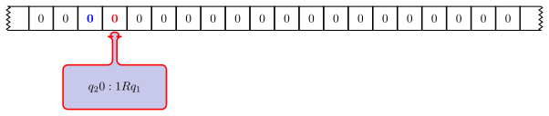

Slide 2: The fourth box from the left is red and there is a label pointing to it stating $q_2 0 : 1 R q_1$.

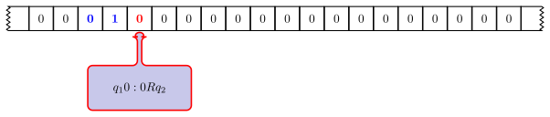

Slide 3: The fourth box is now 1. The fifth box from the left is red and there is a label pointing to it stating $q_1 0 : 0 R q_2$.

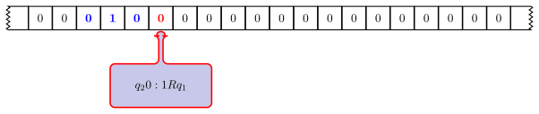

Slide 4: The sixth box from the left is red and there is a label pointing to it stating $q_2 0 : 1 R q_1$.

Slide 5: The sixth box is now 1. The seventh box from the left is red and there is a label pointing to it stating $q_1 0 : 0 R q_2$.

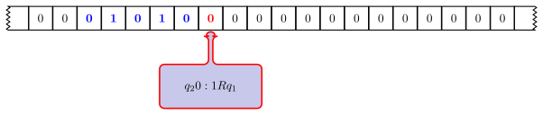

Slide 6: The eighth box from the left is red and there is a label pointing to it stating $q_2 0 : 1 R q_1$.

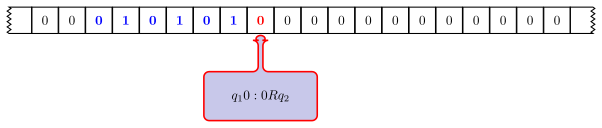

Slide 7: The eighth box is now 1. The ninth box from the left is red and there is a label pointing to it stating $q_1 0 : 0 R q_2$.

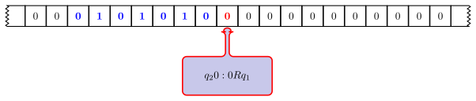

Slide 8: The tenth box from the left is red and there is a label pointing to it stating $q_2 0 : 0 R q_1$.

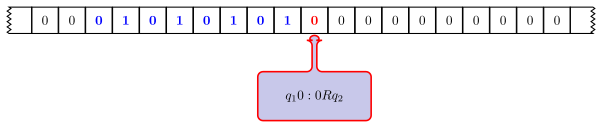

Slide 9: The tenth box is now 1. The eleventh boxfrom the left is red and there is a label pointing to it stating $q_1 0 : 0 R q_2$.

### Figure 3 description

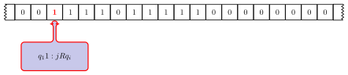

A horizontal strip of concatenated boxed 0s and 1s with the left and right ends of the strip being ragged. The numbers from left to right are 00111101111100000000. The first 1 from the left is red with a label pointing to it stating $q_{1} : j R q_{1}$.

### Figure 4 description

This is an animation made up of 9 slides. All use the same horizontal strip of concatenated boxed containing either 0s or 1s with the left and right ends of the strip being ragged.

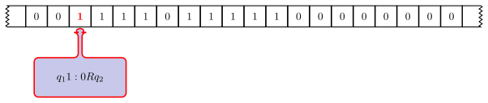

Slide 1: The numbers from left to right are 00111101111100000000. The third box from the left, containing 1, is red and labeled $q_{1} 1 : 0 R q_{2}$.

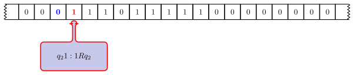

Slide 2: The fourth box from the left, containing 1, is red and labeled $q_{2} 1 : 1 R q_{2}$.

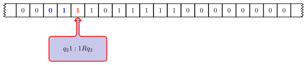

Slide 3: The fifth box from the left, containing 1, is red and labeled $q_{1} 1 : 1 R q_{2}$.

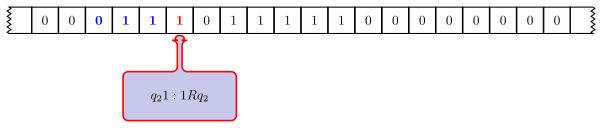

Slide 4: The sixth box from the left, containing 1, is red and labeled $q_{1} 1 : 1 R q_{2}$.

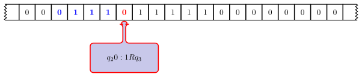

Slide 5: The seventh box from the left, containing 0, is red and labeled $q_{2} 0 : 1 R q_{3}$.

Slide 6: The seventh box from the left is now 1. The eighth box from the left, containing 1, is red and labeled $q_{3} 1 : 1 L q_{3}$.

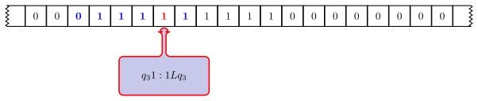

Slide 7: The seventh box from the left, containing 1, is red and labeled $q_{3} 1 : 1 L q_{3}$.

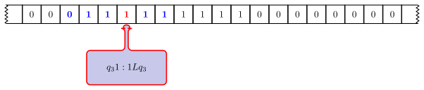

Slide 8: The sixth box from the left, containing 1, is red and labeled $q_{3} 1 : 1 L q_{3}$.

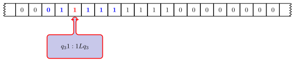

Slide 9: The fifth box from the left, containing 1, is red and labeled $q_{3} 1 : 1 L q_{3}$.
