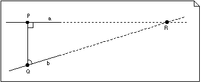
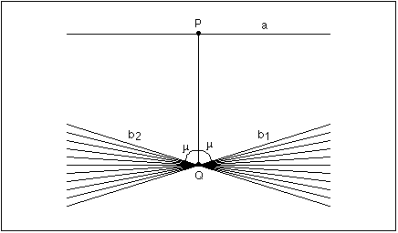
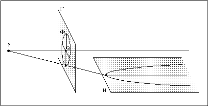
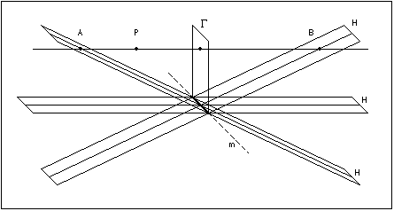

# 19 世纪几何学 Nineteenth Century Geometry (Roberto Torretti)

*首次发表于 1999 年 7 月 26 日；2016 年 10 月 20 日实质修订。*

19 世纪的几何学与大多数学术门类一样，经历了一段近乎天翻地覆的成长期。此间，几何学的内容与内部分化扩张到几乎难以辨认的地步；公理方法自古便受几何学仰慕者称道，如今终于具备真正的逻辑充分性；以黎曼那极为柔顺的体系取代欧几里得的标准几何来描述物理现象，根基也由此奠定。近代各派哲学家——笛卡尔与霍布斯、斯宾诺莎与洛克、休谟与康德——都曾把欧几里得几何奉为认知确定性的典范。欧几里得几何骤然缩减为庞大空间数学理论家族中的一个亚种，粉碎了若干幻觉，也促成了人类知识之哲学构想的重要转变。于是，比方说，经历了这些 19 世纪的进展之后，有些哲学家再也不能举欧几里得几何为类似目标业已实现的例证。他们原本梦想凭自明原则经逻辑推演，获得关于对错的完全确定知识。本文综述 19 世纪几何学中最受哲学关注的诸方面，并顺带点出其哲学意涵。

## 1 罗巴切夫斯基几何

欧几里得（活跃期约在公元前 300 年）在《几何原本》卷首开列一连串“定义”（如“点是没有部分的东西”）与“共同概念”（如“等量加等量，和仍相等”），外加五条“请求”。照理说，这些条目应当涵盖推出几何定理、求解几何问题所需的全部信息，但事实不然。不过，那五条“请求”（希腊语 *aitemata*，英文通常叫作“公设”）无论如何都得先行承认，否则欧几里得的证明便无从展开。其中几条显然属于操作性要求：

> 1. 由任一点向任一点作直线。3. 以任一点为心、任一距离为半径作圆。

然而，第五条更像一句事实陈述。欧几里得的原文译成英文大致是：“若一直线 [*c*] 落在两直线 [*a* 与 *b*] 上，使同侧内角之和小于两直角，则这两直线 [*a* 与 *b*] 无限延长后，必在内角小于两直角的那一侧相交”（方括号内词项为明了起见所加）。这话听上去颇为牵强。但它其实不难改述为构造三角形的一道操作程序（见图 1）。每个三角形均由三条共面直线组成，两两相交于三点。任给一线段 *PQ*，过 *P* 作直线 a，过 *Q* 作直线 *b*，使 *a*、*b* 共面；再验证 *a*、*b* 与 *PQ* 在 *PQ* 某一侧的夹角之和小于两直角；条件若满足，就应承认 *a* 与 *b* 在 *PQ* 同侧的某点 *R* 相交，于是构成三角形 PQR。这条请求即所谓“欧几里得公设”。倘若拒绝它——比方说，我们相信世界有限，而所论内角若只比两直角略小，世界便没有余地容纳顶点 *R*——那么欧几里得几何体系的大部分都将无从展开。

> **图 1** 

在此后较为黯淡的岁月里，欧几里得那种数学上的自由气度失落了，哲学家与数学家都指望几何学奠基于自明的地基之上。试看：若 *a* 垂直于 *PQ*，而 *b* 几乎垂直于 *PQ*，则 *a* 与 *b* 在 *PQ* 一侧缓慢地相互靠近，它们终将在该侧某处相交，此点并非自明。毕竟，双曲线无限趋近其渐近线，却明明白白永不与之相交。数百年来，好几位作者要求——也曾尝试——给出欧几里得公设的证明。约翰·沃利斯（1616—1703）从“存在大小不同而形状相同的多边形”这一假定把它推了出来。可这个假定反过来又需要证明。吉罗拉莫·萨凯里（1667—1733）诉诸归谬法：他从欧几里得公设的否定推出一长串命题，直至得出一个他判为“与直线本性相抵牾”的命题。然而萨凯里对这条“本性”的理解植根于欧几里得几何，他的结论不过是乞题。

到 19 世纪 20 年代，尼古拉·伊万诺维奇·罗巴切夫斯基（1793—1856）与亚诺什·鲍耶（1802—1860）各自另辟蹊径，独立处理了这一问题。罗巴切夫斯基以欧几里得公设的否定为地基，另立一套几何体系，称之为“想象几何”，并试图借天文尺度上恒星所成三角形的内角和来检验其有效性，结果未成定论。鲍耶则把该公设从欧几里得体系中切除；余下的残余即“绝对几何”，再补入欧几里得公设或其否定，便可进一步确定。从 1790 年代起，卡尔·弗里德里希·高斯（1777—1855）已朝同一方向研究此问题，却因怕招致丑闻而未发表。由于罗巴切夫斯基首发其说，以“绝对几何”加欧几里得公设之否定为基础的几何体系，便得名为 **罗巴切夫斯基几何**。

为解释欧几里得公设而引入的上述作图，同样可用来阐明对它的否定。过点 *P* 作直线 *a*，与线段 *PQ* 成直角。一旦否弃欧几里得公设，过 *Q* 便有无数条与 *a* 共面的直线，它们与 *PQ* 夹成锐角，却始终不与 *a* 相交。取这些锐角大小为元素构成实数集，设其最大下界为 μ。显然 μ > 0。过 *Q* 恰有两条与 *a* 共面的直线，与 *PQ* 所成之角等于 μ。（见图 2。）名之为 *b*₁ 与 *b*₂。*b*₁ 和 *b*₂ 都不与 *a* 相交；但过 *Q* 的每一条与 *a* 共面、且与 *PQ* 成小于 μ 之角的直线，*a* 都与它相交。高斯、罗巴切夫斯基与鲍耶互不相谋，却一致把 *b*₁ 与 *b*₂ 叫作过 *Q* 的 *a* 的 **那条** 平行线。μ 称为线段 *PQ* 的平行角，其大小随 *PQ* 长度而定，*PQ* 越长，μ 越小。

> **图 2** 

设 *PQ* 的平行角恰为直角之半。此时 *b*₁ 与 *b*₂ 在 *Q* 处夹成直角，于是同一平面上便有两条互相垂直、却都不与 *a* 相交的直线。

罗巴切夫斯基几何里满是令人吃惊的定理（其中不少萨凯里早已发现）。略举数例：三角形三内角之和 **小于** 两直角；这一差额即“亏量”，与三角形面积成正比。于是，在罗巴切夫斯基几何中，相似三角形必全等。再者，若把一三角形剖分为若干小三角形，整体亏量等于各小三角形亏量之和。亏量既不能超过两直角，三角形面积便有一个有限上界。一个四边形若按作图带有三个直角，第四角必为锐角。所以，罗巴切夫斯基几何中没有矩形。

罗巴切夫斯基式三角学与通常球面三角学的方程之间，有简单的形式对应。罗巴切夫斯基据此论证：他的几何中若出现任何矛盾，欧几里得几何中必有一矛盾与之相配。这似乎是所谓相对相容性证明的最早例子——借它表明，一个理论之所以相容，是因为另一个理论（其相容性通常被当作理所当然）不会不相容。

直到 1860 年代后期，罗巴切夫斯基几何都很少受人注目。哲学家终于留意它时，意见却莫衷一是。有人视之为纯粹逻辑演绎的形式练习，既无物理意义也无哲学意义，其中“直”“平”一类日常词语都被悄悄改变了含义。有人则欣然接受，认为它足以证明：与康德那颇具影响的论点相反，欧几里得几何并不传递任何人类经验的先决条件，物理空间的几何结构容许实验探究。还有人承认非欧几何是正当的备选方案，却指出物理实验的设计与解释一般总要预设某种确定的几何，而这个位置早已被欧几里得体系占去。

不管哲学家怎么说，对数学家来说，罗巴切夫斯基几何原本多半只是一件古怪的珍玩；只是后来在射影几何与微分几何这两股 19 世纪几何研究的主要潮流（见 §2 与 §5）中为它找到了位置，情形才不同。

## 2 射影几何

今日射影几何在数学中地位不显，但在 19 世纪后期，它几乎成了现代几何的同义语。吉拉尔·德萨格（1591—1661）与布莱兹·帕斯卡（1623—1662）都曾用过射影方法，后来却为笛卡尔的坐标法所掩。直到让-维克托·蓬斯莱（1788—1867）表明，图形的射影性质所提供的证明根据至少与笛卡尔式程序同样有力，而且更直观、表面上也更令人信服，射影方法才重新兴盛；所谓笛卡尔式程序，是为表示点的数建立方程并求解。

所谓射影性质，即在投影下保持不变的性质。举例说，取两平面 Γ 与 *H*，以及二者之外的某点 *P*。设 Φ 为 Γ 上任一图形。自 *P* 向 Φ 的每一点引直线，这些直线与 *H* 相交的各点所成之图形，便是 Φ 自 *P* 投到 *H* 上的投影。一般说来，此图形在大小与形状上都不同于 Φ。然而，Γ 上任意若干条在某些点彼此相交的直线，其投影一般也由 *H* 上同样数目的直线组成，并分别交于那些点的投影。可是，倘若连接 *P* 与 Γ 上某点 *Q* 的直线永不与 *H* 相交——因为 *PQ* 恰巧落在与 *H* 平行的平面上——又当如何？（见图 3。）

> **图 3** 

为了消除这类恼人的例外，射影几何在空间中每一条直线上添加一个理想点，凡与它平行的直线都共有此点。连续性随即要求：所有理想点都落在同一个理想平面上，而该平面与每一族平行平面分别沿一条不同的理想直线相交。原教旨主义者见此情景，或许会为这种看似任意的实体增殖而战栗。可这种做法在算术里已经行了好几个世纪：自然数 1、2、3、……的原有库存，先后补入了零、负整数、非整有理数、无理数，以及所谓虚数。

同一直线上的各点彼此处在邻接与次序的关系之中。欲知理想点如何安顿于这些关系，可令 *H* 绕它与 Γ 相交的直线 *m* 持续旋转。（见图 4。）当 *H* 平行于 *PQ* 时——设此刻为 *t*——点 *Q* 自 *P* 投到 *H* 上的投影，便是过 *P*、*Q* 之直线的理想点。紧接 *t* 之前，上述投影还是 *H* 上一个离 *m* 很远的普通点；紧接 *t* 之后，投影仍是 *H* 上的普通点，离 *m* 很远，却落到平面的另一端。细察投影在包含 *t* 的短时段内的连续位移，便可断定：*A*、*B* 若是 *H* 上分居 *m* 两侧的任意两点，则过 *A*、*B* 之直线的理想点必位于 *A* 与 *B* 之间。可见在射影几何里，一条直线上的点按循环次序排列，一如圆周上的点。由此，射影空间与射影平面上各点的邻接关系，与标准几何中习见的情形迥然不同，且极违直觉。平心而论，射影几何在人类思想上所标志的革命，远比单纯否弃欧几里得公设来得深刻、来得深远。

> **图 4** 

在新的框架下，图形的射影性质得以无例外地界定。射影空间到自身的一一映射 *f* 若把任意三个共线点 *A*、*B*、*C* 送到同样共线的三点 (*A*)、(*B*)、(*C*)，便称为 **直射变换**。所谓射影性质（及关系），即在直射变换下保持不变者。略举数例。关于三个或更多的点：共线；共面。关于三条或更多的直线：共点；共面。关于三个或更多的平面：沿同一直线相交；共有一个点。关于曲线：为圆锥曲线。关于曲面：为二次曲面。

## 3 克莱因的埃尔朗根纲领

费利克斯·克莱因（1849—1925）1872 年入职埃尔朗根大学时印行一本小册子，检点了几何学惊人的增长与分化，并提出一个可将众多分支组织为体系的立足点。由此立足点看，几何学某一分支的任务可表述如下：

> 给定一个流形以及该流形的一个变换群，就群变换所不改变的那些特征来研究该流形的构形。（Klein 1893, p. 67）[^klein-1893]

在 19 世纪的数学里，“流形”往往指我们今天所说的集合；但克莱因显然想到的是更特定的东西：

> 设给定 *n* 个变量 *x*₁、……、*x*_{*n*}；若让变量 *x* 各自独立地取遍从 −∞ 到 +∞ 的实数值，所得的……值系统便构成我们所谓的……“一个 n 维流形”。每个特定的值系统 (*x*₁、……、*x*_{*n*}) 称为该流形的一个 **元素**。（Klein 1873, p. 116）[^klein-1873]

*S* 无论在哪种意义上是一个流形，所谓“S 的变换”，都是把 *S* 一一映到自身的映射。显而易见：

1. 若 *T*₁ 与 *T*₂ 是 *S* 的变换，则先施 *T*₁、再施 *T*₂ 所得的复合映射 *T*₂ ○ *T*₁ 也是 *S* 的变换；
2. 变换的复合满足结合律：若 *T*₁、*T*₂、*T*₃ 是 *S* 的变换，则 (*T*₃ ○ *T*₂) ○ *T*₁ = *T*₃ ○ (*T*₂ ○ *T*₁)；
3. 把 *S* 每一点映到自身的恒等映射 I 是 *S* 的变换，且对任意变换 *T* 有 *T* ○ *I* = *I* ○ *T* = *T*；
4. 每个变换 *T* 都有变换 *T*^{−1}，称为 *T* 的 **逆**，使 *T*^{−1} ○ *T* = I（*T*^{−1} 把 *S* 的每一点送回 *T* 把它带离之处）。

由条件 (i)-(iv)，*S* 的全体变换构成一个 **群** *G*_{*S*}，其含义正是代数中“群”一词的严格意义。*G*_{*S*} 含有子群，即包含 I 并满足条件 (i) 与 (iv) 的子集。设 *H* 为 *G*_{*S*} 的子群，Φ 为 *S* 或其元素、部分的某一特征，若 Φ 不受 Φ 的变换影响，便称 Φ 是 *H* 不变的。唯一的 *G*_{*S*} 不变量是 *S* 的基数（即流形所含元素的个数）。另一极端，由恒等映射单独构成的群 {*I*}，则平凡地保持一切想得到的特征。两端之间可以有许多不同的子群，各自带有种种有趣的不变量，视其群结构而定。若 *S* 并非任意集合（即不带结构者），而是克莱因所说的数值流形，它便承袭实数域的结构，这有助于刻画 *G*_{*S*} 的各子群及其不变量。于是，连续变换群保持拓扑性质（邻接关系），线性变换群保持射影性质。

度量性质能否这样确定？传统做法是把数值流形中两点 (*x*₁、……、*x*_{*n*}) 与 (*y*₁、……、*y*_{*n*}) 的距离，定义为 (*x*₁ − *y*₁)^{ 2} + … + (*x*_{*n*} − *y*_{*n*})² 的正平方根；保持此函数的变换构成等距变换群。然而这不过是约定，采用它是为确保几何为欧几里得几何。克莱因借射影几何另谋更佳之策：定义于整个射影空间、以点对为自变量的实值函数，没有一个是射影群的不变量；但以共线四点组为自变量的函数中，却有这样一个不变量，即 **交比**。克莱因汲取阿瑟·凯莱（1821—1895）的研究，考察四点组 <*P*₁,*P*₂,*P*₃,*P*₄> 的交比，其中 *P*₃、*P*₄ 属于射影平面上一给定的圆锥曲线 κ，*P*₁、*P*₂ 则在由 κ 界定、或以别的方式由 κ 确定的区域 **R** 内变动。既然 *P*₃、*P*₄ 必是过 *P*₁、*P*₂ 的直线与 κ 的交点，上述交比便可视为点对 <*P*₁,*P*₂> 的函数。把给定圆锥曲线映到自身的直射变换构成一群，而上述函数显然为此群的不变量。克莱因进而表明，这个函数的某一函数在 **R** 上的表现一如普通距离函数。由此函数确定的结构随圆锥曲线 κ 的性质而定。它或满足欧几里得平面几何的全部定理，或满足罗巴切夫斯基平面几何的全部定理，或满足克莱因本人发现并命名为“椭圆”的第三种几何的定理。（在椭圆几何中，每一直线皆与每另一直线相交，三角形三内角之和恒大于两直角。克莱因把欧几里得几何与罗巴切夫斯基几何分别命名为“抛物”几何与“双曲”几何。）

克莱因的方法施于平面上的罗巴切夫斯基几何，运作如下。设 κ 为射影平面上的实圆锥曲线，即只含实点的圆锥曲线；设 *G*_{κ} 为把 κ 映到自身的全部直射变换之集，它是射影群的子群。今考察四点组 <*P*₁,*P*₂,*P*₃,*P*₄> 的交比，其中 *P*₃、*P*₄ 属于 κ，*P*₁、*P*₂ 在由 κ 界定的实平面区域的内部 Int(κ) 中变动（*P* ∈ Int(κ) 当且仅当 *P* 为实点，且 κ 的任何实切线都不经过 *P*）。如上所述，选定了 *P*₁、*P*₂ 也就确定了 *P*₃、*P*₄，故上述交比可仅视为前一对点的函数，记作 *f*_{κ}(*P*₁,*P*₂)。函数 *f*_{κ} 显然是 *G*_{κ} 不变的。令 *d*_{κ}(*P*₁,*P*₂) = *c* log *f*_{κ}(*P*₁,*P*₂)，其中 *c* 为不等于 0 的任意实值常数，log *x* 表示 *x* 的自然对数主值。克莱因得以证明：*d*_{κ} 在 Int(κ) 上的行为恰如罗巴切夫斯基距离函数。换言之，只要两点距离由 *d*_{κ} 给出，罗巴切夫斯基几何的每条定理都适用于 Int(κ) 之点所构成的适当图形。譬如取 Int(κ) 中四点 *P*₁、*P*₂、*P*₃、*P*₄，使 *d*_{κ}(*P*₁,*P*₂) = *d*_{κ}(*P*₂,*P*₃) = *d*_{κ}(*P*₃,*P*₄) = *d*_{κ}(*P*₄,*P*₁)。它们构成一个罗巴切夫斯基等边四边形 *Q* 的顶点；*Q* 至多能有三个直角，若真有三个直角，其第四个内角必为锐角。（此处“直角”照常指与其邻角相等之角；Int(κ) 中两角称为相等，谓其中一角经群 *G*_{κ} 的某变换成为另一角。）

倘若 κ 代表另一类圆锥曲线，而非寻常实圆锥曲线，则照上述程序得到的 *d*_{κ} 便另换一副面貌。在射影平面适当界定的区域上，它的行为如欧几里得距离函数，或如椭圆几何的距离函数（视 κ 的性质而定）。因此，依 κ 属于三类圆锥曲线中的哪一类，把 κ 映到自身的直射变换群，在结构上恰与罗巴切夫斯基、欧几里得、椭圆三种等距变换群之一相同。三维情形亦有相应结果，只是 κ 换作二次曲面。

克莱因的结果促使伯特兰·罗素（1873—1970）在其新康德主义之作《几何学基础论》（1897）中断言：一般的“外在性形式”在射影几何中先天地向我们显露。至于其度量结构——**只能** 是罗巴切夫斯基式、欧几里得式或椭圆式——则须由实验后天地确定。昂利·庞加莱（1854—1912）取更激进的立场：几何学若只是群的研究，

> 人们便可以说，欧几里得几何之真与罗巴切夫斯基几何之真并不相悖，因为一个群的存在并不与另一个群的存在相冲突。（Poincaré 1887, p. 290）[^poincaré-1887]

应用到物理学上，径直可见：“在一切可能的群中，我们特别挑出一个，以便把所有物理现象都参照于它，正如我们选取三条坐标轴，以便把几何图形参照于它们”（同上，p. 291）。挑这个群，一因其数学上简单，二因下述事实。据说：“自然界中有某些称为 **固体** 的奇特物体，经验告诉我们，这些物体种种可能运动的关联方式，与所选群种种不同运算的关联方式大致相仿”（同上）。庞加莱这番议论，标志着科学哲学中约定论的肇端，并为其提供了最初的动因。

克莱因的几何群论观点，在数学家与哲学家当中颇受青睐。它取得过一次重大成功：赫尔曼·闵可夫斯基（1909）证明，爱因斯坦狭义相对论的精髓，正是洛伦兹群的（时空）几何；这一根本性成果，克莱因（1911）在世时已及见。由此可见，晚近关于闵可夫斯基时空几何与洛伦兹不变性孰先孰后的争论，实属徒劳：二者逻辑等价，无异于同一枚硬币的两面（Acuña（2016）对此有说明）。然而，克莱因的埃尔朗根纲领未能涵盖黎曼的微分几何（§5），而爱因斯坦（1915、1916）恰恰把微分几何置于广义相对论的核心。

## 4 公理学的成熟

依亚里士多德之见，科学知识（*episteme*）必须由这样的陈述来表达。它们从一份有限的自明陈述（公理）清单演绎地推出，并且只使用由一份有限的、自身即可领会的词项（初始词项）清单所定义的词项。两千余年间，人们普遍假定亚里士多德的理想已在欧几里得《几何原本》中实现。其实，欧几里得 I.1 中早已藏着一个逻辑缺口（该题的解决依赖于一条未明言的连续性假定）；而且欧几里得是否把自己的公设看作自明的，也未可知——他把它们唤作“请求”，这反显出他并不作如是观。凭无可置疑的原则作逻辑演绎以确立知识，这一念头对伽利略、牛顿等近代科学家极具魔力。二人皆乐此不疲地实践公理学，至少是把它当作一种文体，一如斯宾诺莎之于《伦理学》。然而，一个真正令人满意、可称严肃的知识分支公理化实例，迟至 1882 年莫里茨·帕施（1843—1930）刊行《现代几何学讲义》，方始见于印本。

帕施视几何学为一门自然科学；它在其他科学和实际生活中之所以被成功运用，“完全仰赖这样一个事实：几何概念原初与经验对象精确契合”（Pasch 1882, p. iii）[^pasch-1882]。几何学之有别于其他自然科学，在于它直接从经验取得的定律少之又少，而志在以纯粹演绎的手段，由之求得较复杂现象的定律。帕施把几何学的经验基础收拢为一组基本概念与基本陈述即公理的内核。基本概念关乎物体的形状、大小及其相互位置。它们不加定义，因为任何定义都替代不了“展示适当的自然对象”，而这是领会这类简单而不可还原的概念的唯一途径（同上，p. 16）。其余一切几何概念最终都须用基本概念来定义。公理把基本概念彼此联结起来，它们“陈述在某些极其简单的图形中所观察到的东西”（p. 43）。其余一切几何陈述，都必须以最严格的演绎方法从公理证明出来。证明所需的一切，必须毫无例外地记录在公理之中。因此公理必须包罗几何学所整理的全部经验材料，故“它们一旦建立，便无须再诉诸感官知觉”（p. 17）。“证明中出现的每一结论都必须在图形中获得印证，但使之成立的并非图形，而是某一确定的在先陈述（或定义）”（p. 43）。帕施对其方法的蕴含洞若观火。他写道（p. 98）：

> 几何学若要真正成为演绎之学，推理过程在其一切环节上都必须独立于几何概念的 **意义**，正如必须独立于图形。所当考虑的，仅是陈述与定义中记录的几何概念间 **关系**。演绎途中，顾念其中出现的几何概念的意义，既被允许，也有裨益，但 **这根本不是必要的**。实际上，一旦这种顾念真成了必要，便表明证明有缺口；这缺口若不能靠修改论证来消除，便表明前提太弱，撑不起该证明。

帕施的《现代几何学讲义》处理的是射影几何。第一部合乎帕施标准的欧几里得几何公理化著作，是大卫·希尔伯特（1862—1943）的《几何基础》，1899 年问世，对 20 世纪数学与哲学影响极大。希尔伯特请读者设想三组任意对象，分别唤作“点”“直线”与“平面”。他又引入五类未加定义的关系，依次介于：点与直线；直线与平面；三点；两对点（“线段”）；三点组的两个等价类（“角”）。希尔伯特 20 条公理（含第二版增补的完备性公理）所规定的条件，足以在同构意义上刻画上述对象与关系。然而，同构——即结构等价——可以在直觉上判然有别的不同对象系统之间成立。希尔伯特正利用公理理论的这一特点，研究某些公理相对于其余公理是否独立。为证明独立，他给出实际实例（模型）：除一条外的全部公理，加上被略去那条的否定，由此确定一个结构。弗雷格抱怨道，这类练习中保留的几何公理要施于希尔伯特那些离奇的模型，唯有篡改词语的自然含义才办得到（参较《爱丽丝镜中奇遇》里爱丽丝与矮胖子 Humpty Dumpty 的对话）。希尔伯特于 1899 年 12 月 29 日复信：

> 任何理论都只是一副概念及其必然相互关系的脚手架或图式，基本元素尽可随心设想。我若随便取一个事物系统当我的点，譬如爱、法律、扫烟囱的……，并径自把我的一切公理都当作这些事物之间的关系来设定，那么我的定理——例如毕达哥拉斯定理——对这些事物照样成立。……理论的这一特征绝不是缺陷，无论如何都无可避免。

当然，这一切都出于公理学的本性，从帕施上引段落的解释已可看出。的确，自约瑟夫·迪亚兹·热尔岗（1771—1859）1825 年提请注意下述 **对偶原理** 以来，这类保真的语义置换在几何学中早已不算新事。射影平面几何的任何真陈述，都生出另一个同样为真的对偶陈述。办法是把前者的“点”换成“线”、“共线”换成“共点”、“相交”换成“联结”，反之亦然，凡这些词出现之处皆照此办理。（在射影空间几何中，对偶施于“点”与“面”。）自然，不换词语而换其含义，所得结果相同。

## 5 黎曼的微分几何

波恩哈德·黎曼（1826—1866）1854 年向哥廷根大学哲学院发表题为“论几何学基础所依据的假设”的演讲（1867 年遗稿刊行），就此提出若干极具革新性的看法。他指出，离散流形的可测性质可以靠计数径直确定。（试想一国的人口，以及重生基督徒、或新婚第一年内离婚夫妇所占的比例。）但连续流形不适用这套办法。尤其是，作为几何学主题的物理空间，其可测性质取决于作用于它的束缚力。空间中两点的距离可用杆、卷尺或光学手段测知，而结果本质上取决于所用仪器的物理行为。迄今为止，空间的可测性质一直按欧几里得几何得到了成功的描述。然而，“空间度量测定所凭据的经验概念——刚体与光线的概念——在无限小处失效；因此，空间在无限小处的度量关系极可能与几何学的假定不合，而事实上，只要借之能把现象解释得更简单，人们便只得接受这一结论”（Riemann 1854, p. 149）[^riemann-1854]。为使物理学家对这一可能性有所预备，黎曼提出了一种更一般的几何构想。黎曼的基本方案容许远比他实际达到的更大的普遍性；但在他看来，眼下只需把连续流形的几何刻画得使其在每一点的微小邻域内与欧几里得几何最为吻合，便已足够。

黎曼把高斯（1828）研究嵌入欧几里得空间的曲面内蕴几何时所用方法推广到 *n* 维（所谓“内蕴”，是说它描述曲面自身呈现的度量性质，与曲面在空间中安放的方式无关）。回看高斯的工作，有助于更佳地把握黎曼的概念（参见 Torretti 1978, pp. 68–82）[^torretti-1978]。不过，为简洁明晰计，莫如向前看，借用后来数学家为索解黎曼方案而引入的某些概念。黎曼理论的现代表述，见补充材料[黎曼理论的现代表述](geometry-19th.supplement.md)。

高斯研究曲面时引入过一个实值函数——**高斯曲率**，它依曲面的内蕴几何度量曲面局部偏离平坦的程度。黎曼把曲率概念推广到黎曼 *n* 流形。凭推广后的曲率概念，他极为优雅地刻画了这样一类度量流形：其中一切图形皆可自由移动，而大小与形状不变。这便是 **常曲率** 黎曼流形。此想法可与克莱因对度量几何的分类巧妙相合。视作黎曼 3 流形，欧几里得空间曲率恒为零，罗巴切夫斯基空间曲率恒为负，椭圆空间曲率恒为正。依埃尔朗根纲领，这些常曲率几何各由其自身的等距变换群刻画。但克莱因的构想过于狭窄，容纳不下全部黎曼几何，因为后者还包括变曲率空间。事实上，一般情形下，黎曼 *n* 流形的等距变换群是由恒等映射单独构成的平凡群，其结构全然不能透露相应几何的任何信息。

## 6 李群

对哲学家而言，19 世纪数学所达到的惊人复杂程度，最令人惬意的特征或许是：新创（抑或发现？）的数学结构迅即渗入经验科学，使实际现象可在理智上把握、操作。我们这篇 19 世纪几何学巡览，就以几句闲评作结，评的是一个格外丰饶、在当今物理学中位居要津的结构——**李群**。此名得自索菲斯·李（1842—1899），这位挪威数学家 1870 年后对之深研有得。李群当然是我们在 §3 见过的那种代数意义上的群，即一个集合 *G*，满足：(i) 每个有序对 <*x*,*y*> ∈ *G* 都对应 *G* 中唯一元素 *x* · *y*（称为 *x* 与 *y* 的 **积** 或 **和**）；(ii) 积运算满足结合律，即对一切 *x*、*y*、*z* ∈ *G*，(*x* · *y*) · *z* = *x* · (*y* · *z*)；(iii) 存在唯一元素 0 ∈ *G*，使对一切 *x* ∈ *G* 有 *x* · 0 = 0 · *x* = *x*（0 即 *G* 的 **单位元** 或 **中性元素**）；(iv) 对每个 *x* ∈ *G*，存在唯一元素 *x*^{−1} ∈ *G*，使 *x* · *x*^{−1} = 0（*x*^{−1} 称为 *x* 的 **逆**）。但李群同时还是光滑流形，如补充材料[黎曼理论的现代表述](geometry-19th.supplement.md)所述：集合 *G* 可以逐片用实值（或复值）坐标系表出，各坐标系在其重叠处由良定义的可微坐标变换彼此联系。*G* 的群结构与流形结构，由“积运算是 *G* × *G* 到 *G* 的可微映射”这一条件绾合为一体。

李群的一个简单而重要的例子是群 SO(2)，由平面绕任意固定点的旋转实现。其流形在拓扑上紧致，故不能由单片坐标域覆盖，但三片足矣：一片含所有大于三弧度而小于四弧度的逆时针旋转，可自然用开区间 (3,4) 内的实数配置坐标；另一片含前者的逆，可映到开区间 (−4,−3)；第三片覆盖所有小于两直角的逆时针旋转及其顺时针方向的逆变换，可映到开区间 (−π,π)。确然，§3 中遇到的、克莱因为刻画空间的欧几里得几何与古典非欧几何而用到的那些群，无一不是李群；它们各自的光滑流形结构也容许若干拓扑上的怪癖。于是，欧几里得等距变换构成一个不连通流形，镜面反射与欧几里得运动子群不在同一连通分支。

与一切光滑流形一样，李群 *G* 的每个元素都附着一个切向量空间。尤其是，*G* 的中性元素 0 处的切空间，借所谓 **李括号** 的定义成为 *G* 的 **李代数**：李括号是 *T*₀*G* × *T*₀*G* 到 *T*₀*G* 的双线性映射，对 *T*₀*G* 中一切 *u*、*v*、*w* 满足 [*u*,*u*] = 0 及雅可比恒等式 [*u*,[*v*,*w*]] + [*v*,[*w*,*u*]] + [*w*,[*u*,*v*]] = 0。*G* 的李代数经 0 ∈ *T*₀*G* 某邻域到 0 ∈ *G* 某邻域的同胚（“指数”）映射，把 *G* 的结构照得格外分明。

补充材料[黎曼理论的现代表述](geometry-19th.supplement.md)触及 **纤维丛** 的观念：它由两个光滑流形 *F* 与 *M* 组成，借 *F* 到 *M* 上的“投影”映射 π 绾结在一起，π 把流形 *F* 分划为若干“纤维”，分别映到 *M* 的各个点。若有一李群 *G*（称为该丛的 **结构群**）作用于 *F*，使 *F* 的每一纤维皆为该作用的一条轨道，并满足另外几个条件，纤维丛 <*F*,*M*,π> 便成为 **主纤维丛** <*F*,*M*,π,*G*>。例如，洛伦兹群乃是任何相对论时空上标架丛（每点处正交归一切向量的四元组）之主纤维丛的结构群，无论该时空何等怪异。李群即以此种方式，把一物理理论所容许的众多模型统一起来，并在其间引入某种齐一性。

20 世纪最后三分之一的时间里，纤维丛连同其李群几乎接管了基础物理学。此中机理，本文不拟解释；但物理学不可遏止地走向数学上愈益精致、而 *prima facie* 愈不直截了当的表述，这一演进值得哲学家留意。显而易见，“外面”存在某个确定而稳定的东西、至少原则上可持可弄，这一观念对我们已不复如对打制燧石器的先人那般管用。

## 参考文献

**以下文献从原文照录，不作翻译；中国文献条目（古今）一律译为中文。**

> 原文参考文献已转为脚注引用：文内“作者-年份”引用组后附 [^key] 标记，完整条目见本文末脚注定义。

### Primary Sources

### Secondary Literature

[^bolyai-1832]: Bolyai, J., 1832. *Scientia absoluta spatii*. Appendix to Bolyai, F., *Tentamen juventutem studiosam in elementa matheseos purae elementis ac sublimioris, methodo intuitiva, evidentiaque huic propria, introducendi*, Tomus Primus. Maros Vasarhely: J. et S. Kali. (English translation by G. B. Halsted printed as a supplement to Bonola 1955.)
[^cayley-1859]: Cayley, Arthur, 1859. “A sixth memoir upon quantics,” *Philosophical Transactions of the Royal Society of London*, 149: 61–90.
[^ehresmann-1957]: Ehresmann, Ch., 1957. “Les connexions infinitésimales dans un espace fibré différentiable,” in *Colloque de Topologie* (*Espaces Fibrés*), *Bruxelles 1950*, Paris: Masson, pp. 29–55.
[^einstein-1915]: Einstein, A., 1915. “Die Feldgleichungen der Gravitation,” *Sitzungsberichte der Königlich Preussischen Akademie der Wissenschaften zu Berlin* (1915), pp. 844–847.
[^einstein-1916]: Einstein, A., 1916. “Die Grundlagen der allgemeinen Relativitätstheorie,” *Annalen der Physik*, 49: 769–822.
[^euclides-1883]: Euclides, *Elementa*, I. L. Heiberg (ed.), Leipzig: B. G. Teubner, 5 volumes., 1883–88. (For English translation, see below under Heath).
[^gauss-1828]: Gauss, C. F., 1828. *Disquisitiones generales circa superficies curvas*, Göttingen: Dieterich. (English translation by A. Hiltebietel and J. Morehead: Hewlett, NY, Raven Press, 1965.)
[^hilbert-1899]: Hilbert, D., 1899. “Die Grundlagen der Geometrie,” in *Festschrift zur Feier der Enthüllung des Gauss-Weber Denkmals*, Leipzig: B.G. Teubner, pp. 3–92.
[^hilbert-1968]: Hilbert, D., 1968. *Grundlagen der Geometrie*, mit Supplementen von P. Bernays. Zehnte Auflage. Stuttgart: Teubner. (Tenth, revised edition of Hilbert 1899.)
[^klein-1871]: Klein, F., 1871. “Über die sogenannte Nicht-Euklidische Geometrie,” *Mathematische Annalen*, 4: 573–625.
[^klein-1872]: Klein, F., 1872. *Vergleichende Betrachtungen über neuere geometrische Forschungen*, Erlangen: A. Duchert.
[^klein-1873]: Klein, F., 1873. “Über die sogenannte Nicht-Euklidische Geometrie (Zweiter Aufsatz),” *Mathematische Annalen*, 6: 112–145.
[^klein-1893]: Klein, F., 1893. “Vergleichende Betrachtungen über neuere geometrische Forschungen,” *Mathematische Annalen*, 43: 63–100. (Revised version of Klein 1872).
[^klein-1911]: Klein, F., 1911. “Über die geometrischen Grundlagen der Lorentz-Gruppe,” *Physikalische Zeitschrift*, 12: 17–27.
[^lie-1888]: Lie, S., 1888–1893. *Theorie der Transformationsgruppen* (3 volumes), Unter Mitwirkung von F. Engel, Leipzig: Teubner.
[^lobachevsky-1837]: Lobachevsky, N. I., 1837. “Géométrie imaginaire,” *Journal für die reine und angewandte Mathematik*, 17: 295–320.
[^lobachevsky-1840]: Lobachevsky, N. I., 1840. *Geometrische Untersuchungen zur Theorie der Parallellinien*, Berlin: F. Fincke. (English translation by G. B. Halsted printed as a supplement to Bonola 1955.)
[^lobachevsky-1856]: Lobachevsky, N. I., 1856. *Pangéométrie ou précis de géométrie fondée sur une théorie générale et rigoureuse des parallèles*, Kazan: Universitet.
[^locke-1690]: Locke, J., 1690. *An Essay concerning Humane Understanding* (in four books), London: Printed for Thomas Basset and sold by Edward Mory. (Published anonymously; the author's name was added in the second edition).
[^minkowski-1909]: Minkowski, H., 1909. “Raum und Zeit,” *Physikalische Zeitschrift*, 10: 104–111.
[^pasch-1882]: Pasch, M., 1882. *Vorlesungen über neueren Geometrie*, Leipzig: Teubner.
[^poincaré-1887]: Poincaré, H., 1887. “Sur les hipothèses fondamentales de la géométrie,” *Bulletin de la Société mathématique de France*, 15: 203–216.
[^poncelet-1822]: Poncelet, J. V., 1822. *Traité des propriétés projectives des figures*, Paris: Bachelier.
[^ricci-1901]: Ricci, G. and T. Levi-Cività, 1901. “Méthodes de calcul différentiel absolu et leurs applications,” *Mathematische Annalen*, 54: 125–201.
[^riemann-1854]: Riemann, B., 1854. “Über die Hypothesen, welche der Geometrie zugrunde liegen,” *Abhandlungen der Königlichen Gesellschaft der Wissenschaften zu Göttingen*, 13 (1867): 133–152. (For English translation, see below under Spivak.)
[^riemann-1861]: Riemann, B., 1861. “Commentatio mathematica, qua respondere tentatur quaestioni ab illustrissima Acad. Parisiensi propositae,” in *Bernhard Riemanns gesammelte mathematische Werke und wissenschaftlicher Nachlass*, Leipzig: Teubner, 1876, pp. 391–404.
[^russell-1897]: Russell, B., 1897. *An Essay on the Foundations of Geometry*, Cambridge: Cambridge University Press. (Unaltered reprint: New York, Dover, 1956.)
[^saccheri-1733]: Saccheri, G. 1733. *Euclides ab omni nævo vindicatus sive conatus geometricus quo stabiliuntur prima ipsa universæ geometriæ principia*, Mediolani: Ex Typographia Pauli Antonii Montani. (Reprint, with facing English translation by G. B. Halsted: New York, Chelsea, 1986.)
[^acuña-2016]: Acuña, Pablo, 2016. “Minkowski spacetime and Lorentz invariance: The cart and the horse or two sides of a single coin?,” *Studies in History and Philosophy of Science* (Part B: Studies in History and Philosophy of Modern Physics), 55: 1–12.
[^blumenthal-1961]: Blumenthal, L. M., 1961. *A Modern View of Geometry*, San Francisco: Freeman.
[^boi-1995]: Boi, Luciano, 1995. *Le problème mathématique de l'espace: Une quête de l'intelligible*, Berlin: Springer.
[^bonola-1955]: Bonola, R., 1955. *Non-Euclidean Geometry: A critical and historical study of its development*. English translation with additional appendices by H.S. Carslaw. New York: Dover.
[^freudenthal-1957]: Freudenthal, H., 1957. “Zur Geschichte der Grundlagen der Geometrie,” *Nieuw Archief vor Wiskunde*, 5: 105–142.
[^freudenthal-1960]: Freudenthal, H., 1960. “Die Grundlagen der Geometrie um die Wende des 19. Jahrhunderts,” *Mathematisch-physikalische Semesterbericht*, 7: 2–25.
[^gallot-2004]: Gallot, S., D. Hulin, and J. Lafontaine, 2004. *Riemannian Geometry*, Berlin: Springer, 3rd edition. (An up-to-date textbook, with solutions to odd-numbered exercises. A section is devoted to the “pseudo”-Riemannian geometry employed in Relativity Theory.)
[^giedymin-1982]: Giedymin, J., 1982. *Science and Convention: Essays on Henri Poincaré's Philosophy of Science and the Conventionalist Tradition*, Oxford: Pergamon.
[^greenberg-2008]: Greenberg, M. J., 2008. *Euclidean & Non-Euclidean Geometry: Development and History*, New York: Freeman, 4th edition. (An excellent tool for self-study at the high-school senior or college freshman level.)
[^heath-1956]: Heath, T. L., 1956. *The Thirteen Books of Euclid's Elements*, translated from the text of Heiberg with introduction and commentary, New York: Dover, 3 volumes, 2nd edition, revised with additions.
[^magnani-2001]: Magnani, L., 2001. *Philosophy and Geometry: Theoretical and Historical Issues*, Dordrecht: Kluwer.
[^nagel-1939]: Nagel, E., 1939. “The formation of modern conceptions of formal logic in the development of geometry,” *Osiris*, 7: 142–224.
[^o'neill-1983]: O'Neill, B., 1983. *Semi-Riemannian Geometry with Applications to Relativity*, New York: Academic Press.
[^nomizu-1956]: Nomizu, K., 1956. *Lie Groups and Differential Geometry*, Tokyo: The Mathematical Society of Japan.
[^ronan-2008]: Ronan, M., 2008. “Lie Theory,” in T. Gowers (ed.), *The Princeton Companion to Mathematics*, Princeton, NJ: Princeton University Press, pp. 229–234.
[^rosenfeld-1988]: Rosenfeld, B. A., 1988. *A History of Non-Euclidean Geometry: Evolution of the Concept of a Geometric Space*, translated by Abe Shenitzer, New York: Springer.
[^spivak-1979]: Spivak, M., 1979. *A Comprehensive Introduction to Differential Geometry* (5 volumes), Berkeley: Publish or Perish, 2nd edition. (Contains an excellent English translation, with mathematical commentary, of Riemann's lecture “On the hypotheses that lie at the foundation of geometry”; see Vol. 2, pp. 135ff.)
[^torretti-1978]: Torretti, R., 1978. *Philosophy of Geometry from Riemann to Poincaré*, Dordrecht: Reidel. (Corrected reprint: Dordrecht, Reidel, 1984).
[^trudeau-1987]: Trudeau, R. J., 1987. *The Non-Euclidean Revolution*, Boston: Birkhäuser.
[^winnie-1986]: Winnie, J. W., 1986. “Invariants and objectivity: A theory with applications to relativity and geometry,” in R. G. Colodny (ed.), *From Quarks to Quasars*, Pittsburgh: Pittsburgh University Press, pp. 71–180.

## 学术工具

* [如何引用本词条](https://plato.stanford.edu/cgi-bin/encyclopedia/archinfo.cgi?entry=geometry-19th)。
* [预览本词条的 PDF 版本](https://leibniz.stanford.edu/friends/preview/geometry-19th/)，见 [SEP 学会之友](https://leibniz.stanford.edu/friends/)。
* 在 [InPhO](https://www.inphoproject.org/entity?sep=geometry-19th&redirect=True) 查找与本词条相关的话题与思想家。
* 在 [PhilPapers](https://philpapers.org/sep/geometry-19th/) 查看本词条的增强文献目录及其数据库链接。

## 其他网络资源

[欢迎向作者提出建议。]

## 相关词条

先验证成与先验知识 | Hilbert, David | 伊曼努尔·康德 | 空穴论证

**（译注：相关词条的中文站内链接将由管线在对应词条重译完成后统一挂接。）**

## 致谢

插图承约翰·诺顿 John Norton 惠赐，某些数学概念之所以能呈现得更好，亦多亏他的想法，谨致谢忱。我也十分感谢爱德华·扎尔塔 Edward Zalta 一丝不苟的编辑工作，以及他找出并断然剔除本文初版中一段晦涩文字。[2003 年补记：]约翰·科科兰 John Corcoran 的批评意见极为切中肯綮，促成 1999 年文本多处修改，谨此致谢。
