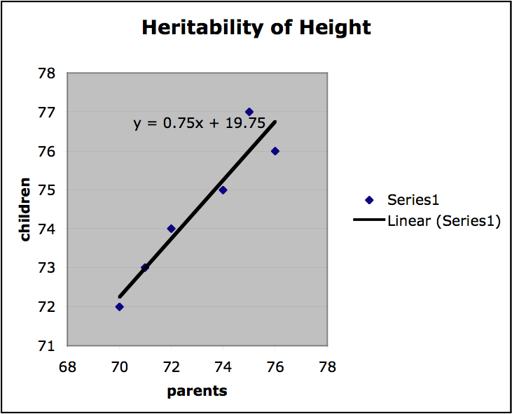
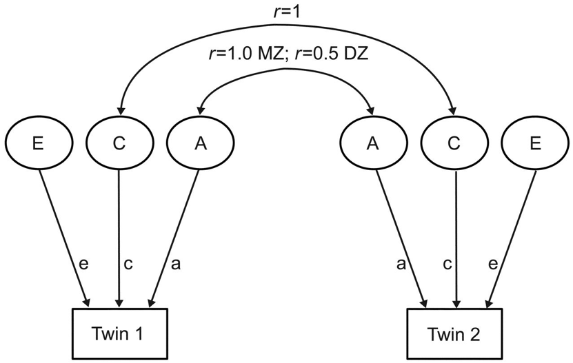
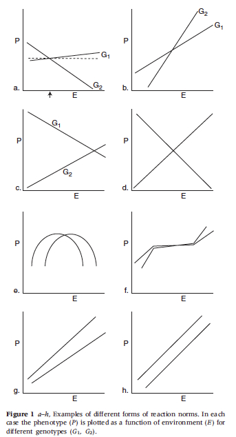

# 遗传力 Heritability (Stephen M. Downes、Lucas Matthews)

*首次发表于 2024 年 2 月 27 日。*

[*编者按：本词条取代先前的 [Heritability](https://plato.stanford.edu/archives/win2023/entries/heredity/)（遗传力）词条，并以其为基础写成。*]

所谓可遗传性状，粗略地说，就是后代的某一性状与亲本对应性状的相似度，超过它与群体中随机个体同一性状的相似度。在被纳入演化理论的关键概念之前，遗传（inheritance 或 heredity）就已是系统研究的焦点。20 世纪对遗传的系统研究以基因作为遗传单位。（遗传史方面的有益研究汗牛充栋，如 Keller（2002）、Griesemer（1994）、Morange（1998）、Moss（2003）、Sapp（2003）、Sarkar（1998）、Wade（1992）、Winther（2000; 2001），以及 Buerton 等编（2000）中的各撰稿人。）如今主宰遗传研究的是两大传统：群体遗传学与分子生物学。为任一性状的遗传力构造定量测度的想法出自群体遗传学，遗传力测度则常见于行为遗传学（Plomin 等 1990、Plomin 等 1997；对行为遗传学与遗传力分析的批判性反思另见 Panofsky 2014、Tabery 2014、Taylor 2014、Turkheimer 2000）[^panofsky-2014][^plomin-1990][^plomin-1997][^tabery-2014][^taylor-2014][^turkheimer-2000]。至于被遗传的东西是一份 DNA 储备或 DNA 序列所含的信息，这一观念来自分子生物学。

哲学界关于遗传的讨论，大多聚焦在遗传力分析能否站得住脚这一点上。这里我们将介绍遗传力概念、它的理论历史、确定性状遗传力的另类进路，以及与这些进路相伴而生的哲学问题。

## 1. 术语问题

“可遗传的”（heritable）一词说的是：某性状在群体中有变异，且亲代与子代在该性状上的相似度，高于随机抽取的个体之间的相似度。我们从父母那里继承到许多东西：宗教信仰，走运的话还有巨额家产。生物学家关心的遗传性状，是指那些作为生物学事实而能可靠地代代相传的性状。达尔文（1859 [1968]）尚无后来遗传学提供的种种便利，他在表型层面讨论遗传性状，并证明自然选择对遗传变异进行拣选，比如生物体的高矮、体重、毛色等。当代讨论遗传的多数学者把遗传性状限定于可证明经由基因传递的性状。“遗传力”（heritability）概念的引入，是“为了量化生物学上受关注的表型由亲代传给子代的可预测程度”（Feldman, 151）。评估遗传力通常要靠复杂的统计分析、缜密的实验，或两者并举。

谈论遗传时，人们常常混淆两类机制：一类负责个体的发育，另一类负责性状从一代到下一代的传递。基因是生物学中讨论遗传时的标准单位，同时也被当作生物体性状发育中最重要的因果成分。但源自群体遗传学、用来评估遗传力的那些方法，对于塑造个体性状的因果机制提供不出任何信息。群体遗传学家研究的是性状在群体中代际传递的模式；分子生物学家则鉴定 DNA 的编码序列，并进而鉴定这些序列在发育中的生物体里产出哪些蛋白质。两者联手，就能对某个特定基因形成汇聚式的说明：既给出它的传递模式，又交代它在发育中的作用。举个例子，医学遗传学家可能发现某种疾病在一个家系中的遗传模式，由此猜想有个（或有一组）基因在个体中负责该性状的发育；随后的分子分析也许会找到一段编码某种异常蛋白质的 DNA 序列，而疾病症状的出现部分地归因于这种蛋白质。最后，诸如遗传力分析之类的群体遗传学技术，还可以反过来施用于分子生物学家发现的机制（例如参见 Visscher 等 2008）[^visscher-2008]。

## 2. 遗传力与群体遗传学

孟德尔遗传学给出的是支配离散性状代际传递的定律。比如，孟德尔用实验演示了一个豌豆群体中圆滑与皱缩两种豌豆的特定遗传模式（关于孟德尔本人对遗传学的具体贡献，见 Olby 1979；至于应当如何理解孟德尔的贡献及其在当代遗传学中的位置，见 Kampourakis 2024 与 Raddick 2022 的反思。）[^kampourakis-2024][^olby-1979]。离散（不连续）性状与连续（数量）性状相对。人的身高、树的叶片数，都是连续性状。连续性状在一个连续统上变异，该连续统可表示为正态分布，画出来就是一条钟形曲线。关于遗传与遗传力的哲学讨论，多半就是从连续性状的研究中生长出来的。

研究数量（连续）性状，可以只看表型。比如，一个植物群体在株高上有变异，我们就可以问：这些变异有多少出自基因？评估一个群体中性状变异归因于基因的比例，用的是一种名为方差分析（ANOVA）的统计方法。分析一经完成，一个简单的公式便给出 0 到 1 之间的一个数，这就是该性状的遗传力测度。下面用几个简单的例子来说明构造遗传力测度所涉及的关键概念。

在考察方差分析、看它如何贡献于遗传力测度之前，最好先弄清遗传力的一般概念。行为遗传学家和动物育种者都把遗传力理解为对变异之遗传影响的测度：按这种理解，若某性状遗传力高，则该性状在群体中逐个体而异的情况可以由遗传来解释。普罗明（Plomin）（2018）等行为遗传学家采纳了这种理解，沙夫纳（Schaffner）则提出一个较弱的说法：“遗传力估计……意在指示群体中的表型变异有多少出自遗传变异”（2016, 10）（另见 Longino, 2013。）下面这个虚构的例子展示了评估遗传力的一条途径。设想班里有两名学生，学生 *a* 身高 6′2″，学生 *b* 身高 4′2″。要弄清基因对身高有多大影响，我们可以把两名学生都克隆出来，再交换两个克隆体所处的环境，看看结果如何。在下图中，*a* 与 *b* 各自成长的环境记作 $\mathrm{E} a$ 与 $\mathrm{E} b$，*a* 与 *b* 的克隆体记作 $\mathrm{C} a$ 与 $\mathrm{C} b$。

$$ \begin{array}{cccl} & \mathrm{E} a & \mathrm{E} b & \text{Height results} \ldots \\ \hline 1 & \mathrm{C} b=4^{\prime}2^{\prime\prime} & \mathrm{C} a=6^{\prime}2^{\prime\prime} & \text{from genes} \\ \hline 2 & \mathrm{C} b=5^{\prime}8^{\prime\prime} & \mathrm{C} a=5^{\prime}8^{\prime\prime} & \text{from genes and environment} \\ \hline 3 & \mathrm{C} b=6^{\prime}2^{\prime\prime} & \mathrm{C} a=4^{\prime}2^{\prime\prime} & \text{entirely from environment} \\ \hline \end{array} $$

图 1

最可能出现的是情形 2 那样的结果。当然，人克隆不得（人成长的环境也无法忠实复制）。但对植物和其他实验生物可以这么做，于是我们就能对基因在表型性状变异中的贡献获得相当清楚的认识。

估计人类的遗传力，办法之一是比较双生子在表型性状上的相似度（双生子研究的详细讨论见第 4 节），之二是比较其他有血缘关系的个体配对，如兄弟姐妹、父母、堂表亲等。双生子研究基于如下假定：同卵双生子共享全部基因和全部环境，异卵双生子共享一半基因和全部环境。对任一给定性状（比如身高），结果如下：

> a) 如果遗传力高、变异主要出自基因，同卵双生子的身高就会比异卵双生子更接近。

> b) 如果遗传力低、身高变异主要出自环境，那么同卵双生子彼此之间的身高差异就会同异卵双生子一样大。

最后还有一法：把子代的性状值对亲代的性状值作图，由回归线的斜率来感知该性状的遗传力。斜率为 1，性状便完全由基因决定；斜率为 0，性状便与基因毫无关系。若个体间的变异源于基因的变异，子代就应与亲代相似。遗传力总是介于 1 与 0 之间的值。下图（图 2）标出了一个小样本群体的中亲身高与中子代身高（中亲身高即双亲身高的平均值）。回归线斜率为 .75，表明遗传力高。（必须强调，这只是对这类遗传力估计的非正式演示；要让这条路子给出有用的结果，还须满足关于群体性质与相关环境的若干重要约束条件。）

图 2

图 2

前面介绍的遗传力测量或计算方法都比较直观。问题在于，这些方法并未把群体中生物体数量性状变异的产生所涉及的全部因素都考虑进来。仍以一个人类样本群体的身高变异为例：多数有代表性的样本里，身高大体呈正态分布。身高的方差定义为每个测得身高与该群体平均身高之差的平方的平均值。表型方差（phenotypic variance）记作 $V_P$。（从这一节剩下的部分起，我们用一种特定的策略来呈现阐明遗传力关系的诸方程：先给出下式的最简版本式 (1)。像式 (1) 这么简单的方程几乎从不成立，但在行为遗传学的入门教科书里却常常被当成够用的东西来介绍。本序列后续的方程会把实际情况刻画得更准确。群体遗传学家认可的是下文式 (1′) 的种种变体，而不是式 (1)。）

$$\tag{1} V_P = V_G + V_E $$

式 (1) 说的无非是：表型方差等于基因所致方差与环境所致方差之和。行为遗传学家和心理学家如此引入遗传力：遗传力就是表型方差中可归因于基因型方差的比例，即遗传力 $= {^{V_G}\unicode{x2044}_{V_P}}$（也有人谈“环境力”（environmentability），即 ${^{V_E}\unicode{x2044}_{V_P}}$。）

这种意义上的遗传力称为广义遗传力（broad sense heritability），记作 $h_b^2$，即“表型差异中归因于一切遗传变异来源的比例”（Plomin 1990, 234）[^plomin-1990]。狭义遗传力（narrow sense heritability）$h^2$ 则是“表型方差中仅归因于加性遗传方差的比例”（Plomin 1990, 234）[^plomin-1990]。

$$\tag{2} h_b^2 = \frac{V_G}{V_P} $$ $$\tag{3} h^2 = \frac{V_A}{V_P} $$

“加性遗传变异 $(V_{A})$ 是个体间由于基因的加性效应而产生的变异”（Freeman and Heron, 206）。举例来说，生物体身高的变异可以来自一个基因座上几个等位基因的叠加贡献：每个等位基因都把生物体的高度再抬高一点。说得更准些，等位基因 *A* 可贡献 .5 个单位的高度，等位基因 *a* 再贡献 .5 个单位，如此类推。与加性遗传方差成对照的是显性方差（dominance variance）$(V_{D})$：设两个等位基因（*A* 与 *a*）共同决定生物体的高度，基因型 *aa* 的生物体高 1.0 个单位，*AA* 高 2.0 个单位，而 *Aa* 也有 2.0 个单位高。总遗传方差 $V_G$ 其实是全部遗传方差之和。在这个简化情形里，就是

$$\tag{4} V_G = V_A + V_D $$

到此为止的讨论所隐含的 $V_P$ 方程为

$$\tag{\(1^{\prime}\)} V_P = V_A + V_D + V_E $$

但这个方程仍把情况看得过于简单，要处理数量性状还得继续细化。表型方差可以出自基因交互效应，也就是上位性方差（epistatic variance）$V_{I}$：当一个基因座上的等位基因对表型的影响取决于另一个或另一些基因座上的等位基因时，就会出现这种方差。其次，表型方差还可能有一份来自基因/环境交互作用的贡献 $V_{G\times E}$（基因/环境交互作用的详尽讨论见 Tabery 2014）[^tabery-2014]：当环境对表型的作用因基因型而异时，就会发生这种交互。最后，$V_P$ 还会受到基因型与环境之间非随机相关的影响，即所谓基因-环境协方差（covariation）$\mathrm{COV}(G,E)$。举例来说，倘若带有“倾向长成大植株”之基因型的植株也借着根系生长或种子散播选择了养分充足的环境，而带有“倾向长成小植株”之基因型的植株也选择了养分贫乏的环境，株高的方差便会拉大；若这种关系反过来，方差便会缩小（Futuyma 1998）[^futuyma-1998]。把上述各项全部纳入，我们便得到：

$$\tag{\(1^{\prime\prime}\)} V_P = V_A + V_D + V_I + V_E + V_{G\times E} + \mathrm{COV}(G,E) $$

并且

$$\tag{\(4^{\prime}\)} V_G = V_A + V_D + V_I $$

许多演化生物学家的假定是：$V_I, V_{G\times E}$ 与 $\mathrm{COV}(G,E)$ 通常都很小，从演化的角度看，最重要的方差成分是 $V_A$。演化生物学家、心理学家和行为遗传学家都关心 $h^2 (= {^{V_A}\unicode{x2044}_{V_P}})$，但关心的理由不同。心理学家与行为遗传学家想知道基因对人类心理性状有多大贡献；演化生物学家（还有动物育种者）则常常用遗传力测度来预测和度量性状对选择的反应（见 Lynch and Walsh 1998, 50）[^lynch-1998]。这里要用到的方程是

$$\tag{5} h^2 = \frac{R}{S} $$

式中 *R* 为选择反应（response to selection），*S* 为选择差（selection differential）。这一语境下的遗传力叫做现实遗传力（realized heritability）。

围绕遗传力测量的哲学讨论，多半起于 $h^2$ 测度在行为遗传学与心理学中的运用。这场讨论很大程度上发端于列文廷（Lewontin）1974 年论方差分析的一篇论文，他在其中论证：对于“基因对某个性状的方差究竟贡献多少”这类问题，方差分析给不出答案。在进入这场讨论及相关讨论之前，我们先更细地交代遗传力在人类身上是如何测量的。

## 3. 测量遗传力：从高尔顿到 GWAS

弗朗西斯·高尔顿（Francis Galton）鼓吹达尔文遗传学说的一个变体：这个变体明确认定，遗传性状背后有一种内在的、物质性的贡献。他提出先天与后天之分，主张归于先天的性状是遗传而来的生物材料的产物。他也是头一个提议用人类双生子来研究先天（相对后天）对人类性状之贡献的人（Burbridge 2001；另见 Kronfeldner 2018）[^burbridge-2001][^kronfeldner-2018]。高尔顿的早期工作为行为遗传学的一个范式奠定了基础：双生子与家系研究。在植物和其他生物的研究里，遗传构成与环境都可以系统地加以改变，以便评估基因与环境对表型性状的相对影响；双生子研究就是人类行为遗传学家对这类实验的替身（见 Shaffner 2016）[^shaffner-2016]。双生子与家系研究追踪相似环境中养育的有血缘关系个体的相似与差异，从而允许对归因于遗传与环境二者的方差来源作某种科学探究。唐斯（Downes）与特克海默（Turkheimer）（2021）梳理了双生子研究的部分早期历史，那要比 ACE 模型的使用早得多。像霍尔津格（Holzinger）这样的双生子研究者有一个最初记作 $t^2$ 的测度，它“度量 A［先天］因素相对于 B［后天］因素在造成分化上的相对影响”（Holzinger 1929, 247）。霍尔津格及其同事（例如见 Newman 等 1937, 115）后来改用 $h^2$ 取代 $t^2$，但没有把他们的测度称为遗传力（他们的 $t^2$ 给出大于零的数值，$h^2$ 给出 0 到 1 之间的数值）。他们用一个与“法尔科纳公式”（下文讨论）相仿的方程来算出他们的 $h^2$。

20 世纪 70 年代末以来，双生子研究从业者最常用的工具是统计上的“ACE 模型”（图 3）。

图 3

图 3

ACE 模型是一个因子分析模型：它把表型方差（用方框表示）剖分为三个潜变量成分（用圆圈表示）。第一个潜因子“A”代表“加性”遗传方差，捕捉双生子对之间遗传上的同与异：同卵（MZ）双生子共享约 100% 的 DNA，而异卵（DZ）双生子只共享约 50% 的 DNA，跟普通同胞一样。成分“*C*”代表“共同”（common）环境，指一起养育的双生子对共享的环境方差。比如，同卵与异卵双生子对都住在同一户人家，其共享环境的相关等于 1。最后，“*E*”代表“独特”（unique）或非共享环境方差，捕捉双生子对之间互异的环境变量。实际上，最终被归入“*E*”名下的，是双生子在家门之外不共享的环境变异，比如双胞胎上了不同的学校，或经历了不同的人生事件。

图 3 描绘的 ACE 模型，是对遗传力估计背后那套数学（即“法尔科纳公式”（Falconer and McKay 1998））的路径分析式可视化。有意思的是，法尔科纳（Falconer）本人当初只是非正式地提出这一想法，随后又把它否定掉，认为它不是估计遗传力的好办法，理由是它忽略了非加性遗传方差，而这在他看来是个不合理的假定（Falconer 1960）[^falconer-1960]（见 Downes and Turkheimer 2021）。该公式源自一个可观测的群体统计量：同卵与异卵双生子对之间的表型相关。对任一表型来说，同卵相关或 $r_{\textrm{MZ}}$ 通常高于异卵相关或 $r_{\textrm{DZ}}$。这大概不足为奇：基因完全相同的双生子比异卵双生子更相像。这暗示：遗传上越相似，表型上就越相似。于是，狭义数量遗传的遗传力便被直观地定义为同卵相关与异卵相关之间的*差异*：差异越大，遗传力越高。反过来说，若两种相关几乎无差别，那就意味着遗传与所论性状的方差关系不大，得到的遗传力估计值也会偏低。

法尔科纳公式从一个简单的观察出发：同卵双生子对在三个成分中有两个是完全共享的，即 100% 的基因与 100% 的共同环境。于是，同卵相关就被处理成 A 加 C：

$$ r_{\textrm{MZ}} = A + C$$

同样地，异卵双生子对共享 100% 的共同环境，却只共享一半的遗传关联度。于是，异卵相关等于加性遗传方差的一半加上共同环境：

$$r_{\textrm{DZ}} = \frac{A}{2} + C$$

估计遗传力的法尔科纳公式如下，它算的是同卵相关与异卵相关之差：

$$A = 2(r_{\textrm{MZ}} - r_{\textrm{DZ}})$$

估计共享环境（*C*）的公式则是：

$$C = 2 r_{\textrm{DZ}} - r_{\textrm{MZ}}$$

最后，非共享环境可由如下假定导出：遗传相似性、共享环境与非共享环境合起来构成一个观测性状的总方差。由此得：

$$E = 1- r_{\textrm{MZ}}$$

看一个具体的例子。一项双生子研究考察身高，得到 $r_{\textrm{MZ}} = .95$ 与 $r_{\textrm{DZ}} = .55.$ 手里有这些数字，就可以用数量遗传学的基本技术，把上述方差剖分为归因于共享遗传或共享环境的来源。先算遗传力：

$$ \begin{align} A & = 2(r_{\textrm{MZ}} - r_{\textrm{DZ}})\\ A & = 2(.95-.55)\\ A & = 2(.4) \\ A & = .8 \\ \end{align} $$

这个结果在哲学上有争议（理由见下文），但它表明：在被研究的共同养育双生子群体中，身高方差的 80% 可以归到遗传差异头上。要估计非共享环境（*C*），取前面导出的公式：

$$ \begin{align} C & = 2r_{\textrm{DZ}} - r_{\textrm{MZ}}\\ C & = 2(.55) - .95\\ C & = .15\\ \end{align} $$

最后是身高方差中归于非共享环境的部分：

$$ \begin{align} E & = 1 - r_{\textrm{MZ}}\\ E & = 1 - .95 \\ E & = .05\\ \end{align} $$

在这个例子中，身高方差有 80% 归于加性遗传（*A* = .8），15% 归于共享环境（*C* = .15），5% 归于非共享环境（*E* = .05）。

遗传力研究眼下正经历一场大转型。将近一个世纪里，遗传力都是在“传统”意义上靠双生子与家系研究来估计的，而这类研究对遗传传递底层的生物学单元不置一词。换言之，双生子与家系研究和 ACE 模型都是从关于遗传关联度的粗粒度假定出发的：同卵双生子共享约 100% 的遗传物质，异卵双生子只有一半。直到沃森（Watson）与克里克共同发现 DNA 的双螺旋模型，遗传学家才能够在估计遗传力时顾及生物学细节。DNA 发现以来发生的事情太多，这里无法细数（比如连锁分析与候选基因研究），但有若干关键进展，对于理解最近这些估计遗传力的新进路是必不可少的。

第一，现代所有的遗传力估计进路都以单核苷酸多态性（SNPs）的经验数据为建材。可以说，SNPs 是个体之间遗传差异的基本单元，并被默认为携带科学上有用的信息。人类之间的遗传序列有 99% 以上彼此相同，SNPs 正是那些彼此不同的点位。SNP 芯片从血液或唾液样本制得，研究者借此可以为一个人的基因组获取一大批 SNPs。早期的 SNP 芯片最多能追踪全基因组范围内的 50 万个变异；最新的技术已能检出超过数百万的 SNPs。

过去 20 年里，快速而便宜的 SNP 芯片发展起来，遗传学家由此获得了在大人群里评估个体间基于 DNA 的差异的能力，也就有了一条估计遗传力的新路（Mills 等, 2020）。第一条人类基因组序列花了约 10 亿美元（$1 billion）；如今给整个基因组测序只要 200 到 2000 美元（$200–$2000），海量的基因组数据因此变得相对便宜。SNP 芯片一般只含每个基因组的一小部分，如今造价极低。通过一大族方法，全基因组关联研究（GWAS）找出 SNPs 与数千种表型之间的统计关联：从身体性状（如身高、体重、BMI 等），到行为与精神性状（如 IQ、精神分裂症、抑郁症等），再到更晚近的社会与行为结果（如教育获得、家庭收入与数学能力）。多数 GWAS 按病例-对照设计进行：从共享某性状（如重度注意缺陷多动障碍或黄斑变性）的一个人群采集 SNP 剖面，再与缺乏该性状的对照人群的 SNP 剖面对比。

GWAS 找到的是与目标表型统计相关的 SNPs。将近一个世纪的双生子与家系研究都一致显示性状有较高的遗传力，所以行为遗传学界一度预期，早期 GWAS 会找到同样可观的 SNP 遗传力。这方面的 GWAS 结果却令人失望。比如，双生子研究显示认知能力总方差约 50% 可由遗传差异解释，而与认知能力相关的单个 SNP 通常只能解释总方差的 .04% 还不到。

## 4. 多基因评分与 SNP 遗传力

GWAS 找到的单个 SNP 位点能解释的方差份额令人失望。有鉴于此，行为遗传学家与社会基因组学研究者发展出了多基因风险评分（PRS），以及更晚近的多基因评分（PGS）（有些研究者把同一测度称作“多基因指数”（PGI））。在最简单的形式下，PGS 就是与目标表型显著相关的全部 SNPs 之无数微小效应的总和（见 Mills 等, 2020, 105）。令 N 为统计显著的 SNPs 个数，*$β_i$* 为每个变异（*i*）对某份 DNA 样本（*j*）的 beta 值（效应量），基本的多基因评分就按下式计算：

$$PGS_j = ∑_i^Nβ_i$$

为了让 GWAS 结果解释更多的表型方差，Yang 等（2015）发展出基因组复杂性状分析（GCTA），如今叫做“基于 SNP 的遗传力”（SNP-based heritability）或“SNP 遗传力”（SNP-heritability），记作 h²_{SNP}（Mills 等 2020）[^mills-2020]。SNP 遗传力通常指现有 SNPs 所能解释的表型方差比例（Mills 等 2020）[^mills-2020]。传统遗传力由有亲缘关系个体的粗粒度遗传相似性估得，SNP 遗传力则由无亲缘关系个体的细粒度遗传相似性估得。评估 SNP 遗传力要动用一族高度精密的统计技术，其目标是把可归于观测或插补 SNP 变异的表型方差比例最大化（其中若干技术的入门介绍见 Mills 等 2020）[^mills-2020]。

SNP 遗传力有几个值得注意的特点。其一，它不把分析局限于满足 GWAS 严格 p 值显著性阈值的 SNPs，而是分析每个参与者样本的整套 SNPs，其中也包括与目标性状无关的那些。就此而言，SNP 遗传力在生物学上并不显然。其二，SNP 遗传力假定 SNP 效应线性可加。其三，SNP 遗传力标出了对任一给定表型而言 SNPs 所能解释的总方差的现行上限。比如说，若一个多基因评分达到最大预测力，它就等于 SNP 遗传力。其四，对任何行为性状，SNP 遗传力都稳定地低于双生子遗传力。这个双生子遗传力与 SNP 遗传力之间的缺口，有时被称作遗传力缺失问题（missing heritability problem），下文再谈。

## 5. 双生子研究与遗传力分析引出的哲学问题

围绕遗传力测度是否可靠的争论，在 20 世纪 70、80 年代一度白热化。70 年代，关于 IQ 与种族的争论达到顶点（这一话题在 90 年代随赫恩斯坦（Herrnstein）与默里（Murray）（1994）一书的出版而被重新翻出）；70 年代末到 80 年代初，社会生物学又成了批判审视的靶子。主张 IQ 由遗传决定的人和社会生物学家都把人类行为性状与基因挂起钩来。IQ 论战中的遗传论者明确依赖上面介绍的那种双生子遗传力分析。而社会生物学与 IQ 遗传论的批评者里，既有生物学家、哲学家和众多社会科学家，也有大批左翼政治与社会活动家（这段历史的有关部分见 Gould（1981）、Paul（1998）与 Segerstråle（2000））。

哲学家们批评遗传力分析，多以列文廷 1974 年论方差分析的论文为起点。（值得注意的是，列文廷那篇文章写得相当不正式，或许最好把它看作列文廷向更广的听众转达当时群体遗传学家共识的一次尝试。列文廷暗示的正式论证见于多处，包括 Layzer（1974）与后来的 Kempthorne（1978）；这些论证的先例可以在 Hogben（1933）以及 R.A. 费希尔的工作中找到（另见 Sarkar 1998）[^sarkar-1998]。）列文廷声称，上文的式 $(1^{\prime\prime}$) 给出了对表型方差各项贡献的最准确刻画。他接着论证，$V_{I}, V_{G\times E}$与$\mathrm{COV}(G,E)$绝非可以忽略（这一点法尔科纳早在 1960 年就已指出，见上文）[^falconer-1960]。在列文廷看来，这些成分总是性状方差不可分割的部分。这样一来，在基因与环境之间分摊表型方差绝非易事，而标准的方差分析根本算不出有用且有信息量的$h_b^2$与$h^2$ 数值。列文廷还指出，许多遗传力测度的拥护者错误地把遗传力值安到个体头上，而不是群体头上。他进一步主张，反应规范对基因、环境与表型性状之间关系的刻画更为准确。所谓反应规范，就是针对不同基因型，把某个数量表型作为环境的函数画成图线（见下图 4，出自 Lewontin 1974）[^lewontin-1974]。许多哲学家与生物学家扩展并精化了列文廷对方差分析的批评（如 Block 1995、Kitcher 1985、Sarkar 1998、Sober 1988、Northcott 2006）[^block-1995][^kitcher-1985][^northcott-2006][^sarkar-1998][^sober-1988]，他们大多接受列文廷的结论：遗传力测度难得有用，反应规范才是考察基因/环境交互作用的更佳途径。

图 4

图 4

列文廷（2006）后来补充说：“（1974）那篇论文的要点是解释：把观测到的表型变异统计地剖分为与遗传关系变异相联系的方差、而不是分配给环境差异的方差，这样做实际上并不能把发育中的遗传原因与环境原因分开”（2006, 536）。他又补充道，分子遗传学的进展如今使下述事情成为可能：“对核苷酸替换与细胞发育和功能之间的因果链条提供详细的分子分析”（Lewontin, 2006, 536）。（索伯（1988）也强调过列文廷对方差分析之批评的这一面。）列文廷把他所理解的遗传因果说得很清楚：一条从 DNA 序列到蛋白质产物的因果链，展开在生物体的细胞之内。他的要害在于：光靠群体遗传学与行为遗传学的统计方法，承担不了揭示如此理解的遗传原因这一任务。第 6 节将结合 GWAS 与其他“分子”式的遗传力测量技术，重新审视这个问题。

面对这类批评，一种回应是强调使用遗传力测度时要多加小心，并重申列文廷的要点：这类测度提供不了关于个体性状的信息（例如见 Plomin 等 1990; 1997，Hamer and Copeland 1998）[^hamer-1998][^plomin-1990]。基切尔（1985）针对这条辩护路线指出：光说小心似乎不够，许多行为遗传学家和心理学家说起话来，还是好像他们真能用遗传力分析找到人类行为性状的遗传成分。第二条回应路线则主张：对复杂的人类性状，反应规范几乎造不出来，所以在查明人类性状遗传原因的事业里，它算不上一个认真的竞争者。这个难题正是列文廷本人向反应规范提出的。对基因型和环境都能被穷尽操纵的生物体，特定性状的反应规范可以造出来；列文廷引果蝇（*Drosophila*）幼虫对温度反应的早期研究，视之为这一路工作的先驱。但难题在于：对大多数人类性状（尤其人类行为性状），我们既不清楚该考察哪些相关基因，也不清楚相关环境的范围有多大。这种回应未必能挫钝列文廷对遗传力测度的批判，因为凡能可靠造出反应规范的情形，我们对基因与环境关系的了解，就确实多于标准方差分析所能给的。此外，想用实验把遗传方差对表型方差的贡献剖分开，在人类性状上碰到的困难与构造反应规范如出一辙。上文第 2 节的例子之所以是人为的，道理就在这里：确立导致人类性状变异的相关基因型与环境，实在太难。当下生物学哲学家的共识是：遗传力分析对人类性状的遗传原因有误导性；不过皮尔逊（2007）对遗传力分析的解释效用作了一次审慎的辩护。奥姆里·塔尔（Omri Tal）也借把概率论用于遗传力分析而为遗传力作了温和的辩护，既覆盖假定无基因-环境交互的情形（2009），也覆盖存在基因-环境交互的情形（2011）。塞萨尔迪奇的（1993 与 2005）著作则与反遗传力共识、以及皮尔逊和塔尔那种温和克制的支持都形成鲜明对照：塞萨尔迪奇坚定站在遗传力分析一边，对它的批评者大张挞伐。近年来另一些哲学家开始为遗传力的因果解释辩护，如林奇与布拉（2016）；布拉（2019）更以干预主义因果框架来考量遗传力的因果解释。最后，列文廷援引反应规范以来，反应规范研究（如 Pigliucci 2001）[^pigliucci-2001]的推进，也强化了他关于这类分析能提供何种信息的论点。

在许多领域（生物学哲学、演化生物学、群体遗传学等）都存在某种共识：遗传力测度的用处非常有限（唐斯与卡普兰（2022）是这一观点的晚近表述）。生物学哲学家的共识是：广义遗传力测度提供不了什么信息，不过也有零星异议（如 Sesardic 1993 与 2005、Pearson 2007 与 Tal 2009 与 2011）[^pearson-2007][^sesardic-1993][^sesardic-2005][^tal-2009][^tal-2011]。（这里所说的共识是非正式意义上的；科学元研究与实验性科学哲学的技术手段可以用来检验共识主张。）卡普兰（2000）写过一部导论，介绍遗传力及其在行为遗传学中的运用。萨卡尔（1998）对反对遗传力的诸论证作了精巧（且技术上也相当艰深）的处理。弗里曼与赫伦（1998）清晰剖析了 IQ 与种族关联论主张者使用遗传力测度时的问题（读懂这一分析需要一些统计知识）。布洛克（1995）综述了反对在 IQ 与种族文献中使用遗传力测度的种种论证；这篇综述很有用，而且是专为非专业读者写的。索伯（1988）为列文廷（1974）批评“用方差分析评估基因在个体性状形成中的作用”一事作了辩护；诺斯科特（2006）对列文廷与索伯的工作作了进一步的有益分析。塔伯里（2014）与泰勒（2014）都借对先天/后天之争的不同反思，对遗传力分析提出了持续的批评。最后，特克海默（2000）从行为遗传学内部对双生子研究的遗传力测度之价值提出了一个批判性视角。

塞萨尔迪奇晚近的著作，矛头指向那些搬用列文廷式论证来反对遗传力分析的人：他通过打击批评者来为遗传论辩护。他把不满概括成这样：“不知为何，在［遗传力］论战中，哲学家们表现出的求知欲和分析敏锐度出奇地匮乏”（2005, 9）。这是因为“他们轻率接受了只有表面说服力的反遗传论论证”，而且“恰恰在他们所探究的领域里，对基本科学事实的了解常常相当贫乏”（2005, 9）。塞萨尔迪奇的批评带着论战色彩，也没有向哲学听众引入任何新的遗传力分析技术；他倚重的是对早期观点的重述，例如列文廷批评的最初靶子之一詹森的那些观点。对塞萨尔迪奇一书，学界有几篇火力十足的回应（塔伯里 2006 年与 2009b 年的书评是两例）[^tabery-2006][^tabery-2009b]；格里·奥夫特达尔（2005）则厘清了塞萨尔迪奇与列文廷之间争执的焦点何在。

列文廷的追随者与塞萨尔迪奇的追随者之间，部分争点在于：$V_{GxE}$和其他方差成分究竟是可以忽略，还是举足轻重。这不是一个纯哲学问题；实验可以处理它，而且已经被处理过。塔伯里（2009a 与 2014）提请注意心理学家卡斯皮与莫菲特的一项纵向研究：两人在关于人类反社会行为障碍的纵向研究里展示了 GxE 效应，以此支持一个与列文廷一致的立场。道格拉斯·瓦尔斯滕的许多实验工作也处理这个问题（Wahlsten 1990 总结了他的理论观点；Wahlsten and Gottlieb 1997 对动物方面的相关实验工作是一份很好的综述）[^wahlsten-1990][^wahlsten-1997]。再者，把基因-环境协方差$\mathrm{COV}(G,E)$ 算作遗传力的一部分，曾让一些人错误地把环境对表型的作用记到基因账上。狄更斯与弗林（2001）用了一个例子来挑明这一点：把篮球运动能力记作 BP。他们论证：即便假定 BP 遗传力很高，BP 看起来仍有一个很大的环境成分；照他们的解释，只要认真对待基因/环境协方差，这就讲得通。正像上文第 2 节里的高植株最终会处在矮植株到不了的营养充足环境中，身材高大、擅长运动的人也常常被放进能抬升其 BP 的环境。狄更斯与弗林指出：高个而善运动的同卵双生子（包括一出生就被分开的），其父母可能会常陪他们打球，或者他们会在中学、大学里被编入篮球训练计划。在这些情形里，每个人的 BP 都会涨；但把 BP 的上涨归因于身高与运动天赋的基因是错的，因为相关环境对表型有着可观的影响。

有点讽刺：生物学哲学家几乎把注意力全押在演化生物学上，却偏偏是遗传力的批评者。要知道，遗传是演化变化的核心环节，遗传力分析（尤其经由现实遗传力概念，见上文式 (5)）又是理论演化生物学的重要部件（见 Lynch and Walsh 1998）[^lynch-1998]。针对遗传力的批判大多在先天/后天之争（如见 Tabery 2014）[^tabery-2014]和对遗传决定论的忧惧的背景下展开，最好把它理解为对心理学中行为遗传学的一次批判性评估。哲学家对在演化语境中批判地评估遗传力概念的兴趣正与日俱增。现实遗传力概念在萨米尔·奥卡沙（2006）（另见 Downes 2010）[^downes-2010]与索伯（2008）那里得到过简短讨论。直到晚近，遗传力与演化理论其他核心概念之间关系的彻底讨论，还只有演化生物学家在做（如见 Lynch and Walsh 1998 与 Rice 2004）[^lynch-1998][^rice-2004]。彼得·维舍尔等人（2008）的综述文章，是这个领域诸多工作的一篇上佳导论。哲学家如今提出并辩护了一些相当激进的主张，比如“演化可以没有遗传”（如见 Earnshaw-Whyte 2012 与 Bourrat 2013）[^bourrat-2013]。把遗传力放到演化理论语境里来研究，是块哲学研究的丰产田；布拉（2014）考察了遗传力在自然选择演化之“配方”进路中的角色，即为一例。最后，为进一步拓展演化生物学中遗传力的哲学视角，布拉（2022）尝试发展一个“统一的”遗传力概念。

## 6. GWAS、PGS 与 SNP 遗传力引出的哲学问题

有关遗传力的哲学讨论，大头针对的是今天可以算作遗传学前范式的东西：传统的双生子研究遗传学。估计遗传力的另类方法（GWAS 与 SNP 遗传力等）发展起来之后，一面是老哲学问题借新方法重上议程，一面是晚近技术发展催生的全新哲学问题被识别出来。

### 6.1 重访旧问题

关于传统遗传力的哲学讨论，大体可以归结为两个问题。其一，遗传力有用吗？其二，遗传力是因果的吗（就是说，它能不能阐明基因型与表型之间的因果关系）？这两个问题缠结得很紧，但确实捕捉到了遗传力相关的两类不同的哲学问题；如今在 SNP 遗传力的映照下，它们正被重新审视。截至本 SEP 词条更新时，尽管这一领域的兴趣正在升温，哲学家就该主题发表的论文仍然不多。

值得注意的是，GWAS 与 SNP 遗传力的发展，让关于因果关系的旧哲学问题重新冒头。该领域的研究者对少数几个概念问题心知肚明，正是这些问题让人怀疑：GWAS 认出的 SNPs 到底是不是因果的。约翰·杜普雷把 GWAS 列入“把遗传差异与表型差异关联起来”这一日益浩大工程的多条进路之中。他说，GWAS“利用我们如今掌握的关于人类群体的大量遗传数据，去寻找与医学结果的关联，即生理与心理疾病”（2013, 285）。杜普雷接着说：“参与这类研究的人都知道，这算不上对充分原因的搜寻。GWAS 充其量能提供一些线索，指向病理所涉的详细因果过程”（2013, 286）。有些 GWAS 研究者对因果性的乐观程度，超过杜普雷这里所描述的（如见 Plomin 2018）[^plomin-2018][^plomin-2018-2]。群体遗传学里有个尽人皆知的问题，叫连锁不平衡：不同基因座上的等位基因出现非随机的关连。GWAS 研究者承认，如今受关注的许多 SNPs 与基因组里许多其他 SNPs 处于连锁之中。这意味着：某个 SNP 究竟是因果变异，还是只是与因果变异连锁在一起（也许经过演化漂变），仍未有定论。甚至有可能，受关注的 SNPs 与所考虑的性状根本没有任何因果相干。

还有强有力的证据表明，现行 GWAS 容易受群体分层（population stratification）的干扰。人类群体呈现出等位基因频率各异的族裔或文化亚群，群体分层因此会加大 GWAS 检出假阳性 SNPs 的概率（见 Schaffner 2016）。群体分层不仅见于不同生物地理祖先（欧洲人、亚洲人、非洲人）的大群体之间，也见于群体内部。例如，“欧洲血统的个体”既包括巴黎人，也包括移民到美国的英国人。

SNP 遗传力的因果解释面临的最大障碍，也许在于 GWAS 及其相关技术至今没有带来多少生物学发现（见 Turkheimer 2012）[^turkheimer-2012]。SNP 遗传力的构造用到了给定 SNP 芯片里的全部遗传变异，其中相当大一部分在统计上并不显著。此外，尽管 SNP 遗传力号称提供了表型方差的另一种遗传学解释，它并没有带来有分量的生物学说明或病因学发现，能把核苷酸模式与复杂人类行为的模式因果地勾连起来（如见 Meyer 等 2023）[^meyer-2023]。朱迪亚·珀尔与达娜·麦肯齐把 GWAS 称作“典型的大数据方法：研究者借它在统计上把整个基因组梳理一遍，寻找碰巧在某病患者中出现得更多的基因”（2018, 339–340）。他们接着说：“重要的是注意 GWAS 一词里的‘关联’。这个方法证明不了因果性；它只是在给定样本里识别与某种疾病相关联的基因”（340）。他们呼应了这里的观点：GWAS 所用的方法，拖了因果推断的后腿。

尽管发表成果有限，哲学界似乎正在形成一种日渐壮大的共识：传统遗传力测度的老问题（以及针对它们的批评）至少大部分并没有被基因组学的最新进展（GWAS、PGS 与 SNP 遗传力）打发掉。医学遗传学与行为遗传学的许多从业者拥抱 PGS，图的是它许诺给出“基因在个体身上致连性状”的知识，而不止是群体层面的测度。然而，比如萨卡尔（2023）就论证：与传统遗传力一样，PGS 也被 GxG 与 GxE 交互作用缠住，因此没有用处。与此相关，伍德沃德与肯德勒（2023）论证 PGS 不是因果的（尽管它们可能有实用的应用）。塞尔皮科（2023）论证，PGS 底层模型里内置的理想化削弱了它的效力；塔伯里（2023）则主张，PGS 给不出“个性化”医疗所需的精确预测。诺恩与塞尔德尼亚（2024）比塔伯里更看好 PGS 的医学应用，但在社会与行为性状的遗传学语境中仍然劝人谨慎。另一面，投身哲学讨论的一线遗传学家则主张：对所有性状而言，PGS 既因果又管用（如见 Madole and Harden 2023）[^madole-2023]。林奇（2021）为遗传学中诉诸因果语言的做法提供了一份有用的概览。此外，列文廷（1974）对遗传力可推广性的批判，即所谓可移植性问题（portability），已被拿来与 PGS 面临的类似的可推广性问题相提并论（Matthews 2022）[^matthews-2022][^matthews-2022-2]。

### 6.2 遗传力缺失问题

在考察基因型与表型关系时，科学上用起了新方法、找到了新证据，由此产生了至少一个新的哲学问题，号称遗传力缺失问题（missing heritability problem）。与传统遗传力相比，GWAS、PGS 与 SNP 遗传力的发展带来了一批测量“基因型对表型的所谓影响”的新路数。表面上看，遗传力缺失问题源自传统遗传力估计与基于 SNP 的遗传力估计之间的数值落差。比如说，用双生子与家系研究得到的 IQ 传统遗传力估计介于 .5 与 .7 之间，而 IQ 的基于 SNP 的估计目前不超过 .25（Plomin and von stumm 2018）[^plomin-2018][^plomin-2018-2]。复杂的行为性状身上，遗传力缺失最为严重。

自马赫（2008）首创“遗传力缺失”一词以来，统计学家与遗传学家围绕这个问题写了大量东西。几乎在所有场合，撰稿人谈的都是遗传力缺失可能的解释，并强调那些理应弥合传统估计与 SNP 遗传力估计之数值落差的技术与方法学方案（但见 Turkheimer 2011）[^turkheimer-2011]。这些解释通常聚焦于标准格式的 GWAS 追踪不到的种种遗传效应，而这些效应又不可避免地是双生子与家系研究要一并算进来的。值得一提，撰稿人们诉诸遗传变异间的非线性交互（“GxG 交互”，即上位性）。SNPs 之间的上位性交互意味着：某个 SNP 的效应会因另一个 SNP 的在场而被修改（比如放大或削弱），这就违反了 SNP 遗传力的可加性假定。类似地，基因-环境交互与表观遗传（epigenesis）也被提出来解释遗传力缺失（Zuk 等 2012）[^zuk-2012]。特定变异或变异群在不同环境下，效应可能被放大、削弱甚至消音，这同样违反 SNP 遗传力的可加性假定。还有一部分遗传力缺失，可能要归到低频、高外显率变异头上，这类变异的检测需要海量样本（Zuk 等 2014）[^zuk-2014]。

哲学家们已经开始从多个方向介入遗传力缺失问题。首先是布拉与卢（Bourrat and Lu）（2017）：他们为一种紧缩式进路辩护，论证这个问题在两个互补的步骤里大体被“消解”了。一方面，两人指出，备择遗传力估计方法之间的数值落差可以靠下调传统估计来部分收窄，传统估计历来背负着高估的名声。另一方面，两人又论证，只要改造 SNP 遗传力技术、把他们声称 GWAS 目前没有追踪的非线性与表观遗传因素纳入进来，数值落差还能弥合得更多。

与之相对，马修斯与特克海默（2022）论证：遗传力缺失问题严重得多，前景中的消解方案根本看不到影。他们的分析回溯了马赫引入遗传力缺失的那段历史：马赫当时评论的，是行为遗传学家面对的一个更大的挑战，即在持续努力解释、理解并准确预测遗传差异与精神分裂症、抑郁症、智力等复杂行为差异之间压倒性地复杂的关系时，他们该怎么办。马修斯与特克海默给了这个问题一个三重刻画：传统遗传力与 SNP 遗传力之间的数值落差只是这个多面问题中一根定量而独立的支柱。照他们的看法，另外两根支柱关乎预测（从分子基因型准确预测复杂行为表型之难）与机制（讲出把分子遗传差异与复杂行为差异勾连起来的、有意义的因果-机械故事之难）。尽管多数行为遗传学家，以及布拉与卢，都把力气花在备择估计方法之间的数值落差上，马修斯与特克海默强调：解决这个统计问题，既推进不了遗传力测度所提供的人类行为预测，也推进不了它的解释。最后，马修斯与特克海默（2021）还考察了该问题对生物学哲学诸论题（如科学多元主义）的意涵。

## 7. 展望

遗传力研究有一段漫长而丰富的历史。许多科学进展带来了更精细的遗传力估计技术，而这些进展的每一项都成了哲学分析的对象。近年来，围绕遗传力估计之研究与构造的经验进路发生了剧变，GWAS、SNP 芯片与 SNP 遗传力的引入尤为关键。这些晚近发展正开始得到哲学家更多的注意。关于遗传力的本性，以及双生子遗传力与 SNP 遗传力之间差异的细粒度把握，都还需要更多哲学分析。除了支持或反对 SNPs 与遗传力之因果解释的哲学论证，科学家们也摆出自己的理由，常常诉诸精密的统计技术，声称这些技术足以识别人类遗传学中的因果关系。哲学家不妨认真地对付这类技术（尤其是孟德尔随机化），看看它们与更宽泛的哲学框架（如各种替代的因果学说）如何接榫（该领域的新工作见 Woodward and Kendler（2023））。

上文（第 6.2 节）已经指出，SNP 遗传力的登场带来一个有趣的新问题：遗传力缺失问题。马修斯与特克海默（2021）考虑过它对科学多元主义之论战的影响，我们预期它的意涵不止于此。在这里做更多的哲学工作，应当会是有收获的。

最后，遗传力与生命伦理学的干系斩不断。双生子遗传力估计曾在 20 世纪 70 年代到 90 年代的种族科学论辩中扮演核心角色；有此前车，SNP 遗传力的登场理应得到一次重新评估。一如当年双生子遗传力的境遇，SNP 遗传力如今正被用来处理智力与认知能力之种族差异的遗传基础这类老而争议不断的问题。双生子遗传力与 SNP 遗传力在概念与方法上都彼此独立，哲学家与科学家因此有必要重新评估：诉诸 SNP 遗传力的群体差异研究是否仍然站得住。

## References（引用注释）

**以下文献从原文照录，不作翻译；中国文献条目（古今）一律译为中文。**

> 原文参考文献已转为脚注引用：文内“作者-年份”引用组后附 [^key] 标记，完整条目见本文末脚注定义。

[^beurton-2000]: Beurton, P. J., R. Falk, *et al*. (eds.), 2000. *The Concept of the Gene in Development and Evolution*, Cambridge: Cambridge University Press.
[^block-1995]: Block, N., 1995. “How heritability misleads about race,” *Cognition*, 56: 99–128.
[^bourrat-2013]: Bourrat, P., 2013. “From survivors to replicators: Evolution by natural selection revisited,” *Biology and Philosophy*, 29: 517–538.
[^bourrat-2014]: –––, 2014. “How to read heritability in the recipe approach to natural selection,” *British Journal for the Philosophy of Science*, 66: 883–903.
[^bourrat-2019]: –––, 2019. “Heritability, causal influence and locality,” *Synthese*, 198: 6689–6715.
[^bourrat-2020]: –––, 2020. “Causation and Single Nucleotide Polymorphism Heritability,” *Philosophy of Science*, 87: 1073–1083.
[^bourrat-2017]: Bourrat, P. and Lu, Q., 2017. “Dissolving the Missing Heritability Problem,” *Philosophy of Science*, 84: 1055–1067.
[^burbridge-2001]: Burbridge, D., 2001. “Francis Galton on Twins, Heredity and Social Class,” The British Journal for the History of Science, 34: 323–340.
[^darwin-1859]: Darwin, C., 1859 [1968]. *The Origin of Species*, London: Penguin Books.
[^dickens-2001]: Dickens, W.T. and Flynn, J.R., 2001. “Heritability Estimates Versus Large Environmental Effects: The IQ Paradox Resolved,” *Psychological Review*, 108: 346–369.
[^downes-2010]: Downes, S.M., 2010. “Moving past the levels of selection debates: Review of Samir Okasha, *Evolution and the Levels of Selection*, Oxford, Oxford University Press (2006),” *Biology and Philosophy*, 25: 417–423.
[^downes-2022]: Downes, S.M. and Kaplan, J.M., 2022. “Changes in heritability: Unpredictable and of limited use,” *Behavioral and Brain Sciences*, 45: e159.
[^dupré-2013]: Dupré, J., 2013. *Processes of Life*, Oxford: Oxford University Press.
[^earnshaw-white-2012]: Earnshaw-White, E., 2012. “Increasingly Radical Claims about Heredity and Fitness,” *Philosophy of Science*, 79: 396–412.
[^falconer-1960]: Falconer, D.S., 1960. *Introduction to quantitative genetics*, New York, NY: Ronald Press.
[^feldman-1992]: Feldman, M.W., 1992. “Heritability: Some Theoretical Ambiguities,” *Keywords in Evolutionary Biology*, E. A. Lloyd and E. Fox Keller (eds.), Cambridge, Harvard University Press, 151–157.
[^freeman-1998]: Freeman, S. and J. C. Herron, 1998. *Evolutionary Analysis*, Upper Saddle River, NJ: Prentice Hall.
[^futuyma-1998]: Futuyma, D., 1998. *Evolutionary Biology*, Sunderland, MA: Sinauer.
[^gould-1996]: Gould, S. J., 1996 [1981]. *The Mismeasure of Man*, New York: W.W. Norton.
[^griesemer-1994]: Griesemer, J. R., 1994. “Tools for Talking: Human nature, Weismannism, and the interpretation of genetic information,” *Are Genes Us? The Social Consequences of the New Genetics*, C. F. Cranor (ed.), New Brunswick: Rutgers University Press.
[^hamer-1998]: Hamer, D. and P. Copeland, 1998. *Living with Our Genes*, New York: Doubleday.
[^herrnstein-1994]: Herrnstein, R. J. and C. Murray, 1994. *The Bell Curve*, New York: Free Press.
[^hitchcock-2004]: Hitchcock, C. (ed.), 2004. *Contemporary Debates in the Philosophy of Science*, Oxford: Blackwell.
[^hogben-1933]: Hogben, L., 1933. *Nature and Nurture*, New York: W.W. Norton.
[^hull-1981]: Hull, D.L., 1981. “Units of Evolution: A metaphysical essay,” *The Philosophy of Evolution*, R.Jensen and R.Harre (eds.), Brighton: Harvester: 23–44.
[^kampourakis-2024]: Kampourakis, K., 2024. *How we get Mendel wrong, and why it matters: challenging the narrative of Mendelian genetics*, Boca Raton, FL: CRC Press.
[^kaplan-2000]: Kaplan, J., 2000. *The Limits and Lies of Human Genetic Research*, London: Routledge.
[^keller-2000]: Keller, E.F., 2000. “Decoding the Genetic Program: Or, some circular logic in the logic of circularity,” *The Concept of the Gene in Development and Evolution*, P. J. Beurton, R. Falk and H. Rheinberger (eds.), Cambridge: Cambridge University Press: 159–177.
[^keller-2002]: –––, 2002. *The Century of the Gene*, Cambridge, MA: Harvard University Press.
[^kempthorne-1978]: Kempthorne, O., 1978. “Logical, Epistemological and Statistical Aspects of Nature Nurture Data Interpretation,” *Biometrics*, 34: 1–23.
[^kitcher-1985]: Kitcher, P., 1985. *Vaulting Ambition: Sociobiology and the Quest for Human Nature*, Cambridge, MA: MIT Press.
[^kronfeldner-2018]: Kronfeldner, M., 2018. *What’s Left of Human Nature*, Cambridge, MA: MIT Press.
[^layzer-1974]: Layzer, D., 1974. “Heritability Analyses of IQ Scores: Science or Numerology?” *Science*, 183: 1259–1266.
[^lewontin-1974]: Lewontin, R., 1974. “The analysis of variance and the analysis of causes,” *American Journal of Human Genetics*, 26: 400–411.
[^lewontin-2006]: Lewontin, R. C., 2006. “Commentary: Statistical Analysis or Biological Analysis as Tools for Understanding Biological Causes.” *International Journal of Epidemiology*, 35: 536–537.
[^lloyd-1988]: Lloyd, E.A., 1988. *The Structure and Confirmation of Evolutionary Theory*, Princeton, NJ: Princeton University Press.
[^longino-2013]: Longino, H.E., 2013. *Studying Human Behavior: How scientists investigate aggression and sexuality*, Chicago, IL: University of Chicago Press.
[^lynch-2021]: Lynch, K.E., 2021. “The meaning of ‘cause’ in genetics,” *Cold Spring Harbor Perspectives in Medicine*, 11: a040519.
[^lynch-2016]: Lynch, K.E. and Bourrat, P., 2016. “Interpreting Heritability Causally,” *Philosophy of Science*, 84: 11–34.
[^lynch-1998]: Lynch, M. and B. Walsh, 1998. *Genetics and Analysis of Quantitative Traits*, Sunderland, MA: Sinauer.
[^madole-2023]: Madole, J.W. and Harden, K.P., 2023. “Building causal knowledge in behavior genetics,” *Behavioral and Brain Sciences*, 46: e182.
[^maher-2008]: Maher, B., 2008. “The case of the missing heritability,” *Nature*, 456: 18–21.
[^matthews-2022]: Matthews, L.J., 2022. “Half a century later and we’re back where we started: How the problem of locality turned in to the problem of portability,” *Studies in History and Philosophy of Science*, 91: 1–9
[^matthews-2021]: Matthews, L. and Turkheimer, E., 2021. “Across the great divide: pluralism and the hunt for missing heritability,” *Synthese*, 198: 2297–2311
[^matthews-2022-2]: Matthews, L. and Turkheimer, E., 2022. “Three legs of the missing heritability problem,” *Studies in History and Philosophy of Science*, 93: 183–191
[^meyer-2023]: Meyer, M.N. et al., 2023. “Wrestling with Social and Behavioral Genomics: Risks, Potential Benefits, and Ethical Responsibility,” *Hastings Center Report*, 53: S1
[^mills-2020]: Mills, M., Barban, N. and Tropf, F., 2020. *An Introduction to Statistical Genetic Data Analysis*, Cambridge, MA: MIT Press.
[^moss-2003]: Moss, L., 2003. *What Genes Can’t Do*, Cambridge, MA: MIT Press.
[^non-2024]: Non, A.L. and Cerdeña, J.P., 2024. “Considerations, Caveats, and Suggestions for the Use of Polygenic Scores for Social and Behavioral Traits,” *Behavior Genetics*, 54: 34–41.
[^northcott-2006]: Northcott, R., 2006. “Causal efficacy and the analysis of variance,” *Biology and Philosophy*, 21: 253–276.
[^odling-smee-2003]: Odling-Smee, F. J., K. N. Laland, *et al*., 2003. *Niche Construction: The neglected process in evolution*, Princeton: Princeton University Press.
[^oftedal-2005]: Oftedal, G., 2005. “Heritability and Genetic Causation,” *Philosophy of Science*, 72: 699–709.
[^okasha-2006]: Okasha, S., 2006. *Evolution and the Levels of Selection*, Oxford: Oxford University Press.
[^olby-1979]: Olby, R., 1979. “Mendel no Mendelian?,” *History of Science*, 17: 53–72.
[^panofsky-2014]: Panofsky, A., 2014. *Misbehaving Science: Controversy and the development of behavior genetics*, Chicago: University of Chicago Press.
[^paul-1998]: Paul, D. B., 1998. *The Politics of Heredity*, Albany: SUNY Press.
[^pearl-2018]: Pearl, J. and MacKenzie, D., 2018. *The Book of Why*, New York, NY: Basic Books.
[^pearson-2007]: Pearson, C., 2007. “Is heritability explanatorily useful?” *Studies in History and Philosophy of Biological and Biomedical Sciences*, 38: 270–288.
[^pigliucci-2001]: Pigliucci, M., 2001. *Phenotypic Plasticity: Beyond Nature and Nurture*, Baltimore: Johns Hopkins University Press.
[^plomin-2018]: Plomin, R.,2018. *Blueprint: How DNA makes us who we are*, Cambridge, MA: MIT Press.
[^plomin-1990]: Plomin, R., J. C. DeFries, et al., 1990. *Behavioral Genetics: A Primer*, New York: W.H.Freeman.
[^plomin-1997]: –––, 1997. *Behavioral Genetics*, New York: W.H. Freeman.
[^plomin-2018-2]: Plomin, R. and von Stumm, 2018. “The new genetics of intelligence,” *Nature Reviews. Genetics*, 19: 148–159.
[^rice-2004]: Rice, S., 2004. *Evolutionary Theory: Mathematical and Conceptual Foundations*, Sunderland, MA: Sinauer.
[^robinson-2014]: Robinson, M. R., Wray, N. R., Visscher, P. M., 2014. “Explaining additional genetic variation in complex traits,” *Trends in Genetics*, 30: 124–132.
[^sarkar-1996]: Sarkar, S., 1996. “Biological Information: A skeptical look at some central dogmas of molecular biology,” *The Philosophy and History of Molecular Biology: New Perspectives*, S.Sarkar (ed.), Dordrecht: Kluwer, 187–231.
[^sarkar-1998]: –––, 1998. *Genetics and Reductionism*, Cambridge: Cambridge University Press.
[^sarkar-2023]: –––, 2023. “GWASs and polygenic scores inherit all the old problems of heritability estimates,” *Behavioral and Brain Sciences*, 46: e227.
[^segerstråle-2000]: Segerstråle, U., 2000. *Defenders of the Truth: The Battle for Science in the Sociology Debate and Beyond*, Oxford: Oxford University Press.
[^serpico-2023]: Serpico, D., 2023. “A Wolf in Sheep’s Clothing: Idealisations and the aims of polygenic scores,” *Studies in History and Philosophy of Science*, 102: 72–83.
[^sesardic-1993]: Sesardic, N., 1993. “Heritability and Causation,” *Philosophy of Science*, 60: 396–418.
[^sesardic-2005]: –––, 2005. *Making Sense of Heritability*, Cambridge: Cambridge University Press.
[^shaffner-2016]: Shaffner, K., 2016. *Behaving: What’s genetic, what’s not, and why should we care?*, New York, NY: Oxford University Press.
[^sober-1988]: Sober, E., 1988. “Apportioning Causal Responsibility,” *Journal of Philosophy*, 85: 303–318.
[^sober-2008]: –––, 2008. *Evidence and Evolution: The logic behind the science*, Cambridge: Cambridge University Press.
[^tabery-2006]: Tabery, J., 2006, “Fueling the (In)Famous Fire,” (A Review of *Making Sense of Heritability*, by Neven Sesardic, 2005), *Metascience*, 15(3): 605–609.
[^tabery-2009a]: –––, 2009a, “Interactive Predispositions,” *Philosophy of Science*, 76: 876–888.
[^tabery-2009b]: –––, 2009b, “Making Sense of the Nature-Nurture Debate” (Review of Neven Sesardic, *Making Sense of Heritability*), *Biology and Philosophy*, 24: 711–723.
[^tabery-2014]: –––, 2014. *Beyond Versus: The Struggle to Understand the Interaction of Nature and Nurture*, Cambridge, MA: MIT Press.
[^tabery-2023]: –––, 2023. *Tyranny of the gene: personalized medicine and its threat to public health*, New York, NY: Alfred A. Knopf.
[^tal-2009]: Tal, O., 2009, “From Heritability to Probability,” *Biology and Philosophy*, 24: 81–105.
[^tal-2011]: –––, 2011, “The impact of gene-environment interaction and correlation on the interpretation of heritability,” *Acta Biotheoretica*, 60: 225–237.
[^taylor-2014]: Taylor, P., 2014, *Nature-Nurture? No: Moving the Sciences of Variation and Heredity Beyond the Gaps*, Arlington, MA: The Pumping Station.
[^turkheimer-2000]: Turkheimer, E., 2000, “Three laws of behavior genetics and what they mean,” *Current Directions in Psychological Science*, 9: 160–164.
[^turkheimer-2011]: –––, 2011, “Still Missing,” *Research in Human Development*, 8: 227–241.
[^turkheimer-2012]: –––, 2012, “Genome Wide Association Studies of Behavior are Social Science,” *Philosophy of Behavioral Biology* (Boston Studies in the Philosophy of Science: 282), K. Plaisance and T. Reydon (eds.), Dordrect: Springer, 43–63.
[^visscher-2008]: Visscher, P.M., Hill, W.G. and Wray, Naomi. R., 2008. “Heritability in the genomics era: concepts and misconceptions,” *Nature Reviews Genetics*, 9: 255–266.
[^wade-1992]: Wade, M. J., 1992. “Heritability: Historical Perspectives,” *Keywords in Evolutionary Biology*, E. A. Lloyd and E. Fox Keller (eds.), Cambridge, MA: Harvard University Press, 149–150.
[^wahlsten-1990]: Wahlsten, D., 1990. “Insensitivity of the analysis of variance to heredity-environment interaction,” *Behavioral and Brain Sciences*, 13: 109–120.
[^wahlsten-1997]: Wahlsten, D., and Gottlieb, G., 1997. “The invalid separation of effects of nature and nurture: Lessons from animal experimentation,” in R. J. Sternberg and E. L. Grigorenko (eds.), *Intelligence, Heredity and Environment*, Cambridge: Cambridge University Press, 163–192.
[^weedon-2008]: Weedon M.N. and Frayling, T.N., 2008. “Reaching new heights: insights into the genetics of human stature,” *Trends in Genetics*, 24: 595–603.
[^west-eberhard-2003]: West-Eberhard, M. J., 2003. *Developmental Plasticity and Evolution*, Oxford: Oxford University Press.
[^williams-1966]: Williams, G. C., 1966. *Adaptation and Natural Selection*, Princeton: Princeton University Press.
[^williams-1992]: –––, 1992. *Natural Selection: Domains, Levels and Challenges*, New York: Oxford University Press.
[^winther-2000]: Winther, R., 2000. “Darwin on Variation and Heredity,” *Journal of the History of Biology*, 33: 425–455.
[^winther-2001]: –––, 2001. “August Weismann on Germ-Plasm Variation,” *Journal of the History of Biology*, 34: 517–555.
[^woodward-2023]: Woodward, J., and Kendler, K., 2023. “Polygene Risk Scores: A Philosophical Exploration,” *Philosophy of Medicine*, 4.
[^yang-2010]: Yang, J., Visscher, P.M. et al., 2010. “Common SNPs explain a large proportion of the heritability for human height,” *Nature Genetics*, 42: 565–569.
[^yang-2015]: Yang, J. et al., 2015. “Genetic variance estimation with imputed variants finds negligible missing heritability for human height and body mass index,” *Nature Genetics*, 47: 1114–1120.
[^zuk-2012]: Zuk, O. et al., 2012. “The mystery of missing heritability: Genetic interactions create phantom heritability,” *Proceedings of the National Academy of Sciences*, 109: 1193–1198.
[^zuk-2014]: Zuk, O. et al., 2014. “Searching for missing heritability: Designing rare variant association studies,” *Proceedings of the National Academy of Sciences*, 111: E455–E464.

## 学术工具

* [如何引用本词条](https://plato.stanford.edu/cgi-bin/encyclopedia/archinfo.cgi?entry=heritability)。
* [预览本词条的 PDF 版本](https://leibniz.stanford.edu/friends/preview/heritability/)，见 [SEP 学会之友](https://leibniz.stanford.edu/friends/)。
* 在 [InPhO](https://www.inphoproject.org/entity?sep=heritability&redirect=True) 查找与本词条相关的话题与思想家。
* 在 [PhilPapers](https://philpapers.org/sep/heritability/) 查看本词条的增强文献目录及其数据库链接。

## 其他网络资源

- [History of Recent Science and Technology](http://hrst.mit.edu/)（近世科学技术史），包含一个生物信息学站点与一个分子演化站点。
- [Online Mendelian Inheritance in Man](http://www.ncbi.nlm.nih.gov/entrez/query.fcgi?db=OMIM)（人类孟德尔遗传在线数据库）。

## 相关词条

适应主义 | 生物利他主义 | Aristotle, General Topics: biology | 生物学实验 | 生物学哲学 | 达尔文主义 | 优生学 | 进化 | 基因 | genetics: genotype/phenotype distinction | genetics: molecular | 群体遗传学 | 人类基因组计划 | 生物信息 | 遗传系统 | innate/acquired distinction | 分子生物学 | 自然选择 | 为人父母和生育

**（译注：相关词条的中文站内链接将由管线在对应词条重译完成后统一挂接。）**

## 致谢

作者感谢埃里克·特克海默（Eric Turkheimer）为本词条提供的宝贵意见。
