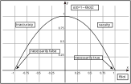

# 语义概念的信息 semantic conceptions of (Sebastian Sequoiah-Grayson and Luciano Floridi)

*首次发表于 2005 年 10 月 5 日；2022 年 1 月 14 日实质修订。*

信息是一种丰饶的货品。它或许是其中最为丰饶者。如今，利益相关方——从个人，到大规模的全球化私营行动者，再到民族国家——会竭尽全力去保护和获取信息，这几乎已近于老生常谈。如果我们允许自己做一点扶手椅上的词源学，那么，某物之处于 *formation*（形成）状态，无非是说它并非随机。事实上，这种扶手椅式的词源学径直触及我们通常如何谈论信息——即与随机化相对照——的核心。的确，“信噪比”可以被重述为“信息噪比”，故此“那不是信息，只是噪声”这一说法无处不在。

换一种说法，信息是一种带有差异的非随机区分。信息随附于模式化的偏离之上，而从环境中获取信息，取决于一个人能否识别并利用这些模式。我们环境的一部分可能携带关于另一部分的信息，这取决于我们的环境以可靠、非随机化的方式运行。我们利用环境一部分的信息来获取另一部分信息的能力，不仅取决于我们识别模式化规律性的能力，还取决于我们识别这些规律性之间联系的能力。

例如，要从“有烟”这一近端信息获取“有火”这一远端信息，我们必须意识到烟与火之间的关联。这一点由“烟意味着火”这样的格言所标示。关于世界事件之间这种自然意义关联的研究，是香农（Shannon）与韦弗（Weaver）所创的数学通信理论（MTC）的研究对象（见“信息”词条）。这是通信工程师所分析的关于信息的“行业标准”说明。然而，由自然语言编码的信息又如何呢？在这一更具体、更具语义意义的信息又如何呢？一种语义概念的信息观不会去考察一个信号在给定信号自身可能性之下的单纯惊奇值（如 MTC 所做的那样）。相反，它会考察消息本身所承载或编码的信息的性质。另一种接近该问题的方式，是将这类语义概念的信息观理解为考察某种语言某一片段的 **信息内容**。这样的语言片段可能是命题、单独词项、摹状词，等等。

最早被详细阐发的这种语义概念信息的理论，是巴尔-希勒尔（Bar-Hillel）与卡尔纳普（Carnap）的 **语义信息理论**。因此，我们从第 1 节开始是恰当的。在第 1.1 节，我们将看到语义信息理论对某些类型的陈述——即逻辑真理与矛盾——所具有的、被许多人认为反直觉的后果。在第 1.2 节，我们将看到弗洛里迪（Floridi）如何回应这些问题，以及其他人如何扩展并回应弗洛里迪的提议——即我们接受 **真实性论题**（veridicality thesis）——信息必须是事实性的。其中一些回应是由关于语义信息本体论的实在论与自然主义考量所驱动的。在第 2 节，我们将考察认真对待自然主义形而上学的语义信息概念。在这里，我们将看到福多（Fodor）、德雷特斯基（Dretske）、埃文斯（Evans）、刘易斯（Lewis）、雷卡纳蒂（Recanati）与杰克逊（Jackson）如何提出并辩护那些以呈现方式为枢轴的语义信息概念。这些概念大体上是自然主义的，就它们试图将信息囊括进各种因果关联而言。任何关于意义或知识的因果理论都将面临这样的问题：说明抽象对象的意义以及我们对它们的认知进路。

第 2 节所概述的大多数广义语义信息理论，都在某种意义或另一种意义上诉诸信息通道（信息通道是允许信息从一个状态流向另一个状态的关系）。在第 3 节，我们将直接考察信息通道理论。（关于信息通道理论的形式性质的详细考察，以及该理论如何与逻辑与信息中的其他议题相联系，见“逻辑与信息”词条。）我们将看到，巴怀士（Barwise）与佩里（Perry）最初的信息通道理论如何从奥斯汀（Austin）的语义内容理论中涌现。我们还将看到，信息通道理论如何被发展和扩展，以便为信息流本身提供语义，并为自然语言片段和认知现象提供信息语义学。

## 1 巴尔-希勒尔与卡尔纳普的语义信息理论

对于任何语义概念信息的概览来说，最自然的出发点是卡尔纳普与巴尔-希勒尔（Carnap and Bar-Hillel）的《语义信息理论纲要》（1952）。巴尔-希勒尔与卡尔纳普的语义信息理论是一种量的理论，它从更一般的信息理论中产生（见“信息”词条第 4.2 节关于香农的部分）。他们的理论是为达成这样的目标而设计的：为我们提供一个可用的框架，用以计算特定语言中句子所编码的语义信息的 **数量**。就他们的情况而言，所讨论的语言是一元谓词逻辑。哲学上的细节建立在一个后来被称为 **逆范围原理**（inverse range principle，IRP）的观念之上。粗略地说，IRP 说的是，一个句子所承载或编码的信息量与某个别的东西成反比，而这个别的东西可以被赋予一个精确数值。一旦做到这一点，人们就可以用这个数值来计算语义信息理论所理解的语义信息的量度。

对于巴尔-希勒尔与卡尔纳普来说，**一个句子所编码的语义信息数量与这个句子为真的可能性成反比**。因此，对他们而言，为真的可能性就是那个我们可以赋予精确数值的“别的东西”。为了说明，我们从他们计算语义信息的一种质性个别化的方法开始，即 **内容**（content）或“Cont”。

设 $s$ 是一个句子，$W$ 是所有可能世界的集合，内容定义如下：

$$\tCont(s) := \{x\in W : x\vdash \neg s\}$$

鉴于句子 $s$ 的 **内涵** 是所有使句子为 **真** 的世界之集合，而句子的内容是所有使 $s$ 为 **假** 的世界之集合，句子 $s$ 的内涵与内容在世界集合 $W$ 上形成一个划分。

巴尔-希勒尔与卡尔纳普定义了两种不同的语义信息 **定量** 计算方法——一种 **内容量度**（cont），一种 **信息量度**（inf）。他们从句子 $s$ 的一个 **先验** 概率测度 $p(s)$ 开始，它是从一个 **先验** 分布得到的。$W$ 上的 **先验** 分布之和为 1，我们假定所有赋值是等可能的，因此 **先验** 概率测度就是由此分布所得的 $p(s)$ 之值。在这种情况下，**cont** 与 **inf** 可以定义如下：

$$\begin{align} \tcont(s) &:= 1 - p(s)\\ \inf(s) &:= \log_2\frac{1}{1 - \tcont(s)} \end{align}$$

这两种量度出于技术理由而需要——分别为了捕捉在 **内容独立** 与 **归纳独立** 上的可加性。两个句子 $s$ 与 $s'$ 在它们不共有任何世界时是内容独立的。两个句子 $s$ 与 $s'$ 在彼此给定时各自的条件概率等于它们各自的初始无条件概率时是归纳独立的。cont 上的归纳独立可加性不成立，因为有可能 $\tcont(s\wedge s') \neq \tcont(s) + \tcont(s')$，这是由于 $p(s)$ 与 $p(s')$ 共有世界——也就是说，是由于它们尽管归纳独立却不是内容独立的。要使可加性在 cont 上成立，所需要的是 **内容独立**，而非归纳独立。相比之下，inf 上的归纳独立可加性并不失败。巴尔-希勒尔与卡尔纳普的证明并不平凡（见其 1952: 244–5）。

### 1.1 语义信息理论的难题

撇开技术问题不谈，一些哲学问题会立即显现。首先，在实践中我们如何知道有多少可能世界？如果我们谈论的是关于英语中所有可能句子的可能世界数目，那么它们将有无限多个。巴尔-希勒尔与卡尔纳普通过只谈论具有有限个谓词字母的一元谓词逻辑中句子所编码的语义信息，回避了这个问题。当有 $n$ 个谓词字母时，将有 $2^n$ 个可能对象，穷尽所有可能的谓词组合。然后将有 $2^{2^n}$ 个可能世界（用巴尔-希勒尔与卡尔纳普的说法是“状态描述”），对应于可能对象的所有可能组合。欣蒂卡（Hintikka）（1970, 1973）将巴尔-希勒尔与卡尔纳普的语义信息理论从一元谓词逻辑扩展到完全一般的谓词逻辑。

第三点，也是更一般的，巴尔-希勒尔与卡尔纳普的语义信息理论引起了两个在哲学上意义重大的问题。

- 巴尔-希勒尔与卡尔纳普语义悖论（BCP）
- 演绎丑闻（SOD）

BCP 指的是如下事实：巴尔-希勒尔与卡尔纳普的语义信息理论将最大信息指派给矛盾句。设 $\perp$ 是任一矛盾，鉴于 $\perp$ 在所有可能世界中都为假，我们分别经由 (1)、(2)、(3) 得到以下结果：

$$\begin{align} \tCont(\perp) &= W\; (\text{i.e., maximal content})\\ \tcont(\perp) &= 1\\ \inf(\perp) &= \infty\end{align}$$

巴尔-希勒尔与卡尔纳普（1952: 229）对此情形回应如下：

> 一个自相矛盾的句子——因而是一个任何理想接受者都不会接受的句子——却被视为携带着最广涵的信息，这或许乍看起来显得奇怪。然而，应当强调，语义信息在这里并非意指蕴含真。一个碰巧说了很多的假句子，由此在我们的意义上是高度有信息的。它所携带的信息是真还是假、是否具有科学价值，等等，并不关涉我们。一个自相矛盾的句子断言得太多；它有信息得以至于不真。

这一回应有两个维度在哲学界引起了担忧。第一，他们的语义信息概念是 **非事实性的**——语义信息不需要为真。第二，他们是在以某种非平凡的意义上，把语义信息概念当作信息性（informativeness）的基础。

SOD 指的是如下事实：关于信息的哲学说明尚未对逻辑真理与演绎推理的信息性给出说明。巴尔-希勒尔与卡尔纳普的语义信息理论将最小信息指派给逻辑真理（有效的演绎推理可以通过把前提合取成一个条件句的前件、以结论为后件，转化为逻辑真理）。设 $\top$ 是任一重言式，鉴于 $\top$ 在所有可能世界中都为真，我们分别经由 (1)、(2)、(3) 得到以下结果：

$$\begin{align} \tCont(\top) &= \varnothing\\ \tcont(\top) &= 0\\ \inf(\top) &= 0\end{align}$$

关于逻辑真句子返回最小信息值，巴尔-希勒尔与卡尔纳普（1952: 223）回应如下：

> 然而，这决不应被理解为意指：不存在“信息量”的好意义，在其中这些句子的信息量根本不是零，对某些人来说甚至可能相当高。为避免歧义，我们将使用形容词“语义的”，以把此时此刻我们所感兴趣的“信息”的前系统意义及其系统阐释项，与其他意义（如“对个人 P 的心理信息量”）及其阐释项区分开来。

我们将在下文第 3.2 节简要回到 SOD。但这里要注意，欣蒂卡（1970, 1973）发动了一次技术上英勇但最终不成功的解决它的尝试（见 Sequoiah-Grayson (2008)）；关于一项恰当而详细的考察，见“逻辑与信息”词条。目前我们必须认识到，巴尔-希勒尔与卡尔纳普上述回应本身带来了一些值得注意的哲学主张。第一，巴尔-希勒尔与卡尔纳普是在暗示：由逻辑真理所编码、且其编码量非零的那类信息，在某种意义或另一种意义上是心理的。此外，即使就同一逻辑真理而言，它也可能因人而异。第二，他们是在听从克劳德·香农（Claude Shannon）——数学通信理论的创立者——恰在两年前给出的如下建议。

> “信息”一词已被信息论一般领域中的各位作者赋予不同意义。其中至少有一些很可能被证明在特定应用中是有用的，值得进一步研究与永久承认。很难期望单一的信息概念能令人满意地说明该一般领域的众多可能应用。（1950 [1993: 180]）。

香农是在倡导一种丰富的 **信息多元主义**，其详细发展见 Allo (2007)。香农在这点上的建议，正如我们即将看到的，正是十足的远见。

### 1.2 弗洛里迪的强语义信息理论

卢西亚诺·弗洛里迪（Luciano Floridi）的 **强语义信息** 理论（2004, 2005），是对 BCP 的一种回应，其动机是认为巴尔-希勒尔与卡尔纳普的理论根本上出了差错。怀疑之处在于：他们的理论建立在一个太弱的语义原则之上，**即真值与语义信息相互独立**。弗洛里迪的提议是：一种把语义信息视为事实性的进路可以避开这一悖论，并且由此产生的理论更符合我们关于什么通常算作信息的日常概念。论证思路是：一种基于真值（alethic）与差异值而非概率的强语义信息理论，能够成功地避开 BCP。相关地，关于下文将描述的弗洛里迪理论的概览，见 Bremer and Cohnitz (2004: chap. 2)；关于强语义信息理论针对来自 Fetzer (2004) 与 Dodig-Crnkovic (2005) 的独立反对意见的辩护，见 Sequoiah-Grayson (2007)。

在展开弗洛里迪的进路之前，请注意，一些人提出了不同的真值（alethic）进路，一种使用逼真性（truthlikeness），或近真性（verisimilitude），来阐明语义信息概念的进路——Frické (1997)、Cevolani (2011, 2014) 与 D'Alfonso (2011)。这些进路通常寻求把事实信息等同于关于所有经验事态、或关于某个受限的相关事实领域之全部真理的相似性。它们也避开 BCP，并且也不使用概率。然而，逼真性不同于真理本身，因为一个真值载体可以具有逼真性而实际上不为真，即，在为假的同时具有逼真性。因此，关于信息的近真性说明可以允许假的主张可能拥有信息。的确，在这一说明上，假陈述有时可以比它们的真否定携带更多信息，见 Frické (1997)。

相比之下，弗洛里迪把强语义事实性信息定义为良构的、有意义的、且 **真实** 的数据。后者对语义信息的事实性约束，通常被称为 **真实性论题**（veridicality thesis，VT）（在 Mingers (1995, 1996a, 1996b) 中已有预兆）。重要的是，VT 的版本出现在关于一般信息本体论地位的争论中，而不仅仅关于特定语义信息——见 Dretske (1981) 作为经典例子。一旦内容如此定义，命题 $p$ 中的强语义信息量，就 $p$ 所应模型化的情境 $z$（情境是部分或不完全的世界）与 $p$ 的距离来计算。

当 $p$ 在所有情形中为真时，但也当 $p$ 在所有情形中为假时，$p$ 与它应模型化的情境 $z$ 之间有最大距离（与最大接近相对）。相比之下，**最大接近** 等同于在约定的抽象层次或描述充分性上对 $z$ 的精确模型化。朝向真理方向的 **最大距离** 将导致 $p$ 在所有情形中为真，此时 $p = \mathord{\top}$ 且信息量最小。类似地，朝向虚假方向的极大距离导致 $p$ 在所有情形中为假（所有可能情境或概率 0），此时 $p = \mathord{\perp}$ 且信息量也最小。这里重要的区别是：这个方向上的任何距离都是 **完全丧失强语义信息的** 距离。这是因为朝向“虚假”方向的距离违反了强语义信息的事实性条件。

弗洛里迪把 **信息性** 与强语义信息本身区分开来。这是受欢迎的，因为强语义信息是事实性的，而假陈述仍然可以是有信息的。的确，假陈述 $s$ 可能比真陈述 $s'$ **更有信息**，尽管事实上 $s'$ 携带强语义信息而 $s$ 不携带。举例来说，假设你正在为一场活动承办餐饮，而事实上将有正好 200 人出席。假设 $s$ 是 **将有 201 人出席**，而 $s'$ 是 **将有 100 到 200 人之间出席**。$s'$ 为真而 $s$ 为假，但 $s$ 在“有信息”这一概念的任何自然理解下都比 $s'$ 更有信息。

设 $\sigma$ 是一条强语义（因而为真）的信息，$z$ 是它以完全准确性描述的目标情境，$\sigma$ 离 $z$ 越远，它适用的情境数目就越多，其信息性程度就越低。弗洛里迪用 ‘$\Theta$’ 来指真 $\sigma$ 与 $z$ 之间的距离（回想弗洛里迪对非事实性信息不感兴趣，甚至很可能否认存在任何可感的此类货品）。$\Theta$ 表示 $z$ 提供给 $\sigma$ 的支持程度。给定特定的 $\sigma$ 与相应的目标 $z$，弗洛里迪把 $\Theta$ 的值映射到笛卡尔图表的 x 轴上。我们现在需要一个公式，来计算 $\sigma$ 的信息性程度 $\iota$——$\iota(\sigma)$——与 $\Theta(\sigma)$ 的关系。弗洛里迪的提议是：我们通过 $\Theta(\sigma)$ 的距离之平方的补来计算 $\iota(\sigma)$ 之值：

$$\iota(\sigma) = 1 - \Theta(\sigma)^2$$

$\iota$ 的值从 0 到 1，并被映射到笛卡尔图表的 y 轴上。图 1 展示了当我们把假 $\sigma$ 的负值包括进来时由 (10) 生成的图像。$\Theta$ 从 $-1 = \mathord{\perp}$ 到 $1 = \mathord{\top}$：

**图 1**

#### Responses and extensions

弗洛里迪（2012）把强语义信息理论扩展到传统认识论的事务。他的 **说明网络理论** 包含如下论证：如果强语义信息被嵌入一个正确说明它的问答网络之中，那么这对于该强语义信息算作 **知识** 就是充分且必要的。弗洛里迪（2008）发展了一种 **相关** 语义信息理论，以便阐明一种 **认知相关性** 理论。在这里他论证：相关语义信息的性质是对真实性论题的又一证实。在弗洛里迪（2011）中，他进一步探索：语义信息为真可能或应当意味着什么。他没有接受真理的符合论、融贯论或实用论，而是为真实性论题发展了他所谓的 **真理正确性理论**，一种与上述说明网络理论直接联系的理论。

弗洛里迪（2006）论证：模态逻辑 KTB 很适合充当 **被告知** 逻辑的角色（KTB 是“模态逻辑”词条中所描述的系统 **B**）。KTB 本身在被告知的语境中许可真实性论题的一个版本，$I_\alpha p\to p$（其中 $I$ 是一个全称模态算子，由于公理 $\square p\to p$ 是 KTB 的一条公理）。“被告知”是一个既不同于知识也不同于信念的认知状态。Allo (2011) 为被告知逻辑提供了形式语义，包括纯版本与应用版本。Primiero (2009) 为 **正在被告知** 的逻辑拒绝真实性论题。Primiero 的正在被告知逻辑是一种认知构造性信息的逻辑，在其中，信息的定义要求把它与真理区分开来。认知构造性信息依据证明条件而非真值条件来理解命题内容的信息。

更广义地说，Dinnen and Brauner (2015) 寻求一种单一的信息定义（无论是否语义的），并发现真实性论题是阻碍性的。相比之下，Mingers and Standing (2018) 主张一种支持真实性论题的单一信息定义。Allo (2007) 通过对语义信息本身的 **实在论** 解释，论证了 **信息多元主义**（类似于逻辑多元主义，见该词条），从而抢先回应了此类担忧。对语义信息的实在论解释自然引出这样的问题：语义信息如何能够从自然世界涌现并成为自然世界的一部分——这一问题在 Vakarelov (2010) 中得到详细探讨。信息能否被自然主义地说明，在哲学中有着丰富的历史，最显著的是在下节所涵盖的 **信息语义学** 中。

尽管弗洛里迪与巴尔-希勒尔、卡尔纳普关于语义信息的立场并非没有争议（若撇开信息多元主义不论），弗洛里迪的动机性直觉有一些哲学先例。第一，许多人不太可能满足于巴尔-希勒尔与卡尔纳普的主张：“一个自相矛盾的句子断言得太多；它有信息到以至于不能为真”。第二，关于在弗洛里迪的说明上逻辑真理具有零语义信息，回想维特根斯坦（Wittgenstein）以典型的直率所说的——“逻辑的全部命题都说着同一件事，即什么也没说。它们是重言式”（*Tractatus*，4.46, 6.1）。理解弗洛里迪强语义信息理论的一种方式，是把它看作我们关于特定客观物理环境所获得的信息的理论。我们的物理环境正是那种矛盾与逻辑真理通常对其最大限度地无信息的。那些被设计来对我们的所谓指称词项的内容讲述自然主义故事的信息概念，在哲学中自身有着丰富的历史，而这正是我们现在转向的话题。

## 2 信息、呈现方式与意义

自弗雷格（Frege）的《意义与指称》以来，以呈现方式为枢轴的意义理论在哲学中以某种方式或另一种方式很常见。故事如下。一个指称词项的意义必定比其指称物更多，因为词项可以共指。例如，*James Newell Osterberg Jr.* 与 *Iggy Pop* 都指称同一个人。尽管如此，“它们意义不同”这一直觉很强。“Iggy Pop is Iggy Pop”与“Iggy Pop is James Newell Osterberg Jr.”**似乎** 并不意味着同一件事。类似地，似乎存在这样的情况：“Alice believes that Iggy Pop was the singer in The Stooges”可能为真，而“Alice believes that James Newell Osterberg Jr. was the singer in The Stooges”可能为假，至少在一种符合我们关于意义直觉的自然读法上如此。

弗雷格著名的回应是：指称词项的指称物与意义（sense）都在规定其语义内容中起作用。但一个词项的意义是什么？弗雷格自己兑现意义概念的方式，是借助 **呈现方式**（mode of presentation，MOP），一个被许多后来的哲学家使用的观念。一个指称词项的 MOP，是我们的现象学把其假定指称物呈现给我们的方式。MOP 是我们试图识别或定位一个我们掌握其意义的指称词项的指称物时所使用的东西。许多当代以信息为枢轴的意义理论，都以某种方式或另一种方式纳入 MOP。原因在于：尽管把一个词项的意义还原为它独自承载或传递的信息很吸引人，但这已被证明充满问题。

把意义与信息视为几乎同一回事的诱惑，是如下观念的结果。这个观念是：词 “cat” 指谓“是猫”这一性质，而它意谓 *cat*，因为它表达 cat 概念，而 cat 概念意谓 *cat*。cat 概念意谓 *cat*，因为它携带信息 $\langle$cat$\rangle$，而 cat 携带信息 $\langle$cat$\rangle$，因为它的实例或标记，大体上是由猫引起的。这是一个不错的观念。通过把意义与信息捆绑在一起，并对它们讲述一个 **因果** 故事，我们就有了一个关于我们从环境获得的信息的自然主义故事。于是，我们也就有了一个关于意义的自然主义故事。这类传递信息的关系是 **信息通道**——便利信息在信息来源与接收者之间流动的因果联系。我们应当注意，这个故事在讲述一个关于亚命题层面定位的信息片段（如谓词 “cat” 与单独词项的范例性使用）的信息语义学故事。因此，它位于上述语义信息与强语义信息理论所描述的范围之外。尽管如此，我们将看到，这个故事的一个精炼版转而追踪 **准确性**，如果不是真理本身的话。

在一系列关于信息语义学这一领域的有影响著作中，杰里·福多（Jerry Fodor）（1990）与弗雷德·德雷特斯基（Fred Dretske）（1981）提出了一种与上述非常相似的语义理论（见“心理内容的因果理论”词条）。这种信息语义学的一个著名问题，通常被称为 **析取问题**。析取问题如下。cat 标记并不总是由猫引起，它们有时由其他东西引起，例如小狗（或关于毛线球之类的想法）。鉴于此，如果上述故事是正确的，那么为什么 cat 意谓 *cat* 而非 *cat or dog*？福多（1990）的回应分两个阶段。

第一，福多最初的提议是：cat 的非由猫引起的标记非对称地依赖于 cat 的由猫引起的标记。也就是说，如果没有任何由猫引起的 cat 标记，那么也就不会任何非由猫引起的 cat 标记。第二，在福多的图景中，意义与信息 **分离**。一个概念的一个标记所携带的 **信息** 与其原因共变，而一个标记的 **意义** 是所有该概念的标记所共有的——我们 cat 标记的内在载体，或它们的 MOP。注意，严格说来，福多并不是把信息作为意义的一部分来囊括，而是把它们区分开来。根据福多，我们未能认识到意义与信息分离，是如下事实的后果：第一，它们经常共外延；第二， “means” 是语义内容（意义）与信息承载的同形异义词。考虑 “means” 的如下两种用法：

- 烟意味着火。
- ‘烟’意谓 **烟**。

在福多看来，第一种用法只是信息承载的意义。烟携带“有火”的信息，但这不是它在语义上所意谓的。‘烟’在语义意义上所意谓的是 **烟**，而这由上面 “means” 的后一种用法所捕捉。在福多的故事中，正如上面的 ‘cat’ 一样， ‘smoke’ 意谓 **烟**，因为它表达烟，而烟的标记由烟本身范例性地（但不总是！）引起。“不总是”这一限定由上面的非对称依赖条件所涵盖。到此为止一切顺利，但像 bunyip 这样的不存在对象又如何呢？bunyip 的非由 bunyip 引起的 bunyip 标记，不能非对称地依赖于 bunyip 的由 bunyip 引起的 bunyip 标记，因为周围没有任何 bunyip 去引起任何东西。

鉴于像 bunyip 这样的不存在对象，以及尽管没有 bunyip bunyip 标记仍有意义，福多调整了他的提议。意义现在建立在 **性质之间的规律性关系中的非对称依赖** 之上——例如是 bunyip 这一性质——而非个体之间的 **实际** 因果联系之上。规律性关系以反事实来兑现，所以我们现在所拥有的是一种如下的信息语义学——bunyip 意谓 *bunyip*，因为如果有 bunyip，bunyip 就会是 bunyip 标记的原因，而所有其他原因都会非对称地依赖其上。

再次回想，福多是在把意义与信息区分开来。加雷斯·埃文斯（Gareth Evans）（1982）表述了一种类似的关于意义的信息理论，但其中信息与 MOP 都被囊括进语义故事本身。对埃文斯而言，一个关于特定对象（至少据称在世界中的对象）的思想之意义的完整故事，需要同时考虑思想的因果起源，以及由它所生的 MOP。埃文斯称这类思想为 **基于信息的特定思想**，且当且仅当满足 MOP 的对象与因果路径源端的对象是同一个东西时，这类思想才是 **充分奠基** 的。

福多与德雷特斯基、埃文斯的这些信息语义学理论的共同之处在于：它们都认识到，一个思想的意义或内容/对象在因果变化中是稳健的：

> 我们想要能够说，两个信息状态（不同人的状态）体现同一信息，前提是它们源于同一个初始信息事件。（Evans 1982: 128–129）[^evans-1982]
>
> 信息理论……诉诸可靠的共变，同时量化这些共变所由以维持的因果机制。通过这样做，它们解释了信息（事实上，正是同一信息）如何能够在如此多种不同的通道上传送。（Fodor 1990: 100）[^fodor-1990]

此外，尽管埃文斯没有完全用这些术语来表达，福多、德雷特斯基与埃文斯都认识到 **信息通道** 本身是稳健的实体。

弗朗索瓦·雷卡纳蒂（François Recanati）（2012, 2016）提出了信息语义学的一个详细版本，他的 **心理档案** 理论，在其中信息通道扮演核心角色。雷卡纳蒂的心理档案是单独词项的认知对应物，因而是指称概念。雷卡纳蒂的观点乍一看与埃文斯的基于信息的特定思想非常相似。然而，在雷卡纳蒂看来，心理档案以 **对象的一种 MOP 的形式** 包含信息——无论是直接地、经验地给予，还是间接地经由摹状词。它们的指称不由它们所包含的信息/它们的呈现方式所固定。相反，心理档案的指称由这一档案所 **基于** 的关系所固定，而心理档案的指称者将是那个我们凭借此类关系之获得而正确熟知其所在的实体或对象。所以雷卡纳蒂允许 MOP 本身包含信息，而不是把信息的作用限制在指称固定关系本身（如埃文斯与福多所做的那样）。识别这些关系的特征是：它们是 **认知上丰益的**（epistemically rewarding，ER）关系。对雷卡纳蒂而言，一个关系之所以是 ER 关系，是因为它是那种使 **信息流动成为可能** 的关系。换言之，ER 关系就是 **信息通道**。

雷卡纳蒂的 ER 关系大量借鉴刘易斯（Lewis）的（1983）“认知联系”关系——那种会允许信息流动的因果链，或换个名字叫信息通道。雷卡纳蒂与刘易斯都通过允许信息与错误信息都可能沿信息通道传送，来承认析取问题。雷卡纳蒂的立场是：心理档案的指称由那个位于信息通道远端、对该档案所包含的信息有所贡献的对象所固定，而不论其“契合度”如何。契合度当然可能因为嘈杂的通道和/或代理一方的错误识别而变差。正如雷卡纳蒂所说：

> 基于某一熟识关系（acquaintance relation）的心理档案的作用，是储存凭借该关系所获得的信息。所讨论的信息不必是真实的；我们可以简单地把它们想成一组谓词，主体认为指称者满足这些谓词。指称者实际上不必满足所讨论的这些谓词，因为主体可能弄错。这类错误之所以可能，是因为决定指称的不是档案的内容，而是与对象的相关关系。档案对应于一条信息通道，而指称是信息所由出的那个对象，无论该信息是真正的信息还是错误信息。（2012: 37–38）

这里读起来仿佛雷卡纳蒂把心理档案与承载其信息载荷的信息通道混为一谈了。的确，雷卡纳蒂接着论证，存在两种可感的、“不同的档案概念”（p. 82）。第一种概念只是一个不断演变的信息库，它看似且可能关于单个不同的对象。第二种档案概念，雷卡纳蒂称之为“恰当的概念”，既涉及一条特定的相关信息通道，也涉及通过该通道获得的信息库。

与福多、德雷特斯基、埃文斯、雷卡纳蒂和刘易斯一起，弗兰克·杰克逊（Frank Jackson）（2010）也阐发了一种基于信息通道（随附于因果联系）的语义理论，连同 MOP。杰克逊的 MOP 被等同于 **摹状词**。杰克逊关于专名的摹状词指称理论转而依赖信息通道，后者以支撑信息流动的因果联系来表述。杰克逊的动机性观念是：专名大体上是关于它们所指称的实体的信息来源。描述性维度是这些（摹状词的）被以承载信息的因果联系——信息通道——来规定的功能。

对杰克逊而言，语言一般是一个表象系统，它把事物被认作方式的信息传递给理解该语言的人。当专名被用于陈述句时，说话者在把事物表象为某种方式。专名在这类语境中的使用，是向语言共同体中的其他说话者传递关于事物之方式的假定信息。根据杰克逊，专名作为它们（存在于语言使用者与世界之间）的信息通道的组成部分而做到这一点。为了追踪信息通道本身以便从中获取信息，我们必须理解语言项目（词与句子）与世界可能方式之间的结构化联系。专名本身凭借它们作为存在于我们与世界之间的信息通道的要素，而促进这一实践。这些通道由语言使用的惯例与既定的命名（baptism）实践所创造。

鉴于信息通道在上述理论中的普遍性，信息通道成为其自身的研究课题也就不足为奇了。信息通道理论对自然语言的信息分析以及形式语义学做出了贡献。

## 3 信息通道理论

信息通道理论，即 **通道理论**，从情境语义学（见“自然语言语义学的情境”词条）中涌现。情境语义学由如下观察所推动：意义依赖于世界中的系统性规律性，而这些规律性是我们把握任何意义的一个必要条件（Barwise 1993）[^barwise-1993]。乔恩·巴怀士（Jon Barwise）与约翰·佩里（John Perry）（1983）诉诸这一观察，以便证成并推动一种自然主义的意义理论。情境理论的早期工作集中于情境本身，用模态的说法，最好把它们视为 **部分世界**。重要的是，情境理论本身是用集合论而非模态的方式处理形式方面的，尽管我们将在下面看到，模态解释已经占据主导。

情境理论早期聚焦于 **约束**，而约束最有用地被理解为 **条件句**。情境理论把它的语义理论建立在一套奥斯汀式的真理理论之上——其中，陈述句 $s$ 的一个话语 $u_s$ 提出一个关于某种类型的情境 $x$ 的主张，使得 $x$ 属于某种类型 $\phi$（Barwise 1993: 4）[^barwise-1993]。奥斯汀（Austin）（1950）称类型 $\phi$ 为 $s$ 的描述内容，其中 $\phi$ 规定世界中被描述的情境（或事件或事物等等）的类型。他称情境 $x$ 本身为 $s$ 的 **指示内容**。换言之，$\phi$ 描述 $s$ 的内容，而 $x$ 是由 $s$ **指示** 的内容——这不过是说，它是 $u_s$ 的说话者在说出 $s$ 时所谈论的世界的那一部分。

根据巴怀士，对于任何条件陈述*如果 $s_1$ 则 $s_2$*，使得 $s_1$ 的描述内容是类型 $\phi$，而 $s_2$ 的描述内容是类型 $\psi$，*如果 $s_1$ 则 $s_2$* 的描述内容是约束 $\phi\to\psi$。约束是类型之间的联系。*如果 $s_1$ 则 $s_2$* 的 **指示内容** 将是 $s_1$ 与 $s_2$ 的指示内容之间的联系。假设 $x$ 是 $\phi$ 的指示内容，$y$ 是 $\psi$ 的指示内容，*如果 $s_1$ 则 $s_2$* 的指示内容将是 $x$ 与 $y$ 之间的联系，而这一联系是 $x$ 与 $y$ 之间的一条 **信息通道** $c$，记作 $x\cmapsto y$。正如巴怀士简洁地所说：

> 所谓 **信息通道**，让我们意指情境之间的这些关系之一，因为正是这些关系允许关于一个情境的信息从另一个情境中获取。（1993: 5）

总的来说，该提议是：当我们通过说出*如果 $s_1$ 则 $s_2$* 来表达一个约束 $\phi\to\psi$ 时，我们是在提出一个主张，其要旨是 **存在一条支持该约束的信息通道**。对于一条信息通道支持一个约束，巴怀士的提议如下：

$$\text{If }x\vDash\phi, \:x\cmapsto y,\text{ and } \phi\to\psi, \text{ then } y\vDash \psi$$

(11) 说的是：如果类型 $\phi$ 的信息在情境 $x$ 处为真，并且存在一条从情境 $x$ 到情境 $y$ 的信息通道 $c$，并且存在一个从类型 $\phi$ 的信息到类型 $\psi$ 的信息的约束，那么类型 $\psi$ 的信息在情境 $y$ 处为真。

巴怀士把情境概念精炼为“场所”（site）——一个包含信息的结构化对象。我们现在有场所 $x,$ $y,$ $z,$… 与类型 $\phi,$ $\psi,$…，其中 $x:\phi$ 读作*信息场所 $x$ 属于类型* $\phi$。限定条件是：通道可能是也可能不是场所之一，而 $x\cmapsto y$ 是信息场所与通道之间的一个三目（三元）关系。巴怀士为通道理论表述了 **健全性公理** 如下：

$$c: \phi\to\psi \text{ iff } \text{ for all sites } x, y, \text{ if } x\cmapsto y\text{ and } x:\phi, \text{ then } y:\psi.$$

在这个阶段，事物在精神上（如果不是在实践中）开始看起来明显是 **模态** 的。

巴怀士与佩里的 **情境** 以及奥斯汀的 **指示内容**，不过是在不同名目下的部分世界。也就是说，它们是 **不完全的可能世界**。奥斯汀的类型，即陈述的 **描述内容**，看起来非常像命题——特别是描述一个话语所提出之主张的命题。稍加许可，我们或许可以把奥斯汀对陈述的指示内容，在一种细粒度意义上视为该陈述的 **真值制造者**。巴怀士在 (11) 中关于 $x\vDash\phi$ 的记号暴露了这一读法。此外，鉴于 $x\cmapsto y$ 是一个三元关系，(12) 开始看起来非常像关于条件句的一个语义条款，它依赖于像克里普基框架（Kripke frame）那样的一个三目可及关系。

鲁特利（Routley）等人（1982）的相干逻辑语义，给出三目可及关系的评价条件，其中可及关系的概念因其在克里普基框架中的作用（用于规定模态逻辑的语义）而为人所熟知。巴怀士明确地指出了这一联系：

> 这里所呈现的工作也提示了一种思考相干逻辑（Routley 与 Meyer 的）三目可及关系语义的方式。（在过去一年里，我不时与 Gabbay 和 Dunn 讨论过这件事。最近，Greg Restall 注意到了这一联系，并开始较为详细地研究这一联系。）（1993: 26）

雷斯塔尔（Restall）（1996）与马雷（Mares）（1996）如下展开这一联系。雷斯塔尔假定通道 **是** 信息场所之一（马雷则不这样假定）。不再谈论信息 **场所**，通常的术语谈论信息 **状态**。信息状态可能是不完全和/或不一致的，事实上它们可能完全是亚命题的。下文考察基于兰贝克演算（Lambek Calculi）的信息化版本的自然语言细粒度信息语义学时，我们将看到这一点。用克里普基/框架语义的术语，我们有 **三元信息框架** $\mathbf{F}:\langle S, \sqsubseteq, R\rangle$，其中 $S$ 是一个信息状态集合，$\sqsubseteq$ 是 $S$ 上的一个偏序，而 $R$ 是 $S$ 的成员上的一个三元可及关系。一个 **信息模型** 是一个信息框架 $\mathbf{F}$ 连同 $S$ 的成员与类型/命题 $\phi, \psi\ldots$ 之间的一个评价/支持关系 $\Vdash$。我们究竟如何读 $x\Vdash\phi$，将取决于 $x$ 碰巧是哪种信息状态，以及 $\phi$ 是哪类东西。最简单的情形将是 $x$ 是一个情境而 $\phi$ 是一个命题。在这种情况下，我们可以把 $x\Vdash\phi$ 读作*$\phi$ 在 $x$ 处为真*。鉴于此，(12) 被翻译如下：

$$x\Vdash\phi\to\psi\text{ iff }\forall y, z \text{ s.t. } Rxyz, \text{ if }y\Vdash\phi\text{ then }z\Vdash\psi.$$

在这种语境中，$Rxyz$ 被读作——如果你取在 $x$ 处为真的信息，并把它与在 $y$ 处为真的信息放在一起，那么你就得到在 $z$ 处为真的信息。然而，$Rxyz$ 一般不这样严格地读。尽管 $\Vdash$ 关系 **可以** 被读作一种与 $\vDash$ 一致的直接语义关系，但它要灵活得多。$x\Vdash\phi$ 的其他读法包括 *$x$ 携带 $\psi$ 这一信息*、*$x$ 携带类型 $\psi$ 的信息*、*$x$ 支持 $\psi$ 的信息/类型 $\psi$ 的信息*、*$x$ 是 $\psi$ 的信息/类型 $\psi$ 的信息的记录*，等等。作为这一点的后果，$Rxyz$ 在实践中读作什么，将取决于这些信息基础语义模型的应用对象——也就是说，取决于所讨论的信息通道的领域。

信息通道的领域可能是任何东西：从弗洛里迪所感兴趣的那种命题性结构的环境信息通道（无论是否真实），到福多与埃文斯所感兴趣的那种亚命题性结构的环境信息通道。此外，它可能是语言聚焦的、来自自然语言语义学的亚命题性结构信息。它也可能涉及语言哲学议题（如态度报告与认知状态及其他态度状态的语义分析）中熟悉的语义信息现象。我们将在下节较为详细地考察这类进路。

目前，请注意，不同信息通道类型的语义模型，将依据对 $Rxyz$ 中 $x$ 与 $y$ 的“放在一起”**究竟** 如何理解而被个别化。例如，把 $x$ 与 $y$ 放在一起，可能与把 $y$ 与 $x$ 放在一起是同一回事，也可能不是，这取决于人们是否想要三元关系 $R$ 是一个 **交换的**（commutative）关系。也就是说，取决于人们是否想要 $\forall x\;\forall y\;\forall z(Rxyz\to Ryxz)$ 成立。人们是否 **确实** 想要 $R$ 是一个交换关系，将取决于人们试图模型化的信息通道的性质（见上文一段）。

类比地，回想模态逻辑，其中二目可及关系 $R^2xy$ 的不同性质将产生不同的模态逻辑（例如，要得到模态逻辑 $T$，人们使 $R^2xy$ 自反；要得到模态逻辑 $S4$，人们使 $R^2xy$ 自反且传递，等等）。关于三元关系 $Rxyz$ 也可以做出类似的决策。例如，人们可能想要 $Rxyz$ 具有 **交换性**、**结合性**、**收缩性**、**单调性** 等性质，或者全无这些性质，或者这些性质的微妙组合。这些决策将以与 $R^2$ 的选择产生不同模态逻辑相同的方式，产生 **不同的信息通道逻辑**。这些逻辑一般被称为子结构逻辑（substructural logics），因为三元可及关系的性质（交换等）对应于个别化这些逻辑本身的结构规则。（人们可以把结构规则看作所讨论的语义条件在语法/证明论上的对应物。）作为更一般地增长中的逻辑与信息领域的一部分，我们将在下节看到，这类逻辑的簇在广泛的信息语义现象中找到了用途。

### 3.1 信息流的语义

一组被称为 **兰贝克演算** 的弱子结构逻辑拒绝 **所有** 结构规则，或者拒绝交换或结合中的这一个或那一个，或者只拥有这两个规则。这些逻辑由约阿希姆·兰贝克（Joachim Lambek）设计并以他命名，最初被设计来模型化自然语言的句法或形式语法（见“类型语法”词条）。

它们已经在模型化——为——跨信息通道的信息流提供语义这一方面找到归宿，并不像乍看起来那样令人惊讶。第一，稍加许可，我们可以把自然语言词汇表想成一个数据库，把语法想成对该数据库处理约束的一个规定，使得处理约束保证良好形式的输出。第二，情境与通道理论的最初目标之一正是自然语言语义学本身，所以这种汇聚远非完全令人惊讶。例如，马西莫·波埃西奥（Massimo Poesio）（1993）诉诸情境理论的形式术语，以建立摹状词解释的理论。金兹堡（Ginzburg）（1993）使用情境理论的天然细粒度结构，为命题态度提供语义。黄（Hwang）与舒伯特（Schubert）（1993）通过一个情境理论框架实现自然语言处理（NLP）控制。韦斯特霍尔（Westerhåll）、哈格伦德（Haglund）与拉格（Lager）（1993）诉诸情境理论，以给出 **文本意义** 的理论，其中文本被当作编码读者认知状态的抽象状态。

巴怀士、加贝（Gabbay）与哈托纳斯（Hartonas）（1995, 1996）诉诸 **结合的** 兰贝克演算，以模型化——即为——**信息流本身** 提供语义。他们把 **信息网络** $\mathbf{N}$ 定义为一个四元组，使得 $\mathbf{N} := \langle S, C, \mapsto, \circ\rangle$。其中 $S$ 是一个信息状态集合（原作者称之为“场所”），$C$ 是一个信息通道集合，$\mapsto$ 是 $S \times C \times S$ 上的一个三元可及关系，而 $\circ$ 是 $C$ 上的一个结合二元复合算子。为了让信息流动，必须有某种通道复合的方式，使信息可以从一条通道流向另一条。他们对串行通道复合规定了如下约束。对于所有通道 $a$ 与 $b$：

$$\forall x\; \forall y (x \overset{a\circ b}{\longmapsto} y\: \text{ iff }\ \exists z(x\overset{a}{\mapsto} z \text{ and } z\overset{b}{\mapsto} y))$$

他们主张通道结合，因此通道上的二元复合算子是结合的，即对于所有通道 $a,$ $b$, 与 $c$，如果 $a\circ(b\circ c)$，则 $(a\circ b)\circ c$）。那些熟悉 **范畴论** 的人会知道“通道结合！”这一口头禅。

需要注意，不要把上文 (14) 中规定的通道 **复合**，与上文 (12) 和 (13) 中规定的通道 **应用** 混为一谈。后者涉及把输入喂给一条通道，而前者涉及通道本身的复合。泰德（Tedder）（2017）优雅地论证，信息通道的复合与应用应被分别对待，并且我们不应期望两者的性质（通过三元关系 $\mapsto$ 上的结构规则来规定）相同。关于我们 **应该** 期望通道复合与应用具有什么性质的论证，见 Tedder (2021) 与 Sequoiah-Grayson (2021)。塞阔亚-格雷森（Sequoiah-Grayson）（2010）论证，一种具有兰贝克演算所给语义的基本信息流理论，给出格罗恩代克（Groenendijk）与斯托霍夫（Stokhof）（1991）的 **动态谓词逻辑**（DPL）的一种信息解释。

范本特姆（van Benthem）（2010），相比之下，反对把兰贝克演算理解为如此基础的信息术语的诱惑。这并不是说范本特姆反对兰贝克演算的扩展应用。例如，范本特姆（1996）论证将兰贝克演算应用于为 **认知程序** 给出动态语义的目的。范本特姆把兰贝克演算用于认知程序的动态语义，**与** 把子结构解释的兰贝克演算用作信息流的基础模型相结合。这自然引出这样的观念：**动态认知现象** 的模型可以用信息通道理论术语给出。我们在下节考察这类信息模型。

### 3.2 信息地模型化认知现象

塞德拉尔（Sedlár）与蓬乔哈尔（Punčochář）（2019）把 **命题动态逻辑**（PDL）扩展到非结合兰贝克演算，他们称之为 **兰贝克 PDL**。他们给兰贝克 PDL 三种非形式解释，一种关于修改语言资源的行动，一种关于修改信息体的行动，一种关于修改代理认知状态的行动（见 2019: 358–539）。在他们的语义中，上文 (13) 中三元关系 $R$ 的特定读法将取决于其模型中信息状态的解释。特别是，他们感兴趣的是阈值情形，其中交换 $x\circ y = y\circ x$ 在通道应用上失效。塞德拉尔（2020）在信息解释下，把非结合、非交换兰贝克演算扩展到 **迭代** 通道运算（应用的与复合的）。

塞德拉尔（2016）设计并探索信息解释下的子结构认知逻辑，明确目标在于关注上文第 1.1 节的 **演绎丑闻**（SoD）。这里的动机性观念是：存在从一个代理的认知状态到该代理另一认知状态的通道。某些促进信息沿此类通道流动的认知行动（即推理行为）可以被上文 (13) 中标出通道应用的三元关系 $R$ 所捕捉。蓬乔哈尔与塞德拉尔（2017）引入一种子结构认知逻辑，用于通过代理之间结构化交流（即结构化信息流）**汇合信息**。在这种语境中，二元组合算子 $\circ$（塞德拉尔与蓬乔哈尔的记法中是 ‘$\cdot$’）是交流群体中各代理不同认知状态 **之间** 的汇合算子。他们有若干例子表明，在这种语境中，结合与交换都是误导的。塞德拉尔、蓬乔哈尔与泰德（2019）通过信息解释下非结合兰贝克演算的现已熟悉的信息读法，为全称知识与共同知识算子提供语义。

## 4 总结

至此很明显，语义概念的信息涵盖了大量领域，但并非没有凝聚的结构。

卡尔纳普与巴尔-希勒尔（1952）关于形式语言的语义信息理论有一个直觉的出发点，它把内涵与语义信息视为非常密切相关。无论他们理论的缺点是什么，它都激发了对语义信息性质的一个完整研究领域。这一领域经由卢西亚诺·弗洛里迪对语义及相关现象的系统性信息进路，以及越来越多密切相关的研究纲领。

主要归功于德雷特斯基、埃文斯、福多、刘易斯、杰克逊、雷卡纳蒂与扎尔塔（Zalta）的信息基础语义学。它针对自然语言与承载内容的心智状态，导致了以信息关系来表述的意义与内容的精炼理论。这类关系——允许信息从系统的一部分流向另一部分的信息通道——已被证明如此不可或缺，以至于它们反过来成为自身的研究对象。

主要归功于巴怀士的信息通道语义理论，已被精炼到允许它适应对广泛哲学现象的模型化。最初为在其自身术语内模型化语言人工产物而设计的逻辑，已被用于捕捉信息流的性质。这很快导致为这类语言人工产物严格定义语义模型，以及为以信息流本身表述的认知现象模型。

## 参考文献

> 原文参考文献已转为脚注引用：文内“作者-年份”引用组后附 [^key] 标记，完整条目见本文末脚注定义。

[^aczel-1993]: Aczel, Peter, David Israel, Yasuhiro Katagin, and Stanley Peters (eds.), 1993, *Situation Theory and Its Applications, Volume 3: Proceedings of the First-Third Conference on Situation Theory and Its Applications. Third Conference Held in Kanagawa, Japan, November 1991*, (CSLI Lecture Notes 37), Stanford, CA: CSLI Publications.

[^allo-2007]: Allo, Patrick, 2007, “Logical Pluralism and Semantic Information”, *Journal of Philosophical Logic*, 36(6): 659–694. doi:10.1007/s10992-007-9054-2

[^allo-2011]: –––, 2011, “The Logic of ‘Being Informed’ Revisited and Revised”, *Philosophical Studies*, 153(3): 417–434. doi:10.1007/s11098-010-9516-1

[^austin-1950]: Austin, J. L., 1950, “Truth”, *Aristotelian Society Supplementary Volume*, 24: 111–128. doi:10.1093/aristoteliansupp/24.1.111

[^barwise-1993]: Barwise, Jon, 1993, “Constraints, Channels, and the Flow of Information”, in Aczel et al. 1993: 3–28.

[^barwise-1983]: Barwise, Jon and John Perry, 1983, *Situations and Attitudes*, Cambridge, MA: MIT Press.

[^barwise-1995]: Barwise, Jon, Dov Gabbay, and Chrysafis Hartonas, 1995, “On the Logic of Information Flow”, *Logic Journal of IGPL*, 3(1): 7–49. doi:10.1093/jigpal/3.1.7

[^barwise-1996]: –––, 1996, “Information Flow and the Lambek Calculus”, in Seligman and Westerståhl 1996: 47-62.

[^benthem-1996]: van Benthem, Johan, 1996, *Exploring Logical Dynamics*, Stanford, CA: CSLI Publications.

[^benthem-2010]: –––, 2010, “Categorial Versus Modal Information Theory”, in van Benthem and Moortgat 2010: 533–543.

[^benthem-2010-2]: van Benthem, Johan and Michael Moortgat (eds), 2010, *Festschrift for Joachim Lambek*, issue of *Linguistic Analysis*, 36(1-4).

[^bremer-2004]: Bremer, Manual and Daniel Cohnitz, 2004, *Information and Information Flow: An Introduction*, Frankfurt, Lancaster: Ontos Verlag.

[^carnap-1952]: Carnap, Rudolf and Yehoshua Bar-Hillel, 1952, “An Outline of a Theory of Semantic Information”, Technical report 247, Cambridge, MA: Research Laboratory of Electronics, Massachusetts Institute of Technology. Reprinted in *Language and Information: Selected Essays on their Theory and Application*, Y. Bar-Hillel, Addison-Wesley Series in Logic, Israel: Jerusalem Academic Press and Addison-Wesley, 1964, pp. 221–274. [[Carnap and Bar-Hillel 1952 available online](https://dspace.mit.edu/handle/1721.1/4821)]

[^cevolani-2011]: Cevolani, Gustavo, 2011, “Verisimilitude and Strongly Semantic Information”, *Etica & Politica/Ethics & Politics*, 13(2): 159–179.

[^cevolani-2014]: –––, 2014, “Strongly Semantic Information as Information About the Truth”, in *Recent Trends in Philosophical Logic*, Roberto Ciuni, Heinrich Wansing, and Caroline Willkommen (eds.), (Trends in Logic 41), Cham: Springer International Publishing, 59–74. doi:10.1007/978-3-319-06080-4_5

[^d’alfonso-2011]: D'Alfonso, Simon, 2011, “On Quantifying Semantic Information”, *Information*, 2(1): 61–101. doi:10.3390/info2010061

[^dinneen-2015]: Dinneen, Jesse David and Christian Brauner, 2015, “Practical and Philosophical Considerations for Defining Information as Well-Formed, Meaningful Data in the Information Sciences”, *Library Trends*, 63(3): 378–400. doi:10.1353/lib.2015.0012

[^dodig-crnkovic-2005]: Dodig-Crnkovic, Gordana, 2005, “System Modeling and Information Semantics”, in *Proceedings of the Fifth Promote IT Conference* (Borlänge, Sweden), Janis Bubenko, Owen Eriksson, Hans Fernlund, and Mikael Lind (eds.), Lund: Studentlitteratur.

[^dretske-1981]: Dretske, Fred I., 1981, *Knowledge and the Flow of Information*, Cambridge, MA: The MIT Press.

[^evans-1982]: Evans, Gareth, 1982, *The Varieties of Reference*, John Henry McDowell (ed.), Oxford: Clarendon Press.

[^floridi-2004]: Floridi, Luciano, 2004, “Outline of a Theory of Strongly Semantic Information”, *Minds and Machines*, 14(2): 197–221. doi:10.1023/B:MIND.0000021684.50925.c9

[^floridi-2005]: –––, 2005, “Is Semantic Information Meaningful Data?”, *Philosophy and Phenomenological Research*, 70(2): 351–370. doi:10.1111/j.1933-1592.2005.tb00531.x

[^floridi-2006]: –––, 2006, “The Logic of Being Informed”, *Logique et Analyse*, 49(196): 433–460.

[^floridi-2008]: –––, 2008, “Understanding Epistemic Relevance”, *Erkenntnis*, 69(1): 69–92. doi:10.1007/s10670-007-9087-5

[^floridi-2011]: –––, 2011, “Semantic Information and the Correctness Theory of Truth”, *Erkenntnis*, 74(2): 147–175. doi:10.1007/s10670-010-9249-8

[^floridi-2012]: –––, 2012, “Semantic Information and the Network Theory of Account”, *Synthese*, 184(3): 431–454. doi:10.1007/s11229-010-9821-4

[^fetzer-2004]: Fetzer, James H., 2004, “Information: Does It Have To Be True?”, *Minds and Machines*, 14(2): 223–229. doi:10.1023/B:MIND.0000021682.61365.56

[^fodor-1990]: Fodor, Jerry A., 1990, *A Theory of Content and Other Essays*, Cambridge, MA: MIT Press.

[^frické-1997]: Frické, Martin, 1997, “Information Using Likeness Measures”, *Journal of the American Society for Information Science*, 48(10): 882–892. doi:10.1002/(SICI)1097-4571(199710)48:10<882::AID-ASI4>3.0.CO;2-Y

[^ginzburg-1993]: Ginzburg, Jonathan, 1993, “Propositional and Non-Propositional Attitudes”, in Aczel et al. 1993: 265–302.

[^groenendijk-1991]: Groenendijk, Jeroen and Martin Stokhof, 1991, “Dynamic Predicate Logic”, *Linguistics and Philosophy*, 14(1): 39–100. doi:10.1007/BF00628304

[^hintikka-1970]: Hintikka, Jaakko, 1970, “Surface Information and Depth Information”, in *Information and Inference*, Jaakko Hintikka and Patrick Suppes (eds.), Dordrecht: Reidel, 263–297. doi:10.1007/978-94-010-3296-4_8

[^hintikka-1973]: –––, 1973, *Logic, Language Games, and Information*, Oxford: Clarendon Press.

[^hwang-1993]: Hwang, Chung Hee and Lenhart K. Schubert, 1993, “Episodic Logic: A Situational Logic for Natural Language Processing”, in Aczel et al. 1993: 303–338.

[^jackson-2010]: Jackson, Frank, 2010, *Language, Names, and Information*, Oxford, UK: Wiley-Blackwell. doi:10.1002/9781444325362

[^lewis-1983]: Lewis, David, 1983, “Individuation by Acquaintance and by Stipulation”, *The Philosophical Review*, 92(1): 3–32. doi:10.2307/2184519

[^mares-1996]: Mares, Edwin D., 1996, “Relevant Logic and the Theory of Information”, *Synthese*, 109(3): 345–360. doi:10.1007/BF00413865

[^mingers-1995]: Mingers, John C., 1995, “Information and Meaning: Foundations for an Intersubjective Account”, *Information Systems Journal*, 5(4): 285–306. doi:10.1111/j.1365-2575.1995.tb00100.x

[^mingers-1996a]: –––, 1996a, “Embodying Information Systems”, in *Information Technology and Changes in Organisational Work*, Wanda Orlikowski, Geoff Walsham, Matthew Jones, and Janice DeGross (eds), London: Chapman Hall, 272–292.

[^mingers-1996b]: –––, 1996b, “An Evaluation of Theories of Information with Regard to the Semantic and Pragmatic Aspects of Information Systems”, *Systems Practice*, 9(3): 187–209. doi:10.1007/BF02169014

[^mingers-2018]: Mingers, John C. and Craig Standing, 2018, “What Is Information? Toward a Theory of Information as Objective and Veridical”, *Journal of Information Technology*, 33(2): 85–104. doi:10.1057/s41265-017-0038-6

[^poesio-1993]: Poesio, Massimo, 1993, “A Situation-Theoretic Formalization of Definite Description Interpretation in Plan Elaboration Dialogues”, in Aczel et al. 1993: 339–374.

[^primiero-2009]: Primiero, Giuseppe, 2009, “An Epistemic Logic for Becoming Informed”, *Synthese*, 167(2): 363–389. doi:10.1007/s11229-008-9413-8

[^punčochář-2017]: Punčochář, Vít and Igor Sedlár, 2017, “Substructural Logics for Pooling Information”, in *Logic, Rationality, and Interaction: 6th International Workshop, LORI 2017*, Alexandru Baltag, Jeremy Seligman, and Tomoyuki Yamada (eds.), (Lecture Notes in Computer Science 10455), Berlin, Heidelberg: Springer Berlin Heidelberg, 407–421. doi:10.1007/978-3-662-55665-8_28

[^recanati-2012]: Recanati, François, 2012, *Mental Files*, Oxford: Oxford University Press. doi:10.1093/acprof:oso/9780199659982.001.0001

[^recanati-2016]: –––, 2016, *Mental Files in Flux*, Oxford: Oxford University Press. doi:10.1093/acprof:oso/9780198790358.001.0001

[^restall-1996]: Restall, Greg, 1996, “Information Flow and Relevant Logics”, in Seligman and Westerståhl 1996: 463–477.

[^restall-2002]: –––, 2002, *An Introduction to Substructural Logics*, London: Routledge. doi:10.4324/9780203016244

[^routley-1982]: Routley, Richard, Robert K. Meyer, Valerie Plumwood, and Ross T. Brady, 1982, *Relevant Logics and Their Rivals 1*, Atascadero, CA: Ridgeview.

[^sedlár-2016]: Sedlár, Igor, 2016, “Epistemic Extensions of Modal Distributive Substructural Logics”, *Journal of Logic and Computation*, 26(6): 1787–1813. doi:10.1093/logcom/exu034

[^sedlár-2020]: –––, 2020, “Iterative Division in the Distributive Full Non-Associative Lambek Calculus”, in *Dynamic Logic. New Trends and Applications: Second International Workshop, DaLí 2019*, Luís Soares Barbosa and Alexandru Baltag (eds.), (Lecture Notes in Computer Science 12005), Cham: Springer International Publishing, 141–154. doi:10.1007/978-3-030-38808-9_9

[^sedlár-2019]: Sedlár, Igor and Vít Punčochář, 2019, “From Positive PDL to Its Non-Classical Extensions”, *Logic Journal of the IGPL*, 27(4): 522–542. doi:10.1093/jigpal/jzz017

[^sedlár-2019-2]: Sedlár, Igor, Vít Punčochář, and Andrew Tedder, 2019, “First Degree Entailment with Group Attitudes and Information Updates”, in *Logic, Rationality, and Interaction: 7th International Workshop, LORI 2019*, Patrick Blackburn, Emiliano Lorini, and Meiyun Guo (eds.), (Lecture Notes in Computer Science 11813), Berlin, Heidelberg: Springer Berlin Heidelberg, 273–285. doi:10.1007/978-3-662-60292-8_20

[^seligman-1996]: Seligman, Jerry and Dag Westerståhl (eds.), 1996, *Logic, Language and Computation, Volume 1*, (CSLI Lecture Notes 58), Stanford, CA: CSLI Publications.

[^sequoiah-grayson-2007]: Sequoiah-Grayson, Sebastian, 2007, “The Metaphilosophy of Information”, *Minds and Machines*, 17(3): 331–344. doi:10.1007/s11023-007-9072-4

[^sequoiah-grayson-2008]: –––, 2008, “The Scandal of Deduction: Hintikka on the Information Yield of Deductive Inferences”, *Journal of Philosophical Logic*, 37(1): 67–94. doi:10.1007/s10992-007-9060-4

[^sequoiah-grayson-2010]: –––, 2010, “Lambek Calculi with 0 and Test-Failure in DPL”, in van Benthem and Moortgat 2010: 517–532.

[^sequoiah-grayson-2021]: –––, 2021 “A Logic of Affordances”, in *The Logica Yearbook 2020*, Martin Blicha and Igor Sedlár (eds), London: College Publications, 219–236.

[^shannon-1950]: Shannon, Claude E., 1950, “General Treatment of the Problem of Coding. The Lattice Theory of Information”, presented at the *Symposium on Information Theory*, London, September 1950. Printed, 1953, as two papers, “General Treatment of the Problem of Coding” and “The Lattice Theory of Information” in *Institute of Radio Engineers (IRE), Transactions on Information Theory*, 1(1): 102–104 and 105–107, respectively. Reprinted, 1993, in *Claude E. Shannon: Collected Papers*, N. J. A. Sloane and A. D. Wyner (eds), Los Alamos, CA: IEEE Press, 177–179 and 180–183. doi:10.1109/TIT.1953.1188572

[^tedder-2017]: Tedder, Andrew, 2017, “Channel Composition and Ternary Relation Semantics”, *Proceedings of the Third Workshop*, Katalin Bimbó and J. Michael Dunn (eds), special issue of *The IfCoLog Journal of Logics and their Applications*, 4(3): 731–753.

[^tedder-2021]: –––, 2021, “Information Flow in Logics in the Vicinity of BB”, *The Australasian Journal of Logic*, 18(1): 1–24. doi:10.26686/ajl.v18i1.6288

[^vakarelov-2010]: Vakarelov, Orlin, 2010, “Pre-Cognitive Semantic Information”, *Knowledge, Technology & Policy*, 23(1–2): 193–226. doi:10.1007/s12130-010-9109-5

[^westerhåll-1993]: Westerhåll, Dag, Björn Haglund, and Torbjörn Lager, 1993, “A Situation-Theoretic Representation of Text Meaning: Anaphora, Quantification, and Negation”, in Aczel et al. 1993: 375–408.

[^williamson-2007]: Williamson, Timothy (ed.), 2007, *The Philosophy of Philosophy*, Oxford, UK: Blackwell Publishing Ltd. doi:10.1002/9780470696675

[^wittgenstein-1921]: Wittgenstein. Ludwig, 1921 [1922], “Logisch-Philosophische Abhandlung”, *Annalen der Naturphilosophische*, 14(3/4): 185–262. Translated as *Tractatus Logico-Philosophicus* (TLP), C. K. Ogden (trans.), London: Routledge & Kegan Paul, 1922.

## 学术工具

* [如何引用本词条](https://plato.stanford.edu/cgi-bin/encyclopedia/archinfo.cgi?entry=information-semantic)。
* 在 [InPhO](https://www.inphoproject.org/entity?sep=information-semantic&redirect=True) 查找与本词条相关的话题与思想家。
* 在 [PhilPapers](https://philpapers.org/sep/information-semantic/) 查看本词条的增强文献目录及其数据库链接。

## 其他网络资源

[欢迎向作者提出建议。]

## 相关词条

类型语法 | 信息 | 逻辑与信息 | 模态逻辑 | 逻辑多元主义 | 意义理论 | 心理内容的因果理论 | 自然语言语义学的情境

**（译注：相关词条的中文站内链接将由管线在对应词条重译完成后统一挂接。）**
