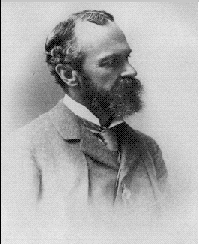

# 威廉·詹姆斯 James, William (Russell Goodman)

**首次发表于 2000 年 9 月 7 日；2021 年 11 月 3 日实质修订。**

（约 1895 年，载《威廉·詹姆斯书信集》（*The Letters of William James*），亨利·詹姆斯（Henry James）编，波士顿，1920 年）

威廉·詹姆斯是一位原创思想家，其思考既在生理学、心理学与哲学各学科之内展开，又贯穿于诸学科之间。他那部一千二百页的巨著《心理学原理》（1890），熔生理学、心理学、哲学与个人反思于一炉；“思想流”以及婴儿对世界的印象——“一大片繁盛、嗡嗡作响的混乱”（PP 462）——等观念，皆出自此书。书中蕴含着实用主义与现象学的种子，影响了欧美数代思想家，包括埃德蒙德·胡塞尔（Edmund Husserl）、伯特兰·罗素（Bertrand Russell）、约翰·杜威（John Dewey）与路德维希·维特根斯坦（Ludwig Wittgenstein）。詹姆斯曾就读于哈佛的劳伦斯科学学院与医学院，但他的著述从一开始就兼有哲学与科学的双重品格。《关于斯宾塞“心灵即对应”概念的几点评论》（1878）与《理性感》（1879、1882）预示了他后来的实用主义与多元主义，并首次表述了他的观点：哲学理论是哲学家气质的反映。

詹姆斯最早的论文与《心理学原理》中，已隐约透露出宗教关切；到《信仰的意志及其他大众哲学论文》（1897）、《人类不朽：对学说的两个所谓异议》（1898）、《宗教经验之种种》（1902）与《多元的宇宙》（1909），这一关切变得更为明确。他在两种想法之间摇摆不定。一边认为，像《宗教经验之种种》这样的“人性研究”有助于一门“宗教科学”；另一边则相信，宗教经验关乎一个全然超自然的领域——科学对它多少不可通达，个体的人却能通达。

詹姆斯最重要的哲学贡献，有一些出自其生命的最后十年。1904–5 年间他有一次写作喷发（后结集为《彻底经验主义论文集》（1912）），提出了通常称为“中立一元论”的形而上学观点：存在一种既非物质也非心灵的单一根本“质料”。在《多元的宇宙》中，他为一种神秘主义的、反实用主义的观点辩护，认为概念扭曲而非揭示实在；而在其影响深远的《实用主义》（1907）中，他系统地提出了一组关于真理、知识、实在、宗教与哲学的看法，这些看法自 1870 年代末起便贯穿于他的全部著述。

## 1 詹姆斯生平年表

- 1842 年。生于纽约市，是亨利·詹姆斯（Henry James）与玛丽·沃尔什·詹姆斯（Mary Walsh James）的长子。受教于家庭教师，并就读于纽约的私立学校。
- 1843 年。弟弟亨利出生。
- 1848 年。妹妹艾丽丝出生。
- 1855–8 年。举家迁居欧洲。威廉先后在日内瓦、巴黎与滨海布洛涅上学，并对绘画与科学产生兴趣。
- 1858 年。举家定居罗得岛州纽波特，詹姆斯随威廉·亨特（William Hunt）学画。
- 1859–60 年。举家定居日内瓦，威廉在日内瓦学院学习科学；后来威廉决定重拾绘画，全家便返回纽波特。
- 1861 年。威廉放弃绘画，进入哈佛劳伦斯科学学院。
- 1864 年。进入哈佛医学院。
- 1865 年。随老师路易斯·阿加西（Louis Agassiz）参加亚马逊考察队，染上轻度天花，康复后溯亚马逊河而上，为阿加西设在哈佛的动物学博物馆采集标本。
- 1866 年。返回医学院。当年秋季饱受眼疲劳、背部病痛与轻生抑郁之苦。
- 1867–8 年。为健康与学业游历欧洲：德累斯顿、巴德特普利茨、柏林、日内瓦、巴黎。在柏林大学研习生理学，并研读哲学、心理学与生理学著作（冯特、康德、莱辛、歌德、席勒、勒南、勒努维耶）。
- 1869 年。获医学博士学位，但从未行医。当年秋季陷入严重抑郁。
- 1870–1 年。抑郁与健康不佳持续未愈。
- 1872 年。接受哈佛校长艾略特（Eliot）之聘，为本科生讲授比较生理学。
- 1873 年。接受讲授全年解剖学与生理学的教职，但为赴欧旅行而推迟授课一年。
- 1874–5 年。开始教授心理学；建立全美第一个心理学实验室。
- 1878 年。与艾丽丝·豪·吉本斯（Alice Howe Gibbens）结婚。在《思辨哲学杂志》发表《评斯宾塞“心灵即对应”的定义》。
- 1879 年。在《心灵》发表《理性感》。
- 1880 年。受聘为哈佛哲学助理教授，同时继续教授心理学。
- 1882 年。游历欧洲，会见了埃瓦尔德·赫林、卡尔·施通普夫、恩斯特·马赫、威廉·冯特、约瑟夫·德尔伯夫、让·夏尔科、乔治·克鲁姆·罗伯逊、沙德沃思·霍奇森与莱斯利·斯蒂芬。
- 1884 年。讲授《决定论的两难》，并在《心灵》发表《论内省心理学的若干遗漏》。
- 1885–92 年。在哈佛教授心理学与哲学：逻辑学、伦理学、英国经验哲学、心理学研究。
- 1890 年。与波士顿的亨利·霍尔特（Henry Holt）合作出版《心理学原理》，距他应允撰写此书已过十二年。
- 1892 年。与亨利·霍尔特合作出版《心理学简编》。
- 1897 年。由朗曼斯·格林公司（Longmans, Green & Co.）出版《信仰的意志及其他大众哲学论文》，并讲授《人类不朽》（1898 年出版）。
- 1898 年。在加州大学伯克利分校发表《哲学概念与实际结果》，自称为实用主义者。出现心脏疾患。
- 1899 年。与亨利·霍尔特合作出版《教师谈心理学：并致学生论人生若干理想》（内收《论人类的某种盲目》与《什么使生活值得过？》）。成为反帝联盟的积极成员，反对美国在菲律宾的政策。
- 1901–2 年。在爱丁堡发表吉福德讲座《宗教经验之种种》（1902 年出版）。
- 1904–5 年。在《哲学、心理学与科学方法杂志》发表《“意识”存在吗？》《纯粹经验的世界》《两个心灵如何能认识同一事物》《彻底经验主义是唯我论的吗？》与《情感事实在纯粹经验世界中的地位》。后均重刊于《彻底经验主义论文集》（1912）。
- 1907 年。辞去哈佛教职。由朗曼斯·格林公司出版《实用主义：一些旧思想方法的新名称》，据其在波士顿与哥伦比亚的讲座整理而成。
- 1909 年。由朗曼斯·格林公司出版《多元的宇宙》，据前一年在英格兰与哈佛所作的希伯特讲座整理而成。
- 1910 年。在《希伯特杂志》发表《一位多元论的神秘主义者》。放弃构建一个哲学“体系”的尝试。（其未完成的稿本后以《哲学的若干问题》之名身后出版。）在新罕布什尔州乔科鲁阿的夏季寓所因心力衰竭辞世。

## 2 早期著作

### 《评斯宾塞“心灵即对应”的定义》（1878）

尽管发表这篇文章时詹姆斯名义上已是心理学教授，但他对赫伯特·斯宾塞（Herbert Spencer）的讨论，触及的却是他哲学中一以贯之的主题。这些主题包括：宗教与激情的重要、人对生活的种种回应，以及“我们帮助‘创造’自己所‘登记’的真理”这一观念（E 21）。斯宾塞认为，机体对环境的适应是心理进化的基本特征；詹姆斯据此指责斯宾塞把他自己“应当是什么”的构想，投射到他声称所描述的现象之上。詹姆斯断言，生存只是人类众多旨趣之一：“社会情感、各种形式的游戏、艺术令人心动的暗示、哲学沉思的愉悦、宗教情感的安息、道德自我认可之乐、幻想与机智的魅力——其中若干或全部，都是使单纯存在的观念变得可忍受所绝对必需的；……”（E 13）。詹姆斯认为，我们归根结底都是目的论的存在者，每个人都持有一组先验（*a priori*）的价值与范畴。斯宾塞“只是站在他碰巧偏好的那个目的（*telos*）一边”（E 18）。

詹姆斯特有的经验主义体现在这一主张中：价值与范畴在人类经验的进程中彼此争胜，它们的冲突“只能通过行进（*ambulando*）来解决，而不能凭借任何先验（*a priori*）的定义”。他断定，“被证明拥有最宏大命运的公式”，“就是那真实的公式”（E 17）。然而詹姆斯希望为这一感受辩护：任何这样的公式，其决定因素既在世界，也同样在自由行动的人类心灵。这一立场他后来（在《实用主义》中）称为“人文主义”：“心灵从诞生之日起就具有一种自发性、一票表决权。它在局中，而不只是一个旁观者；它关于‘应当如何’的判断、它的理想，不能像赘生物那样从所思之物的躯体上剥离下来……”（E 21）。

### 《理性感》（1879、1882）

这篇论文的主干于 1879 年首次发表于《心灵》，1882 年刊于《普林斯顿评论》，1897 年重刊于《信仰的意志及其他大众哲学论文》。尽管他从未完全挑明理性是一种情感，但詹姆斯主张，一种情感——其实是一组情感——乃是理性的一个“标志”。詹姆斯写道，哲学家认识一个概念的合理性，“正如他认识其他一切事物一样，凭借某些它在他身上发生作用的主观标志。当他获得这些标志时，他就可以知道自己已经把握了合理性。”这些标志包括一种“轻松、平和、安息的强烈感受”（WB 57），以及一种“当下时刻的充足、绝对之感”（WB 58）。还有一种“对简约的激情”（WB 58），在把握理论统一时油然而生；以及一种区分辨异的激情，一种“对知觉之清晰与完整的忠诚，对模糊轮廓、含混认同的厌恶”（WB 59）。詹姆斯认为，理想的哲学家将理性的这两种激情熔于一炉；即便某些伟大的哲学家，也在某一方向上失之过甚：斯宾诺莎（Spinoza）把万物统一于一个实体，是“贫瘠的”；休谟（Hume）视万物“松散而分离”，亦然（WB 60）。

理性的情感不仅在逻辑或科学中运作，也在日常生活中运作。例如，我们初次搬进一个房间时，“不知道会有什么穿堂风从背后袭来，会有什么门打开，会有什么形体闯入，会在橱柜和角落发现什么有趣的东西。”这些微小的不确定性充当“心理刺激物”，而一旦我们熟悉房间的布局、“在那里感到自在”，它们便烟消云散（WB 67–8）。

詹姆斯在论文第二部分开篇考察了这样的情形：“两种概念同样适合满足”流畅性或统一性的“逻辑要求”。在此，他认为，必须考虑理性的一个“实践”成分。那种“唤起能动冲动、或比其他概念更好地满足其他审美要求的概念，将被视为更合理，并将理所当然地胜出”（WB 66）。詹姆斯既把这一论点作为心理学之点——对将要发生之事的预测——也作为判断之点，因为他主张它将“理所当然地”胜出。

正如他论斯宾塞的文章那样，詹姆斯探讨了气质与哲学理论化之间的关系。他认为，唯心论“将由一种情感构造的人所选择，唯物论则由另一种人所选择。”唯心论提供一种与宇宙的亲昵之感，那种最终我“即一切”的体会。但唯物论者在唯心论中嗅出“一种狭隘、逼仄、病房般的空气”，宁愿设想一个不确定、危险而狂野、对“我们的自我毫无尊重”的宇宙。唯物论者想，让“潮水奔涌”，“即使它们从我们身上漫过”（WB 76）。詹姆斯既同情“宇宙是我们可与之亲昵者”这一观念，也同情“它是狂野而不可预测的”这一观念。他若批评唯心论带着“病房般的空气”，也批评还原论的唯物论形式，因为后者否认“我们最亲密的官能……在宇宙事务中的任何相关性”（WB 71）。这些相互对照的哲学所刻画的亲昵与狂野，正回应着人类身上的倾向、激情与官能；詹姆斯预言，这两种“心理气质”形式之间的“纷争”，将永远在哲学中显现（WB 76）。当然，在威廉·詹姆斯的哲学中，它始终显现。

## 3 《心理学原理》

1878 年，詹姆斯应美国出版商亨利·霍尔特之约撰写一部心理学教科书，但他花了十二年才交出书稿；完稿后，他向霍尔特形容它是“一团可憎的、膨胀的、浮肿的、鼓起的、水肿的团块，除了两个事实什么也证明不了：其一，根本不存在心理学这一门‘科学’；其二，W. J. 是个无能之辈”（《威廉·詹姆斯书信集》，亨利·詹姆斯编。波士顿：利特尔—布朗公司，1926，第 393–4 页）。尽管如此，这部融心理学、生理学与哲学于一体、长达一千页的著作，已被公认为詹姆斯的代表作；其中论“思想流”“自我意识”“情绪”“意志”等众多主题的章节极为丰富，包含了他主要哲学观念的早期表述。

詹姆斯告诉我们，他将在《心理学原理》中采用内省这一心理学方法，并把它定义为“审视我们自己的心灵，并报告我们在此所发现的种种”（PP 185）。事实上，他在书中采取了多种方法论进路。书的前部收有“脑的功能”与“脑活动的若干一般条件”两章，反映了他任哈佛解剖学与生理学讲师的岁月；他还论证了还原论的唯物主义论题：习惯“归根到底是物理原则”（PP 110）。随着书的推进，他开始与哲学家对话——例如在论自我的一百页长章中与休谟、康德（Kant）交锋——并发现自己正提出一些形而上学主张，预示着他后来的实用主义；例如他写道：“**没有任何属性是绝对本质性地属于任何一物的。** 同一属性，在一次场合充当一物的本质，在另一场合却成为极非本质的特征”（PP 959）。

甚至“内省”也涵盖种种不同的报告。詹姆斯讨论了同时代人冯特、施通普夫与费希纳在他们的实验室中所做的实验，这些实验使他们得出诸如“声音在强度上的辨别不如光那么精细”的结论（PP 513）。但詹姆斯许多最重要、最令人难忘的内省观察，都出自他自己的生活。例如：

> 一个遗忘的词，其节奏或许仍在，却没有任何声音来包裹它……每个人必定都体验过某句被遗忘之诗那空白节奏的撩人效果——它在心中不安地舞动，竭力要用词句将它填满（PP 244）。
>
> 我们的父亲母亲、我们的妻儿，都是我们骨中之骨、肉中之肉。他们逝去时，我们自我的一部分也随之消失。他们若做错了事，那是我们的耻辱。他们若受辱，我们的怒火会像自己受辱一般立刻迸发。（PP 280）。
>
> 哭泣发作时有一种兴奋，它本身并非没有一种辛辣的乐趣；但要发现干瘪枯萎的悲伤感中任何一点救赎性品质，却需要一位幸福的天才（PP 1061）。
>
> “**你愿意这样，还是不愿意？**”是我们被问过的最追根究底的问题；我们每天每时都被问及，关乎最大以及最小、最理论以及最实际的事物。我们以 **同意或不同意** 作答，而非用言语。这些无声的回应，竟然像是我们与事物本性交流的最深器官，这有什么奇怪呢！（PP，第 1182 页）。

在这最后一段引文中，詹姆斯从心理学视角处理了一个哲学问题。尽管他回避回答“这些‘回应’是否实际上是与世界本性交流的深层器官”，只报告说它们在我们看来是如此。但在《宗教经验之种种》《多元的宇宙》等后期著作中，他承认这个问题应当作肯定回答，并在一定程度上为之辩护。

在那理所当然著名的论“思想流”的章节中，詹姆斯认为自己提供了比休谟等传统经验论者更丰富的经验说明。他相信关系、模糊的边缘与倾向都是被直接经验到的（这一观点他后来将它作为“彻底经验主义”的一部分来辩护）。詹姆斯发现意识是一条流，而非一系列“观念”。其水流彼此交融；我们各自的意识——或如他有时更愿称呼的“意识性”（sciousness）——“浸染、着色”于环绕它的意识之水或思想之流中。我们的心理生活有其节奏：它是一系列过渡与停歇，一系列“飞翔与栖息”（PP 236）。当我们记起一直在搜寻的名字时，我们便歇息；当我们听到那可能是婴儿从午睡中醒来的声响时，我们又再度启程。

兴趣——及其近亲注意——在詹姆斯心理学中是主要成分；渗入其讨论的认识论与形而上学里，它同样是主要成分。詹姆斯在《思想流》中说，一物是一组性质，“它们恰好在实践上或审美上引起我们的兴趣，因此我们赋予它们实体的名称……”（PP 274）。而实在“**仅仅意味着与我们的情感生活及能动生活的关系……凡激起并刺激我们兴趣的东西都是实在的**”（PP 924）。对詹姆斯而言，我们专注于一物而非另一物的能力表明：意识里有一种“一切意识中的 **能动** 元素，……一种精神性的东西……它似乎出去迎接这些性质与内容，而它们似乎进来被它接纳”（PP 285）。詹姆斯此刻不是以心理学家、而是以哲学家的身份发言。面对科学决定论与我们对自己自由或自主的信念之间的张力，他论证道：科学“必须不断被提醒，她的目的并非唯一的目的，而她所使用、因而有权预设的齐一因果秩序，可能被包裹在一个更宽广的秩序之中，对那个秩序她毫无主张”（PP 1179）。

在他论意识的讨论中，詹姆斯在不同时刻仿佛既是还原论唯物主义者，又是二元论者，既是原始现象学家，又是一个不敢触碰哲学问题的中立心理学家。《心理学原理》最富原创性的层次之一，在于詹姆斯追求对思想流的一种“纯粹”描述——这种描述不预设它要么是心灵的、要么是物质的；这一追求不仅预示了他自己后来的“彻底经验主义”，也预示了胡塞尔的现象学。例如，在论“感觉”的章节中，詹姆斯竭力否认感觉“在心灵之中”、然后“通过我们方面的特殊行为被‘引渡’或‘投射’，从而显得位于外部世界之中”（PP 678）。他论证说，我们原初的经验是客观的，“只有随着反思的发展，我们才得以意识到有一个内心世界”（PP 679）。然而，原初经验到的那个客观世界，并不是我们所思考的空间关系世界：

> 当然，一个在波士顿新生的婴儿，从照亮卧室的烛焰或从尿布别针获得感觉，[他]并不会觉得这两个物体位于西经 71 度、北纬 42 度……火焰占据它自己的位置，疼痛占据它自己的位置；但此时这些位置既未被认同于任何其他位置，也未被与之区分开来。那是后来才发生的。因为这样最初被感性认识到的位置，是婴儿空间世界的元素，将伴随他一生。（PP 681–2）

詹姆斯论“习惯”的章节位于书的前部，以习惯作为物理问题起笔，而以考量其伦理意涵收尾。詹姆斯论证，自然律本身就是习惯，“不过是不同基本种类物质在其相互作用与反作用中所遵循的不变习惯”（PP 109）。在大脑中，习惯是神经能量的通路，就像河流溪水之于水流。在皮肤层面，甚至伤疤也是一种习惯，“比邻近部位更容易被擦伤、发炎、遭受疼痛与寒冷”（PP 111）。在心理层面亦然，“任何已被频繁重复的心理动作序列，都倾向于自我延续……”（PP 116）。习惯能减少我们必须投入行动的注意，从而让我们得以发展“心灵中更高的能力”（PP 126）。在社会层面，习惯是“社会的巨大飞轮，它最珍贵的保守剂。唯有它使我们所有人保持在法令的界限之内，并保护命运之骄子免受穷人嫉妒的起事”（PP 125）。在詹姆斯看来，“习惯律的伦理意涵”（PP 124），关乎我们选择发展哪些习惯、又在何时发展。许多习惯必须早年养成：“二十岁以后习得的语言，几乎没有一种说出来不带外国口音”（PP 126）。我们应该努力使“神经系统成为我们的盟友而非敌人”，办法是尽可能早、尽可能多地养成好习惯。即使在晚年，我们也应让决断能力保持状态：每隔一两天做一件“除了你宁可不做之外别无理由的事”（PP 130）。

《心理学原理》后部有两章值得注意：“情绪”与“意志”。前者提出了这样的理论——丹麦生理学家卡尔·朗格也曾阐述——情绪跟随其身体表现，而非引起身体表现：“常识说，我们失去财产，感到悲伤而哭泣；我们遇见熊，感到恐惧而奔逃；我们被对手侮辱，感到愤怒而出手。这里要辩护的假设则说，这种次序是错误的……我们因哭泣而悲伤，因出手而愤怒，因颤抖而恐惧……”（PP 1065–6）。在詹姆斯看来，这一观点的意义在于：情绪与身体表现紧密相连。他问道，悲伤“没有眼泪、没有啜泣、没有心口憋闷、没有胸骨后的刺痛”会是什么？詹姆斯答道，那不是情绪，因为“一种纯粹脱离肉身的人类情绪是子虚乌有”（PP 1068）。

在论“意志”的章节中，詹姆斯反对同时代人威廉·冯特的理论：存在一种特殊情感——“神经支配之感”——存在于一切意向行动之中。在审视一系列情形后，詹姆斯发现，有些行动包含一种决断行为或向外输出的神经能量，另一些则不然。例如：

> 晚饭后我坐在桌旁，发现自己不时从盘中取坚果或葡萄干来吃。我的正餐早已结束，而在交谈的兴头上我几乎意识不到自己在做什么；但水果的知觉，以及我可以吃它的转瞬即逝的念头，似乎无可挽回地促成了这一行为。这里当然没有任何明确的命令；……（PP 1131）。

论“意志”的章节还包含若干引人注目的段落，预示了《宗教经验之种种》的关切：关于心境、“心灵的变化”与“良心的觉醒”。詹姆斯观察到，这些可能影响“我们动机与冲动价值的整个尺度”（PP 1140）。

## 4 大众哲学论文

詹姆斯的《信仰的意志及其他大众哲学论文》广受欢迎、影响深远，1897 年出版；其中汇集了他此前十九年间已发表的论文，包括《理性感》（上文已讨论）、《决定论的两难》《伟人与他们的环境》与《道德哲学家与道德生活》。篇名论文——两年前才发表——因似乎推荐不负责任或非理性持有的信念而引发争议。詹姆斯后来写道，他本应称之为“信仰的 **权利**”：他的意图是 **在特定情境下** 为持有某些信念 **提供证成**，而非主张我们可以（或应当）仅凭意志行为便相信某事。

在科学中，詹姆斯指出，我们可以从容等待研究结果出来再形成信念；但在其他情形中，我们是被“迫”的——即使所有相关证据尚未齐备，我们也必须形成某种信念。如果我身处一条孤立的山间小径，面前是一段必须跨越的结冰岩脊，却不知道能否通过，我可能被迫考虑这个问题：我能否、或是否应当相信我能跨过这段岩脊。这个问题不仅是被迫的，而且是“重大的”：如果我判断错误，我可能坠入深渊而亡；而如果我正确地相信我能跨过岩脊，那么我持有这一信念本身，可能就促成了我的成功。詹姆斯断言，在这样的情形中，我拥有“信仰的权利”——正因这样的信念或可促成所信之事。这是一个“除非在事实来临之前已存在一种初步的信仰，否则该事实根本不会来临”的情形（WB，25）。

詹姆斯把他的分析应用于宗教信念，特别是这样可能的情形：一个人的得救，有赖于在任何关于上帝存在的证明之前就相信上帝。在这样的情形中，信念或可凭持有它所引出的结果获得证成。然而，他把这一分析扩展到宗教领域之外，涵盖广泛的世俗人生：

> 任何种类社会有机体之所以成为其所是，是因为每个成员都怀着“其他成员会同时尽到其职责”的信任，去尽自己的职责……一个政府、一支军队、一个商业体系、一艘船、一所学院、一支运动队，都依存于这一条件而存在；没有它，不仅一事无成，而且连尝试都不会有人尝试（WB 24）。

道德问题同样既重大，又不太可能由“感性证明”所支撑。它们不是科学之事，而是“帕斯卡尔（Pascal）所谓我们的心”之事（WB 22）。尽管如此，詹姆斯仍为我们在这些问题的某些答案上拥有信仰的权利而辩护。

文集中另一篇论文《反射动作与有神论》，试图调和科学与宗教。詹姆斯的“反射动作”一词，暗指这样一种生物学图景：机体以一系列动作回应感觉。在高等动物中，一个理论的或思维的阶段介于感觉与动作之间，而这正是人类身上上帝之念萌生的所在。詹姆斯主张，这一念是人对宇宙的自然回应，独立于上帝存在的任何证明；他预言，上帝将成为“一切试图解开生命之谜之努力的重心”（WB，116）。他以倡导一种“有神论”收束全篇——这种有神论预设“事物中的终极不透明性，一个逃逸我们理论控制的存在之维”（WB 143）。

《信仰的意志》还包含詹姆斯对道德最成熟的论述，《道德哲学家与道德生活》。在詹姆斯看来，道德建立在感受性之上——没有感受性，就没有道德主张，也没有道德义务。但一旦感受性存在，主张便被提出，道德便在“宇宙中取得一个立足点”（WB 198）。尽管詹姆斯坚称道德并无共同本质，他确在“我们随时尽可能满足尽可能多的要求”这一原则中，为伦理哲学找到了指导原则（WB 205）。这种满足要通过努力朝向一个“更丰富的宇宙……那似乎最能组织化、最适合进入复杂组合、最宜成为更包容整体之一员的善”来实现（WB 210）。这项工作经由一系列实验展开；凭借这些实验，我们（大体上）已学会在没有“一夫多妻与奴隶制、私人战争与杀人自由、司法酷刑与专断王权”的情况下生活（WB 205）。然而，詹姆斯主张，“在任何实际给定的人类理想平衡中都没有任何终结性，[因此]正如我们现在的法律与习俗曾战胜以往的其他法律与习俗，它们也将依次被任何新发现的秩序所推翻——这种新秩序将平息它们仍引起的抱怨，而不产生更响亮的其他抱怨”（WB 206）。

詹姆斯的论文《论人类的某种盲目》，1899 年发表于他的《教师谈心理学：并致学生论人生若干理想》，展现了詹姆斯道德观中另一个重要元素。詹姆斯提请我们注意的盲目，是一个人对另一个人的盲目；他用自己生活中的一个故事来说明这种盲目。在北卡罗来纳山区骑马时，他来到一片荒芜的景象前——没有树木，大地布满疤痕，间或有阳光下一片片生长的玉米。但在与那些为腾出农场空地而砍伐森林的定居者交谈之后，詹姆斯开始以他们的眼光看待这一切（至少暂时如此）：不是荒芜，而是“责任、奋斗与成功”的显现。詹姆斯总结道：“我对他们处境的独特理想性的盲目，正如他们若窥见我在剑桥那种奇特的室内学术生活方式时，也必定会对我的理想性盲目一样”（TT 233–4）。詹姆斯在论文中描绘了多种视角，并赋予它们形而上学/认识论与伦理的双重意义。他写道，这种多样性：

> 命令我们容忍、尊重并迁就那些我们所见以自己方式无害地乐在其中、自得其乐的人，无论这些方式对我们多么不可理解。放手吧：无论是全部真理还是全部善，都未曾向任何单个观察者显现；尽管每个观察者都从他身处的特殊位置获得一种局部的洞见优势。甚至监狱与病房也有它们特别的启示（TT 264）。

《论某种盲目》讲宽容，讲对不同观点的欣赏；但詹姆斯在文中的英雄选择，展现了他自己的浪漫主义视角：华兹华斯（Wordsworth）、雪莱（Shelley）、爱默生（Emerson）与 W. H. 哈德逊——据说他们都能感到“自然事物中无限意义”（TT 244）。即使在城市中，街道的日常事件、河流与人潮里也存在“不可测度的意义与重要性”（TT 254）。詹姆斯赞扬沃尔特·惠特曼（Walt Whitman）这个“白发苍苍的闲荡汉”，因为他懂得如何从生活的寻常机遇中受益。写作一上午、洗过澡，惠特曼便乘公共马车沿百老汇从第 23 街到鲍灵格林再折返，只为其中的乐趣与景致。“谁知道更多的真理，”詹姆斯问道，“是站在马车顶上、心中满是景象激起的喜悦的惠特曼，还是你——心中满是他那行当的徒劳所激起的轻蔑？”（TT 252）。詹姆斯关注他人的内心生活，也关注托尔斯泰（Tolstoy）这类作家——他们与他一样，懂得他人内心“神秘的潮起潮落”（TT 255）。这份兴趣引导他长久研究人的宗教经验：即他 1901–2 年的吉福德讲座，1902 年以《宗教经验之种种》出版。

## 5 《宗教经验之种种》

正如《心理学原理》一样，《宗教经验之种种》也是一项“人性研究”，恰如其副标题所示。但约五百页的篇幅，只有《心理学原理》的一半，与其更为受限——尽管仍很宏大——的范围相称。因为詹姆斯研究的是人性中属于、或与宗教经验相关的那一部分。他的兴趣不在宗教制度、仪式，甚至大体上也不在宗教观念，而在“个体的人在独处中的感受、行为与经验，只要他们领悟到自己与自己所认作神圣的任何东西相关联”（V 31）。

詹姆斯在早期论“健康心灵之宗教”与“病态灵魂”的章节中，确立了本书的一个核心区分。健康心灵的宗教人——沃尔特·惠特曼是詹姆斯的主要例证之一——对“生命之善”有深切的感受（V 79），并有一颗“天蓝色调”的灵魂（V 80）。健康心灵可以是非自愿的，对某人而言只是自然而然；但它常以更执意的形式出现。例如，自由派基督教代表着一种对健康心灵的坚定虔诚，战胜了病态的“旧地狱之火神学”（V 91）。詹姆斯还援引了玛丽·贝克·埃迪（Mary Baker Eddy）的“心灵疗法运动”——对她而言，“恶不过是一个谎言，任何提及它的人都是说谎者”（V 107）。与之相反，对“病态灵魂”而言，“根本的恶获得了它的出场机会”（V 163）。无论一个人感到多么安稳，病态灵魂都会发现：“正如老诗人所说，不知不觉地从每一道快乐之泉的底部，有苦涩的东西涌起：一丝恶心，快乐的猝然沉寂，一阵忧郁的气息……”这些状态不只是不愉快的感受，因为它们带来“一种来自更深区域的感受，并常常具有惊人的说服力”（V 136）。詹姆斯的主要例证：列夫·托尔斯泰的《忏悔录》、约翰·班扬（John Bunyan）的自传，以及一份关于可怖“恐惧”的报告——据称出自一位法国通讯员，实则出自詹姆斯本人。有些病态灵魂从未痊愈，另一些则康复甚至凯旋：这些就是“再生者”（twice-born）。在论“分裂的自我及其统一过程”与论“皈依”的章节中，詹姆斯讨论了圣奥古斯丁（St. Augustine）、亨利·阿林（Henry Alline）、班扬、托尔斯泰以及一系列通俗布道家，聚焦于他所称他们达到的“确信状态”（V 247）。这一状态的核心是“一切忧虑的消失，那种最终一切都好的感受，那平静，那和谐，那 **愿意存在**——即使外部条件保持不变”（V 248）。

《宗教经验之种种》中经典的论“神秘主义”章节，提出了“四个标志——当一个经验具备它们时，就可以证成我们称之为神秘的……”（V 380）。第一是不可言说性：“它无法言说……其品质必须被直接经验；它不能被传授或转达给他人。”第二是一种“认知品质”：神秘状态呈现为知识状态。第三，神秘状态是短暂的；第四，主体对它们是被动的：他们无法控制它们的来去。詹姆斯以这一问题收束本章：这些状态是“心灵借以向外眺望一个更广阔、更包容世界的窗户吗[？]”（V 428）。

在题为“哲学”——很大部分致力于实用主义——与“结论”的章节中，詹姆斯发现宗教经验总体上有用，甚至“是人类最重要的生物学功能之一”；但他承认这并不使它为真。尽管如此，詹姆斯阐述了自己的信念——他并未声称能证明它：宗教经验把我们与一个更大的、或更远的实在连接起来；那个实在，在我们与世界之间正常的认知关系中并不可通达。“在我看来，我们存在的更远界限，坠入一个与感性而仅仅‘可理解’的世界全然不同的存在之维”（V 515）。

## 6 晚期著作

### 《实用主义》（1907）

詹姆斯 1898 年在伯克利一次题为《哲学概念与实际结果》的讲座中，首次宣布了他对实用主义的承诺。《实用主义》后来的材料，出自 1905 年他在韦尔斯利学院、以及 1906 与 1907 年在洛厄尔研究所和哥伦比亚大学的讲座。实用主义在詹姆斯的书中呈现为六样东西：一种哲学气质、一种真理理论、一种意义理论、一种整体论的知识说明、一种形而上学观点，以及一种解决哲学争端的方法。

实用主义气质出现在书的开篇章节中；在那里（遵循他最初在《评斯宾塞“心灵即对应”的定义》中提出的方法），詹姆斯按气质对哲学家分类：此处分为“硬心肠的”或“软心肠的”。实用主义者是这两个极端之间的调停者——像詹姆斯本人一样，既对事实怀有“科学的忠诚”，又保有“对人类价值的旧日信心及由此而来的自发性，无论宗教型的还是浪漫型的”（P 17）。解决争端的方法与意义理论，展现在詹姆斯关于一场争论的讨论中：一个人绕树追逐松鼠，是否也在绕松鼠转。把意义当作“对象可能涉及的、属于实践类型的可设想结果”，实用主义哲学家发现“绕”有两个“实践”意义在起作用。要么这人绕行于松鼠的北、东、南、西侧；要么他先面对松鼠的头，然后是一侧，然后是尾巴，然后是另一侧。“挑明这一区分，”詹姆斯写道，“就没有任何进一步争论的余地了。”

实用主义真理论是本书第六章（某种程度上也是第二章）的主题。詹姆斯认为，真理是“一种善”，就像健康。真理之所以为善，是因为我们能“乘着”它们驶向未来，而不被不愉快地惊吓。它们“把我们引入有用的言辞与概念区域，也径直把我们带到有用的感性终点。它们导向一致、稳定与顺畅的人际交流。它们使我们远离偏执与孤立，远离受挫而贫瘠的思维”（103）。真理在人类经验的进程中“**被制造**”（104）出来，而且大部分时候它们靠“信贷体系”过活——当下并未获得验证；但詹姆斯也持一种经验论观点：“被 **某人** 具体验证过的信念，是整个上层建筑的支柱”（P 100）。

詹姆斯论“实用主义与人文主义”的章节，阐述了他的唯意志论认识论。“我们雕刻出一切，”詹姆斯说，“正如我们雕刻出星座，为的是服务于我们人类的目的”（P 100）。然而，他承认“每一次真理制造的经验中都有抵抗因素”（P 117）——这不仅包括我们当下的感觉或经验，也包括我们全部先前的信念。詹姆斯既不主张我们凭空创造真理，也不主张真理完全独立于人类。他拥抱“人文主义原则：你不能剔除人类的贡献”（P 122）。他还拥抱一种过程形而上学，主张“对实用主义而言，[实在]仍在制造之中”，而对“理性主义而言，实在从永恒中就已现成而完整”（P 123）。《实用主义》末章论“实用主义与宗教”，沿袭《宗教经验之种种》的路线，攻击“先验绝对主义”那不可验证的上帝观，并为一种基于人类经验的“多元论的、道德主义的宗教”辩护（144）。“按照实用主义原则，”詹姆斯写道，“如果上帝的假设在最宽泛的意义上令人满意地起作用，那么它就是真的”（143）。

### 《多元的宇宙》（1909）

这套讲座最初以“论哲学中的当前形势”为题在牛津发表。詹姆斯像开始《实用主义》那样开始本书，讨论哲学理论的气质决定；他指出，这些理论“恰是那么多种视野、感受整体推动的方式……被一个人的整个性格与经验强加于他，并且总体上是作为他最好的工作态度而 **被偏好**——没有比这更真实的词了”（PU 15）。詹姆斯断言，一个哲学家的“视野”是“关于他的重要之事”（PU 3）；他谴责“我们美国大学里年轻信徒们的那种过度技术化及其随之而来的沉闷……”（PU 13）。

詹姆斯从对乔赛亚·罗伊斯（Josiah Royce）唯心论与黑格尔“恶性理智主义”的批判性讨论，转向他所钦佩的哲学家的视野：古斯塔夫·费希纳（Gustav Fechner）与亨利·柏格森（Henri Bergson）。他赞扬费希纳的这一主张：“整个宇宙在其不同的跨度与波长、排除与发展中，处处都是活着而有意识的”（PU，70）。他还试图精炼并证成费希纳的观念：彼此分离的人类、动物与植物意识，在一个“范围更广的意识”（PU 72）中相遇或融合。詹姆斯运用亨利·柏格森对“理智主义”的批判，论证道：“经验的具体脉动，似乎并不像我们的概念替代物所限定那样，被任何确定的界限所围困。它们连续地相互融入，似乎彼此渗透”（PU 127）。詹姆斯以拥抱一个立场作结；这个立场，他在《宗教经验之种种》中曾更试探性地提出：宗教经验“以合理的或然性，指向我们意识与一个更宽广精神环境的连续性——而那个寻常的审慎之人（他正是所谓科学心理学所注意的唯一的人）被隔绝于这种连续性之外”（PU 135）。在《实用主义》中，詹姆斯把宗教归入实用主义之下（作为成功在世间安身立命的又一方式）；而在《多元的宇宙》中，他则暗示宗教提供了与宇宙的一种更优越的关系。

### 《彻底经验主义论文集》（1912）

这部身后出版的文集，收录了詹姆斯论“纯粹经验”的开创性论文，最初发表于 1904–5 年。詹姆斯的根本观念是：心灵与物质，都是一个更基本的质料——纯粹经验——的不同侧面，或由这一质料形成的结构；而纯粹经验（尽管被称为“经验”）既非心灵的也非物理的。詹姆斯解释说，纯粹经验是“生活的直接流变，它为我们后来的反思及其概念范畴提供材料……一个尚非任何确定的‘什么’（*what*）的‘那个’（*that*），尽管它准备成为种种‘什么’……”（ERE 46）。纯粹经验可能成为的那些“什么”，是心灵与身体、人与物质对象；但这并不取决于这些“纯粹经验”之间根本的本体论差异，而取决于它们所进入的 **关系**。某些纯粹经验的序列构成物理对象，另一些构成人；但一个纯粹经验（比方说对一把椅子的知觉）可能既属于构成椅子的序列，又属于构成一个人的序列。事实上，一个纯粹经验可能是两个不同心灵的一部分——正如詹姆斯在题为“两个心灵如何能认识同一事物”的章节中所解释的。

詹姆斯的“彻底经验主义”有别于他的“纯粹经验”形而上学。它在《论文集》中从未被精确界定，而最好地由《真理的意义》中的一段话阐明；詹姆斯在那里说，彻底经验主义由一条公设、一项事实陈述与一个结论构成。公设是：“哲学家之间可争论的唯一东西，应当是用从经验中引出的术语可定义的东西”；事实是：关系与它们所关联的东西一样，是被直接经验到的；结论是：“经验的各个部分，通过本身是经验部分的关系，从这一部分到下一部分地维系在一起”（MT，6–7）。

詹姆斯 1910 年去世时，仍在研究针对其“纯粹经验”学说的反驳意见、回应《实用主义》的批评者，并撰写一篇哲学问题导言。他的遗产延伸至心理学与宗教研究；在哲学中，不仅贯穿他（与查尔斯·皮尔士（Charles Peirce）一道）所创立的实用主义传统，也延伸进现象学与分析哲学。埃德蒙德·胡塞尔把詹姆斯的“边缘”与“光晕”概念纳入他的现象学（Moran，第 276–80 页）；伯特兰·罗素的《心的分析》受惠于詹姆斯的“纯粹经验”学说（Russell，1921，第 22–6 页）；路德维希·维特根斯坦从詹姆斯的《心理学》得知“意志行为的缺失”（Goodman，《维特根斯坦与威廉·詹姆斯》，第 81 页）；而纳尔逊·古德曼（Nelson Goodman）、理查德·罗蒂（Richard Rorty）与希拉里·普特南（Hilary Putnam）所提出的“新实用主义”版本，则浸透着詹姆斯的思想。在物理学中，詹姆斯的人文主义实用主义，以及他“新存在以局部的点与片进入”（P 138；Fuchs 2017，第 33 页）[^fuchs-2017]的提示，启发了被称为 QBism 的量子理论版本（见 Healey）。詹姆斯是最富魅力、最令人感到亲切的哲学家之一：因为他所见的那个“狂野”、“开放”却仍由我们人类的力量所塑造、回应我们某些最深切需要的宇宙；同时，正如罗素在他的讣告中所观察到的，也因为他展现这一视野时那“宽大的宽容与……人道”。（《民族》，1910 年 9 月 3 日：第 793–4 页。

## References（引用注释）

> 原文参考文献已转为脚注引用：文内“作者-年份”引用组后附 [^key] 标记，完整条目见本文末脚注定义。

### 原始文献：威廉·詹姆斯的著作

### 第二手文献

[^pp-nd]: The works that correspond to the abbreviations [PP], [WB], [TT], [V], [P], [PU], [MT], and [E] are referenced below -- the abbreviation is indicated occurs at the end of relevant reference.

[^works-1975]: *The Works of William James*, Cambridge, MA and London: Harvard University Press, 17 vol., 1975–.

[^william-1878]: *William James: Writings 1878–1899*. New York: Library of America, 1992.

[^william-1902]: *William James: Writings 1902–1910*. New York: Library of America, 1987

[^remarks-1878]: “Remarks on Spencer’s Definition of Mind as Correspondence,” first published in *The Journal of Speculative Philosophy*, 1878. Contained in *Essays in Philosophy*, pp. 7–22.

[^principles-1981]: *The Principles of Psychology*, Cambridge, MA: Harvard University Press, 1981. Originally published in 1890 [PP].

[^will-1979]: *The Will to Believe and Other Essays in Popular Philosophy*, Cambridge, MA and London: Harvard University Press, 1979; first published in 1897 [WB].

[^philosophical-1898]: “Philosophical Conceptions and Practical Results,” 1898. Contained in *Pragmatism*, in *The Works of William James*, pp. 255–70.

[^talks-1899]: *Talks to Teachers on Psychology and to Students on Some of Life’s Ideals*. New York: Henry Holt, 1899 [TT].

[^varieties-1916]: *The Varieties of Religious Experience*, New York: Longmans, Green, 1916. Originally published in 1902 [V].

[^pragmatism-1979]: *Pragmatism*. Cambridge, MA: Harvard University Press, 1979. Originally published in 1907 [P].

[^pluralistic-1977]: *A Pluralistic Universe*. Cambridge, MA: Harvard University Press, 1977. Originally published in 1909 [PU].

[^meaning-1979]: *The Meaning of Truth*, Cambridge, MA and London: Harvard University Press, 1979 [MT]. Originally published in 1909.

[^essays-1978]: *Essays in Philosophy*. Cambridge, MA and London: Harvard University Press, 1978 [E].

[^some-1979]: *Some Problems of Philosophy*. Cambridge, MA and London: Harvard University Press, 1979. Originally published in 1911.

[^letters-1926]: *The Letters of William James*, ed. Henry James, Boston: Little Brown, 1926.

[^correspondence-1992]: *The Correspondence of William James*, ed. Ignas K. Skrupskelis and Elizabeth M. Berkeley, 12 volumes. Charlottesville and London, University Press of Virginia, 1992–.

[^selected-1997]: *Selected Letters of William and Henry James*, Charlottesville and London, University Press of Virginia, 1997.

[^baghramian-2017]: Baghramian, Maria and Sarin Marchetti (eds.), 2017, *Pragmatism and the European Traditions: Encounters with Analytic Philosophy and Phenomenology Before the Great Divide*, New York and London: Routledge.

[^barzun-1983]: Barzun, Jacques, 1983, *A Stroll with William James* New York: Harper and Row.

[^benoist-2005]: Benoist, Jocelyn, 2005, “A Phenomenology or Pragmatism?” in *Pragmatism, Critical Concepts in Philosophy*, vol. 2, Russell B. Goodman (ed.), London and New York: Routledge, pp. 89–112.

[^bernstein-2010]: Bernstein, Richard, 2010, *The Pragmatic Turn*, Cambridge, U.K. and Malden, MA: Polity Press.

[^bird-1986]: Bird, Graham, 1986, *William James* (The Arguments of the Philosophers), London: Routledge and Kegan Paul.

[^campbell-2017]: Campbell, James, 2017, *Experiencing William James: Belief in a Pluralistic World*, Charlottesville: University of Virginia Press.

[^carrette-2013]: Carrette, Jeremy, 2013, *William James’s Hidden Religious Imagination: A Universe of Relations*, New York: Routledge.

[^edie-1987]: Edie, James, 1987, *William James and Phenomenology*, Indianapolis: Indiana University Press.

[^feinstein-1984]: Feinstein, Howard M., 1984, *Becoming William James*, Ithaca, NY: Cornell University Press.

[^friedl-2019]: Friedl, Herwig, 2019, *Thinking in Search of a Language: Essays on American Intellect and Intuition*, New York and London: Bloomsbury Academic.

[^fuchs-2017]: Fuchs, Christopher A., 2017, “Notwithstanding Bohr: The Reasons for QBism,” *Mind and Matter*, 15(2): 245–300; page reference is to the [preprint of Fuchs 2017 available online](http://arxiv.org/pdf/1705.03483.pdf)].

[^gale-1999]: Gale, Richard M., 1999, *The Divided Self of William James*, Cambridge: Cambridge University Press.

[^gale-2004]: –––, 2004, *The Philosophy of William James: An Introduction*, Cambridge: Cambridge University Press.

[^girel-2004]: Girel, Mathias, 2004, “Les Angles de l’acte. Usages d’Emerson dans la Philosophie de William James,” *Cahier Charles V*, XXXVII (October): 207–245.

[^goodman-1990]: Goodman, Russell B., 1990, *American Philosophy and the Romantic Tradition*, Cambridge: Cambridge University Press, Chapter 3.

[^goodman-2002]: –––, 2002, *Wittgenstein and William James*, Cambridge: Cambridge University Press.

[^goodman-2004]: –––, 2004, “James on the Nonconceptual,” *Midwest Studies in Philosophy*, XXVIII: 137–148.

[^goodman-2008]: –––, 2008, “Emerson, Romanticism, and Classical American Pragmatism,” in *The Oxford Handbook of American Philosophy*, ed. Cheryl Misak, Oxford: Oxford University Press, pp. 19–37.

[^goodman-2010]: –––, 2010, “William James’s Pluralisms,” *Revue Internationale de Philosophie*, 2: 155–76.

[^goodman-2016]: –––, 2016, “Thinking about Animals: James, Wittgenstein, Hearne”, in *Nordic Wittgenstein Review*, 5(1): 9–29.

[^healey-2017]: Healey, Richard, 2017, “Quantum-Bayesian and Pragmatist Views of Quantum Theory,” in *The Stanford Encyclopedia of Philosophy* (Spring 2017 edition), Edward Zalta (ed.), URL = <[https://plato.stanford.edu/archives/spr2017/entries/quantum-bayesian/](https://plato.stanford.edu/archives/spr2017/entries/quantum-bayesian/)>.

[^jackman-2008]: Jackman, Henry, 2008, “William James,” in *The Oxford Handbook of American Philosophy*, Cheryl Misak (ed.), Oxford: Oxford University Press, pp. 60–86.

[^jackman-2017]: –––, 2017, “William James on Conceptions and Private Language,” *Belgrade Philosophical Annual*, 30: 175–193.

[^klein-2009]: Klein, Alexander, 2009, “On Hume on Space: Green’s Attack, James’s Empirical Response,” in *Journal of the History of Philosophy*, 47(3): 415–49.

[^klein-2018]: ––– (ed.), 2018, *The Oxford Handbook of William James*, Oxford: Oxford University Press.

[^levinson-1981]: Levinson, Henry S., 1981, *The Religious Investigations of William James*, Chapel Hill: University of North Carolina Press.

[^madelrieux-2008]: Madelrieux, Stéphane, 2008, *William James, l’attitude empiriste*, Paris: Presses Universitaires de France.

[^marchetti-2015]: Marchetti, Sarin, 2015, *Ethics and Philosophical Critique in William James*, New York: Palgrave Macmillan.

[^marchetti-nd]: –––, forthcoming, *The Jamesean Mind*, New York and London: Routledge.

[^matthiessen-1947]: Matthiessen, F. O., 1947, *The James Family*, New York: Knopf.

[^mcdermott-1986]: McDermott, John, 1986, *Streams of Experience: Reflections on the History and Philosophy of American Culture*, Amherst: University of Massachusetts Press.

[^misak-2013]: Misak, Cheryl, 2013, *The American Pragmatists*, Oxford: Oxford University Press.

[^moore-1922]: Moore, G. E., 1922, “William James’ ‘Pragmatism’,” in *Philosophical Studies*, London: Routledge & Kegan Paul, pp. 97–146.

[^moran-2017]: Moran, Dermot, 2017, “Phenomenology and Pragmatism: Two Interactions. From Horizontal Intentionality to Practical Coping,” in Baghramian and Marchetti 2017, pp. 272–93.

[^myers-1986]: Myers, Gerald, 1986, *William James: His Life and Thought*, New Haven: Yale University Press.

[^pawelski-2007]: Pawelski, James O., 2007, *The Dynamic Individualism of William James*, Albany, NY: State University of New York Press.

[^perry-1935]: Perry, Ralph Barton, 1935, *The Thought and Character of William James*, Boston: Little, Brown, 2 vols.

[^pihlström-2008]: Pihlström, Sami, 2008, *The Trail of the Human Serpent is over Everything: Jamesian Perspectives on Mind, World, and Religion*, Lanham, MD: University Press of America.

[^poirier-1992]: Poirier, Richard, 1992, *Poetry and Pragmatism*, Cambridge, MA: Harvard University Press.

[^proudfoot-2004]: Proudfoot, Wayne, ed., 2004, *William James and a Science of Religions*, New York: Columbia University Press.

[^putnam-1987]: Putnam, Hilary, 1987, *The Many Faces of Realism*, La Salle, IL: Open Court.

[^putnam-1990]: ––– (with Ruth Anna Putnam), 1990, “William James’s Ideas,” in Putnam, Hilary, *Realism with a Human Face* (Cambridge, MA: Harvard University Press, pp. 217–231.

[^putnam-1997]: Putnam, Ruth Anna, 1997, *The Cambridge Companion to William James*, Cambridge: Cambridge University Press.

[^richardson-2006]: Richardson, Robert D., 2006, *William James: In the Maelstrom of American Modernism*, Boston: Houghton Mifflin.

[^russell-1921]: Russell, Bertrand, 1921, *The Analysis of Mind*, London: George Allen and Unwin.

[^russell-1986]: –––, 1986, *The Collected Papers of Bertrand Russell* (Volume 6), London: George Allen and Unwin, pp. 257–306.

[^simon-1998]: Simon, Linda, 1998, *Genuine Reality: a life of William James*, New York: Harcourt Brace.

[^seigfried-1990]: Seigfried, Charlene Haddock, 1990, *William James’s Radical Reconstruction of Philosophy*, Albany: State University of New York Press.

[^skillen-1996]: Skillen, Anthony, 1996, “William James, ‘A Certain Blindness’ and an Uncertain Pluralism,” in *Philosophy and Pluralism*, ed. David Archard. Cambridge: Cambridge University Press, pp. 33–45.

[^slater-2009]: Slater, Michael R., 2009, *William James on Ethics and Faith*, Cambridge: Cambridge University Press.

[^slater-2014]: –––, 2014, *Pragmatism and the Philosophy of Religion*, Cambridge: Cambridge University Press.

[^sprigge-1993]: Sprigge, T. L. S., 1993, *James and Bradley: American Truth and British Reality*, Chicago: Open Court.

[^suckiel-1982]: Suckiel, Ellen Kappy, 1982, *The Pragmatic Philosophy of William James*, Notre Dame, IN and London: University of Notre Dame Press.

[^suckiel-1996]: –––, 1996, *Heaven’s Champion*, Notre Dame, IN and London: University of Notre Dame Press.

[^tarver-2015]: Tarver, Erin C. and Shannon Sullivan (eds.), 2015, *Feminist Interpretations of William James*, University Park, PA: The Pennsylvania State University Press.

[^taylor-1996]: Taylor, Eugene, 1996, *William James on Consciousness Beyond the Fringe*, Princeton, NJ: Princeton University Press.

[^wahl-1925]: Wahl, Jean, 1925, *Pluralist Philosophies of England and America*, trans. Fred Rothwell , London: Open Court.

[^wilshire-1979]: Wilshire, Bruce, 1979, *William James and Phenomenology: A Study of* “The Principles of Psychology”, New York: AMS Press, 1979.

## 学术工具

> |   | [如何引用本词条](https://plato.stanford.edu/cgi-bin/encyclopedia/archinfo.cgi?entry=james). |
> | --- | --- |
> |   | [预览本词条的 PDF 版本](https://leibniz.stanford.edu/friends/preview/james/)（[SEP 之友协会](https://leibniz.stanford.edu/friends/)）。 |
> |   | [查找与本词条相关的话题与思想家](https://www.inphoproject.org/entity?sep=james&redirect=True)（互联网哲学本体论项目，InPhO）。 |
> |   | [本词条的增强文献目录](https://philpapers.org/sep/james/)（[PhilPapers](https://philpapers.org/)），含其数据库链接。 |

## 其他网络资源

- [威廉·詹姆斯](http://www.uky.edu/~eushe2/Pajares/james.html)，弗兰克·帕哈雷斯（Frank Pajares）的网页
- [实用主义网络文献馆](http://www.pragmatism.org/)

## 相关词条

约翰·杜威 | 埃德蒙德·胡塞尔 | 多元主义 | 实用主义 | 宗教经验 | 伯特兰·罗素 | 路德维希·维特根斯坦

**（译注：相关词条的中文站内链接将由管线在对应词条重译完成后统一挂接。）**