# 日本美学 aesthetics (Graham Parkes and Adam Loughnane)

*首次发表于 2005 年 12 月 12 日；2023 年 12 月 6 日实质修订。*

日本创造伟大的艺术并为它写作，已有许多个世纪，还包括一个上溯千年的丰富诗学传统；但日本对应于西方“美学”的哲学学科，直到十九世纪才起步。要概览这个更大的领域，一个好办法是考察传统中兴起的最重要审美观念——它们全都出现在美学被正式确立为一个学科之前：即 *mono no aware*（物哀，物的哀感）、*wabi*（侘，内敛而枯淡的美）、*sabi*（寂，古朴的包浆）、*yūgen*（幽玄，神秘深邃）、*iki*（意气，洗练的格调）与 *kire*（切，切割）。（最后这个词读作两个重音均匀的音节 kee-reh。某些元音上的长音符表示该元音是双倍长度。人名用日式惯常顺序：先姓后名。）

## 1 引言

关于日本文化传统，有两点先行观察与艺术相关。第一，古典日本哲学把实在理解为恒常的变化，或者（用佛教的说法）无常。呈现给感官的流变世界是唯一的实在：它之上或背后，没有稳定的“柏拉图式”领域的观念。日本的艺术传统上反映着这一根本性的无常——有时哀叹它，但更多时候是礼赞它。*mujō*（无常）的观念，在十三世纪禅宗祖师道元的著述与法语里表达得或许最为有力——道元可以说是日本最深刻的哲学家。较晚的法师吉田兼好也有一段出色的表达，其《徒然草》（Tsurezuregusa，1332）闪烁着审美的洞见：

> 无论你多么年轻强壮，死期都来得比你预想的早。你能活到今天，实在是非凡的奇迹；你以为还有片刻喘息可供松懈吗？（Keene, 120）

在日本佛教传统中，觉知存在的根本境况，并不是走向虚无主义绝望的理由，而是一种召唤：召唤人在当下积极行动，并为又一个时刻被赐予我们而感恩。

第二个观察是：日本的艺术往往与儒家的自我修习紧密相连。其明证是，它们常被称作诸“道〔之生活〕”：*chadō*，茶之道（茶道），*shodō*，书之道（书法），等等。而且，中国的士人被要求精通“六艺”——礼仪、音乐、书法、数学、射箭与驾车——因此文化与艺术同智性及心灵生活的联系，比西方传统更紧密。

直到今天，在日本，学者除具备相应智性能力，仍不乏兼擅书法与诗艺者。

## 2 Mono no aware：物的哀感

*mono no aware* 一语的含义复杂，且随时间而变，但基本上指的是“物”（*mono*）的“哀感”（*aware*），源于其无常。在八世纪的日本古典诗选《万叶集》（*Manyōshū*）中，*aware* 之感典型地由鸟兽的哀鸣触发。它在世界第一部小说——紫式部作于十一世纪初的《源氏物语》——中也起着重要作用。稍晚的《平家物语》（Heike monogatari）以下面这几行名句开头，清楚地表明无常是物哀之感的根基：

> 祇园精舍的钟声，有诸行无常之响；娑罗双树的花色，显盛者必衰之理。骄奢者不久留，恰如春夜之梦；雄强者终泯灭，正像风前之尘。（McCullough 1988）[^mccullough-1988]

兼好论无常与美的关联：“人若不像安野之露那样消散，不像鸟边山之烟那样消失，事物该会多么失去打动我们的力量！人生最可贵者，正在其无常”（Keene, 7）。对无常的接受与礼赞超越了所有病态，使人能够充分享受生活：

> 人怎能不每天为活着而欢喜？愚人忘了这种欢喜，辛苦地追求别的；忘了自己已有的财富，为贪求新财而冒生命之险。可他们的欲望从不知足。活着时不对生命欢喜，面对死亡却恐惧它——还有比这更不合逻辑的吗？（Keene, 79）

只要我们不欢喜生命，我们就未能领会与我们共度生活的那些事物的哀感。对我们多数人来说，其中某些事物尽管无常，却会比我们存在得更久；尤其如果它们曾被爱过，就会成为悲哀之物：“想到一个人的日用之物对他的死无动于衷、在他逝去后还要长久留存，真是可悲”（Keene, 30）。

著名的文学理论家本居宣长以一部《源氏物语》研究把物哀推到文学理论的前沿，表明这一现象正是该书的核心主题。他主张对物哀作更宽的理解：深切敏感于存在总体的情感与感受维度。紫式部成就的伟大，在于她能在写作中刻画怀有深切物哀之感的人物，使读者能够在这种感受中与他们共情。

小津安二郎常被认为是最具“日本性”的日本电影导演，他的电影是一系列传达物哀的练习。斯坦利·卡维尔说：“电影把我们对对象的最初迷恋归还给我们并加以延伸——对象有着内在而固定的生活。”这话用在小津身上再合适不过：小津常常通过呈现事物的面孔而非演员的面孔来表达情感。铺着榻榻米的房间里，父亲与女儿睡着，角落里立着一只花瓶；两位父亲在“枯山水”园林里凝望岩石，他们的姿态与石头的形状相互呼应；一面镜子映出刚出嫁离家的女儿的缺席——所有这些意象，都同最伟大演员脸上的表情一样有力地表达出物的哀感。

当代日本最常被引用的物哀之例，是对樱花的传统热爱，表现为每年涌向户外赏樱（并在樱树下野餐）的人潮。日本樱花的花朵本身并不比梨树或苹果树的花更美：它们之所以受到更高的珍视，是因为其短暂——它们通常在初开一周之内便开始凋落。恰恰是这份美的转瞬即逝，唤起观者物哀的怅惘。

## 3 Wabi：简素枯淡之美

在前述《徒然草》里，兼好问：“赏花，难道只该在盛放之时？观月，难道只该在无云之夜？”（Keene, 115）。如果对佛教徒来说根本境况是无常，那么只把永恒流变中的某些时刻挑选出来奉为完满，也许就等于拒绝接受那一根本境况。兼好接着说：“观雨而思月，垂帘而不觉春逝——这更加动人心怀。枝头将绽的花蕾、落英缤纷的庭园，更值得我们的欣赏。”这是“侘”之念的一例——内敛不露之美；它最初是在诗歌中受到分辨与赞美的。但在茶艺与禅的语境里，侘这一观念得到了最充分的发展。

《南方录》（1690）是茶人千利休言行的记录，其中写道：“在小〔茶〕室中，每件器物最好都略欠充分。有人因一件器物稍有残损便不喜欢它；这种态度表明他全然不理解〔茶道〕”（Hirota, 226）。在侘美学之下，带小瑕疵的器物常常比表面上完美的更受珍视；只要修复得当，破损或有裂纹的器物比完好的更受推重。侘美学不是苦行主义，而是节制，正如《南方录》的这段话所表明的：“小室之会，餐食只须一汁二三菜；酒也应适度而饮。为侘的聚会精心备膳，殊不相宜”（Hirota, 227）。

《禅茶录》（1828）里有一节论侘的著名文字，开头说侘不过是“持守〔佛〕戒”（Hirota, 274）。作者接着说：

> 侘意味着：身处窘境，不起艰难之念；有所不足，不生匮乏之感；面对失败，也不怨天尤人。你若觉得窘境局促，你若哀叹不足等于匮乏，你若抱怨万事不遂意——这就不是侘。（Hirota, 275）

茶道以茶室与器物的雅致简朴，体现这种人生态度；它同“美必然带来宏伟富丽”的任何观念都相反。

侘的枯淡在空无中达到顶峰——空无是佛教中心而遍在的观念。在《阴翳礼赞》（1933）一文中，大小说家谷崎润一郎（1886–1965）这样谈论日本传统茶室中壁龛（*tokonoma*）之美：

> 一片空的空间以素木素墙标出，光被引进去，在空无之内形成昏暗的阴影。仅此而已。然而，当我们凝视聚在横梁之后、花瓶四周、搁架之下的暗处——尽管我们完全知道那只是阴影——却会被一种感受攫住：在这方寸氛围的一隅，支配着完全而彻底的寂静；在这片黑暗里，不变的和静当权。（谷崎，20）

一个简单的结构，却特殊而引人联想，是一个有深刻哲学纵深的地方。从房间里切出一块空间，切断直射的光，从而开启一个新世界：这些技法在日本建筑传统中独辟蹊径地发展起来。（关于“切”，见下文第 7 节。）

> 这是我们祖先的天才：他们从这个空无的空间切断光线，使由此形成的阴影世界带上一种神秘或深邃的品格，胜过任何壁画或装饰。这技法看似简单，却绝非轻易达成。

不在墙上添加艺术品，而是把墙本身减去，把它退置为壁龛。然后让空无被光影的游戏填满。

有资格声称是日本茶道发源地的地方之一，是京都的银阁寺。楼阁（十五世纪晚期）是寂之乐趣的朴素纪念碑；其旁的向月台与银沙滩（约晚二百年）则是侘的范本。后两者构成日本独有的“枯山水”园林风格的一个不寻常版本（见下文第 7 节）。这些惊人的抽象构形（以十七世纪而论！）最好在满月之夜从楼阁二层观赏：沙在月光中闪着银光，沙纹宛如静止海面上的波涛。

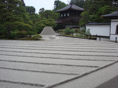 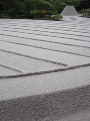 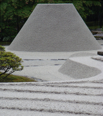

[银阁寺银沙滩与向月台大图](japanese-aesthetics.ginkakuji.md)

## 4 千利休之茶与侘的齐一美学

日本史上，少有哪个人物像千利休（1522–1591）那样以如此可畏的艺术家面目出现；也少有哪场美学运动比他对茶道的改造——*Wabicha*（侘茶）——更具转变之力。利休虽被公认为最杰出的日本茶人，但他作为审美家的角色远不止于此。他既是完满的画家与诗人、插花的践行者，又兼擅书法与造园，后来更成为有影响的政府显贵，就文化与艺术事务向幕府进言。通过数不清的发明与创新，他所创造——有人说所完善——的审美世界，其影响远远超出茶道本身。它为日本的认同与公民身份发掘出新的前景；社会德性得以开创，人类存在与宗教救赎呈现新图景；平等的新可能也由此开启（Suzuki 278–279）。而这一切，都植根于侘美学。

利休的声名后来盖过前辈，但其美学创新属于一个诞生于港市堺的谱系：茶人村田珠光（1423–1502）及其学生武野绍鸥（1502–1555）。两人都是禅的奉持者，后者后来做了利休的老师。两位先驱都开始开拓茶的美学，为利休日后的精炼奠定基础；两人都动用了新的审美策略，旨在把侘美学纳入茶道（Ludwig, 387–390. Sen Sōshitsu, 123–157）。

利休的侘茶有别于其师们的茶会，因为它化解了一重张力：十六世纪茶道实践与更广日本文化世界里，种种审美暗流相互竞争（Slusser 55–57）。在侘茶兴起之前，中世的茶日益向两个方向极化。书院（*Shoin* 書院）风格在权势贵族的华丽宅邸里排演财富的炫示。在这一氛围中，最受珍视的茶道具（*meibutsu* 名物）是从中国进口的珍稀器物，其审美价值主要看它们能在多大程度上彰显主人的富足与权势。这就使书院茶成了一种有意非平等主义的仪式。

书院的炫示又得到所谓“婆娑罗”（婆娑羅）风气的强化：品茶竞赛（*tōcha* 闘茶）与奢华茶会（*chayoriai* 茶寄合）都为夸富的大场面而设。正当书院风格上升之际，茶的世界同时朝相反方向演化，出现了一种称为草庵（*Sōan* 草庵）风格的茶会：一种颂扬枯淡与贫素、而非富丽丰足的美学。它取代贵族的宏大厅堂与数十乃至数百宾客的集会，把农夫与隐者的世界审美化，追求在一间小小的素朴草屋里集会的亲密，来客通常不过寥寥数人。珠光与绍鸥是这一风格的先驱，而利休继承、并最终磨至圆满的，正是这种“草屋”理想的茶。

十六世纪日本的第二种极化文化倾向，横跨书院与草庵之分，是武士与宗教两种审美感受之间的张力。利休的侘茶把武家集会与禅寺修习的要素熔铸一处，化解了这一张力。他的茶会避免专一地附属于宗教性或军事性，而以侘美学注入一种平等主义，抗衡两个领域里根深蒂固的等级划分，把侘重铸为一种“对真实的非等级觉知”（Hirota 95）。

在武人与寺域之外，十六世纪日本民众等级森严：顶端是武士，底层则是农人、佃户与商人。这些划分是绝对的，向上爬到更高的社会层几乎无法想象。尽管如此，利休仍动用侘美学挑战社会等级（Sen Sōshitsu 182–183）。在他的侘茶中，一切茶客都被视为平等，而他的美学创新使这一原则落到实处，确保它不只是一个高远的理想。在他名下的文本《南方录》（1690）中，他声称茶室中“世俗的等级被置之不理”。

利休的审美决断受一种尊崇引导：尊崇农耕生活之清贫、山居隐士之严格俭省、贫农不假雕饰之质朴。因此他偏爱粗糙未琢的材料：茶室内的墙壁与木料一任其生涩未完工，稻草与草泥清晰凸露在外。昂贵的中国瓷器、象牙花瓶与茶勺，统统为本地产的竹器取代。艳丽的花卉几乎尽被排除，一种“非像”的仪式由此形成——茶室内部与周围庭园里不设任何图像。

在利休运用的诸多建筑创新中，最具平等精神的是茶室的几处设计——它们使茶客在物理上无法表达其社会地位或权势。躙口（*nijiriguchi* 躙口），大略可译为“爬入之口”，是茶客唯一的入口（此前的数寄屋另设一个供贵族与上层人士使用的大入口）。这个仅约 60cm x 60cm（2ft x 2ft）的小开口，实现了侘茶的两个平等化目标（Sōshitsu Sen 182–183）。其一，武士无法佩双刀入内，而双刀通常是位居社会等级之巅最显眼的标志（利休在茶屋檐下、躙口之侧设了刀挂［*katanakake* 刀掛け］）。其二，开口尺寸意味着，富有的贵族与廷臣戴着高高的礼帽也钻不过这个小口。于是，一旦进入利休小小的数寄屋，惯常用来炫示与维系森严等级的一切标志便荡然无存；甚至言语与修辞之涉及社会地位者、提及职业者、炫耀财富之物、为权势张目之交游，也一概严禁。

侘茶美学还有一维强化了平等理想，就是利休对“本地”的拥抱。他反对输入昂贵中国茶器的潮流，转而推崇本地工匠所制、反映闹市都会之外农耕生活的器物。在利休的多项创新中，最著名的一项——以集中体现侘之精髓而闻名——是一种全新陶艺风格“乐烧”（*Raku* 楽焼，*raku-yaki*）的创立。利休延请本地陶工佐佐木“乐”长次郎（長次郎），塑制体现侘美学的茶器。与高度精巧的中国瓷器相对，乐烧是质朴的土陶：实用、无饰，形制与完成度往往不对称、不完美——礼赞清贫存在的优雅，是一曲献给本地隐者与农人的颂歌。烧制与干燥技法的发展，留出了余地，让空气、自然与重力在陶土加热复冷却之际自逞其态。这种美学唤起的，是就在近旁取手中之材劳作的僧侣或农人，而不是从异邦输入珍宝的入世贵族。与侘的精神相合，乐烧之可贵在于呈现清贫存在的朴素之美，扬贫乏之美学而抑丰饶。于是乐烧扮演了拉平者的角色，使先前围绕茶道形成的排他性物质文化更趋平等。

另一项削减财富标记的重要革新，涉及挂轴（*Kakemono* 掛物）设计与重心的转变。挂轴本居边缘，利休把它拔升，使其美学向平等理想重新校准，并把它安放为茶室乃至整个仪式的中枢（Hirota, 217–218）。利休不仅把挂轴推到仪式美学的最前沿（这一位置先前由书院样式的茶入占据），还使挂轴美学摆脱昂贵而专有的中国货。在利休的赞助之下，挂轴首次委托本地的禅宗书家与画家制作。

利休的这些介入，或许成功地在茶世界的界限之外挑战了森严的社会等级，但也可能为他本人的悲剧结局埋下伏笔。他力图拆解的等级标记，对幕府权力的正当化与维系至关重要。身为政府官吏，利休几乎没有回旋余地拒绝秀吉；而秀吉所愿，往往与侘茶的清俭大相径庭（例如营建金色的待庵茶室）。他的平等主义正在侵蚀幕府将军赖以炫示至尊的重要象征，并威胁颠覆维系其踞社会政治等级之巅的结构（Slusser, 56-57）。利休的侘茶，连同他塑造的消解等级之符号与结构，对抗幕府所拥抱的权力政治，也挑战他所服务精英阶层的军国利益。利休被下令切腹（*seppuku* 切腹）；1591 年行完最后一场茶会后，他写下辞世诗，随即自尽。

利休对后世日本茶道乃至整个文化影响至深，无可否认；但其遗产是复杂的。他的切腹被后来的超民族主义倾向挪用、审美化，由此早早确立了一种“审美化”死亡的标准——战时为国捐躯（Cross, 163–166）。于是，他的悲剧时刻被抬举出来，为帝国某些最骇人的暴行提供理据。一段本应保持清白的记忆，就此同日本对帝国主义、战争与自我牺牲的灾难性审美化绑在一起——而这些价值，与利休借茶道中的侘美学引入日本文化的价值，根本相悖。

## 5 Sabi：古雅之锈

*sabi* 一词在《万叶集》（*Manyōshū*）中屡见，带有荒凉之意（*sabireru* 意为“沦为荒凉”）；后来它似乎获得了新的含义，指那种经年而美的事物：或已生锈（另一个读作 *sabi* 的词，意为“锈”），或生出使之增美的锈色。

十五世纪伟大的茶人珠光——最早茶道流派之一的创始人——肯定了 *sabi* 对茶道的重要性。一位卓越的评注者这样说：“*sabi* 这个概念不仅带有‘年老’之义——既指‘经验与洞见之成熟’，也指‘浸染了赋予古物以美的锈色’——还带有宁静、孤绝、深沉孤独之义”（Hammitzsch, 46）。

*sabi* 之情致，也见于十七世纪著名诗人松尾芭蕉的俳句，其中它同 *sabishii*（孤寂、寂寞）一词的联系得到强调。下面这首俳句典型地体现了 *sabi(shii)*：它传达一种孤寂的氛围，并且像日本诗歌通常那样，消解主观与客观之间的区别：

> 如今孤绝——/繁花丛中/立着一株柏树。

与繁花的绚丽之美相对，柏树较为沉敛的雅致——它无疑比看它的人年岁更长，却同样孤独——典型地体现了 *sabi* 的诗情。

谷崎的《阴翳礼赞》屡屡礼赞 *sabi*；对照西方趣味，他这样写日本人的感受力：

> 我们并不厌恶一切发光之物，但与浅薄的光鲜相比，更爱沉思的光泽——那种无论见于石上还是器物上，都诉说着古意的幽光。……我们爱那些带着污迹、烟灰与风霜痕迹的东西，爱那些令人想起造就它们的往昔的颜色与光泽。（谷崎，11–12）

这是一个重要的生存论考量：古物的光泽把我们与过去连在一起，现代科技的闪亮产品全然无法企及。而古物多以自然材料制成，与之打交道有助于我们体认自己与自然环境最亲密的联结。

在谷崎那里，*sabi* 在传统日本厕所的美学中占据显著位置：这种厕所“与主体建筑分开，坐落于走廊尽头，在树叶与苔藓芬芳的树丛里”。现代科技给洁具问题强加的烦恼令他苦恼——传统洁具正被“白瓷与闪亮金属的把手”取代（谷崎，3, 6）。

> 上漆黑亮、光泽闪烁的木料自然最好；但即便是未上漆的木料，随岁月推移颜色转暗、木纹渐细，也会获得一种难以言表的安神静心之力。极致当然是盛着杉枝的木质“牵牛花”小便器：看着赏心悦目，且绝不发出丝毫声响。（谷崎，6）

而传统日本厕所的主要乐趣，在于它与自然的亲近：在那个特殊的地方，“四围是静谧的墙壁与纹理细密的木料，人望见的是蓝天与绿叶”（谷崎，4）。在传统日本建筑的种种成就中，谷崎盛赞厕所为“最具审美性的”。

> 我们的祖先把生活里的一切都化成了诗，把本该是家里最不卫生的屋子，变成了一个雅致得无从超越的场所，满是对自然之美的亲切联想。

排泄这样最自然的事，把大地的恩赐残余归还大地，本就该在自然而不是高科技的环境里完成，这无疑再合宜不过。

*sabi* 更高妙的例证，是京都银阁寺那座精致的银阁。茶道据说就发源于此地一间浸透 *sabi* 的小茶室，而银阁的外表原本打算仿照金阁寺的金阁（十四世纪），包上一层银箔。可银阁从未披上过银装，反倒成了 *sabi* 的典范，也是有史以来最优雅的建筑之一。把它与更大、更耀眼的金阁对照，颇能说明问题：金箔赋予金阁的是另一种美，而且分明与 *sabi* 相悖。

 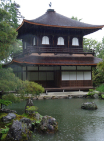 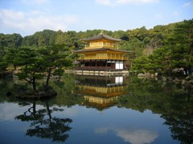 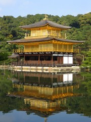

[银阁寺银阁与金阁寺金阁大图](japanese-aesthetics.ginkakuji-kinkakuji.md)

1950 年，一名精神失常的佛教侍僧被金阁之美搅得心神不宁，竟纵火把它烧成焦土。1955 年，人们在原址上照原样重建。原建筑的美学品质，三岛由纪夫的小说名作《金阁寺》（1956）与市川昆的经典影片《炎上》（Enjo，Conflagration，1958）都有传扬。1987 年，蓬勃的日本经济让这座建筑有史以来第一次得以按创建者的原意包上金箔。结果辉煌得令人屏息，却全然不像日本。京都的老住户有一句著名的抱怨：要等这座建筑攒够 *sabi*、重新值得一看，还不知要多久。照这层包浆眼下的积累速度，大概要几百年。

2011 年，东北海啸加上福岛的爆炸与核堆熔毁，使日本出现严重的电力短缺；众多应对办法之一，是把公共场所的照明大幅调暗，尤以那些地下连着大片餐饮与购物区的地铁站为甚。谷崎曾引用二十世纪二十年代末一句有先见的话：“也许没有哪两个国家比美国与日本更浪费电了”（谷崎，35）。要是他看到今天的日本城市削减无处不在的霓虹炫光与通宵电力照明、调暗不必要的灯，从而把他曾雄辩称颂的阴翳重新引回几分，一定会很高兴。

## 6 Yūgen：神秘的优雅

*yūgen* 在普遍晦涩的日本审美观念中，也许要算最不可言说的一个。这个词最早见于中国哲学文献，意思是“幽暗”或“神秘”。

以《方丈记》（Hōjōki，An Account of My Hut，1212）闻名的鸭长明（Kamo no Chōmei）也写过诗论，认为 *yūgen* 是他那个时代诗歌的首要关切。他这样刻画 *yūgen*：“它像秋日傍晚，无色的静寂天空铺展无边。不知怎的，仿佛有个我们本该想得起的缘由，泪水不可遏止地涌出来。”另一处刻画点明了想象力的重要：“隔着雾气看秋山，景象也许朦胧，层次却极深。雾中能看见的红叶也许很少，景象照样迷人。想象造出的无边景致，远胜过任何看得更清楚的东西”（Hume, 253–54）。

这段话体现了东亚文化的一个普遍特征：看重暗示，不看重直白与完整。*yūgen* 并不像人们有时以为的那样，牵涉此世之外的另一个世界；它关乎我们所居世界的深度，即唯有修养有素的想象力方能体验的那层深度。

*yūgen* 这个观念扮演最重要角色的艺术，是能剧（Nō）——世界伟大的戏剧传统之一，在世阿弥元清（Zeami Motokiyo，1363–1443）手里达到鼎盛。世阿弥写过好几部能剧论著，*yūgen*（“幽玄”）在其中是“最高原理”（Rimer, 92）。他把幽玄与日本贵族高度精致的文化联系起来，尤其与他们的言谈联系起来；不过能剧里还有“音乐之幽玄”“（不同角色的）表演之幽玄”和“舞蹈之幽玄”（Rimer, 93）。它极为稀有，只有传统里最伟大的演员、而且练上几十年功夫才够得着。它没法被概念化，所以世阿弥常常借意象来解释：“幽玄的美，莫非可以比作天鹅喙里衔着一朵花的样子？”（Rimer, 73）

最著名的说法，见于世阿弥《九位次第》（Notes on the Nine Levels）开头；最高的一位叫作“无上风姿之花”的艺：

> “无上风姿”一语的含义，超出任何言语的解释，也在意识运作之外。完全可以说，“深夜之中，日光赫赫”这句话存在于逻辑解释之外的境界。真的，说到本艺中最伟大表演者的幽玄，［它引生］“超越认知的感受”那一瞬，也引生一种超越艺术家自觉所能达到的任何层级的艺。（Rimer, 120）

这段话暗示着一种严格修行方式的结果；这种修行贯穿日本的许多“表演艺术”（除戏剧外，还有茶道和书法），也贯穿东亚的武术。能剧在这方面是典范：它的念白、手势、步态、舞蹈动作全都高度程式化，极不自然。意思是，人要长年练一种跟身体自然动作相悖的“形”（*kata*），因此需要极大的自律——直到某一刻豁然贯通，达到“更高的自然”；这种自然只在“形”彻底化入身体的时候才显现。这样的自发性给人的印象，正如幽玄那样，是某种“超自然”的东西。

## 7 Yūgen 与山水画

日本美学的一些引人入胜之处，透过雪舟等杨的艺术实践与他最著名的作品——1495 年那幅所谓“泼墨山水”（*Haboku* *Sansui*，字面意思即“破墨山水”）——显露出来。要迈出读解其艺术的第一步，就先得认识日本山水画的一个独特之处：作为艺术对象，它们的美学地位要比西方哲学与艺术史传统所解释的同类作品宽泛得多。画作本身当然重要，但关键的美学价值同时也在于作品所见证的身体表演。要恰当地评断雪舟“泼墨山水”之美——就像欣赏日本书法那样——就不只要评判纸上墨迹，还要欣赏创作这幅作品的身体动作。雪舟的自发动作由高度自律的禅宗修行培养而成，因此解释他的山水艺术，需要一种扩及哲学与宗教的美学。

雪舟等杨（雪舟等楊，1420–1506）是日本艺坛的巨擘。当日本禅宗（Zen）从中国的禅（Chan）脱胎而出、哲学—宗教实践正超越中国影响之时，他参与开创了一种本土艺术传统。雪舟属于一条延续数百年的脉络：把各种日本形态的佛教确立为这个国家宗教、哲学与审美认同的持久特征。他生前，禅作为一门宗教修行正日益显赫，足利氏庇护下的相关艺术亦然。室町时代是禅美学的时代：不只水墨画，书法、茶道、能剧、枯山水造园等一切日本审美实践（*geidō*）都作为当时禅——尤其是临济禅——精神的表达而繁荣。这一时期，画坛正从 *kara-e*（唐绘，“中国画”）转向 *yamato-e*（大和绘，“日本画”）。为信仰而作的诸神像与道释题材绘画（*dōshakuga*），其在艺术实践中的核心地位正被取代；日本此时首次出现要开创一种追求纯审美理想的艺术传统的动向。山水画正是那一动向的中心。

雪舟是著名的画家、诗人、书法家与园艺家，中国的主要画法与体裁几乎无所不精，从花鸟到肖像、挂轴、屏风、扇面。然而使他名垂不朽的，是其山水，尤以那幅著名的“泼墨山水”为最。这幅画让人洞见上文讨论过的一个日本美学核心观念，即 *yūgen*。

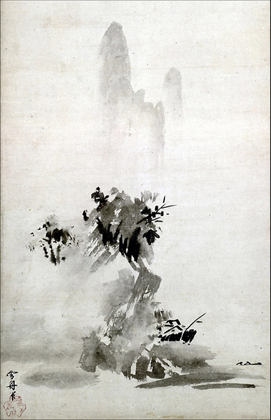

[雪舟《泼墨山水》](japanese-aesthetics.splashed-ink.md)

这幅他最著名的山水，其神秘幽玄既来自画出而可见之物，也同样来自未加触碰的空白——不可见与缺席者（常称画作的“龙脉”）。作品看上去尚未完成，仍处在成形之中；雾气造出的戏剧性留白让各种形体消融、彼此交融；更关键的是，按幽玄的运作方式，这种空无邀请观者走进画里，主动把它补全。正如其他体裁中运用幽玄原理的艺术家所示，作品的未完成与暗示性把观者召入景中。用吉尔拉迪（Ghilardi）的话说，“观看者必须融入图像，补全那些空白，使它成为自然本身的一个生动要素，处于可见与不可见‘之间’”（Ghilardi, 2015, 99）。

雪舟不追求把山水的每个细节都画出来以求再现式的逼真，也不追求画出主体能辨认出的对象。他的目标只是给出树木、山峦或流水的一点暗示或痕迹，而这些形体看上去在否定自己作为对象的存在。因此，雪舟不勾勒形体的轮廓，而把它们打散，从而给出一种诗的当下感。雪舟运用极度的简省与抽象，把任何形体——即使还辨认得出——尽可能推离对象性，却又不至于完全消失在无形之中。正如于连（Jullien）论及影响过雪舟的中国画家时所说，他们画出的山水“带着‘仿佛’的调性，以显现—消隐的方式，既‘仿佛有’又‘仿佛无’”（Jullien, 2009. 8）。居中那丛树、融入树干的旅舍，还有那小小船夫，全都显现出来，却又让人觉得即将失掉，也许已化作一段模糊的记忆，只差一笔就彻底消散。敏感的观者不只感知到对这一事件的再现，还能感到催生这一景象那种倏忽无常、挥洒自如的笔势。要欣赏画作的这一审美特征，就得调动雪舟作为禅僧所涵养的佛教原理。

雪舟的生平与创作，对日本美学而言堪称范例：他的实践并非狭义上的审美实践，还包容了受道家启发的禅佛教的宗教与哲学原理。“泼墨山水”作于雪舟七十六岁那年，他当时自称眼睛“渐渐蒙雾”，而道家思想对他的画作影响日深。作为画僧，他的冥想修行与艺术创作都指向自我否定，都指向禅修目标所说的“无我”。正如李普特（Yukio Lippit）所写：“《泼墨山水》由此展示了一种水墨画模式，既投射出修养有素的艺术能动性，又投射出一种无主体的状态。这种可渗透主体的状态，对中世纪晚期的日本僧侣画家来说堪称恰到好处”（Lippit 2012, 71）[^lippit-2012]。揭示这一审美—宗教目标如何在绘画实践中被趋近，也就揭示出禅佛教的道家根源。

绘画属于日本称为 *geidō* 芸道的审美实践之一。弓道（*kyudō* 弓道）、柔道（*jūdō* 柔道）、书法（*shodō* 書道）、插花（*kadō* 華道）、茶道（*sadō* 茶道）诸词共有一个汉字，即 *dao*（道）（日语读 *dō* 或 *michi*），标示出这些实践的哲学—宗教取向。依 *dao* 而动，就是以自然的自发性而动，作为著名概念“无为”（*wuwei* 無爲）的体现。自发地行动意味着超出主动与被动的二分；也就是说，世界推动身体，正如身体在世界中运动。因此，如西田（Nishida）所评论的，我们可以说“雪舟画了自然，或者自然通过雪舟画了自己”（Nishida 1990, 135）。剑士、书法家或能剧演员那种优雅的自然，同样是画家笔势的特征。这些都是身体实践，都要通过无为而与 *dao* 的自发运动相谐。所以，要评断雪舟笔法的审美价值，就是欣赏它源于道家影响的佛教实践的宗教根源。因为观者能使己身与驱动画作的动作相谐，这件作品引发的不只是审美判断，它本身就是涵养宗教—哲学修行的场所。

雪舟所用的“泼墨”技法，尤其能体现日本美学那种扩展了的框架。“泼墨”（*hatsuboku*）是源自中国的几种“破墨”（*haboku*）自发技法之一，雪舟在游历中国、向中国画家求学并在寺院修行时学到了它们。这些技法从自发的晕染、泼洒，一直到真正的掷墨与滴墨。这些方法听上去很放纵，也与“醉态美学”“偶然美学”联系在一起，但泼墨一体其实要求最高，被视为表达的最高形式，也是对艺术家技艺的至高考验。同样，人们认为它比任何其他体裁都更能考验观者的敏感。这一风格源于中国山水画南宋派的“文人”画家，他们偏爱幽玄式的简省与诗的暗示，不喜北派那种细密描摹的“院体”路数。因此，循着这一传统，雪舟这样的画家并不以练就高手技艺、造出完整成形的艺术形象为目标；他们在否定自我、与自然的运动连成一体之际，遵循的正是道家“大象无形”之箴言。

## 8 Iki：洗练的格调

九鬼周造（Kuki Shūzō，1888–1941）的《“意气”的结构》（“Iki” no kōzō），可以说是二十世纪日本美学最重要的著作，也肯定是最短的之一。九鬼 1926 年在巴黎写成初稿，其时他旅居欧洲已近七年；1929 年回日本后不久，该书出版。这是一项现象学—解释学研究，所研究的现象 *iki* 在此前两三百年间一直是日本审美生活的中心，源自大城市游乐场所中男人与艺妓之间的情色关系。九鬼指出，虽然法语词 *chic*、*coquet*、*raffiné* 与 *iki* 含义相通，却没有哪个欧洲词能译出其意义的丰富。这并不奇怪：它产生于特定文化语境，而九鬼要把握的，正是这一现象被体验时的“活的形式”。九鬼举法语 *esprit* 与德语 *Sehnsucht* 为例，说它们同样不可译，原因同样是文化上的根植（Nara, 15–16）。

九鬼在 *iki* 以媚态（*bitai*）为根基之外，又区分出两个进一步的“环节”：“意地”（*ikiji*）与“断念”（*akirame*）。就作为媚态的 *iki* 而言，“维持一种二元关系，把可能性保护为可能性”——这是暗指海德格尔把死亡领会为终极可能性的生存论构想——它已经拥抱了无常与有死。*iki* 把可能性保护为可能性、从而维持二元关系的第一层意思，是性结合的行为并未完成（或至少被推延）。这种可能性的保存，又因“意地”而强化；九鬼以武士面对死亡（自己与他人之死）的态度及其生活方式（*bushidō*）为范例。它同样因“断念”这一环节而强化；九鬼把断念理解为对无常世界不执著的佛教态度。全靠这些，再加上对日常生活关切的现象学式“悬置”，一种审美的“游戏”才成为可能（Nara, 18–23）。

九鬼先把 *iki* 这一现象放到其他种种审美感受之间定位——甘味（*amami*）对涩味（*shibumi*）、华丽（*hade*）对素静（*jimi*）、下品（*gehin*）对上品（*jōhin*）——随后考察这一现象的客观表现，这些表现或属“自然”，或属“艺术”（Nara, 24–34）。在自然中，柳树与徐缓不断的雨是 *iki* 的范例；在人体上，则是略略放松、中而不高的嗓音、长而不圆的脸型、眼与口颊之间那种紧张与松弛并存，以及手的弯曲或微微后仰。此外，穿薄料衣服、施薄妆、头发不甚正式地打理（用水而非油）、低胸设计以引人注意裸露的后颈，也都属于 *iki*（Nara, 35–39）。

在设计这门“自由艺术”中，平行线、尤其是竖条纹，最能表现 *iki*：日本织物艺术发展出的其他美丽纹样几乎都不具 *iki*，因为它们往往带曲线。能体现 *iki* 的颜色，只有某些灰、褐与蓝。建筑上，四叠半的小禅茶室是 *iki* 的典范，尤其因为它开启了木与竹的交互。照明必须幽暗：要么是间接日光，要么是纸灯笼那种光。各类音乐的调式、旋律与节奏也相应地是 *iki*，因为（这里暗指歌德、谢林与叔本华）“建筑是凝固的音乐，音乐是流动的建筑”（Nara, 41–51）。

在结论中，九鬼追问：十九世纪与当代欧洲的各种艺术能否体现 *iki*？他的判断是大概不能确切体现，但认为波德莱尔的诗与美学有若干方面与之极为接近（差别在于，花花公子作风是男性的特权，而 *iki* 与两性都相关）。旅居德国与法国的七年里，他听过海因里希·李凯尔特、埃德蒙德·胡塞尔、马丁·海德格尔、亨利·柏格森、让-保罗·萨特等人讲课与研讨，并与他们交谈。九鬼由此对欧洲哲学与美学形成精深理解，回国后着意把所学方法用于一种日本审美现象。因此他并不追求某种普世美学——因为 *iki* 根植于某一特定族群的文化。但当时日本在地缘政治压力下要更高效地现代化，正与自己的传统失去联系，所以九鬼把彰显过去的审美价值视为自己的任务之一（Nara, 58–60）。

不幸的是，他因此被斥为极端民族主义者、甚至法西斯主义者，最著名的例子是 Leslie Pincus 的《在帝国日本认证文化：九鬼周造与国民美学的兴起》；这让一些人不敢读他。Pincus 的书为九鬼在日本工作时的环境提供了不少有用的历史背景，但她说他是法西斯主义者，并无根据（见 Parkes 1997, 2007）[^parkes-1997]。不带偏见地读《意气的结构》，看不出任何法西斯倾向；那些民族主义主题是无害的，只是呼吁记住日本传统中有价值、且很可能在现代化浪潮下失落的东西；何况这一呼吁所处的世界，本就与过去的联系正在枯萎，且日本正抵御西方列强对东亚与南亚的殖民。

九鬼是一位引人入胜的思想家；《意气的结构》因坚持严格欧洲的方法论而偶显迂曲，却照亮了日本审美传统的一些迷人面向，同时也触及了任何地方经验的最深层面。

## 9 Kire：切

日本审美话语中有一独特观念，即“切”（*kire*）或“切续”（*kire-tsuzuki*）。“切”是临济宗禅佛教的基本修辞，尤见于禅祖白隐（1686–1769）的教法。对白隐而言，“见性”这一目标唯有“断命根”方能实现：“你必须准备好，在悬于绝壁之际松手，死去再活回来”（Hakuin, 133–35）。“切”也作为根本特征出现于日本特有的插花艺术 *ikebana* 中。此词字面意思是“让花活起来”——初看之下，对一门以促花之死开始的艺术来说，这名字有点怪。西谷启治有一篇精妙文章专论这门奇妙艺术：其中机体生命恰被切断，好让花的真性显露（Nishitani, 23–7）。从佛教万物无常的观点看，植物身上有一种古怪的欺人之处：它们不能移动，又把根扎进土里，因而无论在哪里都显得格外“安家”。西谷提示，把花从根上切断、安置到壁龛里（壁龛本身按谷崎的说法也隔绝直射光），就是让它们如其所是地显现。在这个彻底无常的世界里，它们与其余一切存在者一样，绝对无根。

“切续”这一观念，见于能剧演员高度程式化的步态。演员脚尖抬起、贴地滑行，然后急速落脚，“切”断这一动作——就在那一刻，另一只脚又开始贴地滑行。对人类自然行走的这一程式化，把注意力引向生命的片段性；这种片段性也反映在每次呼气与下一次吸气之间的停顿里。在禅修中留意呼吸，人便会察觉：呼气与吸气之间的停顿，同吸气与呼气之间的停顿不一样——更像一刀切断。这映现出生命随时可能被切断：那一次呼气之后没有吸气，即所谓“断气”。

“切”也见于俳句（*haiku*）艺术的“切字”（*kireji*）：它把一个意象与下一个意象切开，同时也把它们连起来。最著名的俳句诗人松尾芭蕉，其最广为人知的一首俳句第一行末尾，就有一个著名的切字 *ya*：

> | *Furuike ya* *Kawazu tobikomu* *Mizu no oto*. | 呵，古池——/忽然一只青蛙跳进！/水声。 |
> | --- | --- |

日本最具特色的庭园样式“枯山水”（*karesansui*），其存在要归功于把景观从园界之外的自然世界“切”开。此风格的典范是京都龙安寺石庭：十五块“山”形石头安置在苔地上，围在一片矩形白砂“海”中。

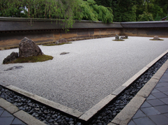  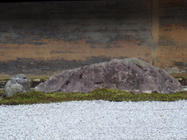  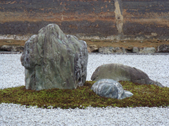 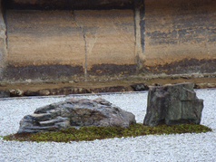 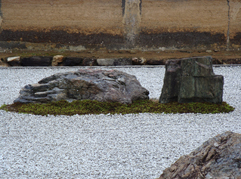 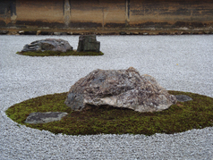 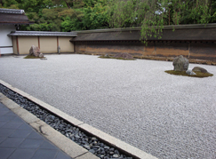 

[龙安寺枯山水庭园大图](japanese-aesthetics.ryoanji.md)

（日语中“山水”一词，*sansui*，字面意思是“山与水”：见 Berthier 2000。）[^berthier-2000] 龙安寺的石庭被一道漂亮的墙从外部切开，墙却低得足以让人看见周围的自然。这一“切”在某种意义上被沿墙顶延伸、似乎把墙切断的斜屋顶叠加了一层，而它在动与静的对照中最为明显。墙的上方与远方，是运动中的自然：枝条摇曳，云朵飘过，偶有飞鸟掠过。但除非落雨下雪，或有落叶被吹过，庭内能见的运动都只是影子或幻象——日月把树枝的缓慢影子投在静止的砂上。

庭园在近侧也被切开：一道卵石边（比砂粒更大、更深、更圆）沿东缘与北缘延伸。庭园边界严整的矩形，与其内岩石不规则的天然形状之间，形成醒目的对照。砂的原野也被岩石自下方的隆起切穿：大地能量涌起，在石的迸出中达到顶点。砂的原野把每一组岩石与其他组隔开；耙砂又围绕每组（以及某些单块岩石）耙出“波纹”纹样，强化了这一分离。然而这些切割的总体效果，其实是强化岩石之间那些看不见的连线；它们的相互关系，正是佛教“缘起”（*engi*）这一根本洞见的例证。

石庭也体现佛教无常这一核心洞见。它被从周围自然切开，效果是使其有机生命枯干，于是不再以通常的方式朽坏。既然枯干（*karesansui* 中的 *kare* 意为“枯萎”），龙安寺庭园的山与水初看之下，就不如墙外同类显得短暂，因为后者体现着有机生命必承的循环变化。但正如植物因扎根大地而显得欺人地恒久，枯山水庭园的岩石也给人一种误导性的恒久印象，尤其是在若干年间反复重访时。岩石参与着梭罗所称的大地“伟大的中心生命”，其生命以与我们颇为不同的时间序列展开——却同样受制于一切事物所依的无常。

## 10 Ozu Yasujirō：电影中的切

龙安寺的庭园在日本电影经典之一、小津安二郎的《晚春》（1949）里短暂而重要地出现过一次。它紧接在影片最著名的画面之一后面：一只花瓶立在榻榻米上，窗前投着竹影。该场景由八个镜头组成，其中七个拍的是龙安寺的石头（总共十五块），它们之间由七次“切”分隔并连接。（小津几乎从不用“切”以外的转场，比如划接。）先拍两个庭中石头的镜头，随后机位反打，我们看到主角与朋友——两人都是父亲，女儿都已长大——坐在木台上，画面下部被两块石头占住。两块石头，两个父亲。切到从左侧拍父亲的近景，画面里没有石头。他们身着深色西装，以小津经典的“叠置三角形”构图坐着，身子前倾朝向庭园，双臂抱着屈向胸前的膝盖，看上去就像两块石头。他们谈着如何把子女养大，子女又如何离去过自己的生活。在念叨这些无常的显现之际，他们几乎一动不动，只是偶尔点头或转头。

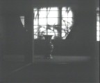  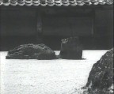 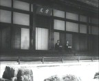 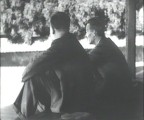 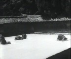 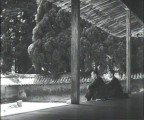 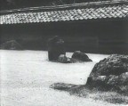 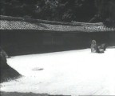

[《晚春》剧照放大序列](japanese-aesthetics.late-spring.md)

在庭园边上的短暂交谈中，两位父亲不过是就家庭生活交换了些陈词滥调——可这个场景却是对人之境况极为动人的表达。它之所以有这样的效果，是因为把两人的身影同化于石头，而这似乎确认了无常循环的绵延。这些同化影像抓住了枯山水庭园背后的核心观念：人的意识与石头连续一体；这也可理解为觉知与本源的亲缘。

《东京物语》（1953）被一些人视为小津最伟大的影片，其开头几个镜头在“切”的运用上也堪称范例。第一个镜头里，画面中心偏左是一座神社的石雕，其后是一片河口，一只小船突突地向右驶去，朝着地平线上渐渐升起的丘陵。十秒钟后，正当小船即将消失在画框之外——切到街边路面。一辆板车占据画面左侧前景，旁边立着两只大瓶子（小津的标志性形状）。八个小学生穿着校服，背对镜头向右走去。连续性来自第一场中河流、地平线与第二场中路面、房屋水平线之间的平行关系，也来自向右的运动。连续性还来自声音：小船的突突声继续着。第九个孩子出现，当他走过瓶子、到达画面中心——切到越过屋顶拍的火车，火车向右行驶，其后是神社或寺院的建筑，再后是丘陵。小船的突突声继续，随后被火车声盖过；火车经过的那条近乎水平的线仍与街面诸线一致，向右缓缓下降。左侧与中央两根烟囱冒出烟来，这场戏持续十五秒。

火车尾部到达画面中心时——声音继续，但切到从山坡一侧拍的火车近景，火车这时沿对角线向左上方行驶。火车另一侧的房屋背后又是河口。火车汽笛响起——切到一座被松树与石像环绕的神社，神社立在堤岸上，远处左侧背景是河口。连续性由前景的一根烟囱提供，它冒着烟，而火车的汽笛声继续。画面的主线又回到向右上升的水平线。六秒钟后——这是迄今最短的一场——切到祖父母坐在乡下家中的榻榻米上，面朝右方。祖父查着时刻表说：“我们今晚六点左右过大阪”，说的是他们即将启程去东京的火车旅行，这趟旅行将启动影片的主要情节。

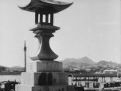 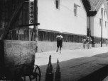 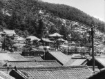 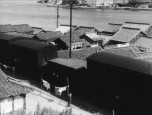 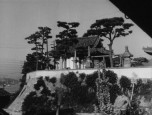 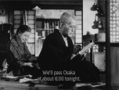

[《东京物语》剧照放大序列](japanese-aesthetics.tokyo-story.md)

每一次“切”，小津都至少安排了一个形式要素，为相邻场景提供连续性（*kire-tsuzuki*）。小津那些不显眼的切换，至今仍是世界电影中最有风格的剪切；他的作品也仍在启发后来者。

## References（引用注释）

**以下文献从原文照录，不作翻译；中国文献译为中文。**

> 原文参考文献已转为脚注引用：文内“作者-年份”引用组后附 [^key] 标记，完整条目见本文末脚注定义。

[^berthier-2000]: Berthier, François, 2000, *Reading Zen in the Rocks: The Japanese Dry Landscape Garden*, Graham Parkes (trans.), Chicago and London: University of Chicago Press.
[^bordwell-1988]: Bordwell, David, 1988, *Ozu and the Poetics of Cinema*, Princeton: Princeton University Press.
[^carter-2008]: Carter, Robert E., 2008, *The Japanese Arts and Self-Cultivation*, Albany: State University of New York Press.
[^clarke-1997]: Clarke, John (trans), 1997, *Reflections on Japanese Taste: The Structure of Iki*, Sydney: Power Institute Publications.
[^covell-1975]: Covell, Jon Carter, 1975, *Under the Seal of Sesshū*, New York: Hacker Art Books.
[^cross-2003]: Cross, Tim, 2003, “Rikyū has left the Tea Room” in Morgan Pitelka (ed.), *Japanese Tea Culture: Art, History and Practice*, London and New York: Routledge, 151–183.
[^bary-2001]: deBary, William Theodore, et al. (eds.), 2001, *Sources of Japanese Tradition* (Volume I), New York: Columbia University Press, chapters 9 and 16.
[^bary-2005]: –––, 2005, *Sources of Japanese Tradition* (Volume II), New York: Columbia University Press, chapter 27.
[^ghilardi-2015]: Ghilardi, M., 2015, *The Line of the Arch: Intercultural Issues between Aesthetics and Ethics*, Milan: Mimesis International.
[^hakuin-1971]: Hakuin, Ekaku, 1971, *The Zen Master Hakuin: Selected Writings*, Philip Yampolsky (trans.), New York: Columbia University Press.
[^hammitzsch-1980]: Hammitzsch, Horst, 1980, *Zen in the Art of the Tea Ceremony: A Guide to the Tea Way*, New York: St. Martin’s Press.
[^hirota-1995]: Hirota, Dennis (ed.), 1995, *Wind in the Pines: Classic Writings of the Way of Tea as a Buddhist Path*, Fremont: Asian Humanities Press.
[^hume-1995]: Hume, Nancy G. (ed.), 1995, *Japanese Aesthetics and Culture: A Reader*, Albany: State University of New York Press.
[^izutsu-1981]: Izutsu, Toshihiko and Toyo, 1981, *The Theory of Beauty in the Classical Aesthetics of Japan*, The Hague, Boston, London: Nijhoff.
[^jullien-2009]: Jullien, Francois, 2009, *The Great Image Has No Form, or on the Nonobject through Painting*, Chicago: University of Chicago Press.
[^keene-1967]: Keene, Donald, 1967, *Essays in Idleness: The* Tsurezuregusa *of Kenkō*, New York: Columbia University Press.
[^lippit-2012]: Lippit, Yukio, 2012, “Of Modes and Manners in Japanese Ink Painting: Sesshū’s ‘Splashed Ink Landscape’ of 1495,” *The Art Bulletin*, 94(1): 50–77.
[^ludwig-1981]: Ludwig, Theodore, 1981, “Before Rikyū. Religious and Aesthetic Influences in the Early History of the Tea Ceremony,” *Monumenta Nipponica*, 36(4): 367–390.
[^marra-2001]: Marra, Michael F. (trans. and ed.), 2001, *A History of Modern Japanese Aesthetics*, Honolulu: University of Hawai‘i Press.
[^marra-2004]: –––, 2004, *Kuki Shūzō A Philosopher’s Poetry and Aesthetics*, Honolulu: University of Hawai‘i Press.
[^marra-2011]: ––– (ed.), 2011, “Aesthetics” (translations of excerpts from seventeen authors), in James W. Heisig, Thomas P. Kasulis, John C. Maraldo, eds, *Japanese Philosophy: A Sourcebook*, Honolulu: University of Hawai‘i Press, pp. 1167–1227.
[^marra-1999]: Marra, Michele, 1999, *Modern Japanese Aesthetics: A Reader*, Honolulu: University of Hawai‘i Press.
[^miller-2011]: Miller, Mara, 2011, “Japanese Aesthetics and Philosophy of Art,” in J.L. Garfield and W. Edelglass (eds.), *The Oxford Handbook of World Philosophy*, New York: Oxford University Press, pp. 317–333.
[^miller-2020]: Miller, Mara and Yamasaki Kōji, 2020, “Japanese (and Ainu) Aesthetics and Philosophy of Art,” in B.W. Davis (ed.), *The Oxford Handbook of Japanese Philosophy*, New York: Oxford University Press, pp. 735–754.
[^mccullough-1988]: McCullough, Helen C. (trans.), 1988, *The Tale of the Heike*, Stanford: Stanford University Press.
[^nara-2004]: Nara, Hiroshi, 2004, *The Structure of Detachment: The Aesthetic Vision of Kuki Shūzō* (with a translation of *Iki no kōzō*), Honolulu: University of Hawai‘i Press.
[^nguyen-2018]: Nguyen, A. Minh (ed.), 2018, *New Essays in Japanese Aesthetics*, Lanham & London: Lexington Books.
[^nishida-1992]: Nishida, Kitarō, 1992, *An Inquiry into the Good*, New Haven: Yale University Press.
[^nishitani-1995]: Nishitani, Keiji, 1995, “The Japanese Art of Arranged Flowers,” Jeff Shore (trans.), in Robert C. Solomon and Kathleen M. Higgins (eds.), *World Philosophy: A Text with Readings*, New York: McGraw Hill.
[^odin-2001]: Odin, Steve, 2001, *Artistic Detachment in Japan and the West: Psychic Distance in Comparative Aesthetics*, Honolulu: University of Hawai‘i Press.
[^ohashi-1986]: Ohashi, Ryōsuke, 1986, 「切れ」の構造：日本美と現代世界 (*“Kire” no Kōzō: Nihonbi to Gendai Sekai*), Tōkyō: Chūō Kōronsha.
[^ohashi-1998]: –––, 1998, “Kire and Iki,” Graham Parkes (trans.), in Michael Kelly (ed.), *The Encyclopedia of Aesthetics*, New York: Oxford University Press, 2: 553–55.
[^ohashi-2014]: –––, 2014, *Kire: Das Schöne in Japan*, Paderborn: Fink.
[^ryōsuke-2022]: Ōhashi, Ryōsuke, Rolf Elberfeld, and Leon Krings, 2022, *Blumenspiegel*: *Ein Grundlagentext Zur Praxis Und Ästhetik Des Japanischen Nō-Theaters*, Paderborn: Brill.
[^parkes-1995]: Parkes, Graham, 1995, “Ways of Japanese Thinking,” in Hume (1995), 77–108.
[^parkes-1997]: –––, 1997, review of Leslie Pincus, *Authenticating Culture in Imperial Japan: Kuki Shūzō and the Rise of National Aesthetics*, in *Chanoyu Quarterly*, 86: 63–70.
[^parkes-2000]: –––, 2000, “The Role of Rock in the Japanese Dry Landscape Garden: A Philosophical Essay,” in Berthier (2000), 85–155.
[^parkes-2007]: –––, 2007, “The Definite Internationalism of the Kyoto School,” in Christopher Goto-Jones (ed.), *The Political Philosophy of the Kyoto School*, London and New York: Routledge, 161–182.
[^rimer-1984]: Rimer, J. Thomas and Yamazaki Masakazu (trans.), 1984, *On the Art of the Nō Drama: The Major Treatises of Zeami*, Princeton: Princeton University Press.
[^saito-2007]: Saito, Yuriko, 2007, *Everyday Aesthetics*, Oxford, New York: Oxford University Press.
[^sen-1998]: Sen Sōshitsu, 1998, *The Japanese Way of Tea: From its Origins in China to Sen Rikyū*, Honolulu: University of Hawai’i Press.
[^slusser-2003]: Slusser, Dale, 2003, “The Transformation of Tea Practice in Sixteenth-Century Japan,” in Morgan Pitelka (ed.), *Japanese Tea Culture: Art, History and Practice*, London and New York: Routledge, 39–60.
[^suzuki-2019]: Suzuki, D.T., 2019, *Zen and Japanese Culture*, R.M. Jaffe (trans.), New Jersey: Princeton University Press.
[^tanizaki-1977]: Tanizaki, Jun’ichirō, 1977, *In Praise of Shadows*, Thomas J. Harper and Edward G. Seidensticker (trans.), New Haven: Leete’s Island Books.

## 学术工具

* [如何引用本词条](https://plato.stanford.edu/cgi-bin/encyclopedia/archinfo.cgi?entry=japanese-aesthetics)。
* [预览本词条的 PDF 版本](https://leibniz.stanford.edu/friends/preview/japanese-aesthetics/)，见 [SEP 学会之友](https://leibniz.stanford.edu/friends/)。
* 在 [InPhO](https://www.inphoproject.org/entity?sep=japanese-aesthetics&redirect=True) 查找与本词条相关的话题与思想家。
* 在 [PhilPapers](https://philpapers.org/sep/japanese-aesthetics/) 查看本词条的增强文献目录及其数据库链接。

## 其他网络资源

- [日本美学、侘寂与茶道](http://www.art.unt.edu/ntieva/download/teaching/Curr_resources/mutli_culture/Japan/Aesthetics/Japanese%20Aesthetics_Wabi-Sabi_Tea%20Ceremony.pdf)，由北德克萨斯教育者视觉艺术研究所（北德克萨斯大学）主办的网页。

## 相关词条

电影哲学

**（译注：相关词条的中文站内链接将由管线在对应词条重译完成后统一挂接。）**

## 致谢

银阁寺银阁等处与龙安寺枯山水庭园的照片，由 Graham Parkes 拍摄。金阁寺金阁的照片由 Susanne Z. Riehemann 拍摄，经她许可复制于此。第 7 节所论影片剧照的致谢如下：《晚春》，小津安二郎导演，1949 年，版权归松竹株式会社；《东京物语》，小津安二郎导演，1953 年，版权归松竹株式会社。泼墨山水的图像[属于公有领域](https://en.wikipedia.org/wiki/Haboku_sansui#/media/File/Sesshu-Haboku-Sansui.jpg)。
