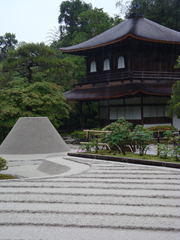
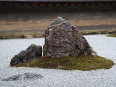
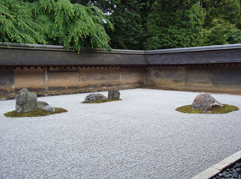
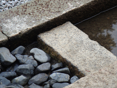
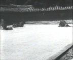

# 日本美学 aesthetics (Graham Parkes and Adam Loughnane)

*首次发表于 2005 年 12 月 12 日；2023 年 12 月 6 日实质修订。*

尽管日本人创作伟大的艺术并为之著书立说已有许多世纪，其中包括一个可追溯至千年前的诗学传统，但日本哲学中与西方“美学”相对应的学科，直到十九世纪才开始形成。考察这一更广阔领域的一个好办法，是审视这一传统进程中产生的最重要的审美观念——它们全都先于美学作为一门学科正式确立：即 *mono no aware*（物哀，物之哀感）、*wabi*（侘，克制而质朴的美）、*sabi*（寂，古雅之锈）、*yūgen*（幽玄，神秘之深远）、*iki*（意气，洗练之风格）与 *kire*（切，切断）。（最后一个术语读作两个轻重均匀的音节 *kee-reh*。某些元音上的长音符号表示双倍长度的元音。使用人名时，采用日本惯常的顺序：先姓后名。）

## 1 引言

关于日本文化传统，有两点初步观察与艺术相关。第一，古典日本哲学把实在理解为持续的变化，或者用佛教的说法，理解为无常（impermanence）。呈现于我们感官的这个流转世界是唯一的实在：不存在某个稳定的“柏拉图式”领域高居其上或藏于其后的观念。日本的艺术传统上反映了这种根本的无常——有时哀叹它，但更常赞美它。*mujō*（无常）这一观念，或许在十三世纪禅宗大师道元（Dōgen）的著述与言说中得到了最有力的表达，道元堪称日本最深刻的哲学家；但后来一位佛教僧侣吉田兼好（Yoshida Kenkō）也对此有精妙的表达，他的《徒然草》（*Tsurezuregusa*，1332）闪烁着美学的洞见：

> 无论你多么年轻或强壮，死亡的时刻总比预想的来得更早。你能活到今日是一个非凡的奇迹；难道你以为自己还有哪怕片刻的喘息可以放松吗？（Keene, 120）

在日本佛教传统中，对存在根本境况的觉知并不引起虚无主义的绝望，而毋宁是召唤人在当下这一刻奋发有为，并对又一刻被赐予我们而心怀感恩。

第二点观察是，日本的艺术往往与儒家的修身实践紧密相连，其证据是它们常被称为“[生活之]道”：*chadō*，茶道（茶会）；*shodō*，书道（书法）；等等。而由于中国的士大夫应精通“六艺”——礼、乐、书、数、射、御——文化与艺术便往往与理智及心智生活联系得比西方传统更紧密。

直到今天，在日本，一位学者同时是出色的书法家和有成就的诗人，此外还具备相关的心智才能，这并不罕见。

## 2 物哀：物之哀感

*mono no aware* 这一短语的含义复杂且随时间而变，但基本上指“物”（*mono*）的“哀感”（*aware*），这种哀感源于物的无常。在八世纪日本诗歌的经典选集《万叶集》（*Manyōshū*）中，*aware* 之感通常由鸟或其他动物的哀婉啼鸣所触发。它在世界上第一部小说、十一世纪初紫式部（Murasaki Shikibu）的《源氏物语》（*Genji monogatari*，The Tale of Genji）中也扮演重要角色。稍晚的《平家物语》（*Heike monogatari*，The Tale of the Heike Clan）以下列著名诗句开篇，这些诗句清楚地显示无常是 *mono no aware* 之感的根据：

> 祇园精舍钟声响，诉说世事本无常；娑罗双树花色白，示盛者必衰之理。骄者不长久，恰如春夜之梦；猛者终灭亡，宛如风前之尘。（McCullough 1988）[^mccullough-1988]

这里还有兼好论无常与美之间的联系：“如果人永远不会像化野的露珠那样消逝，永远不会像鸟部山的炊烟那样飘散，事物还有什么力量能打动我们！生命中最珍贵的东西正是它的不确定性”（Keene, 7）。对无常的接受与赞美超越了一切病态，并使人能充分享受生命：

> 人们怎么可能不日日为活着的欢愉而欣喜？愚昧的人忘记这种欢愉，费力地寻求别的；忘记自己拥有的财富，却为了贪求新的财富而冒生命之险。但他们的欲望永无满足。活着时他们不因生命而欣喜，面对死亡时却畏惧它——还有什么比这更不合逻辑？（Keene, 79）

就我们不因生命而欣喜而言，我们就未能体察与我们共享生命的万物的哀感。对我们大多数人来说，这些无常之物中有一些会比我们活得更久——尤其是如果它们曾受珍爱，它们就会成为令人感伤之物：“想到一个人熟悉的物件，对他人的死漠然置之，却在他身后长存，令人感伤”（Keene, 30）。

著名文学理论家本居宣长（Motoori Norinaga）通过对《源氏物语》的研究把 *mono no aware* 的观念带到文学理论的前沿，表明这一现象是该书的中心主题。他主张应对它有更宽广的理解，把它视为对存在一般的情感与感受维度的深切敏感。紫式部夫人的伟大成就，在于她能在写作中刻画具有深刻 *mono no aware* 之感的人物，使读者能在这种感受中与之共情。

小津安二郎（Ozu Yasujirō）的电影常被认为是日本导演中最“日本”者，它们是一系列传达 *mono no aware* 的练习。斯坦利·卡维尔（Stanley Cavell）的观察——电影“把我们对物及其内在而固定之生命的最初迷恋归还给我们，并加以延展”——极其适用于小津，他常常通过呈现物的面貌而非演员的面孔来表达情感。一间铺着榻榻米的房间角落里立着一只花瓶，父亲与女儿正在其中安睡；两位父亲凝望着“枯山水”庭园中的岩石，他们的姿态呼应着石的形状；一面镜子映照出刚刚出嫁离家之女的空缺——所有这些意象都像最伟大的演员脸上的表情一样有力地表达着物之哀感。

在当代日本，*mono no aware* 最常被引用的例子是传统的樱花之爱，这体现在每年成群结队的人外出观赏（并在树下野餐）樱花。日本樱花的花瓣并不比例如梨花或苹果花更美：它们之所以被更高地珍视，是因为它们的无常，因为它们通常在初绽后一周内便开始凋落。正是它们之美的短暂易逝，在观者心中唤起 *mono no aware* 的怅惘之感。

## 3 侘：简素之美

在上述《徒然草》中，兼好问道：“我们只在樱花盛开时赏樱，只在月明无云时赏月吗？”（Keene, 115）。如果对佛教徒来说根本境况是无常，那么只把永恒流转中某些时刻尊为圆满，可能意味着拒绝接受那根本境况。兼好继续说道：“在雨中望月而心向往之，垂下帘幕而不知春去——这些更令人深深感动。将开未开的花枝，或撒满落花的庭园，更值得我们的赞赏。”这是 *wabi*（侘）——克制之美——观念的一个例子，它最初在诗歌表达中被分辨并赞美。但 *wabi* 观念发展得最充分的，是在茶道艺术和禅宗的语境中。

在《南坊录》（*Nampōroku*，1690），一部记录茶道大师千利休（Sen no Rikyū）言说的书中，我们读到：“在小的[茶]室中，每件器具最好都不尽完善。有人厌恶一件略有破损的器物；这种态度表明完全缺乏理解”（Hirota, 226）。在 *wabi* 美学中，带有微小瑕疵的器具常比看似完美的器具更受珍视；而破损或开裂的器具，只要修补得当，又比完好的更受珍视。*wabi* 美学并不意味禁欲，而毋宁是节制，正如《南坊录》这段文字所示：“小室集会的膳食应只是一汤二三菜；酒也应适量供应。为 *wabi* 集会精心准备食物是不恰当的”（Hirota, 227）。

《禅茶录》（*Zencharoku*，Zen Tea Record，1828）包含一段关于 *wabi* 的著名章节，开篇说它只是“持守[佛教]戒律”之事（Hirota, 274）。作者继续说道：

> *Wabi* 意味着即使在困窘中也不生艰辛之念。即使在匮乏中也无匮乏之感。即使遭遇失败也不为不公而忧思。如果你觉得困窘令人局促，如果你哀叹匮乏为穷困，如果你抱怨事情安排不善——这就不是 *wabi*。（Hirota, 275）

茶道在茶室与器具的优雅简朴中体现了这种生活态度，这与任何认为美必须蕴含壮丽与奢华的观点相悖。

*Wabi* 在空无中达到其质朴的顶峰——空无是佛教中一个核心而普遍的观念。在《阴翳礼赞》（“In Praise of Shadows”，1933）一文中，伟大的小说家谷崎润一郎（Tanizaki Jun'ichirō，1886–1965）这样谈论日本传统茶室中壁龛（*tokonoma*）之美：

> 一块空的空间以素木和素墙划出，使得引入其中的光在空无内形成幽暗的阴影。再无别的。然而，当我们凝视横梁之后、花瓶周围、搁架之下聚集的黑暗时，虽然我们清楚地知道那只是阴影，我们仍被一种感觉所征服：在这小小一角的气氛中，统治着彻底而完全的寂静；在这里，在黑暗中，恒常的安宁栖居。（Tanizaki, 20）

一座简单的结构，却特殊而引人遐思，一个具有深邃哲学深度的地方。从房间中切出的一块空间，切断了直射的光，从而开启一个新世界：这些技法在日本建筑传统中独特地发展起来。（见下文第 7 节论“切”。）

> 这正是我们祖先的天才之处：通过切断这块空空间的光，他们赋予了那里形成的阴影世界一种比任何壁画或装饰更优的神秘性或深度。技法看似简单，却绝非如此简单地达成。

与其在墙上添加某种艺术之物，不如减去墙本身，把它后撤进壁龛。然后让空无充盈着光影的嬉戏。

一处据称是日本茶道发源地的地方，是京都的银阁寺（Ginkakuji，Silver Pavilion）。银阁（十五世纪末）是 *sabi* 之乐的一座朴素纪念碑，而它旁边的观月台与银沙滩（约两百年后）则是 *wabi* 的典范。后两者构成日本特有的“枯山水”庭园风格的奇特版本（见下文第 7 节）。这些（对十七世纪而言！）惊人的抽象造型，最适合在满月之夜从银阁二层观赏，那时沙在月光下闪烁银光，条纹宛如静止无波的海洋表面的波浪。

  

[银阁寺银沙滩与观月台的放大照片](japanese-aesthetics.ginkakuji.md)

## 4 利休的茶与侘的平等美学

在日本历史上，几乎没有比千利休（Sen no Rikyū，千利休，1522–1591）更令人敬畏的艺术家，也几乎没有比他改造的茶道 *Wabicha*（侘茶）更具变革性的美学运动。虽然利休被公认为日本首屈一指的茶道大师，但他作为审美家的角色远为广泛。作为炉火纯青的画家与诗人、插花（*ikebana*）的践行者、出色的书法家与庭园艺术家，利休后来成为幕府在文化事务上的有影响力政府显要。通过无数发明与创新，他所创造、有人甚至说他所臻于完美的审美世界的影响，远远超出茶道本身的边界，为日本人的身份与公民性开掘出新的可能，开创新的社会德性，提出关于人的存在与宗教拯救的原创洞见，并最终为平等开启新的可能（Suzuki 278–9），这一切都植根于 *wabi* 美学。

虽然利休的声誉已超越其前辈，但他的审美创新是一个诞生于港口城市堺市的谱系的一部分，包括茶道大师村田珠光（Murata Shukō，村田珠光，1423–1502）及其弟子武野绍鸥（Takeno Jōō，武野 紹鴎，1502–1555），两人都是禅宗信徒，后者后来成为利休的导师。他的两位先驱都开始开创茶道美学，为利休最终的精致化奠定了基础，两人都运用旨在把 *wabi* 美学融入茶道的新审美策略（Ludwig, 387–390. Sen Sōshitsu, 123–157）。

使利休的 *Wabicha* 区别于其导师们仪式的，是它化解了十六世纪茶道实践与更广阔的日本文化世界中相互竞争的审美潜流之间的紧张（Slusser 55–57）。在 *Wabicha* 出现之前，中世茶道日益在两极分化。*Shoin*（书院）风格在权贵们的奢华宅邸中排场显赫地展示财富。在这一氛围中，最受珍爱的茶具（*meibutsu* 名物）是从中国进口的稀世珍宝，它们的审美价值主要由它们如何展示主人的富有与权力来衡量，使 *Shoin* 茶成为一场蓄意非平等的仪式。

*Shoin* 风格的铺张在所谓的“*basara*”态度（婆娑羅）中进一步强化，其特征是斗茶竞赛（*tōcha* 闘茶）与为大肆炫耀财富而举办的奢华茶会（*chayoriai* 茶寄合）。当 *Shoin* 风格如日中天时，茶道世界同时在相反方向演变，形成一种称为 *Sōan*（草庵）风格的仪式版本，一种颂扬质朴与贫穷而非奢华与富足的美学。取代贵族的宏伟厅堂与数十乃至数百宾客的聚会，所谓“草庵”*Sōan* 风格审美化了农夫与隐士的世界，追求在一间毫不起眼的小屋中聚会的亲密，通常只有寥寥数位宾客出席。珠光与绍鸥是该风格的一些先驱，而利休继承的正是作为“草庵”理想的茶，并最终把它磨练到炉火纯青。

十六世纪日本第二种两极化文化倾向，横贯 *Shoin* 与 *Sōan* 之分，是武士与宗教审美敏感之间的紧张。利休的 *Wabicha* 通过把武士集会的元素与禅宗寺院培育的元素融合，化解了这种紧张。他的仪式避免与宗教性或军国主义单独结盟，运用 *wabi* 美学注入一种抗衡两个领域内部根深蒂固等级划分的平等主义，把 *wabi* 重新铸造为“对实在的非等级性觉知”（Hirota 95）。

超越武与僧的领域，十六世纪日本的民众深深分层，从顶端的武士一直到底层社会阶梯的农夫、农民与商人。这些划分是绝对的，向更高社会阶层的社会流动几乎不可想象。尽管如此，利休运用 *wabi* 美学挑战社会分层（Sen Sōshitsu 182–183）。在他的 *Wabicha* 中，所有茶道施主都被视为平等，他的审美创新使这一原则具体化，确保这不只是一个崇高理想。在归于他的文本《南坊录》（1690）中，他声称茶室中“世间的身份被忽略”。

利休的审美决定由对农耕生活方式贫乏生存的崇敬、山间隐士的严格俭省、贫穷农夫朴素无饰的崇敬所引导。他因而偏好粗朴未琢的材料，这意味着茶室内的墙壁与木料保持原样未完成，稻草与黏土明显外露。昂贵的中国瓷器、象牙花瓶与茶勺被本地出产的竹制品取代。彩色花朵几乎完全被排除，而一种“反偶像”的仪式出现了，其特征是茶室与周围庭园中没有任何图像。

在利休部署的众多建筑创新中，最平等的是茶室的几处特征，它们使茶客在物理上不可能表达其社会地位或权力。*nijiriguchi*（躙口），大致译为“爬行进入的空间”，是茶客唯一的入口（此前的 *sukiya* 另有为贵族与显贵准备的较大入口）。这个仅约 60cm × 60cm（2 英尺 × 2 英尺）的小开口实现了 *Wabicha* 的两个平等目标（Sōshitsu Sen 182–183）。首先，武士被阻止携带他们通常在社会等级顶端最显眼标志的两把 *Katana* 刀进入。（利休在 *nijiriguchi* 旁、茶室屋檐下引入了一个刀架（*katanakake* 刀掛け）。）其次，开口的尺寸意味着富有的贵族与廷臣无法戴着他们过大的高帽通过小开口。于是，一旦进入利休的小小 *sukiya*，通常用于展示与维持僵化社会等级的标志便不复存在。甚至援引社会地位、提及职业、展示个人财富的物件、或为个人权力辩护的联想等谈话或修辞，都严格禁止。

*Wabicha* 美学的另一个强化平等理想的维度，是利休对本地事物的拥抱。他反对进口昂贵中国茶器的潮流，转而倡导反映忙碌城市中心之外农耕生活的本地制品。在利休的众多创新中，最著名的——因体现了 *wabi* 的极致精髓而闻名——是一种全新陶艺风格 *Raku*（楽焼，*raku-yaki*）的开创。利休延请本地陶工佐佐木“乐”长次郎（Sasaki “Raku” Chōjirō，長次郎）来塑造体现 *wabi* 美学的茶器。与高度精巧的中国瓷器相对，*Raku* 是质朴的粗陶，实用、无饰、常不对称、形态与表面不尽完美——赞颂谦卑生存的优雅，一首献给本地隐士与农夫的颂歌。烧制与干燥技法被发展出来，以赋予气氛、自然与重力在陶土加热冷却时表达自身的余地。这种美学唤起了附近僧侣或农夫就地取材劳作的形象，而非从异国海岸进口珍宝的世俗贵族。与 *wabi* 的精神一致，*Raku* 器因其展现贫乏生存的简朴之美而受珍视，强调匮乏之美胜过奢华。于是，*Raku* 扮演了一种拉平的角色，使茶道周围原本排他的物质文化更加平等。

另一项遏制财富标志的重要创新，涉及挂轴（*Kakemono* 掛物）的设计与重心的转变。曾经是边缘之物的挂轴，利休提升了它，把它的美学重新校准向平等理想，并把它安置为茶室与整个仪式的中心（Hirota, 217–218）。利休不仅把挂轴提升到仪式的审美前沿（这一角色此前由 *Shoin* 风格中的茶罐占据），还把挂轴美学从昂贵排他的中国版本中转移开。在利休的赞助下，挂轴首次委托本地禅宗书法家与画家制作。

虽然他的干预可能成功挑战了茶道世界之外僵化的社会分层，但它们也可能为他自身的悲剧性败落埋下伏笔。他试图拆除的社会等级标志，对辩护与维持幕府的权力至关重要。作为政府官员，利休几乎无权拒绝秀吉（Hideyoshi）的意愿，后者常常与 *Wabicha* 的质朴大相径庭（例如建造金色的待庵（Tai-an）茶室）。他的平等主义在削弱幕府赖以展示其至高无上地位的重要象征，并威胁颠覆维持他社会政治等级顶端地位的权力结构（Slusser, 56-57）。利休的 *Wabicha* 与他塑造的消除等级的标志与结构，对抗了幕府奉行的权力政治，挑战了他所服务的精英的军国主义利益。利休被勒令切腹（*seppuku* 切腹）自杀，在 1591 年他的最后一场茶会之后，他写下辞世诗，然后自尽。

虽然利休对日本茶道与更广阔文化此后历史的影响不可否认，但他的遗产是复杂的。他的切腹被后来的极端民族主义倾向的美学化所挪用，从而为战时“审美性”的死亡——作为对国家的献祭——确立了一个早期标准（Cross, 163–166）。于是，他的悲剧时刻被宣扬为合理化帝国某些最令人发指暴行的手段。一段本应保持无瑕的记忆，却与日本对帝国主义、战争与自我牺牲的灾难性美学化联系在一起——这些价值与利休通过茶道中 *wabi* 美学引入日本文化的价值根本相悖。

## 5 寂：古雅之锈

*sabi* 一词在《万叶集》中常出现，那里它带有荒凉（*sabireru* 意为“变得荒凉”）的含义，后来它似乎获得了某物经年而美、生了锈（另一个发音为 *sabi* 的词意为“锈”）、或获得了使它美丽的包浆的含义。

*sabi* 对茶道的重要性，由十五世纪伟大的茶道大师珠光所肯定，他是最早茶道流派之一的创立者。正如一位杰出评注者所说：“*sabi* 概念不仅带有‘陈年’的含义——在‘因经验与洞见而成熟’以及‘浸润着赋予旧物之美的包浆’的意义上——也带有宁静、独处、深沉孤寂的含义”（Hammitzsch, 46）。

*sabi* 之感也在十七世纪著名诗人松尾芭蕉（Matsuo Bashō）的俳句中唤起，那里它与 *sabishii*（孤寂，寂寞）一词的联系被强调。以下俳句体现了 *sabi(shii)*，传达一种孤寂或寂寞的气氛，正如日本诗歌通常所做的那样，消解了主观与客观之分：

> 孤寂——在花丛中 立着一株柏树。

与花朵的绚丽之美相对，柏树更克制的优雅——无疑比看见它的人更古老，却不减孤寂——体现了 *sabi* 的诗意心境。

谷崎的《阴翳礼赞》常赞颂 *sabi*。与西方趣味相对，他论日本感性写道：

> 我们并非厌恶一切闪光之物，但我们更偏爱沉思的光泽而非浅薄的光辉，一种幽暗的光，无论在一方石上还是一件器物上，都诉说着古旧的光泽。……我们爱承载着污垢、烟尘与风霜痕迹之物，爱那些唤起造就它们之过去的色彩与光泽。（Tanizaki, 11–12）

这是一个重要的生存论考量：旧物的光泽以现代技术的闪亮产品完全无法做到的方式，把我们与过去连接起来。而由于旧物往往由天然材料制成，接触它们有助于我们体认自己与自然环境最紧密的联系。

对谷崎而言，*sabi* 在日本传统厕所的美学中占据显著地位，它“独立于主建筑之外，位于走廊尽头，在一片芬芳的叶与苔藓树丛中”。他苦思现代技术加诸洁具问题的烦恼，因为传统洁具被“白瓷与闪亮金属手柄”取代（Tanizaki, 3, 6）。

> 上完光亮的黑漆的木料是最好的，但即使未上漆的木料，随着年深日久而变暗、木纹变得更微妙，也获得一种难以言说的镇定与抚慰之力。当然，终极的是以雪松枝条填充的木制“牵牛花”尿壶：它赏心悦目，且不发出丝毫声响。（Tanizaki, 6）

但日本传统厕所的首要乐趣是它接近自然：在那个特别之处，“被宁静的墙壁与纹理细腻的木料环绕，可以望见蓝天与绿叶”（Tanizaki, 4）。在日本传统建筑的成就中，谷崎称赞厕所为“最具审美性”。

> 我们的祖先，把生活中的一切都化为诗，把本应是屋内最不卫生的房间，改造成无与伦比优雅之地，充满对自然之美的深情联想。

在自然而非高科技的环境中，执行那些最自然的排尿与排便功能，把它的丰饶残渣归还大地，无疑是恰当的。

*sabi* 一个更崇高的例证，是京都银阁寺精美的银阁。虽然据说茶道发源于此的一间小小的 *sabi* 浸润的茶室，但银阁的外部原本打算覆以银箔，以仿效金阁寺（Kinkakuji，十四世纪）的金阁。从未享有银层覆盖的银阁，是 *sabi* 的典范，也是曾建造的最优雅的结构之一。与更宏大更抢眼的金阁相对，金阁的金箔涂层赋予它一种相当不同（且明显非 *sabi*）的美，这一对比富有教益。

   

[银阁寺银阁与金阁寺金阁的放大照片](japanese-aesthetics.ginkakuji-kinkakuji.md)

1950 年，一位精神失常的佛教侍僧，被金阁之美深深困扰，纵火把它烧成灰烬。1955 年在原址重建了一座精确的复制品。原结构的美学品质在三岛由纪夫（Mishima Yukio）的优秀小说《金阁寺》（1956）以及市川昆（Ichikawa Kon）的经典影片《炎上》（*Enjo*，Conflagration，1958）中受到赞颂。1987 年，蓬勃发展的日本经济使金阁有史以来首次能够按创造者的原初意图覆以金箔。结果令人惊叹地壮观——却完全不日本。京都的长期居民著名地抱怨，这栋建筑需要很长时间才能获得足够的 *sabi* 而值得再看。以包浆似乎推进的速率，可能需要几个世纪。

2011 年，东北地方（Tōhoku）的海啸以及福岛的爆炸与核熔毁造成日本严重的能源短缺，众多回应之一是大幅减少公共场所的照明，尤其是在拥有广泛地下餐饮与购物区的地铁站。谷崎引用了 1920 年代末一个有先见之明的说法，大意是“也许没有哪两个国家比美国和日本浪费更多电力”（Tanizaki, 35）。他现在会高兴地看到日本城市减少霓虹灯与通宵电照的普遍强光，在调暗不必要灯光的过程中，从而重新引入他如此雄辩赞颂的一些阴影。

## 6 幽玄：神秘之雅

在一般晦涩的日本审美观念中，*yūgen*（幽玄）也许是最难以言说的。该术语最早见于中国哲学文本，那里它有“暗”或“玄妙”的含义。

鸭长明（Kamo no Chōmei），著名《方丈记》（*Hōjōki*，An Account of my Hut，1212）的作者，也论诗，并认为 *yūgen* 是他所处时代诗歌的首要关切。他给出如下对 *yūgen* 的刻画：“它像在无色苍茫的静默天空下的一个秋夜。不知怎地，仿佛出于某种我们应当能记起的原因，泪水不可抑制地涌出。”另一处刻画有益地提到想象力的重要性：“透过薄雾看秋山，景色也许朦胧却大有深度。虽然透过雾只能看到寥寥几片秋叶，景色却令人着迷。想象中创造的无限远景，远胜任何看得更清晰之物”（Hume, 253–54）。

这段文字例证了东亚文化的一个普遍特征，它偏好含蓄而非直白与完整。*Yūgen* 并不像有时被认为的那样，与这个世界之外的某个他界有关，而是与我们生活于其中的世界的深度有关，在培育的想象的帮助下来体验。

*Yūgen* 概念扮演最重要角色的艺术，是能剧（Nō），世界伟大的戏剧传统之一，它通过世阿弥元清（Zeami Motokiyo，1363–1443）的艺术达到了最高繁荣。世阿弥写了若干部论能剧的论著，其中 *yūgen*（“雅”）作为“最高原理”出现（Rimer, 92）。他把它与日本贵族高度精炼的文化及他们的语言特别是说话方式联系起来，虽然能剧中也有“音乐之雅”、“[扮演不同角色的]表演之雅”与“舞蹈之雅”（Rimer, 93）。它是某种稀罕之物，只有传统中最伟大的演员才能获得，且只有经过数十年的专注修行才能达到。它无法概念化，所以世阿弥常诉诸意象来试图解释它：“雅之美，难道不能比作一只衔着花的白天鹅的意象吗？”（Rimer, 73）。

最著名的表述出现在世阿弥《[能艺]九位[论]》的开篇，那里最高位被称为“绝妙之花之艺”：

> “绝妙”一词的意义超越任何言语解释，超乎意识的活动。确实可以说，“深夜之中，太阳灿照”一语存在于超越逻辑解释的领域。确实，关于我们艺术中最伟大表演者的“雅”，[它引发]超越认知的感受时刻，以及超越艺术家可能自觉达到的任何层次的艺术。（Rimer, 120）

这段文字暗示了一种严格修行模式的结果，这种模式渗透日本许多“表演艺术”（包括茶道与书法，以及戏剧），以及东亚武术。能剧在这方面是典范，因为它的措辞、手势、步法与舞蹈动作形式都高度程式化且极其不自然。其观念是，一个人多年练习一种“型”（*kata*），它违背身体的运动，因而需要极大的纪律——直至突破到一种“更高的自然”，当型被炉火纯青地内化时便展现出来。这种自发性，正像“雅”的情形一样，给人以某种“超自然”之物的印象。

## 7 幽玄与山水画

日本美学的引人入胜特征，通过雪舟等杨（Sesshū Tōyō）的艺术实践及其最负盛名的作品、1495 年的所谓“泼墨山水”（*Haboku Sansui*，字面意为“破墨山水”）展现出来。开始解读他的艺术，需要我们先认识到日本山水画的一个独特特征：作为艺术对象，它们相对于西方哲学与艺术史传统中所解读的类似作品，具有大为扩展的审美地位。当然，绘画对象本身重要，但关键的审美价值也在于作品所证实的身体性表演。恰当估计雪舟“泼墨山水”之美——类似于应当如何欣赏日本书法——不仅涉及判断纸上墨迹，也要求欣赏创造作品的身体运动。由于雪舟的自发运动是按照高度纪律化的禅宗佛教实践培育的，解读他的山水艺术要求一种扩展的美学，以包容哲学与宗教层面。

雪舟等杨（雪舟等楊，1420–1506）是日本艺术界的巨人，他在哲学-宗教实践超越其中国影响的时刻，帮助开创了一种本土艺术传统，正如禅宗（Chan）在中国发展为日本禅宗（Zen）。雪舟是确立日本佛教形态作为该国宗教、哲学与审美身份持久特征这一许多世纪进程的一部分。在他一生中，禅作为宗教修行日益显赫，相关艺术在足利（Ashikaga）赞助下亦然。室町时代是禅宗美学的时代：不仅是单色水墨画，所有日本审美实践（*geidō*）——包括书法、茶道、能剧与枯山水庭园——都作为时代禅宗、特别是临济禅精神的表达而繁荣。在这一时期，绘画界正从 *kara-e*（唐絵，“中国绘画”）转向 *yamato-e*（大和絵，“日本绘画”）。用于虔诚目的的诸神形象，以及道教与佛教主题的绘画（*dōshakuga*），正被取代，因为日本出现了其最初的走向开创追求纯粹审美理想艺术传统的运动。山水画是那场运动的中心。

雪舟是著名画家、诗人、书法家与庭园家，精通所有主要中国风格与体裁，从花鸟画到肖像、挂轴、屏风与扇面。然而，是他的山水画，特别是他著名的“泼墨山水”，使他名垂不朽。这幅画提供了对上述日本美学核心概念、即 *yūgen* 的洞见。

[雪舟的泼墨山水](japanese-aesthetics.splashed-ink.md)

他最负盛名山水画的神秘之雅，既来自未被触动的空间、不可见与缺席（常被称为画的“龙脉”）也来自所画与所见之物。作品看似未完成，仍在形成之中，雾所创造的戏剧性负空间使各种形式相互消解交融，但更决定性地，按照 *yūgen* 的动态，这种否定性邀请观者进入画中主动完成它。正如其他体裁中运用 *yūgen* 原则的艺术家所示，作品的不完整性与含蓄召唤观者进入场景。用基拉尔迪（Ghilardi）的话说：“观者必须融入图像，填补空的空间，使它成为自然本身的一个生动元素，‘介于’可见与不可见之间”（Ghilardi, 2015, 99）。

雪舟并不寻求描绘景物的每一细节以达到再现的逼真，去描绘一个对主体可辨识的对象。目的是只给出树、山或水的暗示或踪迹，它们似乎作为对象否定自身。于是，雪舟不描摹形式，而是通过分解它们给出诗意的直接印象。采用极度的省略与抽象，使得任何形式，即使勉强可辨，也尽可能远离对象性，而不会完全消失于无形。正如朱利安（Jullien）论影响雪舟的中国画家所写，他们画“在 *as if*（仿佛）的色调中的山水，以显现-消失的模式，同时‘仿佛有’又‘仿佛没有’”（Jullien, 2009. 8）。中央的树丛、融入树干的客栈、微小的船夫，都看似存在却感觉即将失去，也许已过渡为模糊的记忆，只差一笔就完全消解。敏感的观者不只是感知对这一事件的再现，还能感到引起场景短暂性的挥洒自发手势。欣赏这幅画的这一美学特征，唤起雪舟作为禅僧本应培育的佛教原则。

雪舟的生平与作品是日本美学的典范，因为他的实践不是狭义意义上的审美，也包含了道教启发的禅宗佛教的宗教与哲学原则。“泼墨山水”作于雪舟 76 岁，那时他声称自己的眼睛“变得朦胧”，道教对他的绘画影响日增。作为僧侣画家，他的冥想与艺术实践都旨在自我否定，达到禅修目标所言的“无我”。正如里皮特（Yukio Lippit）所写，“泼墨山水由此展示了一种水墨画模式，它同时投射出培育的艺术能动性与一种无主体状态。这种可渗透主体的状态，对中世晚期的日本僧侣画家而言将是完美贴合的”（Lippit 2012, 71）[^lippit-2012]。揭示这一审美-宗教目标如何在绘画实践中被接近，揭示了禅宗佛教的道教根源。

绘画属于被称为 *geidō* 芸道的日本审美实践。弓箭（*kyudō* 弓道）、武术（*jūdō* 柔道）、书法（*shodō* 書道）、插花（*kadō* 華道）、茶道（*sadō* 茶道）等复合词共有的汉字之一是“道”（*dō* 或 *michi*，日语），标示着这些实践的哲学-宗教取向。循“道”而动，就是以自然的自发性而动，体现著名概念“无为”（*wuwei* 無爲）。自发地行动，涉及超越能动或受动的二分；也就是说，世界推动身体，正如身体在世界中运动。于是，如西田（Nishida）所评论，我们可以说“雪舟画了自然，或者说自然通过雪舟画了它自己”（Nishida 1990, 135）。剑客、书法家或能剧演员的优雅自然性，也见于画家的手势。这些都是寻求通过无为与 *dao*（道）的自发运动和谐的身体实践。于是，评价雪舟笔法的审美价值，就是欣赏它在道教启发的佛教实践中的宗教根源。因为观者能使自己的身体与激活画面的运动和谐，作品唤起的不仅是审美判断，它本身也是培育宗教-哲学修行的场所。

“泼墨”技法雪舟所采用的，特别例证了日本美学的扩展框架。“泼墨”（*hatsuboku*）是源于中国的若干“破墨”（*haboku*）自发技法之一，雪舟在旅行至中国随画家学习并在其寺院修行宗教实践时习得。这些技法从自发的晕染与泼溅，到真正的掷墨与滴墨。虽然这些方法听起来鲁莽，并与“醉态美学”和“偶然美学”相关联，但泼墨语汇实际上是最苛刻的风格，被视为最高的表达形式与对艺术家技巧的至高考验。同样，它被认为像任何其他体裁一样考验观者的敏感。该风格源于中国山水画南宋院体的“文人”艺术家，他们偏好 *yūgen* 式的省略诗意暗示，而非北宗的详尽描述性“学院”方法。于是，遵循这一传统，像雪舟这样的画家并不旨在发展精湛技巧以创造完全成形的艺术图像，而是在否定自我、与自然的运动连续的过程中，遵循道家的训诫：“大音希声，大象无形。”

## 8 意气：洗练之风格

九鬼周造（Kuki Shūzō，1888–1941）的《“意气”的结构》（“Iki” no kōzō）堪称二十世纪日本美学最重要的著作——当然也是最简短者之一。九鬼 1926 年在巴黎居住时写出初稿，时值他在欧洲七年之久的尾声，并在 1929 年回到日本后不久出版该书。这是一项对 *iki*（意气）现象的现象学与解释学研究，*iki* 在此前两三百年间是日本审美生活的核心，源于大城市游廊中男妓与艺伎之间的性爱关系形式。九鬼评论说，虽然法语词 *chic*、*coquet* 与 *raffiné* 与 *iki* 一词共有含义，但没有欧洲词能翻译其意义的丰富性——这并不意外，因为它源于一个特定的文化语境，而九鬼专注于把握所体验现象的“活形式”。九鬼提到法语的 *esprit* 与德语的 *Sehnsucht* 是同样不可译的词，出于类似的文化嵌入理由（Nara, 15–16）。

九鬼除了 *iki* 基于诱惑或妖媚（*bitai*）之外，还区分了另外两个“契机”：“勇敢的沉着”（*ikiji*）与“断念”（*akirame*）。就作为诱惑的 *iki* 而言，“维持一种二元关系，把可能性作为可能性来守护”——暗指海德格尔把死亡作为终极可能性的生存论概念——它已包含无常与必死性。*iki* 把可能性作为可能性来守护，从而维持一种二元关系的第一层意义，是性结合的行为没有完成（或至少被推迟）。这种可能性的守护，进一步由勇敢的沉着增强，对九鬼而言，后者体现在武士（samurai）及其生活方式（*bushidō*）对死亡（他自己与他人的）的态度中。它也由断念的契机增强，九鬼把断念理解为佛教对无常世界不执著的态度。三者共同使一种审美的“游戏”成为可能，这得益于对日常生活关切的（现象学）“悬置”（Nara, 18–23）。

在把 *iki* 现象定位于一系列其他审美情感之中后——如甜（*amami*）与涩（*shibumi*）、华丽（*hade*）与素雅（*jimi*）、下品（*gehin*）与上品（*jōhin*）相对——九鬼接着考察该现象的客观表达，它们或是“自然的”或是“艺术的”（Nara, 24–34）。在自然中，柳树与缓慢持续的雨例证 *iki*；在人身上，是轻微的放松、中音而非高音的嗓音、长而非圆的脸、眼睛嘴巴与脸颊的某种张力与放松结合、弯曲或微向后弯的手。*iki* 也是穿薄衣、薄施粉黛、不太正式地梳理头发、以水而非油辅助，以及设计来引人注意裸露后颈的露肩装（*décolletage*）（Nara, 35–39）。

在“自由艺术”的设计中，平行线，尤其是垂直条纹，表达 *iki*：日本织物艺术发展出的几乎所有其他美丽图案，由于常涉及曲线，都是非 *iki* 的。唯一体现 *iki* 的颜色是某些灰、棕与蓝。在建筑中，小小的（四张半榻榻米）禅茶室是 *iki* 的典范，尤其是就它开启木与竹的相互作用而言。照明必须克制：间接日光，或纸灯笼提供的照明。各种音乐的调式、旋律与节奏相应是 *iki* 的，就（暗指歌德、谢林与叔本华而言）“[建]筑是冻结的音乐，而音乐是流动的建筑”（Nara, 41–51）。

在结论中，九鬼问十九世纪与当代的各种欧洲艺术是否可能例证 *iki*，并断定很可能并非完全如此，虽然他允许波德莱尔（Baudelaire）诗歌与美学的各个方面非常接近（区别在于，纨绔主义是男性的特权，而 *iki* 与两性都相关）。在德国与法国七年期间，他听了里克特（Heinrich Rickert）、胡塞尔（Edmund Husserl）、海德格尔（Martin Heidegger）、柏格森（Henri Bergson）与萨特（Jean-Paul Sartre）等人的讲座与研讨课，并与他们交谈。九鬼由此发展了对欧洲哲学与美学的精深理解，并在回到日本后，致力于把他所学的方法应用于一种日本审美现象。他因而并不企求任何普遍美学——因为 *iki* 植根于一个特定族群的文化。然而，由于当时的日本人在地缘政治压力下为更有效地现代化而正与自己的传统失去联系，九鬼把赞颂过去的审美价值视为自己的任务之一（Nara, 58–60）。

他不幸地因这些理由被斥为极端民族主义者甚至法西斯主义者，尤其是莱斯利·平卡斯（Leslie Pincus）在她的书《帝国日本的文化认证：九鬼周造与民族美学的兴起》中如此，这阻止了一些人阅读他。但虽然平卡斯的书提供了九鬼在日本工作氛围的许多有益历史背景，她称他是法西斯主义者的主张毫无根据（见 Parkes 1997, 2007）[^parkes-1997]。不带偏见地阅读《“意气”的结构》，没有显露任何法西斯倾向，民族主义主题也无害，只是呼唤记住日本传统中有价值、很可能在现代化浪潮之下失去的东西——在一个与过去的联系正枯萎、日本正抵御西方列强对东亚与南亚殖民化的世界里。

九鬼是一位迷人的思想家，《“意气”的结构》虽然因其致力于严格欧洲方法论而有时曲折，却照亮了日本审美传统的一些迷人方面，同时也在任何地方都介入经验的最终深层面。

## 9 切：切断

日本审美话语中一个独特的概念是“切”（*kire*）或“切续”（*kire-tsuzuki*）。“切”是临济宗（Rinzai）禅宗的一个基本比喻，尤其体现在禅宗大师白隐（Hakuin，1686–1769）的教义中。对白隐而言，“见性”的目标只有“切断生命之根”才能实现：“你必须准备好在悬于绝壁时放手，死去而又复生”（Hakuin, 133–35）。切在日本特有的插花艺术 *ikebana* 中作为基本特征出现。该词字面意为“使花活”——一个奇怪的名字，至少乍看之下，用于一门以引发花之死为始的艺术。西谷启治（Nishitani Keiji）有一篇论这门奇妙艺术的精美文章，其中有机生命被切断，正是为了让花的真性显现（Nishitani, 23–7）。从佛教万物无常的观点看，植物有一种奇特的欺骗性，它们缺乏移动能力，扎根于大地，因而显得无论身处何方都特别“安适”。西谷提出，把花从根部切断，置于壁龛中（它本身切断直射光，正如谷崎所评论），就是让花显示其真实所是，即与这个激烈无常世界中每一个存在一样绝对无根。

切续的概念体现在能剧演员高度程式化的步法中。演员脚趾抬起沿地板滑动，然后通过迅速落下脚趾“切断”运动——并在那一精确瞬间开始另一只脚沿地板的滑动。这种对自然人行步态的程式化，引起人们对生命片段性的注意，这也反映在肺的每次呼气与下一次吸气之间的停顿中。通过禅修中关注呼吸，人意识到呼气与吸气之间的停顿不同于吸气与呼气之间的停顿——更像一个“切”。这反映了生命可在任何时刻被切断的可能：那一次没有后续吸气的呼气，称作“呼出最后一息”。

切也出现在俳句艺术的“切字”（*kireji*）中，它把一个意象从下一个意象切断——同时把它与下一个连接。有一个著名的切字 *ya*，在最著名俳句诗人芭蕉最著名的俳句首行末尾：

> | *Furuike ya* *Kawazu tobikomu* *Mizu no oto*. | 啊，古池—— 青蛙跳入！ 水声。 |
> | --- | --- |

最具日本特色的庭园风格，“枯山水”（*karesansui*）庭园，其存在归功于景观被从其边界之外的自然世界“切断”。该风格的典范是京都龙安寺（Ryōanji）的岩石庭园，那里十五块“山”形岩石置于苔藓床中，在一方矩形白砾石的“海”里。

         

[龙安寺枯山水庭园的放大照片](japanese-aesthetics.ryoanji.md)

（日语中“山水”一词 *sansui*，字面意为“山与水”：见 Berthier 2000。）[^berthier-2000] 在龙安寺，岩石庭园被一道壮丽的墙与外界切断，但墙足够低，仍能看到周围自然景色。这道切，在某种程度上被沿墙顶延伸、似乎切断它的斜屋顶所加倍，在运动与静止的对比中最明显。墙的上方与之外是运动中的自然：枝条摇曳，云朵飘浮，偶有鸟飞过。但除非下雨或下雪，或一片落叶飘过，庭园内可见的唯一运动是阴影的或虚幻的，因为太阳或月亮把树枝的缓慢移动的阴影投射在静止的砾石上。

庭园在近侧也被一道砾石边界（比砾石块更大、更深色、更圆润）切断，沿东、北边缘延伸。庭园边界的严格矩形性与内部岩石的不规则自然形式之间，有惊人的对比。砾石的广阔也被岩石从下方的上冲切断：大地能量上升，在石的迸发中达于顶峰。每组岩石被砾石的广阔与其他组切断，分离又因围绕每组（以及一些单独岩石）耙出的“涟漪”纹样而增强。然而，这些切的总效果，实际上是强化岩石之间看不见的联系线，它们的相互关系例证了“缘起”（*engi*）这一根本佛教洞见。

岩石庭园也体现了无常这一根本佛教洞见。就其被与周围自然切断使有机生命干涸而言，它不再以通常方式腐朽。被弄干（*karesansui* 的 *kare* 意为“枯萎”），龙安寺庭园的山水起初显得比外面的对应物更不暂时，后者显现有机生命所继承的循环变化。但正如植物因扎根大地而看似欺骗性地恒常，枯山水庭园的岩石也给人恒常的误导印象，尤其当人多年后重访时。作为（梭罗所称之为）地球“伟大的中心生命”的参与者，岩石拥有一种在时间序列中展开的生命，与我们的相当不同——却也受制于制约万物的无常。

## 10 小津安二郎：电影的切

龙安寺庭园在日本电影经典之一、小津安二郎的《晚春》（*Late Spring*，1949）中短暂而重要地出现。它紧接影片最著名的意象之一：一只花瓶立在窗前榻榻米上，窗上投射着竹子的剪影。该场景由八个镜头组成，其中七个显示龙安寺岩石（共十五块），由七个切分开与连接。（小津几乎从不用切以外的转场，如划。）在庭园中岩石的两个镜头后，摄影机角度反转，我们看到主角与他的朋友——他们都是女儿的父亲——坐在木平台上，两块岩石的顶部占据画面下部。两块岩石与两位父亲。切到父亲们左侧的特写，画面中没有岩石。他们身着深色西装，以经典的小津“重叠三角”构型坐着，身体前倾朝向庭园，双臂环抱曲膝收向下巴，宛如两块岩石。他们谈论如何抚养子女，子女随后各自去生活。当他们援引这样的无常表现时，除了偶尔的点头或转头，他们保持不动。

        

[《晚春》剧照放大序列](japanese-aesthetics.late-spring.md)

在庭园边缘的简短交谈中，两位父亲几乎只交换关于家庭生活的陈词滥调——然而该场景是对人类境况的深刻动人表达。它获得这一效果，源于把两人形象同化于岩石，这似乎肯定了无常循环的持续。这些同化意象捕捉了枯山水庭园背后的中心观念之一：人类意识与石之间的连续统，它也可理解为觉知与其原初根据的亲缘关系。

《东京物语》（*Tokyo Story*，1953）的开场镜头，一些人认为是小津最伟大的影片，也关于切而堪称典范。第一个镜头显示一座神社雕像位于中央偏左，其后是河口，一艘小船向右突突驶去，朝地平线上渐升的丘陵方向。十秒后，正当小船即将消失于画框之外——切到街道一侧的人行道。一辆手推车现在占据画框左前景，旁边立着两个大瓶（小津的标志性形状）。八名穿校服的小学生背向摄影机向右走去。连续性由第一场景的河流与地平线、第二场景的人行道与房屋水平线之间的平行，以及向右的运动提供。连续性也由小船突突声的持续而听觉地提供。第九个孩子出现，当他经过瓶子到达画框中央——切到一个越过房屋屋顶的镜头，一列火车向右行驶，其后是神社或寺院建筑，再后是丘陵。小船的突突声继续，直到被火车声淹没，火车几乎水平的路线继续与人行道一致，向右渐降。左侧与中央的两个烟囱冒烟，场景持续十五秒。

当火车末端到达画框中央——声音继续，但切到一个从山侧拍摄的火车更近镜头，它现在沿对角线向左上方移动。火车另一侧的房屋之后又是河口。当火车鸣笛——切到一座被松树与雕像环绕、立于堤岸上的神社，河口在远处左侧背景。连续性由前景一个烟囱提供，当火车汽笛继续时它喷出烟。主线已回到一条向右上升的水平线。六秒后，迄今最短的场景——切到祖父母坐在他们村中家宅的榻榻米上，面向右。祖父查看着时刻表说：“我们今晚六点左右过大阪，”指的是他们即将启程前往东京的火车之旅，这将开启影片的主要动作。

     

[《东京物语》剧照放大序列](japanese-aesthetics.tokyo-story.md)

对于每个切，小津都安排至少一个形式元素在相邻场景之间提供连续性（*kire-tsuzuki*）。小津不显眼的切换仍是世界电影中最有风格的切之一，他的作品继续是灵感之源。

## 参考文献

** 以下文献从原文照录，不作翻译；中国文献条目（古今）一律译为中文。**

[^berthier-2000]: Berthier, François, 2000, *Reading Zen in the Rocks: The Japanese Dry Landscape Garden*, Graham Parkes (trans.), Chicago and London: University of Chicago Press.

[^bordwell-1988]: Bordwell, David, 1988, *Ozu and the Poetics of Cinema*, Princeton: Princeton University Press.

[^carter-2008]: Carter, Robert E., 2008, *The Japanese Arts and Self-Cultivation*, Albany: State University of New York Press.

[^clarke-1997]: Clarke, John (trans), 1997, *Reflections on Japanese Taste: The Structure of Iki*, Sydney: Power Institute Publications.

[^covell-1975]: Covell, Jon Carter, 1975, *Under the Seal of Sesshū*, New York: Hacker Art Books.

[^cross-2003]: Cross, Tim, 2003, “Rikyū has left the Tea Room” in Morgan Pitelka (ed.), *Japanese Tea Culture: Art, History and Practice*, London and New York: Routledge, 151–183.

[^bary-2001]: deBary, William Theodore, et al. (eds.), 2001, *Sources of Japanese Tradition* (Volume I), New York: Columbia University Press, chapters 9 and 16.

[^bary-2005]: –––, 2005, *Sources of Japanese Tradition* (Volume II), New York: Columbia University Press, chapter 27.

[^ghilardi-2015]: Ghilardi, M., 2015, *The Line of the Arch: Intercultural Issues between Aesthetics and Ethics*, Milan: Mimesis International.

[^hakuin-1971]: Hakuin, Ekaku, 1971, *The Zen Master Hakuin: Selected Writings*, Philip Yampolsky (trans.), New York: Columbia University Press.

[^hammitzsch-1980]: Hammitzsch, Horst, 1980, *Zen in the Art of the Tea Ceremony: A Guide to the Tea Way*, New York: St. Martin’s Press.

[^hirota-1995]: Hirota, Dennis (ed.), 1995, *Wind in the Pines: Classic Writings of the Way of Tea as a Buddhist Path*, Fremont: Asian Humanities Press.

[^hume-1995]: Hume, Nancy G. (ed.), 1995, *Japanese Aesthetics and Culture: A Reader*, Albany: State University of New York Press.

[^izutsu-1981]: Izutsu, Toshihiko and Toyo, 1981, *The Theory of Beauty in the Classical Aesthetics of Japan*, The Hague, Boston, London: Nijhoff.

[^jullien-2009]: Jullien, Francois, 2009, *The Great Image Has No Form, or on the Nonobject through Painting*, Chicago: University of Chicago Press.

[^keene-1967]: Keene, Donald, 1967, *Essays in Idleness: The* Tsurezuregusa *of Kenkō*, New York: Columbia University Press.

[^lippit-2012]: Lippit, Yukio, 2012, “Of Modes and Manners in Japanese Ink Painting: Sesshū’s ‘Splashed Ink Landscape’ of 1495,” *The Art Bulletin*, 94(1): 50–77.

[^ludwig-1981]: Ludwig, Theodore, 1981, “Before Rikyū. Religious and Aesthetic Influences in the Early History of the Tea Ceremony,” *Monumenta Nipponica*, 36(4): 367–390.

[^marra-2001]: Marra, Michael F. (trans. and ed.), 2001, *A History of Modern Japanese Aesthetics*, Honolulu: University of Hawai‘i Press.

[^marra-2004]: –––, 2004, *Kuki Shūzō A Philosopher’s Poetry and Aesthetics*, Honolulu: University of Hawai‘i Press.

[^marra-2011]: ––– (ed.), 2011, “Aesthetics” (translations of excerpts from seventeen authors), in James W. Heisig, Thomas P. Kasulis, John C. Maraldo, eds, *Japanese Philosophy: A Sourcebook*, Honolulu: University of Hawai‘i Press, pp. 1167–1227.

[^marra-1999]: Marra, Michele, 1999, *Modern Japanese Aesthetics: A Reader*, Honolulu: University of Hawai‘i Press.

[^miller-2011]: Miller, Mara, 2011, “Japanese Aesthetics and Philosophy of Art,” in J.L. Garfield and W. Edelglass (eds.), *The Oxford Handbook of World Philosophy*, New York: Oxford University Press, pp. 317–333.

[^miller-2020]: Miller, Mara and Yamasaki Kōji, 2020, “Japanese (and Ainu) Aesthetics and Philosophy of Art,” in B.W. Davis (ed.), *The Oxford Handbook of Japanese Philosophy*, New York: Oxford University Press, pp. 735–754.

[^mccullough-1988]: McCullough, Helen C. (trans.), 1988, *The Tale of the Heike*, Stanford: Stanford University Press.

[^nara-2004]: Nara, Hiroshi, 2004, *The Structure of Detachment: The Aesthetic Vision of Kuki Shūzō* (with a translation of *Iki no kōzō*), Honolulu: University of Hawai‘i Press.

[^nguyen-2018]: Nguyen, A. Minh (ed.), 2018, *New Essays in Japanese Aesthetics*, Lanham & London: Lexington Books.

[^nishida-1992]: Nishida, Kitarō, 1992, *An Inquiry into the Good*, New Haven: Yale University Press.

[^nishitani-1995]: Nishitani, Keiji, 1995, “The Japanese Art of Arranged Flowers,” Jeff Shore (trans.), in Robert C. Solomon and Kathleen M. Higgins (eds.), *World Philosophy: A Text with Readings*, New York: McGraw Hill.

[^odin-2001]: Odin, Steve, 2001, *Artistic Detachment in Japan and the West: Psychic Distance in Comparative Aesthetics*, Honolulu: University of Hawai‘i Press.

[^ohashi-1986]: Ohashi, Ryōsuke, 1986, 《切れの構造：日本美と現代世界》 (*“Kire” no Kōzō: Nihonbi to Gendai Sekai*), Tōkyō: Chūō Kōronsha.

[^ohashi-1998]: –––, 1998, “Kire and Iki,” Graham Parkes (trans.), in Michael Kelly (ed.), *The Encyclopedia of Aesthetics*, New York: Oxford University Press, 2: 553–55.

[^ohashi-2014]: –––, 2014, *Kire: Das Schöne in Japan*, Paderborn: Fink.

[^ryōsuke-2022]: Ōhashi, Ryōsuke, Rolf Elberfeld, and Leon Krings, 2022, *Blumenspiegel*: *Ein Grundlagentext Zur Praxis Und Ästhetik Des Japanischen Nō-Theaters*, Paderborn: Brill.

[^parkes-1995]: Parkes, Graham, 1995, “Ways of Japanese Thinking,” in Hume (1995), 77–108.

[^parkes-1997]: –––, 1997, review of Leslie Pincus, *Authenticating Culture in Imperial Japan: Kuki Shūzō and the Rise of National Aesthetics*, in *Chanoyu Quarterly*, 86: 63–70.

[^parkes-2000]: –––, 2000, “The Role of Rock in the Japanese Dry Landscape Garden: A Philosophical Essay,” in Berthier (2000), 85–155.

[^parkes-2007]: –––, 2007, “The Definite Internationalism of the Kyoto School,” in Christopher Goto-Jones (ed.), *The Political Philosophy of the Kyoto School*, London and New York: Routledge, 161–182.

[^rimer-1984]: Rimer, J. Thomas and Yamazaki Masakazu (trans.), 1984, *On the Art of the Nō Drama: The Major Treatises of Zeami*, Princeton: Princeton University Press.

[^saito-2007]: Saito, Yuriko, 2007, *Everyday Aesthetics*, Oxford, New York: Oxford University Press.

[^sen-1998]: Sen Sōshitsu, 1998, *The Japanese Way of Tea: From its Origins in China to Sen Rikyū*, Honolulu: University of Hawai’i Press.

[^slusser-2003]: Slusser, Dale, 2003, “The Transformation of Tea Practice in Sixteenth-Century Japan,” in Morgan Pitelka (ed.), *Japanese Tea Culture: Art, History and Practice*, London and New York: Routledge, 39–60.

[^suzuki-2019]: Suzuki, D.T., 2019, *Zen and Japanese Culture*, R.M. Jaffe (trans.), New Jersey: Princeton University Press.

[^tanizaki-1977]: Tanizaki, Jun’ichirō, 1977, *In Praise of Shadows*, Thomas J. Harper and Edward G. Seidensticker (trans.), New Haven: Leete’s Island Books.

## 学术工具

* [如何引用本词条](https://plato.stanford.edu/cgi-bin/encyclopedia/archinfo.cgi?entry=japanese-aesthetics)。
* 在 [InPhO](https://www.inphoproject.org/entity?sep=japanese-aesthetics&redirect=True) 查找与本词条相关的话题与思想家。
* 在 [PhilPapers](https://philpapers.org/sep/japanese-aesthetics/) 查看本词条的增强文献目录及其数据库链接。

## 其他网络资源

* [日本美学、侘寂与茶道](http://www.art.unt.edu/ntieva/download/teaching/Curr_resources/mutli_culture/Japan/Aesthetics/Japanese%20Aesthetics_Wabi-Sabi_Tea%20Ceremony.pdf)，由北德克萨斯教育者视觉艺术研究所（北德克萨斯大学）主办的网页。

## 相关词条

电影哲学

**（译注：相关词条的中文站内链接将由管线在对应词条重译完成后统一挂接。）**

## 致谢

银阁寺等处银阁与龙安寺枯山水庭园的照片，由 Graham Parkes 拍摄。金阁寺金阁的照片由 Susanne Z. Riehemann 拍摄，并征得她的许可在此复制。第 7 节讨论影片剧照的致谢如下：《晚春》，小津安二郎导演，1949，版权归松竹株式会社；《东京物语》，小津安二郎导演，1953，版权归松竹株式会社。泼墨山水的图像[属于公有领域](https://en.wikipedia.org/wiki/Haboku_sansui#/media/File:Sesshu-Haboku-Sansui.jpg)。
