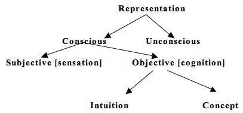
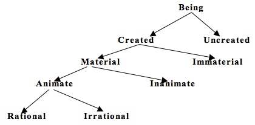

# 康德对空间和时间的观点 Kant’s Views on Space and Time (Andrew Janiak)

*首次发表于 2009 年 9 月 14 日；2022 年 4 月 1 日实质修订。*

只要随手翻阅康德《纯粹理性批判》（*Kritik der reinen Vernunft*，1781 年初版），读者便会注意到其中论空间与时间的篇幅格外显眼。学界同样视这部分讨论为康德所谓批判哲学的中枢。康德以提出艰深乃至晦涩的哲学见解闻名，因此得知学界对如何刻画与阐释其空间时间观尚无共识，读者当不意外。本词条的目标即在于：把康德的观点放回早期近代围绕空间与时间的几场核心论争的思想氛围之中。这个氛围尤以一段丰厚的世纪为背景：从牛顿《数学原理》初版（1687）到恰在百年之后刊行的《纯粹理性批判》第二版。借此，本词条要在历史与哲学两个层面求得一些清晰。理解康德观点的困难，使解释者更有理由倚重语境；我将特别着重康德对其在本领域最重要前辈莱布尼茨与牛顿的回应。全篇重心是康德的扛鼎之作《纯粹理性批判》。依照传统，也部分依照康德本人的指引，重心同样落在空间以及我们对空间的表象，涉及时间（及其表象）的平行论点则不时点出。

下文征引《纯粹理性批判》沿用通行的 A/B 版式；其余文献则据《康德全集》（标作“Ak”［科学院版］，后附卷次与页码）。莱布尼茨与克拉克的通信按作者—信件—节次标注（如 L 3:1 指莱布尼茨第三封信第一节）。除特别注明者外，译文皆出本词条作者之手。正文另守一条约定：概念用尖括号标出，例如“金”这一概念写作 &lt;gold&gt;；“gold”则用来指那个词本身。

## 1. 导论：关于空间与时间的哲学问题

解释康德关于空间与时间的观点，牵涉若干哲学问题。康德自己在 1770 年的《就职论文》里就开列了一串这样的问题；这篇文本标志他同前批判时期大体“莱布尼茨式”的旧见分手（Hatfield 2006, 72–6）[^hatfield-2006]。他如此写道：

> 空间并非客观实在之物，既非实体，亦非偶性，亦非关系；它是主观的、观念性的，依一条恒定法则源自心的本性，仿佛一张图型，用以协调一切在外被感知者。（Ak 2: 403）

短短一句，便列出了一串早期近代关于空间的重要问题。空间是“实在的”，还是某种意义上的“观念的”？它是自在的实体，是某物的属性，抑或两者都不是？它或在某种意义上取决于对象间的关系，或独立于这些关系？空间与心又有何关联？末了，这些议题彼此怎样交织？

《就职论文》那段话暗含关于空间与时间的五个不同问题。其一，是在康德眼中的 17 世纪独断形而上学框架内考察空间与时间的本体论。按此框架，空间与时间若要存在、若要刻画物理世界，便须被认作自成一类的实体，或认作某实体的属性。两个选项都不很诱人。空间与时间看上去有别于实体：它们因果上惰怠、因果上不可接近（其方面或属性不会因与别的实体互动而改变），而且不可感知。它们又常被视为无限，于是有思想家怀疑它们当不成实体，因为人们常把上帝设想为唯一的无限实体（笛卡尔把空间说成“无定的”，或许正由于此）。可是把空间与时间当作某实体的属性同样为难：那样它们想必依赖该实体而存在。若说它们依赖某个偶然实体，似乎就得承认空间与时间可能不存在、可能消失，端看那偶然实体的际遇。人们也许会改说空间与时间依赖那唯一的必然实体，但这显然又牵出一堆新问题。把空间与时间当作上帝的属性，可能等于把上帝视为在时空之中，而按许多 17 世纪思想家的看法，这是 **禁忌**（Janiak 2008, chapter five）[^janiak-2008]。

第二个论题，是把空间与时间的本体论从实体—属性的形而上学框架中抽出、单独考察，例如考察它们同物理对象的关系。自牛顿在《数学原理》诸定义之后那篇附注（Scholium，1687 年初版）中的讨论以来，近代关于空间本体论的争论便围绕两种总纲性构想展开。其一是绝对主义（如今或称“实体论”，此标签本身却带来一些问题），主张空间与时间独立于一切可能对象及对象关系而存在，或主张时空点存在。其二是关系主义，主张空间与时间的存在有赖于可能对象及其关系，或主张时空点并不存在（DiSalle 2006; Messina 2018）[^disalle-2006][^messina-2018]。

先放下本体论，另有一个不同（至少可能不同）的议题：我们对空间与时间的表象源自何处？这第三个议题来自早期近代的一种感受——我们关于空间与时间的观念或表象，必定在某重要意义上不同于我们关于寻常物理对象的观念或表象。多数人相信空间与时间因果上惰怠，因而不可感知；那么我们究竟凭什么表象空间与时间？几乎无人愿意否认：我们确实有表象，不止表象空间中的对象与时间中的对象，也表象空间与时间本身。于是这里确有一个谜。

第四个论题紧跟第三个：我们关于空间与时间的观念或表象，其内容为何？在康德看来，表象的内容可以指示它可能的来源；反过来，表象的来源也可以成为线索，帮助我们推测其内容。就空间而论，或许有理由认为，我们表象的内容必定以某种方式映照出我们从欧几里得几何学所知的关于空间的一切。

第五个、也许是最后一个论题，同第三、第四个紧密相关，并且确实把前四个论题串在一起：空间与时间同人心之间，究竟是什么关系？这个问题显然亟待澄清。它可能指什么，其中一部分可以用上面第三、第四问来界定：倘若我们把心想作以某种方式表象空间与时间，那么这或许就是我们对心与时空本身之关系的一种理解。不过在康德著作的脉络里，表面上看还另有议题潜伏：空间与时间是否在某种意义上赖心而存在？我们空间时间表象的来源——或其内容——也许暗示了某种依赖（也可能两者合起来暗示）。康德似乎还认为，承认空间与时间依赖心的观点，或许有助于化解上述本体论难题。

上述五个关于空间与时间的哲学议题，个个都关系到理解康德。下文将会看到，解释康德的难处有一部分源于这样一个事实：他显然透过第一《批判》的视角，把早期近代空间时间论争的方方面面都作了转化（Allison 2004, 120–1）[^allison-2004]。在第一个议题的脉络中，说空间与时间是“实在的”，也许意为它们是自成一类的实体而非单纯属性；而在绝对主义—关系主义之争的脉络中，空间与时间若“实在”，便独立于一切对象与关系而存在。但康德使用“实在的”与“观念的”二词，所表达的却是空间时间同心的关系，撇开了关于对象与关系的看法。本词条即通过区分这些不同考量来澄清问题。

## 2. 《批判》中康德观点的背景

### 2.1 莱布尼茨与牛顿

莱布尼茨派与牛顿派关于空间时间地位的论争，无疑是康德一生观点的基本背景之一。牛顿最初的构想是针对笛卡尔《哲学原理》（1644）而发，到了 18 世纪之交，牛顿一系已同莱布尼茨及欧陆的追随者陷入长期论战。其中既有微积分发明权的著名优先权之争，也有莱布尼茨对牛顿《数学原理》（1687；1713 年第二版）中空间、时间与运动观的根本批评。莱布尼茨在与萨缪尔·克拉克的通信里提出这些批评，克拉克则为牛顿辩护。康德在《批判》中屡屡提及这场论战（如 A23/B37、A39/B56、A46/B64）。粗略说来，牛顿一派主张，把空间、时间与运动当作“绝对的”——或至少从绝对的观点来看——至关重要。这即是说，空间与时间独立于物质及物体间的关系而存在。牛顿（1999, 408）写道：“绝对空间，就其自身本性而言，不关涉任何外在之物，永远保持齐一且不动。”可见绝对空间、或从绝对观点看空间，自有其本性，且不待他物即具齐一与不动之性。既然按此构想，空间不依任何关系即有其本性与属性，牛顿便常被解读为宣称空间是一个存在者、甚或实体。令不少哲学家不快的是，牛顿在《数学原理》正文中避用这些范畴；不过在一份著名的未刊手稿里，他否认应把空间视为实体或偶性（Newton 2014, 35—36）[^newton-2014]。其后莱布尼茨在致克拉克的通信（1715—1716）中指出，牛顿的构想与充足理由律相冲突：空间若独立于一切物质及物质关系而存在，上帝便没有理由把物质创造在某一处而非别处；一旦离开物质，所有位置都无从区分（见 L 5: 3—4）。莱布尼茨部分正是为解决这个充足理由律的难题，才主张空间不过是诸物体间关系的秩序。照他的看法，空间依赖对象及其关系，难题随之化解：空间不独立于物质而存在，上帝也就不曾面临把物体“置于”空间何处的抉择。创造一堆物质，本身就是创造空间。

不少解释者以为，在《纯粹理性批判》中、尤其在第一部分“先验感性论”里，康德是要用先验观念论来应对莱布尼茨式“关系主义”与牛顿式“绝对主义”的空间构想。[^note-1] 查尔斯·帕森斯说，“今日所谓绝对主义与关系主义两种空间时间构想之争，以牛顿和莱布尼茨为典范代表”，正是“［康德］全部思考”关于空间时间的“背景”（Parsons 1992, 67; 参 Torretti 1999, 105）[^parsons-1992]。康德在《先验感性论》开篇处，借莱布尼茨派与牛顿派构想空间失当的失败来界定自己的立场：

> 然则空间与时间为何物？它们是现实的存在者［wirkliche Wesen］吗？它们仅是事物的规定，抑或也是事物的关系——不过仍是即便事物未被直观也归其所有的那种关系？又或者，它们只属于直观的形式，因而属于我们心的主观构造；没有这一构造，这些谓词便无从归属任何事物？（A23/B37–38）

“空间与时间是现实存在者”一说，意在代表牛顿的立场；而“它们只是事物的规定或关系”一说，代表莱布尼茨（但参 Hatfield 2006, 77–8）[^hatfield-2006]。在《先验感性论》后文中，他称牛顿派为自然的“数学研究者”，以为空间与时间自足地“持存”；称莱布尼茨派为“自然的形而上学家”，以为空间与时间“内寓”于对象及其关系（见 A39–40/B56–57）。

康德显然影射了这一理论背景，然而值得留意：他在《感性论》中所持的那类主张——空间与时间为先验观念的、只是直观的“形式”、依赖“心的主观构造”等等——并不显然与莱布尼茨—牛顿之争接得上线。于是要问康德究竟怎样使用这一背景。其一，他如何理解莱布尼茨式与牛顿式的空间时间构想？他是否只把它们视为关于空间与对象及关系之地位（我称之为“地位”）的看法，抑或以为它们还包含、甚至蕴含关于其他议题的看法，比如我们空间时间表象的品格？其二，康德是否认为自己必须拆掉这两套先前景象之一或全部，才能支撑“空间与时间是先验观念的”这一结论？其三，康德把莱布尼茨式与牛顿式构想 **一概** 斥为“先验实在论”的类型，这是否能说明他所谓先验观念论的意思？其四，康德这样刻画前人的观点，底气是否充足？这些问题将引导下文的讨论。

康德如此看重莱布尼茨派与牛顿派之争，颇费解，因为他在《批判》的语境中明明对运动问题兴致索然。牛顿之所以要区分“绝对的”（或“数学的”）与“相对的”（或“通俗的”）空间构想，首要理由之一，是想为真实运动与单纯相对运动之别奠定基础。牛顿说明物体的真实运动（而非仅仅“表观的”运动），不像笛卡尔《原理》那样凭物体同其他物体关系的变化，而是凭其绝对位置的改变（Janiak 2008, chapter five）[^janiak-2008]。可见绝对空间或数学空间这一观念本身，已足以表达真实运动为何。查明物体的真实运动而非仅表观运动，进而确定造成这些真实运动的力，正是牛顿《数学原理》的主要目标之一。

康德对《数学原理》附注中的这些细节一清二楚，却在《先验感性论》中明言要把物体运动的问题括起来。理由是他把 &lt;motion&gt; 当作经验概念，而《感性论》意在阐明纯粹 **先天** 的空间构想（见 A 41/B 58；又见 MFNS, 4: 482）。物理运动另由康德在《自然科学的形而上学基础》中处理：他认为，只要确定太阳系的质心系，就能判别真实运动与相对运动（4: 482, 487, 555–6, 559–63），由此不必设定牛顿的数学（绝对）空间。

可是撇开物理运动问题又如何？换一个抽象得多的语境来谈运动——比如说，一个 **数学点** 穿越空间的运动——能否纳入《感性论》？康德的回答是：仍属经验之事，因为运动概念本身即经验概念，故仍应留给《自然科学的形而上学基础》。该书正是从撇开质量等物理问题的运动谈起，再逐步添入更多物理（或经验）要素。

康德在《先验演绎》§26 一则著名脚注中论及“主体的运动”这一要念。这种运动是否已隐含地在《感性论》语境中得到讨论？康德认为“主体的运动”（例如画圆之际的运动）并非经验的，但它确实需要——且显然例示了——由意识统一性所加于直观杂多的那种统一。无论此说何解，按康德自己的看法，它都无法在《感性论》中处理：后一文本抽掉了知性的一切贡献，从而也抽掉了对知性统一性所加杂多统一性的任何考量。（这似与康德 §26 的论点密切相关：唯有从先验分析论的视角出发，方能区分他所谓作为 **直观形式** 的空间与作为 **形式直观** 的空间。）故在康德看来，批判哲学虽考察种种运动——描述空间时所谓主体的运动、数学点穿越空间的运动、物体穿越空间的运动——却没有一种能在《感性论》的语境中登场（见 Pollok 2006）。

看来康德对绝对主义—关系主义之争的兴趣，并不出于他要谈论 **运动**（无论取何义）。那么下文的目标之一，便是指明康德在《感性论》里为何仍围着莱布尼茨与牛顿（及各自追随者）的观点打转。这番兴趣或许来自他对所谓“形而上学家”（莱布尼茨派）与所谓“数学家”（牛顿派）观点的普遍关切。无论前批判期还是批判期，康德都热衷于种种调和尝试：试图把莱布尼茨式形而上学的某些方面同牛顿式自然观接榫（Friedman 1992, 1–52）[^friedman-1992]。不过关于康德何以聚焦绝对主义—关系主义之争，还有可说之处（尤其是 Messina 2018）[^messina-2018]，留待下文。

### 2.2 康德对表象的理解

在第一《批判》一处著名段落里，康德对表象这一观念作了有帮助的讨论（A320/B376–77）：

图 1

图 1

康德视直观为有意识的客观表象，与感觉严格有别——感觉在康德看来并不是关于对象、属性、事件等等的表象，而只是主体的一种状态。感觉不表象任何有别于感知主体的东西（其中或许包括主体身体的状态）；直观却是客观表象。[^note-2] 晚近研究颇重视这一区分的分量（Allais 2015, 145–47, 154, 159–60）[^allais-2015]。

感觉与直观之别，是康德空间时间总体构想的基石。理由不止一端，尤其要避免以为康德主张我们对空间有感觉；我们有的是对空间的直观（见 Carson 1997）[^carson-1997]。这一区分侧面甚多，基本意思如下。感觉是主观的，意即它不表象对象，只是主体的变状。感到一阵痒，就是感觉的好例子。痒当然可能由某物引起（比如烤饼时落到鼻子上的面粉），但它并不表象面粉，也不表象任何在我之外的东西；痒就是我所感到的而已。若我们只有感觉，便不会有关于自身之外事物的表象，纵然那些事物引起了或促成了我们的感觉。感觉或可帮我们避痛——感到火的热便往后跳。但若无直观，我们便无空间意识，也就是没有对周围空间中之物的觉察。要表象自身之外的事物，就须有直观；康德把它看作单一的、直接的客观表象（感觉则如前所述，只是主观的）。直观何以是单一而直接的客观表象？这一复合观念首先意味着，直观表象殊相，即相对于我和其他事物占据某种空间位置的东西。我觉出痒，那是感觉；我看见面前柜上碗旁那堆面粉，那是直观，即对空间中一物的表象，该物相对于我、相对于他物皆有位置。但直观虽能表象柜上碗旁的面粉，却不能把它表象 **为** 面粉。那要概念才办得到。[^note-3]

概念与直观的区分同样是康德思想的基础，这一点尽人皆知。直观是单一的、直接的表象，概念则是一般的、中介的表象（Engstrom 2006）[^engstrom-2006]。两者都表象属性、对象或事态，只是方式不同。可惜学界对怎样理解这一想法尚无定论。[^note-4]粗略说来，直观表象某个*X*——*X*可以是对象、属性，甚至是事件——方式如同人们在知觉中表象*X*。于是它把*X*表象为，比方说，**在那里**。[^note-5]反之，概念是把*X*放进一个或多个类里来表象*X*——*X*照样可以是属性、对象或事件。设想我要表象此刻坐在其前的书桌。以直观表象书桌，就是把它表象为我手指所向的那一个、表象为 **在那里**。这当然并不说出它是书桌、是我的书桌、是一件家具、是木头的，等等；但它确实挑出了一个殊相，一个相对于我和别的东西（如地上地毯）有空间位置的某物。它之 **直接**，至少在于不动用任何别的表象。以概念表象书桌，则是把它表象为 **书桌**、为 **家具**、为 **木制之物**，等等。在康德看来，这至少在如下意义上 **间接**：概念 &lt;desk&gt; 通过别的概念（如 &lt;furniture&gt;）来表象对象。[^note-6] 还要记住：以直观表象书桌——把它表象为占着某处空间却尚未 **作为** 书桌的东西——我是在 **知觉** 书桌，而不是在 **判断** 它是书桌（或任何别的什么）。要 **判断** 我面前有一张书桌，甚或只判断我面前有某物，就需要概念，以及那套著名《先验演绎》里讨论的复杂机制；该节是《批判》的关键部分，置于《先验感性论》的论证之后。单凭直观类似知觉——它在判断里出力，其自身却并不类似判断。[^note-7]

康德有个出人意料的想法：直观与概念这两类客观表象，都可以是经验的，也可以是 **先天的**。说有些概念非经验，或许并不骇人，因为早期近代本有天赋观念的著名传统。康德关于此类概念 **来源** 的构想——即他所谓“形而上学演绎”（B159, B377）所述——仍然出人意表，只因他不取天赋观念（Longuenesse 1998）[^longuenesse-1998]。但即便搁下这层纠葛，听说直观——它在某些方面近于知觉（Parsons 1992, 65–66; Allais 2015, 147*ff*）[^allais-2015][^parsons-1992]——也可以是经验的或 **先天的**，仍足够惊人。此处须回想：康德把感觉与直观分开。问题仍在：我们究竟怎样理解“能有纯粹直观、即 **先天**（非经验）直观”这一想法本身？这一想法是康德空间时间观的枢纽，因为他有句名言：空间与时间不过是直观的形式；此说与《先验感性论》中“我们对空间与时间有纯粹直观”的主张相连。如前所见，这意味着我们对空间与时间拥有非经验的、单一的、直接的表象。本词条的目标之一，正是澄清这一想法。说它是康德对近代哲学最具特色的贡献之一，并不为过。而按他一贯作风，它极难把握。

## 3. “形而上学阐明”

### 3.1 何谓形而上学阐明？

康德所谓空间概念的“形而上学阐明”，构成《先验感性论》的头一批论证。康德如此界定概念的“阐明”：“我把阐明（*expositio*）理解为把属于一个概念的东西清晰地表象出来（即便不是明证的）；若阐明所含为概念 **先天** 所予者，则为形而上学的”（A23/B38）。在此语境中，我理解康德所谓概念（*Begriff*）无非就是表象。[^note-8] 他要做的，是刻画空间表象的内容。对康德而言，“阐明”不同于定义：他并非要为空间、“空间”一词或概念 &lt;space&gt; 下定义（可参 Dunlop 2012 的有益讨论）[^dunlop-2012]。这一步他沿袭了源自牛顿《数学原理》定义附注的悠久传统：牛顿在那里说明，空间、时间与运动人尽皆知，故不在书中定义；质量、冲力之类生僻的专门概念才有定义（Newton 1999, 408）[^newton-1999]。但与牛顿不同，康德把焦点放在我们对空间的表象、而非空间本身上。他的“阐明”观念似乎正表达了这一点。

### 3.2 我们空间表象的来源

形而上学阐明的第一个论证提示：空间表象不可能是经验的。

> 1. 空间不是从外部经验引出的经验概念。因为，要把某些感觉指涉到我之外的某物（即指涉到另一个不同于我所在位置的空间区域中的某物），同样，要我能把这些感觉表象为在我之外、彼此并列，从而不仅互不相同、且各居一处，就必须已有空间表象作它们的基础［dazu muß die Vorstellung des Raumes schon zum Grunde liegen］。所以空间表象不可能从经验、从外部显象的关系中得来；毋宁说，这种外部经验本身唯有通过那个表象方才可能。（A23/B38）

此处究竟针对什么观点？一个潜在的目标，是我们空间观念的经典经验主义说明，比如洛克那一套。洛克在《人类理解论》中承认，空间的观念看似“疏远”于我们对对象的知觉，却仍主张它源自经验（《人类理解论》，2.13.2–4）。他的设想是：感知者观察彼此相近的对象，留意对象间的距离，再把这些距离的观念反复相加，从而得到一个随意多大的单一空间的观念。按洛克的看法（休谟辩护过一个版本，《人性论》，1.2.3），我们从对空间关系的知觉得到空间的表象——不是关于各个位置的表象，而是关于那个囊括一切的空间的表象；后者 **或许** 与几何空间相仿。

康德或许盯住了洛克观点的起点。按洛克，我们似乎从两个物体之间的距离观念起步；这想必已涉及“这两个物体在不同位置”的观念。康德也许要说：要把对象表象为彼此处在不同位置，我就必须把它们表象为在空间中。可若果真如此，我便已然拥有空间的表象，因而不可能再循洛克勾勒的路径得到它。

丹尼尔·沃伦把这个论证澄清得尤其透彻（Warren 1998；参 Allison 2004, 100–104）[^allison-2004][^warren-1998]。当然，一般而论并不成立：要把任何两个实体 A 和 B 表象为以某种方式相关，就必须把它们表象为落进某个相关的更大“空间”。沃伦举过一个有用的例子：把 A 表象为“亮于” B，无须把 A 与 B 表象为一个更大“亮度”空间的组成部分。我 **可以** 这样做——把 A 表象在亮度谱的一端、把 B 表象在另一端附近，以此借“亮度”关系表象它们；但我并非必须如此：我可以径直表象 A 与 B，并表象 A 亮于 B，就像面对两盏灯那样（Warren 1998, 200*ff*）[^warren-1998]。其暗示是：要把 A 与 B 表象为彼此有 **空间** 关系——例如表象它们相隔一段距离——就必须把 A 与 B 表象为 **在空间之中**。就这一意义而言，把对象表象为空间相关者，或许已预设了空间表象。洛克的麻烦在于：他从我对两个对象之间距离的知觉或观念出发，再由此构造空间观念。可我对任何两对象间距离关系的表象，若已预设了把它们表象为在空间中，那前者就不可能充当产生后者的过程的起点。

有些注释者指出，康德第一个论证的靶子未必只有洛克——或其他古典经验主义者。莱布尼茨在某些场合似乎同样主张：空间表象是从对距离关系（及类似关系）的个别知觉构造而成的。例如在致克拉克最后一封信的著名段落里，莱布尼茨说，要得到空间表象，可以考察一个由对象组成的系统（其中一些对象在运动），再从该系统抽象出 **同一位置** 的概念。[^note-9] A 与 B 同占一位，就是二者在不同时刻对空间中相同诸物体具有相同关系。空间即涵盖这一切位置者。[^note-10] 康德的第一个论证对这一段落中的立场或许同样有效。至于该论证是否也击中莱布尼茨的空间关系主义，那是另一回事，且有争议。[^note-11]

一些注释者以为，康德形而上学阐明的第二个论证，专意于击溃莱布尼茨的关系主义（参 Parsons 1992, 68–9）[^parsons-1992]：

> 2. 空间是必要的 **先天** 表象，为一切外部直观奠基。谁也不能表象出空间之不在，虽能很好地设想其中没有任何事物。因此它须被视为显象之可能性的条件，而非依附于显象的规定；它是必然作外部显象之基础的 **先天** 表象。（A24/B38–39）

康德的断言是：我们虽能把空间表象为空，却无法表象空间本身之缺席。倘若关系主义“空间不独立于对象”的主张，至少部分奠基于“空间独立于对象而存在这个观念本身不融贯”，那么这一点就能挫伤莱布尼茨式关系主义。持有那种观点的人，可以像康德那样驳难关系主义：我们确实能够设想无对象的空间。

“空间在任何时刻都不能独立于对象存在”这一主张，确实蕴含空间不可能完全没有对象。莱布尼茨把空间视为对象间现实关系与 **可能** 关系的秩序，因此他有资源说空间可以容纳空段——见《人类理智新论》，127，及 L 5: 43——但看来他不能断言空间 **全然** 空无，否则对象关系就缺席了。然而这与“我们能 **设想** 空的空间”的想法毫不相妨。莱布尼茨自己在攻讦牛顿的空间绝对论时，就一再明确使用这种情形的设想。他并不主张“空间可独立于对象”这一观念不融贯，而是说它违反充足理由律（见 L3: 5；L 5: 53）——克拉克本人也以一种别样的版本为该原则辩护。这则“虚构”（L5: 29；参 L5: 55）之所以触犯该原则，是因为空间的齐一与均匀使上帝没有任何理由以某一朝向、而非其他可能的朝向，把宇宙诸对象安放到绝对空间中。上帝可以把对象放进一个先在的绝对空间，用这种朝向而非那种——这观念本身并非不融贯；毋宁说，上帝缺少这样做的 **理由**。同样，莱布尼茨还主张绝对论违反不可分辨者的同一性原则（L4: 16），并带有神学上的难处（L4: 10）。

这并非否认莱布尼茨的关系主义与其空间表象观相互纠缠。在他看来，我们不可因能设想无对象的空间，就上当而断定空间本身是某种独立于对象及其关系的东西。同一切单纯抽象一样，空间不可被物化。[^note-12]

也可以换个读法：康德的第二个论证直指“空间表象是经验的”这一观点。康德说我们无法表象空间之不在，却能把空间表象为没有对象。他的用意或许是：主张空间表象取自对象知觉的经验论者，必须负起解释责任，说明我们何以可能设想无对象的空间。这一考量看似单薄。但那更深一层的主张——不能表象空间之不在——经验论者恐怕更难接受。粗看之下难以理解：若我们的空间表象果真源自经验，我们为何竟缺少设想空间 **缺席** 的能力？这或可读作康德就空间表象问题对经验主义的表面驳难。

头两个论证里，康德（或许连同别的）考察了我们空间表象的来源，结论是它并非经验。但这两个论证在两个重要方面仍未回答空间表象的 **内容** 是什么。其一，康德前两个论证并未说明我们把空间表象成具有哪些属性。我们把空间表象为有限还是无限、齐一与否？等等。其二，《先验感性论》的前两个论证显然留有余地：我们的空间表象内容可以是概念性的——我们的空间表象可以是一个概念而非一个直观；它既可是一般的、间接的表象，也可以是单一的、直接的表象。我们只知道——若康德论证成立——这表象不是经验的。康德当然认为非经验表象可概念可直观：他主张我们既有 **先天** 概念，也有纯粹直观。纯粹直观这一观念，以某种 **先天** 概念未必有的方式令人困惑；解释的目的之一，就是在解读形而上学阐明的后两个论证时澄清它。

### 3.3 我们空间表象的内容

第三个与第四个论证里，康德主张空间表象具有一种可指明的内容，而这内容同“它是概念性表象”不相容。换言之，他论证我们对空间的表象不是概念，而是一个直观——单一的、直接的表象。如前所示，感觉与直观之别表明，这一主张并不等于说我们对空间有感觉（理由已如上）。它要说的是：我们对空间有一个客观表象，只不过这个表象是单一的、直接的。

要理解那两个旨在确立“我们有单一、直接的空间表象”这一结论的论证，最好先回想康德对概念的态度。在他看来，“下”一个概念（fall “under”），即属于该概念的外延；“内”于一个概念，即属于其内涵。同样重要的是：按康德的思路，概念的外延并非例示该概念的那些事物，也不是它“适用”于的对象集合，而是一类作为子分组归在更一般标题之下的概念。这一想法还须澄清。

试看 &lt;being&gt;（存在）的外延：[^note-13]

图 2

图 2

&lt;being&gt; 的外延，就是概念树上“下”于 &lt;being&gt; 的那些概念——它们是属 &lt;being&gt; 之下的诸种。康德所谈的，是充当某一概念外延的那类概念的诸成员之间寓有的属—种关系序列；一个概念是属还是种，视相对关系而定。概念 &lt;created&gt; 相对于它的种 &lt;material&gt;、&lt;immaterial&gt; 是属，相对于属 &lt;being&gt; 则是种。一个概念的 **内涵** 由共同构成它的那些概念组成。例如概念 &lt;human&gt; 的内涵是：“理性的、有生命的、物质的、被造的存在者。”共同构成某一概念的那些概念，常称“Merkmale”或“Teilbegriffe”，亦可谓之概念部分（“维也纳逻辑学讲义”，Ak 24: 913）。要构造概念 &lt;human&gt;，只须把 &lt;rational&gt;、&lt;animate&gt;、&lt;*material&gt;、&lt;created&gt;、&lt;being&gt; 拼在一起。构造或把握概念 &lt;human&gt;，无非就是把握这些成分。

带着这些区分，我们可以考察康德形而上学阐明的第三个论证。此论证聚焦于概念（康德意义上的）内涵。

> 3. 空间不是关于一般事物关系的推论性概念、即所谓一般概念，而是一个纯粹直观。因为，第一，人们只能表象唯一一个空间；若谈到“许多空间”，人们由此意会的只是同一个唯一空间的诸部分。这些部分不能先行于那个统摄一切的空间而存在，仿佛是构成它的诸成分；它们只能被设想为 **在其中**。空间本质上是单一的；它之中的杂多，从而诸空间的一般概念，全然取决于限制。由此可见：一个 **先天** 直观（非经验的）奠定一切空间概念的基础。同样，几何命题——例如三角形中两边之和大于第三边——决不能从线与三角形的一般概念推出，而只能从直观推出，而且 **先天** 地、以确然的确定性推出。（A24–25/B39–40；参“知觉的预测” A169–170/B211）

这里的意思大致如下：空间表象若是概念而非直观，我们就应当能够把它的各部分拼合起来构造它。这好像要求：无须表象那个待构造的概念，就能表象它的部分。对其他概念而言确实如此：可以表象 &lt;human&gt; 内涵的任一部分（比如 &lt;material being&gt;），而不必顺带表象整个概念 &lt;human&gt;。康德主张，空间表象的情形行不通，因为位置表象的获得，只有通过对那个统摄一切的空间之表象划出某个子区。借用一个与形而上学阐明第一论证相平行的说法：任何位置的表象都以空间表象为前提。所以我们不可能表象空间的任何“部分”——任何位置——而不顺带表象空间本身。可见，空间表象的部分—整体关系，不同于概念所适用的部分—整体关系。

这个论证是否成立，并不清楚。例如，它似乎把以下两者混为一谈：（1）空间与其部分的关系；（2）空间表象与其构成成分的关系。若去掉这层混淆，就不明白我们凭什么要期待从位置概念构造出空间概念。从别的概念——如无限性、量值等概念——构造空间概念，似乎比从位置概念出发更为合理。混淆之说成立的前提，是把康德的第三论证读作关涉空间表象而非空间本身。这一读法又可能与第三论证首句的字面相抵触（尽管未必抵触其精神）：那句明说“Der Raum”，即空间，不是概念，而是直观。若按字面读，这层显见的混淆即可避免。但代价不小：问空间本身是不是概念，究竟何意？谁持过类似的看法？乍看之下，这种观点在当代读者眼里相当古怪。[^note-14] 增进理解的一个办法是重读莱布尼茨。可以把莱布尼茨读作主张空间本身是一种抽象，而非实在的存在者或实体；甚至可以不夸张地说，空间必是一种概念抽象，类似于莱布尼茨可能称为纯粹数学的那些对象。也就是说，在此观点下，空间本身是概念抽象，正如等腰三角形是抽象、线是抽象那样，并非实在的存在者或实体。当然，这要求透过康德的透镜去读莱布尼茨。即便如此，若所论观点是“空间本身是一种概念”，仍不明白人们为何不说：这个概念依赖别的构成性概念——如无限性概念、齐一性概念，而康德自己在下一个编号论证里就处理了它们。也许最好的解读是：康德专意应战莱布尼茨在与克拉克最后一轮（第五次）通信中的论证，即前文所引。其设想是：莱布尼茨的论证或可理解为含有两重主张——位置概念构成空间概念；空间本身不过是一种概念，这便授权了他对空间概念的独占关注。于是康德的断言便是：莱布尼茨式的观点——空间本身是通过知觉对象占据诸位置的过程而获得的概念抽象——两头都站不住。

康德的第二个论证旨在加固第一论证所提的主张（空间表象是 **先天的**）；他的第四个、也是最后一个论证，则试图加固第三论证所提的主张：空间表象不具概念品格。此处概念的外延与内涵似乎都牵涉其中：

> 4. 空间被表象为一个无限的 **被给予的** 量。须知每个概念都必须被设想为一种表象：它包含在无限多不同的可能表象之中（作为其共同标记），从而把这些表象 **含于其下**；但就其自身而言，没有任何概念能被设想为把无限多表象 **含于其内**。然而空间恰是以后一种方式被思考的（因为空间的一切部分无限地同时存在［denn alle Teile des Raumes ins Unendliche sind zugleich］）。所以空间的源始表象是一个 **先天直观**，而非一个 **概念**。（B40）

康德的断言是：既然我们把空间表象为含无限多位置，空间表象便不可能是概念性的。何以如此？想法是：概念虽可有无限外延（其 **下** 可有潜在无限多个从属概念），却不能有无限内涵，即其 **内** 不能装无限多个表象。后一意义上的无限概念，有限心灵无从把握。[^note-15] 概念有无限外延，是说它有无限多个种，即在概念树上“下”于它之处可分出无限多个子型。这不碍我们把握树上的任何概念：要把握树上任选的一个概念，只须把握它的成分（那些“内”于它的概念），而它们在树上位于其“上”。但若概念能把无限多成分装 **在自身之内**，把握能力就成问题了：倘若 &lt;fish&gt; 含无限多成分——倘若概念树上“上”于 &lt;fish&gt; 之处有无限多更高阶的分类单元——它便无从把握，甚至可能没有确定的内容。至少，指明其内容得花无限多步。

可在康德看来，我们把空间表象为有无限多个构成成分——位置。[^note-16] 空间表象若是概念性的，我们便须表象每一个这样的成分 **以便表象空间本身**，正如表象金子必须表象金属（因为 &lt;gold&gt; 把金范畴化为金属）。但我们不可能为表象空间本身而表象空间内的每一个位置。倘若我们认定自己确实表象空间、且把它表象为内含无限多位置，那么空间表象想必不是康德意义上的概念。如前所见，形而上学阐明的第三个论证似乎已蕴含：任何位置的表象都预设空间本身的表象。第四个论证则另出一论：若空间本身的表象要求把空间被表象为具有的每个部分都表象出来，我们就根本不能表象空间。既然我们确实表象空间、且把它表象为内含无限多位置，空间表象就不是康德意义上的概念。当然，康德的读者可以否认他的一个显见前提——我们把空间表象为无限的；具有宽泛经验论倾向的读者尤其可能怀疑它。

康德主张我们对空间有的是直观而非概念，这看来引出一个难题：空间不是对象，直观却似乎给我们某种类似知觉的东西。露西·阿莱说，直观包含“对象向意识的在场”（Allais 2015, 197*ff*）[^allais-2015]；可空间不是对象。我们凭什么把自己看作在知觉空间？这一点很难说清。理解某件寻常之物——比如一只西红柿——是我意识面前的对象，并不难：我瞧着农摊上的西红柿时就是如此。知觉的哲学理论自然很多，即便对这么简单的知觉案例，各家讨论也不一致。但假定西红柿至少在这个意义上作为对象临于我的意识——它是我在看的东西之一——似无争议。同样无争议的是，除西红柿之外还有许多东西能以类似方式临于我的意识：云、雾、彩虹，尽管它们不是西红柿那种简单意义上的“对象”。然而，说空间本身也在这些东西之列，实在勉强。这不只因为空间在任何清楚的意义上都不是对象，也因为在这样的历史与哲学语境里，空间本身对我没有因果作用。于是，我如何能在康德那里认定自己有类似空间知觉的东西，困难倍增。康德当然向我们保证：我们拥有空间的先天直观。所以，虽然他在一种意义上谈的是类似知觉的东西，在另一种意义上他所谈的被认为与普通知觉全然不同。这一保证能否帮读者澄清问题，尚有争论。但清楚的是：康德空间构想的这一面，始终是其理论哲学中最有争议、最艰难的部分之一。

康德认定空间表象不是概念，也许还有别的理由。若回想他的主张——概念是一般的、中介的表象——连同他关于这套事实如何在上述概念树上体现的看法，那么至少表面上看，确有一个谜：我们怎么可能拥有康德意义上的空间概念？看一个对照类。就算 &lt;God&gt; 只表象单个实体，也不妨碍康德认定这个概念是一般的、中介的表象（参 Thompson 1972, 318–19, 328–29）[^thompson-1972]。因为按康德，我们经由其他概念表象上帝：例如上帝是必然实体（A678/B706），故 &lt;God&gt; 是中介表象。这与直观表象事物的方式判然有别。概念 &lt;substance&gt;（范畴之一，A80/B106）则可独立于 &lt;God&gt; 而被把握。所以 &lt;substance&gt; 是 &lt;God&gt; 的成分，反之则不然。况且 &lt;God&gt; 是 **一般的** 表象，因为它把上帝放进另一个类——实体类。普遍性标准与中介性标准是否为一回事，仍可争论（参 Parsons 1992, 63–6）[^parsons-1992]。但关键在此：&lt;God&gt; 挑出单个个体——甚至也许 **只能挑出单个个体**——并不蕴含这个概念非一般或非中介。这反过来提示：康德在形而上学阐明中的要点，不可能是说我们的空间表象挑出单个个体，所以不可能是概念。毋宁说，他大概认为我们对空间既不：（1）借表象其构成成分（位置）来表象；也不（2）**经由** 其他概念来表象。（1）上文已谈；（2）呢？

就（2）而言，请注意：经由其他概念表象空间，可能逼人就空间本体论（按上文所列诸义之一）采取一个（通常有争议的）立场。比方说，想把 &lt;space&gt; 安进概念树的某处，就得在 &lt;substance&gt; 或 &lt;being&gt; 这类概念之下给它找到位置。可空间本体论并无公论：或视为实体（或存在者），或视为关系网络，或视为上帝的属性，等等。既然这些争议悬而未决已久，把一条有待其解决才可行的进路看作无望，似乎是合理的。康德突出的是一个公认的事实：我们把空间表象为无限的欧几里得量——这一点尽管空间本体论有争议，仍可广泛接受。

还有另一条路可澄清康德关于概念性的论证：看后两个论证里他预设的对手是谁。这些论证矛头所指恐怕不是洛克；康德心里想的多半是莱布尼茨。莱布尼茨主张，空间的观念（或表象）出自纯粹知性；这与前述洛克式看法恰成对照。他在《人类理智新论》里写道：

> 菲拉勒忒斯：那些“经由不止一种感官”知觉而来的观念，是关于空间或广延、形状、运动与静止的观念。
>
> 特奥菲勒斯：这些据说出自不止一种感官的观念——空间、形状、运动之类——其实来自共同感官，即来自心灵自身；因为它们是纯粹知性的观念，尽管关涉外部世界、且由感官使我们感知，所以仍容许定义与证明。（《人类理智新论》，128；见 Leibniz 1840, 230）[^leibniz-1840]

莱布尼茨想说的或许是：知觉给不了我们连续体的观念，而他确把空间视为连续体。比如，感官给不出无限可分之物的观念。在《人类理智新论》的别处，莱布尼茨还说了句意思相近的话：空间类似“纯粹数学”中的那些对象。

此处的问题是：莱布尼茨与康德对概念的看法是否足够接近，以至康德的论证能咬住《人类理智新论》里那种观点——康德在该书 1765 年问世后某个时候读过它（Vaihinger 1922, 2: 133, 414 and 428–29）[^vaihinger-1922]。莱布尼茨有一著名观念：实体的完全概念；这种概念似乎会含无限多成分——上帝正是通过把握实体的全部成分来把握其完全概念。照此说来，康德形而上学阐明第四论证所举的那些考量，多半难不住莱布尼茨：他会径直接受“空间表象同任何概念一样可以有无限多成分”（Posy 2000）[^posy-2000]。但第三个论证可能咬得更深：若康德主张任何位置的表象都预设空间本身的表象是对的，那么空间表象或许就欠缺概念通常那种部分—整体结构。莱布尼茨实际上可能接受关于概念部分—整体结构的这一一般构想。若然，第三个论证就会给他的观点添麻烦。

阐明的头两个论证，并非只是同洛克式经验观点较量的机会；第三、第四个论证也不只是冲着莱布尼茨式理性观点而来的挑战。毋宁说，“空间表象既非经验亦非概念”这一主张，对康德的先验观念论整体至关重要；同时，它对理解康德眼中体现于先验实在论、以及体现于他后来所谓“独断观念论”之中的哲学错误也很要紧——两者都遭他强烈反对。这些问题下一节讨论。

## 4. “先验阐明”与康德的“结论”

### 4.1 何谓先验阐明？

在《批判》B 版（1787）里，先验感性论的 §2（形而上学阐明）之后是 §3（先验阐明）。如前所示，形而上学阐明管的是空间表象的来源与内容；它的先验兄弟则显然要解释康德认为我们在几何学中可获得的综合先天知识（或认识）。这牵出康德数学哲学中一些极难的解释问题——这些问题由本《百科全书》的另一个词条处理（见丽莎·沙贝尔论康德数学哲学的词条）。不过康德在这一节里可能还提出一个相关论点——且看这段插在几何学讨论中的文字（参上文 2-b 节）：

> 可是，一个先行于对象本身、对象的概念又能据以 **先天** 确定的外直观，如何能安寓于心中？显然只有一种可能：它仅在主体中占有其位，作为主体因受对象触发而由此获得关于对象的 **直接表象**、即 **直观** 的形式构造，因而只是作为一般外部 **感官** 的形式。（B41）

形而上学阐明已让我们看到：我们拥有关于空间的纯粹（或 **先天**）直观，即非经验的、单一的、直接的空间表象。可是这样的表象怎么可能？若所论是 **经验的**、单一的、直接的表象，我们不难理解：在寻常知觉里，我们可以（比方说）看见面前花瓶里的一枝玫瑰。于是知觉可以含一个单一的、直接的表象——我们表象 **那里那个**，即占有一个空间位置的对象。经验情形相当明白。但“我们拥有一个非经验的、单一的、直接的表象”究竟何意？它不可能像直接看见面前的某物那样，因为康德在形而上学阐明中的要点之一（如前所见）正是：位置的表象、把对象表象为具有空间关系，已 **预设了** 空间的（非经验）表象。可若空间表象并不像直接看见面前某物，那它凭什么直接、凭什么单一？康德在上段话里的暗示似乎是：直观必须以某种方式安顿在主体之中——必须是心的一个“形式”；更精确说，是康德此处所谓“外感官”的形式。这显然已非常接近先验观念论的表述——该观点在《批判》中第一次被明确说出，就在《先验感性论》紧接的下一段。不过上面这段引文，连同康德对先验阐明之所是的讨论，暗示他在这里的部分目标是 **说明非经验的、单一的、直接的空间表象如何可能**。（这与解释几何学内综合 **先天** 知识如何可能相平行。）

同样，有注释者指出：先验阐明之后的那些“结论”（就在上引段落之后的下一段）并未另附论证，而是意在从形而上学阐明与先验阐明中的论证直接推出。也就是说，“空间表象是先天直观”这一观点，被认为足以推出康德在《先验感性论》里那几个分量不轻的关于空间的结论。其中第一个——标作“a”，后接另一个标作“b”的结论——相当惊人：

> 空间根本不表象任何物自身的属性，也不表象它们彼此的任何关系，即不表象任何系于对象自身、且即便抽掉直观的一切主观条件仍会留驻的规定。因为无论绝对规定还是相对规定，都不可能在它们所属的事物存在之前、从而 **先天地** 被直观。（A26/B42）

康德在此重新拾起《先验感性论》开篇所提的莱布尼茨派与牛顿派的空间时间之争。他似乎有意让自己的观点与两者对照：与牛顿的空间观对照——那套观点显然谈的是空间的“绝对”规定；也与莱布尼茨的空间观对照——那套观点显然谈的是空间的“相对”规定。也许康德在暗示：牛顿式与莱布尼茨式的空间时间观纵有诸般差异，却都表明（或默默假定）空间表象不能是非经验的、单一的、直接的表象。若真是这个意思，何以如此？我下一节讨论。

在《先验感性论》随后的几段里，康德得出那几个著名结论：空间只能“从人类立场”来谈（A26/B42）；空间具有“先验观念性”（A28/B44）。这是康德在《纯粹理性批判》中主要立场之一的枢纽。为澄清这些想法，我先循康德上段话的暗示——他有意让自己的立场在某些方面与莱布尼茨和牛顿相对照。这一步棋将把我们带到更深处，看清先验观念论。

### 4.2 绝对的/关系的对实在的/观念的

理解近代关于空间时间的绝对主义—关系主义之争时，种种混淆会作祟，其中一些在讨论康德时尤为流行。比如，人们有时把绝对主义当作实在论，把观念论当作关系主义。头一种混淆或出于历史原因。在克拉克与莱布尼茨那场著名通信中——它是康德《批判》空间时间思考的基本背景之一——双方常讨论这样一个命题：**空间是实在的**。按今日眼光，实在论与反实在论问的是某物是否在某种意义上依赖心。我们对桌椅、数、集合乃至万事万物都会问这个。可莱布尼茨与克拉克谈空间的“实在性”或“绝对实在性”时，通常问的是空间相对于对象的地位。两人讨论通信中的主要问题之一——双方共同接受的充足理由律是否蕴含其中一人拥有正确的空间构想（参 L3: 4 与 C 3: 4–5）——时，情形显然如此。莱布尼茨主张而克拉克否认：空间若独立于对象，上帝便缺少充足理由以某一朝向、而非别的朝向把宇宙对象放进空间。莱布尼茨据此断定空间缺乏“实在性”、或缺乏“绝对实在性”（见 L5: 29 与 L5: 36）。**依据同一套考量**，他又否认空间是“绝对的”（L3: 2–3、L3: 5、L4: 16、L4: 9–10），并主张它是“相对的”（L3: 4）。故在此语境中，说空间 **实在**，即说空间独立于对象与关系而存在。

同样，莱布尼茨断言空间是 **观念的**（L5: 33），用以回应克拉克的说法（C4: 7）：可以有“世外”空间，即超出对象宇宙边界之外的空间。此处也一样，说空间是观念的——或者说它没有实在性——就等于说它 **不能独立于对象而存在**。莱布尼茨末封信中的一段话即为明证：

> 我已证明：空间无非是从同时并存方面观察到的诸物存在之秩序。所以，所谓一个有限的物质宇宙在无限虚空中前行的虚构，断不可容许。这全不合理，也办不到。因为，姑且不说物质宇宙之外并无实在空间，这样一种动作本身便毫无目的：它徒有动作而无事可成……它不会产生任何能为任何人所观察到的变化。这些不过是观念不完整的哲学家的想象，是他们把空间造成一种绝对实在［réalité absolue］（L 5: 29）。

请注意：莱布尼茨说“物质宇宙之外的实在空间”，指的并不是 **独立于心** 的空间，而是 **独立于对象** 的空间。

这并非说通信里不谈空间相对于心的地位。莱布尼茨末封信主张：关系是“观念的”，因为它们既非实体也非偶性，故不属实在之要素（L5: 47）。他在《人类理智新论》中写道：实在中只有实体及实体的属性；关系是心“加上去的”（《人类理智新论》，2.12；又参 2.30.4、2.25.1）。空间既是对象可能关系的秩序，想必便在依赖心的意义上是观念的。但莱布尼茨此处的意思似乎是：正像人们把关系物化、以为它独立于对象而存在，人们也把空间物化、以为它同样独立于对象而存在。可见即便在谈空间的观念性时，他也要表明：要解释这种物化倾向，我们无须把关系与空间当作绝对的。

空间的观念性与实在性，在康德那里的含义不同于在莱布尼茨与克拉克那里。对康德而言，问某物是实在的还是观念的，问的是它相对于心的地位。康德对实在论与观念论最明快的讨论之一见“第四谬误推理”（A368–380）：他关心对象可能依赖心的地位，也关心我们关于对象存在的知识处于何种地位。康德显然在谈空间对象相对于心的地位，**其中部分地是借讨论空间时间与心的关系来谈**；但此处并未处理空间时间相对于对象 **本身** 的地位。

> 然而，我把一切显象的 **先验观念论** 理解为这样的学说：一切显象都只应被看作单纯表象，而非物自身；相应地，空间与时间只是我们直观的感性形式，既非自在地被给予的规定，也非作为物自身的对象之条件。与此相对的是 **先验实在论**：它把空间与时间当作自在地被给予者（独立于我们的感性）。于是先验实在论者把外部显象（只要承认其实在性）表象为物自身——这些物自身将独立于我们和我们的感性而存在，因而按纯粹知性概念也会在我们之外。（A369）

有鉴于此，且看下表：

| **实在论的关系主义** 空间是诸对象可能关系的秩序；关系不依赖心 | **观念论的关系主义** 空间是诸对象可能关系的秩序；关系依赖心 |
| --- | --- |
| **实在论的绝对主义** 空间是独立于对象的对象关系框架；空间不依赖心 | **观念论的绝对主义｛？｝** 空间是独立于对象的对象关系框架；空间依赖心 |

实在论者也可以是关系主义者：只要她认为空间是现实（或许还有可能）对象间现实关系与可能关系的秩序，而且认为这些关系 **实在**。这顺带说明，空间实在论者不必把空间当作某种 **对象**：空间完全可以既实在、又是对象间可能关系的秩序。其实康德本人在 1755 年《物理单子论》里可能就持此说：他仍接受莱布尼茨式关系主义，却拒斥莱布尼茨对关系的解释，主张关系是实在的方面。[^note-17] 同样，如今一些关系主义的辩护者似乎也认为：空间是现实与可能对象间现实关系与可能关系的秩序，而那些关系完全实在，即绝不依赖心。

绝对主义另有难处。可以设想空间是心投射到实在上的一个瞬时框架。[^note-18] 若空间是这种依赖心的框架，它照样可以被想成独立于对象。无论如何，假使绝对主义表明空间独立于一切对象与关系，而人们又认定这蕴含空间必定也独立于心，那我们大概得把这一蕴含讲清楚，因为它并不显明（Ishiguro 1972, 109）[^ishiguro-1972]。实际上，康德在 1770 年《就职论文》中可能就辩护过一种绝对主义—观念论的空间构想（Friedman 1992, 29–31）[^friedman-1992]。唯有避免把这些纷繁观点搅在一起，才能求得清晰。

康德在《批判》中始终按更习见的近代意义使用观念性与实在性，所问的是依赖心与否。他的用法把关于空间的哲学讨论从关系主义—绝对主义之争转到观念论—实在论之辨。因此在《先验感性论》里泛论牛顿式与莱布尼茨式空间时间构想时，他不去权衡绝对主义与关系主义孰优孰劣，而是揭示前人共有的错误。例如，概述完自己的构想后，康德断言：“然而，凡断言空间与时间具有绝对实在性［*absolute Realität*］者，无论视之为自存还是内寓，都必与经验的原则［*Principien*］相冲突”（A39/B56）。前一类人又称“自然的数学研究者”，显然指牛顿一派；后一类人即“自然的形而上学家”，指莱布尼茨一派（参 Shabel 2005, 31, 45–9）[^shabel-2005]。可见先验观念论是对莱布尼茨式与牛顿式空间时间构想的某种 **替代**；但之所以需要替代，并非因为二者分别是关系主义与绝对主义构想。需要替代，是因为二者同属一种单独的、总纲性的空间构想——按此构想，空间（同时间一样）具有“绝对实在性”。此处“绝对的”一词显然不可能是莱布尼茨与克拉克的意思。

由此生出一个难题。康德主张：作为一般空间构想的先验观念论，须同先验实在论相对照；而他把先验实在论同时算在牛顿与莱布尼茨头上。可从莱布尼茨的立场看，实在的要素只有实体及其属性。严格按形而上学说，关系既非实体亦非属性，故不在实在要素之列。这一点见于多处文本；例如回应其洛克式对话者时，莱布尼茨在《人类理智新论》中写道：“把我们思想的对象分为实体、样式与关系，这分法正合我意。我相信性质无非实体的变状，而知性则加上关系［l’entendement y adjoute les relations］。”他补一句：关系是“知性的作品”（《人类理智新论》，145）。莱布尼茨那里空间只是对象关系的秩序，关系又是观念的，那么空间在某种意义上也是观念的（《人类理智新论》，145；参 Cassirer 1902, 248）[^cassirer-1902]。也就是说，在某种意义上，空间性并不刻画实在（Adams 1994, 254–5）[^adams-1994]。这些观点见于致克拉克的书信与《人类理智新论》，两部文献康德都读过，他本人也明言提及其中一些。[^note-19] 把莱布尼茨读作实在论者的明显障碍，使先验观念论的解释复杂起来：康德显然认为先验观念论是莱布尼茨与牛顿那些所谓实在论观点的替代品。下一节处理这个问题。

## 5. 何谓先验实在论？

### 5.1 康德对莱布尼茨的批评

康德凭什么把莱布尼茨刻画成某种“先验实在论者”——也就是他同样归给牛顿的那一类？如前所示，这个刻画令人困惑。回到上面的概念矩阵：莱布尼茨不只认为空间是对象间可能关系的秩序、因而依赖对象及其关系；他还明确采纳早期近代的通行观点——关系是 **观念的**，意即它们以某种方式依赖心。[^note-20] 于是表面上看：空间若是关系的秩序、或依赖关系，而关系又依赖心，那么空间本身似乎也依赖心。可见莱布尼茨似乎否认空间在 **康德** 意义上 **实在**。否认空间实在，可以等值于否认空间绝对；可莱布尼茨的关系主义 **加上** 他熟知的早期近代关系观（一项独立的形而上学论题），似乎蕴含空间 **同样** 不实在——它不独立于心。那么凭什么称莱布尼茨为先验实在论者？乍看之下，这样解释他有失公道。

可以回到《批判》里对莱布尼茨式空间时间立场的首次描述——就在康德着手空间形而上学阐明之前。他问空间与时间：“它们只是事物的规定，抑或也是事物的关系，却仍是即便事物未被直观也归其所属的？”（A23/B38）[^note-21] 这或许透露：康德说莱布尼茨派把空间时间视为具有“绝对实在性”时，心里想的是什么。也许他的意思是：对莱布尼茨而言，空间的实在性 **独立于直观**，或空间就其自身而言独立于直观而存在——尽管它可能并不就其自身而言独立于心。但这一观念细说起来是什么意思？

在“反思概念的歧义”附注里，康德对莱布尼茨展开了长篇讨论，并提示：莱布尼茨的先验实在论也许就体现在他把空间时间当作 **有根可依的现象**（*phenomena bene fundata*）这一观点中：

> 第四，他那著名的 **时间与空间学说**——在其中感性形式被理智化——仅仅出自先验反思的同一迷惑。若我要用单纯知性表象事物的外部关系，就只能借助它们交互作用的概念；若要把同一物的某一状态连上另一状态，就只能依根据与后果的秩序来连。于是莱布尼茨把空间想成实体交互中的某种［gewisse］秩序，把时间想成实体状态的力学序列。至于这两个概念仿佛各自具有的独一性与脱于事物的独立性，他把它们归给这两个概念的 **混淆**：这一混淆使一种仅为力学关系的单纯形式者，被当成一个自存而先于事物本身的单一直观。于是空间与时间成了事物自身（实体及其状态）联结的可理解形式。（A275–276/B331–332）

空间是对象现实与可能关系的秩序；对象（在某种极难界定的意义上）映照实体的秩序，空间本身便也以混淆的方式映照它（见 Langton 1998, 68–96）[^langton-1998]。这情形若以概念表象之，给出的是单子秩序的表象；感性却把空间错当成独立实体。所以空间独立于直观，在于它是关系的秩序，而该秩序映照、表达着实体的秩序——后者独立于直观。[^note-22] 于是空间被看作“实体交互中的某种秩序”；康德本人在前批判期为它的一个变体辩护过（见《自然科学的形而上学基础》弗里德曼导言，174）。

这也说明该怎么理解“先验实在论可以对空间同对象的关系给出不同描绘”。一种主张空间独立于直观的路径，是说它随附于实体的秩序（该秩序本身独立于直观）；另一条路径则说空间是一个独立存在的实体。前者是莱布尼茨的，后者是牛顿的。康德在《先验感性论》中正有此暗示：

> 我们拒斥时间对绝对实在性［absolute Realität］的一切索求，即当时间作为条件或属性绝对地系于事物、乃至全然不顾我们感性直观的形式之时。这类属于物自身的属性，也永不能经由感官给予我们。因此时间的 **先验观念性** 就落在此处：一旦抽掉我们感性直观的主观条件，时间便一无所有，既不能被视为自存的，也不能被视为内居于物自身对象之中的（且不顾其与我们直观的关系）。（A36/B52）

先验实在论的绝对主义读法，主张空间与时间自行“持存”，即不依对象。先验实在论的关系主义读法，主张空间与时间“内寓”于对象，即不能独立于对象而存在。而如前所示，莱布尼茨还会主张寻常对象本身以某种方式内寓于单子秩序之中。[^note-23]

可是莱布尼茨的空间表象观与康德的解读相容吗？在致克拉克的末封信里，莱布尼茨试图证明：无须倚赖“空间以某种方式独立于对象关系”的观念，我们也能形成空间观念（L 5: 47）。他谈到人们“观察”诸对象及其相互关系，听上去仿佛主张空间观念来自对对象关系的感官经验。可他心里想的是哪个空间观念？换句话说，他心中那个空间观念的内容为何？他或许是说：可以按他描述的办法得到一个粗略现成的空间观念——关于一个本身不属于任何对象或对象组合的属性的三维量。但数学的空间观肯定无法由此获得，理由有数条，莱布尼茨在《人类理智新论》里已说明（如前所记）：（a）空间与时间是纯粹数学中的对象；（b）空间是连续体，而连续体的观念肯定不能从对象关系的感官知觉得来；（c）感官知觉只会给出受混淆的观念；要有清晰分明的空间观念——标明它作为数学对象的属性——必须另有所凭。故把普通日常的空间构想——其中不必考虑空间无限与否、无限可分与否、平行公设成立与否等等——同我们的几何空间构想分开，看来是合理的。康德在整部《先验感性论》里想的都是几何学空间构想，这几乎无疑——形而上学阐明的第三论证与整篇先验阐明都已明示。

于是对莱布尼茨而言，&lt;space&gt;_{混淆} 源自我们与对象的知觉经验，而 &lt;space&gt;_{清晰分明} 断不可能如此得来。康德本人不仅在“反思概念的歧义”附注、也在《感性论》正文中强调：莱布尼茨派主张 &lt;space&gt;_{混淆} 来自我们对对象及其关系的知觉经验。在《感性论》（B 版）§7 他说：

> 若他们取第二种立场（某些自然的形而上学家即如此），把空间与时间视为从经验抽象出来的显象关系（彼此相邻或相继），纵然在抽象中受混淆地被表象，那么涉及现实事物（例如空间中的事物）时，他们就必须否证 **先天** 数学学说的有效性，至少否证其确然的确定性——因为这种确定性绝不可能 **后天** 出现；而且按其观点，空间与时间的 **先天** 概念只是想象力的造物，其来源真正须到经验中去寻：想象力从经验抽出的关系构造出某种东西，它固然含着经验中的普遍者，却离不开自然加于其上的那些限制。（A39/B56–A40/B57）

于是可以把康德笔下的莱布尼茨读作持以下主张：

**（1）**

&lt;space&gt;_{混淆}来自我们对对象的知觉经验，如末封致克拉克信所勾勒；而且，

**（2）**

&lt;space&gt;_{清晰分明}得自把受混淆的知觉要素从 &lt;space&gt;_{混淆} 中剔除之后，由此便获得一个清晰分明的观念，也就是关于空间的概念表象。

照此读法，形而上学阐明的头两个论证意在瓦解（1），后两个论证意在瓦解（2）。莱布尼茨由此否认我们拥有关于空间的 **先天**、单一、直接的表象。在他看来，我们从空间的经验表象出发，剔去其中受混淆的成分，便得到一个清晰分明的观念——关于一个抽象数学对象的概念表象。[^note-24]

这番讨论令人想起康德同莱布尼茨派在“感性”与“知性”上的根本分歧。在《感性论》的“总注释”里，我们读到：

所以说我们全部感性无非是对事物的混淆表象，它只含有那些就事物自身而言属于事物者，只不过裹在一堆标记与部分表象之下，我们永远无法有意识地将它们彼此分开。这是对感性概念与显象概念的歪曲，足以使关于二者的整套理论变得无用而空洞。（A43/B60）

莱布尼茨对感性的这种态度，康德在《感性论》以及《批判》别处要作普遍而彻底的反对——他随即称之为“完全不正派的视角”（A44/B62）。例如“反思概念的歧义”附注里，他埋怨莱布尼茨“只给感官留下混淆、搅乱知性表象这一可鄙差事”（A276/B332）。可见康德不只认为我们拥有关于空间的非经验、单一、直接的表象。他还认为——若借用莱布尼茨的术语——我们关于空间的清晰分明表象是单一而直接的。在康德那里，直观可以是清晰分明表象的真正来源。

回到康德关于表象的基本构想——感觉表象主体的状态，直观则是“客观”表象——则康德对莱布尼茨派的批判态度或可如此概括：他们把直观与感觉混为一谈，或把直观解释成一种感觉。莱布尼茨派没看出直观是客观表象，而非单纯的混淆表象；后者之所以混淆，是因为它实际表象的是主体状态，却自称表象对象。按 **康德** 笔下的莱布尼茨：我面前有一本红色的书，随后有了红色的感觉，我的感官便把书表象为具有一种类似我之感觉的属性，其实书另有属性（比如某种表面质地）。对第二性质的感觉来说，这 **或许** 不无道理——莱布尼茨的错处毋宁在于把所有知觉情形都归入此类，进而断言知觉只给我们混淆的观念。若按康德的办法把感觉与直观严格分开，与知觉类似的客观表象便有了可能。我们并不对无限的欧几里得量有 **感觉**（！），但确实有关于它的单一而直接的表象。莱布尼茨派没给这个选项留位置。

### 5.2 康德对牛顿的批评

康德在《感性论》里把批判的锋芒多半指向莱布尼茨与莱布尼茨派。这或许因为莱布尼茨（如前所见）对空间时间及其表象有成熟完备的看法；牛顿对空间时间的表象则没有多少论述（虽然他对这类问题有个最低限度的看法）。这或许也因为康德在前批判期始终持各种宽泛“莱布尼茨式”的立场，到 1770 年《就职论文》才与莱布尼茨相当实质地分手。但这不等于说康德在《感性论》里只盯着莱布尼茨及其追随者。他对牛顿的立场还有两大类批评。其一，他批评牛顿派在空间时间上持先验实在论——他反先验实在论的论证若成立，想必既打莱布尼茨式“内寓”说，也打牛顿式“持存”说。其二，他主张牛顿派的视角不同于莱布尼茨的视角，深受一组严重形而上学问题之累；谈到牛顿立场时，康德常强调这些问题。在《感性论》（1787 年 B 版）§7 里，康德先描述先验观念论的空间时间构想，再刻画相关的对照类：

> 但那些断言空间与时间具有绝对实在性［absolute Realität］的人，无论视之为自存还是仅仅内寓，都必与经验的原则［Principien］相冲突。因为，他们若取第一种（自然的数学研究者通常如此），便须假定两个永恒而无限的自存非存在者（空间与时间）；它们在那里（却无任何现实之物在那里），只为把一切现实之物囊括于自身。（A39/B56–A40/B57）[^note-25]

康德主张，牛顿派把空间当成某种准对象。他似乎又回到本词条开头那场关于空间本体论的古典讨论。他强调：按牛顿的看法，空间与时间类似实体——一方面不依一切对象与关系，另一方面不依心（与直观）——却又缺乏因果关系。它们还不可感知；就空间而言，无疑是无限的。于是康德认为，牛顿派把空间看作类似实体的无限存在者，既不可感知、又因果惰怠；依一般形而上学理由，这是荒谬之论。18 世纪许多哲学家——从莱布尼茨、贝克莱到夏特莱——都同意这点。康德还补一句：牛顿的观点似与所谓“经验的原则”相冲突（见 Shabel 2005, 46–7）[^shabel-2005]。这第二项批评背后的想法，或可从康德在《批判》别处及《自然科学的形而上学基础》中的评论窥见——那里他指出，绝对空间不是可能经验的对象，其存在无法靠经验来证明。[^note-26] 如此看来，康德对牛顿的批评似乎建立在极一般的形而上学与认识论考量之上——在很大程度上与那套在批判莱布尼茨时举足轻重的直观与表象学说脱了钩。

## 6. 何谓先验观念论？

先验观念论显然太复杂，单靠讨论康德的空间时间观无法讲清。要完整讨论它，得遍及其在形而上学、美学、目的论与伦理学方面的批判著作。但如前所示，康德本人在《先验感性论》里就指明先验观念论与他的空间时间构想密切相连，因此在本词条范围内也能对他总体的哲学立场有所澄清。办法仍如前述：细察康德如何评论前人关于空间时间的说法，借以澄清他自己的立场。此处尤其有用的是他对贝克莱的评论——当然还有对莱布尼茨与牛顿的评论。

### 6.1 康德对贝克莱的批评

上文已见：在康德看来，莱布尼茨与牛顿——或许连同部分追随者——都在辩护“先验实在论”的某种版本。因为他们支持（或因别的理由承诺）这样的观点：空间与时间在某种意义上独立于直观。他们也可能因另一缘由而持此实在论立场：他们从未表述康德在形而上学阐明中辩护的观点——我们拥有关于空间时间的非经验、单一、直接的表象。可康德说空间时间以某种方式依赖直观，究竟何意？要在这一带求得清晰，一条路是考察康德对另一种观念论——贝克莱的观念论（依他的理解）——的刻画，借以补全他心中的概念地形。那就假定：空间在任何意义上都不是独立于直观的对象属性——它甚至不 **随附** 于独立于直观的对象属性（记得：对莱布尼茨来说，空间随附于单子秩序，因为对象与关系随附于该秩序）。在我要考察的观点里，空间不随附于独立于直观的对象属性，因为这类属性根本不存在。再假定空间确实依赖直观，但依赖 **经验的** 直观。我以此作为贝克莱“*esse est percipi*”一语的 **一种可能解读**。这一考量提示：表面上看，康德不该把贝克莱解作先验实在论者。若果真如此，又是什么妨碍把贝克莱理解成先验观念论者？相应地，是什么妨碍把先验观念论理解成某种关于空间时间的贝克莱式观念论？这类问题有助于澄清康德所谓 **先验** 观念论：他似乎把贝克莱看作同道观念论者，只是不持这一立场的先验版本。

颇具讽刺意味的是，“康德——也许不顾他激烈的否认——是贝克莱式观念论者”这一看法，出现在对《批判》最早的批评之一，即 1782 年所谓“加尔维—费德尔评论”里。[^note-27] 在该评论之后随即写成的《未来形而上学导论》中，康德急于把自己的观念论与贝克莱的分开；他强调的一点，系于两人对空间的不同构想。他追问：早期批评者加尔维与费德尔为何把他读成贝克莱式观念论者？他写道：

> 这一难点的解决，系于一件只要愿意、本可从全书语境中极容易看出的事。空间与时间连同其中所含之物，并不是事物本身，也不是事物本身的属性，而只属于这类事物的显象；就此而言，我与先前的观念论者一致。但这些观念论者——其中尤以贝克莱为甚——把空间看作单纯经验的表象，仿佛空间连同空间中的显象及空间的一切规定，都只能通过经验或知觉为我们所知。我却相反地首先指出：空间（以及贝克莱未加留意的空间与时间），连同它的一切规定，都能为我们 **先天** 地认识；因为空间与时间作为我们感性的纯粹形式，先于一切知觉或经验而寓于我们之中，并使一切出自感性的直观、从而一切显象成为可能（Ak 4: 374–5）。

于是在康德看来，贝克莱拒斥先验实在论——他不认为空间是物自身，或物自身的属性。[^note-28] 想必他也不会认为空间时间独立于直观。康德在《先验感性论》中承认：贝克莱为躲避先验实在论的“荒谬”（康德认为牛顿派正陷其中，B70–71）而跌入一种激进观念论，这不能“怪”他——那些荒谬正是上文论康德批牛顿一节所谈的。这句评论似乎暗示：贝克莱本人是牛顿式绝对空间或数学空间的激烈批评者，为了避开牛顿的构想，他才主张空间时间依赖直观、并非“先验实在的”。而在“反驳观念论”之前，康德再次强调贝克莱避开了先验实在论（B274——见 Wilson 1999, 276–93）[^wilson-1999]。在康德看来，贝克莱正确避开了先验实在论，代价却是错误地主张空间依赖 **经验的** 直观。如前所见，这是个错误，因为康德认为空间表象不可能是经验的。反过来，正是这类观点被康德引来推出：空间必定在某种意义上依赖 **先天** 直观。因此，先验观念论之所以是 **先验的**、而不只是 **观念论的**，或许正因为它把“空间表象是非经验的”当作本质成分。

那么，康德那句名言——认可先验实在论便落入经验观念论（A368–369）——又当如何理解？表面看来，贝克莱按理该承诺经验观念论，可康德偏偏把他解作 **拒斥** 先验实在论。我的理解是：贝克莱借辩护一种更激进的 **独断** 观念论（B274–275）而避开先验实在论，因而只限于经验观念论。按此观点，并无独立于直观的对象或属性。[^note-29] 反之，康德把莱布尼茨派解作两面兼有：实体秩序是先验实在的（即独立于直观本身）；有根可依的现象及其关系却不实在——后者出自我们对底层无关系的单子实在的错表象。对象带着空间与因果关系而成的显象世界，只是观念的。莱布尼茨派或许正是在 **此** 意义上落入经验观念论。[^note-30]

### 6.2 结论

上面对“先验观念论何以为 **先验的**”的解读，暗示了另一条澄清康德总体立场的路径。他的主张不只是：空间不是独立于直观本身的事物的属性；而是：空间不是独立于 **先天** 直观的事物的属性。这就把他的构想同贝克莱一类思想家的观念论分开，因为如前所示，康德否认空间以某种方式依赖 **经验的** 直观。这一点又凸显出形而上学阐明头两论证与后两论证之间的一处重要平行：后两论证凭“空间表象非概念”让康德把自家观念论同莱布尼茨的分开；头两论证则凭“空间表象非经验”让他同贝克莱的分开。于是，贝克莱的“独断”观念论与莱布尼茨的“经验”观念论，分别因考察空间表象的内容与来源而被排除。这至少像是康德在《先验感性论》、尤其是形而上学阐明中的部分意图。由此看来，贝克莱式与莱布尼茨式的观念论观点，都可以解释为关于空间与直观之关系的构想：贝克莱认为空间依赖 **经验的** 直观，莱布尼茨则认为空间独立于直观本身。这正是康德在《先验感性论》里关注我们空间表象的用意：只消专门考察这一表象，他便能应付关于空间与直观之关系的其他构想。

最后，就先验观念论涉及空间与时间而言，它含有一个本质成分：我们拥有关于空间的非经验、单一、直接的表象。康德的创新之一，是把“我们能有非经验直观”这一想法本身带入哲学词汇。若不提醒自己康德严格区分感觉与直观，就多半解释不对这一想法。而这一区分又是康德大规模拒斥莱布尼茨式知觉学说的关键一环。唯有领会这一拒斥，才能真正看清康德同莱布尼茨式空间时间观的分道扬镳。

## 参考文献

**以下文献从原文照录，不作翻译；中国文献条目（古今）一律译为中文。**

> 原文参考文献已转为脚注引用：文内“作者-年份”引用组后附 [^key] 标记，完整条目见本文末脚注定义。

### Primary Sources

### Secondary Sources

[^hume-1888]: Hume, David, *A Treatise of Human Nature*, edited by L.A. Selby-Bigge, Oxford: Oxford University Press, 1888.
[^kant-1902]: Kant, Immanuel, *Kants gesammelte Schriften*, edited by Königlich Preussischen Akademie der Wissenschaften, Berlin: G. Reimer, 1902–
[^kant-1920]: –––, *Prolegomena zu einer jeden* *künftigen Metaphysik, die als Wissenschaft wird auftreten können*, edited by Karl Vorländer, Hamburg: Felix Meiner Verlag, 1920.
[^kant-1956]: –––, *Kritik der Reinen Vernunft*, edited by Raymund Schmidt, Hamburg: Felix Meiner Verlag, 1956.
[^kant-1755]: –––, *On the Form and Principles of the Sensible and the Intelligible World* [*Inaugural Dissertation*], in *Theoretical Philosophy: 1755–1770*, translated by David Walford and Ralf Meerbote. Cambridge: Cambridge University Press, 1992.
[^kant-1997]: –––, *Metaphysische Anfangsgründe der Naturwissenschaft*, edited by Konstantin Pollock, Hamburg: Felix Meiner Verlag, 1997.
[^kant-1998]: –––, *Critique of Pure Reason*, translated by Paul Guyer and Allen Wood. Cambridge: Cambridge University Press, 1998.
[^kant-1781]: –––, *Metaphysical Foundations of Natural Science*, in *Theoretical Philosophy after 1781*, edited by Henry Allison and Peter Heath, translated by Michael Friedman, Cambridge: Cambridge University Press, 2002.
[^leibniz-1840]: Leibniz, Gottfried Wilhelm, *Opera Philosophica quae exstant Latina Gallica Germanica Omnia*, edited by J.E. Erdmann. Berlin: G. Eichleri, 1840.
[^leibniz-1890]: –––, *Die philosophischen Schriften*, edited by C.J. Gerhardt. Berlin: Weidmann, 1890.
[^leibniz-1962]: –––, *Sämtliche Schriften und Briefe*, edited by Leibniz-Forschungsstelle der Universität Münster (Series 6, Volume 6), Berlin: Akademie Verlag, 1962.
[^leibniz-1981]: –––, *New Essays Concerning Human Understanding*, translated by Jonathan Bennett and Peter Remnant, Cambridge: Cambridge University Press, 1981.
[^leibniz-1989]: –––, *Philosophical Essays*, translated by Roger Ariew and Daniel Garber, Indianapolis: Hackett, 1989.
[^locke-1975]: Locke, John, *An Essay Concerning Human Understanding*, edited by Peter Nidditch, Oxford: Oxford University Press, 1975.
[^newton-1999]: Newton, Isaac, *The Mathematical Principles of Natural Philosophy*, edited and translated by I. Bernard Cohen and Anne Whitman, Berkeley: University of California Press, 1999.
[^newton-2014]: –––, *Philosophical Writings*, Andrew Janiak (ed.), second edition, Cambridge: Cambridge University Press, 2014.
[^adams-1994]: Adams, Robert Merrihew, 1994. *Leibniz: Determinist, Theist, Idealist*, Oxford: Oxford University Press.
[^alexander-1956]: Alexander, H.G. (ed.), 1956. *The Leibniz-Clarke Correspondence*, Manchester: Manchester University Press.
[^allais-2009]: Allais, Lucy, 2009, “Kant, non-conceptual content and the representation of space,” *Journal of the History of Philosophy*, 47: 383–413.
[^allais-2015]: –––, 2015. *Manifest Reality: Kant’s Idealism and his Realism*, Oxford: Oxford University Press.
[^allison-2004]: Allison, Henry, 2004. *Kant’s Transcendental Idealism*, 2nd edition, New Haven: Yale University Press.
[^allison-1973]: Allison, Henry (ed.), 1973. *The Kant-Eberhard Controversy*, Baltimore: Johns Hopkins University Press.
[^anderson-2015]: Anderson, Lanier, 2015, *The Poverty of Conceptual Truth: Kant’s analytic/synthetic distinction and the limits of metaphysics*, Oxford: Oxford University Press.
[^brandt-1997]: Brandt, Reinhard, 1997. “Transzendentale Ästhetik, §§1–3,” in Georg Mohr and Marcus Willaschek (eds.), *Kritik der reinen Vernunft*, Berlin: Akademie Verlag.
[^broad-1978]: Broad, C.D., 1978. *Kant: An Introduction*, edited by C. Lewy, Cambridge: Cambridge University Press.
[^buchdahl-1969]: Buchdahl, Gerd, 1969. *Metaphysics and the Philosophy of Science*, Cambridge, MA: MIT Press.
[^buroker-1981]: Buroker, Jill Vance, 1981. *Space and Incongruence*, Dordrecht: D. Reidel.
[^carson-1997]: Carson, Emily, 1997, “Kant on intuition in geomety,” *Canadian Journal of Philosophy*, 27: 489–512.
[^cassirer-1902]: Cassirer, Ernst, 1902. *Leibniz’ System in seinen wissenschaftlichen Grundlagen*, Marburg: Elwert.
[^collins-1999]: Collins, Arthur, 1999. *Possible Experience: Understanding Kant’s* Critique of Pure Reason, Berkeley: University of California Press.
[^disalle-2006]: DiSalle, Robert, 2006. *Understanding Space-time: the philosophical development of physics from Newton to Einstein*, Cambridge: Cambridge University Press.
[^dunlop-2012]: Dunlop, Katherine, 2012, “Kant and Strawson on the content of geometrical concepts,” *Noûs*, 46: 86–126.
[^engstrom-2006]: Engstrom, Stephen, 2006. “Understanding and Sensibility,” *Inquiry*, 49: 2–25.
[^friedman-1992]: Friedman, Michael, 1992. *Kant and the Exact Sciences*, Cambridge, MA: Harvard University Press.
[^ginsborg-2007]: Ginsborg, Hannah, 2007, “Was Kant a conconceptualist?” *Philosophical Studies*, 137: 65–77.
[^grüne-2017]: Grüne, Stefanie, 2017, “Givenness, objective reality and a priori intuition,” *Journal of the History of Philosophy*, 55: 113–130.
[^guyer-1987]: Guyer, Paul, 1987. *Kant and the Claims of Knowledge*, Cambridge: Cambridge University Press.
[^guyer-2018]: –––, 2018, “The infinite given magnitude and other myths about space and time,” in Ohad Nachtomy and Reed Winegar (eds.), *Infinity in Early Modern Philosophy*, Berlin: Springer.
[^hatfield-2006]: Hatfield, Gary, 2006. “Kant on the perception of space (and time),” in Paul Guyer (ed.), *Kant and Modern Philosophy*, Cambridge: Cambridge University Press.
[^heidegger-1962]: Heidegger, Martin, 1962. *Die Frage nach dem Ding*, Tübingen: Max Niemeyer Verlag.
[^horstmann-1997]: Horstmann, Rolf-Peter, 1997. “Raumanschauung und Geometrie: Bemerkungen zu Kants transcendentaler Ästhetik,” in *Bausteine kritischer Theorie: Arbeiten zu Kant*, Bodenheim: Philo.
[^ishiguro-1972]: Ishiguro, Hidé, 1972. *Leibniz’s Philosophy of Logic and Language*, Ithaca: Cornell University Press.
[^janiak-2008]: Janiak, Andrew, 2008. *Newton as Philosopher*, Cambridge: Cambridge University Press.
[^jauernig-2008]: Jauernig, Anja, 2008. “Kant’s Critique of the Leibnizian Philosophy: *contra* the Leibnizians, but *pro* Leibniz,” in Daniel Garber and Béatrice Longuenesse (eds.), *Kant and the Early Moderns*, Princeton: Princeton University Press.
[^langton-1998]: Langton, Rae, 1998. *Kantian Humility: Our Ignorance of Things-in-Themselves*, Oxford: Oxford University Press.
[^longuenesse-1998]: Longuenesse, Béatrice, 1998. *Kant and the Capacity to Judge*, translated by Charles Wolfe, Princeton: Princeton University Press.
[^mcdowell-1994]: McDowell, John, 1994, *Mind and World*, Cambridge, MA: Harvard University Press.
[^martin-1951]: Martin, Gottfried, 1951. *Immanuel Kant, Ontologie und Wissenschaftstheorie*, Cologne: Kolner Universiteit Verlag; translated by P.G. Lucas as: *Kant’s Metaphysics and Theory of Science*, Manchester: University of Manchester Press, 1955.
[^messina-2015]: Messina, James, 2015, “Conceptual analysis and the essence of space: Kant’s Metaphysical Exposition Revisited,” *Archiv für Geschichte der Philosophie*, 97: 416–457.
[^messina-2018]: –––, 2018, “Kant’s stance on the relationalist-substantivalist debate,” *Journal of the History of Philosophy*, 56: 697–726.
[^parsons-1992]: Parsons, Charles, 1992. “The Transcendental Aesthetic,” in Paul Guyer (ed.), *The Cambridge Companion to Kant*, Cambridge: Cambridge University Press.
[^paton-1936]: Paton, H.J., 1936. *Kant’s Metaphysic of Experience*, London: Routledge Kegan Paul.
[^patton-2011]: Patton, Lydia, 2011, “The paradox of infinite given magnitude: why Kantian epistemology needs metaphysical space,” *Kant-Studien*, 102: 273–289.
[^posy-2000]: Posy, Carl, 2000. “Immediacy and the birth of reference in Kant: the case for space,” in Gila Sher and Richard Tieszen (eds.), *Between Logic and Intuition: Essays in Honor of Charles Parsons*, Cambridge: Cambridge University Press.
[^posy-2008]: –––, 2008, “Intuition and infinity: a Kantian theme with echoes in the foundations of mathematics,” in *Kant and Philosophy of Science Today* (Royal Institute of Philosophy Supplement 63), Michela Massimi (ed.), Cambridge: Cambridge University Press.
[^shabel-2005]: Shabel, Lisa, 2005. “Apriority and Application: philosophy of mathematics in the modern period,” in *The Oxford Handbook of Philosophy of Math and Logic*, Stewart Shapiro (ed.), Oxford: Oxford University Press.
[^smith-1918]: Smith, Norman Kemp, 1918. *A Commentary to Kant’s* *Critique of Pure Reason*, London: Routledge Kegan Paul.
[^strawson-1966]: Strawson, Peter, 1966. *The Bounds of Sense*, London: Methuen.
[^sutherland-2022]: Sutherland, Daniel, 2022, *Kant’s Mathematical World: mathematics, cognition and experience*, Cambridge: Cambridge University Press.
[^thompson-1972]: Thompson, Manley, 1972. “Singular terms and intuitions in Kant’s epistemology,” *Review of Metaphysics*, 26: 314–343.
[^tolley-2013]: Tolley, Clinton, 2013, “The non-conceptuality of the content of intuitions: a new approach,” *Kantian Review*, 18: 107–136.
[^vaihinger-1922]: Vaihinger, Hans, 1922. *Kommentar zu Kants Kritik der reinen Vernunft*, edited by Raymund Schmidt, Stuttgart: Union deutsche Verlagsgesellschaft.
[^van-1999]: Van Cleve, James, 1999. *Problems from Kant*, Oxford: Oxford University Press.
[^walker-1978]: Walker, Ralph C.S., 1978. *Kant*, London: Routledge Kegan Paul.
[^warren-1998]: Warren, Daniel, 1998. “Kant and the Apriority of Space,” *The Philosophical Review*, 107: 179–224.
[^willaschek-1997]: Willaschek, Marcus, 1997. “Der transzendentale Idealismus und die Idealität der Raum und Zeit,” *Zeitschrift für philosophische Forschung*, 51: 537–564.
[^wilson-1999]: Wilson, Margaret, 1999. *Ideas and Mechanism: Essays on Early Modern Philosophy*, Princeton: Princeton University Press.
[^wolff-1963]: Wolff, Robert Paul, 1963. *Kant’s Theory of Mental Activity: A Commentary on the Transcendental Analytic of the Critique of Pure Reason*, Cambridge, MA: Harvard University Press.
[^wojtowicz-1997]: Wojtowicz, Randy, 1997. “The Metaphysical Expositions of Space and Time,” *Synthese*, 113: 71–115.

## 学术工具

* [如何引用本词条](https://plato.stanford.edu/cgi-bin/encyclopedia/archinfo.cgi?entry=kant-spacetime)。
* [预览本词条的 PDF 版本](https://leibniz.stanford.edu/friends/preview/kant-spacetime/)，见 [SEP 学会之友](https://leibniz.stanford.edu/friends/)。
* 在 [InPhO](https://www.inphoproject.org/entity?sep=kant-spacetime&redirect=True) 查找与本词条相关的话题与思想家。
* 在 [PhilPapers](https://philpapers.org/sep/kant-spacetime/) 查看本词条的增强文献目录及其数据库链接。

## 其他网络资源

- [《康德全集》（科学院版）](http://www.bbaw.de/bbaw/Forschung/Forschungsprojekte/kant/de/Startseite/)。
- [北美康德学会（North American Kant Society）](http://www.sandiego.edu/naks/)。

## 相关词条

莱布尼茨的物理哲学 | 牛顿对空间、时间和运动的观点 | 后牛顿理论中的空间与运动的绝对性与相对性

**（译注：相关词条的中文站内链接将由管线在对应词条重译完成后统一挂接。）**

## 致谢

我尤其感谢 Michael Friedman 就本词条所涉问题的多次讨论。也感谢 Randall Amano、Guido Bacciagaluppi、Fred Beiser、Hess Chung、Paul Franks、Hannah Ginsborg、Barbara Herman、David Hills、Christian Johnson、John MacFarlane、Susan Neiman、Konstantin Pollock、Conrad Robinson、Tom Ryckman、Daniel Sutherland、Carol Voeller、Daniel Warren 与 Allen Wood 的有益交谈与批评。Lanier Anderson 与 Lisa Shabel 对早先草稿提出过极有帮助的意见。

## 脚注

[^note-1]: 参见（不限于）Buchdahl 1969, 587–9；Kemp Smith 1918, 140–2；Paton 1936, 1: 171–6；Broad 1978, 50–1；Heidegger 1962, 155；Martin 1955, 12–15；Wolff 1963, 4–8；Allison 1983, 12, 107–111；Guyer 1987, 350–6；van Cleve 1999, 114。

[^note-2]: 在《耶舍逻辑》§1（Ak 9: 91）里，康德写道：“一切认识［*Erkenntnisse*］，即一切有意识地关联于对象的表象，非*直观*即*概念*。直观是单一的表象（*repraesentatio singularis*）；概念则是*一般*表象（*repraesentatio per notas communes*）或*反思*表象（*repraesentatio discursiva*）。”关于这些问题，参见 Thompson 1972, 323 与 Allais 2007 的明晰讨论。

[^note-3]: 关于第一《批判》中的直观、感觉与空间表象，晚近最清楚的讨论之一见 Allais 2009。她主张：直观不依概念便给我们殊相的表象，即占有空间位置之物的表象；但她强调，须把这一关于*表象*的主张，同康德那句名言分开——没有直观与概念两者，我们无法达成*认识*（Allais 2009, 390）[^allais-2009]。

[^note-4]: 若干有影响的解释细节各异，见 Thompson 1972、Friedman 1992、Parsons 1992，以及最近的 Posy 2000。

[^note-5]: 因此有解释者把直观理解为给我们提供单一的直接指称——尤其是 Posy 2000 对这些观念及相关观念的透辟阐述。

[^note-6]: 之所以如此，是因为按康德的术语，&lt;desk&gt; *包含* &lt;furniture&gt;，这又意味着 &lt;desk&gt; 是属 &lt;furniture&gt; 之下的一个种。也可以把康德读作主张：概念之所以间接表象对象，不是因为它们作为种所属的更高层的属，而是因为它们作为属所辖的更低层的种。这里无暇细究这一读法，详见 A68–69/B93–94。

[^note-7]: 近些年来，自约翰·麦克道尔《心灵与世界》中那段著名讨论之后，学界对有时称为“非概念性内容”的问题兴趣浓厚。不少学者又把该问题移用于第一《批判》，追问康德是否相信这类内容。尤其可问：《先验感性论》对直观的分析是否意味着，不运用概念也能有表象性内容？抑或《先验演绎》中关于判断与经验的论述会推翻此说？这些问题并不专涉康德的空间时间观，本词条无法深究其中的纠葛。不过晚近文献对此有不少耐读的论述：例如 Ginsborg 2008、Grüne 2017、Tolley 2013。

[^note-8]: 有注释者觉得康德此处用 *Begriff* 会生麻烦，因为康德自己正想证明空间表象不是*概念性的*（begrifflich）（见下文）。但 *Begriff* 还泛指观念或表象，此处似取此义。此词在康德术语中有专门含义（上文已及），两种用法不可混同。关于康德“阐明”观念及其与*定义*之别的有益讨论，见 Dunlop 2012, 94–94、Messina 2015, 422。

[^note-9]: 全文如下（L 5: 47）：

> 这里我要说明，人们是如何形成空间观念［la notion］的。他们看到许多事物同时存在，并在其中观察到某种共存秩序：按此秩序，一物与他物的关系或简单或复杂，这就是它们的位置或距离。当这些共存事物之一改变了对其他许多事物的关系，而那些事物彼此间的关系不变；当另一个新事物获得了前者对其他的同样关系，我们便把这种变化称作那个直接导致变化的物体中的运动。纵然许多乃至全部共存事物都按某些已知的方向与速度规则而变化，人们仍总能确定每个共存者相对于每个其他共存者所占的位置关系；甚至能确定：若任何其他共存者未曾改变、或改以别的方式改变，它与本物的关系、或本物与它的关系将会怎样。若假定、或设想这些共存者中有足够多保持不变，那我们便可以说：凡与这些固定存在者具有如此关系者——一如其他事物先前与之所有的关系——现在就拥有那些其他事物曾有的 **同一位置**。而统摄所有这些位置者，便称为 **空间**。由此可见，要拥有位置、从而空间的观念，只需考察这些关系及其变化规则，而无须从我们所考察其位置的事物中造出一种绝对实在［réalité absolue］。

[^note-10]: 莱布尼茨的一个要点似乎是：他的关系主义与“空间表象是经验的”这一主张完全*相容*（关于形而上学阐明中某些论证意在击破莱布尼茨式关系主义的看法，见 Guyer 1987, 349；Wojtowicz 1997, 79, 84, 87；Brandt 1997, 96–7；Walker 1978, 42–4；Parsons 1992, 68）[^brandt-1997][^guyer-1987][^parsons-1992][^walker-1978][^wojtowicz-1997]。他显然用这一手来表明：感知者可以借对象间空间关系的知觉而得到空间表象，无须依赖空间在本体论上独立于对象的说法。这与洛克的路数相仿——洛克也想表明，人可以同时拥有关于空间与关于物体的不同观念，而得空间观念。可见，在牛顿的支持者（如洛克）中流行的那个观念——空间表象来源上是经验的——与关系主义毫不冲突。其实，莱布尼茨论证经验主义空间表象观同其关系主义本体论相容时，心里很可能正想着洛克，因为他对洛克的观念论兴趣甚浓。这是一步巧棋：致信牛顿在英格兰最显赫的辩护者萨缪尔·克拉克时，他接受经验主义的空间表象观，以此表明这一接受丝毫无损于他为空间本体论地位所作的关系主义辩护。

[^note-11]: 关于此问题的不同说法，例如见 Parsons 1992, 68 与 Collins 1999, 68–9, 191 注 9。

[^note-12]: 就此点而言，尤见莱布尼茨 1687 年 4 月 30 日致阿尔诺的信，载 Leibniz 1890, 2: 101；又见《人类理智新论》，110 与 L5: 32。关于物化，参见 Cassirer 1902, 247, 254 的透辟讨论。

[^note-13]: 见“维也纳逻辑学”（Ak 24: 910–913）与《耶舍逻辑》§§7–9（Ak 9: 95–98）及 Ak 9: 40。论康德对概念表象与直观表象之别的理解，最详尽而有助益的讨论当数 Anderson 2015（外延与内涵之别见 65–68）。安德森尤其有益地把康德的看法安放在其 1740–1750 年代初涉哲学时的沃尔夫式关键背景里（见 2015, 81–88）。

[^note-14]: 但这一点尚无共识。例如梅西纳主张：形而上学阐明的对象其实是空间本身的本质，而非空间的表象（Messina 2015）[^messina-2015]。

[^note-15]: 当然，莱布尼茨派会否认这一点；而康德手里是否有反驳另一种观点的论证，并不清楚——这或许代表一个根子上的分歧。讨论见 Friedman 1992, 62–68 与 Posy 2000, 161–162。

[^note-16]: 康德主张空间被表象为无限被给予的量，这引发了大量学术讨论。近期研究的有益分析见 Patton 2011 与 Posy 2008。盖耶在一篇近文中论证：按康德在《批判》中的定论，我们并不把空间表象为无限被给予的量，因为空间不是对象——从而也不是无限对象——只是直观的形式，故其实没有确定的量（Guyer 2018, 189, 191, 196）[^guyer-2018]。另有一个问题：如何理解《感性论》中“空间与时间是无限被给予的量”一说，与“直观的公理”一节对诸空间、诸时间的讨论之间的关系。前者似乎暗示：对空间时间而言，整体优先于部分；后者似乎暗示：空间时间既是直观，而一切直观都是量，那么正如下所有量那样，部分优先于整体。这些谜团及许多相关问题，丹尼尔·萨瑟兰的近著处理得干净利落；他区分了康德对空间时间*本身*的分析与对特定空间时间的分析（Sutherland 2022, 36–40）[^sutherland-2022]。更一般地，萨瑟兰详细分析了康德的总体主张：数学是关于量的科学。

[^note-17]: 见所谓《物理单子论》，Ak 1: 479 起；关于康德前批判观点这一面相的讨论，见 Friedman 1992, 7–9。

[^note-18]: 关于另一种解释——它认为这或许终究办不到——见 Buroker 1981, 8–9, 22。

[^note-19]: 就此点而言，尤见“反思概念的歧义”——第一《批判》先验分析论的附录，A260–292/B316–349。

[^note-20]: 这些观念在 Adams 1994, 181–182, 246–247 与 Langton 1998, 93–121 中得到讨论与澄清。朗顿尤其尝试给出一种对莱布尼茨形而上学的解读——特别是其中对关系与空间时间的处理——来照亮康德的先验观念论。

[^note-21]: 别处的段落也印证这句话给人的印象。例如《感性论》中康德第一次断言先验观念论正确的那段话里，他写道：“空间根本不表象任何物自身的任何属性，也不表象它们彼此的任何关系，即不表象任何系于对象自身、且即便抽掉直观的一切主观条件仍留驻的规定”（A26/B42；参 A39/B56）。而在《批判》后文，先验观念论得到描述之后，康德补充道（在上文引过的那一段中）：“与这种观念论相对的是一种*先验实在论*，它把时间与空间视为自在地被给予的某物（独立于我们的感性）”（A369；该段保留于第二版）。

[^note-22]: 约恩尼希（2008）在一篇近文中给出了截然不同的解释，部分用意是表明：《批判》中的批评常常针对的是各种*莱布尼茨式*立场，而莱布尼茨本人未必持有。在铺陈这一解释视角时，她对所谓“反思概念的歧义”作了极有助益的解读——那是康德最深入讨论莱布尼茨式哲学观点的文本。

[^note-23]: 主张先验观念论与先验实在论的差别在于对*空间*与*直观*（而非*空间*与*心*）关系的构想，这一点分量不轻。因为如前所示，莱布尼茨并不认为空间是独立于心本身意义上的实在：空间是一个关系秩序，而关系依赖“知性”。毋宁说，按康德的解读，他主张空间独立于直观本身。

[^note-24]: 可是，若莱布尼茨认为空间是关系秩序、关系依赖心、而我们的 &lt;space&gt;_{混淆} 又依赖感官知觉，那么他是否承诺：空间本身也以某种方式依赖感官知觉？若然，康德透过先验实在论透镜对他的刻画是否公道，就不好说了。第一，如康德深知，莱布尼茨在《人类理智新论》里主张：关系不只是依赖心，而是依赖知性，而非感官知觉。这或许暗示：透过知性的透镜看空间——聚焦 &lt;space&gt;_{清晰分明}——我们看到空间是一个依赖知性的关系秩序，因为它依赖关系，而关系又是知性“加”到现存对象上去的。也许其暗示是：关系本身不属于 &lt;space&gt;_{混淆}，而属于 &lt;space&gt;_{清晰分明}。有人或许会说：我们对空间的混淆表象把空间表象为一种独立实体，而非关系秩序；因为按莱布尼茨，寻常构想把空间描绘成某种准实体，这是错的。当然，空间其实并非准实体，故莱布尼茨末封致克拉克信所勾勒的空间表象来源之正解，不应如此呈现空间。毋宁说，正解应当预设空间只是关系秩序，并在作此预设的同时解释那一来源，纵然表象本身把空间表象为*某种不同于关系秩序的东西*。聚焦 &lt;space&gt;_{清晰分明} 之时，我们发现空间被表象*为*关系秩序；而如前所示，那些关系依赖知性。

[^note-25]: 他在《感性论》他处提出类似指责：

> 因为，倘若把空间与时间看作其可能性必须到物自身［Sachen an sich］中去寻的属性，再看一看这样纠缠出来的荒谬——两个无限之物［Dinge］既非实体、也非实际内寓于实体者，却必须存在，甚至必须是万物存在的必要条件，还得在一切现存之物被移走后依旧留驻——那么，善良的贝克莱若把物体贬为单纯幻相［bloßem Schein］，人们实在怪不得他……（B70–71；参《就职论文》，Ak 2: 403–404）。

[^note-26]: 例如见 A172–175/B214–217 与《自然科学的形而上学基础》，Ak 4: 534–535, 563–565。

[^note-27]: 福尔兰德在其《未来形而上学导论》版本（Kant 1920）[^kant-1920] 第 167–174 页重刊了该评论，并在第 175–188 页附上 1783 年加尔维与康德的往来书信。

[^note-28]: 当然，这段话也可换一种读法：把贝克莱放进康德的图式，让他当先验实在论者。若先验实在论指“我们能获得关于物自身的知识”，而贝克莱又可解作主张我们认识的物自身不过是观念的串联、其余的东西则是心灵（或许还有上帝），那么他就是先验实在论者了。

[^note-29]: 这似乎是康德对贝克莱的解读，尽管破绽明显。康德似乎忽略了这样的事实：在贝克莱那里，心——以及上帝——是独立于直观、或感官知觉的。换句话说，贝克莱当然把上帝与心灵视为实在的存在者：它们不同于其他一切，并非单纯的观念堆积。

[^note-30]: 把莱布尼茨读作某种观念论者，当代也有附议者——尤其见 Adams 1994 的解读。
