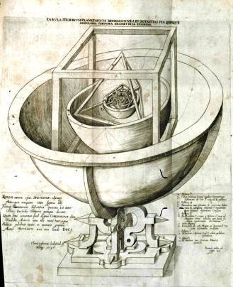
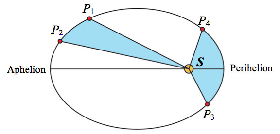

# 约翰内斯·开普勒 Kepler, Johannes (Daniel A. Di Liscia)
*首次发表于 2011 年 5 月 2 日；2025 年 9 月 14 日实质修订。*

约翰内斯·开普勒（Johannes Kepler，1571–1630）是所谓十六、十七世纪科学革命最重要的代表之一。他虽只受过“硕士”级的基础训练，职业取向在生涯之初也偏向神学，却很快以数学才能与理论创造力闻名。作为坚定的哥白尼主义者，开普勒能在多条战线上为新体系辩护：反对仍坚持托勒密体系的旧天文学家，反对亚里士多德主义的自然哲学家，反对第谷·布拉赫之新“混合体系”的追随者——开普勒在布拉格继任其帝国数学家之职——甚至反对标准的哥白尼立场：后者认为新体系只应被当作计算装置，而不必然是物理实在。开普勒的全部著作很难像经院哲学或十七世纪下半叶兴起的笛卡尔式新体系那样被概括成一个观念“系统”。尽管如此，仍可辨认出两种主要倾向：一种接续柏拉图主义，把几何学在世界结构中的作用置于优先；另一种接续亚里士多德传统，强调经验与因果性在认识论中的分量。他因三大行星定律在天文学中赢得不朽声名，但在光学与数学领域同样做出了根本性贡献。开普勒不懈的科学活动中还有一些鲜为人知的事实：他努力开发不同的技术装置——例如一台水泵——试图申请专利并用于多种实际场合（文件见 KGW 21.2.2, pp. 509–57 与 667–691）。在同时代人眼中，他也是有名的数学家与占星学家；而就他自己的期望而言，他是一位以科学方式探究宇宙最深结构的哲学家。

## 1 生平与著作

约翰内斯·开普勒 1571 年 12 月 27 日生于魏尔德施塔特——德国西南部符腾堡州、斯图加特近旁的一座小镇。父亲海因里希是士兵与雇佣兵；母亲卡塔琳娜则能培育开普勒的智识兴趣。他在施瓦本受教育：先就读莱昂贝格（1576）、阿德尔贝格（1584）与毛尔布龙（1586）的学校；后来得益于图宾根神学院（*Tübinger Stift*）的一个名额，进入图宾根大学。1591 年他在那里获得文学硕士（*Magister Artium*），随后开始神学院的学习。图宾根给了他语言与科学的扎实教育；他在此结识迈克尔·梅斯特林——正是后者把他引入哥白尼的新世界体系（见《宇宙的奥秘》英译 Duncan, p. 63，及 KGW 20.1, VI, pp. 144–180）。

图宾根的神学学业尚未结束，开普勒便于 1594 年三四月间接受聘请，赴格拉茨（奥地利施蒂利亚州）新教学校接任格奥尔格·施塔迪乌斯的数学教职。这一时期（1594–1600），他编写了许多官方历书与预言书，并出版第一部重要著作《宇宙的奥秘》（＝*MC*）——一夜成名。1597 年 4 月 27 日，他与第一任妻子芭芭拉·米勒·冯·米勒克结婚。格拉茨反新教的气氛日重，加之 *MC* 在科学共同体的积极反响，他离开格拉茨，1600 年迁居布拉格，在伟大的丹麦天文学家第谷·布拉赫（1546–1601）指导下工作。然而与第谷的初次接触极为痛苦，尤其因为乌尔苏斯事件（见下文 4.1 节）。1601 年 10 月第谷意外去世，开普勒继任帝国数学家。布拉格时期是他尤其多产的阶段：完成最重要的光学著作《天文学的光学部分》（＝*APO*）与《折射光学》（＝*D*）；出版数篇占星学论文（《论占星学更可靠的基础》《答罗斯林的谈话；第三方插言》）；讨论伽利略的望远镜发现（《与星际信使的对话》）；并写出最重要的天文学著作《新天文学》（＝*AN*）——他的前两条行星运动定律即在其中。

1611 年 8 月 3 日，开普勒的妻子芭芭拉·米勒去世。1612 年他迁往上奥地利的林茨，任领地学校（*Landschaftsschule*）教授；1612–1628 年担任上奥地利等级议会的数学家。1613 年娶苏珊娜·罗伊廷格，育有六子。1615 年完成数学著作《酒桶的立体几何学》与《阿基米德的测量术》。1617 年末，他为被控施行巫术的母亲成功辩护。1619 年出版主要哲学著作《世界的和谐》（＝*HM*），并几乎同时撰写《哥白尼天文学概要》（＝*EAC*）。1624 年继续数学研究，出版对数著作《千的对数》……

为《鲁道夫星表》物色可靠的印刷商，他于 1626 年末前后迁居乌尔姆，待到 1627 年底。1628 年 7 月赴萨根，投入阿尔布雷希特·冯·华伦斯坦（1583–1634）帐下效力。1630 年 11 月 15 日在雷根斯堡去世——他原要去那里向帝国当局陈述自己的财务诉求（关于开普勒的生平，卡斯帕尔的传记（1993）至今仍是最佳著作；KGW 19 收有与生平相关的文献。其思想与成就的简要概览及传记语境，见 Osterhage 2020）。

## 2 哲学、神学、宇宙论

恐怕不存在任何纯粹形态的“开普勒哲学”。尽管如此，处理“开普勒的哲学”的尝试已有很多，各有其价值：有的聚焦某一部文本（如论《为第谷辩护驳乌尔苏斯》，见 Jardine 1988）[^jardine-1988]；有的追踪开普勒某些特定思想在较长生涯时段中的演变（如论其原型论，Martens 2000）[^martens-2000]；有的试图从哲学角度确定他在十五至十七世纪天文学革命中的位置（Koyré 1957 与 1961）[^koyré-1957][^koyré-1961]，或在十七世纪科学运动的更宽泛语境中的位置（Hall 1963，尤其 Burtt 1924）；还有的讨论了开普勒科学世界中起作用的一长串哲学原则，并声称借这种分析找到了科学、哲学与宗教相互作用的令人信服的证据（Kozhamthadam 1994）。就开普勒这个特例而言，哲学与天文学、数学乃至最后与“宇宙论”（一个晚得多的概念）直接相关——这些思辨的核心，应到他在《宇宙的奥秘》与《世界的和谐》中处理的问题谱系里寻找（就这一主题，Field 1988 是开普勒研究中最有代表性的著作之一）[^field-1988]。加之他一生的特殊际遇、迷人的个性与天才，关于开普勒的文献极为驳杂：从马克斯·布罗德《第谷·布拉赫走向上帝之路》（1915）这类文学作品——其中涉及开普勒处仍不免错误——到历史小说体裁的一般性介绍，甚至虚构故事、占星学的江湖骗术，以及多年来把他描绘成第谷·布拉赫刺客的作品。不过据近来的报告：第谷究竟是否被谋杀，仍有争议（见 phys.org 报告：https://phys.org/news/2012-11-mercury-poisoning-tycho-brahe-death.html）。

与最优秀的科学家一样，开普勒精通最复杂的技术问题——尤其在天文学；但他始终强调自己处理问题的哲学进路，甚至神学进路：上帝不仅显现在《圣经》的话语中，也显现在宇宙的奇妙秩序及其与人类理智的契合之中。因此，对开普勒来说，天文学若以哲学的方式来研究，便是通往上帝的最佳道路（见 Hübner 1975；Methuen 1998 与 2009；Jardine 2009；Kirby 2019）[^hübner-1975][^jardine-2009][^kirby-2019][^methuen-1998][^methuen-2009]。正如他在自己最伟大的天文学著作的核心处所坦承（AN 第二编第 7 章，KGW 6, p. 108；英译 p. 183）：生涯之初他“品尝到哲学的甘美……对天文学没有任何特别的兴趣”。而即使到了后期——在计算了众多星历表与各种天文数据之后——开普勒仍在 1619 年 2 月 17 日致 V. 比安基的信中写道：“我也请求你们，我的朋友们，不要把我钉在数学计算的踏车上；给我留出哲学思辨的时间吧，那是我唯一的快乐！”（KGW 17, let. N° 827, p. 327, lin. 249–51）。

尤其在处理宇宙的几何结构时，开普勒总是回到他的柏拉图主义与新柏拉图主义思想框架（Michalik, J., 2019；Rudenko and Lastovets, 2023）。因此，他在 *MC* 中首次提出的多面体假说（见下文第 3 节）代表一种“形式因”——宇宙根基结构的构成者。此外还需要一种“动力因”，在形体世界中实现这一结构：这当然是造物主上帝，他依照五种正多面体的模型完成了他的作品。开普勒把关于创世的传统论述重新诠释为造物主的一个形象，赋予古代理念更系统、更定量的品格。甚至三位一体的教义也可以几何地表示：以中心为圣父，以球面为圣子，以中间的空间——数学上表现为点与面之间关系的规则性——为圣灵。在开普勒的模型中，我们必须能够把一切显现还原为直与曲：它们为世界之创造的几何结构奠基。上帝借以使被造世界与自己根本相似的第一范畴，就是量（见 MC 第 2 章，KGW pp. 23–26）。此外，量也被引入人类灵魂——其特定目的，正是使这种根本对称性能够被科学地把握和认识。

这类思辨同样属于开普勒哲学光学的基本原则。在 *APO* 第 1 章（“论光的性质”）中，开普勒对这一“三一创世论”给出新的论述。正如他在致托马斯·哈里奥特（1560–1621）的信中所承认的：他在此的进路更是神学的而非光学的（KGW 15, let. 394, p. 348, lin. 18）。与 *MC* 中的思辨类似，开普勒再次解释上帝与创造之间的对称性，但这次稍稍越出了神学-几何学反思的界限。首先，他似乎假定：世界的物体在创世时被赋予了一些能力，使其能超出几何界限并作用于其他物体（磁力即好例）。其次，引入物质的对称性原则构成了“整个形体世界中最卓越的东西、诸有生命官能的母体、连接形体世界与精神世界的链条”（APO 英译 p. 19）。第三，正如开普勒在一个出色的多重从句长拉丁句中所表达的，这一原则“已转入世界赖以被装备起来的同一批法则之中”（*in leges easdem*）（同上 p. 20；原文见 KGW 2, p. 19：该版边注为“*lucis encomium*”）。最后，这些反思以下述评论作结：与哥白尼、马尔西利奥·费奇诺等人一样，太阳的中心位置因其散播光、并间接散播生命的作用而得到辩护。类似思辨在 *EAC* 中仍可见到（KGW 7, pp. 47–48 与 267）。同样值得注意的是：这些思辨对开普勒构思占星学的特殊方式至关重要（如《论占星学更可靠的基础》，英译与评注见 Field 1984）[^field-1984]。

## 3 五种正多面体

与五种正多面体——立方体（六面体）、四面体、八面体、二十面体、十二面体——相关的哲学、几何学乃至神学思辨，至少自古毕达哥拉斯学派起即已出现。自柏拉图《蒂迈欧》以来，这五种几何体扮演主导角色；在后来的传统中，它们以“五种柏拉图立体”之名为人所知。

**图 1。**

图 1。《宇宙的奥秘》中的表 3：开普勒的模型显示五种正多面体内接于诸行星假想球之间的情形（参 KGW 1, pp. 26–27）。

柏拉图在物理与化学层面建立了五种正多面体与五种元素——土、水、气、火、以太——的对应，并试图为这种对应提供几何学根据。另一具有历史决定性意义的来源是：五种正多面体在欧几里得《几何原本》中得到处理——对开普勒而言，尤其在普罗克洛的柏拉图式进路中，这部著作占据中心位置（Claessens 2011）[^claessens-2011]。*HM* 开篇处，开普勒抱怨彼得·拉米斯（1515–1572）的现代哲学与数学学派未能理解《原本》的建筑学结构——它以对五种正多面体的处理而登峰造极。此外，开普勒的时代恰逢柏拉图哲学复兴，它不仅启发哲学家与数学家，也启发建筑师、艺术家与插图画家（见 Field 1997）[^field-1997]。

文艺复兴对正多面体的兴趣普遍高涨；在其中，开普勒特别关心它们在解决一个宇宙论问题上的应用——哥白尼体系的实在性（见下文第 5 节）。为此，他早在 *MC* 中就引入多面体假说，为哥白尼体系寻找一种“先天”的奠基（见 Aiton 1977, Di Liscia 2009）[^aiton-1977][^di-2009]。这种进路的背景似乎是：“后天”的道路——照开普勒的看法，哥白尼本人走的正是这条路——无法导向对新世界体系实在性的必然肯定，只能导向盖然的、因而是“工具论的”表象：把它当作计算装置。这就是对哥白尼的“奥西安德尔”或“维滕贝格诠释”；开普勒不仅在 *MC* 中、后来还在 *AN* 中直接攻击了它（见 Westman 1972, 1975 与 2011）[^westman-1972]。在 *MC* 中，他声称找到了三个主要问题的答案：1）行星的数目；2）轨道的大小，即距离；3）行星在轨道中的速度。借助多面体假说（见图 1），第一问得到了决定性而简洁的回答：把多面体内接于承载行星的诸球之间，必然止步于包围立方体的土星之球——再无多面体可内接，而按文艺复兴与现代天文学的标准情形，也再无行星可由诸球承载。对论证的一致性而言，绝对决定性的一点是：假说的必然性由如下事实保证——它已作为数学演示存在（欧几里得《原本》第十三卷命题 18 之后的附录），据此正多面体（传统所谓“柏拉图立体”）仅有五种。第二与第三个问题的答案当然不如第一个明显。但开普勒能够表明：由五种正多面体的几何模型导出的距离，与哥白尼体系的吻合远胜于与托勒密体系的吻合。第三问的回答还需引入一个 power（力）的概念：它发自太阳，一直延伸到宇宙的最外端（见 Stephenson 1987, pp. 9–20）[^stephenson-1987]。

在 *HM* 中，开普勒于宇宙论与数学两个层面继续多面体研究。第二卷讨论“贴合”（此处非今日“同大小同形状”之义，而是指：图形与其他正多边形一起铺满平面，或在空间中构成封闭几何体的性质）；借镶嵌图形的研究，开普勒做出了新的数学发现——他发现了两种新立体，即所谓的“小星形十二面体与大星形十二面体”。

对正多面体的处理构成 *HM* 第五卷（第 1–2 章）两大主要支柱之一，第三定律即在其中得到表述（见 Caspar 载 KGW 6, Nachbericht, p. 497，及英译 p. xxxiii）。开普勒延续 *MC* 的进路，辅以对 *EAC* 的偶尔引用，再次利用柏拉图立体确定行星数目及其与太阳的距离。与此同时，他已了解到：旧的多面体假说应用有其限度。正如他在 1621 年 *MC* 第二版的一条脚注中所说，他此前曾相信：行星轨道的偏心率可以由该假说“先天”导出的数值来解释（MC 英译 p. 189）。如今借助第谷的观测数据，开普勒不得不排除这种解释、另寻他途——而这正是他的基本和谐（又派生自正多边形）最重要的成就之一，构成第五卷的第二大支柱。

## 4 认识论与科学哲学

开普勒几乎所有的科学研究都反映一种哲学背景；他的许多哲学问题——即便具有科学的旨趣——其最终答案也在神学领域。从一个相当现代的视角出发，可以把开普勒的认识论思想凸显为四个条目：实在论；因果性；他的数学哲学；以及他那独特的经验主义。

### 4.1 实在论

实在论是开普勒思想中恒定而不可分割的组成部分，且从一开始就以精致的形式出现。缘由在于：他的实在论始终与他对哥白尼世界观的辩护并行——这种辩护从他最早的公开声明与出版物中已然可见。

开普勒关于认识论的许多思想，见于其《为第谷辩护驳乌尔苏斯》或《驳乌尔苏斯》（＝*CU*）。这部著作诞生于论战性的框架：尼古劳斯·莱马鲁斯·乌尔苏斯（1551–1600）与第谷·布拉赫的剽窃冲突。议题包括：天文理论的因果性与物理化、天文假说的概念与地位、“实在论-工具论”论战、他对一般怀疑论的批评、历史的认识论作用等等。它是这一主题所曾有过的最有意义的著作之一，有时被与培根《新工具》、笛卡尔《谈谈方法》相提并论（Jardine 1988, p. 5；此书的优秀新版与完整研究见 Jardine / Segonds 2008）[^jardine-1988][^jardine-2008]。

这些认识论议题的焦点，可以 mutatis mutandis 地与现代围绕天文学理论之科学地位的讨论对应排列（不过正如贾丁所指出的：更稳妥的做法，是把开普勒的 *CU* 更多地读作一部反对怀疑论的著作，而非置于现代实在论/工具论论战的语境）。例如对皮埃尔·迪昂（1861–1916）而言，安德烈亚斯·奥西安德尔的立场——乌尔苏斯采纳了它，而照迪昂的看法开普勒在 *MC* 中对它作了天真的批评——代表着现代所谓的“工具主义”进路。照这一认识论立场（迪昂本人即持之），科学理论不应与真理和虚假的概念紧密相联：假说与科学定律不过是描述与预测现象的“工具”（很少用于解释现象）；物理学理论的目的不是提供因果解释或研究现象之因，而只是表象它们；在最好的情形下，理论能整理并分类那些对其预测能力至关重要的东西（Duhem 1908, 1914）[^duhem-1908]。

与第谷和开普勒相反，乌尔苏斯在天文学中持虚构主义立场。然而在其著作《论假说》的一开头，乌尔苏斯就对天文学理论的性质作出清晰声明，与奥西安德尔在哥白尼《天球运行论》导言中提示的进路非常相似：假说是一种“虚构的设定”，引入它只为“拯救天体的运动”并“计算它们”（英译 Jardine 1988, p. 41）[^jardine-1988]

开普勒延续 *MC* 的进路，并预示了后来 *AN* 的开篇几页（尤其见 AN II.21：“为什么以及在何种程度上，一个假假说可以产生真理？”英译 pp. 294–301），处理了哥白尼主义及其被奥西安德尔一类思想家接受的问题——这些人强调：天文假说的真，不能必然地从对天文事实的正确预测中推出。照这种诠释，哥白尼假说即便能拯救现象也未必为真——否则人们就会犯“肯定后件的谬误”（*fallacia affirmationis consequentis*）。而照开普勒的看法，“这只是碰巧发生，并非总是如此；只有当某一命题中的错误遇上另一条适合引出真理的命题（无论真假）时，才会如此”（英译 Jardine, p. 140）。值得注意的是：正如贾丁（2005, p. 137）所指出的，现代的科学实在论者从一个实在的独立世界出发，而开普勒的真理概念预设——自然与人类心智都不独立于上帝的心智（Jardine 2005, p. 137）[^jardine-2005]。

### 4.2 因果性

天文假说的实在性——从而哥白尼世界体系的优越性——蕴涵天文理论的物理化，转而又意味着对因果性的强调。尽管开普勒批评亚里士多德，这一方面实际可视为亚里士多德古老知识理想在天文学领域的实现：“知识”意味着把握现象的原因。

这样，一方面，“因果性”是一个蕴涵“现实科学知识”这一最普遍观念的概念，它引导并激励着每一项研究。在此意义上，开普勒早在 *MC* 中就着手一项因果研究：追问天球之数目、大小与“运动”（＝速度）的 **原因**（见上文第 3 节）。

另一方面，照亚里士多德的物理科学构想，“因果性”在开普勒那里意味着具体的“物理原因”：产生运动、或负责维持物体运动的动力因。不过开普勒的原创之处、其进路的典型特征在于：他坚定地相信天文假说的等价性问题可以解决，并随之把因果性概念引入天文学——这门传统上的数学科学。这种进路已见于 *MC*：例如，他第一次把诸行星的距离与一种 **力** 联系起来——该力发自太阳，随各行星距离递减而递减，直至恒星天球（见 Stephenson 1987, pp. 9–10）[^stephenson-1987]。

开普勒在 *MC* 中的一个决定性创新，是用真实的太阳取代哥白尼的“平太阳”：后者不再仅是几何点，而是一个能物理地影响周围行星的物体。此外，在 *MC* 1621 年版的注释中，开普勒强烈批评把“灵魂”（*anima*）当作行星运动的动力学因素，提议以“力”（*vis*）取代之（见 KGW 8, p. 113；英译 p. 203, note 3）。

开普勒 1609 年《新天文学》（＝*AN*）最重要的哲学方面之一，是它的方法论进路与因果奠基（见 Mittelstrass 1972）[^mittelstrass-1972]。开普勒对自己引入天文学的观点转变有足够清醒的意识，故决定在全书的标题中宣告之：《新天文学，因果论，或天界物理学，以关于火星运动的评注呈献，据第谷·布拉赫的观测》（*Astronomia Nova, Aitiologetos, seu physica coelestis…*；英译 Donahue：*New Astronomy Based upon Causes…*）。在 *AN* 导言中，开普勒坚持自己的根本观点转变：他的著作关乎物理学，而非纯粹运动学的或几何学的天文学。“物理学”——按这门学科的传统、亚里士多德式的理解——处理现象的原因；对开普勒而言，这正是他在竞争假说之间作出裁决的最终进路（AN 英译 p. 48；见 Krafft 1991）[^krafft-1991]。另一方面，由于他的天界物理学不仅使用几何公理，还使用其他非数学公理，所获得的认识常常带有猜测的成分。

在 *AN* 第三编（第 22–40 章），开普勒处理地球的路径，意在为哥白尼理论提供一种物理学的说明。这样一来，他便纳入如下观念：应让某种关于力的概念负责调节诸行星速度的差异，而这些差异又须与诸行星的距离联系起来确立。哥白尼行星理论始于一条一般原则：地球沿偏心圆规则运动。开普勒恰恰相反：诸行星的运动不规则——运动越慢，离力的中心（太阳）越远。处理新天文学的物理学方面时，开普勒在第 32–40 章——也许是全书最具个人特色的章节——讨论其推动力概念。这里他把不同进路与来源结合起来；有时——为通过引入一个引起运动的力来简化几何天文学的整体几何构造——反而在动力学层面造成新的混乱。首先，开普勒心目中的力究竟属于哪一种，并不总是绝对清楚：他主要倾向于太阳中有一种磁力的想法，但也提到光，并至少间接提到重力——他在 *AN* 中心章节未启用重力，但借助天平模型的解释在一定程度上暗示了它，而且如总导言所解释的，他肯定认为重力对日-月系统为真。其次，这种力是什么、如何作用，也不总是清楚——尤其当他仅在类比意义上、以“仿佛”说话时（光的情形尤其如此）。本质上，开普勒把行星运动分解为两个分量：一方面，行星绕太阳运动——在此讨论阶段——是圆周式的；另一方面，它们在日-连线上表现出一种天平动。太阳的自转负责行星的运动：一道自转太阳辐射出的力沿黄道面扩散，随离力源（太阳）的距离而衰减。对开普勒物理学天文学的发展具有决定性意义的著作，是威廉·吉尔伯特（1544–1603）的《论磁》（伦敦，1600）——这部著作同样意在为新的哥白尼宇宙论提供新物理学，肯定影响了开普勒关于这种力的思想。主要问题当然是：如何把磁力的一般原理应用于行星运动——先解释圆周路径上速度的差异，再说明椭圆上的运动。开普勒构想了一个平行磁纤维的模型：太阳与诸行星以这种方式相连，使太阳的自转引起行星绕它的运动。纤维由一种“活力”在行星中产生，平行且垂直于拱线。行星自身被极化：以其一极被太阳吸引，以另一极被排斥。这很好地解释了行星运动的方向：行星都朝同一方向运动，**因为** 太阳朝那个方向自转。然而似乎仍有一个问题悬而未决：按开普勒的说明，行星绕太阳的速度应与太阳自转一样快——实情并非如此。这一现象可借助物质的一种属性解释——对开普勒而言它具有公理性质：*inclinatio ad quietem*，趋向静止的倾向（尤其见 AN 第 39 章；KGW 3, p. 256）。结果是：行星绕太阳的速度，慢于太阳之力单独起作用时的速度。

开普勒的因果进路最突出地体现在《概要》中——这部卷帙浩繁的著作对后来天文学的发展影响甚大。第 4 卷第二部分处理世界诸部分的运动。其出发点不是前两条定律，而是刚在 *HM* 中公布的第三定律：它不是一个行星路径的计算装置，而是一般的宇宙论命题，因而更合于他在此的进路。同时应当指出：第三定律未必是开普勒在此意欲的动力学的、因果的运动进路的最佳出发点——与前此的因果进路相比，负责产生运动的力之位置何在的问题依然存在。传统观点中运载行星的诸天球，自第谷以降已被废弃；开普勒也明确反对亚里士多德传统的“推动理智”。轨道呈椭圆而非圆形，这一事实表明：运动不是由精神的力引起，而是由一种自然力——它内在于物质的构成。行星自身被赋予“**惯性**”（*inertia*）：照开普勒的理解，这一属性抑制运动、构成对运动的阻碍。推动力（*vix motrix*）确实来自太阳——它向四面八方发送光与力的射线，为行星所捕获。不过开普勒试图较少借助占星学、远更多地借助磁学（这一物理现象在他那个时代远未被清楚理解）解释行星的这种行为。第一，太阳自转，由此使其周围的行星运动；第二，既然行星是磁体的两极，而太阳本身以磁力作用，行星就在轨道的不同部分被吸引或排斥——椭圆路径由此因果地产生。开普勒部分放弃力学进路：他设定太阳中有一个灵魂，负责其规则的旋转运动——整个系统最终依赖于此。事实上，开普勒也假定行星自转，因此行星也被赋予“某种灵魂”或产生自转的类似原则。

除天文学与宇宙论，开普勒还把因果进路扩展到光学（下文第 6 节）与和声学（下文第 7 节）领域。

### 4.3 数学哲学

除他本人的天赋外，显然开普勒自图宾根求学的最早时期就受数学训练。至少在名义上，他在格拉茨、布拉格、林茨、乌尔姆与萨根的职位，都可刻画为最广义数学家的典型职业——包括占星学与天文学、理论力学与气体力学、计量学，以及一切能以某种方式与数学相联的题目。除天文与光学这些通常以不同方式应用数学的领域外，开普勒对对数理论、尤其在其最钟爱的领域——几何学（特别是立体几何学研究）——做出了原创贡献（关于中世纪比例理论作为开普勒对数的背景，见 Rommevaux-Tani, 2018）。因此，出于天生的偏好与才能、出于数学——尤其几何学——对其思想的重要性，在他的著作中找到许多阐明数学哲学的段落并不令人意外。不过开普勒对这一主题的主要阐述见于 *HM*——其前两卷在内容上纯是数学。正如他自己宣告的：在 *HM* 中他扮演的角色“不是哲学中的几何学家，而是几何学这一部分中的哲学家”（KGW 6, p. 20；英译 p. 14）。

在数学相关的哲学问题上，普罗克洛与柏拉图是开普勒最重要的灵感来源；但他并不总把柏拉图与亚里士多德看作完全对立——后者照开普勒的诠释也接受“数学实体的某种存在”（KGW 14, let. N° 226, p. 265；见 Peters, p. 130）。开普勒在很大程度上把 *HM* 中的数学研究理解为欧几里得《几何原本》的延续，尤其是第十卷对无理量的分析。他在此阐发的核心概念是“可构造性”。照开普勒的看法，每一门知识原则上都必须可还原为几何学，才能被承认为严格意义上的知识（不过正如 *AN* 所强调的：就物理学而言，这一条件只是必要的而非充分的）。于是，他多年在占星学中精心阐述的新原理都是几何原理；和声的基本概念亦然——经开普勒之手，它们可还原为几何学。当然，并非每个几何命题都同等重要、同等根本。对开普勒而言，特别根本的几何实体、原理与命题，是能在经典意义上构造的东西——只使用直尺（不带刻度）与圆规。在此基础上，又有按不同“可知性”（*scibilitas*）程度的进一步概念——始于圆及其直径。开普勒再次在宇宙论与神学哲学的框架内理解这一点：几何学、尤其几何上可构造的实体，比其他知识有更高的意义，因为上帝用它们描绘并创造这个完美和谐的世界。照这一视角，显然开普勒为数学辩护的是柏拉图主义的构想；他不能接受亚里士多德的抽象理论，也无法接受代数——至少照他所理解的代数。例如，有些图形无法“几何地”构造，却常被当作可靠的几何知识——最好的例子也许是七边形：它无法在圆外描述；在圆内它的边当然有确定的大小，但不可知。开普勒自己说这一点很重要：他在这里找到了解释——为什么上帝没有用这类图形构造世界。因此他花了许多页讨论这个问题（KGW 6, Prop. 45, pp. 47–56；另见 KGW 9, p. 147）。对一个像开普勒这样的几何学家而言，近似——作为 **数学** 理论——是一种痛苦而不可靠的前进方式。他拒斥代数的哲学背景，至少部分地在某些基本预设上是亚里士多德式的：几何量是连续量，不能用数处理——数反过来是离散量。但与亚里士多德科学理想的差别仍是重要的差别：对亚里士多德而言，算术与几何的交叉只在“中间科学”情形下被允许；对开普勒，一切知识都必须还原为几何基础。晚近研究试图表明：开普勒研究光的折射时遵循“毕达哥拉斯式方法论”的判准——这在他对“同类者为同类者所知”原则的应用中显而易见，也见于他回避无限、毋宁说给无限量设限的倾向（Cardona Suárez 2016）[^cardona-2016]。

### 4.4 经验主义

对开普勒哲学态度与原则的一般性阐述，若不提他与经验世界的联系便不完整。尽管他在自然科学中的进路以理论为主，开普勒仍常常强调经验——以及一般而言的经验数据——之重要。他的通信中有许多关于观察与经验之意义的评论，如 1598 年致赫瓦特·冯·霍恩堡的信（KGW 13, let. N° 91, lines 150–152），或 1603 年致法布里修斯的信（KGW 14, let. N° 262, p. 191, lines 129–130）——这里只举他最重要的两位通信者。为哥白尼体系寻找经验支持，开普勒在 *MC* 中比较不同的星表；在 *AN* 中大量使用第谷的观测宝库。*MC*（第 18 章）中，当所用星表的数据与多面体假说算出的数值不完全吻合时——此处正是如此——他引用雷蒂库斯的一段长文以作修辞上的支持。这段文字告诉读者：开普勒在 *MC* 中所辩护的世界体系的伟大创立者哥白尼，曾有一天对雷蒂库斯说：坚持与数据绝对一致没有意义，因为数据本身肯定不完美。毕竟这很可疑：开普勒使用例如伊拉斯谟·莱因霍尔德（1511–1553）的《普鲁士星表》（1551），是否拥有充分而正确的经验信息，能像他宣称的那样大张旗鼓地确认哥白尼假说（关于莱因霍尔德星表及其影响的分析，见 Gingerich 1993, pp. 205–255）[^gingerich-1993]。

开普勒在布拉格接触到第谷的观测时（据他常说的，这些观测很少在他手边），情况完全改观。态度的转变在 *AN* 中显而易见：他不受限制地使用第谷的观测（书名已讲明这一点）。第 2 部分（第 7–21 章）给出“替代假说”——最终又被他自己驳倒。这一假说代表传统天文学限度内所能达到的最好结果：它使用圆轨道，并假定行星的运动从拱线上的某点看是规则的。与传统方法相反，开普勒在此不把偏心率等分，而让划分保持开放。为检验假说，他需要火星冲日的观测——火星、地球与太阳在午夜位于同一条线上。他从第谷那里“继承”了 1580–1600 年间的十次这样的观测，又补上 1602、1604 年的两次。第 17–21 章，开普勒对替代假说做了观测与计算的双重检验。一方面，他指出假说已足够好：计算位置与观测位置的偏差落在可接受限度（2 角分）之内；事实上他把这一假说呈现为“传统天文学”框架内所能提出的最好假说——与他后面部分将提出的新天文学相对。另一方面，若考虑黄纬的观测，假说可被证伪：进一步计算产生 8 角分的差——这不能接受，因为第谷的观测足够可靠。开普勒的名言是：“仅仅这 8 分就已为改革全部天文学指明了道路”（AN, KGW 3, p. 286；英译 p. 286）。人们似乎一致同意：开普勒的 *AN* 包含了对观测误差问题的第一次明确处理（见 Hon 1987 与 Field 2005）[^field-2005][^hon-1987]。

开普勒在光学领域也给了经验重要的位置。事实上，他开始光学研究正是因为理论与观察之间的分歧；他使用自己设计的科学仪器（例如见 KGW 21.1, p. 244）。然而，关于 **暗箱** 与“空气中的像”问题的晚近研究表明：沿物理学史主流的传统进路处理开普勒光学有其限度——毋宁说，他的 *experimentum*（实验）概念需要被置于他那个时代的社会实践与认识论承诺之中（见 Dupré 2008）[^dupré-2008]。

最后应当提到：在开普勒的和声-音乐理论与占星理论中，经验与经验数据也被赋予类似的意义——这两个领域从属于 *HM* 的更大宇宙论计划。在占星学中，他使用自己记录多年的气象数据作确证材料；这一材料表明：地球作为一个整体的生命存在者，对天空中规律出现的诸方位相（aspects）作出反应（见 Boner 2013, pp. 69–99）[^boner-2013]。在音乐理论中，开普勒是一位现代思想家——尤其因为他赋予经验的角色。如已有人指出的（Walker, 1978, p. 48），开普勒早在写作 *HM* 之前很久就用单弦琴做声学实验。在致赫瓦特·冯·霍恩堡的信中（KGW 15, ep. 424, p. 450），他描述了自己如何检验一根弦在不同长度下的声音，确立哪些情形下耳朵判断声音为悦耳。开普勒不接受这一限制建立在算术思辨之上——即使这已为柏拉图（他常追随的）与毕达哥拉斯学派所假定。基于实验，开普勒发现弦还有其他划分也为耳朵感知为谐和：即三度与六度。

如果说宇宙论是开普勒兴趣的主要框架，那么毫无疑问——正如菲尔德指出的——他“感到需要为自己的宇宙模型寻求观测支持”（Field 1988, p. 28；另见 Field 1982）[^field-1982][^field-1988]。

## 5 改革后的哥白尼主义与三大行星定律

今天，开普勒在科学史中首先以三大行星定律为人铭记；它们是在非常特定的语境中、于不同时间提出的。虽然他是否会把这些科学陈述理解为“定律”是可疑的——甚至可以争论他对这个词的用法与我们今天不同——但似乎清楚的是：三条定律（作为语言约定，我们不妨继续用这个词）都以开普勒哲学的某些基础为前提：（a）实在论；（b）因果性；（c）宇宙的几何结构。除此之外应当指出：三条定律的共同分母，是开普勒对哥白尼世界观的辩护——这个宇宙论体系，他若不彻底改革便无法为之辩护（见 Goldstein and Hon, 2005）。当然，把新天文学建立在物理基础之上——如他一贯所愿——花了十多年持续的工作。然而他很早就确信太阳的中心地位：既是位置上的，也是物理上的（见 Granada 2022）[^granada-2022]。值得注意的是：早在生涯之初，开普勒就激烈地为哥白尼世界观的实在性辩护，其方式被他借用标准亚里士多德认识论的术语刻画为“先天的”（见上文第 3 节及 Di Liscia 2009）[^di-2009]。

**图 2。**

图 2。开普勒的椭圆第一定律与面积第二定律（现代表示，偏心率大大夸大）。

前两条定律最初发表于 *AN*（1609），尽管众所周知开普勒更早便已得出这些结果。第一定律确立：行星的轨道是椭圆，太阳位于其中一个焦点（见图 2）。照第二定律，从太阳到行星 P 的向径在相等时间里扫过相等面积，例如 $SP_1P_2$ 与 $SP_3P_4$。因此行星 P 在近日点更快——那里离太阳更近；在远日点更慢——那里离太阳更远。按照动力学进路，开普勒先找到第二定律，然后作为假设力之效果所产生的进一步结果，得到行星的椭圆路径（关于前两条行星定律，特别见 Aiton 1973, 1975a, Davis 1992a–e 与 1998a; Donahue 1994; Wilson 1968 与 1972；开普勒与光学相关的圆锥曲线系统，见 Del Centina 2016 近作）[^aiton-1973][^davis-1992a][^donahue-1994][^wilson-1968][^wilson-1972]。

开普勒两条定律最重大的影响，也许在宇宙论后果中可见。第一定律废除了行星轨道为圆周这一古老公理——它不仅对前哥白尼的天文学与宇宙论有效，对哥白尼本人、第谷与伽利略也仍有效。第二定律与传统天文学的另一条公理决裂：行星运动在速度上均匀。托勒密的天文学传统当然意识到这一困难，并应用一种格外有效的装置拯救加速的“表象”：偏心匀速点（equant）。哥白尼则坚持均匀圆周运动公理的必要性：他把托勒密的偏心匀速点理解为违反该公理的一种技术装置。开普勒恰恰相反：他肯定行星运动速度变化的实在性，并为它们提供物理学说明。与既有观念——不仅在他之前的传统中，也在他自己的思想中——艰苦搏斗之后，开普勒放弃行星运动的圆形路径，由此开启通向宇宙论的更经验性的进路（不过参见 Brackenridge 1982）[^brackenridge-1982]。

      开普勒第一次发表第三定律——所谓“和谐定律”——是在《世界的和谐》（1619）中，即十年之后。在《概要》中，他对全部三条定律及其根据与含义给出了更系统的处理（见 Davis 2003; Stephenson 1987）[^davis-2003][^stephenson-1987]。在第 5 卷第 3 章，作为 13 个论点中的第 8 点（KGW 6, p. 302；英译 pp. 411–12），开普勒几乎是偶然地表达了把流逝时间与距离联系起来的基本关系，用现代记号可写作： 

       $$ \left(rac{T_1}{T_2}
ight)^2 = \left(rac{a_1}{a_2}
ight)^3 $$

其中 $T_1$ 与 $T_2$ 表示两颗行星的公转周期，$a_1$ 与 $a_2$ 表示它们半长轴的长度。这一关系的另一种表述在文献中也很常见：$a^3/T^2 = K$——它以 $K$ 表示距离的三次方与时间的平方之比为常数（不过见 Davis 2005, pp. 171–172；关于第三行星定律特别见 Stephenson 1987）[^davis-2005][^stephenson-1987]。作为第三定律的推论：行星绕太阳一周所需的时间，随它离得更远、轨道半径更长而显著增加。例如土星的恒星周期接近 30 年，而水星绕太阳一周只需不到 88 天。就宇宙论的历史而言，重要的是讲清楚：第三定律实现了开普勒对哥白尼世界观之 **系统性** 表象与辩护的追求——在其中，行星并非彼此绝对独立，而是被整合进一个和谐的世界体系。

## 6 光学与光的形而上学

开普勒以两部开创性著作对光学这一特殊领域做出贡献：《补编，天文学的光学部分》（＝*APO*）与《折射光学》（＝*DI*）；后者的动机很大程度上来自 1610 年伽利略《星际信使》的出版。在《与星际信使的对话》（*Dissertatio cum Nuncio Sidereo…a Galillaeo Galilaeo*, KGW 4, pp. 281–311）中，他为伽利略给出的事实信息辩护，同时指出：必须对观测到的现象之原因作出说明。他研究光学的背景无疑是天文光学的种种具体问题（见 Straker 1971）。在此语境中，他把精力集中于解释月食、月球视大小与大气折射。开普勒很早便研究 **暗箱** 理论并记录其一般原理（见 M. Hammer 载 KGW 2, pp. 400–1 的评注，及 Straker 1981）[^straker-1981]。此外，他深入研究望远镜理论，发明了折射式天文望远镜即“开普勒式”望远镜——较伽利略式望远镜有相当大的改进（特别见 DI, Problem 86, KGW 4, pp. 387–88）。除这些令人印象深刻的贡献，开普勒把研究计划扩展到数学与解剖学：例如讨论圆锥曲线、解释视觉过程（见 Crombie 1991，尤其 Lindberg 1976b）[^crombie-1991][^lindberg-1976b]。

在 *APO* 第 1 章（“论光的性质”）中，开普勒阐述关于光之不同性质的 38 个命题：光从物体表面的每一点向所有方向流出；它没有物质、重量或阻力。追随——同时反转——亚里士多德关于运动时间性的论证，他断言：光的运动不在时间中发生，而在瞬间发生（*in momento*）。光沿直线（射线）传播；射线不是光本身，而是光的运动。值得注意的是：虽然光从一个物体传到另一个物体，它却不是物体，而是一种趋于扩展为曲面的二维实体——光的二维性也许正是它无形体的主要原因。运动在开普勒的光哲学中扮演重要角色。对斯特雷克而言，光学与物理学（尤其在引入力学分析的第 20 命题中）之间假定的联系，“揭示了他对光的机械物理学之承诺的全部程度”（Straker 1971, p. 509）。

两个问题受到现代专家的集中讨论。第一：把机械论进路归于开普勒，在多大程度上正当？第二：应如何确定他在科学史——尤其光学领域——中的位置：开普勒光学的主要思想路线表明与传统的 **连续**，还是毋宁 **断裂**？对这两个问题都存在有充分根据的不同立场。克龙比（1967, 1991）与斯特雷克认为，开普勒发展了一种力学进路——这在他的视觉解释中用 **暗箱** 模型看得特别清楚。此外，斯特雷克强调：开普勒的基本机械论还得到他把光构想为非主动的、被动实体的有力支持；运动概念与天平模型的解释，也都表明对机械论的承诺（Straker 1970, pp. 502–3）[^straker-1970]。相反，林德伯格（1976a）支持争论的“连续性一方”，他相当有说服力地表明：对开普勒而言，光在宇宙中具有建构性的、主动的功能——不仅在光学中，也在占星学、天文学与自然哲学中（关于开普勒对中世纪传统的批评，另见 Chen-Morris / Unguru, 2001）。

## 7 和谐与灵魂

从哲学的角度看，开普勒把 *HM* 视为他最主要的、也是他最珍爱的著作。这部包含第三行星定律的著作，无疑是天文学史上开创性的贡献。但他没有把酝酿已久的项目还原为天文学研究——关于“和谐”的最初想法早在 1599 年已出现，尽管著作迟至 1619 年才出版——而是广泛讨论其数学基础与哲学含义：包括占星学、自然哲学与心理学。因此，开普勒的第三行星定律出现在一个远远超出天文学的语境中，并在很大程度上重新接续青年时期 *MC* 的视角。谈论开普勒的“和谐”，须记住：赋予这一概念以完整意义的背景远超音乐理论。当然，音乐牵涉其中且扮演决定性角色——与之相伴的是源自毕达哥拉斯传统的相应数学概念。然而在开普勒那里，“和谐”代表最普遍的观念，是作为有秩序整体的世界之核心，因而也是他哲学探究的终极目标。社会与政治的方面也包括在内。细节并非无关紧要：开普勒在三十年战争前夜把 *HM* 献给英格兰国王詹姆斯一世——“开普勒相信最适合把它的教训应用于最迫切的和谐——教会与国家的和谐——的那个人”（Rothman 2017, p. 6）[^rothman-2017]。

照开普勒的看法，必须区分“可感的”和谐与“纯粹的”和谐。前者见于自然的、可感的实体之中——如音乐中的声音或光线；二者可以彼此成比例，从而处于和谐之中。他通过结合亚里士多德的三个范畴解决这一问题：量、关系，以及最后的质。经由关系范畴的功能，开普勒过渡到心灵（或灵魂）的主动功能。结果是：若两样东西可以按量的范畴比较，它们就可被刻画为和谐的。但至少需要两样东西——这一事实表明：“是和谐的”不是孤立之物的属性。此外，事物间的关系也不能在事物自身之中找到；毋宁说，它由心灵产生：“一般而言，每一种关系若离开心灵、离开它所关联的事物就什么都不是；因为除非假定有某个心灵在场把它们彼此关联，事物并不具有人们说它们具有的那种关系”（KGW 6, p. 212；英译 p. 291）。这一过程经由把可感事物与心灵中在场的原型（*archetypus*）相比较而实现。

下一个核心问题直接关乎认识论：开普勒对可感事物进入心灵的路径给出一种心理学说明。他重述经院哲学的种相理论：非物质的种相从可感事物中辐射出来，作用于感官——先作用于“前庭”，继而作用于内部官能（关于开普勒的“种相”概念见 Rabin 2005，该说在文献中既有支持也有批评）[^rabin-2005]。它们抵达想象，再转入 **共通感**；于是按传统教义，所接受的感性信息如今能够被加工、被用于陈述。从这里开始，可感事物“被保存在记忆中，由回忆唤起，［并］被灵魂的更高官能所分辨”（Caspar 1993, p. 269；参 KGW 6, p. 214, lines 18–23；英译 p. 293）[^caspar-1993]。和谐作为灵魂/心灵的活动产生，在于定量地建立关系；开普勒补充道——接过亚里士多德的范畴学说——和谐也是一种“性质的关系”，涉及“形状的质，由规则的图形形成”，后者为比较提供根据（KGW 6, p. 216, lines 37–41；英译 p. 296）。如果“事物”（即可感实体）就是这样进入灵魂以便被比较的，那么——正如开普勒承认的——它绝不构成对非可感事物（即数学实体）如何进入心灵的充分解释：它们如何进入灵魂？开普勒接受亚里士多德对毕达哥拉斯哲学关于数的批评：开普勒与亚里士多德都相信，数在本体论上构成数学实体中较低的类（对开普勒而言，数派生自几何实体）。尽管如此，亚里士多德的哲学不足以把握数学的本质。开普勒与普罗克洛对齐——从其《欧几里得几何原本评注》引用一大段——为柏拉图的 **回忆说**（*anamnêsis*）辩护，反对亚里士多德的 **白板说**。他的讨论位于经验主义与理性主义之间经典论争的源头——这场论争将在随后几代人中支配哲学舞台。与唯心论的联系当然显而易见（例如见 Caspar 1993 英译 p. 269）[^caspar-1993]；而事实上，开普勒在十九世纪德意志唯心论内部得到积极接受（Schwaetzer 2016, esp. 217–19）[^schwaetzer-2016]。然而从历史上看，把他的立场与圣奥古斯丁的哲学传统联系起来似乎更为准确。

除心理学与认识论，开普勒在第 4 卷处理的另一主要问题谱系是“方位相”理论，即占星学（HM, IV, Cap. 4–7）——他的心理学的又一应用领域，也是几何学在其哲学中作用的又一证据。“方位相”即行星、月亮与太阳之间的角度，是开普勒想从旧占星学中拯救的全部——他对后者严厉批评；因为方位相是、或可还原为几何结构，即灵魂能够认出的原型。照开普勒的看法，不存在天界的“机械影响”：恒星与星座在他的占星学中不起作用。尽管如此，开普勒为确定恒星的大小及其在哥白尼天文学中的作用付出相当努力（见 Graney 2019）[^graney-2019]，同时坚持：行星的占星学构型影响尘世事件与人的生活。毋宁说，地球与人类——最终与所有其他生命实体一样——都被赋予一个灵魂，几何原型即在灵魂之中。当天空中形成一个方位相，对称性产生，刺激地球或人的灵魂。开普勒写道：“地球”回应“方位相所吹奏的调子”（KGW 11.2, p. 48；关于他的占星学特别见 Field 1984 与 Rabin 1997, Boner 2005 与 2006）[^boner-2005][^boner-2006][^field-1984][^field-1997][^rabin-1997]。

## 参考文献

**以下文献从原文照录，不作翻译；中国文献译为中文。**

### A. Primary Sources

#### Complete Editions

#### Selected English Translations of Individual Works

### B. Secondary Literature

[^joannis-1858]: *Joannis Kepleri Astronomi Opera omnia*, ed. Ch. Frisch, vols. 1–8, 2; Frankfurt a.M. and Erlangen: Heyder & Zimmer, 1858–1872.
[^johannes-1937]: *Johannes Kepler Gesammelte Werke*, herausgegeben im Auftrag der *Deutschen Forschungsgemeinschaft* und der *Bayerischen Akademie der Wissenschaften*, unter der Leitung von Walther von Dyck und Max Caspar, Bd. 1–21.2.2; München: C.H. Beck’sche Verlagsbuchandlung, 1937–2009 (apparently finished) [ = KGW]. The last volumes include a selection of the manuscripts, mostly with only brief commentaries by the editors. Several hundred folia by Kepler (often in his own hand) still remain unedited.
[^mysterium-1981]: *Mysterium cosmographicum*: Trans. A. M. Duncan, *The secret of the universe* Translation by A.M. Duncan / Introduction and commentary by E. J. Aiton, New York: Abaris, 1981.
[^apologia-1984]: *Apologia Tychonis contra Ursum*: Trans. N. Jardine, *The Birth of History and Philosophy and Science: Kepler’s Defense of Tycho against Ursus with Essays on its Provenance and Significance*, Cambridge: Cambridge University Press, 1984 (with corrections 1988).
[^ad-2000]: *Ad Vitellionem paralipomena. Astronomiae pars optica*: Trans. W. H. Donahue, *Johannes Kepler. Optics: Paralipomena to Witelo & Optical Part of Astronomy*, trans. William H. Donahue, New Mexico: Green Lion Press, 2000.
[^dissertatio-1965]: *Dissertatio cum Nuncio Sidereo* and *Narratio de Observatis Jovis Satellitibus*: Trans. E. Rosen, *Kepler’s Conversation with Galileo’s Sideral Messenger*, New York and London: Johnson Reprint Corporation, 1965.
[^de-1984]: *De fundamentis astrologiae certioribus*: = *On Giving Astrology Sounder Foundations*: Trans. J.V. Field, “A Lutheran Astrologer: Johannes Kepler”, *Archive for History of Exact Sciences*, 31(3) (1984): 189–272.
[^astronomia-1992]: *Astronomia nova*: Trans. W. H. Donahue, *New Astronomy*, Cambridge, New York: University Press, 1992; and *Selections from Kepler’s* Astronomia Nova: *A Science Classics Module for Humanities Studies*, trans. W. H. Donahue, Santa Fe, NM: Green Lion Press, 2005; revised version 2015.
[^harmonices-1997]: *Harmonices mundi libri V*: Trans. E. J. Aiton, A. M. Duncan, J.V. Field, *The Harmony of the World*. Philadelphia: American Philosophical Society (Memoirs of the American Philosophical Society), 1997.
[^epitome-1952]: *Epitome astronomiae copernicanae*: Partial trans. C. G. Wallis, *Epitome of Copernican Astronomy: IV and V*, Chicago, London: Encyclopaedia Britannica (Great Books of the Western World, Volume 16], 1952, pp. 839–1004.
[^strena-1966]: *Strena seu de nive sexangula*: Trans. C. Hardie, *The Six-Cornered Snowflake*, Oxford: Clarendon Press, 1966.
[^somnium-1967]: *Somnium seu de astronomia lunari*: Trans. E. Rosen, *Kepler’s Somnium: The Dream, or Posthumous Work on Lunar Astronomy*, Madison: University of Wisconsin Press, 1967.
[^letters-1951]: *Letters* (selection): Trans. C. Baumgardt; introd. A. Einstein: *Johannes Kepler: Life and Letters*, New York: Philosophical Library, 1951.
[^aiton-1973]: Aiton, E.J., 1973, “Infinitesimals and the Area Law”, in F. Krafft, K. Meyer, and B. Sticker (eds.), 1973: *Internationales Kepler-Symposium Weil der Stadt 1971*, Hildesheim: Gerstenberg, 285–305.
[^aiton-1975a]: –––, 1975a, “How Kepler discovered the elliptical orbit”, *Mathematical Gazette*, 59(410): 250–260.
[^aiton-1975b]: –––, 1975b, “Johannes Kepler and the astronomy without hypotheses”, *Japanese Studies in the History of Science*, 14: 49–71.
[^aiton-1977]: –––, 1977, “Kepler and the *Mysterium Cosmographicum*”, *Sudhoffs Archiv*, 61(2): 173–194.
[^aiton-1978]: –––, 1978, “Kepler’s path to the construction and rejection of his first oval orbit for Mars”, *Annals of Science*, 35(2): 173–190.
[^barker-1994]: Barker, P., and B.R. Goldstein, 1994, “Distance and Velocity in Kepler‘s Astronomy”, *Annals of Science*, 51: 59–73.
[^barker-1998]: –––, 1998, “Realism and Instrumentalism in Sixteenth Century Astronomy: A Reappraisal”, *Perspective on Sciences*, 6(3): 232–258.
[^barker-2001]: –––, 2001, “Theological Foundations of Kepler’s Astronomy”, *Osiris*, 16: 88–113.
[^bialas-1990]: Bialas, V., 1990, “Keplers komplizierter Weg zur Wahrheit: von neuen Schwierigkeiten, die ‘Astronomia Nova’ zu lesen”, *Berichte zur Wissensschaftsgeschichte*, 13(3): 167–176.
[^beer-1975]: Beer, A., and P. Beer (eds.), 1975, *Kepler Four Hundred Years*, Oxford: Pergamon Press.
[^bennett-1998]: Bennett, B, 1998, “Kepler’s Response to the Mystery: A New Cosmographical Epistemology”, in J. Folta (ed.), *Mysterium Cosmographicum 1596–1956*, Prague, pp. 49–64.
[^boockmann-2005]: Boockmann, F., D.A. Di Liscia, and H. Kothmann (eds.), 2005: *Miscellanea Kepleriana*, [Algorismus 47], Augsburg: Erwin Rauner Verlag.
[^boner-2005]: Boner, P.J., 2005, “Soul-searching with Kepler: An analysis of *Anima*, in his astrology”, *Journal for the History of Astronomy*, 36(1): 7–20.
[^boner-2006]: –––, 2006, “Kepler’s Living Cosmology: Bridging the Celestial and Terrestrial Realms”, *Centaurus*, 48: 32–39.
[^boner-2013]: –––, 2013, *Kepler’s Cosmological Synthesis: Astrology, Mechanism and the Soul*, Leiden: Brill.
[^brackenridge-1982]: Brackenridge, J.B., 1982, “Kepler, elliptical orbits, and celestial circularity: a study in the persistence of metaphysical commitment. I”, *Annals of Science*, 39(2): 117–143, and II in *Annals of Science*, 39(3): 265–295.
[^buchdahl-1972]: Buchdahl, G., 1972, “Methodological aspects of Kepler’s theory of refraction”, *Studies in History and Philosophy of Science*, 3: 265–298.
[^burtt-1924]: Burtt, E. A., 1924, *The Metaphysical Foundations of Modern Physical Science*, New York: Kegan Paul; 2nd rev. ed., 1954, Garden City, NY: Doubleday, reprinted 2003, New York: Dover Publications.
[^cardona-2016]: Cardona Suárez, C. A., 2016, “Kepler: Analogies in the Search for the Law of Refraction”, *Studies in History and Philosophy of Science*, 59: 22– 35.
[^caspar-1993]: Caspar, M., 1993, *Johannes Kepler*, New York: Dover Publications.
[^chen-morris-2001]: Chen-Morris, R.D., and Unguru, Sabetai, 2001, “Kepler’s Critique of the Medieval Perspectivist Tradition”, in Simon & Débarbat 2001, pp. 83–92.
[^claessens-2011]: Claessens, G., 2011, “Imagination as Self-knowledge: Kepler on Proclus’ Commentary on the first book of Euclid’s *Elements*”, *Early science and Medicine*, 16(3): 179-199
[^crombie-1967]: Crombie, J.A., 1967, “The *Mechanistic Hypothesis*, and the Study of Vision: Some Optical Ideas as a Background to the Invention of the Microscope”, in S. Bradbury and G.L.E. Turner (eds.), *Historical Aspects of Microscopy*, Cambridge: Heffer (for the Royal Microscopical Society), 3–112.
[^crombie-1991]: –––, 1991, “Expectation, modelling and assent in the history of optics. II, Kepler and Descartes”, *Studies in History and Philosophy of Science*, 22(1): 89–115.
[^crombie-1985]: –––, Cohen, B., 1985, *The Birth of a New Physics*, New York and London: W.W. Norton.
[^davis-1975]: Davis, A.E.L., 1975, “Systems of Conics in Kepler’s Work”, *Vistas in Astronomy*, 18: 673–685.
[^davis-1992a]: –––, 1992a, “Kepler’s resolution of individual planetary motion”, *Centaurus*, 35(2): 97–102.
[^davis-1992b]: –––, 1992b, “Kepler’s ‘distance law’ – myth not reality”, *Centaurus*, 35(2): 103–120.
[^davis-1992c]: –––, 1992c, “Grading the eggs (Kepler’s sizing-procedure for the planetary orbit)”, *Centaurus*, 35(2): 121–142.
[^davis-1992d]: –––, 1992d, “Kepler’s road to Damascus”, *Centaurus*, 35(2): 143–164.
[^davis-1992e]: –––, 1992e, “Kepler’s physical framework for planetary motion”, *Centaurus*, 35(2): 165–191.
[^davis-1998a]: –––, 1998a, “Kepler’s unintentional ellipse—a celestial detective story”, *The Mathematical Gazette*, 82(493): 37–43.
[^davis-1998b]: –––, 1998b, “Kepler, the ultimate Aristotelian”, *Acta historiae rerum naturalium necnon technicarum*, 2: 65–73.
[^davis-2003]: –––, 2003, “The Mathematics of the Area Law: Kepler’s successful proof in *Epitome Astronomiae Copernicanae*, (1621)”, *Archive for History of Exact Sciences*, 57(5): 355–393.
[^davis-2005]: –––, 2005, “Kepler’s Angular Measure of Uniformity: how it provided a potential proof of his Third Law”, in F. Boockmann, D.A. Di Liscia, and H. Kothmann (eds.), pp. 157–173.
[^davis-2010]: –––, 2010, “Kepler’s Astronomia Nova: a geometrical success story,” in A. Hadravová, T.J. Mahoney and P. Hadrava (eds.), *Kepler’s Heritage in the Space Age*, (*Acta historiae rerum naturalium necnon technicarum*, Volume 10), Prague: National Technical Museum.
[^del-2016]: Del Centina, A., 2016, “On Kepler’s System of Conics in Astronomiae Pars Optica” , *Archive for History of Exact Sciences*, 70(6): 567– 589.
[^di-2009]: Di Liscia, D. A., 2009, “Kepler’s *A Priori* Copernicanism in his *Mysterium Cosmographicum*,” in M.A. Granada and E. Mehl (eds.), pp. 283–317.
[^donahue-1994]: Donahue, W., 1994, “Kepler’s invention of the second planetary law”, *British Journal for the History of Science*, 27(92): 89–102.
[^dreyer-1963]: Dreyer, J.L.E., 1963, *Tycho Brahe*, *A Picture of Scientific Life and Work in the Sixteenth Century*, New York: Dover Publications.
[^duhem-1908]: Duhem, P., 1908, *SOZEIN TA*, *FAINOMENA: Essai sur la notion de théorie physique de Platon à Galilée*, Paris: A. Hermann.
[^duhem-1914]: –––, 1914, *La théorie physique, son objet et sa structure*, Paris: Chevalier et Rivière.
[^dupré-2008]: Dupré, S., 2008, “Inside the Camera Obscura: Kepler’s Experiment and Theory of Optical Imagery”, *Early Science and Medicine*, 13: 219–244.
[^field-1982]: Field, J.V., 1982, “Kepler’s Cosmological Theories: their agreement with observation”, *Quarterly Journal of the Royal Astronomical Society*, 23: 556–568.
[^field-1983]: –––, 1983, “Cosmology in the work of Kepler and Galileo”, P. Galluzzi (ed.) *Novità celesti e crisi del sapere*, [Supplement volume to Annali del Istituto e Museo di Storia della Scienza di Firenze], Florence: Giunti Barbèra, pp. 207–215
[^field-1984]: –––, 1984, “A Lutheran Astrologer: Johannes Kepler”, *Archive for History of Exact Science*, 31: 189–272.
[^field-1988]: –––, 1988, *Kepler’s Geometrical Cosmology*, London and Chicago: Athlone and University of Chicago Press.
[^field-1997]: –––, 1997, “Rediscovering the Archimedean polyhedra: Piero della Francesca, Luca Pacioli, Leonardo da Vinci, Albrecht Dürer, Daniele Barbaro, and Johannes Kepler”, *Archive for History of Exact Sciences*, 50(3–4): 241–289.
[^field-1998]: –––, 1998, “Kepler’s mathematization of cosmology”, *Acta historiae rerum naturalium necnon technicarum*, 2: 27–48.
[^field-2005]: –––, 2005, “Tycho Brahe, Johannes Kepler and the concept of error”, in F. Boockmann, D.A. Di Liscia, and H. Kothmann (eds.), pp. 143–155.
[^field-2009]: –––, 2009, “Kepler’s Harmony of the World”, in Richard L. Kremer and Jarosław Włodarczyk (eds.), *Johannes Kepler: From Tübingen to Zagan* (Proceedings of a conference held in Zielona Gora in June 2008), *Studia Copernicana*, 42: 11–28.
[^folta-1998]: Folta, J. (ed.), 1998, *Mysterium cosmographicum 1596–1996*, Prague [*Acta Historiae rerum naturalium necnon technicarum*, New Series, Vol. 2].
[^gingerich-1993]: Gingerich, O., 1993, *The Eye of Heaven. Ptolemy, Copernicus, Kepler*, New York: American Institute of Physics.
[^goldstein-2005]: Goldstein, B. R. and G. Hon, 2005, “Kepler’s Move from *Orbs* to *Orbits*: Documenting a Revolutionary Scientific Concept”, *Perspectives on Science*, 13(1): 74–111.
[^granada-2008]: Granada, M.A., 2008, “Kepler and Bruno on the Infinity of the Universe and of Solar Systems”, *Journal for the History of Astronomy*, 39: 1–27.
[^granada-2022]: –––, 2022, “Johannes Kepler. The Sun as the Heart of the World”, *Journal for the History of Astronomy*, 53(2): 133–140.
[^granada-2009]: Granada, M.A., and E. Mehl (eds.), 2009, *Nouveau ciel, nouvelle terre / La révolution copernicienne en Allemagne 1530–1630*, Paris: Belles Lettres.
[^graney-2019]: Graney, Chr. M., 2019, “The Starry Universe of Johannes Kepler”, *Journal for the History of Astronomy*, 50(2): 155–173.
[^hall-1963]: Hall, R., 1963, *From Galileo to Newton 1630–1720*, New York: Collins.
[^holton-1956]: Holton, G., 1956, “Johannes Kepler’s universe: its physics and metaphysics”, *American Journal of Physics*, 24: 340–351.
[^hübner-1975]: Hübner, J., 1975, *Die Theologie Johannes Keplers zwischen Orthodoxie und Naturwissenschaft*, Tübingen: J.C.B. Mohr.
[^hon-1987]: Hon, G., 1987, “On Kepler’s awareness of the problem of experimental error”, *Annals of Science*, 44(6), 545–591.
[^itokazu-2009]: Itokazu, A.G., 2009, “On the Equivalence of the Hypotheses in Part 1 of Johannes Kepler’s New Astronomy”, *Journal for the History of Astronomy*, 50: 173–190.
[^jardine-1988]: Jardine, N., 1988, *The Birth of History and Philosophy and Science: Kepler’s Defense of Tycho against Ursus with Essays on its Provenance and Significance*, Cambridge: Cambridge University Press, 1984 (with corrections 1988).
[^jardine-2005]: –––, 2005, “The Many Significances of Kepler’s Contra Ursum”, in F. Boockmann, D.A. Di Liscia, and H. Kothmann (eds.), pp. 129–142.
[^jardine-2009]: –––, 2009, “Kepler, God, and the Virtues of Copernican Hypotheses”, in M. A. Granada and E. Mehl (eds.), pp. 269–277.
[^jardine-1999]: Jardine, N., and A. Segonds, 1999, “Kepler as Reader and Translator of Aristotle”, in C. Blackwell and S. Kusukawa, eds., *Philosophy in the Sixteenth and Seventeenth Centuries: Conversations with Aristotle*, Aldershot: Ashgate, pp. 206–233.
[^jardine-2001]: Jardine, N., and A. Segonds, 2001, “A Challenge to the Reader: Ramus on *Astrologia*, without Hypotheses”, in M. Feingold, J.S. Freedman, and W. Rother (eds.), *The Influence of Petrus Ramus. Studies in Sixteenth and Seventeenth Century Philosophy and Sciences*, Basel: Schwabe, pp. 248–266.
[^jardine-2008]: Jardine, N., and A. Segonds, 2008, *La Guerre des Astronomes: La querelle au sujet de l’origine du système géo-hèliocentrique à la fin du XVIᵉ siècle* (Science et humanisme, 9–10), Paris: Belles Lettres, 2 volumes.
[^kirby-2019]: Kirby, T., 2019, “The ‘Cosmographic Mystery’: Johannes Kepler’s Conversion of Astronomy”, *Laval Théologique et Philosophique*, 75(1): 59– 74.
[^koyré-1957]: Koyré, A., 1957, *From the Closed World to the Infinite Universe*, Baltimore, MD: Johns Hopkins Press.
[^koyré-1961]: –––, 1961, *La révolution astronomique. Copernic – Kepler – Borelli*, [Histoire de la Pensée III. École Pratique des Hautes Études. Sorbonne], Paris: Hermann.
[^kozhamthadam-1994]: Kozhamthadam, J., 1994, *The Discovery of Kepler’s Laws.*, *The Interaction of Science, Philosophy and Religion*, Notre Dame and London: University of Notre Dame Press.
[^krafft-1991]: Krafft, F., 1991, “The New Celestial Physics of Johannes Kepler”, in S. Unguru (ed.), pp. 185–227.
[^launert-1999]: Launert, D., 1999, *Nicolaus Reimers (Raimarus Ursus). Günstling Rantzaus – Brahes Feind Leben und Werk*, Munich (Dr. Rauner Verlag) [Algoritmus N° 29].
[^lindberg-1976a]: Lindberg, D. C., 1976a, “The Genesis of Kepler’s Theory of Light: Light Metaphysics from Plotinus to Kepler”, *Osiris* (New Series), 2: 5–42.
[^lindberg-1976b]: –––, 1976b, *Theories of Vision from Al-Kindi to Kepler*, Chicago and London: University of Chicago Press.
[^lindberg-1991]: –––, 1991, “Kepler and the incorporeality of light”, in S. Unguru (ed.) 1991, pp. 229–250.
[^martens-1998]: Martens, R., 1998, “Kepler’s use of Archetypes in his Defense against Aristotelian Scepticism”, in J. Folta (ed.), *Mysterium cosmographicum 1596–1996*, Prague 1998 [Acta historiae rerum naturalium necnon technicarum 2], pp. 74–89.
[^martens-2000]: –––, 2000, *Kepler’s Philosophy and the New Astronomy*, Princeton, NJ: Princeton University Press.
[^methuen-1998]: Methuen, C., 1998, *Kepler’s*, *Tübingen: Stimulus to a Theological Mathematics* (St. Andrews Studies in Reformation History), Aldershot: Ashgate.
[^methuen-2009]: –––, 2009, “De la *sola scriptura*, à l’*Astronomia nova*: Principe d’autorité, principe d’accommodation et réforme de l’astronomie dans l’oeuvre de Jean Kepler”, in M.A. Granada and E. Mehl (eds.), pp. 319–334.
[^michalik-2019]: Michalik, J., 2019, “Johannes Kepler and his Neoplatonic Sources. Platonism and its Legacy”, J. F. Finamore and T. Nejeschleba (eds.), *Selected Papers from the Fifteenth Annual Conference of the International Society for Neoplatonic Studies*, Sydney: The Prometheus Trust, 297–318.
[^mittelstrass-1972]: Mittelstrass, J., 1972, “Methodological Aspects of Keplerian Astronomy”, *Studies in History and Philosophy of Science*, 3: 213–32.
[^osterhage-2020]: Osterhage, W. W., 2020, *Johannes Kepler: The Order of Things*, Cham: Springer.
[^peters-1941]: Peters, T., 1941–42, “Über Näherungskonstruktionen und Mechanismen im ersten Buch der Harmonik Keplers und seine Forderung nach Beschränkung der Konstruktionsmittel allein auf Zirkel und Lineal”, *Deutsche Mathematik*, 6(1): 118–132.
[^rabin-1997]: Rabin, S., 1997, “Kepler’s Attitude toward Pico and the Anti-astrology Polemic”, *Renaissance Quatterly*, 50: 750–770.
[^rabin-2005]: –––, 2005, “Was Kepler’s *Species Immateriata* Substantial?”, *Journal for the History of Astronomy*, 36(1): 49–56.
[^rommevaux-tani-2018]: Rommevaux-Tani, S., 2018, “Une théorie de la mesure des rapports dans le Chilias Logarithmorum de Kepler (1624)”, *Revue d’histoire des mathématiques*, 24(2): 107–206.
[^rothman-2017]: Rothman, A., 2017, *The Pursuit of Harmony: Kepler on Cosmos, Confession, and Community*, Chicago: University of Chicago Press.
[^rosen-1986]: Rosen, E., 1986, *Three Imperial Mathematicians: Kepler Trapped Between Tycho Brahe and Ursus*, New York: Abaris Books.
[^rudenko-2023]: Rudenko, S. and M. Latovets, 2023, “Cosmological Ideas of Johannes Kepler in Their Relation to Antiquity Based on the Treatise *Harmonices Mundi*”, *Philosophy and Cosmology*, 31: 108–115.
[^schwaetzer-2016]: Schwaetzer, H., 2016, “Die höchste Einheit der Wahrheit und Schönheit: Schelling, Kepler, Cusanus”, *Allgemeine Zeitschrift für Philosophie*, 41(2): 199–220.
[^schofield-1981]: Schofield, C.J., 1981, *Tychonic and Semi-Tychonic World Systems*, New York: Arno Presse.
[^simon-1979]: Simon, G., 1979, *Kepler astronome astrologue*, Paris: Gallimard.
[^simon-2001]: Simon, G., and S. Débarbat (eds.), 2001, *Optics and Astronomy. Proceedings of the XXth International Congress of History of Science* (Liège, 20–26 July 1997), Turnhout: Brepols.
[^stephenson-1987]: Stephenson, B., 1987, *Kepler’s Physical Astronomy* [Studies in the History of Mathematics and Physical Sciences 13] New York, Berlin: Springer Verlag.
[^stephenson-1994]: –––, 1994, *The Music of the Heavens: Kepler’s Harmonic Astronomy*, Princeton, NJ: Princeton University Press.
[^straker-1970]: Straker, S.M., 1970, *Kepler‘s Optics: A Study in the Development of Seventeenth-Century Natural Philosophy*, Ph.D Dissertation, Indiana University.
[^straker-1981]: –––, 1981, “Kepler, Tycho, and the ‘Optical Part of Astronomy’: the genesis of Kepler’s theory of pinhole images”, *Archive for History of Exact Sciences*, 24(4): 267–293.
[^unguru-1991]: Unguru, S. (ed.), 1991, *Physics, Cosmology and Astronomy, 1300–1700: Tension and Accommodation* (Boston Studies in the Philosophy of Science 126), Dordrecht, Boston, and London: Kluwer Academinc Publishers.
[^voelkel-1999]: Voelkel, James R., 1999, *Johannes*, *Kepler and the New Astronomy*, New York and Oxford: Oxford University Press.
[^voelkel-2001]: –––, 2001, *The Composition of Kepler’s*, Astronomia Nova, Princeton, NJ: Princeton University Press.
[^walker-1967]: Walker, Daniel P., 1967, “Kepler’s Celestial Music”, *Journal of the Warburg and Courtauld Institutes*, 30: 228–250.
[^walker-1978]: –––, 1978, *Studies in Musical Science in the Late Renaissance*, London: Warburg Institute.
[^westman-2011]: Westman, Robert, 2011, *The Copernican Question: Prognostication, Skepticism, and Celestial Order*, Berkeley: University of California Press.
[^whiteside-1974]: Whiteside, D.T., 1974, “Keplerian Planetary Eggs, Laid and Unlaid, 1600–1605”, *Journal for the History of Astronomy*, 5: 1–21.
[^wilson-1968]: Wilson, C., 1968, “Kepler’s Derivation of the Elliptical Path”, *Isis*: 59: 5–25; reprinted in Wilson 1989.
[^wilson-1972]: –––, 1972, “How did Kepler Discover His First Two Laws?”, *Scientific American*, 226: 93–106; reprinted in Wilson 1989.
[^wilson-1974]: –––, 1974, “Newton and Some Philosophers on Kepler’s Laws”, *Journal for the History of Ideas*, 35: 231–58.
[^wilson-1978]: –––, 1978, “Horrocks, Harmonies, and the Exactitude of Kepler’s Third Law”, *Science and History: Studies in Honor of Edward Rosen*, [Studia Copernicana 16] Wrocław (Ossolineum), pp. 235–59.
[^wilson-1989]: –––, 1989, *Astronomy from Kepler to Newton: Historical Essays*, Aldershot: Variorum Reprints.
[^westman-1972]: Westman, R. S., 1972, “Kepler’s theory of hypothesis and the ‘Realist Dilemma’”, *Studies in History and Philosophy of Science*, 3: 233–264.
[^westman-1975]: –––, 1975, “The Melanchthon Circle, Rheticus, and the Wittenberg Interpretation of the Copernican Theory”, *Isis*, 66: 164–193.
[^zik-2006]: Zik, Yaakov, 2006, “Mathematical Instruments: The Technological Infrastructure of Seventeenth-Century Science”, in M. Folkerts (ed.), *Astronomy as a Model for the Sciences in Early Modern Times*, Augsburg: Rauner, pp. 355–368.

## 学术工具

* [如何引用本词条](https://plato.stanford.edu/cgi-bin/encyclopedia/archinfo.cgi?entry=kepler)。
 [预览本词条的 PDF 版本](https://leibniz.stanford.edu/friends/preview/kepler/)，见 [SEP 学会之友](https://leibniz.stanford.edu/friends/)。
* 在 [InPhO](https://www.inphoproject.org/entity?sep=kepler&redirect=True) 查找与本词条相关的话题与思想家。
* 在 [PhilPapers](https://philpapers.org/sep/kepler/) 查看本词条的增强文献目录及其数据库链接。

## 其他网络资源

- [开普勒传记](https://mathshistory.st-andrews.ac.uk/Biographies/Kepler/)，MacTutor，圣安德鲁斯大学。
- [约翰内斯·开普勒传](http://galileo.rice.edu/sci/kepler.html)，伽利略计划，莱斯大学。
- [开普勒的行星定律](https://mathshistory.st-andrews.ac.uk/HistTopics/Keplers_laws/)，A.E.L. 戴维斯（帝国理工学院），MacTutor 历史专题，圣安德鲁斯大学。
- [运动学的行星运动](http://web.archive.org/web/20160515234447/http://www-history.mcs.st-andrews.ac.uk/Extras/Kepler_planetary_motion.html)，A.E.L. 戴维斯（帝国理工学院），MacTutor，圣安德鲁斯大学。

## 相关词条

亚里士多德 | 尼古拉·哥白尼 | 宇宙学与神学 | 伽利略·伽利莱 | 毕达哥拉斯主义

**（译注：相关词条的中文站内链接将由管线在对应词条重译完成后统一挂接。）**

## 致谢

作者在凡尔赛圣康坦大学（中世纪/近代早期 ESR，Emmanuel Bury 教授）获得的资助——2010 年 2 月 1 日至 5 月 30 日作者在那里任客座教授——使他得以完成本词条。作者还感谢大卫·T. 麦考利夫，以及同事帕特里克·J. 博纳为改进本文语言提出的建议。SEP 的编辑们分别感谢希拉·拉宾与吉尔·克雷耶为本词条所作的出色审稿与编辑工作。
