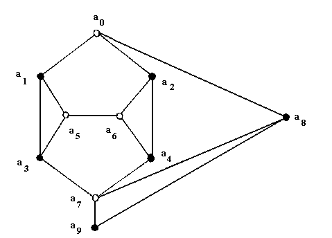
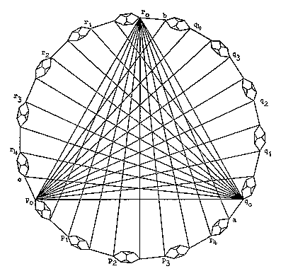
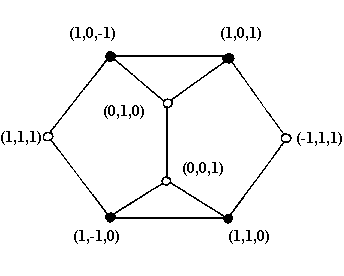

# 科亨-施佩克尔定理（KS 定理）The Kochen-Specker Theorem
*首次发表于 2000 年 9 月 11 日；2022 年 9 月 6 日实质修订。*

Kochen-Specker 定理是量子力学（QM）基础中一个重要而精微的主题。该定理证明了一类隐变量（HV）型 QM 解释的不可能——当人们开始思考解释 QM 的方案时，这类解释会自然浮现。本文分不同层次呈现该定理/论证及其基础讨论：想快速概览的读者应读第 1、2、3.1、3.2、4、6 节；通读全词条的读者可在补充文档中找到若干非平凡主张的证明。

## 1 导言

QM 有一个奇特性质：量子态对测量结果一般只给统计性限制。由此自然得出：这些态是量子系统的不完整描述——QM 因此不完整：个体系统的典型 QM 态描述，可以由一个以 HV 理论形式给出的更完整描述补充。在系统的 HV 描述中，QM 概率将被自然地解释为普通统计力学中出现的那类认识论概率。这样的 HV 描述或许没有实际用处，但人们忍不住想：它至少原则上应当可能。然而有两条强定理表明：这样的描述受到严格约束——给定至少初看可信的前提，QM 不能由 HV 理论补充。更有名的是贝尔定理：给定局域性前提，HV 模型无法匹配 QM 的统计预测。第二条反对 HV 理论的重要不可行定理是 Kochen 与 Specker 定理（KS）：给定非语境性前提（稍后解释），某些 QM 可观察量集合根本无法被一致赋值（甚至在统计分布问题出现之前）。

在详细看到 KS 定理的运作之前，须澄清它为何对科学哲学重要。下文通篇理解的 HV 解释的显前提是 **价值确定性**：

> (VD) 为 QM 系统定义的所有可观察量在一切时刻都有确定值。

（注意：对常被视为 QM 之 HV 解释的玻姆力学，此陈述须加限定。）[^note-1] VD 的动机是一个关于实验结果的、表面上无害的假定——它反映在把量子实验称为“测量”的习惯中：这些实验揭示独立于被测量而存在的值（注意：我们在此不需假定值被测量忠实揭示，只需假定它们存在！）。这提示第二个同样表面无害的假定，即 **非语境性**：

> (NC) 如果一个 QM 系统拥有一个性质（可观察量的值），那么它独立于任何测量语境而拥有它——即独立于该值 **最终如何** 被测量。

当应用于可在不同不相容测量中测量的特定性质时，NC 说：这些性质在这些不同测量情形中是相同的。

现在假设采纳通常的做法：把量子系统的性质（即是-否可观察量）与系统希尔伯特空间上的投影算符关联。

> (O) 量子系统的性质与系统希尔伯特空间上的投影算符之间存在一一对应。

KS 定理确立了 VD + NC + O 与 QM 之间的矛盾；因此接受 QM 在逻辑上迫使我们放弃 VD、NC 或 O 之一。

若满足这些条件的 HV 理论可行，我们就会有对 QM 统计特征的自然解释，以及一个优雅化解著名测量问题的办法——它纠缠着所有 QM 解释者（细节见量子力学词条与量子理论的哲学问题词条之测量问题一节）。KS 定理表明：满足这些条件的最直截了当的 HV 理论不是一个选项。HV 纲领只剩违反其中条件的选项；见玻姆力学与量子力学的模态解释诸词条。

## 2 KS 定理的背景

下文预设读者对‘态’‘可观察量’‘值’等初等 QM 概念及其数学代表（‘矢量’‘（自伴）算符’‘本征值’）有一定熟悉［细节见量子力学词条］。我们通常把可观察量与其希尔伯特空间上的算符视为同一；如需区分，算符以下划线加粗书写（因此算符 A 表示可观察量 *A*）。

本节陈述 KS 定理的历史与系统背景的若干要素。最重要的是：冯·诺依曼（1932）的一个论证、格利森（1957）的一条定理、对两者的批判讨论，以及贝尔（1966）稍后的一个论证。冯·诺依曼在 1932 年名著《量子力学的数学基础》中否定为 QM 提供 HV 基础的可能；其论证可归结为：若 A 与 B 是自伴算符，则其任意实线性组合（任意 C = αA + βB，α、β 为任意实数）也是自伴算符。QM 进一步规定：

1. 如果 *A* 与 *B*（由自伴算符 A 与 B 表示）是系统上的可观察量，则同一系统上存在可观察量 *C*（由前述定义的自伴算符 C 表示）。
2. 若对任意 QM 态，*A* 与 *B* 的期望值由 <*A*>、<*B*> 给出，则 *C* 的期望值由 <*C*>=α<*A*> + β<*B*> 给出。

现在考虑如上的 *A*、*B*、*C*，并假定它们有确定值 *v*(*A*)、*v*(*B*)、*v*(*C*)。考虑决定这些值的“隐态” *V*。于是可从 *V* 推导出平凡的“期望值”——恰是所拥有的值本身：<*A*>_{*V*} = *v*(*A*)，等等。[^note-2] 当然这些“期望值”一般不等于 QM 的那些：<*A*>_{*V*} ≠ <*A*>（我们确实会把后者想成对不同隐态 *V* 的前者的平均！）。然而冯·诺依曼要求 <*A*>_{*V*} 像 <*A*> 一样满足 (2)——这自动蕴涵：值本身必须满足一个与 (2) 平行的条件，即：

1. *v*(*C*) = α*v*(*A*) + β*v*(*B*)。

然而这一般不可能。一个例子极易表明 (3) 如何被违反；但正因其简单，它也暴露论证的不足（此例非冯·诺依曼所举，而是贝尔！[^note-3]）：令 *A* = σₓ、*B* = σ_{y}，则算符 *C* = (σₓ + σ_{y})/√2 对应沿平分 *x*、*y* 方向的自旋分量这一可观察量。所有自旋分量（在合适单位下）的可能值只有 ±1，于是 HV 拥护者被迫把 ±1 赋给 *A*、*B*、*C* 作为值，从而作为“期望值”；但 (3) 显然无法满足——±1 ≠ (±1 + ±1)/√2。

这个例子说明冯·诺依曼的论证为何不令人满意。没有人争议从 (2) 到 (3) 的推移对相容可观察量（照 QM 可在一个装置中联合测量者）的适用性；然而上面 *A*、*B*、*C* 的选择是：任何两个都不相容（不可联合测量）。对它们，我们不会要求任何 HV 解释满足 (3)，只要求 (2)。隐值一般不必与 (3) 一致；只有其值在一系列检验中的平均须与 (2) 一致。冯·诺依曼论证的权威来自：要求 (1) 与 (2) *对 QM 态而言*是 QM 形式主义的推论；但这本身不证明把要求扩展到假想的 **隐态** 正当。事实上若 (3) 无限制为真，这会漂亮地解释（在隐值存在情形下）(2) 为何为真。冯·诺依曼显然认为 HV 拥护者承诺这一解释；但这似是不合理的限制。

KS 定理弥补了这一缺陷，从而加强反对 HV 理论的论证：它只对全部彼此相容的可观察量集合 {*A*, *B*, *C*} 假定 (3)。定理只要求：对相容可观察量，假设 (3) 必须成立。

引向 KS 定理的第二条独立思路由格利森定理提供（Gleason 1957）[^gleason-1957]：在维度 ≥3 的希尔伯特空间上，唯一可能的概率测度是 μ(*P*_{α}) = Tr(*P*_{α} *W*)——*P*_{α} 是投影算符，*W* 是刻画系统实际态的统计算符，Tr 是迹运算。[^note-4] *P*_{α} 可理解为表示是-否可观察量：对“生活”在此希尔伯特空间中的 QM 系统是否具有性质 α 的提问；每个可能的性质 α 唯一对应空间中的矢量 |α>——任务是无歧义地为空间中所有矢量指派概率。QM 测度 μ 连续，故格利森定理实际证明：**对三维希尔伯特空间中一切可能性质的概率指派必须连续**——把空间中所有矢量连续地映入区间 [0, 1]。另一方面，HV 理论（若由 VD + NC 刻画）蕴涵：对每个性质都能说系统有或没有。这产生把所有 *P*_{α} 映到 1 或 0 的平凡概率函数；只要值 1 与 0 都出现（把数字解释为概率即可平凡得出），此函数显然必须不连续（参 Redhead 1987: 28）[^redhead-1987]。

格利森定理的证明出了名地繁复。但值得注意的是：其这一推论可以经比格利森证明初等得多的手段更直接地得到。贝尔（1982: 994, 1987: 164）把功劳归于 J. M. 若赫：他（1963 年）使贝尔注意到格利森定理，并指出它蕴涵对冯·诺依曼结果的加强——附加性要求只对可交换算符成立。贝尔接着以初等方式证明这一结果（未用格利森的证明）（Bell 1966）[^bell-1966]。贝尔不知道的是：斯佩克早已得出这一结果——在 Specker (1960) 中被暗示（未呈示），作为 **一个初等几何的论证**。[^note-5]该论证呈示于 Kochen and Specker (1967)。贝尔的证明与 Kochen-Specker 证明在三维希尔伯特空间使用相似构造，细节不同。Kochen 与 Specker 接着明确构造一个有限投影集——在要求附加性 (3) 当 *A* 与 *B* 可交换时成立的约束下，这些投影无法被赋值。贝尔虽未如此，从贝尔的构造同样容易得到一个有限的、在可交换算符附加性约束下无法赋值的可观察量集合（见 Mermin 1993）[^mermin-1993]。

在给出从格利森定理出发的反 HV 论证变体之后，贝尔转而批评它——策略与其反对冯·诺依曼者平行。贝尔指出：他自己的格利森型论证（针对两个相反值的点可任意接近）预设非可交换可观察量的值之间的非平凡关系；这些关系只在非语境性（NC）假定下才有正当性。作为对何处出错的分析，他提出：他的论证“默认假定对一个可观察量的测量必定给出相同的值，而与同时可做出什么其他测量无关”（1966: 9）。与冯·诺依曼相反，格利森型论证只对相容可观察量集合导出如 (3) 的值指派限制；但同一个可观察量仍可以是不同交换集的成员，而这些论证的要害在于：它在两个集合中被赋同一个值——值指派不对语境敏感。

## 3 KS 定理的陈述与证明

### 3.1 KS 定理的陈述

KS 定理的明确陈述如下：

> 设 H 是维度 *x* ≥ 3 的 QM 态矢量希尔伯特空间。存在 H 上的可观察量集合 *M*，含 *y* 个元素，使得以下两个假设相矛盾：
>
> (KS1) *M* 的全部 *y* 个成员同时有值——即无歧义地被映到实数（对可观察量 *A*、*B*、*C*……记为 *v*(*A*)、*v*(*B*)、*v*(*C*)……）。
>
> (KS2) M 中所有可观察量的值满足以下约束：
>
> > (a) 若 *A*、*B*、*C* 全部相容且 *C* = *A*+*B*，则 *v*(*C*) = *v*(*A*)+*v*(*B*)；
> >
> > (b) 若 *A*、*B*、*C* 全部相容且 *C* = *A*·*B*，则 *v*(*C*) = *v*(*A*)·*v*(*B*)。

定理的假设 KS1 显然是 VD 的等价物。假设 KS2 (a) 与 (b) 在文献中分别称 **和规则** 与 **积规则**。（读者应再次注意：与冯·诺依曼的隐含前提相反，这些规则只非平凡地关联 **相容** 可观察量的值。）两者都是更深层原则——函数复合原则（FUNC）——的推论；而 FUNC 又是（在其他假定中）NC 的推论。NC、FUNC、和规则与积规则的联系将在第 4 节明确。

KS 定理断言：存在一个具有特定性质（KS1 与 KS2 相矛盾）的集合 M[^note-6]，其证明通过为不同 *x*、*y* 选择明确呈示这样的集合而展开。原始 KS 证明中 *x*=3、*y*=117。更晚近，涉及更少可观察量的证明由（其他许多人之中）Peres（1991, 1995）给出 *x*=3 与 *y*=33；Kernaghan（1994）给出 *x*=4 与 *y*=20；Cabello *et al*.（1996）给出 *x*=4 与 *y*=18。KS 证明出了名地复杂；我们只在 3.4 节勾勒。Peres 证明以完全的力度、极大的简洁建立 KS 结果， moreover 直觉可达（它在三维运作）；请参 Peres（1995: 197–99）。Kernaghan 与 Cabello 等的证明各自在四维建立矛盾——当然弱于 KS 定理（三维中的矛盾也是更高维中的矛盾，反之不然）——但非常简单且有教益。 moreover，可以证明（Pavičić *et al*. 2005）[^pavičić-2005]：*y*=18 是 KS 定理成立的最小数目；故从 3.2 节呈现 Cabello 及合作者的证明开始。最后，3.5 节解释 Clifton（1993）的一个论证：*x*=3 与 *y*=8，加一个额外的统计假定，产生一个容易而有教益的 KS 论证。

### 3.2 四维中的快速 KS 论证（Cabello *et al*.）

一个特别容易的 KS 论证在四维希尔伯特空间 H₄ 中进行。我们将使用下一节证明的以下内容：

(1) 从 KS2 可导出一个对投影算符值指派的约束：对 H4 上可观察量 Q 的四个不同本征值 *q*₁、*q*₂、*q*₃、*q*₄ 所对应的每四个投影算符 *P*₁、*P*₂、*P*₃、*P*₄ 的集合，下式成立：

> (VC1′)   *v*(*P*₁) + *v*(*P*₂) + *v*(*P*₃) + *v*(*P*₄) = 1，其中 *v*(*P*_{*i*}) = 1 或 0，*i* = 1, 2, 3, 4。

（(VC1′) 是 (VC1) 的变体，我们在下一节明确证明。）这实际意味着：H4 中每四个正交射线的集合里，恰有一条被赋数字 1，其余为 0。

(2) 尽管定理中的希尔伯特空间为适合 QM 必须是 **复的**，要表明 KS1 与 KS2 不一致，考虑同维的 **实** 希尔伯特空间就足够了。故考虑实空间 R4 而非 H4，把 VC1′ 翻译成要求：R4 中每个正交射线集合里恰有一条被赋数字 1，其余为 0。照文献惯例，把这一切翻译成着色问题：*R4 中每个正交射线集合里恰有一条必须着白色，其余着黑色。*然而这不可能——下表立刻表明（Cabello *et al*. 1996）[^cabello-1996]：

| 0,0, 0,1 | 0,0, 0,1 | 1,−1, 1,−1 | 1,−1, 1,−1 | 0,0, 1,0 | 1,−1, −1,1 | 1,1, −1,1 | 1,1, −1,1 | 1,1, 1,−1 |
| --- | --- | --- | --- | --- | --- | --- | --- | --- |
| 0,0, 1,0 | 0,1, 0,0 | 1,−1, −1,1 | 1,1, 1,1, | 0,1, 0,0 | 1,1, 1,1 | 1,1, 1,−1 | −1,1, 1,1 | −1,1, 1,1 |
| 1,1, 0,0 | 1,0, 1,0 | 1,1, 0,0 | 1,0, −1,0 | 1,0, 0,1 | 1,0, 0,−1 | 1,−1, 0,0 | 1,0, 1,0 | 1,0, 0,1 |
| 1,−1, 0,0 | 1,0, −1,0 | 0,0, 1,1 | 0,1, 0,−1 | 1,0, 0,−1 | 0,1, −1,0 | 0,0, 1,1 | 0,1, 0,−1 | 0,1, −1,0 |

这张表有 4 x 9 = 36 个条目，取自 18 条射线的集合，每条射线出现两次。容易验证：每一列代表一个由四条 **正交** 射线组成的集合。既然有 9 列，我们最终必须得到表中着白色条目的 **奇数** 个。然而每条射线出现两次——每把其一着白色，就承诺把偶数个条目着白色。由此着白色的条目总数必须为偶数，而 **非** 奇数。因此与 VC1′ 一致地对这 18 条射线着色不可能。（为将来参考注意：论证第一部分——‘奇数’——只用 VC1′；第二部分——‘偶数’——本质依赖 NC：假定同一射线在不同列中的出现被赋相同数字！）

### 3.3 原始 KS 论证：技术预备

原始 KS 证明在三维复希尔伯特空间 H₃ 上运作。它需要两件事：(1) 在 H₃ 中正交的射线三元组的集合；(2) 一个约束——每个正交三元组中一条射线被赋数字 1，另两条为 0。两者可如下实现：

考虑 H₃ 上具有三个不同本征值 *q*₁、*q*₂、*q*₃ 的任意算符 *Q*，其本征矢 |*q*₁>、|*q*₂>、|*q*₃>，及投影到这些矢量所张射线上的投影算符 *P*₁、*P*₂、*P*₃。现在 *P*₁、*P*₂、*P*₃ 本身是可观察量（即 *P*ᵢ 是对应问题“系统对 Q 是否有值 *q*ᵢ？”的‘是-否可观察量’）； moreover 它们彼此相容，故可应用和规则与积规则，导出对值指派的约束（［VC1 证明］(kochen-specker.proofvc1.md)）：

> (VC1)   *v*(*P*₁) + *v*(*P*₂) + *v*(*P*₃) = 1，其中 *v*(*P*_{*i*}) = 1 或 0，*i* = 1, 2, 3。

对可观察量 *Q* 的任意选择定义新的可观察量 *P*₁、*P*₂、*P*₃，后者又选择 H₃ 中的射线。于是强令 *P*₁、*P*₂、*P*₃ 全都有值，意味着给 H₃ 中的射线赋数字；VC1 特别意味着：对任意 *Q* 的选择所规定的正交三元组（简称：H₃ 中的正交三元组），其射线中恰有一条被赋 1，其余为 0。引入不同的不相容可观察量 *Q*、*Q*′、*Q*″……后，这些可观察量在 H₃ 中选择不同的正交三元组。KS 定理的假设 (1)（实际即 VD）告诉我们：每个三元组都有三个值；VC1 告诉我们：对每个三元组，值必须恰为 {1, 0, 0}。KS 现在表明：*对 H₃ 中一个特定的有限正交三元组集合，给其中每一个（在公共射线上一致地）赋数字* {1, 0, 0} **不可能**。进一步反思得出：虽 H₃ 是复的，考虑实三维希尔伯特空间 R₃ 就足够——可表明：若按 VC1 的值指派在 H₃ 上可能，则在 R₃ 上也可能；逆否地，若在 R₃ 上不可能，则在 H₃ 上不可能。于是可满足使 KS 证明启动的必要条件，同时把问题约化到 R₃。R₃ 中 H₃ 的任意正交三元组之对应物，同样是正交射线三元组（简称：R₃ 中的正交三元组）。因此若 KS 想表明：对 H₃ 中 *n* 个正交三元组的特定集合（*n* 为自然数），给每个赋 {1, 0, 0} 不可能，只需表明：*对 R₃ 中 n 个正交三元组的特定集合，给每个赋* {1, 0, 0} **不可能**。这正是他们所做的。

应强调：在这一点上 R₃ 与物理空间无直接联系。KS 想表明：对要求以至少三维希尔伯特空间表示的任意 QM 系统，与条件 (KS2)（和规则与积规则）相结合的值归属不可能；为此考虑空间 R₃ 即足够。然而这个 R₃ 不表示该量子系统所处的物理空间——特别地，R₃ 中的正交性不应与物理空间中的正交性混淆。若转到物理空间中坐落、同时要求 H₃ 表示的 QM 系统之例——单粒子自旋-1 系统的自旋自由度——这就显而易见：给定物理空间中任意方向 α 与表示方向 α 自旋分量可观察量的算符 *S*_{α}，H₃ 由 *S*_{α} 的本征矢 |*S*_{α}=1>、|*S*_{α}=0>、|*S*_{α}=−1> 张成——它们在 H₃ 中彼此正交。对应一个空间方向上三个可能测量结果的这三个矢量彼此正交，例示了 H₃ 与物理空间中正交性的不同含义（原因当然在 QM 的结构：QM 用 H₃ 中的不同方向表示一个可观察量的不同值）。

KS 本人在抽象中 exactly 以同样方式行事，但用一个确实与物理空间建立直接联系的例子说明。看到这一联系很重要，但同样须清楚：它由 KS 的例子产生，并非其数学结果所固有。KS 提议考虑单粒子自旋-1 系统，及物理空间中正交方向自旋分量平方的测量 *Sₓ*²、*S_{y}*²、*S_{z}*²——它们相容（而 *Sₓ*、*S_{y}*、*S_{z}* 本身不相容）。[^note-7] 对自旋分量平方的测量只确定其绝对值。这里他们导出稍不同的值指派约束，再次用和规则与积规则（［VC2 证明］(kochen-specker.proofvc2.md)）：

> (VC2)   *v*(*Sₓ*²) + *v*(*S_{y}*²) + *v*(*S_{z}*²) = 2，其中 *v*(*S*_{α}²) = 1 或 0，α = *x*, *y*, *z*。

由于 *Sₓ*²、*S_{y}*²、*S_{z}*² 相容，存在可观察量 O 使三者都是 O 的函数。于是对 O 的任意选择固定 *Sₓ*²、*S_{y}*²、*S_{z}*²；由于后者可直接与 H₃ 中彼此正交的射线相联，又固定了 H₃ 中一个正交三元组的选择。由此产生的问题是：给一个由 O 的选择（或更直接地由 *Sₓ*²、*S_{y}*²、*S_{z}*² 的选择）规定的 H₃ 正交三元组赋数字 {1, 1, 0}。这当然是先前给这样的三元组赋 {1, 0, 0} 的问题的镜像，无需单独考虑。

然而选择具体的 O——它选择可观察量 *Sₓ*²、*S_{y}*²、*S_{z}*²——同时选择物理空间中的三条正交射线：即固定坐标系 ±*x*、±*y*、±*z*（规定沿哪些正交射线测量自旋分量的平方）**在物理空间中**。于是现在，通过选择可观察量 O，空间中的方向与 H₃ 中的方向之间 **确实** 有直接联系：H₃ 中的正交性现在 **确实** 对应物理空间中的正交性。对 R₃ 亦然（若为给 H₃ 提供论证而考虑 R₃）：R₃ 中的正交性现在对应物理空间中的正交性。重要的是注意：这一对应并非给出论证所必需——即使坚持纯数学事实应由物理诠释补充——因为刚才刚看到一个没有任何对应的例子。要点只是：我们 **能** 设计一个有对应的例子。特别地，现在可以跟随 R₃ 中的证明，同时想象一个坐落于物理空间中的系统——自旋-1 粒子——在测量三个物理量时返回三个值，这些量直接与物理空间中的正交方向相联：对任意选择的 *x*、*y*、*z* 而言的 *v*(*Sₓ*²)、*v*(*S_{y}*²)、*v*(*S_{z}*²)。KS 证明然后表明：把这些值赋给自旋-1 粒子的一切任意选择不可能（当然给定其前提）。即 KS 论证表明（给定前提）：自旋 1 粒子不能同时拥有它在不同测量装置中显示的所有性质。

KS 论证中已成为惯例的三个进一步特征需要提及：

(1) 显然，只需给出包含于其中的一点，就能无歧义地规定 R₃ 中过原点的任意射线。KS 因此把射线与单位球 E 上的点等同。KS 不需引用某点的具体坐标，因为其论证是“无坐标的”。不过为说明，我们有时提到具体的点，然后（a）用笛卡尔坐标检查正交性关系，（b）用不在 E 上的点规定射线（例如三元点 (0, 0, 1), (4, 1, 0), (1, –4, 0) 被用来规定一个正交射线三元组）。两种用法都符合近来文献（见例如 Peres (1991) 与 Clifton (1993)）。

(2) 把对值归属的约束 (VC1) 与 (VC2) 翻译成对点着色的约束：在 (VC1) 下运作时，把点着白色（“1”）与黑色（“0”）；在 (VC2) 下运作时，把点着白色（“0”）与黑色（“1”）。无论哪种情形，约束都翻译成同一个着色问题。

(3) KS 用图说明射线的正交性关系——这些图后来被称为 *KS 图*。图中每条射线（或规定射线的点）由一个顶点表示；由直线连接的顶点表示正交射线。着色问题于是翻译成：给图的顶点着白或黑，使相连的顶点不能同为白，且三角形恰有一个白顶点。

### 3.4 原始 KS 论证：证明概要。

KS 分两步进行。

(1) 在第一个（决定性的）步骤中，他们表明 **颜色相反的两条射线不可能任意接近**：首先表明图 1 所画的图 Γ₁（暂且忽略图中指定的颜色）可被构造，仅当 a₀ 与 a₉ 被 0 ≤ θ ≤ sin^{−1}(1/3) 的角 θ 分隔（［步骤 1 证明］(kochen-specker.step1.md)）。

>  图 1：着色不一致的十点 KS 图 Γ₁。

现在考虑（作为 **归谬法**）a₀ 与 a₉ 颜色不同：任意把 a₀ 着白、a₉ 着黑。着色约束迫使把图的其余部分着色为图 1 所示；但这要求 a₅ 与 a₆ 正交且都是白——被禁止。因此距离小于 sin^{−1}(1/3) 的两点不能有不同颜色；逆否地：颜色不同的两点不可能比 sin^{−1}(1/3) 更近。

(2) KS 现按如下方式构造另一个相当复杂的 KS 图 Γ₂：考虑 Γ₁ 在角 θ=18° < sin^{−1}(1/3) 下的一个实现；选择三个正交点 *p*₀、*q*₀、*r*₀，在它们之间安放咬合的 Γ₁ 副本，使一个副本的点 a₉ 的实例与下一副本的 a₀ 的实例相同。这样五个咬合的 Γ₁ 副本被安置在 *p*₀ 与 *q*₀ 之间，且所有五个 a₈ 的实例与 *r*₀ 相同（同样五个咬合副本被安置在 *q*₀ 与 *r*₀ 之间，把 a₈ 的所有副本与 *p*₀ 相同；以及在 *p*₀ 与 *r*₀ 之间，把 a₈ 的所有副本与 *q*₀ 相同）。Γ₂ 可构造性由构造本身直接证明：以 a₀ 实例间 θ=18° 的角度铺开五个 Γ₁ 副本，将铺开 5x18° = 90° 的角度——恰为所需； moreover 在比如 *p*₀ 与 *q*₀ 之间从一个副本走到下一个副本，等价于该副本绕过原点与 *r*₀ 的轴旋转 18°，显然保持副本的点 a₀、a₉ 与 *r*₀ 之间的正交性。

>  图 2：117 点 KS 图 Γ₂（**出自** Kochen and Specker 1967, 69；*经 Indiana University Mathematics Journal 许可*）[^kochen-1967]

然而尽管 Γ₂ 可构造，它却 **不能** 被一致地着色。从第一步知：θ=18° 的 Γ₁ 副本要求点 a₀ 与 a₉ 同色。既然一个副本中的 a₉ 与下一副本中的 a₀ 相同，第二副本中的 a₉ 必与第一副本中的 a₀ 同色；重复这一论证，a₀ 的所有实例必须有同一颜色。现在 *p*₀、*q*₀、*r*₀ 与点 a₀ 被等同——它们必须要么全白、要么全黑，两者都与着色约束（恰有一条为白）不一致。

从构造 Γ₂ 所用的 15 个 Γ₁ 副本中减去彼此相同的点，最终得 117 个不同的点。所以 KS 表明的是：117 个是-否可观察量的集合不能按 VC1（或等价地 VC2）一致地被赋值。

注意：在 Γ₁ 的构造（形成 22 个咬合三元组的 10 个点的集合）中，除 a₉ 外所有点都出现在不止一个三元组中；Γ₂ 中每个点出现在多个三元组中。正是在这里非语境性前提对论证至关重要：我们假定一个任意的点在从一个正交三元组走到下一个时保持其值 1 或 0（即从一个相容可观察量的极大集走到另一个时）。

### 3.5 三维中的统计 KS 论证（Clifton）

回想 KS 的第一步：确立颜色相反的两点不可能任意接近——正是这第一步承载论证的全部力量。贝尔以不同方式确立它，然后论证在非语境的 HV 解释中颜色相反的点必须任意接近。Clifton 在一个结合贝尔与 KS 思想的论证中利用的正是这第一步。

>  图 3：着色不一致的 8 点 KS-Clifton 图 Γ₃。

考虑图 3 所示的 KS 图 Γ₃——显然是 KS 的 Γ₁ 的一部分，但对八个点有额外具体赋值，满足正交性关系（从而直接证明 Γ₃ 可构造）。从先前的着色约束（相连的点不能同为白，三角形恰有一个白点）立刻可见：Γ₃ 可着色，仅当最外两点不都是白（那将要求——如图 3 所示——两个相连的点为白，与约束相反）。 moreover 容易算出最外两点之间的角是 cos^{−1}(1/3)。[^note-8] 于是得出：若想给全部八点着色、且想把外面之一着白，另一个必须是黑。考虑到可在 R₃ 中被角 cos^{−1}(1/3) 恰好分隔的任意两点之间插入一个图，并把问题从着色问题翻译回 KS 的例子（约束 VC2），得到约束 VC2′：

> (VC2′)   若自旋-1 系统在空间中的自旋方向 *x* 被赋值 0，则离开 *x* 一个 cos^{−1}(1/3) 角度的任何其他方向 *x*′ 必须被赋值 1；用符号：若 *v*(*S*_{*x*})=0，则 *v*(*S*_{*x*′})=1。

到目前为止的论证利用原始 KS 条件 KS1 与 KS2。现在额外假定：对值指派的任何约束都会表现在测量统计中。特别地：

> (3) 如果 prob[*v*(*A*)=*a*] = 1，且 *v*(*A*)=*a* 蕴涵 *v*(*B*)=*b*，则 prob[*v*(*B*)=*b*] = 1。

尽管用了统计，这一推理关键地不同于冯·诺依曼的论证：冯·诺依曼曾论证值之间的代数关系应转移到被测量值的统计中，因此 QM 对这些统计的约束应有值约束作为其精确镜像——这一推理使我们从统计约束（对任意可观察量）导出值约束。这里恰恰相反：我们独立于任何统计推理导出值约束，然后得出：这一约束应转移到测量统计之中。[^note-9]

现在 VC2′ 与统计条件 (3) 蕴涵：若 prob[*v*(*S*_{*x*})=0]=1，则 prob[*v*(*S*_{*x*′})=1]=1。然而这 contradicts 从 QM 为 prob[*v*(*S*_{*x*})=0] = 1 的态导出的统计。[^note-10] 事实上 *v*(*S*_{*x*′}=0) 的概率是 1/17——长期检验中 1/17 的自旋-1 粒子将违反该约束。

若接受 Clifton 的统计推理，就有一个完全有效的 KS 论证：确立 QM 的 HV 解释与 QM 本身的预测之间的矛盾。Clifton 还呈示一个稍复杂的 13 可观察量集合，沿同样的路线产生 1/3 的统计矛盾。

Clifton 的论证使用 8（或 13）个可观察量，固定其一（*S*_{*x*}）的值，并导出与 QM 对第二个（*S*_{*x*′}）的预测相抵触的 HV 预测。因此若能产生 QM 系统确定地有值 *v*(*S*_{*x*})=0 的态，预测就可以被经验检验；但以实验固定这样的态不容易。故 Clifton 的论证依赖一个可能难以产生或分离的态。近来人们找到 13 可观察量的构造，允许态无关的统计论证（Yu and Oh 2012）。

## 4 函数复合原则

KS 定理的关键成分是 (2) 中陈述的值指派约束：和规则与积规则。它们可从更一般的原则——所谓 **函数复合原则**（FUNC）——导出。[^note-11] 该原则利用一个数学事实：对作用于希尔伯特空间的自伴算符 A 与任意函数 f: **R** → **R**（**R** 为实数集），可定义 f(A) 并表明它也是自伴算符（故写 f(A)）。若进一步假定每个自伴算符都对应一个 QM 可观察量，则该原则可如此表述：

> **FUNC:** 设 A 是与可观察量 A 相联的自伴算符，设 f: **R** → **R** 是任意函数，使 f(A) 是另一自伴算符，设 |φ> 是任意态；则 f(A) 唯一地对应一个可观察量 *f*(*A*)，使得：
>
> > *v*(*f*(*A*))^{|φ>} = *f*(*v*(*A*))^{|φ>}

（引入态上标是为允许值对系统被制备于其中的特定量子态的可能依赖。）和规则与积规则是 FUNC 的直接推论［［和规则与积规则的证明］(kochen-specker.srprfunc.md)］。FUNC 本身不可从 QM 形式主义导出，但其统计版本（称 STAT FUNC）可以［［STAT FUNC 的推导］(kochen-specker.sfderiv.md)］：

> **STAT FUNC:** 给定如 FUNC 中定义的 *A*、*f*、|φ>，则对任意实数 *b*：
>
> > prob[*v*(*f*(*A*))^{|φ>}=*b*] = prob[f*(v*(*A*))^{|φ>}=*b*]

但 STAT FUNC 不只能从 QM 形式主义导出；它也 follows from FUNC［［STAT FUNC 证明］(kochen-specker.statfunc.md)］。这可视为“为 FUNC 提供可信性论证”（Redhead 1987: 132）[^redhead-1987]：STAT FUNC 就 QM 的数学而言为真。若 FUNC 为真，就能导出 STAT FUNC，从而把 QM 数学的这一部分理解为 FUNC 的推论。[^note-12]

但若不从 STAT FUNC 出发，如何导出 FUNC 本身？它是 STAT FUNC 与三个假定（其中两个已在导言出现）的直接推论：

> **价值实在论（VR）：** 若存在被操作性地定义的实数 α，与自伴算符 A 相联，且对给定态，QM 的统计算法对 A 产出实数 β、β = prob(*v*(A)=α)，则存在可观察量 *A*，其值为 α。
>
> **价值确定性（VD）：** 为 QM 系统定义的所有可观察量在一切时刻都有确定值。
>
> **非语境性（NC）：** 若 QM 系统拥有一个性质（可观察量的值），则它独立于任何测量语境而拥有它。

VR 与 NC 需进一步解释。首先解释 VR 的内容：QM 的统计算法告诉我们如何从给定态、可观察量及其可能值计算概率——这里把它理解为单纯的数学装置，没有任何物理诠释：给定希尔伯特空间矢量、算符及其本征值，算法告诉我们如何计算新数字（具有概率的性质）。此外，我们所谓“操作性地定义”就是指“由已知的、标示实在性质的数字构成”。于是 VR 实际说：若有实在性质 Γ（可观察量 G 的值 Γ），且能从 Γ 构造新数 α、并找到算符 A 使 α 是 A 的本征值，则（已满足应用统计算法的一切必要条件；因此）A 表示一个可观察量 A，其值 α 是实在性质。

其次，NC 的失败可以两种方式理解：要么可观察量的值可能是语境依赖的（虽可观察量本身不是）；要么可观察量的值语境依赖，因为可观察量本身如此。无论哪种情形，可观察量对语境的独立性都蕴涵可观察量与算符之间有对应关系——这一 NC 的推论正是稍后 FUNC 推导中将要使用的。我们确实将假定：若 NC 成立，这意味着 **可观察量**——**从而** 其值——独立于测量语境（即独立于如何被测量）。特别地，可观察量对语境的独立性蕴涵可观察量与算符间存在 1:1 对应；这一推论正是稍后 FUNC 推导中将要使用的。**反过来**，NC 的失败将被仅仅解释为 1:1 对应的失败。

从 VR、VD、NC 与 STAT FUNC 可如下导出 FUNC：考虑系统任意态与任意可观察量 *Q*；由 VD，*Q* 拥有值 *v*(*Q*)=*a*。于是对任意函数 *f* 构造数 *f*(*v*(*Q*))=*b*。对这个数，由 STAT FUNC，prob[*f*(*v*(*Q*))=*b*] = prob[*v*(*f*(*Q*))=*b*]。于是通过按 STAT FUNC 转换概率，我们创造了新自伴算符 f(Q)，并把两个实数 *b* 与 prob[*f*(*v*(*Q*))=*b*] 与之相联。这样由 VR，存在对应 f(Q) 的可观察量，其值为 *b*，故 *f*(*v*(*Q*))=*v*(*f*(*Q*))；由 NC，该可观察量唯一，于是 FUNC 得出。

## 5 逃脱 KS 论证

上一节澄清了 HV 理论家逃脱 KS 论证的可能：否定共同蕴涵 FUNC（从而和规则与积规则）的三个前提之一。

### 5.1 没有普遍的价值确定性

回想 VD 是一个完全成熟的 HV 解释的根本预设——若为逃脱反对 HV 解释之可能性的有力论证而放弃根本前提，似乎没什么意义。但一些解释者指出：在主张只有 QM 规定有值的可观察量有值[^note-13]与主张全部有值之间，有少许余地：提出一个不同于 QM 所规定的集合（但一般既不多于这些、当然也不全部）有值——这称“部分价值确定性”。一种做法是一劳永逸选出一组可赋确定值而不触犯 KS 定理的可观察量：最著名的例子是德布罗意-玻姆导波理论——位置与位置的函数总有确定值。另一种进路是让确定可观察量的集合随态而变：这是各种模态解释的进路。其变体是 Bub（1997）：选某可观察量 *R* 永远确定；然后把确定可观察量的集合扩展到避免 KS 障碍的极大集合。

模态解释的暗礁与险滩超出本文范围（见模态解释词条）。只注意：这些解释如何总能挑出被认为有值的正确可观察量集合，绝不清楚。“正确集合”最少意味着：我们知觉为有值的可观察量（对应测量装置指针位置者）必须总被包括，且总复制 QM 统计。还提到两个使模态解释可行性可疑的重要结果：其一，可表明部分价值确定性要么坍缩为总体价值确定性（即 VD），要么必须放弃关于物理性质的古典推理（Clifton 1995）[^clifton-1995]；其二，在某些模态解释中也可能导出 KS 定理（Bacciagaluppi 1995, Clifton 1996）[^bacciagaluppi-1995][^clifton-1996]。

近来有人论证：对 VD 的否认与 QM 本身不一致（Held 2008, 2012a, 2012b）[^held-2008]。该论证试图表明 VD 是理论本身的推论（QM → VD）。若确实如此，我们就有——回想 KS 确立 QM & VD & NC 蕴涵矛盾——QM 单独蕴涵语境性的论证；既然那种情形下 QM 也蕴涵 VD，最终得到论证：QM 必须以语境隐变量的方式解释。

### 5.2 否认价值实在论

FUNC 的推导本质上在于：从一个变量（即 *f*(*v*(*Q*))，这个数又从另一个变量即 *v*(*Q*) 构造）的概率分布、经由算符（即 f(Q)）构造可观察量（即 *f*(*Q*))。现在与其否认 *v*(*Q*) 在一切情形中存在（如第一个选项 5.1），我们可以拒绝：数 α 的存在与 f(Q) 的构造自动导向一个可观察量——即拒绝 VR；这等于拒绝对每个自伴算符都有定义良好的可观察量。

为表述 VR，我们曾不得不给统计算法一个缩减的读法：它是从矢量、算符与数字计算数字的单纯数学装置。这一读法非常人为：它预设使某些算符（如 Q）获得物理意义的最低限度诠释装置，可以被对另一些算符（如 f(Q)）扣留。

moreover，假定某些算符（与定义良好的可观察量相联的算符之和与积）本身不与定义良好的可观察量相联——即便它们在数学上从加项或因子继承精确值——似乎完全难以置信。举粗略的例子：这等于说问一个系统的能量是定义良好的问题，而问其能量的平方不是——即使从第一个问题的回答与平凡的数学，手头已有定义良好的答案。似乎没有好的先天理由为这一限制辩护。因此为使拒绝 VR 本身可信，人们提出额外提案：对 KS 论证至关重要的是，同一算符由彼此不相容的不同的极大算符构造——f(Q) 恒等于 g(P)，其中 PQ − QP ≠ 0。现在假定：只有经 *Q* 的 f(Q) 构造（而非经 *P* 的构造）在某语境中导向定义良好的可观察量。[^note-14]

然而这一举动自动使一些可观察量语境敏感。所以这种为否认 VR 辩护的方式相当于一种语境主义；本可以通过直接拒绝 NC、不对统计算法做任何手脚而更便宜地得到它（这一事实解释了为何我们在导言没把否认 VR 作为单独的选项提到）。

### 5.3 语境性

最后，我们可以接受 VD 与 VR，但否认对可观察量 *f*(*Q*) 的构造无歧义：这样，尽管 f(Q) 与 g(P) 数学上同一，可假定它们对应不同的可观察量——理由是 *v*(*f*(*Q*)) 的实际确定须经测量 *Q*，而 *v*(*g*(*P*)) 的确定涉及测量与 *Q* 不相容的 *P*。由于 *v*(*f*(*Q*)) 与 *v*(*g*(*P*)) 因而是不同测量情形的结果，没有理由假定 *v*(*f*(*Q*)) = *v*(*g*(*P*))。这一阻断 KS 证明的方式，是把 f(Q) 与 g(P) 理解为不同的可观察量（因对语境敏感），故等于拒绝 NC。文献中主要有两种方式推动这一步；相应地有两种重要的语境性要讨论——因果的与存在论的语境性。

KS 论证是针对 QM 系统所拥有的值提出的——独立于关于测量的考虑。事实上论证中测量只被提到一次，且以否定方式——在 NC 中。然而既然现在考虑对 NC 的拒绝，也须把测量及其复杂性考虑在内。为此最好再阐明另一条体现我们的无害实在论（见上文导言）的原则——忠实测量的原则：

> **忠实测量（FM）：** 对一个可观察量的 QM 测量，忠实地给出该可观察量在测量相互作用之前即刻拥有的值。

FM 也是一般自然科学极为合理的预设（注意 FM 蕴涵 VD，故本可用 FM 给出关于可能测量结果的 KS 论证）。现在考虑 HV 拥护者拒绝 NC 的动机：显然目标是拯救其他预设——尤其 VD。然而 VD 与 NC 是独立的实在论信念，NC 与 FM 则不那么独立。事实上我们将看到：对 NC 的拒绝在一种语境性中蕴涵对 FM 的拒绝，在另一种中强烈暗示它（这使导言那句隐晦的话更精确：赞同实在论原则 VD 但拒绝 NC 的解释应当是什么样子，并不显然——这样的解释将不得不违反第三个实在论原则 FM）。

#### 因果的但可观察量由同一算符 f(Q) = g(P) 表示。值的差别以可观察量的语境依赖性解释：后者是语境依赖的，因为物理地实现它们的不同方式以不同方式因果地影响系统，从而改变被观测的值。

一个性质（可观察量的值）可能是 **因果地** 语境依赖的：它对如何被测量因果地敏感。基本观念是：被观测的值作为系统-装置相互作用的结果而产生。因此，通过与 *P*-测量装置相互作用测量一个系统，可能产出值 *v*(*g*(*P*))；通过与 *Q*-测量装置相互作用测量同一系统，产出不同的值 *v*(*f*(*Q*))，尽管两个可观察量由同一算符 f(Q) = g(P) 表示。值的差别以可观察量的语境依赖性解释：后者是语境依赖的，因为物理地实现它们的不同方式以不同方式因果地影响系统，从而改变被观测的值。

若解释者想为因果语境性辩护，这将要求放弃 FM——至少对 *f*(*Q*) 型可观察量（非极大可观察量）而言：既然其值因果地依赖某些测量装置的存在，这些装置对值的产生因果地必需，值不能在系统-装置相互作用之前就存在，FM 被违反。因果语境主义的一个优点可指出：它不蕴涵所涉物理性质的存在论地位必须改变（即不蕴涵它们变成关系性的）——若对象中的性质经由与另一对象的相互作用产生，它仍可以是相互作用之后对象自身拥有的性质。然而因果语境性的理念有时被批判讨论：有理由认为它可能经验不适当（见 Shimony 1984, Stairs 1992）[^shimony-1984][^stairs-1992]。

#### 存在论的语境性

一个性质（可观察量的值）可能 **存在论地** 语境依赖：为使它定义良好，对它所“来自的”可观察量的说明是必要的。这样，为从算符 f(Q) = g(P) 构造定义良好的可观察量，需要知道它在物理上经可观察量 *P* 还是 *Q* 实现。这一走出 KS 问题的出路，最先由范弗拉森（1973）指出（但未提倡）。于是对一个算符 f(Q) 而言，有多少从极大算符构造 f(Q) 的方式，就有多少可观察量与物理性质的种类；然而没有进一步的解释，这一理念只相当于物理量的 **特设** 增殖。存在论语境性的辩护者肯定欠我们一个更明确的说明：可观察量 *f*(*Q*) 对可观察量 *Q* 的依赖。有两种可能浮上心头：

(a) 我们可能认为 *v*(*f*(*Q*)) 根本不是自我维持的物理性质，而是在存在论上依赖另一个性质 *v*(*Q*) 的性质（回想 FUNC 的证明中 *v*(*f*(*Q*)) **是** 从 *v*(*Q*) 构造的）。但由于这一立场不拒斥关于 *f*(*Q*) 在 *P*-测量情形中的值的问题（因为它不靠“可观察量只在一个语境中定义良好”的观念！），这至少会引出新的紧迫问题。作为为语境主义 **隐变量** 解释辩护的尝试，这一立场必须承认：不仅系统在 *Q*-测量情形中有值 *v*(*Q*)，在 *P*-测量情形中也有值 *v*′(*Q*)——尽管也许 *v*′(*Q*) ≠ *v*(*Q*)。现在关于这种情形中 *f*(*Q*) 的值的问题至少合法：*v*′(*Q*) 是否蕴涵另一个 *v*′(*f*(*Q*)) ≠ *v*(*f*(*Q*))？或 *v*′(*Q*) 与 *v*(*Q*) 相反根本不导向 *f*(*Q*) 的值？两个选项似乎都不可信——难道我们不能只在一个制备好的系统的 *P* 与 *Q*-测量情形之间切换，就把 *v*(*f*(*Q*)) 调入调出存在，或在 *v*(*f*(*Q*)) 与 *v*′(*f*(*Q*)) 之间切换吗？(b) 我们可能认为：为使 *f*(*Q*) 定义良好，一种测量装置而非另一种是必需的——这一理念强烈令人想起玻尔 1935 年反对 EPR 的论证，且确实可看作把玻尔关于 QM 的观点恰当地延伸到现代 HV 讨论（见 Held 1998, ch.7）[^held-1998]。在这一存在论语境主义版本中，性质 *v*(*f*(*Q*)) 不依赖另一个性质 *v*(*Q*) 的存在，而依赖 *Q*-测量装置的存在——这相当于一个整体论立场：对某些性质，只有当系统是某个系统-装置整体的一部分时，把它们说成属于该系统才有意义。这里关于 *P*-测量情形中 *f*(*Q*) 的值的问题 **确实** 变得不合法——因为 *f*(*Q*) 的定义良好与一个 *Q*-测量情形绑定。但又一次需要进一步澄清：这一立场是否主张与 *f*(*Q*) 相反、*Q* 本身在 *P*-测量情形中定义良好？若不是，*Q* 就难有值（定义不良好正是否认 *f*(*Q*) 有值的理由）——这意味着我们不再考虑所给类型的那种 HV 解释，根本无需阻断 KS 论证；若是，什么解释了在 *P*-测量情形中 *Q* 保持定义良好、而 *f*(*Q*) 失去这一地位？

在存在论语境主义的两个版本中 FM 变成了什么？若对这一立场如何被弄可信保持不可知，可以拯救 FM；若选版本 (a) 或 (b) 使其可信，则失去。先考虑对 NC 的不可知式否认：FM 说每个 QM **可观察量** 都被忠实测量。语境主义把一个可由两个不同不可交换算符构造的算符拆成两个可观察量；而存在论语境主义不试图给出会毁坏 FM 所体现的被测值对测量相互作用的因果独立性的因果故事——我们只引入更细粒度的可观察量概念，但仍可对新语境性可观察量施加 FM。

然而存在论语境性的具体版本，为语境性特征提供动机，毁掉了 FM：版本 (a) 允许 *f*(*Q*) 在 *P* 与 *Q*-测量情形的改变上被“打开与关闭”或在不同的值之间切换——对 FM 的公然违反；版本 (b) 也不见得好多少——它引入对测量装置的存在论依赖，很难看出这还能是什么，而只能是同一个因果依赖被推到更高的“存在论”音调上。 again 难道我们不能只来回翻转测量装置，来回改变 *f*(*Q*) 是否定义良好，从而把 *v*(*f*(*Q*)) 调入调出存在吗？

最后我们注意到：两种存在论语境性与因果版本相反，**确实** 蕴涵：我们先前认为内在的系统性质变成关系性的——其意义是：一个系统只有拥有某些其他性质、或与某个测量装置相关，才能拥有这些性质。

## 6 经验检验的问题

著名的是：QM 所规定的对贝尔不等式的违反已被实验证实。对 KS 定理是否可能有类似之事？应区分三个问题：(1) 是否可能实现 KS 作为定理动机而提出的实验？(2) 是否可能检验导向该定理的原则：和规则与积规则、FUNC、或 NC？(3) 是否可能检验定理本身？

(1) KS 本人描述了一个具体的实验装置，在单粒子自旋-1 系统上测量 *S*_{*x*}²、*S*_{*y*}²、*S*_{*z*}²——作为某个极大可观察量的函数。一个处于最低三重态的正氦原子被置于具有菱形对称的小电场 E 中；所论三个可观察量于是可作为单个可观察量（微扰哈密顿量 Hₛ）的函数被测量。由 E 的几何，H₃ 有三个不同的可能值；对它们的测量揭示 *S*_{*x*}²、*S*_{*y*}²、*S*_{*z*}² 中哪两个的值为 1、哪一个为 0（见 Kochen and Specker 1967: 72/311）[^kochen-1967]。这当然是一个实现上述值约束 (VC2) 的实验提案。能否也实现一个 (VC1) 实验——测量投射到某极大可观察量本征态上的交换投影算符集合？Peres（1995: 200）给出肯定回答，讨论了这样的实验，技术可行性参 Swift and Wright（1980）。然而 Kochen 与 Specker 的实验提案未被进一步追寻——因为它不提供对 NC 的直接检验：显然对 H_{S} 的一次测量只测一个正交三元组；HV 拥护者很可能假定隐态从一次 H_{S} 测量到下一次会改变（即使我们重新制备同一 QM 态），从而坚持 NC。

(2) 与 FUNC 的显现（即和规则与积规则）相结合，QM 产生像 VC1 或 VC2 那样 contradicts VD 的约束。因此提供能在给定和规则与积规则时例示如上 VC1 或 VC2 的具体物理例子还不够——必须问：这些规则本身能否得到经验支持。1980 年代初对这一问题有过相当多的讨论（明确地关于和规则是否经验可检验），且存在普遍共识：它不可检验。[^note-15]

理由如下：回想 FUNC 的推导只在最后一步（经由 NC）确立新可观察量 *f*(*Q*) 的唯一性——正是这一唯一性保证一个算符恰好表示一个可观察量，从而不同语境中的可观察量（从而其值）可被等同，这使人得以在不同的不相容可观察量之间建立间接联系。没有这最后一步，FUNC 必须视为相对于不同语境成立：联系被切断，FUNC 被限制到一组彼此相容的可观察量——这时 FUNC、和规则与积规则确实变成平凡的，对这些情形的经验检验将是无意义的问题。[^note-16] 是 NC 做了全部工作，值得通过检验“对不相容的 *P*、*Q*，使 *f*(*Q*)=*g*(*P*)，是否真有 *v*(*f*(*Q*))=*v*(*g*(*P*))”来检验。然而尽管 QM 与非语境 HV 理论对单个系统相互矛盾，这一矛盾涉及不相容的可观察量，因而不可检验（正如刚从 Kochen 与 Specker 自己的提案看到的）。物理学家为克服这一障碍做出巧妙提案：众所周知，双粒子系统与自旋分量乘积的考量导向非常简单的 KS 型证明（Mermin 1990b）[^mermin-1990b]；Cabello 和 Garcìa-Alcaine（1998）表明对这样的系统，QM 与非语境 HV 理论对每一个单一情形都做出不同预测——其推理不诉诸局域性考虑，但因需要两个粒子，这种考虑可能混入。Simon *et al*.（2000）把 Cabello/Garcìa-Alcaine 方案映射到单粒子的位置与自旋可观察量的组合上；实验已被实施并确认 QM 的预测（Huang et al. 2003；另见更近的 Huang et al. 2013）[^huang-2003][^huang-2013]。所有提到的作者都把实验提案视为对 NC 的经验反驳，但这受怀疑（Barrett and Kent 2004）[^barrett-2004]——理由见下段。

(3) KS 定理就其数学性质而言不是经验可检验的。但可以沿前几段的思路，尝试测量合适的 KS 不可着色集合的子集：特别地，应当可能产生沿 Clifton 例子（3.5）路线的情形——QM 与非语境 HV 理论做出可测地不同的预测。似乎这样的情形可提供对自然是否语境性的经验检验（虽不能检验是因果型还是存在论型）（这一进路的近版见 Tang and Yu 2017）[^tang-2017]。从 1980 年代起有人论证这样的检验不可能：据称 KS 定理为 HV 理论留下足够的漏洞——与 QM 相抵触却能复制 QM 的经验预测。Pitowsky（1983, 1985）论证可把注意力限制在 R₃ 中可着色的方向子集；但其论证依赖概率论的非标准版本，被视为物理不合理。Meyer（1999）利用数学事实：R₃ 中逼近 KS 集到任意接近、但具有 **有理** 坐标的方向集合 D_{M} 是 KS 可着色的——并论证：真实测量有有限精度，永远无法区分 R₃ 中的一个方向与其来自 D_{M} 的逼近。Kent（1999）把结果推广到所有希尔伯特空间；Clifton and Kent（2000）表明也存在方向集合 D_{CK}——每个方向是 **仅一个** 正交三元组的成员，逼近任意方向到任意接近。D_{CK} 中没有咬合的三元组，语境性问题不出现，D_{CK} 平凡地 KS 可着色。Clifton 与 Kent 还明确表明：D_{CK} 足够大，允许对值指派的概率分布任意接近所有 QM 分布。Meyer、Kent 与 Clifton（MKC）可理解为这样论证：即使对 KS 不可着色方向的经验测试确认了 QM 的预测，也不能证明自然是语境性的——由于检验精度有限，不可能反驳“我们不知不觉检验的是某个 KS 可着色集合的近旁成员”这一主张。对这类论证的一个明显反驳是：原始 KS 论证针对拥有的值而非被测的值；处理测量有限精度的 MKC 论证没有击中要害。我们也许无法在不同检验中检验恰好正交或恰好相同的可观察量，但断言这样的分量不存在的 HV 解释将很奇怪（见 Cabello 1999，载其他网络资源）。当然这样的非语境 HV 提案将对 KS 论证免疫，但它将被迫要么假定并非物理空间中连续多个方向的每一个都有可观察量，要么假定物理空间中没有连续多个方向——两个假定都不太有吸引力。

此外 MKC 论证即使对被测的值也不令人满意：它只在上述涵义之一上利用真实测量的有限精度，却在另一种上预设无限精度——MKC 对被测可观察量假定不同正交三元组的选择上有有限精度（因此我们一般不可能两次拥有恰好相同的可观察量、作为两个不同三元组的成员）；然而 MKC 仍假定三元组内部有无限精度（精确正交性——否则着色约束根本无从应用）。有人主张可利用这一特征反驳该论证、恢复语境主义（见 Mermin 1999 与 Appleby 2000，均载其他网络资源，及 Appleby 2005）[^appleby-2005]。

最后假定概率随我们在 R₃ 中改变方向而连续变化似乎有道理：因此单一情形中阻碍论证的可观察量选择的小缺陷（但只对被测的值！）会在长期消解（见 Mermin 1999，载其他网络资源）。这本身不构成论证——因为在 MKC 构造的可着色可观察量集合中，概率也（在一种意义上）连续变化。[^note-17] 不过可按如下方式利用梅明的推理。重新考虑 Clifton 的八方向集合（图 3）——它导向对最外点的着色约束，与 QM 统计以 1/17 的比例统计矛盾。使用 Clifton 与 Kent 的可着色方向集合 D_{CK}，无法为这八点导出约束（八点不在 D_{CK} 中）：在可着色子集中从一个互相正交的射线三元组走到下一个时，绝不会恰好碰到同一射线，只会碰到任意逼近它的射线。假定系统集合 S：其中对应 D_{CK} 成员、逼近图 3 八方向到任意接近的可观察量都有值（符合 HV 前提）。那么我们 **可以** 在如下涵义为最外点导出 Clifton 的约束：考虑系统子集 *S*′ ⊂ *S*——任何逼近点 (1, 1, 1) 的方向都得到值 1（白色）。为满足 QM 的预测，*S*′ 中所有逼近 (1, 0, −1) 与 (1, −1, 0) 的方向必须得到使值 0（黑色）概率极接近 1 的值；类似地，在另一个以逼近 (−1, 1, 1) 的方向有值 1（白色）的子集 *S*″ ⊂ *S* 中，所有逼近 (1, 0, 1) 与 (1, 1, 0) 的方向必须得到使值 0（黑色）概率极接近 1 的值。考虑 *S*′ ∩ *S*″ 的成员：其中任何一个，对任何以值 0（黑色）逼近 (1, 0, −1) 的方向，都会有一个恰好正交的点逼近 (1, 0, 1) 且也有值 0（黑色），使得有第三个正交点逼近 (0, 1, 0) 且有值 1（白色）；对 (0, 0, 1) 亦然。但 (0, 1, 0) 与 (0, 0, 1) 正交，且对 *S*′ ∩ *S*″ 的所有成员，**逼近** 它们的方向都有值 1（白色），而 QM 预测 **被逼近** 方向的值为 1 的概率是 0。为确保满足这一预测，*S*′ ∩ *S*″ 必须是 *S* 的极小子集——即 (1, 1, 1) 与 (−1, 1, 1)（图 3 最左与最右的点）的概率必须接近 0，并随 *S* 增大越来越好地逼近 0；QM 相反预测概率 1/17（还回想：选 13 个方向的集合，这个数字可推高到 1/3！）

Cabello（2002）用非常类似的推理表明：MKC 模型导致与 QM 可检验地不同的预测。对 D_{CK}，他实际使用上面勾勒的策略：QM 给出 Clifton-Kent 集合中方向的概率，其模型须匹配这些概率才能复制 QM 的预测；由于这些方向任意接近 KS 不可着色集合中的方向（或导向 Clifton 约束的方向），这对邻近点导出的限制被 QM 的预测可测地违反。对 Meyer 的 D_{M}，Cabello 的论证更强：他明确给出九个 **有理** 矢量的集合，导向与 QM 不同的预测（对其中三个方向）——Meyer 论证被有效反驳（不诉诸梅明的要求）：即使只有对应 R₃ 中有理方向的可观察量（这本身难以置信），一个假定它们全都有被测量忠实揭示的非语境值的理论，也将与 QM 可测地不一致。现在假定 Cabello 方向被检验、QM 预测被可靠确认，这将（在检验可靠性的限度内）构成自然是语境性的证明。

总之，只要假定存在连续多个 QM 可观察量（对应物理空间方向的连续统），建立在例如 Clifton 1993 或 Cabello/Garcìa-Alcaine 1998 提案之上的统计检验，仍完全有效——作为 QM 的经验确认，并经 KS 定理确认语境性。由于这些对 HV 纲领的统计违反是作为 QM、VD、VR 与 NC 一方面与 QM 及实验另一方面的矛盾而发生的，实验数据仍迫使我们面对三难困境：放弃 VD、VR 或 NC 之一。如我们所见，对价值实在论的否认最终等同于一种语境主义——故实际只有两个选项：(1) 放弃 VD：或对所有在正统解释中被禁止有值的可观察量（从而放弃如上定义的 HV 纲领），或对其子集（如模态解释所做的）；(2) 赞同某种语境主义。 moreover 就目前情况而言，两个选项之间的选择似乎不是经验检验的问题，而是纯粹哲学论证的问题。

## 脚注

[^note-1]: 玻姆力学的一个主要理念是：位置是唯一的基本可观察量，正统 QM 的所有其他可观察量都可还原为它。所以玻姆力学会这样限定 VD：“并非正统 QM 为物理系统定义的所有可观察量都在玻姆力学中定义，但那些定义了的（即只有位置）确实在一切时刻都有确定值。”对 VD 的这一修改与对 NC 的拒绝，立刻使玻姆力学对来自 Kochen-Specker 定理的任何反 HV 论证免疫。进一步的讨论见玻姆力学词条的第 10、11 节。

[^note-2]: 注意：若把从隐态导出的“期望”值理解为知道该态的人应预期的平均测量结果，则这一主张只有在忠实测量（FM）假定下才正确。FM 是 QM 的实在论（或非语境主义 HV）解释的另一典型假定。KS 论证可以在没有 FM 的情况下给出——它主张的是拥有的值，而非被测的值；只有在统计论证（如冯·诺依曼与 Clifton 的）中才须假定 FM。我们在正文中隐去 FM，语境性一节（5.3 节）除外。

[^note-3]: 见 Bell (1966: 4) 与 Jammer (1974: 274, 304)；另见 Kochen and Specker (1967: 82/322, theorem 3) 的平行例子与对冯·诺依曼的批评。这一批评最早由格蕾特·赫尔曼（1935）提出；据报告爱因斯坦也提出过同样的批评（见 Shimony 1993: 89）[^shimony-1993]。

[^note-4]: 除了是正的与归一化的（μ(id)=1，id 为恒等算符），格利森意义上的概率测度对互相正交的投影族必须是（可数）可加的——这一自然假定是 KS 对相容可观察量的假设 (3) 的类似物。

[^note-5]: 照贝尔（1987: 167），Kochen 当时不知道格利森的工作。

[^note-6]: 有人主张定理的陈述需要第三个条件：
>
> (KS2)(c)：存在至少一个可观察量 *X*，使 *v*(*X*) ≠ 0。
>
> […] 没有条件 KS2c，定理实际是假的——对所有可观察量 *X* 置 *v*(*X*) = 0 的平凡赋值提供明确的反例。

（见 Rajan and Visser 2017, p. 2，载其他网络资源。）但这是错误：定理断言存在一个赋值使 KS1 与 KS2 联合矛盾——可以说这一主张只能通过明确的例子证明；给出一个使 KS1 与 KS2 联合相容（非矛盾）的赋值（即“平凡赋值”）本身与定理的主张相容，但与其证明无关。

[^note-7]: 见 Kochen and Specker (1967: 71–72/310–11)。

[^note-8]: 由初等矢量代数，即：**a**·**b**=|a| |b| cos φ，其中 **a**·**b** 是矢量 **a** 与 **b** 的内积，φ 是它们之间的角。

[^note-9]: 两个论证（冯·诺依曼的与 Clifton 的）都预设忠实测量（FM）（另见脚注 1）。事实上 FM 的可能失效将是解释为什么对拥有值的某个约束不出现在测量统计中的自然方式。

[^note-10]: 一个 prob(*v*(*S*_{*x*}²)=0)=1 的自旋-1 粒子的态是 |*S*_{*x*}=0>。把这个态在 *S*_{*x*′} 的本征矢中展开，得：

> |*S*_{*x*}=0> = cos φ (1 + sin² φ) ^{−½} |*S*_{*x*′} = 0> + sin φ (1 + sin² φ) ^{−½} (|*S*_{*x*′} = −1> − |*S*_{*x*′} = +1>)

现在取 cos φ=1/3，得到：

> | prob(*v*(*S*_{*x*′}²) = 0) | = | prob(*v*(*S*_{*x*′}) = 0) |
> | --- | --- | --- |
> |   | = | (cos φ)² / (1 + sin² φ) |
> |   | = | 1/9 (1 + 8/9)^{−1} |
> |   | = | 1/17 |

[^note-11]: 见 Redhead (1987: 121)。另见 Kochen and Specker (1967: 64/299, eq. 4) 与 Fine and Teller (1978: 631)——在那里该原则以“函数关系条件”之名出现。

[^note-12]: 这里的论证出自 Redhead（1987: 132）。雷德海本人暗示其论证有内在张力：他评论说，从 QM 形式主义导出的 STAT FUNC 是关于（的概率的）*被测值*的陈述（见其评论：当 QM → STAT FUNC 时，后者“按测量结果的统计来理解”，p. 132），而 FUNC 谈论“可观察量的*拥有的值*”（p. 121，我的强调）——这一区分在某种程度上贬低了雷德海推理的价值：若在拥有的值与被测值之间存在实在差异、且没有明确假定等同两类值，那么可从 FUNC 导出的 STAT FUNC（版本 1）谈论的是*拥有的值*的函数之间的统计关系，而 STAT FUNC（版本 2）从 QM 导出，因而按定义谈论*被测值*的统计。两个版本起初完全不相干，FUNC → STAT FUNC（版本 1）不能为 STAT FUNC（版本 1）提供可信性。那么，难道我们没有好的理由在 QM 中仔细区分被测值与拥有的值吗？

幸运的是这样的区分其实不必要。首先区分拥有的值的强意义与弱意义：强意义中拥有的值是系统独立于被测量而拥有的值；弱意义中拥有的值是系统 **单纯地** 拥有的值——系统就是有它们，也许是测量的结果，也许不是。其次考虑系统因测量而“显示一个值”这一限定短语：至少必须是这样的短语进入统计算法为其给出概率的事件的描述；但这一限定短语实际多余——物理系统若不拥有某物，就不会显示任何东西。因此若系统在测量时显示一个值，它就拥有这个值（弱意义上）；相反，若系统在测量时显示一个值且测量是忠实的，它就独立于测量拥有该值（强意义上拥有）。（关于忠实测量的更多内容见正文 5.3 节；关于忠实测量与拥有值的联系另见 Redhead, p. 131 after eq. (11)。）现在，拥有值的弱意义足以表述 FUNC，而雷德海关于 STAT FUNC 的可信性论证未受触动（事实上 FUNC → STAT FUNC 的推导本身使用统计算法；若后者不指某种意义上拥有的值的概率，这将是非法的程序）。

[^note-13]: 说 QM 形式主义规定*任何*可观察量有值并不完全正确：事实上形式主义本身对值完全沉默（除了它经统计算法蕴涵的统计预测，见 Redhead 1987: 8）[^redhead-1987]。但正统解释的关键假定是本征态-本征值联结（见 Fine 1973: 20）[^fine-1973]：系统上的可观察量 *A* 有值 a_{*k*}，当且仅当系统处于态 |a_{*k*}>。模态解释的范弗拉森原始版本赞同这一原则的“仅当”方向（导向最小限度的值归属；这一方向等价于 Redhead 1987: 73, 120 的本征矢规则）[^redhead-1987]，而否认“当”方向——后者防止把多于最小限度的值归属给系统。

[^note-14]: 这是雷德海（1987: 135–36）对范弗拉森（1974）提案的解读。

[^note-15]: 见 Fine and Teller (1978: 636), Redhead (1987: 138) 及其中的文献。

[^note-16]: 我们的意思如下：可观察量 *f*(*A*)（或可观察量 *A* + *B*、*A*·*B*——都从可观察量 *A* 与 *B* 构造）的定义是：其值通过测量 *v*(*A*)（或测量 *v*(*A*) 与 *v*(*B*)）并把 *f* 应用于结果（或计算 *v*(*A*) + *v*(*B*)、*v*(*A*) *v*(*B*)）而算得。限定于一个测量语境的 FUNC、和规则与积规则，平凡地重复这些定义；显然检验诸如 *v*(*A*·*B*) 是否真的等于 *v*(*A*) *v*(*B*) 没有意义——若前一表达式由后一定义的话。

[^note-17]: “在一种意义上”这一限定来自如下事实：对应 R₃ 中全部方向的可观察量集合的可着色子集，既然是后者的真子集，在直观意义上本身不是连续的；不过我们可以定义一个从这样的可着色子集到 [0, 1] 的概率函数——它满足初等微积分的通常连续性定义。

## 参考文献

**以下文献从原文照录，不作翻译；中国文献译为中文。**

[^appleby-2005]: Appleby, D.M., 2005, “The Kochen-Specker Theorem”, *Studies in History and Philosophy of Modern Physics*, 36: 1–28.
[^bacciagaluppi-1995]: Bacciagaluppi, G., 1995, “Kochen-Specker Theorem in the Modal Interpretation”, *International Journal of Theoretical Physics*, 34: 1205–15.
[^barrett-2004]: Barrett, J. and Kent, A., 2004, “Non-Contextuality, Finite Precision Measurement and the Kochen-Specker Theorem”, *Studies in History and Philosophy of Modern Physics*, 35: 151–76. [[Preprint available online](http://arxiv.org/abs/quant-ph/0309017).]
[^bell-1966]: Bell, J. S., 1966, “On the Problem of Hidden Variables in Quantum Mechanics”, *Reviews of Modern Physics*, 38: 447–52; reprinted in his (1987) (page references are to the reprint).
[^bell-1987]: –––, 1987, *Speakable and Unspeakable in Quantum Mechanics*, Cambridge: Cambridge University Press
[^bohr-1935]: Bohr, N., 1935, “Can Quantum Mechanical Description of Physical Reality be Considered Complete?” *Physical Review*, 48: 696–702; reprinted in J. Kalckar (ed.), *Niels Bohr. Collected Works* (Vol. 7), Amsterdam: Elsevier, 1996, 292–98.
[^bub-1997]: Bub, J., 1997. *Interpreting the Quantum World.* Cambridge University Press.
[^cabello-2002]: Cabello, A., 2002, “Finite-Precision Measurement does not Nullify the Kochen-Specker Theorem”, *Physical Review*, A 65: 05201. [[Preprint available online.](http://arxiv.org/abs/quant-ph/0104024)]
[^cabello-1996]: Cabello, A., Estebaranz, J. and Garcìa-Alcaine, G., 1996, “Bell-Kochen-Specker Theorem: A Proof with 18 vectors”, *Physics Letters*, A 212: 183–87. [[Preprint available online.](http://arxiv.org/abs/quant-ph/9706009)]
[^cabello-1998]: Cabello, A. and Garcìa-Alcaine, G., 1998, “Proposed Experimental Test of the Bell-Kochen-Specker Theorem”, *Physical Review Letters*, 80: 1797–99. [[Preprint available online.](http://arxiv.org/abs/quant-ph/9709047)]
[^clifton-1993]: Clifton, R. K., 1993, “Getting Contextual and Nonlocal Elements-of-Reality the Easy Way”, *American Journal of Physics*, 61: 443–47.
[^clifton-1995]: –––, 1995, “Why Modal Interpretations of Quantum Mechanics Must Abandon Classical Reasoning About Physical Properties”, *International Journal of Theoretical Physics*, 34, 1303–1312.
[^clifton-1996]: –––, 1996, “The Properties of Modal Interpretations of Quantum Mechanics,” *British Journal for Philosophy of Science*, 47: 371–98.
[^clifton-2000]: Clifton, R. K. and Kent, A., 2000, “Simulating Quantum Mechanics by Non-Contextual Hidden Variables”, *Proceedings of the Royal Society of London A*, 456: 2101–14. [[Preprint available online.](http://arxiv.org/abs/quant-ph/9908031)]
[^cooke-1985]: Cooke, R.M., Keane, M., and Moran, W., 1985, “An Elementary Proof of Gleason’s Theorem”, *Mathematical Proceedings of the Cambridge Philosophical Society*, 98: 117–28; reprinted in Hughes 1989, 321–46.
[^fine-1973]: Fine, A., 1973, “Probability and the Interpretation of Quantum Mechanics”, *British Journal for the Philosophy of Science*, 24: 1–37.
[^fine-1974]: –––, 1974, “On the Completeness of Quantum Mechanics”, *Synthese*, 29: 257–89; reprinted in P. Suppes (ed.), *Logic and Probability in Quantum Mechanics*, Dordrecht: Reidel, 1976, 249–81.
[^fine-1978]: Fine, A. and Teller, P., 1978, “Algebraic Constraints on Hidden Variables”, *Foundations of Physics*, 8: 629–36.
[^gleason-1957]: Gleason, A.M., 1957, “Measures on the Closed Subspaces of a Hilbert Space”, *Journal of Mathematics and Mechanics*, 6: 885–93; reprinted in Hooker 1975, 123–34.
[^held-1998]: Held, C., 1998, *Die Bohr-Einstein-Debatte. Quantenmechanik und physikalische Wirklichkeit*, Paderborn: Schöningh.
[^held-2008]: –––, 2008, “Axiomatic Quantum Mechanics and Completeness”, *Foundations of Physics*, 38: 707–732. [[Available online.](https://link.springer.com/article/10.1007/s10701-008-9230-4)]
[^held-2012a]: –––, 2012a, “The Quantum Completeness Problem”, in M. R. Pahlavani (ed.), *Measurements in Quantum Mechanics*, Rijeka; InTech, 175–196. [[Available online.](http://www.intechopen.com/books/measurements-in-quantum-mechanics/the-quantum-completeness-problem)]
[^held-2012b]: –––, 2012b, “Incompatibility of Standard Completeness and Quantum Mechanics”, *International Journal of Theoretical Physics*, 51(9): 2974–2984. [[Preprint available online.](http://philsci-archive.pitt.edu/9080/1/Incompatibility24b.docx)]
[^hermann-1935]: Hermann, Grete, 1935,“Die naturphilosophischen Grundlagen der Quantenmechanik” *Abhandlungen der Fries’schen Schule*, 6. [[English translation, of the relevant section, by M.P. Seevinck is available online](http://www.projects.science.uu.nl/igg/seevinck/trans.pdf).]
[^hooker-1975]: Hooker, C. (ed.), 1975, *The Logico-Algebraic Approach to Quantum Mechanics*, Dordrecht: Reidel.
[^huang-2003]: Huang, Y.-F., Li, C.-F., Zhang, Y.-S., Pan, J.-W., and Guo, G.-C., 2003, “Experimental Test of the Kochen-Specker Theorem with Single Photons”, *Physical Review Letters*, 90 (25): 250401-1 – 250401-4. [[Preprint available online.](http://arxiv.org/abs/quant-ph/0209038)]
[^huang-2013]: Huang Y.-F., Li, M., Cao, D.-Y., Zhang, C., Zhang, Y.-S., Liu, B.-H., Li, C.-F., and Guo, G.-C., 2013, “Experimental Test of State-Independent Quantum Contextuality of an Indivisible Quantum System”, *Physical Review A*, 87: 052133-1 – 052133-10.
[^hughes-1989]: Hughes, R.I.G., 1989, *The Structure and Interpretation of Quantum Mechanics*, Cambridge, MA: Harvard University Press.
[^kent-1999]: Kent, A., 1999, “Noncontextual Hidden Variables and Physical Measurements”, *Physical Review Letters*, 83: 3755–57. [[Preprint available online.](http://arxiv.org/abs/quant-ph/9906006)]
[^kernaghan-1994]: Kernaghan, M., 1994, “Bell-Kochen-Specker Theorem for 20 Vectors”, *Journal of Physics*, A 27: L829–30.
[^kochen-1967]: Kochen, S. and Specker, E., 1967, “The Problem of Hidden Variables in Quantum Mechanics”, *Journal of Mathematics and Mechanics*, 17: 59–87; reprinted in Hooker 1975, 293–328 (page references to original and reprint).
[^meyer-1999]: Meyer, D. A., 1999, “Finite Precision Measurement Nullifies the Kochen-Specker Theorem”, *Physical Review Letters*, 83: 3751–54. [[Preprint available online.](http://arxiv.org/abs/quant-ph/9905080)]
[^mermin-1990a]: Mermin, N. D., 1990a, “Quantum Mysteries Revisited”, *American Journal of Physics*, 58: 731–34.
[^mermin-1990b]: –––, 1990b, “Simple Unified Form of the Major No-Hidden Variables Theorems”, *Physical Review Letters*, 65: 3373–76.
[^mermin-1993]: –––, 1993, “Hidden variables and the two theorems of John Bell”, *Reviews of Modern Physics*, 65: 803–815.
[^pavičić-2005]: Pavičić, M., Merlet, J.-P., McKay, B., and McGill, N. D., 2005, “Kochen-Specker Vectors”, *Journal of Physics*, A 38: 1577–92. [[Preprint available online.](http://arxiv.org/abs/quant-ph/0409014)]
[^peres-1991]: Peres, A., 1991, “Two Simple Proofs of the Kochen-Specker Theorem”, *Journal of Physics*, A 24: L175–8.
[^peres-1995]: –––, 1995, *Quantum Theory: Concepts and Methods*, Dordrecht: Kluwer.
[^pitowsky-1983]: Pitowsky, I., 1983, “Deterministic Model of Spin and Statistics”, *Physical Review*, D 27: 2316–26.
[^pitowsky-1985]: –––, 1985, “Quantum Mechanics and Value Definiteness”, *Philosophy of Science*, 52: 154–56.
[^redhead-1987]: Redhead, M., 1987, *Incompleteness, Nonlocality, and Realism. A Prolegomenon to the Philosophy of Quantum Mechanics*, Oxford: Clarendon Press.
[^redhead-1995]: –––, 1995, *From Physics to Metaphysics*, Cambridge: Cambridge University Press.
[^shimony-1984]: Shimony, A., 1984, “Contextual Hidden Variables Theories and Bell’s Inequalities”, *British Journal for the Philosophy of Science*, 35: 25–45.
[^shimony-1993]: –––, 1993, *Search for a Naturalistic World View, Volume II: Natural Science and Metaphysics*, Cambridge: Cambridge University Press.
[^simon-2000]: Simon, Christoph, Zukowski, M., Weinfurter, H., Zeilinger, A., 2000, “A Feasible ‘Kochen-Specker’ Experiment with Single Particles”, *Physical Review Letters*, 85: 1783–86. [[Preprint available online.](http://arxiv.org/abs/quant-ph/0009074)]
[^specker-1960]: Specker, E., 1960, “Die Logik nicht gleichzeitig entscheidbarer Aussagen”, *Dialectica*, 14: 239–46.
[^stairs-1992]: Stairs, A., 1992, “Value Definiteness and Contextualism: Cut and Paste with Hilbert Space”, *PSA 1992*, 1: 91–103.
[^swift-1980]: Swift, A. R. and Wright, R., 1980, “Generalized Stern-Gerlach Experiments and the Observability of Arbitrary Spin Operators”, *Journal of Mathematical Physics*, 21: 77–82.
[^tang-2017]: Tang, W. and Yu, S., 2017, “Construction of State-independent Proofs for Quantum Contextuality”, *Physical Review A*, 96: 062126-1–062126-9.
[^fraassen-1973]: van Fraassen, B. C., 1973, “Semantic Analysis of Quantum Logic”, in C.A. Hooker (ed.), *Contemporary Research in the Foundations and Philosophy of Quantum Theory*, Dordrecht: Reidel, 80–113.
[^neumann-1955]: von Neumann, J., 1955, *Mathematical Foundations of Quantum Mechanics* (German edition 1932), Princeton: Princeton University Press.
[^yu-2012]: Yu, S. and Oh, C.H., 2012,“State-independent Proof of Kochen-Specker Theorem with 13 Rays”, *Physical Review Letters*, 108: 030402-1–030402-5.

## 学术工具

* [如何引用本词条](https://plato.stanford.edu/cgi-bin/encyclopedia/archinfo.cgi?entry=kochen-specker)。
* [预览本词条的 PDF 版本](https://leibniz.stanford.edu/friends/preview/kochen-specker/)，见 [SEP 学会之友](https://leibniz.stanford.edu/friends/)。
* 在 [InPhO](https://www.inphoproject.org/entity?sep=kochen-specker&redirect=True) 查找与本词条相关的话题与思想家。
* 在 [PhilPapers](https://philpapers.org/sep/kochen-specker/) 查看本词条的增强文献目录及其数据库链接。

## 其他网络资源

- Appleby, D. M., 2000, “Contextuality of Approximate Measurements”。［预印本在线可得：http://arxiv.org/abs/quant-ph/0005010。］
- Cabello, A., 1999, “Comment on Non-Contextual Hidden Variables and Physical Measurements”。［预印本在线可得：http://arxiv.org/abs/quant-ph/9911024v1。］
- Mermin, N. D., 1999, “A Kochen-Specker Theorem for Imprecisely Specified Measurements”。［预印本在线可得：http://arxiv.org/abs/quant-ph/9912081。］
- Rajan, D. and Visser, M., 2017, “Kochen-Specker Theorem Revisited”。［预印本在线可得：http://arxiv.org/abs/1708.01380。］
- [arxiv.org 上的 Kochen-Specker 定理](http://xstructure.inr.ac.ru/x-bin/theme2.py?arxiv=quant-ph&level=1&index1=3004)
- [Ernst-Udo Wallenborn：“什么是 Kochen-Specker 定理？”](https://web.archive.org/web/20160315033351/http://theory.gsi.de/~vanhees/faq/epr/node7.html)（德语，但配有有用的图）

## 相关词条

量子力学的模态解释 | 量子理论的哲学问题

**（译注：相关词条的中文站内链接将由管线在对应词条重译完成后统一挂接。）**
