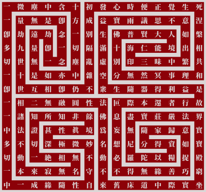

# 韩国哲学 Korean Philosophy

*首次发表于 2022 年 1 月 14 日。*

朝鲜哲学对人的本性、人在社会中的共同生活方式以及实在的构造，给出基本而全面的洞见。在过去约两千年里，它在朝鲜半岛及其毗邻地区逐渐发展；这片地区北面主要以中国大陆为屏、南面主要以日本列岛为邻。对朝鲜哲学家而言，哲学与其在共同生活中的实际践行通常携手并进。卡尔·马克思在《关于费尔巴哈的提纲》（1845）中著名地抱怨哲学家们只是解释世界而不改变世界。然而马克思的这一批评若指向朝鲜哲学便是无的放矢。因为朝鲜哲学向来专注于以其实在的日常语境中的践行去改变实在，而不止于“理论”（源自希腊语动词 *theorein*）。朝鲜的佛教、儒学及其他哲学，就其本性而言，归根到底都是实践取向的，无论它们偶尔被看出什么短处。因此，朝鲜哲学一贯强调自我修养、品格塑造与共同体中的领导力，以促进公共善。在受西方进路影响的习见划分中，我们通常把哲学设想为由形而上学、伦理学与知识论三部分组成。对朝鲜哲学而言，这就不够了。因为它没有公正对待哲学最本质的部分——自我修养之术（或可称之为“圣学”）才是本来意义的哲学最重要的部分。与形而上学、知识论和伦理学一样，自我修养之术当然有理论的成分，但其最本质的成分是实践的成分。研习它的人不仅必须拥有对它的理论理解，还必须把它内化，并在其与他人具体的关联中积极地践行它。实践取向作为朝鲜哲学的总体趋势，源于哲学与宗教的紧密关系——二者共同致力于把人从生存困境与缺点中解放出来（Cawley 2019）[^cawley-2019]。宗教通过与终极实在（Ultimate Reality）的合一经验追求解放，哲学则试图通过阐明这种合一、即通过对 ultimate reality 与其有条件显现之间关系的概念性证成，来帮助达成这一目标。从哲学传统曙光时期朝鲜最古老的佛教形态，到朝鲜本土的东学（*Tonghak*，Eastern Learning，见下文）哲学，再到朝鲜的主体（*chuch'e*，self-reliance，self-reliance）国家哲学，我们都见证了这一总体品格。因此，朝鲜一切主要的哲学运动都在宗教或准宗教实践之中、或与其紧密相连而发展，后者或作为根基，或作为分支。

朝鲜哲学还有一个特征：认为关系比进入关系中的实体更重要。不是实体使关系成为可能，恰恰相反。换言之，关系更本源、更实在。正是这样一种立场，才会看到关系型存在论的活跃发展，例如体（*ch'e*，體，Essence）用（*yong*，用，Function）范式、作为宇宙基质的无（*mu*，無，Nothing）、以及作为联结理（*i*，理，Principle）与气（*ki*，氣，Vital Force）的对偶概念的和谐概念等等（详见下文）。因此，朝鲜哲学的基本概念工具无法从最典型的西方实体-属性存在论的视角来理解（H. Kim 2020）[^kim-2020]。其一个结果是：朝鲜哲学倾向于一元论。这并不否认万物表面上独立的存在——毋宁说，它意味着万物是根本关系的“有机”结果。所以，朝鲜哲学中的那种一元论不是还原论的一元论，而是一种有机的一元论：万物是基本关系的诸样态或显现（Jung-Yeup Kim 2015）[^kim-2015][^kim-2015-2]。

下文中，我先在三国时代（公元前 57 年–公元 668 年）以前本土萨满信仰的背景下介绍其哲学框架（见第 1 节）。随后讨论统一新罗（668–918）与高丽（918–1392）时期的佛教哲学（第 2 节）。接着我系统呈现并检审朝鲜王朝（1392–1910）性理学所发展的哲学（第 3 节）。最后一节讨论朝鲜的现代哲学（第 4 节）。

## 1 “哲学之前”：萨满教的世界观

朝鲜人拥有一族独特的本土民间信仰，可称为“巫教”（*mugyo* 或 *musok*），或更一般地称为“萨满教”。朝鲜萨满教被认为源自西伯利亚-满洲传统，它是一种宇宙论洞见，关联于朝鲜最本土、最古老的世界观及其宗教仪式实践。这一本土民间信仰是崇拜自然、相信精灵的泛灵论的一种形态。换言之，这一朝鲜本土世界观效忠于寓居于众多对象中的精灵，并且有一个媒介（*mudang*，巫堂）连接人与这类精灵。因而，有栖居于岩石、树木、山岳等自然物中的精灵，也有天灵、地灵等等。最著名的精灵包括山神（*Sansin*，通常被描绘为脚边伴虎的老人）、独圣（*Toksŏng*，隐者）与七星（*Ch'ilsŏng*，北斗七星之精）。人们相信这些精灵有影响或改变生者与动物的命运及其环境的力量。但无一例外，它们都植根于一种游牧世界观，而且它们强调一种更普遍的天之观念——朝鲜人有时把它认作自己的祖先神；这一观念后来被转化为巩固政治权力及其意识形态的工具。因此，一然（Iryŏn，1206–1289）——一部中世纪史书的佛教作者——谈到朝鲜的开国君王檀君，人们相信檀君是一位萨满（P. Lee 1993: 6）[^lee-1993]。一般而言，萨满并非由制度任命，而是直接从上天本身接受任命。这提示世界被分为两个不同的领域：有条件的世界与彼岸世界。两个世界或领域由作为媒介的萨满居间沟通。至上之神“天帝”（*Hanullim* 或 *Hwanin*，桓因）在一切关于萨满的神话中扮演重要角色。诚然，萨满教本身不是哲学，但它确实为发展适于朝鲜化哲学观念的抽象思维提供了最初的概念场域。例如，凡影响人类生活的事件或现象必有原因这一观点。它还提示了一种初级的泛心论——自然中的一切都是有生命的、拥有灵魂或赋灵的观点。最后，它展示了一种带有人格化动因的宇宙发生论，这是对宇宙的另一形式的因果解释。

## 2 佛教在朝鲜的发展

### 2.1 朝鲜佛教的概念背景

十四世纪末，儒士与哲学家郑道传（鄭道傳，1342–1398）认为有必要对朝鲜佛教发起广泛的批评，因为他试图按性理学的愿景帮助建立新的朝鲜王朝。照他看来，朝鲜佛教在许多方面无可救药地缺陷累累、腐化堕落。最不幸的是，郑道传论证说，它以无（*mu*，無，Nothing）概念为根基，因而必然导向虚无主义，瓦解社会道德、扰乱政治秩序（郑道传《佛氏杂辨》，见 Muller 2015, 54-81）[^muller-2015]。这一批评显然牵强，从他同时代的佛教批评家涵虚己和（Hamhŏ Kihwa，涵虛己和，1376–1431）的回应（见下文）即可看出。尽管如此，它显示了郑道传的一个卓越洞见：他把无视为朝鲜佛教的奠基性观念——其哲学深深植根于空（*śūnyatā*）范式，作为万物依缘待起之相互共起的表达。我所谓“无”，在过去或曾以多种方式被指称，例如空（*kong*，空，*śūnyatā*）、虚（*hŏ*，虛）或“无极”（無極，infinite supreme）等等；但在本文中，“无”大致指那个不被世界中任何无常之物所引动的、原初的能动的而又寂静的维度。它是世界的自我本源。作为能动过程的一部分，它也构成一场无限的辩证运动的动量。从历史上说，这一范式有一种独特的结构，充当朝鲜一切主要思想传统的基本概念框架。

朝鲜的大乘佛教生长于印度次大陆佛教的原初形态与中国的变体，但它逐渐在朝鲜发展出自己的特质。在其关于实在本性的独特形而上学主张中，它极重视无对存在的优先性：存在不是分离而孤立的实体，而是无的显现。此外，这一观点主张：实在虽然不是二、不是分裂的，却可以以不同的方式被表达。这一观点突出地呈现于一心开二门之说以及二谛说（胜义谛与世俗谛）或其变体之中（详见下文）。最终，这一佛教思潮会归于涅槃（从苦中解脱的觉悟状态）与轮回（无尽的再生之轮、因而也是苦）在形而上学上同一的学说中，如东亚经典《心经》所示。

此外，在更广的东亚佛教场域内，朝鲜佛教被强劲的思想折衷倾向所主导，形成高度综合的话语。历史上的朝鲜佛教僧人在其著作中显示出显著倾向：聚焦于佛教内部各宗之间或佛教与其他宗教之间的分歧（Muller forthcoming）。正如很久之后在世界另一端的黑格尔那样，他们都娴熟地运用自己那套辩证思维来化解种种冲突：如空与有、教与禅、性恶与普遍佛性等等。

在佛教传统中，实在与其显现的关系曾以多种方式被刻画，例如空（*kong*，空）与色（*saek*，色）、般若（*chihye*，智慧）与方便（*pangp'yŏn*，方便）、理（*i*，理）与事（*sa*，事）、以及佛性（*pulsŏng*，佛性）与众生（*chungsaeng*，衆生）。但其最重要的应用——见于朝鲜佛教（也见于朝鲜性理学）——是体（體）与用（用）：体指人心的最深层、最根本的维度，例如作为纯然本具之心的佛心；用指这样一种心在世界中的显现活动。在这一语境中，体指心的潜在本性，用指人所表达的状态、情感或行为；而那状态、情感或行为可能属于一个未曾觉悟的普通人（Muller 1995）[^muller-1995]。

除了强调一切事物的空性以及体用范式之外，朝鲜佛教还效忠于佛胎（或佛胚）之说（*tathāgatagarbha*，如来藏）。这一观点主张：即使是迷妄的凡夫，其构造之中也本具觉悟的能力。心本自光明，却同时被客尘烦恼所暗。因此，心并非本质上无知，而只是偶然地、然而普遍地无知。心中的这一能力称为如来藏（例如见《楞严经》）。

### 2.2 朝鲜佛教的历史发展

正式地说，佛教在朝鲜的起源被追溯到三国时代早期的四世纪，由中国前秦的一位僧人传入。然而，被视为朝鲜佛教传统第一位杰出而最具开创性的佛教思想家的，是新罗（传统纪年公元前 57–公元 935 年）的元晓（Wŏnhyo，元曉，617–680）。他以综观的愿景广为人知：他主张最根本的佛教教义应当从圆融（*wŏnyung*，圓融）的逻辑来理解，这使他能够拥抱并调和佛教的不同思潮，而不放弃各自独有的东西。

佛教初到朝鲜时，是连同其一切经典作为整个文化包裹的一部分从中国传入的。古代朝鲜人对统摄在“佛教”这一共同名目下的庞杂教义家族、以及它们之间表面的矛盾，感到真诚的困惑。当他的多数东亚同代人信奉判教（*p'angyo*，汉：*panjiao*，判敎）时，元晓诉诸“和诤”（*hwajaeng*，和諍）：把各宗的不同立场看作从各自视角对整体实在的局部观点。这样，不同观点就能在其自身视角内得到更好的理解，并汇入一个被视为整合一体的大乘佛教体系。以这一进路，元晓阐明：它们都是那一整合整体中彼此关联、自洽的组成部分。他思想的广度不仅涵盖佛教，也涵盖唐代东亚哲学的全谱：他不仅援引大乘的主要经典，也援引佛教之外的文献，如道家老子与庄子。

元晓思想的核心是“一心”（*ilsim*，一心）概念及其形而上学与救赎论的意涵。一心不仅与一切众生之心等同，也与那些心所从显的根本基体等同。这一心虽然在外部显现为不净与无常，却被设定为本然清净、不改变的。如此，一心构成元晓佛教体系及其诸教义阐释的形而上学根基。然而，一心不是单义的，它有两面（“门”），彼此不同又彼此互补。第一，一心有一个绝对的、究竟的方面，即真如方面。一心的绝对方面是自体如是的真实在，但当它内在于有条件者时，则称为“如来藏”。后者作为在缠真如，是有条件之中的绝对心。这一如来藏可以是能动的——它能帮助众生之心达到觉悟；也可以是被动的一面——它能遭烦恼所覆。一心中还有世俗的“生灭”方面，即处于迁流不断的生死之中的存在领域——轮回。一心的这一世俗方面导向阿赖耶识（即藏识，见下文），后者储藏由过去行为所造的染污种子与习气。在这点上，藏识表达的是染污的心。但同一意识可以被净化，从而与如来藏统一——这将我们各人本具的无垢本觉（*pongak*，本覺）显露出来（S. Lee 2019）[^lee-2019]。元晓提示：阿赖耶识的净分与如来藏其实并无不同。总而言之，我们平常的心同时是迷妄的又是觉悟的（元晓《大乘起信论疏》，HPC 01.0701b24-c05）。众生可能本来觉悟，却仍须经历一个时间性的获得（或现实）觉悟的过程（Buswell, 2007: Part I: Study, 6）。

正因为有一心，觉悟的前景才是心本身固有的、并对一切众生内在可及的。既然这一前景无处不在，就连普通人也能通过净化其心而获得觉悟。在东亚经典《大乘起信论》中，这称为“本觉”（*pongak*）。的确，对元晓而言，宇宙整体就其自身而言，作为这样一种觉悟的表达，处于持续的自我实现过程之中（Rhi 1971）[^rhi-1971]。然而，这一真实在并不与平常、凡俗之心相分离。事实上，平常心有一颗种子，凭它可以抵达究竟。究竟实在即是 ultimate mind。所以，即便真实在并不字面地居于我们平常心中，我们仍可以触及它。这个觉悟被部分地、渐次地例示出来的心的开展状态，元晓称为“始觉”（*sigak*，始覺）。它是觉悟在凡俗领域中的现实的、时间性的实现。如同种子长成树，心正走向本觉这一最终目的、其果实。既然觉悟确实作为如来藏原本就寄存于心，种子一经发现，整个实在也就以其总体获得完全的揭示。在觉悟的那一刻，人们认识到：始觉其实与一直寄存于心中的本觉是同一个。

元晓的多种著述显示了朝鲜半岛上对世界根本形而上学实在的第一次大的系统探究。其著作《十门和诤论》（*Simmun hwajaeng non*，十門和諍論，见 Muller and Ngyyen 2012）[^muller-2012]不仅影响了法藏与澄观等中国大师，也影响了日本的凝然、善珠与定照。

义湘（Ŭisang，義湘，625–702）是元晓的年轻同代人，也出自新罗，是朝鲜华严（汉：Huayan）宗的创立者。其观点呈现于《海印图》（*haeindo*，海印圖）中——华严哲学的实在观与统摄一切的世界观在其中得到最明晰的象征。在这部作品中，差异与分别得到克服，并被显示为超越性整体的组成部分。然而，这一超越而凝聚的实在观的性质与特征，并非所有佛教徒都容易理解。我们所谓“宇宙”，既空无双性与自性，又仍能统摄地整合万物。华严宗的支持者用几个术语描述这一实在的诸方面，其中最一般、最统摄的描述性术语是“圆融”（*wŏnyung*）。

义湘如何在著述中传达他对“圆融”概念的理解？虽然下列非为穷尽，他通过制作一个有力而富有教益的视觉意象来阐明这一观念，并表述了一个统摄一切的普遍法门之“圆融”理解。《海印图》（*Sāgaramudrā Maṇḍala*）原题《华严一乘法界图》（*Hwaŏm ilsŭng pŏpgyedo*，華嚴一乘法界圖），排布如波状之形，象征法界以及华严教学的“六相”（*yuksang*）：总相（*ch'ongsang*，總相）与别相（*pyŏlgsang*，別相）；同相（同一相，*tongsang*，同相）与异相（*yisang*，異相）；成相（整合相，*sŏngsang*，成相）与坏相（*kwoesang*，壞相）。换言之，对自身存在之实在的觉醒，在此通过觉醒于诸对比之相的同时性而得到解释。人由此觉醒于普遍在特殊之中的同时存在，或本体在现象之中的同时存在。于是，轮回与涅槃常相调和。特殊的事（*sa*，事）与普遍的理（*i*，理）毫无分别地完全融合（义湘《华严一乘法界图》；另见 P. Lee 1993: 161–3）[^lee-1993]。

海印图 *Sāgaramudrā Maṇḍala*

确实，在这幅海印图中，华严宗的核心本体论学说“法界缘起”被描绘为镌刻在一方长方形印章（印玺）之上：一首三十颂、每行七字（共 210 字）的诗，构成一条有 51 个转折的连续迷宫线，暗示一切现象由于不执自性而随缘，在法性中相互联结而统一；这条线终结于其起点（居中的汉字“法”），例示了华严的根本学说相即相入，以及佛教的中心教义中道。图的整全与部分和谐地互相贯通而无碍。因此，此图是《华严经》一切教义的一个全面总结。

朝鲜佛教的下一个大思潮——瑜伽行（唯识）佛教——若没有中国大师玄奘（602–664）就不可能。圆测（Wŏnchŭk，圓測，613–696）出自新罗，但活跃并卒于唐代中国，是玄奘入室圈子的一员，但他们的关系可能随时间推移而疏远。不过，鉴于圆测完全信奉玄奘所译《成唯识论》，很难把他的立场看作与玄奘、乃至与后者的中国弟子窥基（窺基）有根本冲突。玄奘最重要的贡献是引入了众生五性各别（汉：*wuzhong xing*，五種性；梵 *pañcagotra*）学说——其新译充分显示，这一学说为其阿赖耶识观所蕴含。不幸的是，这一学说被视为与如来藏理论相矛盾，因为几乎人人假定如来藏理论必然蕴含佛性普遍内在于一切众生。鉴于这一有争议的意涵，圆测决意调和这两个看似矛盾的立场。圆测如何能同时接受如来藏与包括一阐提在内的五性——一阐提即超越救赎可能、永远失去成就涅槃之能力的种性？第一，对他而言，佛性属于理的层面，而五性属于行的层面，各有其佛性。由此推论：不定性者可以追求觉悟（不同于独觉（自悟者）、声闻（闻声者）与菩萨）。但不幸的是，这不适用于第五性，即一阐提。相反，圆测尝试把理层面的佛性与行层面的佛性相融合，从而得出两边各得其宜的解决。诚然，佛性应在理的层面得到承认。他可以接受如来藏的观点。但在行的层面，我们必须承认恶的实存现实，容许不定性者乃至一阐提的可能。一阐提全然无能力觉悟，但仍被视为若修五戒十善等，便可提升其地位至人身或天身。于是圆测能够主张：由于我们的如来藏为我们的救赎而运作，凭借实践中之佛性与理中之佛性的区分，我们都能获得救赎（S. Lee forthcoming）。

圆测的观点由此可以融贯地推进，而不背弃瑜伽行宗的教义——按该宗，一切有为存在皆依识而立。识是从出生到证悟一切活动的基础。除五种感官意识与两种概念意识之外，还有第八识，称为“藏识（*ālayavijñāna*）”。这是意识的主体部分，是其余七识的基础。世界中的一切由诸法构成；法是实在整体本性之内基本的相互依存的模式。每一法是一个心造物，带有由刹那事件之流构成的特殊过程（圆测《解深密经疏》）。后来，圆测的瑜伽行愿景经由其弟子道证（Tochŭng，道證，约八世纪）与大贤（Taehyŏn，大賢，约八世纪）传回朝鲜。

然而，不讨论知讷（Chinul，知訥，1158–1210，法号普照）的朝鲜佛教讨论就不完备。知讷是高丽王朝的僧人、禅（漢：*Chan*，日：*Zen*，禪）佛教——朝鲜佛教思想的主导宗派——的创立者。

他既是义学僧又是禅匠，毕生致力于在两个相互冲突的宗派立场之间创造和谐：一方强调禅修，另一方则献身于文字之学（*kyo*，敎）。他作为不知疲倦的改革家开始其事业。这一和谐通过把禅修实践引入并规范化于既有僧团而达成；这些实践后来成为禅宗、并最终成为整个朝鲜佛教的组成部分。他在禅门内的一项关键革新，是引入并阐发公案（*kong'an*，公案，the public case records）——或者不如说其关键成分“话头”（*hwadu*，話頭）的实践（Park 2005）[^park-2005]。

“话头”字面意思是“话之头”或“语之极限”。既然言语以心的分别模式为前提，话头就充当一个超越分别心与分别思的机制。在《看话决疑论》中，知讷提示话头产生“净智”（涤除之知见）（Chinul-CW, 244）。他随后称许地给出那个最典范的话头：

> 有僧问赵州：“狗子还有佛性也无？”州云：“无！”（同上，245）

大乘佛教的常识是一切众生皆有佛性。那么，为什么这位僧人要问一个显然荒谬的问题，为什么赵州给出一个悖论式的回答？在讨论这一话头、教导弟子如何用功时，知讷提示：“无”是“摧毁错知与错解的武器”。赵州的“无”在此既非肯定亦非否定。禅门弟子于是不应把它联系于某种教义理论——只需“留意把这个问题提在面前、注意力始终凝聚于此”。如此，当禅门弟子耐心走上话头这条曲折而有果实的道路，

> 不期然而然，刹那之间，学人于这无滋味、不可捉摸的话头上起一念证悟，一心法界彻底明现。（同上，246）

话头之法于是使弟子证悟心的真内性——佛性之本空——并进入涅槃之境（H. Kim 2014）[^kim-2014][^kim-2014-2]。

现在让我们考察禅门传统与义学诸宗在朝鲜佛教中的差别，以及知讷综合二者的方式。禅宗最独特地以实践为取向。此处的禅主要指定慧双修——三昧（定）与般若（慧）的联合实践（Keel 1984）[^keel-1984]。早在《劝修定慧结》与《修心诀》等早期著作中，知讷就强调“定慧双修”的需要。定意味着心的等持。当学佛者把注意力从可感事物的世界收回、转向内部，他便入禅修以求自身之内的不动之安。在此过程中，修学者练成纯粹的心的聚焦，达成一种平静的状态。这就是定。进而，当这种定自然产生心之穿透的能量时，心便被导向对世界与自我本性的探究，从而生起对实在的洞见。这就是慧——对世界与其中之自我的本性的超越性理解，伴随一种警醒的状态。禅于是兼取定与慧二者之长，最终导向对一切众生之源——实即整个世界——的发现。

那么，世界终极实在的本性是什么？知讷通常把世界的无为实在称为“真心”（*chinsim*，眞心）。这与佛性是同一个。“真”在这里指任何幻相的绝对缺席，或用他的话说，“离妄”。“心”指作为灵明之镜的实在之源。特别地，它不是用作个体人的心理官能。因此，真心不可恰当地描述，只能被象征。例如，它由《华严经》中的法界所象征。追随《华严经》，知讷主张世界的现象因心的运作而成。心外没有别立的世界。知讷于是谈“心即佛”。心造诸佛。

那么我们平常的心也是真心吗？不是。我们日常的心——离散的、经验的、有限的、个体的、分离的心——只是真心的现象、显现、表现。因为真心没有因果。它不在空间中，也不在时间中。它无始无终。再次受《华严经》启发，知讷主张一切现象相互依存、相互贯通。于是照他看来，在一己之心的镜中，有

> 法界圆明自作之用，常住不灭，含一切法之无碍互入……从不离于净觉之性（法界）。（Chinul-CW“圆顿成佛论”，216–217）

那么，如何在我们有限的身体性条件的范围内证悟心的这一真性？在《修心诀》中，知讷提示我们从话头之法的顿悟（初发悟）开始。这导向“我是佛”的愿景（142）。但从那之后我们该做什么？在其成熟期，知讷提出顿悟之后应继以渐修（144）。对心之真性的觉醒是突然的、直接的。尽管我们通过话头之法的成功施行而对真实在觉醒，我们仍须控制旧习、渐次培养各种品格特质。这是渐修的过程。最后，我们必须完全合拍地理解并践行（Keel 1984）[^keel-1984]。

总之，对心之不二本性的理解是顿然获得的，而对实践之恶的完全断除只能渐次达成。知讷由此发展出他的方案：在空性之名义下对我们的真性顿悟，继以渐修。作为一位优秀的朝鲜佛教僧人，知讷对顿渐（頓漸）之诤表现出一种漂亮的综合态度，提出顿悟渐修（頓悟漸修）的温和立场（Chinul-CW，《修心诀》，143），与之相对的是例如顿悟顿修（頓悟頓修，subitism，即顿悟之后继以顿修）（Peter H. Lee 1993, Vol. I, 418–419）[^lee-1993]。

### 3.1 朝鲜儒学的概念背景

## 3 儒学

我们要考察的下一个哲学传统是儒学，它在朝鲜最早的诸王国时期作为文化包裹的一部分从汉地中国逐渐传入。先秦与两汉的古典儒学极大贡献于朝鲜的文化、社会与文学，但在哲学与政治上，对朝鲜影响最大的是晚得多的、兴起于中世宋元明各代的性理学。孔子无疑是儒学的创始人，以仁为核心概念；但传统上朝鲜人热忱地信奉孟子关于善的人性是道德之基础的观念（特别是四端的观念，即恻隐之心、羞恶之心、辞让之心与是非之心；见《孟子》2A:6），以及这些观念在中国性理学中的实践/形而上学引申与发展。同样重要的是，朝鲜人对其在自我修养之路上面对世界之道德恶时的生存弱点与有限性的觉知；他们对这一脆弱性的情感方面及其解决作了尖锐的分析，并给出不寻常的自我改进的方剂。

朝鲜性理学中最重要的概念与存在论框架之一，是体（*ch'e*）与用（*yong*）这对概念。与佛教传统中一样，体用结构贯穿朝鲜性理学家的整个实在观，当他们把现象的内在结构与其外部表达联系起来时。于是，对这些性理学家而言，宇宙中的一切事物、过程与复合体都可以从两个方面来考虑，即体与用。与佛教中一样，“体”指某物的底层结构，它为其在世界中的活动或变化提供根据或模式。“用”则指隐藏者或不可见者所显现的东西。性理学家把体用范式应用于其哲学大厦最重要的部分，即宇宙论、道德心理学、圣学中自我修养的过程等等。必须记住：“体（*ch'e*，體）”字面意思是“身体”，它并不指一个被实体化的存在者，不像西方形而上学的实体概念。“体”与“用”指根本上同一个东西的两种不同方式或方面。在这个意义上，某物之体与其用不可分离。它们以无缝的方式互相拥抱。但二者之间确实有一个秩序或层级。体总被看作先于用。在这个意义上，它先于用、比用更根本。例如，性理学反复强调：人性（*sŏng*，性）在其未发（*mibal*，未發）状态——即尚未进入活动领域之时——是体，而日常生活中表达的情感是其用。在这一语境中，“体”指圣人之心（有时称为“道心”（*tosim*，*daoxin*，道心）），用则指常人的行为或人心（*insim*，*renxin*，人心）。这里的观念是：作为根本原则的底层者，可以在显现世界中被拉向一切方向。毫无疑问，这一体用范式与所谓“关联思维”密切相关：世界是一张相互联结的网，其中每一事物或现象都处于一个动态的关系循环之中，这些关系对某些其他事物是生产性的，对另一些则是非生产性的（Needham 1954）[^needham-1954]。

性理学家还接过了佛教的体-用（理-事）概念，把它转化为理气（*i-ki*，理氣，Principle and Vital Force）框架，再用它来阐发人的性与情。正是在朝鲜，本然之性与情感之关系的最先进讨论以所谓“四端七情之辩”（见下文）的形式发生；而四端七情之辩的开创者李滉（Yi Hwang，李滉，1501–1570，号退溪）提供了整个东亚传统中可能对体用范式最详尽的检审（Muller forthcoming）。

在继续之前，需要对理（理）与气（氣）作简要说明。第一，理指世界的普遍秩序，因此它是万物的无形而抽象、却又能动而动态的来源。它不仅是世界中一切事物存在的原理，也是它们的规范来源，即世界中善的来源。因此理本性为善，同时又超越，远远超出显现的现象世界的范围。更重要的是，人性正是这同一个理在人中的具体实例化。所以就这方面而言，人性本善。人有一个心（*sim*，汉：*xin*，心），其性（性）由天所赋。既然人性不是别的、正是居于人心之中的理，心就必然内在地指向理。注意：理自身不动，但它为现象世界中能动的东西设定界限。这是因为理自身是实在的组织性来源，虽然不可见，却为一切现象提供结构与模式。当理作为万有之源的充实性彰显出来时，理被称为“太极”（*t'aegŭk*，汉：*taiji*，太極）。太极于是指世界中事物发展之终极的形而上学根据，它通过其两仪（即阴阳二力）产生万物。

另一方面，气（*gi*，汉：*qi*，氣）是一种心理-物理的力或能量，可以充当理的载体。作为具体化的力，它是构成宇宙中一切东西的原初质料。追随宋代中国的朱熹，当时的性理学家典型地认为：理只能凭借气才能在世界上显现自己。当理由气显现在时空世界中时，它成为质（*chil*，質）。质指气变得浓厚密实时的状态。因此，理处处相同，而气则以不同的样态或性质得到实例化。例如，气精纯时自由流动，粗杂时则滞碍。

### 3.2 四端七情之辩的兴起

推翻佛教的高丽王朝而立的新王朝朝鲜，得到当时领衔的儒士文臣的强力支持。如上所述，郑道传在其《佛氏杂辨》（*Pulssi chapbyŏn*，佛氏雜辨，1398）中发动了对佛教最广泛的批评。但他的贡献不限于纯然否定的论战。他也是性理学世界观的意识形态设计师，完全投身于被气之力所主导的世界中的普遍理之秩序。但应当指出：郑道传对佛教的攻击并未无人应答，他同时代的佛教徒己和以《显正论》（*Hyŏnchŏng non*，顯正論）给出了令人印象深刻的回应；己和在书中就自我修养的事业给出了另样的、佛教的解释。己和表明：如何在伦理生活的再生产与既定的社会关系形式、情感的道德心理学、以及苦与恶的意义等问题的语境中，从佛教视角稳妥地回答“如何最恰当地修养自己的生命”这一问题。换言之，一个人可以作佛教徒而不放弃仁或孝的道德价值。他的回应显示了一种卓越的综合性、跨文化性与普世性的解决。佛教不是虚无主义。

尽管己和高贵的努力与优雅的解决值得称道，那并不是要扭转时代的决定性潮流，而且它过于孤立，无法遏制性理学的巨浪——当时的主流时代精神。继因政治斗争而早逝的郑道传之后，权近（Kwŏn Kŭn，權近，1352–1409）以及李彦迪（Yi Onjŏk，1491–1553）等人，把性理学无波折地推向哲学正统的地位。虽然这一阶段尚未准备好爆发性的创造力与想象力，朝鲜儒学的这一时期显然开启了一个汲取消化的新时代，恰当地为下一阶段的全面发展作了准备。其中，权近是最早系统发展理气形而上学的人之一：他提出我们心中的心必有其性，而那性不是别的、正是天理（*chŏnli*，天理）。换言之，心就其体而言是理，但就其用而言，由于与气相混，则发出情（*chŏng*，情）或意（*ŭi*，意）。他浑然不知的是，权近充当了后来所谓“四端七情之辩（见下文）”的催化剂（Kim 2016b）[^kim-2016b]。但直到十六世纪中叶，朝鲜性理学家才准备好超越单纯汲取消化的阶段，开始对性理学核心观念的深入理解给出丰富、能动的、生气勃勃的贡献。他们甚至带出了性理学原初形态中不流行的新主题。众所周知，随着发端于十六世纪中叶的“四端七情之辩”，朝鲜性理学家对我们省察生活中的情感之重要性提出了极具生气、令人印象深刻的贡献。这场论辩最初发生于退溪与奇大升（Ki Taesŭng，1527–1572，号高峰）之间，二人在 1559 年春天开始通信。作为“朝鲜儒学思想全部历史上最重要的思想事件”（Kalton et al. 1994）[^kalton-1994]，这场论辩表面上是关于四端与七情（如喜、怒、爱、惧、哀、恶、欲）的发源；但细察之下可见，它关乎（1）理（*i*）与气（*ki*）的形而上学——就其因果效力与规范性而言——是否可行；（2）其关于心、性与情的道德与心理哲学；以及最重要的，（3）在我们的有身之省察生活中，如何尽善地成就圣境、而不为情感所累。

论辩之初，退溪提出：

> 四端之发，纯理也，故无不善；七情之发，兼气也，故有善恶。（《答高峰书》第一书，A1a，1559 年春，见李滉［退溪］全集第 1 册第 16 卷，402a；Kalton et al. 1994, 1）[^kalton-1994]

让我们称之为“分离发用”论题。退溪在此的基本洞见，根本上被他对自我修养——他所谓“圣学”——的深刻兴趣与体验所导向（见其《圣学十图》，Kalton 1988）[^kalton-1988]。退溪论证说，诉诸单义的情感概念在社会语境中所扮演的多种角色，并无助益。退溪的策略于是是：一方面把四端（以及道心）奠基于能动的理，另一方面把七情（以及人心）奠基于气，从而把情感按其差异截然二分。特别地，他极为谨慎地想要确保：由我们的形气之性所产生的、可能走偏的情感，不致损害孟子四端中趋于恰当的根本动力（Ivanhoe 2015）[^ivanhoe-2015]。

在其回复中，高峰批评了退溪“分离发用”论题所蕴含的明显的二元论。他说四端与七情都是同一品类的人的基本情感。在其致退溪的第一封信中，高峰大胆地提出：四端是七情之善的一边。让我们称之为四七连续体论题。照高峰的看法，退溪的谬误归根到底源于后者的假定：四端与七情是两种彼此分离的情感，因此有两种善的情感——七情中的与四端中的。把理与气看作彼此独立也是错的。

后来，高峰有力的回复使退溪承认：当心被发动时，理与气其实都在一切情感的发源中在场；他按刺激来区分二者的尝试不得不修订。作为回应的一部分，退溪提出了一个承认理气相互依存的作用、但赋予不同权重的公式：就七情而言，气发而理随之；就四端而言，理发而气随（李滉［退溪］全集第 1 册第 16 卷，417b）。于是，退溪不再坚持原来的“分离发用”说，而是提出“互发”（*hobal*，互發）之说：在四端的情形中由理发用，尽管在理气关系中，理传统上不被视为能自发动的行动者（Chung 1995: 73）[^chung-1995]。退溪此时承认四端与七情都是人的基本情感，且二者发用时都同时涉及理与气。如他所说：

> 理气相须，互为其体（*ch’e*）用（*yon*）。（李滉［退溪］全集第 1 册第 16 卷，405a）

然而他仍坚持它们是不同的东西，因为它们发源于不同的源头。照他的看法，四端关联于本然之性，因为它们受天理所启示、与生俱来而本善；七情则关联于形气之禀，因为它们因接触外物而起，可以为善也可以为恶。七情不是真正的道德情感。从孟子的视角看，自我修养要求涵养四端、并对七情施行情感控制。于是对退溪而言，四端连同理，无论事情的进程如何，始终保持其超越的、独立的地位，并且保有发动可欲的行为模式的因果效力。他在《四端七情分理图》与《非心无体用辨》等著作中多种表述为：“理发（理發）”、“理动（理動）”与“理自到（理自到）”（李滉［退溪］全集第 1 册第 16 卷，464-465a）。

显然，退溪强调理在自我修养之路上的作用，是因为其自主的品格。他开出的方剂是：自我修养唯有通过扭转气的盲目取向、并经由“敬”（*kyŏng*，敬）的实践来涵养人性，方能达成。在《圣学十图》中，退溪提出“敬者圣学之始终”（李滉［退溪］全集第 1 册第 7 卷，203a）。这有内外两个方面：在外部，敬总是被合于严格恪守礼法之善行的儒家理想所启示与约束（Chung 1995: 134）[^chung-1995]。于是敬包含“暗室屋漏之中常存戒惧”，也包含“整齐严肃、庄重安静”。在内部，敬的实践还包含保持自己内在的精纯状态。早在与高峰的四七论辩中，退溪就提出：当心的本然状态通过“主一无适”得以持守、并通过“外以律己而内以养心”得以达成时，敬就成就了（李滉［退溪］全集第 1 册第 7 卷，203b；Kalton 1988, 85–87）[^kalton-1988]。

退溪去世数年后，一场新的四端七情之辩被点燃，这次是在李珥（Yi I，号栗谷）与其友成浑（Sŏng Hon，号牛溪）之间——后者于 1572 年致信前者。牛溪是退溪四七关系理解的热忱追随者，因此可以稳妥地假定：牛溪是代退溪与栗谷论辩。追随退溪，牛溪提出四端与七情分别来自理与气。牛溪随后用一个著名的比喻把理与气比作控马之人，正如退溪解释其互发说时所做的那样。

牛溪回应栗谷，坚持：

> 四端是七情之善边。七情包四端。（Kalton et al. 1994: 131）[^kalton-1994]

于是，照栗谷的看法，四与七并不分离，毋宁说前者是后者的一个真子集。栗谷的观点之所以重要，是因为它把我们推入已发情感的更深处。面对善恶之情，是什么使我们能够说善情优于恶情？栗谷提示：如果人们在生活的相关情境中把理与气的作用分离开来，就不可能取得真正的进展。至于理的本性，栗谷有力地否认其超越的、独立的存在以及其因果效力。理“通”（*itong*，理通）而气“局”（*kiguk*，局）：理就其自身而言在因果上无能，唯有随气而行时才获得其能动性（李珥［栗谷］全集，10.26a）。然而，这并不因此意味着理与气彼此独立。尽管理是结构化规范的普遍秩序，气才是唯一的特殊化力量，按理的模型推动事物。栗谷于是主张：

> 大抵理是气之主，气是理之所乘……非二物，而又非一物。非一物，故一而二；非二物，故二而一。（李珥［栗谷］全集，10.2b）

在自我修养方面，栗谷提出一个“诚”（*sŏng*，誠）的模型以成圣（Ro 1989）。诚是自我修养的根基，因为它使人能够涵养自己的气，心则能借其能动性成为身体的主宰、人性与情感的统帅。而诚作为转化我们内部之气的源头之所以奏效，恰恰因为它是天理之真实、心之本然。心由此本来具足诚作为其固有的道德品质。

四端七情之辩以这样那样的形式一直延续到二十世纪初。退溪与栗谷及其应对这一挑战的对立策略，在朝鲜性理学思想史上高耸入云。事实上，四端七情之辩后来漫延为另一场论辩（“湖洛（*Horak*，湖洛）之辩”）：韩元震（Han Wŏnjin，1681–1751）与 Yi Kan（1677–1727）就人性与禽兽之性有无差别、以及在道德共同体中人性能在多大程度上为人提供免于恶的庇护，展开长期讨论（R. Kim 2015）[^kim-2015][^kim-2015-2]。它还点燃了心说（*Simsŏl*，心說）之辩，从十九世纪中叶一直延续到二十世纪。

### 3.3 新思潮的挑战

朝鲜在壬辰倭乱（1592–1598）——十六世纪世界最大的冲突，牵动朝、日、中近五十万作战人员——以及满洲-清的两次入侵（1627 与 1637）中遭受彻底的蹂躏。其结果是，原初形态的古典朝鲜性理学开始瓦解。这表现为从阳明学的视角对心之本性的重新、如今更为积极的兴趣，例如郑齐斗（Chŏng Chedu，鄭齊斗，1649–1736）。我们也看到一些朝鲜女性儒学哲学家的活动，例如任允挚堂（Im Yunjidang，任允摯堂，1721–1793）与姜静一堂（Kang Chŏngildang，姜靜一堂，1772–1832）（Ivanhoe & Wang forthcoming）。但更突出的是，十八世纪，一批对朝鲜社会政治现实更敏锐的哲学家开始拒斥四端七情之辩所预设的形而上学取向框架，转而提供高度自然主义的宇宙论与圣学原理——即今日所谓“实学”（實學，Practical Learning）。这些哲学家包括柳馨远（Yu Hyŏngwon，柳馨遠，1622–1673）与李瀷（Yi Ik，李瀷，1681–1763）等人。其中也有“北学派”（*Pukhakpa*，北學派）的成员，他们对来自清朝的新思想与新技术抱有强烈兴趣。这些学者包括洪大容（Hong Taeyong，1731–1783，号湛轩）、朴趾源（Pak Chiwon，1737–1805）与朴齐家（Pak Cheka，朴齊家，1750–1850）。这些都是改革派思想家，立志革新他们视为过时的时代学人与社会之观念与生活形态。特别是，实学学者普遍强调效用与增进人类经验福祉。

但正是丁若镛（Chŏng Yagyong，丁若鏞，1762–1836，号茶山）对传统提出了最广泛的批评并构造了新体系，有时甚至借用耶稣会士的著述来创造一种新的性理学形态。最重要的是，他明确解构了性理学的理气范式，通过（部分地）整合西方理论（而不摒弃儒学的核心要素）把它转变为一个新范式。他拒斥理气结构，因为在理与气中没有情感的位置，它们也不包含行动者的意志活动（Baker 2010）[^baker-2010]。如前所忆，古典性理学主张心有超越的本性作为其体（*ch'e*）。就其禀赋而言，即就体而言，心基本上是其天禀之性。但就其用而言，人心在于其多样的情感。茶山不否认心有性，但他否认理是心的本质——不像传统性理学所主张的那样，即以其超越的品格。茶山人格哲学中最引人注目的，是这样一个观点：人性是心的一个组成部分，它唯独在于其嗜好（嗜好 *kiho*），即好善恶恶。这一嗜好纯粹自发、自然而然，没有外部任何添加或混杂，因而是天赋的。人性只是心的一个环节或品格。茶山欣然承认心及其天赋嗜好“构成一个统一的人性”，但他明确表示：这里的性并非表达任何超越的价值，而必须指心中固有的自发之好。所以我们不能仅仅因为拥有它而受赞扬，也不能因此受责备。我们的性天然向于道德之善，正如蜜蜂天然向于保护其蜂后。在这个意义上，这一性是固定的。心的全部特征与长处，则不能为其性所穷尽（Ivanhoe 2016）[^ivanhoe-2016]。

那么人心之性本善吗？茶山没有直接讨论这一问题，但我们可以推断他的回答必是两面的。作为向善的天赋嗜好来理解，它必定本善。然而就其实际施行而言，心只是善恶的一种潜能。换言之，作为道德责任核心的心，向种种选项敞开。这提示心还有其他成分。例如，人心有自主之权（自主之權）或权衡（權衡）之力（《孟子要旨》，与犹堂全书 II, 5:33b）。这是人的一种能力，凭它人能够行善或作恶，而不被任何外部事物或其内在本性所决定。显然这一力量居于心中。当具有自主之心最终发出一个行动时，它将被评判为可称赞的或可责难的。但要发出行动，心必须首先运用灵明（靈明）的精妙之力。这是审议与评价的实践能力。它还握有施行的力量，即把被判定为有价值的东西贯彻到底的能力，即便抵住外部的刺激。凭借自主之权的学说，茶山事实上成为整个东亚第一位明确倡导以人之能动性与道德之根基处的自由哲学的哲学家。由此我们可以看到一种天主教（托玛斯主义）-儒学的综合在他的哲学中运作。茶山谨慎而有选择地接受耶稣会士利玛窦传给他的托玛斯主义哲学，完成一次范式转换，铸成一个全新的、独特的儒学体系（Baker 2002）[^baker-2002]。

不可否认，即便对茶山而言，气仍是世界上个体性的担当者。但他断然拒斥这一气归根到底源自理的观点。特别地，他拒斥太极的古典观点，即万有皆源于阴阳之两仪。那么，世界上存在者的终极来源是什么？为回答这一问题，我们现在必须转向茶山的天观。对茶山而言，“天”通常指绝对的人格存在者。就此而言，他常称之为“上帝”（*sangje*，*shangdi*，上帝）。太极固然是由上帝所治理的世界进程的开端，但太极自身不是动态原理，不是万物之源。事实上，上帝是一位人格神，是宇宙的治理者与其道德秩序的来源（《中庸讲义》，与犹堂全书 I, 8:30；《中庸自箴》，与犹堂全书 II, 3:5）。上帝也是护佑的，即他眷顾其造物。现在清楚了：茶山拒斥以理或太极作为道德之终极根据的正统构想，因为一个非人格的原理不能证成道德。作为形而上学原理的太极不能提供任何褒贬的机制。换言之，给定关于理的正统观点，在正统太极的机械的、非人格的框架中，道德堕落者如何受罚、有德者如何受赏，并不清楚。作为世界的治理者与护佑之力，上帝显然与万有不同。因此，茶山把上帝视为最卓越的灵性存在者，即鬼神（*kwisin*，*guishen*）。因此，灵性存在者是那些应当成为祭祀之礼中的崇拜对象的不可见实体（H. Kim 2019b）[^kim-2019b]。

现在让我们稍作停留，反思朝鲜王朝哲学精神的发展方式：朝鲜思想始于强劲的理气二元论，但随着推进，许多人最终拥抱了一种偏向气的观点。例如，徐敬德（Sŏ Kyŏngdok，1489–1546，号花潭）是第一位基于气来立论的大家。

花潭的气哲学旨在通过克服分裂性的思维方式与生活方式，促成一种关于世界与生命的统一观点。凭借气的概念，他给出一种对实在的解释：否定这个世界诸多样存在者之间有任何本质性的分离。照他看来，当我们彼此和谐、并与自然和谐时，我们就能通过克服分裂来促进生命的活力（J. Kim 2015: 95）[^kim-2015][^kim-2015-2]。作为儒者，他由此给出一种由气所整合的共同生活的价值。与他所设想的对外现存的佛教之空远非相同，花潭倡导内在于气之中的动态能量之虚（*hŏ*，虛）（Sŏ 2004: 196）。

这一以气为取向的思潮不仅如上所观察影响了栗谷的哲学，还在两场大战之后加强，并在洪大容、崔汉绮（Ch'oe Hangi，1803–1879，号惠冈）以及崔济愚（Ch'oe Che-u，1824–1864）的哲学中达到顶点。首先，洪大容倡导一种高度特立独行的、以气为取向的世界观，既非绝对主义亦非相对主义。在其气之发展中受张载、道家与西方思想的影响，洪大容论证气不仅是形而上学基础，也是解释宇宙万有之本性的基础。的确，照他看来，没有什么不被气所渗透。如他所说，气无“内外，无始终”（洪大容《医山问答》［2011: 39–40］）。此外，世界中的宏观对象由“气化（氣化）”而生。于是照洪大容的看法，包括人在内的一切实体——都经由气化的过程自然地被造——都源于一个理想状态，他称之为“太和之世（太和之世）”。从这一总起点出发，洪大容进而提出一个价值论主张：万物地位平等，因为它们都拥有以自己方式共同生活的力量（《医山问答》［2011: 34–36］）。他明确反对人类中心论，倡导万物等值的观点。因此，可以说他持有一种整体论的世界观：诸事物有机而和谐地整合于其中（洪大容《心性问》［2008: 148–9］）。

这一思维模式由惠冈进一步强化。在其多种著作中，他最终彻底放弃理，单独把气尊为世界实在的终极来源。他还强调我们研究自然时的实用-实验精神。照惠冈的看法，气充塞天地，即整个宇宙。无论其聚散，没有什么不是气（《神气通》第 1 册第 1 节，崔汉绮《扩遗集》第 1 卷）。因此，由于构成它的气，整个世界是活的、能动的。然而，其观念最有趣之处在于：理（*i*，理）这一概念被完全还原为气。照他看来，理意谓气之条理（條理）。气一被提起，理已寓于气中。理一被提及，气便随之。为此，“理一分殊”这一性理学关于理的常见解释之一，如今被“气一分殊（氣一分殊）”的格言所取代。

在其晚期著作《气学》（氣學，Learning of Vital Force）中，他引入运化（運化，circling/movement and transformation/change）概念来描述气。他在其中区分两种气：形质之气（形質之氣）与运化之气（運化之氣）。地、月、日、星及其他一切实体性的、因而可触的物体，是形质之气；而雨、日光、风、雪、寒、热、燥、湿这些更基本的现象，是运化之气。可以说，形质之气附随于运化之气的聚合（《气学》第 1 册第 6 节，崔汉绮《扩遗集》第 1 卷）。

十九世纪末，在外来/西方影响的侵迫中，崔济愚发明了第一套本土的哲学/宗教体系（称为“东学”（*Tonghak*，東學，Eastern Learning）），强调天的观念之内化于人心。作为这一革命性运动的创造者，崔济愚称终极实在为“至气”（*chiki*，至氣）。于是气在其世界观中扮演决定性角色。但这不是传统性理学理气框架中的那个气。因为在东学中，这里的“气”意谓“能动的、创造性的能量”，而不是可以作为道德恶之原因的材质之力。此外，崔济愚不认为这里的气受制于理这一统合与规导规范的约束。东学中的气是渗透于世界一切事物的能量或精神。人也不例外。这正是人能够与至气合一的原因。在这个意义上，气是一种守心正气（守心正氣）的灵性能量（崔济愚“论学文”，《东经大全》）。人如同宇宙中的一切其他东西，是至气的表达（崔济愚“呪文”，《东经大全》）。

因此，崔济愚似乎持一种强劲的气一元论（混元一氣），没有任何形而上学的超越之理、形式等等。气的构想相当浓重地染有朝鲜本土萨满教（*musok* 或 *mugyo*）的色彩。事实上，崔济愚的东学含有大量萨满教要素，包括二十一字呪文。它也有道教的成分，如无为而化（無爲而化）的观念。此外，至气不仅代表终极实在，也描述终极实在——天主（*Chŏnju*）或天帝（*Hanullim*，God）——的本性。因此，气超越一个人格性的精神面向，指涉万有的宇宙论品格。它也见于无生之物。就此而言，自然作为整体是一。终极实在见于一切事物。我们可以说，崔济愚的观点是万有在神论。上帝（*hanullim*）这一概念当然是人格性的——它有无限的意志与力量（造化）——但它也是终极实在的一个普遍概念（崔济愚《东经大全》）。

## 4 朝鲜现代哲学

自二十世纪之交以来，朝鲜哲学家一直密切关注西方哲学传统：先是欧陆哲学，如德国观念论、马克思主义、现象学与存在主义，晚近则是分析哲学。然而，这些几乎都没有在朝鲜扎根并发展成一个具有鲜明的朝鲜化形态的学派。较传统的哲学——如佛教，尤其是儒学——情况则不同。例如，二十世纪早中叶，在新传入的基督教影响下，一群高度自觉的朝鲜儒者发展出一种独特的本土化哲学愿景：把上帝等同于无（Nothing），从而达成西方思想与东亚传统的综合。柳永模（Yu Yŏng-Mo，1890–1981，号多叔）与咸锡宪（Ham Sŏkhŏn，1901–1989）是发展这一综合的人物。的确，多叔发展出一套有趣的自我三重理论。第一，我们有身体的我（*mom-na*）。但这对生命的意义无关紧要，因为它也见于低等动物。我们还有心理的我（*mam-na*）。但这可能极端自私。对我们最重要的是灵性的我（*ŏl-na*）。正是这最后一个需要被提升，以便与终极实在——他称之为“*Hananim*（上帝）”——合一，他进而把后者等同于无或 Nothing。万物正是从这个原初的无中生起（H. Kim 2019c）[^kim-2019c]。他的学生咸锡宪发展出一套独特的历史哲学：历史的动力不是上层阶级，而是他追随多叔所称的“씨알”（*Ssi-al*，种子）的无名大众。既然씨알是生命在其发展中的动力源，咸锡宪进而把它等同于上帝——历史的精神目的（telos）。它既是生命的起点也是目标。然而这一目标不是超自然的，而是自然的、尘世的；它只能通过作为其必然环节的历史之苦难来达成。作为精神运动的씨알只能在苦难中克服自身，并在具体的历史进程中实现其真性（H. Kim 2016a）[^kim-2016a]。

至于佛教阵营，现代朝鲜佛教徒把佛教设想为带来社会变革的潜在源泉。我们常见他们强调“平等”作为佛教的根本教导，并认可精神的与心灵的训练作为社会生活的一部分。朝鲜的社会、历史与政治处境与他们的主张直接相关。例如，殖民现实与现代世界的涌入是他们二十世纪早期的主要关切。在二十世纪下半叶，他们则投身于军事独裁、韩国的快速经济发展、现代消费社会的兴起以及女性性别平等意识的觉醒等问题。最早的先驱之一韩龙云（Han Yong-un，1879–1944，号万海）批评了朝鲜传统佛教不合时宜的孤立主义政策及其与当时现实的脱节，从而在思想界掀起警世的震荡。在其著作中，他阐扬平等的原则、自我的发现、佛教守护世界与进步的潜力。他作为行动者与思想家的成长正源于他对这些原则的坚守。这后来发展为民众（*Minjung*，grassroots）佛教。另一位重要的先驱是白性郁（Paek Sŏnguk，1897–1981），他示范了现代朝鲜思想家如何处理传统佛教哲学。他视自己为从事阿毗达磨——不是作为阐释佛陀思想的文本群，而是作为研究实在本性的最高学科，即作为佛教形而上学（Paek, forthcoming（originally 1924））。佛教形而上学可以包含理论的论说，但对白性郁而言，最重要的部分是实践的部分。对宇宙真理的纯粹理论理解固然重要，但他称为“直接实习”（*Chikchŏp silsŭp*，直接實習）的个人经验是枢纽性的，因为它能引导修习者觉悟实在。换言之，照白性郁的看法，佛教哲学不只是知识，而是开启对实际实在之觉醒之路的智慧。这才是对佛教救赎论目标最关紧要的东西。

对白性郁而言，佛教的 essence 在于其对实在的非二元的、非实体的理解，他以平等的概念细致地例示这一点。人人名义上都接受并推进平等，但在生活、共同体与国家的实际运转中，他们又选择并践行不平等。“平等是不平等之母，不平等是平等之母”，如他所说（同上）。二者在形式上互相对立，但在实际实在中互为前提。二者都需要。于是他的佛教逻辑要求拒斥二元概念，转而拥抱其不二性。换言之，为把握实在作为非实体的真性，白性郁呈现佛教为发展出自己的一套逻辑，有别于西方传统的形式逻辑。这种佛教逻辑即四句（*catuṣkoṭi*），由肯定、否定、对肯定之否定、对否定之否定构成。这一逻辑的一个重要推论是：认知的主体与其对象相互关联，从而相互达成其同一性。

我们考虑的最后一位现代佛教人物是佛教尼师金一叶（Kim Iryŏp，1896–1971）及其女性主义与佛教哲学。作为女性主义“新女性（*sinyŏsŏng*）”运动的领袖，她积极投身于文化与社会议题，在传统朝鲜儒教社会、西化与现代化、以及日本殖民统治的复杂交汇中，推动女性的自我意识、自由（包括性自由）与权利。在她的愿景中，我们发现佛教与宗教的修行对构建一个有德性的人类社会贡献良多（Kim Iryŏp 2014; Park 2017）[^kim-2014][^kim-2014-2][^park-2017]。

今日的朝鲜哲学处于政治分裂的朝鲜半岛这一独特的、特定化的处境之中；只有历史地重审 1945 年至今的社会-政治-经济-智识发展，它才能得到最好的照明。朝鲜随第二次世界大战结束而摆脱日本殖民统治（1910–1945）。那时，社会主义者与自由主义者之间有激烈意识形态论争。此后，朝鲜北方追随马克思列宁主义，尤其是其共产主义者创建者金日成（Kim Il-sŏng，1912–1994）的主体（主體，self-reliance）哲学；南方则在自由主义之下试验各种哲学理论。于是 1950、60 年代的南方哲学倾向德国观念论与存在主义。朝鲜战争（1950–1953）刚结束，南方的主导意识形态是一民主义（一民主義）：朝鲜人是说同一种语言的单一民族（Kim Suk-Soo 2008）[^kim-2008]。如此强健的民族主义很快导向坚决的反共主义。这一反共主义与费希特和黑格尔的民族理论相结合。民族主义与反共主义的结合直到 1987 年六月民主抗争发生前一直未变；此前经历了 1970 年代对法兰克福学派社会批判理论的积极追求、以及 1980 年代对马克思列宁主义与朝鲜主体意识形态的危险试验。1990 年代见证了新理性主义、后马克思主义与后结构主义的兴起。最后，环境价值与福利主义的问题在 2000 年代走到前台。南方哲学家也持续努力于民主化。朝鲜社会如今到达一个关键节点：其传统与现代性和后现代性发生冲突。事实上，其现代化不是自愿达成的，即不是自下而上的革命，而是自上而下的强加秩序（Kim Suk-Soo 2008）[^kim-2008]。一言以蔽之，朝鲜社会是以前现代的方式被现代化的。严格地说，朝鲜社会直到 1987 年六月民主抗争发生才被现代化。如今我们也看到一种尝试：不仅从西方自由主义的立场、也从后马克思主义以及儒学的视角来解决现代化问题。倾向共同体主义的哲学家主张朝鲜人不应天真地接受西方的自由主义。照这一观点，自由主义不适合朝鲜，因为朝鲜的生活方式本质上基于儒学。既然南方社会如今比以往任何时候都更个人主义、更利己，这些哲学家论证：朝鲜必须发展一种儒学式的共同体主义来解决这一问题。于是有一种强劲的需求：在经济领域与政治领域再造儒学价值，以实现与全球价值相容的真正的东亚价值。

## 参考文献（引用注释）

> 原文参考文献已转为脚注引用：文内“作者-年份”引用组后附 [^key] 标记，完整条目见本文末脚注定义。

## 学术工具

* [如何引用本词条](https://plato.stanford.edu/cgi-bin/encyclopedia/archinfo.cgi?entry=korean-philosophy)。
* 在 [InPhO](https://www.inphoproject.org/entity?sep=korean-philosophy&redirect=True) 查找本词条话题。
* 在 [PhilPapers](https://philpapers.org/sep/korean-philosophy/) 查看本词条的增强文献目录及其数据库链接。

## 其他网络资源

［欢迎读者向作者提出建议。］

## 相关词条

阿毗达磨 | 佛陀 | 宋明理学 | 韩国儒学 | 孟子

**（译注：相关词条的中文站内链接将由管线在对应词条重译完成后统一挂接。）**

### 致谢

作者谨向 Don Baker、In Bang、Robert E. Buswell, Jr.、P.J. Ivanhoe、A. Charles Muller、Sumi Lee 以及诸位匿名审稿人致以最深切的谢意，感谢他们对本文早期草稿的意见。

[^back-2016]: Back, Youngsun and Philip J. Ivanhoe (eds.), 2016, *Traditional Korean Philosophy: Problems and Debates*, (East Asian Comparative Ethics, Politics and Philosophy of Law), London/New York: Rowman & Littlefield International.

[^bang-2013]: Bang, In, 2013, *Tasan Chŏng Yagyongŭi chuyŏksajŏn, kihohakŭro ilda* (A Semiotic Investigation into Chŏng Yag-yong’s System of Yi), Seoul: Yemunsŏwŏn.

[^baker-2002]: Baker, Don, 2002, “Rebels within Tradition: Thomas Aquinas and Tasan Chong Yagyong”, *Tasan Hakbo* [Journal of Tasan Studies], 3: 32–69.

[^baker-2010]: –––, 2010, “Practical Ethics and Practical Learning: Tasan’s Approach to Moral Cultivation”, *Acta Koreana*, 13(2): 47–61. doi:10.18399/ACTA.2010.13.2.005

[^burton-1999]: Burton, David F., 1999, *Emptiness Appraised: A Critical Study of Nagarjuna’s Philosophy*, London: Routledge. doi:10.4324/9781315787343

[^buswell-1989]: Buswell, Robert E. Jr., 1989, *The Formation of Ch’an Ideology in China and Korea: The Vajrasamādhi-Sūtra, a Buddhist Apocryphon*, Princeton, NJ: Princeton University Press.

[^buswell-2007]: –––, 2007, *Cultivating Original Enlightenment: Wŏnhyo’s Exposition of the Vajrasamādhi-sūtra* (*Kŭmgang sammaegyŏng non*), Honolulu, HI: University of Hawai’i Press.

[^buswell-2016]: –––, 2016, *Numinous Awareness Is Never Dark: The Korean Buddhist Master Chinul’s Excerpts on Zen Practice*, (Korean Classics Library. Philosophy and Religion), Honolulu, HI: University of Hawaiʻi Press.

[^cawley-2019]: Cawley, Kevin N., 2019, *Religious and Philosophical Traditions of Korea*, London: Routledge. doi:10.4324/9781315639369

[^chinul-cw-1983]: [Chinul-CW] Chinul, *The Korean Approach to Zen: The Collected Works of Chinul*, Robert E. Buswell (trans.), Honolulu, HI: University of Hawaii Press, 1983.

[^chinul-cw-nd]: –––, *Encouragement to Practice*, in Chinul-CW: pp. 96-134.

[^chinul-nd]: Chinul, *Secrets on Cultivating the Mind*, in Chinul-CW: pp. 140-159.

[^chinul-nd-2]: –––, *Straight Talk on the True Mind*, in Chinul-CW: pp. 160-190.

[^chinul-nd-3]: –––, *Dharma Collection*, in Chinul-CW: pp. 262-274

[^ch’oe-2007]: Ch’oe Che-u, *Tongkyŏng Taechŏn*. Translated to English as *Chondogyo Scripture: Donggyeong Daejeon (Great Scripture of Eastern Learning)*, Yong Choon Kim and Suk San Yoon (trans.), Lanham, MD: University Press of America, 2007.

[^ch’oe-2002]: Ch’oe Han’gi [Hyegang], *Chŭngbo Myŏngnaru Ch’ongsŏ* (Expanded Collection of Ch’oe Hangi‘ Writing), 5 volumes, Seoul: Sungkyunkwan University Press, 2002.

[^choi-2019]: Choi, Suk G. and Jung-Yeup Kim (eds.), 2019, *The Idea of Qi/Gi: East Asian and Comparative Philosophical Perspectives*, Lanham, MD: Lexington Books.

[^chŏng-2015]: Chŏng, Tojŏn, *An Array of Critiques of Buddhism* (Pulssi chappyŏn), in Muller 2015.

[^chŏng-2001]: Chŏng, Yagyong [Tasan], *Yŏyudang chŏnsŏ* (The Complete Works of Yŏyudang Chŏng Yagyong), 6 volumes, Seoul: Tasan Haksul Munhwa Chaedan, 2001.

[^chŏng-2012]: –––, *Ch’ŏngbon Yŏyudang Chŏnsŏ* (The Definitive Version of the Complete Works of Yŏyudang Chŏng Yagyong), Seoul: Tasan Haksul Munhwa Chaedan, 2012.

[^chŏng-2010]: –––, 2010, *Admonitions on Governing the People: Manual for All Administrators*, Byonghyon Choi (trans.), Berkeley and Los Angeles, CA: University of California Press.

[^chŏng-2016]: –––, 2016, *The Analects of Dasan: A Korean Syncretic Reading*, Volumes I–IV, Hongkyung Kim (trans.), New York: Oxford University Press.

[^chung-1995]: Chung, Edward Y. J., 1995, *The Korean Neo-Confucianism of Yi T’oegye and Yi Yulgok: A Reappraisal of the “Four-Seven Thesis” and Its Practical Implications for Self-Cultivation*, Albany, NY: State University of New York Press.

[^deuchler-1992]: Deuchler, Martina, 1992, *The Confucian Transformation of Korea. A Study of Society and Ideology* (Harvard-Yenching Institute Monograph, No. 36), Cambridge, MA: Council on East Asian Publications, Harvard University.

[^ham-1985]: Ham Sok Hon (Sŏk-hŏn), 1985, *Queen of Suffering: A Spiritual History of Korea*, E. Sang Yu (trans.), London: Friends World Committee for Consultation. [[Ham 1985 available online](https://web.archive.org/web/20070209130952/http:/www2.gol.com/users/quakers/queen_of_suffering.htm)]

[^hong-2008]: Hong Taeyong [Tamhŏn], 2008, *Simsŏngmun* (Inquiry concerning Human nature and the Heart-mind), in *Tamhŏnsŏ* (Collected Works of Tamhŏn), Inner Chapters, Volume 1, Hyomin, Seoul: Jimanji Publishing Company.

[^hong-2011]: –––, 2011, *Uisanmundap* (Dialogues at Ui mountain), Kim Taejun and Kim Hyomin (trans.), Seoul: Jimanji Publishing Company.

[^hpc-1979]: [HPC] Committee on Korean Buddhism (eds), 1979–2004, *Han’guk Pulgyo Chŏnsŏ* (韓國佛教 全書 The Complete Works of Korean Buddhism), 14 volumes, Seoul: Dongguk University Press.

[^iryŏn-1993]: Iryŏn, 1281, *Memorabilia of the Three Kingdoms*, translated in P. H. Lee 1993, Vol. I, 5–6.

[^ivanhoe-1998]: Ivanhoe, Phillip J., 1998, “Neo-Confucian Philosophy”, in *Routledge Encyclopedia of Philosophy*, London: Routledge. doi:10.4324/9780415249126-G004-1

[^ivanhoe-2015]: –––, 2015, “The Historical Significance and Contemporary Relevance of the Four-Seven Debate”, *Philosophy East and West*, 65(2): 401–429. doi:10.1353/pew.2015.0029

[^ivanhoe-2016]: –––, 2016, *Three Streams: Confucian Reflections on Learning and the Moral Heart-Mind in China, Korea, and Japan*, New York: Oxford University Press. doi:10.1093/acprof:oso/9780190492014.001.0001

[^ivanhoe-2020]: –––, 2020, “Toegye Yi Hwang’s ‘Refutation of Wang Yangmyeong’s Record for Practice’”, *Journal of Confucian Philosophy and Culture*, 34: 73–103. doi:10.22916/JCPC.2020..34.73

[^ivanhoe-nd]: Ivanhoe, Philip J. and Hwayeong Wang (trans), forthcoming, *Korean Women Philosophers and the Idea of a Female Sage: The Essential Writings of Im Yunjidang and Gang Jeongildang*, New York: Oxford University Press.

[^jokb-2010]: [JOKB] Jogye Order of Korean Buddhism (eds), 2010, *The Collected Works of Korean Buddhism*, 12 volumes, Seoul: Jogye Order of Korean Buddhism. [[some of JOKB 2010 available online](http://www.acmuller.net/kor-bud/collected_works.html)]

[^kallander-2013]: Kallander, George, 2013, *Salvation through Dissent: Tonghak Heterodoxy and Early Modern Korean*, Honolulu, HI: University of Hawaii Press.

[^kalton-1988]: Kalton, Michael, 1988, *To Become a Sage: The Ten Diagrams of Sage Learning*, New York: Columbia University Press.

[^kalton-2015]: –––, 2015, “The Four-Seven Debate: Framing a Naturalistic Ethics for Life in a Twenty-First-Century Evolving Universe”, *Acta Koreana*, 18(1): 119–143. doi:10.18399/ACTA.2015.18.1.004

[^kalton-1994]: Kalton, Michael C., Oaksook Chun Kim, Sung Bae Park, Youngchan Ro, Tu Wei-ming, and Samuel Yamashita (eds/trans), 1994, *The Four-Seven Debate: An Annotated Translation of the Most Famous Controversy in Korean Neo-Confucian Thought*, (SUNY Series in Korean Studies), Albany, NY: State University of New York Press.

[^keel-1984]: Keel, Hee-Sung, 1984, *Chinul, the Founder of the Korean Sŏn Tradition*, Fremont, CA: Jain Pub. Co.

[^kim-2014]: Kim, Halla, 2014, “Nothingness in Korean Buddhism: The Struggle against Nihilism”, in *Nothingness in Asian Philosophy*, JeeLoo Liu and Douglas L. Berger (eds.), London: Routledge, chap. 16.

[^kim-2016a]: –––, 2016a, “Ham Sŏkhŏn and the Rise of the Dynamistic Philosophy of History in Korea”, *Journal of Korean Religions*, 7(2): 149–178.

[^kim-2016b]: –––, 2016b, “From Structure to Action: The Concepts of *Che* (體) and *Yong* (用) in Gwon Geun”, in Back and Ivanhoe 2016: ch. 1.

[^kim-2017]: –––, 2017, “Existential Dimensions of Korean Neo-Confucianism: The Status of Emotions in the Four-Seven Debate”, *Frontiers of Philosophy in China*, 12(4): 591–611.

[^kim-2018]: –––, 2018, “Ideals, Institutions and the Possibility of Confucian Democracy”, *Chŏrak Yŏngu* (philosophical studies), 148: 49–72.

[^kim-2019a]: –––, 2019a, “Confucianism Before Confucius: The Yijing and the Rectification of Names”, *Journal of Chinese Philosophy*, 46(3–4): 161–181. doi:10.1111/1540-6253.12384

[^kim-2019b]: –––, 2019b, “Gwon Geun and Dasan on the Nature of the Mind/Heart”, in Choi and Kim 2019: ch. 5.

[^kim-2019c]: –––, 2019c, “Tasŏk Yu Yŏngmo on God as Nothingness”, *Acta Koreana*, 22(2): 267–286. doi:10.18399/ACTA.2019.22.2.004

[^kim-2020]: –––, 2020, “Ostasiatische Ontologien”, in *Handbuch Ontologie*, Jan Urbich and Jörg Zimmer (eds.), Stuttgart: J.B. Metzler, 287–301. doi:10.1007/978-3-476-04638-3_37.

[^kim-2014-2]: Kim, Iryŏp, 2014, *Reflections of a Zen Buddhist Nun: Essays by Zen Master Kim Iryŏp*, Jin Y. Park (trans.), Honolulu, HI: University of Hawaii Press.

[^kim-2015]: Kim, Jung-Yeup, 2015, *Zhang Zai’s Philosophy of Qi: A Practical Understanding*, Lanham, MD: Lexington Books.

[^kim-2019]: –––, 2019, “An Investigation of Hong Daeyong’s Gi Worldview”, in Choi and Kim 2019: ch. 8, 115–126.

[^kim-2015-2]: Kim, Richard T., 2015, “Human Nature and Animal Nature: The Horak Debate and Its Philosophical Significance”, *International Philosophical Quarterly*, 55(4): 437–456. doi:10.5840/ipq201592345

[^kim-2008]: Kim Suk-Soo, 2008, *Hankuk hyŏndae silc’hŏn ch’ŏrak* (Contemporary Practical Philosophy in Korea), Seoul: Tolbeigei.

[^knc-1983]: [KNC] Korean National Commission for UNESCO (eds), 1983, *Main Currents of Korean Thoughts*, Seoul: Si-sa-yong-o-sa.

[^kwŏn-1990]: Kwŏn, Kŭn, 1990, *Iphakdosol* (A Diagrammatical Introduction to Learning), Kwŏn, Dŏkju (trans.), Seoul: Ŭlyumunhwasa.

[^lee-1993]: Lee, Peter H. (ed.), 1993, *Sourcebook of Korean Civilization*, Vol. 1: From Early Times to the Sixteenth Century, New York: Columbia University Press.

[^lee-1996]: –––, 1996, *Sourcebook of Korean Civilization*, Vol. 2: From the Seventeenth Century to the Modern Period, New York: Columbia University Press.

[^lee-2019]: Lee, Sumi, 2019, “On the *Ālayavijñāna* in the *Awakening of Faith*: Comparing and Contrasting Wŏnhyo and Fazang’s Views on *Tathāgatagarbha* and *Ālayavijñāna*”, *Religions*, 10(9): art. 536. doi:10.3390/rel10090536

[^marx-1976]: Marx, Karl, 1976, “Thesen über Feuerbach” (Theses on Feuerbach), in *The German Ideaology* in *Karl Marx and Frederick Engels Collected Works*, Vol. 5, New York: International Publishers. Originally written 1845.

[^mengzi-2008]: Mengzi (Mencius), *The Mengzi*, Bryan W. Van Norden (trans.), Indianapolis, IN: Hackett, 2008.

[^muller-2015]: Muller, A. Charles (ed./trans), 2015, *Korea’s Great Buddhist-Confucian Debate: The Treatises of Chŏng Tojŏn (Sambong) and Hamhŏo Tŭktong (Kihwa)* (Korean Classics Library: Philosophy and Religion), Honolulu, HI: University of Hawaiʻi Press.

[^muller-1995]: –––, 1995, “The Key Operative Concepts in Korean Buddhist Syncretic Philosophy: Interpenetration (通達) and Essence-Function (體用) in Wŏnhyo, Chinul, and Kihwa” in *Bulletin of Tokyo Gakuen University*, No. 3, (March), 33–38.

[^muller-2012]: Muller, A. Charles and Cuong Tu Nguyen (eds.), 2012, *Wŏnhyo’s Philosophy of Mind*, (International Association of Wŏnhyo Studies’ Collected Works of Wŏnhyo 2), Honolulu, HI: University of Hawaiʻi Press. Contains the translation of Wonhyo’s *Treatise on the Ten Ways of Resolving Controversies.*.

[^needham-1954]: Needham, Joseph, 1954, *Science and Civilization in China*, volume 1, New York: Cambridge University Press.

[^odin-1982]: Odin, Steve, 1982, *Process Metaphysics and Hua-Yen Buddhism: A Critical Study of Cumulative vs Interpenetration*, Albany, NY: State University of New York Press.

[^paek-2021]: Paek, Sŏng-uk, 2021, “ Pulgyo Sunjŏn Ch’orak [Buddhist Metaphysics] in his Collected Works, Volume 4 (originally published in Pulgyo (1924), vol. 7–15.)

[^park-2005]: Park, Jin Y., 2005, ”Zen Language in Our Time: The Case of Pojo Chinul’s Huatou Meditation“, *Philosophy East and West*, 55(1): 80–98. doi:10.1353/pew.2004.0047

[^park-2010]: –––, 2010, *The Makers of Modern Buddhism*, Albany, NY: State University of New York Press.

[^park-2017]: –––, 2017, *Women and Buddhist Philosophy: Engaging Zen Master Kim Iryŏp*, Honolulu, HI: University of Hawaii Press.

[^rhi-1971]: Rhi, Ki-yong (Yi Kiyőng), 1971, ”Wőnhyo and his Thought,“ Korea Journal, 1(1): 4–9, 14.

[^ro-1989]: Ro, Young-chan, 1989, *The Korean Neo-Confucianism of Yi Yulgok*, Albany, NY: State University of New York Press.

[^seok-2019]: Seok, Bong-Rae, Toegye’s and Gobong’s Li-Qi Metaphysics and the Four-Seven Debate, in Choi and Kim 2019: ch. 6, 75–94.

[^sŏ-2004]: Sŏ Kyŏngdok [Hwadam], 2004, *Yŏkjuhwdamjip* (Translated and Annotated Works of Hwadam), Hwang Gwangul (trans.), Seoul: Shinsanmunhwa.

[^hwaŏm-1982]: Ŭisang, *Hwaŏm ilsŭng pŏpgye to* (Diagram of the Avataṃsaka Single Vehicle Dharmadhātu) (華嚴一乘法界圖), in Odin 1982, xix-xx.

[^wŏnchŭk-1996]: Wŏnchŭk, *Commentary on the Samdhinirmocana-sutra*, translated in P. H. Lee 1996.

[^wŏnhyo-sw-2010]: [Wŏnhyo-SW] Wŏnhyo, *Wŏnhyo: Selected Works*, A. Charles Muller, Jin Y. Park, and Sem Vermeersch (trans), A. Charles Muller (ed.), JOKB 2010, volume 1, 元堯. [[Wŏnhyo-SW available online](http://www.acmuller.net/kor-bud/01_wonhyo.pdf)]

[^wŏnhyo-sw-1979]: –––, *Commentary on the Awakening of Mahayana Faith* (起信論疏) in HPC, vol. 23. For an English translation, see Sung Bae Park’s translation in *Wonhyo’s Commentaries on the ”Awakening of Faith in Mahayana“*, PhD thesis, UC Berkeley, 1979, pp. 120–185.

[^wŏnhyo-sw-nd]: –––, *Expository Notes on the Awakening of Mahayana Faith* (大乘起信論別記), in HPC, vol. 47.

[^wŏnhyo-sw-2007]: –––, *Commentary on the Adamantine Absorption Sūtra* (金剛三昧經論), in HPC, vol. 20. For English translation, see Buswell 2007.

[^t’oegye-cw-1958]: [T’oegye-CW] Yi Hwang [T’oegye], *T’oegye Chŏnsŏ* (Complete Works of T’oegye), Seoul: Sungkyunkwan University Press, 1958, 2 volumes.

[^t’oegye-cw-2016]: –––, 2016, *A Korean Confucian Way of Life and Thought: The Chasŏngnok (Record of Self-Reflection)*, Edward Y. J. Chung (trans.), Honolulu, HI: University of Hawaii Press.

[^yulgok-cw-1956]: [Yulgok-CW] Yi I [Yulgok], *Yulgok Chŏnsŏ* (Complete Works of Yulgok), Seoul: Sungkyunkwan University Press, 1956, 2 volumes.

[^xuanzang-2019]: Xuanzang, Cheng wei xi lun, Johnson, Peter Lunde (trans.), *On Realizing There is Only The Virtual Nature of Consciousness*, An Lac Publications, 2019.
