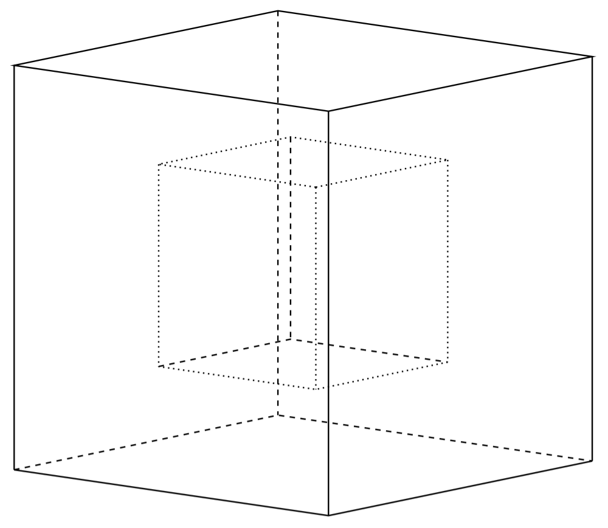
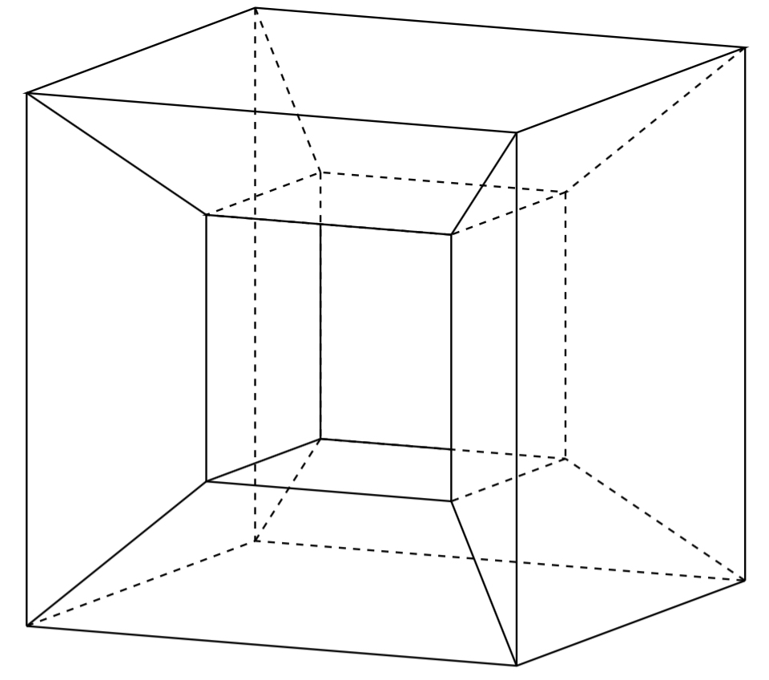
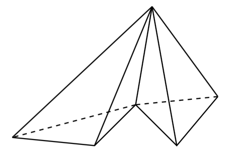

# 伊姆雷·拉卡托斯 Lakatos, Imre (Alan Musgrave and Charles Pigden)
*首次发表于 2016 年 4 月 4 日；2026 年 6 月 19 日实质修订。*

伊姆雷·拉卡托什（Imre Lakatos，1922–1974）是匈牙利出生的数学哲学与科学哲学家，1956 年匈牙利起义遭苏联坦克镇压后流亡，在英国声名鹊起。他有两项著称于世的贡献：其一是反形式主义的数学哲学（此处的“形式主义”不限于希尔伯特及其追随者的哲学，还包括逻辑主义与直觉主义）；其二是“科学研究纲领方法论”（Methodology of Scientific Research Programmes，MSRP）——对波普尔科学与非科学之划界标准的一次激进修正，由此催生了一种全新的科学合理性理论。

他虽在伦敦生活与工作，一路升至伦敦政治经济学院（LSE）逻辑学教授，却始终未入英国籍，直到去世仍是无国籍者。尽管愿意为他作证的学界名流与勋爵爵士阵容豪华，军情五处与特别分局似乎都不信任他；时任内政大臣的罗伊·詹金斯（Roy Jenkins）亲自在拒绝其入籍的批复上签字。（见 Bandy 2009: ch. 16，其中载有历次审讯的笔录。）[^bandy-2009]

尽管如此，拉卡托什的影响——尤其在科学哲学中——是巨大的。据 Google Scholar 统计，截至 2015 年 1 月 25 日——新年才过 25 天——当年就已有 **33 篇论文** 发表并引用拉卡托什，引用率超过每天一篇。科学哲学的导论教科书通常都有关于拉卡托什的相当篇幅：有的钦佩，有的批评，许多兼而有之（例如 Chalmers 2013 与 Godfrey-Smith 2003）[^chalmers-2013][^godfrey-smith-2003]。科学哲学最佳著作的最高奖项（由他富有而学术卓越的门徒 Spiro Latsis 的基金会资助）即以他的名字命名。此外，拉卡托什属于其影响远出学院哲学围墙之外的那类哲学家：2015 年头 25 天引用拉卡托什的 33 篇论文中，够得上纯正哲学的至多 **10 篇**，其余专论教育理论、国际关系、公共政策研究（尤其涉及技术发展）、信息学、设计科学、宗教研究、临床心理学、社会经济学、政治经济学、数学、物理学史与家庭社会学诸领域。因此，伊姆雷·拉卡托什远不止是一位哲学家的哲学家。

首先，我们把拉卡托什的生平与其著作联系起来讨论。他的匈牙利经历如今已成为批评文献中的重大议题：一部分因为关于他早年生活的那些令人不安的事实，直到他死后才在西方曝光；另一部分因为拉卡托什思想的“匈牙利”解释者与“英国”解释者之间的争论——一批作者（不全是匈牙利人）认为后期的拉卡托什比他自己乐于承认的更接近黑格尔主义者（或许也更接近格奥尔格·卢卡奇的门徒），另一批则认为他的黑格尔主义日益残存，到头来不过是一种与黑格尔式表达“调情”的习惯（Marx, *Capital*: 103）。正如分析马克思主义者认为马克思的思想可以剥去黑格尔式卖弄而得到理性重建、辩证马克思主义者则认为不能；同样，分析拉卡托什主义者认为拉卡托什的思想大体可以剥去黑格尔式卖弄而重建，辩证拉卡托什主义者则认为不能（例如 Kadvany 2001 与 Larvor 1998）[^kadvany-2001][^larvor-1998]。显然，一部百科全书词条无法了结这场争论，但我们希望所说的足以照亮问题。（剧透预警：就科学哲学而言，我们倾向于“英国”解释；就数学哲学而言，我们的态度更为两可。）

其次讨论拉卡托什的大观念——构成他作为哲学家的主要声望的两项贡献；继而（第三）较详细地考察其几篇主要论文，末以费耶阿本德/拉卡托什之争一节作结。拉卡托什是一位挑衅而好斗的思想家；若把他的思想呈现得比实际更少争议（或许也更少惊世骇俗），便是歪曲了他的思想。

注：指称拉卡托什的主要著作（以及波普尔的几部著作）时，我们采用一套首字母缩略词而非“名称/年份”体系，希望这样对读者更清晰。缩略词在文献目录中说明。

## 1 生平

### 1.1 两个拉卡托什的故事

伊姆雷·拉卡托什是温暖机智的朋友，也是富有魅力、鼓舞人心的教师（Feyerabend 1975a）[^feyerabend-1975a]。他还是可错论者，公开以精英主义与权威主义为敌，对所谓维特根斯坦式的“思想警察”深恶痛绝——盖因一些维特根斯坦派有奥威尔式倾向：靠紧缩语言压制异见，把他们不喜欢的材料斥为内在地无意义（UT: 225 and 228–36）。在后期（亦即英国）生涯中，他是马克思主义的坚定反对者，1968 年在伦敦政治经济学院对抗社会主义学生激进派的风潮中扮演显要角色，慷慨陈词反对学术的政治化（LTD; Congden 2002）[^congden-2002]。

但在更早的匈牙利阶段，拉卡托什是斯大林主义革命者、一个共产主义小组的领导人：他曾说服一位年轻同志，为了革命，自杀是她的义务——否则她很可能被纳粹逮捕、被迫出卖构成该小组的宝贵年轻干部（Bandy 2009: ch. 5; Long 1998 and 2002; Congden 1997）[^bandy-2009][^congden-1997][^long-1998][^long-2002]。青年拉卡托什绝非可错论者：他对自身把握历史局势的能力自负到十足，足以排除这批年轻且多为犹太人的共产主义者在纳粹占领的匈牙利所面对的公认骇人的问题之外的一切替代方案。（“就没有别的办法了吗？”年轻同志问。回答显然是“没有”：Long 2002: 267。）[^long-2002] 苏联胜利后的 1940 年代末，他热切参与共谋缔造一个斯大林主义国家——在那里，揭发异端分子是时代风尚（Bandy 2009: ch. 9）[^bandy-2009]。拉卡托什本人近乎一个思想警察：他在教育部手握重权，审查大学教师政治上是否可靠（Bandy 2009: ch. 8; Long 2002: 272–3; Congden 1997）[^bandy-2009][^congden-1997][^long-2002]。后来，在得罪了他协助建立的政权、于雷奇克古拉格服刑之后，他又为匈牙利秘密警察 ÁVH 充当线人，盯梢自己的朋友与同志（Bandy 2009: ch. 14; Long 2002）[^bandy-2009][^long-2002]。而作为斯大林主义学生激进派，他还积极投身把德布勒森大学的“反动”教授与学生清洗出去，并瓦解那所有声望却过分独立的厄特沃什学院，激烈抨击厄特沃什所标榜的去政治化（实则隐蔽资产阶级性质的）学术（Bandy 2009: chs. 4 and 9; Long 1998 and 2002）[^bandy-2009][^long-1998][^long-2002]。

### 1.2 生平与著作：第二世界与第三世界

对于许多认识并爱戴后期拉卡托什的人而言，这些事实有些难以消化。但它们与评价他的哲学——那主要产自其英国岁月——有多大干系？这个问题很重要，因为拉卡托什惯于援引波普尔式的区分：世界 3（理论、命题与论证的世界）与世界 2（信念、决定与欲望的心理世界）。他有时倾向于主张：评价一位哲学家的著作，应只诉诸世界 3 的考量，把世界 2 的主观性搁置一旁（F&AM: 140）。

那么，哲学家的生平与其著作究竟有无干系？我们以拉卡托什本人的著作为指引。诚然，有些关于他早年经历的事实是他不愿广为人知的，他也确实在生前对西方的朋友与同事隐瞒得严严实实。但他的官方哲学对传记资料之于思想史的关联性是如何说的？

在《科学史及其合理重构》（“The History of Science and its Rational Reconstructions”，HS&IRR）中，拉卡托什发展了一套做科学史的理论，稍加调整即可扩展为做一般思想史的说明。对拉卡托什而言，科学史的默认假设是：所论科学家正从事一场多少算得上理性的努力，以求解一组（相对）“纯粹的”问题（比如“如何解释天体的视运动，同时与一种可信的力学相一致？”）。科学史中的“合理重构”，是运用一种（科学）合理性理论，连同对所论科学家眼中问题情境的刻画，把某个思想事件呈现为对该问题情境的一系列理性回应。总体而言，一种[科学]合理性理论若能把科学史呈现为相对理性的事业，便是它的加分项；若不能，则是减分项。因此在拉卡托什看来，波普尔证伪主义的朴素版本在某种意义上遭到了科学史的证伪：它们把科学史中太多部分呈现为非理性事业，让太多科学家固守本应认识到已被反驳的假说。如果合理重构成功——即我们能呈现某个思想发展是对问题情境的理性回应——那么我们就得到所论发展的“内部”史；若不能，那么“史的合理重构需要由经验的（社会-心理的）‘外部史’来补充”（HS&IRR: 102）。非理性或“外部”因素有时会干扰科学的理性发展。“任何合理性理论都永远无法解决诸如孟德尔遗传学为何在 1950 年代的苏俄消失的问题”[原因在于，斯大林的宠儿李森科在苏联生物学界攫取了霸权地位并迫害孟德尔派]（HS&IRR: 114）。

（这或许标志着与黑格尔的一个重要分野。在真正的黑格尔主义者看来，**一切** 归根结底都可视为绝对精神自我实现之所必需；于是 **全部** 历史都在某种近似拉卡托什的意义上是“内部的”——“理性的狡计”确保那些表面上非理性的冲动最终从属于历史的目的。）

拉卡托什的智识发展是否也有一段可展示为理性的“内部”史？抑或必须部分诉诸“外部”影响方能解释？答案取决于我们采纳何种合理性理论，以及我们把他看作在应对何种问题情境。

某个特定的理论（或实践）选择能否得到内部解释，部分取决于行动者的问题所在。以笛卡尔的涡旋理论为例：行星被一种流体介质卷携绕日运转，介质本身又含有小漩涡，各行星即在其中游动。若把这一理论看作（就当时所知）为使天体运动的解释与哥白尼天文学相容而作的尝试，它便 **相当** 理性；而若把它看作既要与哥白尼天文学相容、**又** 不在形式上与教会“地球不动”的学说相抵触的尝试，它便 **更** 理性得多。（地球绕太阳转，但相对于携其绕日的流体介质并无运动；且在笛卡尔那里，运动被定义为相对于贴邻物质的运动。）那么，笛卡尔的理论究竟该读作对 **一个** 问题 **相当** 理性的求解尝试而受外部因素扭曲，还是对某个相关却更复杂的问题 **十分** 理性的求解？答案未必分明；但要理解笛卡尔的智识发展，就必须知道：让自己的学说在形式上与教会教义相一致，乃是他构建理论的一项重要约束。

同样，要理解拉卡托什的理论构建，重要的是认识到（例如）他后期想要发展一种科学与非科学的划界标准，让苏联马克思主义（虽然或许并非一切形式的马克思主义）落在划分的非科学一侧。无论把这一约束看作非理性的 **外部** 因素，还是看作其问题情境的构成部分、因而内在于对其智识发展的合理重构，这一点都成立。传记事实有助于理解一个思想家的观念，因为它们能照亮这些观念所针对的问题情境。

此外，拉卡托什思想发展的重大问题在于：旧日的黑格尔-马克思主义者在后期那位后波普尔哲学家身上还剩下多少？他的哲学又有多少是对早先自我的反动？要回答这一问题，就得了解那个早先的自我——无论它是暗中延续的自我，还是后期拉卡托什所反叛的自我。

### 1.3 从斯大林主义革命者到科学方法论家

伊姆雷·拉卡托什 1922 年 11 月 9 日生于匈牙利东部的德布勒森，本名伊姆雷·利普西茨（Imre Lipsitz），是犹太夫妇雅各布·马尔东·利普西茨（Jacob Marton Lipsitz）与玛尔吉特·赫尔茨费尔德（Margit Herczfeld）的独子。父母在他幼年时分手，他主要由祖母与当美容师的母亲抚养成人。拉卡托什出生时的匈牙利是一个没有国王的王国，由一位没有海军的海军上将统治——“摄政”霍尔蒂海军上将，其海军军衔得自在早已解体的奥匈帝国服役。政权属于威权主义，可算一种轻量级的法西斯主义。中学时代成绩辉煌——赢得数学竞赛与众多奖项——1940 年他进入德布勒森大学，1944 年以物理学、数学与哲学毕业。在德布勒森期间，他成为坚定的共产主义者：参加地下共产主义会议，并于 1943 年组建了自己的地下学习小组。

> 凡参加过伊姆雷小组的人，都不会忘记那种热烈而出色的气氛。“他为我打开了世界！”一位参加者如此回忆。即便是后来对共产主义幻灭、或为自己所为感到羞愧的人，也仍记得在伊姆雷的秘密研讨班上感受到的鼓舞、清晰的思考与新社会的希望。（Long 2002: 265）[^long-2002]

不过，拉卡托什的小组重在为即将到来的共产主义革命培养年轻干部，而非从事公开宣传或反法西斯抵抗活动（Bandy 2009: ch. 3）[^bandy-2009]。

1944 年 3 月，德军入侵匈牙利，以阻止其单独媾和的尝试。（匈牙利政府与轴心国结盟，指望收回 1920 年《特里亚农条约》割让的部分领土；到 1944 年，他们已开始意识到这是失策。）霍尔蒂的反犹主义比纳粹的更“绅士”些——他容得下系统性歧视，却显然不肯沾手大规模谋杀——但他被迫接受以 Döme Sztójay 为总理的合作政府。新政权毫无霍尔蒂那点人道顾虑，开始热切而系统地配合纳粹的种族灭绝计划。5 月，拉卡托什的母亲、祖母及其他亲属被赶进德布勒森隔都，随后死于奥斯维辛——这同样是约 60 万匈牙利犹太人的命运。其父是酒商，设法逃脱并在战后移居澳大利亚。略早一些，3 月里，拉卡托什本人已持冒名莫尔纳尔（Molnár）的假证件逃出德布勒森，前往大瓦拉德（今罗马尼亚奥拉迪亚）。后来，匈牙利朋友维尔玛·巴拉兹（Vilma Balázs）回忆道：

> 伊姆雷[曾]与母亲十分亲近，而他们家境相当贫寒。他常为母亲的死自责，反复琢磨自己当时本可否救得了她（Bandy 2009: 32）[^bandy-2009]。

在大瓦拉德，拉卡托什重建了马克思主义小组，共同领导人是他当时的女友、日后的妻子 Éva Révész。5 月，Éva Izsák 加入小组——一位 19 岁的犹太反法西斯活动家，需要在非犹太人家庭寄住。拉卡托什断定，她有被捕、受逼而出卖众人的风险；因此，无论对小组还是对事业，她的义务都是自杀。小组的一名成员带她穿越乡野回到德布勒森，交给她氰化物（Congden 1997, Long 2002, Bandy 2009, ch. 5）[^bandy-2009][^congden-1997][^long-2002]。在俄国文学爱好者看来，这一情节令人想起陀思妥耶夫斯基的《群魔》（部分取材于现实中的涅恰耶夫案件）。小说中，反沙皇革命者彼得·韦尔霍文斯基冒充某个庞大革命组织的代表，靠让小组其余成员共同谋杀一名据称威胁组织的异见成员，来巩固自己为首的地方小组。（虚构的韦尔霍文斯基没能得逞，现实中的谢尔盖·涅恰耶夫得逞了。）Congden 1997 年的揭露之作即以此为题：《着魔：伊姆雷·拉卡托什通往 1956 年之路》。而对拉卡托什那一代的共产主义者或前共产主义者而言，想起的却是另一本书——布尔什维克作家亚历山大·塔拉索夫-罗季奥诺夫的《巧克力》。那是一部讴歌革命自我牺牲的激动人心的小说，主人公是地方契卡（克格勃前身）的首领。此书在匈牙利风行一时，在其（多为）年轻的读者中培养起对革命无情与牺牲的浪漫崇拜。用拉卡托什的同代人 György Magosh 的话说：

> 那本书给了我们多么大的鼓舞！我们渴望成为职业革命家——为了工人阶级和伟大的苏维埃联盟，哪怕一天被绞死好几次（Bandy 2009: 31）[^bandy-2009]。

正是在这种精神氛围里，热情的年轻马克思主义者 Éva Izsák 才会被说服相信：为了事业，自杀是她的义务。至于拉卡托什本人，他那篇最著名论文里的一句偶得之言，恰好透露了他的态度。

> 必须欣赏我们方法论证伪主义者铤而走险的姿态［或者——如他在生涯更早阶段大概会说——恪尽职守的列宁主义者］。他自视为英雄：面对两个灾难性的选项，敢于冷静权衡其相对利弊，并［选择］较小的恶。（FMSRP: 28）

既然钦佩那位敢于在两个灾难性选项之间径直抉择的英雄，难道就不会忍不住去制造灾难性的选项，好让自己能在其间来一场英雄式的抉择吗？

1944 年末，苏军获胜，拉卡托什回到德布勒森，把姓氏从带日耳曼犹太色彩的 *Lipsitz* 改为匈牙利无产阶级色彩的 *Lakatos*（意为“锁匠”）。他活跃于已转合法的共产党以及两个左翼青年与学生组织——匈牙利民主青年联合会（MADISZ）与德布勒森大学俱乐部（DEK）。作为 DEK 领导人之一，他四处鼓动把反动教授清退出德布勒森大学、把反动学生拒之门外。

> 我们明白，我们的这一举动与大学传统的、常被挂在嘴边的“自治”不相容［拉卡托什如此声言］；但在我们看来，尊重自治绝不意味着必须容忍法西斯与反动势力坐大（Bandy 2009: 59 and 61）[^bandy-2009]。

1946 年拉卡托什迁居布达佩斯，入布达佩斯大学读研究生，却把大量时间花在推动共产党接管匈牙利上。这是一场慢镜头的接管，以共产党领袖 Mátyás Rákosi 臭名昭著的“萨拉米战术”为标志。拉卡托什主要供职于教育部：评估大学教师的资历，并开列名单——共产党一旦接管，哪些人将作为不可信者遭解雇（Bandy 2009: ch. 8）[^bandy-2009]。他本人也是厄特沃什学院的学生，却公开抨击该学院是精英主义的资产阶级机构。1950 年，共产党接管完成，该学院及同类机构被关闭。1947 年，他以《论自然科学中概念形成的社会学》一文获德布勒森大学博士学位；1948 年，接管大局已定，他获得奖学金赴莫斯科深造。

拉卡托什 1949 年 1 月飞抵莫斯科，7 月却因“非党”行为被召回。这些“非党”活动究竟为何，至今成谜；更成谜的是，为何顶着嫌疑从莫斯科回来后，他显得那样冷静、沉着、从容。为其立传的 Long 与 Bandy 猜测：他是被留作后备，准备对共产党教育首脑 József Révai 构筑罪名——此人预定出现在一场新的作秀审判中。然而 Rákosi 最终决定对 Révai 不予起诉，拉卡托什随即被抛给了狼群（Bandy 2009: ch. 12; Long 2002）[^bandy-2009][^long-2002]。1950 年 4 月，他以修正主义罪名被捕；在秘密警察的地牢里关押一段时日（自然免不了酷刑）之后，被判处关入雷奇克集中营。

不过，拉卡托什或许本来就在劫难逃。晚年的拉卡托什是奥威尔《一九八四》的热忱崇拜者。也许，他在奥威尔笔下那位党的知识分子兼“新话”专家赛麦身上认出了自己：

> 毫无疑问，赛麦将被蒸发，温斯顿又想。他带着几分悲哀这么想，尽管心里明白，赛麦……只要找到理由，完全有能力告发他是思想犯。赛麦有某种微妙的不对劲。他欠缺了一样东西：审慎、超然，一种保命的愚蠢。不能说他不正统：他信奉英社的原则，崇敬老大哥，为胜利欢欣鼓舞，憎恨异端……然而总有一丝不名誉的气息缠绕着他。他说了些不说为妙的话，他书读得太多了……（Orwell 2008 [1949]: 58）[^orwell-2008]

拉卡托什“赛麦式”行径的一例，是他 1947 年对文学批评家兼哲学家格奥尔格·卢卡奇的揭发——卢卡奇是共产主义运动的知识界巨擘，代表着共产主义在学院中的体面面孔，主张以渐进、民主的方式向无产阶级专政过渡。拉卡托什组织了一次“反卢卡奇会议……由 Valóság 俱乐部主持”，批判卢卡奇的迟疑观望与“魏玛主义”（Bandy 2009: 110）[^bandy-2009]。政权坐稳之后，卢卡奇果然因对资产阶级民主让步过多而遭申斥，五十年代初一直郁郁不得志。但在 1947 年，拉卡托什的批判被认作操之过急，他反倒因“非党”活动惹上麻烦。（卢卡奇本人把这次事件称作一场小圈子的 *kaffe klatsch*［咖啡馆闲话］。）在共产党执政的匈牙利，要紧的是别“落后党的路线一个小册子”（Bandy 2009: 92）[^bandy-2009]；而拉卡托什这类过度热忱的共产主义者，有时倒领先了两三个小册子。

1953 年 9 月走出雷奇克时（少了几颗牙），拉卡托什在一段时间里仍是忠诚的斯大林主义者。他在匈牙利科学院数学研究所勉强糊口，读书、研究、翻译——包括把波利亚《怎样解题》译成匈牙利文。此间他仍向匈牙利秘密警察 ÁVH 报告朋友与同事的动向，尽管他后来声称自己没有递交过任何定罪的东西（Long 2002: 290）[^long-2002]。正是在数学研究所工作期间，他第一次读到波普尔。他逐渐掉头反对曾奉为信条的斯大林主义马克思主义。他与 Éva Pap 再婚（第二任妻子），住在岳父母家——岳父 Endre Pap 是出色的农学家。1956 年他加入修正主义的裴多菲俱乐部，发表了一篇题为《论学者的培养》的激动人心的演讲，至少烧断了与斯大林主义之间的退路：

> 学术教育的根基，在于让学生与研究生尊重事实、尊重精确思考的必要、并要求给出证明。而斯大林主义却把这污蔑为资产阶级客观主义。在 **党性** 科学与学术的旗帜下，我们目睹了一场要创造没有事实、没有证明之科学的宏大实验。
>
> ……培养学者的一个基本方面，必须是努力促进独立思考与个人判断，培育良知与正义感。近年来竟出现了一场反对独立思考、反对相信自家感官的全面意识形态运动——这就是针对经验主义的斗争［笑声与掌声］（Bandy 2009: 221。Bandy 引用的笔录似乎与拉卡托什档案中的准备稿略有出入，准备稿重印于 F&AM）[^bandy-2009]

但拉卡托什不只是公开告别斯大林主义。他也在含蓄地批评裴多菲俱乐部的另一位重量级成员——对他第一篇博士论文影响甚大的格奥尔格·卢卡奇。（早年影响见 Ropolyi 2002。）卢卡奇的著作里弥漫的，恰是拉卡托什在演讲中痛斥的那种对经验主义的敌意、对事实的轻蔑，外加文科出身者对自然科学的居高临下——这一切对后期的拉卡托什来说都属可憎。事实上，卢卡奇以下观点尽人皆知：

> 即便科学发展证明了马克思的一切断言皆假……我们也可以毫无异议地接受这种科学批评，而依然是马克思主义者——只要我们坚守马克思主义的方法

而且

> 察觉到……剥夺剥夺者的时刻已然到来的正统马克思主义者，面对与这一进程相抵触的庸俗马克思主义“事实”连祷，会用德国古典哲学最伟大者之一费希特的话作答：“那就让事实倒霉去吧”。（Lukács 2014 [1919]: ch. 3.）[^lukács-2014]

于是我们看到：1947 年的斯大林主义者拉卡托什公开谴责卢卡奇不够斯大林主义；1956 年的修正主义者拉卡托什却在含蓄地谴责卢卡奇在方法论上太斯大林主义。对后期拉卡托什而言，“正统马克思主义”的问题主要在于其新颖的事实预言被系统性地证伪（见下文 §3.2）。但这几乎就是伯恩斯坦等早期修正主义者的老抱怨（见 Kolakowski 1978: ch. 4）[^kolakowski-1978]，而卢卡奇的布尔什维克著作抗议的恰恰是那种修正主义。（见 Lukács 1971 [1923] 与 2014 [1919]。）[^lukács-1971] 尽管针对一个研究纲领的事实性“反驳”并不总是决定性的，但在拉卡托什看来，卢卡奇式的事实冷漠正是根本不科学之态度的标志。在我们看来，这一下便了结了 Ropolyi 的主张——所谓卢卡奇继续对后期拉卡托什有重大影响。

1956 年 11 月，苏联粉碎短命的匈牙利革命之后，拉卡托什离开匈牙利，与妻子及其父母步行越过边境进入奥地利。不出两个月，他已身处剑桥大学国王学院，持洛克菲勒奖学金，在 R.B. Braithwaite 指导下撰写博士论文——《数学发现中的逻辑文集》，1959 年完成。撇开他的风流韵事不谈，拉卡托什此后的生平大体就是其著作的历史，尽管我们不应忘记他作为学院政治家的活动：他与费耶阿本德的友谊、他与波普尔的友谊及日后的决裂，也都与工作密切相关。在英国，他的学术生涯如流星般上升：1960 年受聘为伦敦政治经济学院卡尔·波普尔所在系的助教；至 1969 年已任逻辑学教授，作为科学哲学家享誉世界。1960 年代的学生造反运动在英国以伦敦政治经济学院为中心，拉卡托什由此成为体制中人。他写了一封“致伦敦政治经济学院院长的信”为学术自由与学术自治辩护，流传甚广；信中谴责学生激进派——按信中的说法——正试图重演他自己当年在德布勒森与厄特沃什做过的事（不过他小心遮掩了这层平行，转而援引纳粹与莫斯科的先例）（LTD: 247）。

1974 年，拉卡托什正值学术声望之巅，却因心脏病突发辞世，年仅 51 岁。

## 2 拉卡托什的大观念

伊姆雷·拉卡托什的盛名主要系于两端。

### 2.1 反对数学中的形式主义

其一是他的数学哲学，尤其见于《证明与反驳》（1963–64）——基于其博士论文的四篇系列文章，以多声部对话体写成；后合并成书，1976 年增补出版。书名暗指波普尔的名篇《猜想与反驳》（他那部最著名文集的招牌之作），波普尔在其中勾画了自己的科学哲学。拉卡托什的要点是：数学的发展远比通常想象的更像波普尔笔下的科学发展——甚至远比 **波普尔本人** 设想的更像。

拉卡托什未大做文章的（但也没有掩饰）是：在他看来，数学的发展也更像黑格尔所分析的 **一般** 思想的发展——只是连黑格尔本人都没意识到这一点。其中有正题、反题与合题——“黑格尔式语言，（拉卡托什认为它）一般而言足以刻画数学中的种种发展”（P&R: 146）。就此而言，拉卡托什可谓比黑格尔还黑格尔：他给数学这门被黑格尔本人鄙为不够辩证的学科做了一次辩证分析（见 Larvor 1998, 1999, 2001）[^larvor-1998]。于是便有费耶阿本德的讥讽（拉卡托什坦然受之）：拉卡托什是个“波普-黑格尔”——波普尔之父与黑格尔之母的私生子（F&AM: 184–185）。

《证明与反驳》是对“形式主义”数学哲学（包括狭义形式主义、逻辑主义与直觉主义）的批判——在拉卡托什看来，这些哲学从根本上歪曲了数学作为智识事业的性质。对拉卡托什而言，数学的发展不应被当作一串欧几里得式的演绎：相关概念的内容预先受到仔细规定，以杜绝歧义。毋宁说，那些从良定义前提出发、滴水不漏的演绎，只是一个演化乃至 **辩证** 过程的（或许是暂时的）**终点**——在此过程中，构成性概念起初界定含混、开放或歧义，然后在漫长的争论中愈磨愈清。证明与概念一道被打磨（故有“证明生成的概念”之说），而以反例形式出现的“反驳”则在这过程中唱着重头戏。[人们几乎可以化用黑格尔的话说：在拉卡托什看来，“当欧几里得式论证以灰色绘出灰色，数学生活的某种形态便已老去……形式主义密涅瓦的猫头鹰要等黄昏降临才开始飞翔”（Hegel 2008 [1820/21]: 16）[^hegel-2008]。]

拉卡托什还急于把数学的发展展示为 **理性** 的事业——尽管证明（起初）往往缺乏逻辑严格性，关键概念也往往开放而不清晰

> 塞德尔清楚道出的那个想法［拉卡托什本人也明确首肯］——证明可以站得住脚而无须无懈可击——在 1847 年不啻革命；不幸的是，今天听来依然革命。（P&R: 139）

由此引出一个推论：数学中的许多“证明”并不是完整意义上的证明——即从必然前提出发、经无可置疑的推理规则、演绎到确定结论的论证；许多“反驳”也不是真正的反驳，因为某种酷似“被反驳”论题的东西往往挺过了反驳，从辩证过程中焕然一新、精神抖擞地重新站起来。

这在对话的早处即已显明：信奉波普尔的伽马抗议老师对反驳满不在乎——那是一个针对欧拉论题（因而也是针对柯西证明）的反例：对一切正多面体，顶点数减去棱数加上面数等于二。反例是一个由一对嵌套立方体围成的立体：一个立方体位于另一个内部，却与之不相接触：

对这个中空立方体而言，$V - E + F$（内外两个立方体都计入）$= 4$。依伽马之见，这干脆利落地反驳了欧拉猜想、推翻了柯西的证明：

> 伽马：先生，您的镇定让我困惑。一个反例反驳一个猜想，与十个反例同样有效。猜想与证明都彻底失手了。举起手来！您得投降。把错误的猜想扔掉，忘掉它，试试一条全新的进路。
>
> 教师：我同意 **猜想** 受到了阿尔法反例的严厉批评。但说证明“彻底失手”则不实。倘若你暂时同意我此前的提议——把“证明”用作“把原猜想分解为诸子猜想的思想实验”，而非“确实性的担保”——你就不必得出这个结论。我的证明当然在第一种意义上证明了欧拉猜想，但未必在第二种意义上。你只关心“证明了想证之物”的证明；我即便在证明没有完成预定任务时也对它感兴趣。哥伦布没有到达印度，却发现了相当有趣的东西。

因此，即便在早期著作里——彼时他还是公开声言的波普尔信徒——拉卡托什已经是个相当异端的波普尔主义者。其一，《证明与反驳》中不时冒出向黑格尔 **以及** 波普尔双双致意的段落，包括他在同一口气里对两人又扬又抑的那一句。（“黑格尔与波普尔代表了现代哲学中仅有的可错论传统，但即便他们二人也都犯了同一个错误：把一个特权的、不会错的地位留给数学”。P&R: 139n.1。）鉴于黑格尔为波普尔所深恶（见《开放社会及其敌人》里那段著名——或曰声名狼藉——的反黑格尔“谐谑曲”（1945 [1966]）），这强烈提示：拉卡托什对波普尔是打着大折扣领受的。其二，对波普尔本人而言，证明就是证明，反驳则该把科学猜想当场击毙。于是，非演绎的证明与驳不死的反驳，标志着对波普尔正统的重大背离。

### 2.2 在科学哲学中改进波普尔

这种异端倾向延续到拉卡托什对哲学的第二项重大贡献——“科学研究纲领方法论”（MSRP，在 FMSRP 中得到详细阐发）：对波普尔科学与非科学划界标准的一次激进修正，并引出一种全新的科学合理性理论。可以说，它比其意在取代的波普尔理论（或其早期表述中意在修正的那一版）现实得多。对波普尔而言，一个理论只有 **在经验上可证伪** 才配称 **科学的**——即有可能列出一些将证明它错的观察陈述。而一个理论是 **好的** 科学——那种你应当坚持的理论（虽然不是你应当相信的东西，因为波普尔不相信“相信”）——当且仅当它可反驳、够冒险、能解决问题，并顶住了接二连三的反驳尝试。换言之，它必须高度可证伪、受过充分检验而（迄今）未被证伪。

拉卡托什的反驳是：波普尔的判据固然有可说之处，却过于苛刻——按它会把太多日常科学实践（更遑论科学精英的价值判断）判为不科学、不理性。因为科学家常常坚持——而且看来是 **理性地** 坚持——按波普尔标准他们本应作为“被反驳”而拒斥的理论：例如牛顿天体力学，它（与其他假设相结合）已经引出遭证伪的预言。对拉卡托什来说，一个关键例子是“水星进动”——水星近日点的反常行为：若牛顿力学正确、又没有其他足够大的天体影响其轨道，水星绕日的方式就不该是它实际的那样。麻烦在于，似乎并不存在这样的天体。这一困难尽人皆知几十年，却并没有让天文学家集体弃守牛顿，直到爱因斯坦的理论登场。拉卡托什认为，天文学家不放弃牛顿是对的——尽管最终证明牛顿错了、爱因斯坦对了。

再如哥白尼的日心天文学，生来就带着“反驳”——因为恒星视差显然不存在。若地球绕太阳转，那么至少 **某些** 恒星（最近的那些）的视位置，应当随地球相对于较远恒星的移动而变化；夜空的某些部分在近日点（地球离太阳最远之时）看起来的样子，应当与在远日点（地球离太阳最近、因而位于轨道另一端之时）略有不同。然而在哥白尼《天体运行论》1543 年出版后近三个世纪里，无人观察到这样的差异。事实上，最近恒星的视位置确有随地球轨道位置而异的细微差别，但这差别 **极其** 细微，几乎探测不到——实际上，直到 1838 年，足够强大的望远镜与测量技术才把它测出来；而那时，日心说早已被当作确立的事实。因此，尽管有这表面上的证伪，天文学家既没有放弃哥白尼，也没有放弃其后来人。

可是，如果科学家常常坚持“被反驳的”理论，那么要么是科学家不科学，要么是波普尔对“何为好科学”——因而对“科学家应当做什么”——的判断出了错。拉卡托什的思路是：构建一套科学方法论及随之而来的划界标准，使其律令更贴合科学实践。

它如何运作？在拉卡托什的科学观中，可证伪性仍有一席之地，但重要性有所下降。取代“单个可证伪理论、一遭反驳就该拒斥”的，是一个 **可证伪理论** 的序列——其特征是共享一个 **硬核**：若干中心论题，经方法论裁定被视为不可反驳，或至少抗反驳。这一理论序列构成一个 **研究纲领**。

这列理论共享的硬核，往往在该词的 **两** 重意义上都不可证伪。

其一，在纲领内工作的科学家通常——而且正当地——不愿放弃构成硬核的那些主张。

其次，硬核论题 **本身** 往往没有经验后果。例如，牛顿力学 **本身**——三条运动定律与万有引力定律——不会告诉你夜空里会看到什么；要从牛顿力学导出经验预言，你得配上关于诸天体（包括地球）的位置、质量与相对速度的一整套 **辅助假设**。（这与迪昂论题相关：一般而言，理论命题——乃至 **成组** 的理论命题——无法被实验观察一锤定音地证伪，因为它们只有与辅助假设相结合才蕴涵观察陈述。于是当出了岔子、其蕴涵的观察陈述被证为假时，我们有 **两** 个知性选项：修改理论命题，或修改辅助假设。见 Ariew 2014。）在拉卡托什看来，研究纲领中的单个理论通常由两部分构成：（或多或少）不可反驳的硬核加一组辅助假设。辅助假设与硬核一道蕴涵经验预言，从而使理论整体——硬核加辅助假设——成为可证伪的东西。

当反驳袭来——硬核与辅助假设相结合所蕴涵的经验预言被证为假——会发生什么？我们手里本质上是一个 **否定后件式**（modus tollens）论证：科学提供其中一个前提，自然（连同实验与观察）提供另一个：

1. 若〈硬核加辅助假设〉，则 *O*（其中 *O* 代表某个观察陈述）；
2. 非-*O*（自然喊出“不”：预言没有应验）；

于是

1. 非〈硬核加辅助假设〉。

但逻辑给我们留了一个选择。硬核加辅助假设的 **合取** 必须被抛弃，而我们可以在硬核与辅助假设二者中保留其一。拉卡托什所谓研究纲领的 **反面启发法**，正是这样一道训令：保住硬核，修改辅助假设：

> 纲领的反面启发法禁止我们把 **否定后件式** 指向这一“硬核”。相反，我们必须施展巧智去阐明乃至发明“辅助假设”——它们在核心周围结成一圈 **保护带**；我们必须把 **否定后件式** 转而指向这圈保护带。正是这圈由辅助假设构成的 **保护带** 必须承受检验的冲击，被一调再调、乃至彻底更换，以保卫那由此加固的核心。（FMSRP: 48）

于是，当反驳袭来，科学家便构造一个 **新的** 理论——序列中的下一个——硬核不变，辅助假设有所修改。她该怎么做？与硬核相联系的，有拉卡托什所谓纲领的 **正面启发法**。

> 正面启发法由一组部分阐明的建议或提示构成：如何改变、发展研究纲领的“可反驳变体”，如何修改、精化那“可反驳的”保护带。（FMSRP: 50）

例如，一颗行星的轨道若不是它本应遵循的光滑椭圆——a) 假使牛顿力学正确；b) 假使除太阳与该行星自身外无须操心别的天体——那么牛顿纲领的正面启发法便指引我们去找 **另一颗** 天体：其引力或许正在扭曲头一颗行星的轨道。又或者，若观察不到恒星视差，我们可以改进仪器、做更精细的测量与观察，以此反驳这个表面上的反驳。

拉卡托什显然认为：当序列中某个理论被反驳时，科学家可以正当地坚持硬核，而无须急着构造序列中的下一个可反驳理论。某些行星轨道与它们应有的轨道不完全相符，这一事实并不该让我们放弃牛顿天体力学——哪怕我们还没有一个可检验的理论来说明究竟是什么在扭曲它们。同样值得一提的是，辅助假设在拉卡托什的方法论里扮演着相当悖谬的角色：一方面，它们把硬核的中心论题与经验 **连接** 起来，使这些论题得以进入可检验、因而可反驳的理论；另一方面，它们又把硬核的论题与反驳 **隔开**——因为 **否定后件式** 之箭射来时，我们把它指向辅助假设，而非硬核。

到此为止，我们谈的是科学家通常 **实际** 做什么，以及拉卡托什认为他们 **应当** 做什么。可科学与非科学之间、好科学与坏科学之间的划界标准呢？即便当硬核加某组辅助假设被反驳时坚持硬核 **有时** 是理性的，总该 **有** 某些情形放弃它才是理性的吧！科学研究纲领方法论总不能只是替科学上的顽固不化辩护！拉卡托什本人如此提出这一点：

> 如今，牛顿的引力理论、爱因斯坦的相对论、量子力学、马克思主义、弗洛伊德主义［后两者是波普尔派口中坏科学或伪科学的寻常例子］都是研究纲领。每一个都有被顽强捍卫的特有硬核，每一个都有较灵活的保护带，每一个都有精心打造的问题解决机器。在其发展的任一阶段，它们都有未解决的问题与未消化的反常。在这个意义上，一切理论生而被反驳、死而被反驳。但它们［全都］一样好吗？（S&P: 4–5.）

当然，拉卡托什认为并非如此。有些科学客观上优于另一些科学；有些科学则不科学到几乎不配称科学。那么，他如何区分“科学的或进步的纲领”与“伪科学的或退化的纲领”？（S&P: 4–5.）

首先，科学评价的单位不再是个别理论（如波普尔那里），而是理论的 **序列**——**研究纲领**。我们不再问这个或那个理论是否科学、构成好科学还是坏科学；而是问理论的 **序列**、研究纲领是否科学或非科学、构成好科学还是坏科学。拉卡托什的基本想法是：一个研究纲领若 **进步**，便构成 **好** 科学——那种坚持下去是理性的、为之工作也是理性的科学；若 **退化**，便是 **坏** 科学——至少在知性上 **可疑** 的科学。研究纲领何谓进步？它须满足两个条件：其一，**理论上** 进步——序列中的每个新理论必须比其前驱多出经验内容，必须预言新颖而迄今出人意表的事实（FMSRP: 33）；其二，**经验上** 进步——那些新颖内容中须有一部分得到确证，即理论预言的新“事实”中 **有些** 必须被证明为真。用拉卡托什本人的话说：一个研究纲领“既理论上进步又经验上进步，便是 **进步的**；否则便是 **退化的**”（FMSRP: 34）。因此，若序列中的诸理论拿不出新预言，或拿出的新预言被证为假，研究纲领就是退化的。

新颖性在某种程度上是个比较性概念：一个研究纲领之预言的新颖性，是相对于其对手来定义的。一个预言 **新颖**，当且仅当该理论不仅预言了序列中先前诸理论未曾预言的东西，而且所预言的观察，既 **不** 被任何可能正在酝酿的对手纲领预言，**也** 不被常规智慧预言。预言人人皆知的事实拿不到加分；只有预言出多少令人意外的观察，才算得分。（此处有某种含混，后来也有某种软化——见下文 §3.6——但至少一开始，这是拉卡托什的主导观念。）

拉卡托什的关键例子之一，是哈雷彗星回归的预言：观测彗星轨迹的一段，再用牛顿力学算出它运行所在的长椭圆，预言由此导出。七十二年后，彗星如期而至，出现的位置与时刻分毫不差——这是一个离开牛顿理论便无从得到的新颖事实（S&P: 5）。在牛顿之前，天文学家或许会注意到每七十二年有一颗彗星到来（尽管他们很难把它与其他彗星分辨开），却无法像哈雷那样精确预言其再现的时间与地点。牛顿理论给出的预言，远比笛卡尔发展的那套对手日心理论精确得多，更遑论把持知识界数百年的地心托勒密宇宙论。正是这种惊人的确证把一个研究纲领推上领先位置；而把牛顿物理学拉下马、让位于爱因斯坦的，同样是一次新颖预言的惊人确证。拉卡托什接着说：

> 这个纲领做出了惊人的预言：若在夜里测量夜空中两颗星的距离，再在白天（日食时它们可见）测量其间距离，两次测量将不相同。在爱因斯坦纲领之前，无人想过做这样的观察。于是，在进步的研究纲领中，理论引领人们发现迄今未知的新颖事实。（S&P: 5.）

另一方面，一个退化的研究纲领（不同于牛顿与爱因斯坦的理论）要么压根预言不出新颖事实，要么其新颖预言被系统性地证伪。例如，马克思主义起初理论上进步而经验上退化（新颖预言被系统性地证伪），最终在理论上也退化了——不再有新预言，只剩事后拼命解释那些未曾预言的“观察”的努力。

> 马克思主义……可曾成功预言过什么惊人的新事实？从来没有！它倒有几个著名的不成功预言。它预言工人阶级将绝对贫困化；预言第一场社会主义革命将发生在工业最发达的社会；预言社会主义社会将不再有革命；预言社会主义国家之间不会有利益冲突。马克思主义的早期预言大胆而惊人，但它们失败了。马克思主义者把一切失败都解释掉了：他们发明帝国主义理论来解释工人阶级生活水平的提高；甚至解释了为何第一场社会主义革命发生在工业落后的俄国。他们“解释”了 1953 年的柏林、1956 年的布达佩斯、1968 年的布拉格；他们“解释”了俄中冲突。但这些辅助假设全是事后拼凑的，为的是护住马克思的理论、使其免受事实的伤害。牛顿的纲领引出了新颖事实；马克思的纲领落在事实后面，一直狂奔着追赶它们。（S&P: 4–5.）

于是：好科学进步，坏科学退化；而一个研究纲领可能一开始、或最终堕落到如此退化，以至于根本不再算作科学。若一个研究纲领要么预言不出任何新东西，要么其蕴涵的新预言从不兑现，那么它可能已退化到蜕变为伪科学的地步。

有时有人提出：在拉卡托什看来，除非已有更好的理论，否则任何理论都不应被抛弃（Hacking 1983: 113）[^hacking-1983]。这是否意味着，只要没有进步的替代者，任何研究纲领都不应放弃——**无论它多么退化**？若是，这便等于一个激进的反怀疑论论题：宁可信奉一个带着虚假之一切标志的理论——例如某个真正退化的纲领的现任代表——也不肯毫无幻觉地坐在无知里。（相比之下，古代怀疑派认为：宁可什么都不信，也不信 **可能** 为假的东西。）我们不确定这是否拉卡托什的意见，尽管他显然认为，放弃一个 **进步的** 研究纲领是错误的——除非有更好的可转投者。但再想想马克思主义的例子：拉卡托什在上面引文里似乎在暗示，放弃马克思主义是理性上允许的——甚至或许是义务性的——即便它 **没有** 进步的对手；也就是说，即便眼下 **没有** 另一个研究纲领，带着一组关于资本主义根本性质及其最终命运的硬核论题。（毕竟，后期的拉卡托什多半接受波普尔式论题：宏观历史系统性地不可预测。若如此，便 **不可能** 存在一个真正进步的、预言资本主义命运的纲领——充其量只能有一个条件式理论，比如 Piketty 的：在资本主义下，不平等很可能扩大——**除非** 出什么意料之外的事，或 **除非** 我们决定对此有所作为。见 Piketty 2014: 35。）所以，尽管拉卡托什认为科学共同体在更好的东西出现之前很少放弃一个纲领，他是否认为他们 **始终应当** 如此，并不清楚。

这一切里有诸多对波普尔正统的偏离。首先，拉卡托什实际上放弃了把可证伪性当作科学与非科学的划界标准：一个研究纲领可以（在某种意义上）可证伪而不科学，也可以科学而不可证伪。先说可证伪的非科学：一个退化的研究纲领中，每一个相继的理论都可以是可证伪的，而纲领整体未必科学——若它只预言人所共知的事实，或其新预言从未得到验证，便可能如此。一个贩卖陈腐旧真理的倦怠供给者，和/或一个坚持预言新谬误的家伙，可能都过不了科学的门槛。再说不可证伪的科学：在拉卡托什看来，把研究纲领的硬核与经验反驳隔离开来，未必是罪。对波普尔而言，靠“引入 **特设的** 辅助假设，或以 **特设的** 方式重新解释理论使其逃过反驳”来捍卫一个被反驳的理论，是对科学的犯罪（C&R, 48）。拉卡托什则不然——尽管这并不意味着在特设性问题上“怎么都行”。

第三，拉卡托什的划界标准比波普尔的宽容得多。首先，一个 **不一致的** 研究纲领无须被打入万劫不复的非科学地狱。这并不是因为它的哪个组成理论可能为 **真**——拉卡托什拒绝黑格尔的论题（现实中有矛盾）：“如果科学以真理为目标，它就必须以一致性为目标；如果它放弃一致性，它就放弃了真理。”不过，科学以真理为目标、**因而** 以一致性为目标，并不意味着它容不下途中的一点不一致。

> 发现一个不一致——或一个反常——［无须］立即使纲领的发展停摆：把不一致放进某种临时的、**特设的** 隔离检疫，同时继续纲领的正面启发法，可以是理性的（FMSRP: 58）。

因此，玻尔坚持其研究纲领，既是理性的 **也是** 科学的——即便其关于原子结构的硬核论题根本不一致（FMSRP: 55–58）。于是，拉卡托什虽然拒绝黑格尔关于现实中存在矛盾的主张（或许“实在”中除外），却 **也** 拒绝波普尔的论题——因为矛盾蕴涵一切，不一致的理论便不排除任何东西，必须作为不可证伪、不科学之物遭拒。对拉卡托什而言，玻尔的原子理论根本不一致，但这并不意味着它蕴涵“月亮是绿奶酪做的”。所以，拉卡托什在此似乎暗示（尽管他说得没有可能的那样明确）：评价科学研究纲领时，我们有时应当启用一种容忍矛盾的逻辑——一种拒绝如下原则的逻辑：任何东西都随矛盾而来；这一原则波普尔明确支持（FMSRP: 58 n. 2）。用今天的术语说，拉卡托什是弗协调主义者（隐含否认从矛盾可得一切），但 **不是** 双面真理论者（明确否认存在真矛盾）。于是，就理论而言他不是波普尔的追随者，就实在而言也不是黑格尔的追随者。（见 Priest 2006 与 2002，尤其 ch. 7，以及 Brown and Priest 2015。）[^brown-2015][^priest-2002][^priest-2006]

拉卡托什的划界标准比波普尔宽容，还有另一处。对波普尔而言，一个 **理论** 若不可证伪，便不科学，仅此而已——非此即彼。对拉卡托什而言，科学性是个多少的问题，且多少会随时间变动。一个 **研究纲领** 可以在某一阶段是科学的，在另一阶段不那么科学（或非科学）——若它不再产出新预言、又消化不了自己的反常——但随后可以卷土重来，恢复科学地位。于是，划界标准的裁决是程度问题，而且是随时间变动的程度问题。我们很少能绝对地说一个研究纲领不科学；只能说它 **眼下** 科学健康欠佳、复苏前景不妙。就此而言，拉卡托什比波普尔更是可错论者：对波普尔而言，考察一个理论的逻辑蕴涵便能判定它是否科学；对拉卡托什而言，我们最好的猜测可能被证明有错——因为一个研究纲领的科学地位部分取决于它的历史，而不只是其逻辑性质，而历史（正如波普尔本人宣告的）本质上不可预测。

还有另一处与波普尔的分歧，有助于解释上述一切：拉卡托什把波普尔的两个区分合而为一——科学与非科学之分，以及好科学与坏科学之分。在伦敦政治经济学院讲课时，拉卡托什本人如此表述：

> 划界问题可以这样表述：什么区分了科学与伪科学？这是一种极端的提法；因为更一般的问题——所谓广义划界问题——其实是科学理论评价的问题，它试图回答：一个理论何时优于另一个？我们自然假定一个连续尺度：零值对应伪科学理论，正值对应被认为科学程度或高或低的理论。（F&AM: 20）

撇开如下事实不谈——对拉卡托什而言，a) 坚持“被证伪的”理论、乃至事实上不一致的理论，可以是理性的，而这两者都为波普尔所深恶；b) 对拉卡托什而言“一切理论生而被反驳、死而被反驳”（S&P: 5），故 **没有** 未被反驳的猜想可供有德性的科学家坚持（这使得波普尔心目中的好科学实际上不可能）——拉卡托什的科学研究纲领方法论用 **一个** 标准取代了波普尔的 **两个**。因为波普尔有 **一个** 标准区分科学与非科学（若理论自命科学，则是科学与伪科学之分），有 **另一个** 标准区分好科学与坏科学。在波普尔看来，理论在经验上可证伪便科学，不可证伪便不科学；是否科学是绝对之事、非此即彼——只要 **有某些** 观察能证伪它，它就是科学的。而作为 **好** 科学是程度问题：一个理论可能或多或少地把人质押给经验的运气，取决于其经验预言的大胆程度。拉卡托什则相反：非科学或伪科学居于一个连续统的一端，最好的科学居于另一端。于是，一个理论——或更恰当地说，一个研究纲领——可以起先是真正科学的，随时间推移逐渐不那么科学（这正是拉卡托什对马克思主义的看法），却不必彻底交出科学之魂。拉卡托什时代的马克思主义是坏科学还是伪科学？从拉卡托什的观点看，这个问题没有确定答案；要点在于它不是 **好** 科学——它代表一个退化的研究纲领。不过，尽管拉卡托什显然认为马克思主义处境不妙，他却不能把它当作盖棺论定的完成时扔进历史垃圾堆——因为（如他常常坚持的）退化的研究纲领有时能卷土重来。

## 3 著作

### 3.1 **证明与反驳**（1963–4，1976）

如前所述，拉卡托什在英国的第一份重要出版物，是对话体的《证明与反驳》——最初作为四篇期刊文章连载。对话题献给乔治·波利亚，致敬其“数学启发法的复兴”，并献给卡尔·波普尔，致敬其批判哲学。

《证明与反驳》是一部极具原创性的作品。它讨论的议题，与当时数学哲学的标准套餐相去甚远——后者由逻辑主义、形式主义与直觉主义主导，个个都在为数学寻找可靠基础。它的论题是激进的；其对话形式更让它既是哲学的 **杰作**，也是文学的 **杰作**。

它名义上的靶子是“形式主义”或“元数学”。但（如前所述）“形式主义”并不只是数学哲学通常理解的狭义“形式主义”：对拉卡托什而言，“形式主义”不仅包括希尔伯特的纲领，还包括逻辑主义，甚至直觉主义。形式主义把数学看作在形式化数学理论中从公理导出定理；其哲学工程是证明公理为真、证明有效，从而把数学看作永恒真理的积累。另一层哲学问题是：这些真理究竟是 **关于** 什么的——即数学本体论的问题。

相比之下，拉卡托什关心的是数学知识的 **增长**：公理与证明是如何被发现的？数学如何从非形式的猜想与证明，生长为更形式的、从公理出发的证明？逻辑经验主义（与波普尔派）正统区分“发现语境”与“辩护语境”，把前者划给经验心理学，认为它属于“不受规范的洞见与好运”之事，几乎不值得哲学分析；数学哲学则只是对已完成理论的逻辑分析。形式主义正是这一正统的体现，它“切断了数学史与数学哲学的联系”（P&R: 1）。为对抗这一正统，拉卡托什化用了康德（这处化用几乎与原句同样出名）：

> 数学史……已然 **盲目**，而数学哲学……已然 **空洞**。（P&R: 2）

［1961 年在牛津的一次会议上，拉卡托什以更一般的形式道出这句康德式格言：“没有科学哲学的科学史是盲目的；没有科学史的科学哲学是空洞的”。见 Hanson 1963: 458。］[^hanson-1963]

就算我们同意拉卡托什——启发法或发现逻辑有其一席之地——正统仍可坚持：发现是一回事，辩护是另一回事，观念如何发生与观念如何被辩护毫无关系。拉卡托什更为激进，他不予认可。其一，他干脆拒绝了基础主义或辩护主义的工程：数学没有基于逻辑、集合论或其他任何东西的基础。其二，他坚持理论生长的方式在其方法论评价中起着本质作用——这既是他的数学哲学的中心主题，同样是他的经验科学哲学的中心主题。

如前所述，《证明与反驳》采用一位教师与一群学生之间的假想对话体。它重构了证明笛卡尔-欧拉多面体猜想的种种尝试的历史——该猜想即：对一切多面体，顶点数 **减** 棱数 **加** 面数等于二（*V* – *E + F =* 2）。教师给出柯西对该猜想的一个非形式证明：这是一个“**提示把原猜想分解为诸子猜想或引理的思想实验**”，原猜想被设想由此得出。于是，除了原有的猜想（结论），我们还有子猜想（前提），以及“后者蕴涵前者”这一元猜想。显然，这种“非形式证明”与形式主义的想法——非形式证明不过是有缺口的形式证明——大相径庭（PP2: 63）。同样显然的是：这些猜想中的任何一个都可能被反例驳倒。

在对话中，相当高明的学生们亲手演示了这一点——他们制造反例，拆了教师的“证明”。反例分三种：

（1）反驳结论、却不反驳任何前提的反例（“局部而非全局反例”）：它们表明结论并不真正从所陈述的前提得出。这要求我们改进证明，把反例同样反驳的“隐藏引理”挖出来，使它变成“局部兼全局”的反例——见下文（3）。

（2）反驳某一前提、却不反驳结论的反例（“全局而非局部反例”）：这要求我们改进证明——换上一个不受该反例影响的新前提，并且（但愿）它对确立结论的贡献不逊于被反驳的原前提。

（3）既反驳结论、又反驳（至少一个）前提的反例（“全局兼局部反例”）：处理办法是把被反驳的前提或引理收编进原结论，作为其成立条件。例如，画框是一个带洞或隧道的多面体：

于是，若把多面体定义为“正常的”——其中没有洞或隧道——便可把原猜想限定于“正常”多面体，从而躲开这一反驳。但这种方法的麻烦在于削减了原猜想的内容，空洞的重言式已在招手——“对所有欧拉多面体（满足 $V - E + F = 2$*V* – *E + F =* 2 的多面体），*V* – *E + F =* 2$V - E + F = 2$”。更具体地说，一刀切排除带洞或隧道的多面体，会误伤一些多面体——尽管有洞，$V - E + F = 2$ 依然成立：一个钻了方形通孔、带两个环形面的立方体便是例子，公式 *V* – *E + F =* 2 照样成立。这提示了比寻找原猜想有效域更深一层的问题——为一切多面体找出 *V*、*E* 与 *F* 之间的一般关系。

这一分析让我们看清了拉卡托什所谓“证明与反驳的辩证统一”：反例帮我们发现隐藏引理，从而改进证明；证明帮我们找到有效性条件，从而改进猜想。无论哪条路、或两条路一起走，数学知识都在增长；而随着知识的增长，概念也被打磨。我们从“多面体是什么”这个含糊而未经分说的概念出发，手头有一个关于多面体的猜想和一个非形式证明。反例或反驳“拉伸”着我们原先的概念：画框算不算真正的多面体？圆柱呢？沿一条棱相连的两个多面体呢？

把猜想从反驳中拯救出来的种种尝试，孕育出“证明生成的定义”——“正常多面体”的定义便是一例。

这种“概念拉伸”的过程有任何限度吗？“有趣的概念拉伸”与“无聊的概念拉伸”之间可划出任何界线吗？这一过程能否产出的不是可错的猜想与证明，而是确定性？拉卡托什的编者区分了证明的确定性与一切证明必须由之出发的公理的确定性，并主张：严格的证明程序已经达成，且“在任何严肃的意义上，这些证明都不是可错的”（P&R: 57）。的确如此——但那只是因为我们已经决定不去“拉伸”那些严格而可形式化的证明程序背后的逻辑概念。经典逻辑里的严格证明，在直觉主义或弗协调逻辑中未必有效。而关键在于：一个证明无论多么严格，都只确立了 **如果** 公理为真、**那么** 定理为真。若公理本身仍属可错，则由之严格导出的定理同样可错。为数学奠定基础，要求把公理弄得确定无疑——从逻辑、集合论或其他东西导出它们。拉卡托什宣称，这一基础主义工程已然崩塌（见下文 §3.2）。

这段假想对话在多大程度上算是对数学史的贡献？拉卡托什解释道：

> 对话体应当映照故事的辩证法：它意在容纳一种 **经过合理重构或“蒸馏”的历史**。真实历史会在脚注中应和进来；因此其中大多数脚注应当被看作本文的有机部分*（P&R: 5）。

这一手法起初是为对话体所迫，后来却成为拉卡托什著作中无处不在的主题，也招来大量批评——多数聚焦于一个问题：合理重构的历史究竟算不算真实历史。麻烦在于，合理与真实可以相当彻底地分道扬镳。《证明与反驳》中有一处，对话人物立下一个历史断言，而据相关脚注，它是假的。拉卡托什说，这一陈述

> 尽管在启发法上正确（**即** 在数学的合理历史中为真），在历史上却是假的。这不该让我们担心：真实历史常常是其合理重构的一幅漫画。（P&R: 21）

有时候，拉卡托什的幽默感会撒腿狂奔：正文里冒出一条杜撰的伽利略引文，脚注却说他“未能追溯这条引文”（P&R: 62）。（不过这确实颇有他年轻时的做派——靠当场捏造“资产阶级”学生所敬权威的引文来赢得争论。见 Bandy 2009: 122。）[^bandy-2009] 惊恐的批评者抗议道：合理重构的历史是真实历史的漫画，实际根本不是历史，而是“哲学在编造例子”；一位批评者甚至说，不该允许科学哲学家染指科学史。这种学术工会主义是误导的：指出“本应发生的事并未发生”，并不就是对历史的伪造。

这一切还有一层重要的教学意涵。证明与反驳的辩证法能按前述方式生成相当复杂的数学概念定义——这类定义，只有考察产生它们的过程方能真正理解。但数学教学不是历史的，甚至不是准历史的。（拉卡托什的理论之谓辩证，在这个意义上：它把一个过程表现为理性的，哪怕辩论的术语并未清晰定义。）可如今的学生一上来就面对最新的定义，被要求学习并套用，却从未真正理解它们。

围绕《证明与反驳》的一个问题是：其中描绘的启发法模式是否适用于全部数学。某些方面固然为多面体这一特定案例研究所特有，但一般模式并非如此——拉卡托什本人就把它们用于第二个案例研究，取自十九世纪分析学的历史（《柯西与连续体》，1978c）。

### 3.2 “倒退”与“复兴”

对形式主义的猛攻在两篇论文里继续：《无穷倒退与数学的基础》（1962）与《近期数学哲学中的经验主义复兴？》（1967a）。在这里，波普尔占主导，黑格尔退居幕后。**倒退** 同时批判逻辑主义与狭义形式主义（即希尔伯特纲领），矛头主要指向罗素。罗素想通过规约性定义与滴水不漏的推理规则，把数学的整体从自明的逻辑公理中导出，从而将数学从怀疑与不确定中拯救出来。然而罗素悖论的发现，连同处理说谎者悖论及相关悖论的切实需要，把这个雄心炸上了天。罗素不得不设定的一些公理——类型论（拉卡托什实际上视之为一个升格为公理的排除妖怪定义：把自指命题斥为无意义，以此绕开悖论）；为放松过分严苛的类型论所需的可还原性公理；为保证每个自然数都有后继而设定无穷多对象的无穷公理；还有选择公理（罗素称之为乘法公理）——要么 **并不** 自明，**并非** 逻辑，或两者皆是。罗素退而辩称：数学之为正当，不在于可从他的公理导出；毋宁说他的公理之所以正当，是因为数学的真理能由之导出而避开矛盾：

> 当纯数学被组织成一个演绎系统时……显而易见：倘若我们相信纯数学为真，这不可能仅仅因为我们相信前提集为真。有些前提远不如它的某些结论明显，人们相信它们主要是冲着它们的结论去的。（Russell 2010 [1918]: 129）[^russell-2010]

正如拉卡托什在 **复兴** 中充分记录的：基础主义葡萄园里竟有那么多工人——卡尔纳普与蒯因、弗伦克尔与哥德尔、莫斯托夫斯基与冯·诺伊曼——准备发出类似的声音。拉卡托什把这一发展命名为“经验主义”（或“准经验主义”），一手欢迎，一手谴责。

为什么叫“经验主义”？不是因为它复活了密尔“算术真理是经验概括”的旧想法，而是因为它赋予数学一种假设-演绎结构——据说经验科学正展示着这种结构。在这一结构里，公理扮演理论的角色，数学后果扮演观察陈述的角色（用拉卡托什的术语说，“潜在证伪者”）。

拉卡托什为什么欢迎他同样谴责的“经验主义”？因为它意味着数学有着波普尔赋予科学的那类认知结构：那是一堆可被数学反驳的公理猜想。（科学与数学的区别，只在潜在证伪者的不同。）

拉卡托什为什么谴责他也称许的“经验主义”？因为罗素和大多数支持者一样，屈从于“归纳主义”的幻觉：以为公理可以由其结论之真得到确证。在拉卡托什看来这纯属错误：真可以从公理向下渗到后果，假可以从后果向上流回公理（或至少流回公理集）；但真、概率或得到辩护的信念，都不能从后果逆流而上、流回它们由之得出的公理。在这里，拉卡托什比波普尔还波普尔：他把科学——甚至数学——描绘成一堆无支撑的猜想，可遭反驳而不能获确证，其余一律斥为“归纳主义”。然而，拉卡托什在 **复兴** 中轻蔑拒绝的那种归纳主义，恰恰是几年后他会向波普尔举荐的那一种。

### 3.3 《归纳逻辑问题的变化》（1968）

1964 年，拉卡托什从数学史与数学哲学转向经验科学的历史与哲学。他组织了一场著名的国际科学哲学讨论会，1965 年在伦敦举行，与会者包括塔斯基、蒯因、卡尔纳普、库恩与波普尔；会议论文集出了四卷（Lakatos (ed.) 1967 与 1968，Lakatos and Musgrave (eds.) 1968 与 1970）。拉卡托什本人为论文集贡献了三篇重要论文。第一篇（**复兴**）已经谈过；第二篇《归纳逻辑问题的变化》（**变化**）分析卡尔纳普与波普尔关于科学中理论与证据之关系的争论——无论结论还是方法论都令人瞩目。直白地说，其结论是：某一种归纳主义是胡说。想造一种归纳逻辑，让你能从观察陈述集导出科学理论、从而给它们以弱的或概率性的辩护——这样的前景实在黯淡：没有任何归纳逻辑能据以推导、“部分证明”或“（被事实）在一定意义上确证”现实生活中的科学理论（**变化**：133）。但拉卡托什想通过剖析波普尔/卡尔纳普之争、翻转那道通行裁定（卡尔纳普胜、波普尔败）来证明这一点。而这有一层障碍。正如 Fox（1981）所解释的：

> 那道裁定依据的事实是：波普尔声称对卡尔纳普的种种反驳全部失败——或因谬误，或因曲解——而卡尔纳普细心、精确、与人为善，习惯于把结论恰好说到其前提所保证的程度为止。裁定所依据的标准，则是我们给三年级论文打分的那些体面专业标准。裁定如下：卡尔纳普得 A+；波普尔不肯淡出，则是一桩道德与智识上的难堪。（Fox 1981: 94.）[^fox-1981]

拉卡托什的策略是：接受那些事实，但通过发展一对孪生概念——**退化的研究纲领** 与 **退化的问题转换**——并施之于卡尔纳普的接续努力，把那个价值判断颠倒过来。可卡尔纳普的纲领是哲学-数学的，不是科学的：它的毛病不可能是未能预言新颖事实、或预言大多被证伪——它压根不干预言经验观察的营生，无论新颖与否。（实际上，拉卡托什的退化 **哲学** 纲领概念，似乎先于其退化 **科学** 纲领概念。）那么卡尔纳普的事业究竟错在哪里？为解原初之题，卡尔纳普不得不解一串子问题：有的解了，有的没解，又各自生出自子问题；其中一些解了，另一些没有，又生出自自子问题、自自自子问题……由于其中一些（子）子问题确有解，这个纲领在其拥趸看来忙碌而进步；但它离原初目标越来越远。

对拉卡托什而言，这类问题转换并不必然退化。一个纲领最终解决的若不是它原想解决的问题，那也无妨——只要它实际解决的问题比它 **原本** 要解决的问题更有趣、更重要。

> 但一个人也可能解决比原初问题更无趣的问题；在极端情况下，他最终解决的（或试图解决的）干脆只是自己在解决原初问题的路上顺手制造出来的问题。在这类情形下，我们便可以谈 **退化的问题转换**。（**变化**：128–9。）

于是，卡尔纳普从“展示科学理论如何能被经验事实部分确证”这一激动人心的问题出发，最后写出的却是从瓮里摸各色小球的技术论文。在拉卡托什看来，这不构成智识进步——卡尔纳普把初衷弄丢了。

### 3.4 《证伪与科学研究纲领方法论》（1970）

拉卡托什的“会议论文集”中最有名的是《批判与知识的增长》——一本国际畅销书。其中载有拉卡托什的重要论文《证伪与科学研究纲领方法论》（FMSRP），前文已讨论。这一方法论更简短的说明此前已经发表（Lakatos 1968a）：拉卡托什在其中区分了教条的、朴素的与精致的证伪主义立场，把它们分别派给“波普尔₀、波普尔₁ 与波普尔₂”——或者换个说法：“原初-波普尔、伪-波普尔与真-波普尔”。（波普尔不喜欢被人拆成时间上的或意识形态上的零件，抗议说：“我不是三位一体”。）

拉卡托什的方法论被正确地看作一次调和的尝试——在波普尔证伪主义与托马斯·库恩的观点之间。波普尔眼中的科学，由大胆的解释性猜想与戏剧性的反驳构成，反驳再引出新猜想。库恩（以及在他之前的波兰尼）反对说：

> 迄今为止，对科学发展之历史研究所揭示的任何过程，都丝毫不像那种“与自然直接比较而证伪”的方法论刻板印象（Kuhn 1962: 77）[^kuhn-1962]。

相反，科学由漫长的“常规科学”时期构成——那是基于范式的研究，任务是把自然摁进范式。当自然不肯就范，这不算反驳，只算反常：受质疑的不是当权的范式，而是科学家的巧智——“挨骂的只是操刀人，不是他的工具”。只有在“革命科学”的非同寻常时期，才会上演类似波普尔式反驳的戏码。

拉卡托什提出一条中间道路：库恩的社会-心理学工具，被逻辑-方法论工具所取代。评价的基本单位不再是孤立的可检验理论，而是“研究纲领”——一系列可检验理论在其中被生成。纲领中产生的每个理论都共享同样的“硬核”假设，外围环绕辅助假设的“保护带”。当某个特定理论被反驳时，纲领的信徒不把责任推给硬核假设——他们把硬核裁定为“不可反驳”；批评转而指向“保护带”里的假设，后者被修改以应对问题。要紧的是，这些修改并非随机——最好的情况下，它们由纲领“硬核”中隐含的启发法原则所引导。新理论若解决了旧理论面临的反常、又可独立检验并做出新预言，纲领便在理论上进步；这些新预言中若至少有一个得到确证，纲领便在经验上进步。

请注意：一个纲领可以同时在理论上与经验上进步，哪怕其中产生的每个理论都被反驳。若一个纲领的相继理论在 **理论上** 不进步（预言不出新事实），或在 **经验上** 不进步（新预言被反驳），它就退化了。此外，库恩认为正常科学由单一范式主导；拉卡托什恰恰相反，主张科学史典型地由 **相互竞争的** 研究纲领构成。当退化的纲领被进步的纲领取代，科学革命便告发生：后者攫取霸权，而其对手或可留作少数派报告，继续存在。

库恩把这一切看作对自己观点的声援——只是换个术语而已（Kuhn 1970: 256, 1977: 1）[^kuhn-1970]。但这漏掉了要点：以逻辑-方法论描述取代库恩的社会-心理学描述，意义何在；它也漏掉了拉卡托什的主张——总存在相互竞争的纲领或范式。霸权很少像库恩似乎暗示的那样彻底。

### 3.5 《科学史及其合理重构》（1971）

如前所见，在《证明与反驳》里拉卡托什已经调侃过：“真实历史常常是其合理重构的漫画”。复数——“重构*s*”——用得要紧：合理地重构历史不止一条路，你如何重构，取决于你把什么算作理性、什么不算——简言之，取决于你的合理性理论。并不存在唯一的“合理历史”（黑格尔或许那样想过），而是有几部相互竞争的。而且，在一次漂亮的辩证转折中，拉卡托什提出：评价相互竞争的合理性理论，可以看它们能把科学史（无论数学还是经验科学）重构得有多好。想法是：如果你的科学哲学或科学合理性理论把大部分“伟大科学”判为非理性，那它自身必有毛病；反过来，你的合理性理论把“伟大科学”的历史判为理性的部分越多，它就越好。

明显的担忧是：这一针对科学合理性理论的元标准，可能让科学哲学失去全部批判锋芒。最好的科学哲学，岂不成了“科学家做什么都合理、科学的力量就是正道”，最好的方法论岂不就是费耶阿本德的“怎么都行”？拉卡托什的康德式警句——“没有科学史的科学哲学是空洞的；没有科学哲学的科学史是盲目的”——大有把科学哲学整个取消之势，代之以对科学共同体决策的历史-社会学研究。（我们中的一人在 Musgrave 1983 里讨论了这一问题，并试图拆除这枚炸弹。）[^musgrave-1983]

另一个担忧不那么显眼：拉卡托什似乎在隐含地诉诸他在别处鄙夷的那类归纳原则。他难道不是在说：科学史上一连串把关键事件展示为理性的成功，会倾向于 **确证** 某个科学合理性理论？

拉卡托什本人是“以哲学为魂的科学史案例研究”的大师——费耶阿本德说他把这门手艺做成了艺术。他那“合理重构的思想史具有优先地位”的“黑格尔式”观念，在 Larvor 1998 与 Kadvany 2001 两本书里得到强调。他去世后，希腊纳夫普利翁举行了一次研讨会：他的学生与同事在会上宣读案例研究，把拉卡托什的思想施用于自然科学与社会科学史上的种种事件。“纳夫普利翁研讨会”的论文集随后以两卷本出版——Howson (ed.) 1976 与 Latsis (ed.) 1976。更多案例研究见 Zahar 1973 与 Urbach 1974。

然而，Urbach 的论文——它是在拉卡托什的积极参与和鼓励下写成的（F&AM: 348–34）——多多少少替 MSRP 踢了一记“乌龙球”。Urbach 论证：智力研究中的环境论纲领（它试图把测试智力的群体间差异归因于环境原因）是一个退化的研究纲领——至少与其遗传论对手相比是退化的，后者把这些差异归到遗传禀赋头上。仅仅十三年后，弗林效应（1987）的发现戏剧性地颠倒了牌局：它显示群体间 IQ 存在巨大差异，而这些差异根本 **无法** 用遗传差异解释（所论的群体在遗传上完全相同，得分高的群体正是得分低的群体的子女或孙辈。见 Flynn 1987 与 2009。）[^flynn-1987][^flynn-2009] 于是，那个曾遭“退化”判词的纲领竟登上了领先位置。当然，MSRP **允许** 这种命运的大逆转；可一个遭大师与其主要门徒联手判为退化的纲领，仅仅十三年后就得到风光平反——这总归有点尴尬。

### 3.6 《波普尔论划界与归纳》（1974）

“波普尔论划界与归纳”（PDI）写于 1970 年，是为《在世哲学家文库》丛书的波普尔卷而作（Schilpp (ed.) 1974）。遗憾的是：尽管开篇几节不吝赞美，它还是酿成了与波普尔的一场大决裂：

> 波普尔的思想代表了二十世纪哲学中最重要的发展；是休谟、康德或惠威尔传统中——且与之同一水准——的成就。……他比任何人都更深地改变了我的生活。我年近四十才进入他智识的磁场。他的哲学帮助我最终决裂于我抱持了近二十年的黑格尔式世界观。（PDI: 139.）

论文的大部分篇幅用于批评波普尔的划界标准、并为自己的标准辩护。这些批评大多已在前文介绍。例如，拉卡托什论证：波普尔的证伪主义是可以被证伪的——

> 通过表明最伟大的科学成就［按波普尔的标准］并不科学，而最伟大的科学家在其最辉煌的时刻违反了波普尔那场科学游戏的规则（PDI: 146）。

但拉卡托什还发展出另一种批评：它与两种划界标准之间的分歧关系不大——事实上，这记批评对波普尔的哲学和他自己的哲学，杀伤力看来不相上下。

拉卡托什指出：波普尔在 1930 年代初写就其经典《科学发现的逻辑》（LSD）时，真理符合论正遭到他想说服的那些经验主义哲学家的深深怀疑。因此波普尔谨慎声明：

> 在这里概述的科学逻辑中，可以避开“真”与“假”这对概念……我们不必说理论是“假的”［或“被证伪的”］，而可以说它与某组被接受的基础陈述相矛盾。对基础陈述，我们也无须说它们“真”或“假”——我们可以把对它们的接受解释为一次约定决策的结果，把被接受的陈述解释为这次决策的结果。（LSD: 273–274.）

但不久之后，波普尔遇见了塔斯基。塔斯基使他相信：真理符合论在哲学上是体面的。这解放了他，让他得以宣布：真理或似真性才是科学事业的目标（LSD: 273n）。拉卡托什显然认可这一发展。

> 塔斯基为真理符合论复权……激励波普尔以自己的逼真性与逼近真理理论，补充其发现的逻辑——这一成就无论在简洁性还是在问题解决能力上都令人惊叹。（PDI: 154.）

但拉卡托什指出一个问题：科学的 **游戏** 与科学的 **目标** 从此脱节了。科学的 **游戏** 在于提出可证伪、够冒险、能解决问题的猜想，并坚守未被反驳、确证良好的那些；科学的 **目标** 却在于发展关于一个很大程度上独立于心灵的世界的、真的或似真的理论。而波普尔没有给出任何理由，让我们相信玩好这场游戏便能实现那个目标。毕竟，一个理论可以既可证伪、未被证伪、能解决问题、确证良好，又不为真。

为接通游戏与目标，拉卡托什向波普尔请求一丝“‘归纳主义’的气息”（PDI: 159）。这气息是什么？

> 一个归纳原则：它把实在论形而上学与方法论评价连接起来，把逼真性与确证连接起来；它把“科学游戏”的规则重新解读为一个——猜测性的——关于知识 **增长之征兆** 的理论，亦即关于 **我们科学理论的逼真性日益增长之征兆** 的理论（PDI: 156）。

换言之，这是一条形而上学原则：高度可证伪而确证良好的理论，在某种意义上比低风险的对手更可能为真（或似真）。确证倾向于确实为真。于是，玩好游戏便是在逼近目标。拉卡托什接着力陈：这一丝归纳主义的气息并不过分——因为波普尔有时似乎已在预设它，只是没完全意识到自己在这么做。

有三点值得注意。

（1）这一批评若对波普尔成立，对拉卡托什本人同样成立。他也有同样的脱节：一边是科学的 **游戏**——玩得好时在于发展进步的研究纲领——另一边是科学的 **目标**——与波普尔一样，他把它看作真理（FMSRP: 58）。要解决这个问题，同样需要一条形而上学原则：高度进步的研究纲领在某种意义上比其退化的对手更可能为真（或似真）。所以，波普尔需要一丝归纳主义的气息，拉卡托什亦然。

（2）拉卡托什向波普尔举荐的归纳主义，与他在罗素那里痛斥的归纳主义惊人地相像。（“我看不出除了教条式地断言我们 **知道** 归纳原则或某个等价物之外还有什么出路；否则就只好把科学与常识当作知识的东西几乎全部扔掉。”Russell 1944: 683，拉卡托什在 **倒退**：18 中轻蔑引用。）[^russell-1944] 可如果归纳主义在科学哲学里是允许的（甚至是 **必修的**），那它在数学哲学里或许同样允许（甚至同样必修）！果真如此，数学哲学中的经验主义复兴就终究算得上一场真复兴——因为逻辑或集合论公理可以（如罗素所想）因其数学后果而得到确证（从而被理性地相信）。如果认知支持能从证据向上流到理论（证据由一串新颖而成功的预言构成），那它或许也能从后果逆流而上、流回公理。

（3）这桩事件动摇了 Ian Hacking 对拉卡托什的一种有影响的“黑格尔式”解读。按照 Hacking 的看法，

> 拉卡托什在匈牙利受的是黑格尔与马克思主义传统的教育，后康德的、黑格尔式的对符合论的摧毁，在他那里被视作理所当然（Hacking 1983: 118）[^hacking-1983]。

这是个古怪的断言：拉卡托什多次明确认可符合论，甚至宣告真理是科学的目标——这也正是矛盾从长远看不可容忍的原因（FMSRP: 58）。可在 Hacking 看来，拉卡托什

> 心中不满的是真理——而非某一特定的真理理论。他［想要］的不是符合论的替代品，而是真理本身的替代品（Hacking 1983: 119）[^hacking-1983]。

他在“进步”这个概念里找到了替代品。

> 拉卡托什随后以进步的研究纲领来定义客观性与合理性：只要一个科学史事件的内部史可以被写成进步问题转换的序列，该事件就是客观且理性的（Hacking 1983: 126）[^hacking-1983]。

进步成了真理的替身：我们不问一个理论是否为真，只问它是否属于某个进步的纲领。化用青年卡尔·波普尔的话——

> 在［拉卡托什］概述的科学逻辑中，可以避开“真”与“假”这对概念［而这，在拉卡托什看来，是一件大好事！］（LSD: 273）。

可如果拉卡托什真的如此反真理成癖，他本不会祝贺波普尔的塔斯基转向，而该谴责波普尔把“真理”这个空洞概念奉为科学的目标。至于科学 **目标** 与科学 **游戏** 之间的脱节，他本该建议波普尔把目标一丢了事、拿游戏顶上（按 Hacking 的说法，这正是拉卡托什自己想做的）。倘若真理不是这项事业的宗旨，那就根本不需要一丝归纳主义的气息去接通波普尔的方法与科学的终极目标。可拉卡托什 **确实** 认为需要这一丝气息。所以，拉卡托什是相信真理乃科学事业之宗旨的。无论他晚年还留着多少黑格尔主义的残余，对真理（或对真理符合论）的厌恶绝不在其中。

### 3.7 《哥白尼的研究纲领为何取代了托勒密的？》（1976）

拉卡托什的最后一篇出版物是一篇历史案例研究，与 Elie Zahar 合著，身后刊行。它论证：科学研究纲领方法论可以把哥白尼革命解释为一个理性过程——一个较早的理论（托勒密的宇宙地心说）被拉下马，让位于另一个客观上更好的理论（哥白尼的日心说）。它由此证明了哥白尼革命（思想史上最富戏剧性的事件之一）的合理性，并确证 MSRP 是一个科学合理性理论——只要我们接受那条归纳原则：一个划界标准能重构为合理的“伟大科学”越多，它就越可能正确。

撇开题材本身的趣味，这篇文章标志着对拉卡托什事实新颖性概念的一处修订，因而也是对 MSRP 的一处修订。对早期的拉卡托什而言，一个事实相对于一个研究纲领算新颖，当且仅当它不被该纲领的任何对手预言、且尚不为人所知。在 WDCRPSP 中，拉卡托什接受了合著者 Elie Zahar 的一个修正。Zahar 的原初问题，正是我们的老朋友水星进动：它由爱因斯坦的纲领——具体说广义相对论——所解释，牛顿的纲领则不能；人们通常认为这有利于爱因斯坦。困难在于，按拉卡托什的用语，水星进动不算新颖事实——天文学家知道它已近一个世纪。于是，按 MSRP 的原始版本，“广义相对论能解释水星进动而牛顿理论不能”这一发现，并不表明爱因斯坦的纲领比牛顿的更进步（**那一点** 须以别的理由另证）。可这个结果实在太反直觉，以至于暴露了 MSRP 的一处缺陷。Zahar 的修订是：一个事实相对于一个研究纲领算作新预言，当且仅当 a) 它不被该纲领的任何对手预言，且 b) 它或者 **尚不** 为人所知，或者虽 **已** 为人所知、该纲领的硬核却并非为解释它而设计。

按这条修订后的标准，水星进动相对于爱因斯坦的纲领就算新颖事实了：广义相对论本是为解决一组 **不同的** 问题而设计的。“如果广义相对论正确，水星近日点将不受任何其他天体影响、像它实际那样移动”——这一预言是“来自史瓦西的意外礼物”（做计算的那位）。它因此是“爱因斯坦纲领的一个未预期的副产品”（WDCRPSP: 185）。于是，尽管历史悠久，水星进动相对于爱因斯坦纲领仍算新颖事实或新预言，纲领由此进步得多。有人也许觉得 Zahar 的修订可疑地 **特设**；但无论是否 **特设**，它看起来都是对原始 MSRP 的一次改进。拉卡托什与 Zahar 接着用这个想法解释：哥白尼的纲领为什么非常正当地取代了托勒密的纲领。

## 4 肉酱未成：拉卡托什对费耶阿本德

据其朋友保罗·费耶阿本德说，拉卡托什“是一个迷人的人物、一位杰出的思想家、我们这个古怪而令人不适的世纪最好的科学哲学家”（Feyerabend 1975a: 1）[^feyerabend-1975a]。John Fox 于 1981 年讥诮地扬起了眉毛：

> 每当拉卡托什如此称赞波普尔时，人们很容易怀疑这是拐弯的自我广告：先把对手捧起来，好让宣称的胜利被当成拿下世界冠军（Fox 1981: 92）[^fox-1981]。

随着 Motterlini 刊布费耶阿本德/拉卡托什通信（F&AM），Fox 的怀疑得到充分证实。拉卡托什与费耶阿本德分明在心照不宣地相互捧场，通往一场计划好的史诗对决——拉卡托什代表的可错理性主义，对阵费耶阿本德代表的认识论无政府主义。用费耶阿本德的话说：“我负责攻击理性主义立场，伊姆雷负责重申并捍卫它，并在此过程中把我剁成肉酱”（Feyerabend 1975b: preface）[^feyerabend-1975b]。这场泰坦之战，将由费耶阿本德的《反对方法》与拉卡托什计划中的应战构成——后者在两人通信中有个神秘的代号：“MAM”。

有时这相互捧场有点过火，令那些把波普尔式批判理性主义当作抵御纳粹借尸还魂之壁垒的严肃哲学家痛苦不安：

> Hans Albert 濒临自杀［拉卡托什致信费耶阿本德］。据称有人告诉他，你将在基尔把批判理性主义说成一种“精神疾病”；他认为那将是理性在德国的末日。我告诉他：尽管你是个 AN EXTREMELY GREAT MAN（极其伟大的人），你也不会单枪匹马把纳粹主义带回来……。（F&AM: 291）

不过，尽管两人有互相抬轿的切身动机，费耶阿本德与拉卡托什之间的相互钦佩显然相当真诚：每个人都真心把对方看作那个必须击败的人。

费耶阿本德对拉卡托什的批评，收束在《反对方法》那页戏谑的献词里：致伊姆雷·拉卡托什——**朋友与同道无政府主义者**。换言之，费耶阿本德的指控是：别看拉卡托什摆出一副科学与理性之捍卫者、伪科学之批评者的法度与秩序姿态，他其实是个身不由己（*malgré lui*）的认识论无政府主义者。费耶阿本德的认识论无政府主义有时被概括为口号“怎么都行”，但这略有误导。他的要点毋宁是：**如果你想要一组区分好科学与坏科学的方法论规则**，那么唯一 **不会** 排掉 **你**（亲爱的读者）心中最好科学之某一部分的原则，就只剩“怎么都行”。任何其他规则都会把世人公认的某些最好的科学判成不科学。于是《反对方法》的很大篇幅用来“表扬”伽利略那些据称反波普尔的做派、与他可疑（但进步）的修辞花招。人人都同意伽利略是伟大的科学家；可伽利略既然伟大，那些据说构成伟大科学的规则就有毛病——因为它们会把伽利略最伟大的功绩排除掉一些。

那拉卡托什呢？费耶阿本德摆出一个两难。假定我们以保守或严格主义的精神适用拉卡托什的科学研究纲领方法论：科学家被敦促放弃退化的研究纲领、转投进步的纲领；拨款机构被敦促给前者断供。毕竟，这些纲领已被划界标准判为 **坏** 科学甚至 **非** 科学！退一万步，退化研究纲领的信徒至少得背上非理性的污名、承认自己的科学之罪。可这样一来，拉卡托什的 MSRP 就把一些本可能恢复其进步（因而科学）地位的研究纲领，当作坏科学甚至非科学判了死刑。于是拉卡托什将暴露在好的一面——他自己加诸波普尔的同一批评之下：他会把一些最好的科学排除为不科学（即那些经历退化阶段却华丽翻盘的研究纲领）。对此，拉卡托什的回应是区分评价与建议：科学哲学家的任务是颁布评价规则，不是去建议科学家（或拨款机构）该做什么。划界标准能评估局势，却不告诉任何人拿局势怎么办。（化用马克思《关于费尔巴哈的提纲》第十一条：“方法论家们只是用不同的方式 **改变** 科学研究的世界；而问题在于 **评价** 它”。）MSRP 确实规定了一条科学诚实原则：退化研究纲领的信徒应当承认自己的方法论缺陷——比如缺乏新预言，或已作预言被证伪。不过，只要承认了这些失败，他们就可以（理性地？）继续其退化的老路。

可如此一来，拉卡托什就被费耶阿本德两难的另一只角挑穿了：费耶阿本德论证，一个不能告诉任何人做这做那的划界标准，与“怎么都行”几乎无从区分。回到费耶阿本德的政治类比：一个无政府社会，与一个“国家”有何区别——这个“国家”的“警察”可以 **评价** 人们的“犯罪”或“守法”行为，却永远无权抓人、无权把谁送进监狱？那是一个不是国家的“国家”、一支不是警察的“警察力量”！我们没有科学的法度与秩序，只有无政府——外加振奋人心的布道，和死后追授给伟大科学亡灵的祝福。

拉卡托什对这个两难作过什么回应？有时有人说——费耶阿本德本人首当其冲——拉卡托什确有、或本会有一个答案，只是没来得及写出来。两人的通信却表明并非如此：费耶阿本德论证的 **经典出处** 虽是《反对方法》（1975b）第十六章，但他在“给专家们的安慰”（1968）里已发展出这个两难；在其生命最后六年陆续寄给拉卡托什的各版草稿中，这一论证的各个版本拉卡托什也都过目了。然而，拉卡托什存世的致费耶阿本德书信里，找不到反论证的踪迹——只有一连串可怕的威胁。

> 我如今非常感激你把我描绘成 **上帝**、把你自己描绘成 **魔鬼**。这份恭维我回敬给你：在我这里，你是唯一值得摧毁的哲学家。不过 **有** 一个麻烦：我 **可以** 把你打得粉碎，粉碎到只有电子显微镜才能把你重新找出来。你会很受伤吗？（F&AM: 268–9.）

然而，除了这些威胁，一个针对费耶阿本德两难的成熟回答显然缺席。这令人想起李尔王：

> 我要做些事情——做什么，我还不知道：但它们将成为人间的恐怖。

结论是：倘若真有对费耶阿本德两难的拉卡托什式回答，那也只能是替他代拟的回答。我们中有人在 Musgrave 1976 里试过一手；但对科学研究纲领方法论而言，这仍是一个非常开放的问题。

## References（引用注释）

**以下文献从原文照录，不作翻译；中国文献译为中文。**

> 原文参考文献已转为脚注引用：文内“作者-年份”引用组后附 [^key] 标记，完整条目见本文末脚注定义。

### Works by Lakatos

### Secondary Literature

[^haladó-nd]: 1947f: “‘Haladó tudós’ a demokráciában” (A “progressive scholar” in a democracy), *Tovább*, June 13.
[^haladó-1956]: 1956: Speech at the Pedagogy Debate of the Petőfi Circle on September 28, 1956; transcript published in András B. Hegedűs (ed.), *A Petőfi Kör vitái* (The debates of the Petőfi Circle), Vol. VI, Budapest: Intézet and Múzsák Kiadó, 1992, 34–38. [English translation “On rearing scholars” in Motterlini 1999: 375–381.]
[^haladó-1961]: 1961: “Essays in the Logic of Mathematical Discovery”. Unpublished PhD dissertation, Cambridge University.
[^haladó-1962]: 1962 [**Regress**]: “Infinite Regress and Foundations of Mathematics”, *Aristotelian Society Supplementary Volume*, 36: 155–94. [Republished as chapter 1 of Lakatos 1978b (PP2), cited pages from this version.]
[^haladó-1963]: 1963: Discussion of “History of Science as an Academic Discipline” by A.C. Crombie and M.A. Hoskin, in A.C. Crombie (ed.), *Scientific Change*, London: Heinemann, pp. 781–5. [Republished as chapter 13 of Lakatos 1978b (PP2).]
[^haladó-1963-2]: 1963–4: “Proofs and Refutations”, in the *British Journal for the Philosophy of Science*, 14: 1–25, 120–139, 221–243, 296–342. [Reprinted in Lakatos 1976c (P&R). cited pages from this version.]
[^haladó-1967a]: 1967a [**Renaissance**]: “A Renaissance of Empiricism in the Recent Philosophy of Mathematics”, in Lakatos 1967b: 199–202. [Republished in an expanded form as 1978b (PP2), cited pages from this version.]
[^haladó-1967b]: 1967b: (ed.), *Problems in the Philosophy of Mathematics*, Amsterdam: North-Holland.
[^haladó-1968a]: 1968a: “Criticism and the Methodology of Scientific Research Programmes”, *Proceedings of the Aristotelian Society*, 69: 149–186.
[^haladó-1968b]: 1968b [**Changes**]: “Changes in the Problem of Inductive Logic”, in Lakatos 1968c, 315–417 [Reprinted as chapter 8 of PP2, cited pages from this version.]
[^haladó-1968c]: 1968c: (ed.), *The Problem of Inductive Logic*, Amsterdam: North-Holland.
[^haladó-1968d]: 1968d: (edited with A. Musgrave) *Problems in the Philosophy of Science*, Amsterdam: North-Holland.
[^haladó-1968e]: 1968e: “A Letter to the Director of the London School of Economics”, in C.B. Cox and A.E. Dyson (eds.), *Fight for Education, A Black Paper*, London: Critical Quarterly Society, 28–31. [Republished as chapter 12 of Lakatos 1978b (PP2), referred to, in this reprint, as LTD.]
[^haladó-1970a]: 1970a [FMSRP]: “Falsification and the Methodology of Scientific Research Programmes”, in Lakatos 1970b, 91–196 (Republished as chapter 1 of Lakatos 1978a, PP1, cited pages from this version.)
[^haladó-1970b]: 1970b, editor with A. Musgrave: *Criticism and the Growth of Knowledge*, Cambridge: Cambridge University Press.
[^haladó-1970c]: 1970c: Discussion of “Knowledge and Physical Reality” by A. Mercier, in A.D. Breck and W. Yourgrau (eds.), *Physics, Logic and History*, New York: Plenum Press, pp. 53–4.
[^haladó-1970d]: 1970d: Discussion of ‘Scepticism and the Study of History’ by Richard H. Popkin, in A.D. Breck and W. Yourgrau (eds.), *Physics, Logic and History*, New York: Plenum Press, pp. 220–3.
[^haladó-1971a]: 1971a [HS&IRR]: “The History of Science and its Rational Reconstructions”, in R.C. Buck and R.S. Cohen (eds.), *PSA 1970: Boston Studies in the Philosophy of Science*, 8, Dordrecht: Reidel, pp. 91–135. [Republished as chapter 2 of Lakatos 1978a (PP1), cited pages from this version]
[^haladó-1971b]: 1971b: “Replies to Critics”, in R.C. Buck and R.S. Cohen (eds.): *PSA 1970: Boston Studies in the Philosophy of Science*, 8, Dordrecht: Reidel, pp. 174–82.
[^haladó-1974a]: 1974a: “Discussion Remarks on Papers by Ne‘eman, Yahil, Beckler, Sambursky, Elkana, Agassi, Mendelsohn”, in Y. Elkana (ed.), *The Interaction Between Science and Philosophy*, Atlantic Highlands, New Jersey: Humanities Press, pp. 41, 155–6, 163, 165, 167, 280–3, 285–6, 288–9, 292, 294–6, 427–8, 430–1, 435.
[^haladó-1974b]: 1974b [PDI]: “Popper on Demarcation and Induction”, in P.A. Schilpp (ed.), *The Philosophy of Karl Popper*, La Salle: Open Court, 241–73. [Republished as chapter 3 of Lakatos 1978a (PP1), cited pages from this version.]
[^haladó-1974c]: 1974c: “The Role of Crucial Experiments in Science”, *Studies in the History and Philosophy of Science*, 4: 309–25.
[^haladó-1974d]: 1974d [S&P]: “Science and Pseudoscience”, in Vesey, G. (ed.), *Philosophy in the Open*, Open University Press. [Republished as the introduction to Lakatos1978a (PP1), cited pages from this version.]
[^haladó-1976a]: 1976a: [UT] “Understanding Toulmin”, *Minerva*, 14: 126–43. [Republished as chapter 11 of Lakatos 1978b.]
[^haladó-1976b]: 1976b [**Renaissance**]: “A Renaissance of Empiricism in the Recent Philosophy of Mathematics?”, *British Journal for the Philosophy of Science*, 27: 201–23. [Republished as chapter 2 of Lakatos 1978b (PP2), cited pages from this version.]
[^haladó-1976c]: 1976c [P&R]: *Proofs and Refutations: The Logic of Mathematical Discovery*, J. Worrall and E. Zahar (eds.), Cambridge: Cambridge University Press
[^haladó-1976d]: 1976d [WDCRPSP]: “Why Did Copernicus’s Programme Supersede Ptolemy’s?”, by I. Lakatos and E.G. Zahar, in R. Westman (ed.), *The Copernican Achievement*, Los Angeles: University of California Press, 354–83. [Republished as chapter 5 of PP1, cited pages from this version.]
[^haladó-1978a]: 1978a [PP1]: *The Methodology of Scientific Research Programmes* (*Philosophical Papers*: Volume 1), J. Worrall and G. Currie (eds.), Cambridge: Cambridge University Press.
[^haladó-1978b]: 1978b [PP2]: *Mathematics, Science and Epistemology* (*Philosophical Papers*: Volume 2), J. Worrall and G. Currie (eds.), Cambridge: Cambridge University Press.
[^haladó-1978c]: 1978c: “Cauchy and the Continuum:the Significance of Non-Standard Analysis for the History and Philosophy of Mathematics”. [Published as chapter 5 of PP1]
[^haladó-1999a]: 1999a: “Lectures on Scientific Method” in Motterlini 1999: 19–109
[^haladó-1999b]: 1999b: “Lakatos-Feyerabend Correspondence” in Motterlini 1999: 119–374.
[^haladó-1999c]: 1999c: “On Rearing Scholars” in Motterlini 1999: 375–381.
[^haladó-1999d]: 1999d: “The Intellectuals’ Betrayal of Reason” in Motterlini 1999: 393–397.
[^ariew-2014]: Ariew, R., 2014, “Pierre Duhem”, *The Stanford Encyclopedia of Philosophy* (Fall 2014 edition), E.N. Zalta (ed.). URL=<[https://plato.stanford.edu/archives/fall2014/entries/duhem/](https://plato.stanford.edu/archives/fall2014/entries/duhem/)>
[^bandy-2009]: Bandy, A., 2009, *Chess and Chocolate: Unlocking Lakatos*, Budapest: Akadémiai Kiadó.
[^brown-2015]: Brown, M.B. and G. Priest, 2015, “Chunk and Permeate II: Bohr’s Hydrogen Atom”, *European Journal for the Philosophy of Science*, 5(3): 297–314. doi:10.1007/s13194-014-0104-7
[^chalmers-2013]: Chalmers, A.F., 2013, *What Is This Thing Called Science*, 4ᵗʰ edition, Brisbane: University of Queensland Press. First edition in 1976.
[^cohen-1976]: Cohen, R.S., P.K. Feyerabend, and M.W. Wartofsky (eds.), 1976, *Essays in Memory of Imre Lakatos*, *Boston Studies in the Philosophy of Science*, 39, Dordrecht/Boston: Reidel
[^congden-1997]: Congden, L. 1997, “Possessed: Lakatos’s Road to 1956”, *Contemporary European History*, 6(3): 279–294.
[^congden-2002]: –––, 2002, “Lakatos’s Political Reawakening” in G. Kampis et al. 2002: 339–349.
[^dostoevsky-1994]: Dostoevsky, F.M., 1994 [1871–72], *Demons*, R. Pevear and L. Volkhonsky (trans.), New York: Knopf.
[^dutilh-2021]: Dutilh Novaes, Catarina, 2021, *The Dialogical Roots of Deduction: Historical, Cognitive and Philosophical Perspectives on Reasoning,* Cambridge: Cambridge University Press.
[^feyerabend-1968]: Feyerabend, P.K., 1968, “Consolation for the Specialist” in Lakatos (and Musgrave) 1970b: 197–230.
[^feyerabend-1975a]: –––, 1975a, “Imre Lakatos”, *British Journal for the Philosophy of Science*, 26: 1–18.
[^feyerabend-1975b]: –––, 1975b, *Against Method*, London: New Left Books.
[^flynn-1987]: Flynn, J.R., 1987, “Massive IQ Gains in Fourteen Nations: What IQ Tests Really Measure”, *Psychological Bulletin*, 101: 171–191.
[^flynn-2009]: –––, 2009, *What Is Intelligence: Beyond the Flynn Effect*, expanded edition, Cambridge: Cambridge University Press.
[^frigg-nd]: Frigg, Roman, J. McKenzie Alexander, Laurenz Hudetz, Miklos Rédei, Lewis Ross, and John Worrall (eds.), *Proofs and Research Programmes: Lakatos at 100,* Cham: Springer.
[^fox-1981]: Fox, J., 1981, “Critical notice: Appraising Lakatos”, *Australasian Journal of Philosophy*, 59(1): 92–103. doi:10.1080/00048408112340071
[^gavroglu-1989]: Gavroglu, K., Y. Goudaroulis, and P. Nicolaccopoulos (eds.), 1989, *Imre Lakatos and Theories of Scientific Change*, *Boston Studies in the Philosophy of Science*, 111, Dordrecht/Boston/London: Kluwer Academic Publishers.
[^godfrey-smith-2003]: Godfrey-Smith, P., 2003, *Theory and Reality: An Introduction to the Philosophy of Science*, Chicago: University of Chicago Press.
[^hacking-1983]: Hacking, I., 1983, *Representing and Intervening*, Cambridge: Cambridge University Press.
[^hanson-1963]: Hanson, N.R., 1963, “Commentary”, in A.C. Crombie (ed), *Scientific Change*, London: Heinemann, 458–466.
[^hegel-2008]: Hegel, W.G.F., 2008 [1820/21], *The Philosophy of Right*, Knox and Houlgate (trans.), Oxford: Oxford University Press.
[^howson-1976]: Howson, C. (ed.), 1976, *Method and Appraisal in the Physical Sciences*, Cambridge: Cambridge University Press.
[^kolakowski-1978]: Kolakowski, L., 1978, *Main Currents of Marxism* (Volume 2: *The Golden Age*), P. Falla (trans.), Oxford: Oxford University Press.
[^kadvany-2001]: Kadvany, J., 2001, *Imre Lakatos and the Guises of Reason*, Durham and London: Duke University Press.
[^kampis-2002]: Kampis, George, Ladislav Kvasz, and Michael Stöltzner (eds.), 2002, *Appraising Lakatos*, Dordrecht: Kluwer.
[^kuhn-1962]: Kuhn, T.S., 1962, *The Structure of Scientific Revolutions*, Chicago: University of Chicago Press.
[^kuhn-1970]: –––, 1970, “Reflections on My Critics”, in Lakatos (and Musgrave) 1970b: 231–278.
[^kuhn-1977]: –––, 1977, *The Essential Tension*, Chicago: University of Chicago Press.
[^larvor-1998]: Larvor, B., 1998, *Lakatos: An Introduction*, London: Routledge
[^larvor-1999]: –––, 1999, “Lakatos’ Mathematical Hegelianism”, *The Owl of Minerva*, 31(1): 23–44. [[Larvor 1999 available online](https://www.researchgate.net/publication/30383175_Lakatos'_mathematical_Hegelianism)]
[^larvor-2001]: –––, 2001, “What is Dialectical Philosophy of Mathematics?” *Philosophia Mathematica*, 9(1): 212–229.
[^latsis-1976]: Latsis, S.J. (ed.), 1976, *Method and Appraisal in Economics*, Cambridge: Cambridge University Press.
[^long-1998]: Long, J., 1998, “Lakatos in Hungary”, *Philosophy of the Social Sciences*, 28: 244–311.
[^long-2002]: –––, 2002, “The Unforgiven: Imre Lakatos’ Life in Hungary”, in G. Kampis, et al. 2002: 263–302.
[^lukács-1971]: Lukács, G., 1971 [1923], *History and Class Consciousness: Studies in Marxist Dialectics*, R. Livingstone (trans.), Cambridge Massachusetts: MIT Press.
[^lukács-2014]: –––, 2014 [1919], *Tactics and Ethics 1919–1929*, M. McColgan (trans.), London: Verso.
[^marx-1976]: Marx, K., 1976, *Capital* (Volume 1), B. Fowkes (trans.), Harmondsworth, Penguin.
[^motterlini-1999]: Motterlini, M. (ed.), 1999 [F&AM], *For and Against Method, including Lakatos’s Lectures on Scientific Method and the Lakatos-Feyerabend Correspondence*, Chicago: University of Chicago Press.
[^musgrave-1976]: Musgrave, A.E., 1976, “Method or Madness” in R.S. Cohen, et al. 1976: 457–491.
[^musgrave-1983]: –––, 1983, “Facts and Values in Science Studies”, in R.W. Home (ed), *Science Under Scrutiny*, *Australasian Studies in History and Philosophy of Science*, volume 3, Dordrecht: Reidel, pp. 49–79.
[^orwell-2008]: Orwell, G., 2008 [1949], *Nineteen Eighty-Four*, Harmondsworth: Penguin, originally published in 1949 London: Secker & Warburg.
[^piketty-2014]: Piketty, T., 2014, *Capital in the Twenty-First Century*, Cambridge, MA: Harvard University Press.
[^pólya-1945]: Pólya, G., 1945, *How to Solve It*, Princeton: Princeton University Press.
[^popper-1963]: Popper, K.R., 1963 [C&R], *Conjectures and Refutations: The Growth of Scientific Knowledge*, London: Routledge.
[^popper-1966]: –––, 1966, *The Open Society and Its Enemies*, 5ᵗʰ edition (2 Volumes), London: Routledge. First edition in 1945.
[^popper-2002]: –––, 2002 [LSD], *The Logic of Scientific Discovery*, London: Routledge Classics; originally published as *Logik der Forschung*, Vienna: J. Springer, 1935.
[^priest-2002]: Priest, G., 2002, *Beyond the Limits of Thought*, 2ⁿᵈ edition, Oxford: Oxford University Press. First edition in 1995.
[^priest-2006]: –––, 2006, *In Contradiction*, 2ⁿᵈ edition, Oxford: Oxford University Press. First edition in 1987, Leiden: Martinus Nijhoff.
[^radnitzky-1978]: Radnitzky, G. and G. Andersson (eds.), 1978, *Progress and Rationality in Science (Boston Studies in the Philosophy of Science Volume 58)*, Dordrecht/Boston/London: Reidel
[^roplyi-2002]: Roplyi, L., 2002, “Lakatos and Lukács”, in Kampis et al. 2002: 303–338.
[^russell-2010]: Russell, B., 2010 [1918], *The Philosophy of Logical Atomism*, London: Routledge.
[^russell-1944]: –––, 1944, “Reply to Criticisms”, in P. Schilpp (ed.), *The Philosophy of Bertrand Russell*, Evanston and Chicago: Northwestern University Press, pp. 679–741.
[^schilpp-1944]: Schilpp, P.A. (ed.), 1944, *The Philosophy of Bertrand Russell*, Evanston: North Western University Press.
[^schilpp-1974]: Schilpp, P.A. (ed.), 1974, *The Philosophy of Karl Popper*, La Salle: Open Court.
[^urbach-1974]: Urbach, P., 1974, “Progress and Degeneration in the ‘IQ Debate’”, *British Journal for the Philosophy of Science*, 25: 99–135, 235–259.
[^zahar-1973]: Zahar, E., 1973, “Why did Einstein’s Programme supersede Lorentz’s?”, *British Journal for the Philosophy of Science*, 24: 95–123, 223–262.

## 学术工具

* [如何引用本词条](https://plato.stanford.edu/cgi-bin/encyclopedia/archinfo.cgi?entry=lakatos)。
* [预览本词条的 PDF 版本](https://leibniz.stanford.edu/friends/preview/lakatos/)，见 [SEP 学会之友](https://leibniz.stanford.edu/friends/)。
* 在 [InPhO](https://www.inphoproject.org/entity?sep=lakatos&redirect=True) 查找与本词条相关的话题与思想家。
* 在 [PhilPapers](https://philpapers.org/sep/lakatos/) 查看本词条的增强文献目录及其数据库链接。

## 其他网络资源

- [拉卡托什](http://www.lse.ac.uk/philosophy/lakatos/)，伦敦政治经济学院的拉卡托什网页。
- [来自布达佩斯：伊姆雷·拉卡托什的故事](http://www.abc.net.au/radionational/programs/philosopherszone/from-budapest-the-story-of-imre-lakatos/3342222)，载于 Philosopher's Zone（哲学家地带）节目。

## 相关词条

勒伊岑·艾赫贝特斯·扬·布劳威尔 | 尼古拉·哥白尼 | 勒内·笛卡尔 | 笛卡尔的物理学 | 保罗·费耶阿本德 | 伽利略·伽利莱 | 格奥尔格·威廉·弗里德里希·黑格尔 | 希尔伯特计划 | 托马斯·库恩 | 其他条件不变律 | 次协调逻辑 | 逻辑主义和新逻辑主义 | 格奥尔格·卢卡奇 | 卡尔·马克思 | 数学解释 | 数学哲学 | 数学哲学中的形式主义 | 数学哲学中的直觉主义 | 构造数学 | 不一致数学 | 数学中的非演绎方法 | 艾萨克·牛顿 | 卡尔·波普尔 | 《数学原理》 | 对概率的解释 | 科学理性的历史主义 | 伯特兰·罗素 | 科学与伪科学 | 科学进步 | 科学革命 | 策梅洛的公理化集合论 | 古代怀疑论

**（译注：相关词条的中文站内链接将由管线在对应词条重译完成后统一挂接。）**
