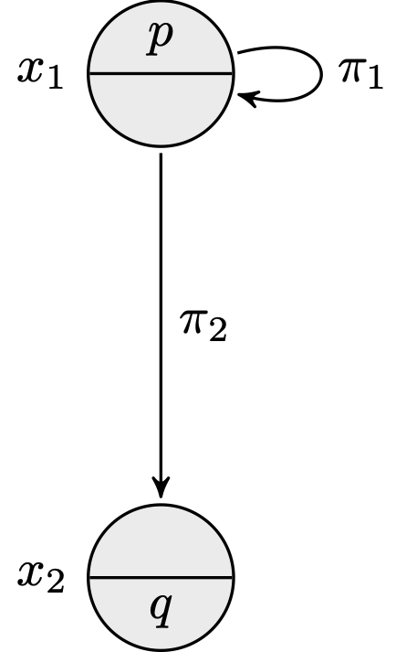
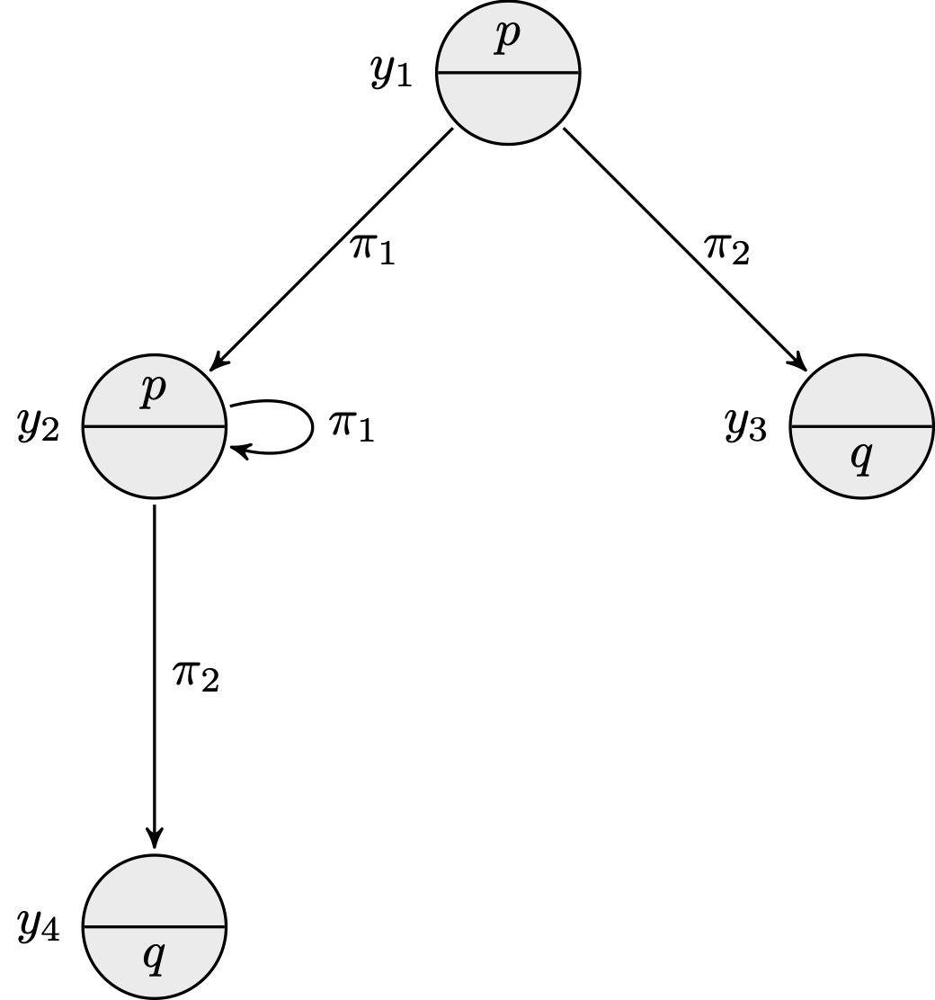

# 命题动态逻辑 propositional dynamic (Nicolas Troquard and Philippe Balbiani)

*首次发表于 2007 年 2 月 1 日；2023 年 2 月 16 日实质修订。*

程序逻辑是这样一类模态逻辑：给编程语言的每个计算机程序 $\alpha$ 配一个模态词 $[\alpha]$，公式 $[\alpha]A$ 读作“程序 $\alpha$ 执行完之后 $A$ 为真”。想法出自 Engeler [1967]、Hoare [1969]、Yanov [1959] 等人，他们构造并研究了可表达程序联结词性质的逻辑语言。Salwicki [1970] 的算法逻辑（AL）与 Pratt [1976] 的动态逻辑（DL）是这些工作的直接延续。本文只讲 DL。围绕 DL 及其变体的众多论文，加上它在程序验证、数据结构上的应用，表明它是研究程序性质的有用工具。Pratt 选择在所谓一阶层面上刻画 DL；几年后 Fischer 与 Ladner [1979] 受其激发，定义了 DL 的命题变体。本文介绍的正是这个命题变体 PDL。

## 1 引论

动态逻辑（DL）是刻画动态系统状态与事件的模态逻辑。它的语言有两副面孔：作断言语言，能表达计算状态的性质；作编程语言，能表达系统状态之间转移的性质。DL 是 **程序逻辑**，可用来谈论并推理事态、过程、变化与结果。

Pratt 最初的程序动态逻辑是 **一阶** 模态逻辑；**命题动态逻辑**（PDL）是它的命题对应物，由 Fischer 与 Ladner [1979] 作为独立逻辑提出。既然是命题的，PDL 语言就不用词项、谓词或函数，只有两个句法范畴：命题与程序。

要给 PDL 的陈述赋予意义，通常用标记转移系统（LTS）给出抽象语义。LTS 可视为 Kripke 模型的一种推广：世界（状态）之间的转移，用 **原子** 程序名作“标记”。赋值则指明每个状态里哪些 **命题** 为真。从状态 $x$ 到 $y$、标记为 $\pi$ 的转移——记作 $xR(\pi)y$ 或 $(x,y) \in R(\pi)$——表示：从 $x$ 出发，程序 $\pi$ 有一次可能执行，终于 $y$。若命题 $A$ 在 $y$ 为真，公式 $\langle\pi\rangle A$ 就在 $x$ 为真，即状态 $x$ 处程序 $\pi$ 有一次可能执行，终于满足 $A$ 的状态。从 $\langle\pi\rangle$ 里看得出一个模态词，让人想到模态逻辑的可能性模态词（常记作 $\Diamond$）。相应地也有必然性概念（模态词常记作 $\Box$），并不意外。公式 $[\pi]A$ 在状态 $x$ 为真，当且仅当从 $x$ 经 $\pi$ 标记的转移可达的每个状态里，$A$ 都真。

复杂程序的可能执行，接着按组合方式定义。比如“先 $\alpha$、后 $\beta$”是复杂程序，更确切说是 **序列**。一次可能执行可在 LTS 里表示为两段转移的复合——记作 $R(\alpha;\beta)$——把状态 $x$ 与 $y$ 连起来：状态 $x$ 处程序 $\alpha$ 有一次可能执行，终于状态 $z$；$z$ 处程序 $\beta$ 又有一次可能执行，终于状态 $y$。命题 $A$ 若在 $y$ 为真，公式 $\langle \alpha;\beta\rangle A$ 就在 $x$ 为真。$\alpha$、$\beta$ 自身也可为复杂程序；再多讲些构造，还能表达更多程序，这些留到适当处。

于是程序被看成一个外延对象：LTS 状态对之间的二元关系。确切说，它是形如 $(x,y)$ 的状态对之集，程序能在 $x$ 执行并走到 $y$。命题则是关于状态的陈述，在状态中非真即假；同样可作外延看待，即使其为真的状态之集。

本文所谓 PDL，专指带有下列程序构造的命题动态逻辑：序列、非确定选择、无界迭代、测试。第 2 节介绍 PDL 及若干性质与基本结果，重点在公理化与可判定性。

Hoare [1969] 的 Hoare 演算是程序逻辑的一座里程碑。它处理形如 $\{A\}\alpha\{B\}$ 的陈述之真——以前提条件 $A$ 运行程序 $\alpha$，后置条件 $B$ 必成立——并以公理化方式定义。它来自一种需要：用严格方法推理程序性质，好让编程在科学中占一席之地。Burstall [1974] 看出了模态逻辑与程序推理的类似，但实际工作始于 Pratt [1976]，是由他课上专讲程序逻辑的学生提起的。PDL 源于 Pratt 用模态逻辑形式系统解释 Hoare 演算；起源导论见 Pratt [1980b]。Hoare 三元组 $\{A\}\alpha\{B\}$ 由 PDL 公式 $A \to [\alpha]B$ 刻画，字面意思是：$A$ 若真，$\alpha$ 每次成功终止的执行结束时 $B$ 都真。看出这层联系，只用 PDL 公理化证明 Hoare 演算的初始规则便是例行公事；第 3 节专讲结构化程序的正确性推理，会详细展开。

与 PDL 相关的课题还有：表达力的比较、可判定性、复杂性，以及把 PDL 按各种方式扩展或限制所得的若干有趣变体之完全性。PDL 问世以来，变体众多，涉及确定性程序、受限测试、非正则程序、作为自动机的程序、程序的补与交、逆与无穷计算等。第 4 节择要介绍，并提示其相对表达力、公理化与计算复杂性。

第 5 节收束全文。

## 2 定义与基本结果

2.1 节给出 PDL 的句法与语义；2.2 节讲证明论，含公理化与完全性文献指引；2.3 节处理可判定性与复杂性。

### 2.1 句法与语义

命题动态逻辑（PDL）用于表示并推理程序的命题性质，句法基于两组符号：原子公式的可数集 $\Phi_0$ 与原子程序的可数集 $\Pi_0$。在此基础上的复杂公式与复杂程序定义如下。

- 每个原子公式都是公式。
- $0$（“假”）是公式。
- 若 $A$ 是公式，则 $\lnot A$（“非 $A$”）是公式。
- 若 $A$、$B$ 是公式，则 $(A\lor B)$（“$A$ 或 $B$”）是公式。
- 若 $\alpha$ 是程序、*A* 是公式，则 $[\alpha]A$（“从当前状态出发，$\alpha$ 的每次执行都导致 $A$ 为真的状态”）是公式。
- 每个原子程序都是程序。
- 若 $\alpha$、$\beta$ 是程序，则 $(\alpha;\beta)$（“先做 $\alpha$，再做 $\beta$”）是程序。
- 若 $\alpha$、$\beta$ 是程序，则 $(\alpha\cup\beta)$（“非确定地做 $\alpha$ 或 $\beta$”）是程序。
- 若 $\alpha$ 是程序，则 $\alpha^*$（“把 $\alpha$ 重复有穷但非确定地确定的次数”）是程序。
- 若 $A$ 是公式，则 $A?$（“若 $A$ 真则继续，否则失败”）是程序。

其余布尔联结词 $1$、$\land$、$\to$、$\leftrightarrow$ 按标准方式作缩写。仿模态逻辑，把 $\lnot[\alpha]\lnot A$ 缩写为 $\langle\alpha\rangle A$（“从当前状态出发，$\alpha$ 的某次执行导致 $A$ 为真的状态”）；把 $n$ 个 $\alpha$ 相继而成的 $\alpha;\ldots ;\alpha$ 写作 $\alpha^n$。更形式地：

- $\alpha^0 := 1?$
- $\alpha^{n+1} := \alpha;\alpha^n$

另外：

- $\alpha^+ := \alpha;\alpha^*$

常用来表示无界、但至少发生一次的迭代。最后，括号省略沿用标准规则。

公式可描述程序成功执行后成立的性质。比如 $[\alpha\cup\beta]A$ 意为：无论 $\alpha$ 还是 $\beta$ 成功执行，都到达 $A$ 成立的状态；$\langle (\alpha;\beta)^*\rangle A$ 意为：存在一串 $\alpha$ 与 $\beta$ 交替执行的序列，最终到达 $A$ 成立的状态。语义上，公式由状态集解释，程序由状态上二元关系解释。确切说，PDL 公式与程序的意义在标记转移系统（LTS）$M = (W,R,V)$ 上解释：$W$ 为非空世界（状态）集，$R$ 把原子程序集 $\Pi_0$ 映到 $W$ 上二元关系，$V$ 把原子公式集 $\Phi_0$ 映到 $W$ 的子集。

直观上，$R$ 给每个原子程序 $\pi\in\Pi_0$ 指派 $W$ 上某个二元关系 $R(\pi)$，意为 $xR(\pi)y$ 当且仅当从 $x$ 有 $\pi$ 的一次执行到达 $y$；$V$ 给每个原子公式 $p\in\Phi_0$ 指派 $W$ 的某个子集 $V(p)$，意为 $x \in V(p)$ 当且仅当 $p$ 在状态 $x$ 为真。按上述对 $0$、$\lnot A$、$A\lor B$、$[\alpha]A$、$\alpha;\beta$、$\alpha\cup\beta$、$\alpha^*$、$A?$ 的读法，$R$ 与 $V$ 自然要归纳扩展如下，才能给出复杂程序与公式的预期意义：

- $xR(\alpha;\beta)y$ 当且仅当存在世界 $z$，使 $xR(\alpha)z$ 且 $zR(\beta)y$
- $xR(\alpha\cup\beta)y$ 当且仅当 $xR(\alpha)y$ 或 $xR(\beta)y$
- $xR(\alpha^*)y$ 当且仅当存在非负整数 $n$ 与状态序列 $z_0, \ldots, z_n$，使 $z_0 = x$、$z_n = y$，且对每个 $k = 1 \ldots n$ 都有 $z_{k-1}R(\alpha)z_k$
- $xR(A?)y$ 当且仅当 $x = y$ 且 $y \in V(A)$
- $V(0) = \emptyset$
- $V(\lnot A) = W \setminus V(A)$
- $V((A\lor B) = V(A) \cup V(B)$
- $V([\alpha]A) = \{x \mid \text{对所有世界 } y，\text{若 } xR(\alpha)y \text{ 则 } y \in V(A)\}$

若 $x \in V(A)$，就说 $A$ 在 $M$ 中的状态 $x$ 处被满足，记作 $\ldquo M, x$ sat $A\rdquo$。

两个标记转移系统：$M = (W,R,V)$（左）与 $M' = (W',R',V')$（右）

上图左边的 LTS 记作 $M$，右边的记作 $M'$。形式地写出来，$M = (W, R, V)$：$W = \{x_1,x_2\}$、$R(\pi_1) = \{(x_1,x_1)\}$、$R(\pi_2) = \{(x_1,x_2)\}$、$V(p) = \{x_1\}$、$V(q) = \{x_2\}$；$M' = (W',R',V')$：$W' = \{y_1, y_2, y_3, y_4\}$、$R'(\pi_1) = \{(y_1, y_2), (y_2, y_2)\}$、$R'(\pi_2) = \{(y_1, y_3), (y_2, y_4)\}$、$V'(p) = \{y_1, y_2\}$、$V'(q) = \{y_3, y_4\}$。例如：

- $M,x_1$ sat $p$
- $M,x_2$ sat $q$
- $M,x_1$ sat $\langle \pi_1 \rangle p \land \langle \pi_2 \rangle q$
- $M,x_1$ sat $[\pi_1]p \land [\pi^*_1]p$
- $M',y_1$ sat $\langle \pi^*_1;\pi_2\rangle q$
- $M',y_2$ sat $[\pi^*_1] p$
- $M',y_1$ sat $[\pi_1 \cup \pi_2] (p \lor q)$
- $M',y_3$ sat $[\pi_1 \cup \pi_2] 0$

现在看公式 $A$。若对所有世界 $x$ 都有 $x \in V(A)$，就说 $A$ 在 $M$ 中有效，或 $M$ 是 $A$ 的模型，记作“$M \models A$”。若对所有模型 $M$ 都有 $M \models A$，就说 $A$ 有效，记作“$\models A$”。若存在世界 $x$ 使 $x \in V(A)$，就说 $A$ 在 $M$ 中可满足，或 $M$ 满足 $A$，记作“$M$ sat $A$”；若存在模型 $M$ 使 $M$ sat $A$，就说 $A$ 可满足，记作“sat $A$”。特别有：

sat $A$ 当且仅当并非 $\models \lnot A$；$\models A$ 当且仅当并非 sat $\lnot A$

PDL 有些显著公式是有效的。（读者不妨形式地证一证，或至少借上面几例先说服自己。）

$\models [\alpha ; \beta]A \leftrightarrow [\alpha][\beta]A$ $\models [\alpha \cup \beta]A \leftrightarrow [\alpha]A \land [\beta]A$ $\models [\alpha^*]A \leftrightarrow A \land [\alpha][\alpha^*]A$ $[A?]B \leftrightarrow (A \rightarrow B)$

也可以等价地写成对偶形式。

$\langle\alpha ; \beta\rangle A \leftrightarrow \langle\alpha\rangle\langle\beta\rangle A$ $\langle\alpha \cup \beta\rangle A \leftrightarrow \langle\alpha\rangle A \lor \langle\beta\rangle A$ $\langle\alpha^*\rangle A \leftrightarrow A \lor \langle\alpha\rangle \langle\alpha^*\rangle A$ $\langle A?\rangle B \leftrightarrow A \land B$

有个概念值得一说：LTS 里所含、可用 PDL 公式表达的信息。以 LTS 描述的系统，行为往往微微隐在形式之中。比如略加审视就不难相信，上图两个 LTS 行为相同、满足同样的 PDL 公式。本节讲句法与语义，最后给出这些主张的理论基础。

给定两个 LTS，可问它们是否满足同样公式。互模拟已成为衡量 Kripke 模型与标记转移系统等价性的标准。LTS $M = (W,R,V)$ 与 $M' = (W',R',V')$ 之间的 **互模拟**，是二者状态集间的二元关系 $Z$，使得对 $W$ 中每个世界 $x$、$W'$ 中每个世界 $x'$，若 $xZx'$，则：

- 对每个原子公式 $p\in \Phi_0$，$x\in V(p)$ 当且仅当 $x' \in V'(p)$；
- 对每个原子程序 $\pi \in \Pi_0$ 与每个世界 $y \in W$，若 $x R(\pi)y$，则存在世界 $y' \in W'$，使 $yZy'$ 且 $x' R'(\pi)y'$；
- 对每个原子程序 $\pi \in \Pi_0$ 与每个世界 $y' \in W'$，若 $x' R'(\pi)y'$，则存在世界 $y \in W$，使 $yZy'$ 且 $x R(\pi)y$。

两个 LTS 之间若存在互模拟，就说它们 **互模拟**。

事实是：两个互模拟的 LTS $M = (W,R,V)$ 与 $M' = (W',R',V')$ 中，对 $W$ 中每个世界 $x$、$W'$ 中每个世界 $x'$，若 $xZx'$，则对每个 PDL 公式 $A$ 都有 $x \in V(A)$ 当且仅当 $x' \in V'(A)$。所以，两个 LTS 按上述定义互模拟时，若 $xZx'$，则

- 对每个程序 $\alpha$ 与每个世界 $y \in W$，若 $x R(\alpha)y$，则存在世界 $y' \in W'$，使 $yZy'$ 且 $x' R'(\alpha)y'$；
- 对每个程序 $\alpha$ 与每个世界 $y' \in W'$，若 $x' R'(\alpha)y'$，则存在世界 $y \in W$，使 $yZy'$ 且 $x R(\alpha)y$。

所以，只查看原子程序，就能比较两个 LTS 的行为，并对二者在复杂程序上的行为比较作安全外推。我们说 PDL 的程序构造 **对互模拟安全**。精确刻画见 Van Benthem [1998]。

很容易看出，上面两个 LTS 实例互模拟。两模型 $M$ 与 $M'$ 之间的互模拟 $Z$ 可取 $Z = \{(x_1,y_1), (x_1,y_2), (x_2, y_3), (x_2, y_4)\}$。状态 $x_1$ 与 $y_1$ 满足完全相同的 PDL 公式，$x_1$ 与 $y_2$ 等亦然。

### 2.2 公理化与完全性

证明论的目标，是用公理与推理规则刻画有效性，即性质 $\models A$。本节按公式的句法结构归纳定义可推演性谓词 $\vdash$，使得对所有公式 $A$ 都有

$\vdash A$ 当且仅当 $\models A$。

PDL 当然是经典命题逻辑的扩张：所有命题重言式成立，一切命题推理都允许。特别是肯定前件有效：由 $A$ 与 $A \rightarrow B$ 推出 $B$。对任何程序 $\alpha$，把 LTS 限制到 $R(\alpha)$，得到 Kripke 模型，其中 $[\alpha]$ 的逻辑是最弱的命题正规模态逻辑 K。因此 PDL 含有分配公理模式的每个实例

**(K)**

$[\alpha](A \rightarrow B) \rightarrow ([\alpha]A \rightarrow [\alpha]B)$

并对下列推理规则（**必然化** 规则）封闭：

**(N)**

由 $A$ 推出 $[\alpha]A$

模态逻辑若服从 (K) 与 (N)，就叫正规。正规模态逻辑有个重要性质：**对合取的分配律** $\land$。公式 $[\alpha](A \land B) \leftrightarrow ([\alpha]A \land [\alpha]B)$ 可用 (K)、(N) 加命题推理证出；**单调** 规则同样如此：由 $A \rightarrow B$ 推出 $[\alpha]A \rightarrow [\alpha]B$。

PDL 是含有下列公理模式所有实例的最小正规模态逻辑：

**(A1)**

$[\alpha;\beta]A \leftrightarrow [\alpha][\beta]A$

**(A2)**

$[\alpha \cup \beta]A \leftrightarrow [\alpha]A \land [\beta]A$

**(A3)**

$[\alpha^*]A \leftrightarrow A \land [\alpha][\alpha^*]A$

**(A4)**

$[A?]B \leftrightarrow (A \rightarrow B)$

并对下列推理规则（**循环不变** 规则）封闭：

**(I)**

由 $A \rightarrow [\alpha]A$ 推出 $A \rightarrow [\alpha^*]A$

若 $X$ 是公式集、$A$ 是公式，则称 $A$ 从 $X$ *$\vdash$-可推演*，记作“$X \vdash A$”，如果存在公式序列 $A_0, A_1, \ldots A_n$，使 $A_n = A$，且每个 $A_i$（$i \leq n$）或是某公理模式的实例，或是 $X$ 中的公式，或由序列在先公式经推理规则而来。另外，$\vdash A$ 当且仅当 $\emptyset \vdash A$，此时称 $A$ *$\vdash$-可推演*；若并非 $X \vdash 0$，则称 $X$ *$\vdash$-一致*。容易证明，规则 (I) 可用下述公理模式（**归纳** 公理模式）代替：

**(A5)**

$A \land [\alpha^*](A \rightarrow [\alpha]A) \rightarrow [\alpha^*]A$

先证 (I) 是以 (A1)、(A2)、(A3)、(A4)、(A5) 为基础的证明系统的导出规则：

| 1. | $A \rightarrow [\alpha]A$ | 前提 |
| --- | --- | --- |
| 2. | $[\alpha^*](A \rightarrow [\alpha]A)$ | 由 1 用 (N) |
| 3. | $A \land [\alpha^*](A \rightarrow [\alpha]A) \rightarrow [\alpha^*]A$ | 公理模式 (A5) |
| 4. | $[\alpha^*](A \rightarrow [\alpha]A) \rightarrow (A \rightarrow [\alpha^*]A)$ | 由 3 用命题推理 |
| 5. | $A \rightarrow [\alpha^*]A$ | 由 2、4 用肯定前件 |

再证 (A5) 在 $\vdash$ 中可推演：

| 1. | $[\alpha^*](A \rightarrow [\alpha]A)\ \leftrightarrow\ $ $(A \rightarrow [\alpha]A) \land [\alpha][\alpha^*](A \rightarrow [\alpha]A)$ | 公理模式 (A3) |
| --- | --- | --- |
| 2. | $A \land [\alpha^*](A \rightarrow [\alpha]A)\ \rightarrow\ $ $[\alpha](A \land [\alpha^*](A \rightarrow [\alpha]A))$ | 由 1 用命题推理与 $[\alpha]$ 对 $\land$ 的分配律 |
| 3. | $A \land [\alpha^*](A \rightarrow [\alpha]A)\ \rightarrow\ $ $[\alpha^*](A \land [\alpha^*](A \rightarrow [\alpha]A))$ | 由 2 用 (I) |
| 4. | $[\alpha^*](A \rightarrow [\alpha]A) \rightarrow (A \rightarrow [\alpha^*]A)$ | 由 3 用命题推理与 $[\alpha^*]$ 对 $\land$ 的分配律 |
| 5. | $A \land [\alpha^*](A \rightarrow [\alpha]A) \rightarrow [\alpha^*]A$ | 由 4 用命题推理 |

以 (A1)、(A2)、(A3)、(A4)、(A5) 为公理模式的 PDL 公理化由 Segerberg [1977] 提出。由上述定义立得：$\vdash$ 相对于 $\models$ 可靠，即

对所有公式 $A$，若 $\vdash A$，则 $\models A$。

证明按 $A$ 在 $\vdash$ 中演绎的长度归纳。$\vdash$ 相对 $\models$ 是否完全，即是否

对所有公式 $A$，若 $\models A$，则 $\vdash A$，

这个问题有多位逻辑学家研究。Segerberg [1977] 的推理路线是证 $\vdash$ 完全性的首次尝试；不久 Parikh 也给出一个证明。1978 年初，Segerberg 发现自己的论证有漏洞（后来补上了），Parikh 于是发表 Parikh [1978]，可算 $\vdash$ 完全性的第一个证明。此后又有 $\vdash$ 完全性的不同证明，如 Kozen 与 Parikh [1981]；更多细节见 Pratt [2017]。

人们也一直在找 PDL 的其他证明论，早期即有，尤其 Pratt [1978]。另外要提到 Nishimura [1979] 与 Vakarelov [1983] 关于相关理论的完全性。

PDL 可推演性谓词的另一种表述，用一条无穷推理规则，例如 Goldblatt [1992a]。（无穷推理规则可以取无穷多个前提。）设 $\vdash'$ 是命题动态逻辑语言中对应的可推演性谓词：取含有 (A1)、(A2)、(A3)、(A4) 所有实例、并对下列无穷规则封闭的最小正规模态逻辑。

**(I′)**

由 $\{[\beta][\alpha^n]A : n\geq 0\}$ 推出 $[\beta][\alpha^*]A$

可证 $\vdash'$ 相对 $\models$ 既可靠又完全，即

对所有公式 $A$，$\vdash' A$ 当且仅当 $\models A$。

换句话说，就生成全部有效公式之集来说，$\vdash$ 与 $\vdash'$ 等价。

### 2.3 可判定性与复杂性

复杂性理论的目标，是用时间或空间资源确立 sat $A$ 这一性质的可计算性。逻辑 $\mathcal{L}$ 的复杂性，常干脆等同于判定其公式是否可满足的问题：

**(L-SAT)**

给定 $\mathcal{L}$ 的公式 $A$，$A$ 可满足吗？

本节研究下述判定问题的复杂性：

**(PDL-SAT)**

给定 PDL 的公式 $A$，$A$ 可满足吗？

PDL 的完全公理化，是有效 PDL 公式集（也就是否定不可满足的公式集）的递归定义。因此，对问题 (PDL-SAT) 我们有个子程序：$A$ 若不可满足，它会答“否”。子程序 (SP1) 枚举一切 $\vdash$-可推演的公式：从公理出发，借推理规则推出别的定理。时间给够，某公式只要 $\vdash$-可推演，子程序终究找得到。所以 $A$ 不可满足时，(SP1) 终必找到 $\lnot A$，并答“否”。

可 $A$ 若可满足，(SP1) 就永远找不到 $\lnot A$，会一路跑下去，什么时候都不好断言。这种不确定有出路：再设想一个子程序，PDL 公式可满足时答“是”。实际上，PDL 最早的结果之一，正是证明它有 **有穷模型性质**，即

对所有公式 $A$，若 sat $A$，则存在有穷模型 $M$ 使 $M$ sat $A$。

有穷模型性质给子程序 (SP2) 打了底：逐个枚举 PDL 的有穷模型，看哪个满足该公式。（对任意公式 $A$ 与有穷模型 $M$，按 $V(A)$ 的定义很容易检验 $M$ sat $A$。）于是 $A$ 可满足时，它终必找到 $M$ 使 $M$ sat $A$，并答“是”。与 (SP1) 对称，$A$ 不可满足时 (SP2) 永远找不到满足它的模型，会一路跑下去，什么时候都不好断言。

把 (SP1) 与 (SP2) 合起来，就有了判定 PDL 公式 $A$ 是否可满足的办法：并行跑。$A$ 可满足，(SP2) 终会答“是”；$A$ 不可满足，(SP1) 终会答“否”。哪一方先给出答案，过程就停。

这样得来的过程足以断定 (PDL-SAT) 可判定，实践上却极低效。有个结果——Fischer 与 Ladner [1979]、Kozen 与 Parikh [1981]——比有穷模型性质更强，叫 **小模型性质**：

对所有公式 $A$，若 sat $A$，则存在大小对 $A$ 为指数的有穷模型 $M$，使 $M$ sat $A$。

这意味着，在 (SP2) 里找满足公式的模型时，如今知道该何时收手：小模型全都试完，就可断定该公式不可满足。由此得到一个非确定地于指数时间（NEXPTIME）运行的过程：猜一个大小至多单指数的模型，再检验它满不满足公式。不过 PDL 复杂性理论的关键结果出自 Fischer 与 Ladner [1979]、Pratt [1980a]。Fischer 与 Ladner 观察到 PDL 公式能高效描述线性空间有界交替图灵机的计算，首先立起 (PDL-SAT) 的指数时间下界；(PDL-SAT) 的 EXPTIME 上界由 Pratt [1980a] 得到，他把语义表列方法改制用于 PDL。所以 (PDL-SAT) 是 EXPTIME-完全的。（实践上更高效的算法见 De Giacomo 与 Massacci [2000]，最坏情况仍为确定性指数时间。）

## 3 结构化程序与程序的正确性

从历史上看，程序逻辑源于 1960 年代末计算机科学家的工作：他们想给编程语言赋予意义，为关于程序的证明找严格标准。这类证明可关乎程序是否合乎预期行为，也可关乎程序是否终止。开创性论文是 Floyd [1967]，它用 **流程图** 分析结构化计算机程序的性质。Yanov [1959]、Engeler [1967] 等早期工作，已提出并研究过可表达程序联结词性质的形式语言。Hoare [1969] 的形式系统是 PDL 诞生途中的里程碑，被作为 Floyd 流程图的严格公理化解释提出。谈这套形式系统，常说 Hoare 逻辑、Floyd–Hoare 逻辑或 Hoare 演算。它关心陈述（“Hoare 三元组”）之真，如 $\{A\}\alpha\{B\}$：在前提条件 $A$、程序 $\alpha$ 与后置条件 $B$ 之间建立联系，意思是 $A$ 作为执行 $\alpha$ 的前提条件成立时，$\alpha$ 成功执行之后 $B$ 作为后置条件成立。

几十年前如此，如今依然如此：验证程序，多半靠拿各式合理的输入去测。某个输入得不到预期输出，就修“bug”；等测过的输入都给出预期输出，人便有理由相信程序没错。可这方法费时，还总留下未测的输入可能出错。程序已实现、已投入使用之后再找错误，资源代价更高。对关键系统来说，用形式方法推理正确性至关重要，因为它能穷尽地证明程序无错。

### 3.1 Hoare 演算

要说明 Hoare 演算的规则捕捉了哪类程序原理，看其中几条就够了。（注意：规则意为，横线上方所有陈述（前提）都成立时，横线下方陈述（结论）也成立。）

$$ \frac{\{A\}\alpha_1 \{B\}\quad\{B\} \alpha_2\{C\}} {\{A\} \alpha_1;\alpha_2\{C\}} \text{（合成规则）} $$

合成规则捕捉程序的基本顺序合成。前提是关于 $\alpha_1$、$\alpha_2$ 部分正确性的两条假定：在满足 $A$ 的状态执行 $\alpha_1$，只要停机，就停在满足 $B$ 的状态；在满足 $B$ 的状态执行 $\alpha_2$，只要停机，就停在满足 $C$ 的状态。结论则由这两条假定推出 $\alpha_1;\alpha_2$（即 $\alpha_1$ 与 $\alpha_2$ 顺序合成）的部分正确性：在满足 $A$ 的状态执行 $\alpha_1;\alpha_2$，只要停机，就停在满足 $C$ 的状态。

迭代规则很重要：它捕捉了程序反复执行某段代码、直到某条件不再成立的基本能力。

$$ \frac{\{A \land B\}\alpha\{A\}} {\{A\} \mathsf{while}~B~\mathsf{do}~\alpha \{\lnot B \land A\}} \text{（迭代规则）} $$

最后，两条后承规则为两类直观推理提供形式依据：一类涉及较弱的后置条件，一类涉及较强的前提条件。

$$ \frac{\{A\}\alpha\{B\}\quad B \rightarrow C} {\{A\} \alpha \{C\}} \text{（后承规则 1）} $$ $$ \frac{C\rightarrow A\quad \{A\}\alpha\{B\}} {\{C\}\alpha\{B\}} \text{（后承规则 2）} $$

Hoare [1969] 的形式系统里，公理模式略去不提，因为那需要一阶语言。后来的 Hoare 逻辑研究还常添规则，早期综述见 Apt [1979]。

### 3.2 Hoare 演算与 PDL

动态逻辑来自 Pratt 用模态逻辑形式系统解释 Hoare 三元组与 Hoare 演算。借模态词 $[\alpha]$ 可形式地表达：执行程序 $\alpha$ 可达的一切状态都满足 $A$，写作 $[\alpha]A$。Hoare 三元组 $\{A\}\alpha\{B\}$ 也就直接由 PDL 公式刻画：

$A \rightarrow [\alpha]B$。

此外，重要的编程构造经定义性缩写即可引入 PDL：

- $\mathsf{if}~ A ~\mathsf{then}~ \alpha ~\mathsf{else}~ \beta := ((A?;\alpha) \cup (\lnot A?;\beta))$
- $\mathsf{while}~ A ~\mathsf{do}~ \alpha := ((A?;\alpha)^*;\lnot A?)$
- $\mathsf{repeat}~ \alpha ~\mathsf{until}~ A := (\alpha;((\lnot A;\alpha)^*;A?))$
- $\mathsf{abort} := 0?$
- $\mathsf{skip} := 1?$

这样看来，用 PDL 逻辑地证明结构化程序的正确性，工具已齐备。可除这层颇显含糊的联系，二者形式上的关系也许还不清楚。其实 PDL 是 Hoare 演算的推广：Hoare 演算全部规则都能在 PDL 公理系统中证出。（严格说，Hoare 演算有些公理需要一阶动态逻辑的扩展语言。）这很值得一说，下面演示如何推导。

证明先假定各规则的前提，然后只用这些假定、PDL 的公理与规则，把规则结论确立为逻辑后承。合成规则：先假定 $\{A\}\alpha_1\{B\}$，即其 PDL 表述 $A \rightarrow [\alpha_1]B$；再假定 $\{B\}\alpha_2\{C\}$，即 $B \rightarrow [\alpha_2]C$。要证 $\{A\}\alpha_1;\alpha_2\{C\}$，确切说，要确立 $A \rightarrow [\alpha_1;\alpha_2]C$ 从公式集 $\{A \rightarrow [\alpha_1]B, B \rightarrow [\alpha_2]C\}$ 是 $\vdash$-可推演的。

| 1. | $A \rightarrow [\alpha_1]B$ | 假定 $\{A\}\alpha_1\{B\}$ |
| --- | --- | --- |
| 2. | $B \rightarrow [\alpha_2]C$ | 假定 $\{B\}\alpha_2\{C\}$ |
| 3. | $[\alpha_1]B \rightarrow [\alpha_1][\alpha_2]C$ | 由 2 用 $[\alpha_1]$ 的单调性 |
| 4. | $A \rightarrow [\alpha_1][\alpha_2]C$ | 由 1、3 用命题推理 |
| 5. | $[\alpha_1;\alpha_2]C \leftrightarrow [\alpha_1][\alpha_2]C$ | 公理模式 (A1) |
| 6. | $A \rightarrow [\alpha_1;\alpha_2]C$ | 由 4、5 用命题推理 |
| — | $\{A\}\alpha_1;\alpha_2\{C\}$ |   |

迭代规则的证明稍复杂。

| 1. | $A\land B \rightarrow [\alpha ]A$ | 假定 $\{A \land B\}\alpha \{A\}$ |
| --- | --- | --- |
| 2. | $A \rightarrow (B \rightarrow [\alpha ]A)$ | 由 1 用命题推理 |
| 3. | $[B?][\alpha ]A \leftrightarrow (B \rightarrow [\alpha ]A)$ | 公理模式 (A4) |
| 4. | $A \rightarrow [B?][\alpha ]A$ | 由 2、3 用命题推理 |
| 5. | $[B? ; \alpha ]A \leftrightarrow [B?][\alpha ]A$ | 公理模式 (A1) |
| 6. | $A \rightarrow [B?;\alpha ]A$ | 由 4、5 用命题推理 |
| 7. | $A \rightarrow [(B?;\alpha )^*]A$ | 由 6 用 (I) |
| 8. | $A \rightarrow (\lnot B \rightarrow (\lnot B\land A))$ | 命题重言式 |
| 9. | $A \rightarrow [(B?;\alpha )^*](\lnot B \rightarrow (\lnot B\land A))$ | 由 7、8 用 $[(B?;\alpha )^*]$ 的单调性与命题推理 |
| 10. | $[\lnot B?](\lnot B\land A)\ \leftrightarrow\ $ $(\lnot B \rightarrow (\lnot B\land A))$ | 公理模式 (A4) |
| 11. | $A \rightarrow [(B?;\alpha )^*][\lnot B?](\lnot B\land A)$ | 由 9、10 用 $[(B?;\alpha )^*]$ 的单调性与命题推理 |
| 12. | $[(B?;\alpha )^* ; \lnot B?](\lnot B\land A)\ \leftrightarrow\ $ $[(B?;\alpha )^*][\lnot B?](\lnot B\land A)$ | 公理模式 (A1) |
| 13. | $A \rightarrow [(B?;\alpha )^* ; \lnot B?](\lnot B\land A)$ | 由 12 用命题推理 |
| — | $\{A\}\mathsf{while}~ B ~\mathsf{do}~ \alpha \{\lnot B\land A\}$ |   |

在 PDL 里，两条后承规则其实是合成规则的特例。第一条把 $\alpha_1$ 换成 $\alpha$、$\alpha_2$ 换成 $\mathsf{skip}$；第二条把 $\alpha_1$ 换成 $\mathsf{skip}$、$\alpha_2$ 换成 $\alpha$。再用公理模式 (A4)，并注意对所有 $A$ 与 $\alpha$，$[\alpha;\mathsf{skip}]A \leftrightarrow [\alpha]A$ 与 $[\mathsf{skip};\alpha]A \leftrightarrow [\alpha]A$ 也 $\vdash$-可推演，就成了。

### 3.3 完全正确性

Hoare 自己在 Hoare [1979] 中承认，最初那套演算只是个起点，局限不少：它只能推理 **部分** 正确性。$\{A\}\alpha\{B\}$ 为真，只保证从满足 $A$ 的状态出发的一切 $\alpha$ 执行都终于满足 $B$ 的状态，**或者不停机**。也就是说，部分正确的程序可能有不终止的执行。（事实上，根本没有终止执行的程序总是部分正确，例如 $\mathsf{while}~ 1 ~\mathsf{do}~ \mathsf{skip}$：对所有 $A$、$B$，$A \rightarrow [\mathsf{while}~1 ~\mathsf{do} ~\mathsf{skip}] B$ 都可推演。）该演算没法证明程序终止。略加修改，便可顾及 **完全** 正确性——部分正确性加终止性，办法是修订迭代规则。此处从略，读者可参看 Apt [1981]。

先看 **确定性** 程序：用下列公式，已能刻画完全正确性：

$A \rightarrow \langle\alpha\rangle B$。

$\langle\alpha\rangle B$ 意为：$\alpha$ 有一次执行终止于满足 $B$ 的状态。$\alpha$ 若确定，这次可能的终止执行就是 $\alpha$ 唯一的执行。所以，只要先证明程序确定，这招就足以证其完全正确性。

完全正确性问题的一般解法就在 PDL 领域里，只须稍作扩展。Pratt 在 Pratt [1980b] 已暗示 PDL 表达力不足以捕捉程序的无穷循环；Streett [1982] 于是引入带重复的 PDL（RPDL），对所有程序 $\alpha$ 加入表达式 $\Delta\alpha$，代表一个新命题，语义为：

- $V(\Delta\alpha) = \{x: $ 存在状态无穷序列 $z_0, z_1, \ldots$，使 $z_0 = x$，且对任何 $n \geq 0, z_n R(\alpha) z_{n+1}\}$。

Streett [1982] 猜想，在 PDL 的证明系统上恰好添上下列公理模式，即可公理化 RPDL。

**(A6)**

$\Delta\alpha \rightarrow \langle\alpha\rangle \Delta\alpha$

**(A7)**

$[\alpha^*](A \rightarrow \langle\alpha\rangle A) \rightarrow (A \rightarrow \Delta\alpha)$

猜想的证明见 Sakalauskaite 与 Valiev [1990]。（组合式 PDL 变体中该猜想的一个版本，也由 Gargov 与 Passy [1988] 证明。）

容易看出，上面的 Hoare 演算里，不终止只能来自迭代规则；PDL 程序的不终止，也只能来自无界迭代的使用。$\Delta\alpha$ 表示 $\alpha^*$ 可能发散，正合需要。于是可归纳定义谓词 $\infty$：对程序 $\alpha$，$\infty(\alpha)$ 恰在 $\alpha$ 能进入不终止计算时为真。

$\infty(\pi) := 0$，其中 $\pi\in\Pi_0$；$\infty(A?) := 0$；$\infty(\alpha \cup \beta) := \infty(\alpha)\ \lor \infty(\beta)$；$\infty(\alpha ; \beta) := \infty(\alpha) \lor \langle\alpha\rangle \infty(\beta)$；$\infty(\alpha^*) := \Delta\alpha \lor \langle\alpha^*\rangle \infty(\alpha)$

最后，程序的完全正确性可用这类公式表达：

$A \rightarrow (\lnot \infty(\alpha) \land [\alpha]B)$，

字面意思：$A$ 成立时，程序 $\alpha$ 不会永远运行，且 $\alpha$ 每次成功执行都终于满足 $B$ 的状态。

## 4 若干变体

扩展或限制 PDL 的句法与语义，可得众多变体，关于其比较表达力、可判定性、复杂性、公理化与完全性的结果蔚为大观。篇幅有限，这里只谈少数几个，动态逻辑中大片本来重要的研究只得割舍。

### 4.1 无测试的 PDL

公理模式 $[A?]B \leftrightarrow (A \rightarrow B)$ 似乎表明：每个公式 $C$ 都有等价的无测试公式 $C'$——即存在无测试公式 $C'$ 使 $\models C \leftrightarrow C'$。有趣的是，这断言不成立。设 PDL₀ 为 PDL 限制到无测试正则程序（即不含测试的程序）的结果。Berman 与 Paterson [1981] 考察 PDL 公式 $\langle (p?;\pi)^*;\lnot p?;\pi;p?\rangle 1$，它等于

$\langle \mathsf{while}~ p~ \mathsf{do}~ \pi \rangle \langle \pi \rangle p$，

并证明没有等价的 PDL₀ 公式，可见 PDL 表达力强于 PDL₀。其论证可推广如下。对每个 $n \geq 0$，设 PDL_{*n*+1} 为 PDL 的子集，其中程序含测试 $A?$ 仅当 $A$ 是 PDL_{*n*} 公式。对每个 $n \geq 0$，Berman 与 Paterson 考察下式定义的 PDL_{*n*+1} 公式 $A_{n+1}$：

$\langle \mathsf{while}~ A_n~ \mathsf{do}~ \pi_n\rangle \langle \pi_n\rangle A_n$，

其中 $A_0 = p$、$\pi_0 = \pi$，并证明对每个 $n \geq 0$，没有与 $A_{n+1}$ 等价的 PDL_{*n*} 公式。所以对每个 $n \geq 0$，PDL_{*n*+1} 的表达力都强于 PDL_{*n*}。

### 4.2 带逆的 PDL

CPDL 是 PDL 加上逆构造的扩展，这构造自 PDL 诞生之初就有人考虑。对每个程序 $\alpha$，令 $\alpha^{-1}$ 代表一个新程序，语义为

$xR(\alpha^{-1})y$ 当且仅当 $yR(\alpha)x$。

有了逆构造，可表达当前状态之前各状态的事实，并反向推理程序。比如 $[\alpha^{-1}]A$ 意为：执行 $\alpha$ 之前 $A$ 必定成立。有

$\models A \rightarrow [\alpha]\langle \alpha ^{-1}\rangle A$ $\models A \rightarrow [\alpha ^{-1}]\langle \alpha \rangle A$

加入逆构造，不会明显改变 PDL 的计算性质。把下列公理模式的所有实例

**(A8)**

$A \rightarrow [\alpha ]\langle \alpha^{-1}\rangle A$

**(A9)**

$A \rightarrow [\alpha^{-1}]\langle \alpha \rangle A$

加到 PDL 的证明系统上，便得扩展语言中既可靠又完全的可推演性谓词，细节见 Parikh [1978]。CPDL 有小模型性质，(CPDL-SAT) 是 EXPTIME-完全的。

容易看出 CPDL 表达力强于 PDL。看 CPDL 公式 $\langle \pi^{-1}\rangle 1$ 与 LTS $M = (W, R, V)$、$M' = (W', R', V')$：$W = \{x,y\}$、$R(\pi) = \{(x,y)\}$、$W' = \{y'\}$、$R'(\pi) = \emptyset$、$V(x) = V(y) = V'(y') = \emptyset$。$M, y$ sat $\langle \pi^{-1}\rangle 1$，$M', y'$ 则不 sat $\langle \pi ^{-1}\rangle 1$；而对所有 PDL 公式 $A$ 都有 $M, y$ sat $A$ 当且仅当 $M', y'$ sat $A$。可见没有 PDL 公式等价于 $\langle \pi^{-1}\rangle 1$。

### 4.3 带重复与循环的 PDL

3.3 节引入 RPDL 时已见过重复的力量。这里再汇总若干 RPDL 的结果，及其与“重复程序”概念其他变体的关联。

RPDL 的复杂性理论方面，Streett [1982] 已确立它有有穷模型性质：每个 RPDL 可满足公式 *A*，都在大小至多对 *A* 的长度为三重指数的模型中可满足。一个自动机论论证由此断定，(RPDL-SAT) 可在确定性三重指数时间（3-EXPTIME）内解决。这样，(RPDL-SAT) 的这个上界与 (PDL-SAT) 的简单指数时间下界之间，就留了空隙。该问题与计算机科学家对时态逻辑复杂性的兴趣紧密相关，尤其关乎 Kozen [1983] 的（命题）模态 $\mu$-演算（MMC），因为 RPDL 到 MMC 有线性膨胀的翻译。Vardi 与 Stockmeyer [1985] 给出非确定指数时间的上界；Emerson 与 Jutla [1988] 及最终形式 Emerson 与 Jutla [1999] 证明 (MMC-SAT) 与 (RPDL-SAT) 都是 EXPTIME-完全的。加上 4.2 节的逆算子，便得 CRPDL；(CRPDL-SAT) 的复杂性悬了几年，但也可证为 EXPTIME-完全，办法是合并 Emerson 与 Jutla [1988]、Vardi [1985] 的技巧，见 Vardi [1998]。

3.3 节定义了谓词 $\infty$，$\infty(\alpha)$ 表示程序 $\alpha$ 可能有非终止计算。把 PDL 加上 $\infty$ 所得逻辑叫 LPDL。显然 RPDL 表达力至少不弱于 LPDL，$\infty(\alpha)$ 在 RPDL 语言中的归纳定义就是明证；其实 RPDL 严格更强，见 Harel 与 Sherman [1982]。可以想见，RPDL 与 LPDL 都强于 PDL，证明办法是举出它们的某些公式，示其在 PDL 中无等价表述。证明用到 **滤化** 技巧：把 LTS 塌缩成有穷模型，同时保持某些公式的真假不变。给定 PDL 公式集 $X$，做法是把 LTS 中在 $X$ 里满足完全相同公式的状态并成等价类；这些等价类构成滤化模型的状态集，再在其上适当构造转移。

取一个依 PDL 公式 $A$ 仔细选定的集合 $FL(A)$（即 $A$ 的子公式集之所谓 Fischer–Ladner 闭包），对 LTS $M$ 作滤化，便得有穷滤化模型 $M'$：$A$ 在 $M$ 中世界 $u$ 处可满足，当且仅当它在滤化模型中含 $u$ 的等价类里可满足。（见 Fischer 与 Ladner [1979]。）

现在考虑 LTS $M=(W,R,V)$ 的滤化，其中

- $W = \{(i,j) : j \text{ 与 } i \text{ 为整数}, 1 \leq j \leq i\} \cup \{ u \}$
- 当 $1 \leq j \leq i$ 时 $(i,j)R(\pi )(i,j-1)$
- 对每个 $i$，$uR(\pi )(i,i)$
- 对每个 $p \in \Phi_0$，$V(p) = \emptyset$

一句话：$M$ 里发生的事，就是从世界 $u$ 出发有无穷多条长度递增的有穷 $\pi$-路径。既有 $M, u$ sat $\lnot\Delta\pi$，又有 $M, u$ sat $\lnot\infty(\pi^*)$。可对每个 PDL 公式 $A$，按 $FL(A)$ 对 $M$ 滤化后，$\Delta\pi$ 与 $\infty(\pi^*)$ 都会在 $u$ 的等价类处被满足——滤化必然塌缩 $M$ 的某些状态，造出循环。所以，既没有 PDL 公式能表达 $\Delta\pi$，也没有 PDL 公式能表达 $\infty(\pi^*)$。

要说一个程序能永远执行，还有别的办法。比如 Danecki [1984a] 提出谓词 $\mathsf{sloop}$，刻画能进入强循环的程序，即：

$V(\mathsf{sloop}(\alpha)) = \{x: xR(\alpha)x\}$。

把 PDL 加上公式 $\mathsf{sloop}(\alpha)$ 所得逻辑称 SLPDL。RPDL 与 SLPDL 基本不可比：$\Delta$ 在 SLPDL 中不可定义，$\mathsf{sloop}$ 在 RPDL 中不可定义。SLPDL 没有有穷模型性质。例如公式

$[\pi^*](\langle\pi\rangle 1 \land \lnot\mathsf{sloop}(\pi^+))$

只在无穷 LTS 中可满足。尽管如此，Danecki [1984a] 仍确立了 (SLPDL-SAT) 在确定性指数时间内可判定。

### 4.4 带交的 PDL

另一个被研究过的构造，是程序的交。把交加入 PDL 得逻辑 IPDL：对每对程序 $\alpha$、$\beta$，表达式 $\alpha \cap \beta$ 代表新程序，语义为

$xR(\alpha \cap \beta )y$ 当且仅当 $xR(\alpha)y$ 且 $xR(\beta)y$。

比如 $\langle \alpha \cap \beta \rangle A$ 的预期读法是：在当前状态执行 $\alpha$ 与 $\beta$，存在一个二者都可达的状态满足 $A$。由此

$\models \langle \alpha \cap \beta \rangle A \rightarrow \langle \alpha \rangle A \land \langle \beta \rangle A$，

但一般地

并非 $\models \langle \alpha \rangle A \land \langle \beta \rangle A \rightarrow \langle \alpha \cap \beta \rangle A$。

程序的交在 PDL 用于人工智能、计算机科学的各种场合（如并发语境）中很重要，可带交 PDL 的证明论与复杂性理论多年无人过问。一碰有穷模型性质，IPDL 的复杂性理论就显出困难。事实上 $\mathsf{sloop}(\alpha)$ 可在 IPDL 中表达，在带交的命题动态逻辑里等价于 $\langle \alpha \cap 1?\rangle 1$。于是可改造 4.3 节 SLPDL 的公式，得

$[\pi^*](\langle \pi \rangle 1 \land [\pi^+ \cap 1?]0)$

只在无穷 LTS 中可满足。换言之，IPDL 没有有穷模型性质。Danecki [1984b] 研究其复杂性理论，表明 (IPDL-SAT) 可在确定性双重指数时间内判定。（现代证明见 Göller、Lohrey 与 Lutz [2007]。）这个双重指数时间上界，与 Fischer 与 Ladner [1979] 对 (PDL-SAT) 的简单指数时间下界之间的空隙，悬了二十多年。2004 年 Lange [2005] 立起 (IPDL-SAT) 的指数空间下界；2006 年 Lange 与 Lutz [2005] 从指数空间有界交替图灵机的字问题归约，证出无测试 IPDL 可满足性问题的双重指数时间下界。此归约中迭代构造至关重要，因为据 Massacci [2001]，无迭代、无测试的 IPDL 可满足性问题只是 PSPACE-完全的。给 IPDL 加上逆构造得 ICPDL，Göller、Lohrey 与 Lutz [2007] 证明其可满足性问题是 2-EXPTIME-完全的。

至于证明论，困难在于：带交 PDL 的语言里，没有哪条公理模式“对应”于程序 $\alpha \cap \beta$ 的语义 $xR(\alpha \cap \beta)y$ 当且仅当 $xR(\alpha)y$ 且 $xR(\beta)y$——至少不像 (A1)、(A2) 分别对应 $\alpha;\beta$、$\alpha \cup \beta$ 的语义那样。因此带交 PDL 的公理化一直悬着，直到 Balbiani 与 Vakarelov [2003] 发展出完全证明系统。

另有一个变体，Peleg [1987] 提出、Goldblatt [1992b] 进一步研究：其中 $\alpha \cap \beta$ 解释为“并行地做 $\alpha$ 与 $\beta$”。此时二元关系 $R(\alpha)$、$R(\beta)$ 不再是 $(x,y)$（$x$、$y$ 为世界）的对之集，而是 $(x, Y)$（$x$ 为世界，$Y$ 为世界集）的对之集。它受 Parikh [1985] 博弈逻辑启发，后者是“程序即博弈”的 PDL 解释。博弈逻辑多提供一种程序构造，使程序对偶化，于是程序的交可定义为程序间非确定选择的对偶。

## 5 结论

本文聚焦命题动态逻辑及其若干重要变体。如今已有若干专著——Goldblatt [1982]、Goldblatt [1992a]、Harel [1979]、Harel、Kozen 与 Tiuryn [2000]——以及综述——Harel [1984]、Kozen 与 Tiuryn [1990]、Parikh [1983]——处理 PDL 及相关形式系统。Pratt [2017] 以非正式、个人化的笔调回顾动态逻辑的发展，也有史料价值。PDL 研究无疑为种种系统动态的逻辑理论立了功，但这些理论可以说超出了本文范围。Van Eijck 与 Stokhof [2006] 是较新的概览，讲动态逻辑的各类应用，涉及哲学家会感兴趣的主题，如交流的动态、自然语言语义。新近专著在更新的话题上更为细致，如 Van Ditmarsch、Van Der Hoek 与 Kooi [2007] 的知识动态逻辑（动态认知逻辑），Platzer [2010] 的连续与混合系统动态逻辑（微分动态逻辑）。PDL 本为推理程序而设；模态逻辑用于程序推理还有别的去处——算法逻辑因允许显式谈论程序而更近 PDL，读者可参看 Mirkowska 与 Salwicki [1987]；时态逻辑如今是理论计算机科学的主要逻辑，与程序逻辑关系紧密，它用抽掉标记（从而抽掉程序）的语言表达转移系统的时态行为，基础概览如 Schneider [2004]。

## References（引用注释）

**以下文献从原文照录，不作翻译；中国文献译为中文。**

> 原文参考文献已转为脚注引用：文内“作者-年份”引用组后附 [^key] 标记，完整条目见本文末脚注定义。

[^apt-1981]: Apt, K., 1981, “Ten years of Hoare’s logic: A survey — Part I”, *ACM Transactions on Programming Languages and Systems*, 3(4): 431–483.
[^balbiani-2003]: Balbiani, P., and D. Vakarelov, 2003, “PDL with intersection of programs: a complete axiomatization”, *Journal of Applied Non-Classical Logics*, 13: 231-276.
[^benthem-1998]: van Benthem, J., 1998, “Program constructions that are safe for bisimulation”, *Studia Logica*, 60: 311–330.
[^berman-1981]: Berman, F., and M. Paterson, 1981, “Propositional dynamic logic is weaker without tests”, *Theoretical Computer Science*, 16: 321–328.
[^burstall-1974]: Burstall, R., 1974, “Program Proving as Hand Simulation with a Little Induction”, *Information Processing 74: Proceedings of IFIP Congress 74*, Amsterdam: North Holland Publishing Company, 308–312.
[^danecki-1984a]: Danecki, R., 1984a, “Propositional dynamic logic with strong loop predicate”, in M. Chytil and V. Koubek, *Mathematical Foundations of Computer Science*, Berlin: Springer-Verlag, 573-581.
[^danecki-1984b]: –––, 1984b, “Nondeterministic propositional dynamic logic with intersection is decidable”, in A. Skowron (ed.), *Computation Theory*, Berlin: Springer-Verlag, 34-53.
[^de-2000]: De Giacomo, G., and F. Massacci, 2000, “Combining deduction and model checking into tableaux and algorithms for converse-PDL”, *Information and Computation*, 160: 109–169.
[^ditmarsch-2007]: van Ditmarsch, H., W. van Der Hoek, and B. Kooi, 2007, *Dynamic epistemic logic*, Dordrecht: Springer-Verlag.
[^eijck-2006]: van Eijck, J., and M. Stokhof, 2006, “The Gamut of Dynamic Logics”, in D. Gabbay and J. Woods (eds.), *The Handbook of History of Logic*, Volume 7—*Logic and the Modalities in the Twentieth Century*, Amsterdam: Elsevier, 499–600.
[^emerson-1988]: Emerson, E., and Jutla, C., 1988, “The Complexity of Tree Automata and Logics of Programs (Extended Abstract)”, in *Proceedings of the 29th Annual Symposium on Foundations of Computer Science*, Los Alamitos, CA: IEEE Computer Society, 328–337.
[^emerson-1999]: –––, 1999, “The Complexity of Tree Automata and Logics of Programs”, in *SIAM Journal of Computing*, 29: 132–158.
[^engeler-1967]: Engeler, E., 1967, “Algorithmic properties of structures”, *Mathematical Systems Theory*, 1: 183–195.
[^fischer-1979]: Fischer, M., and R. Ladner, 1979, “Propositional dynamic logic of regular programs”, *Journal of Computer and System Sciences*, 18: 194–211.
[^floyd-1967]: Floyd, R., 1967, “Assigning meaning to programs”, *Proceedings of the American Mathematical Society Symposia on Applied Mathematics* (Volume 19), Providence, RI: American Mathematical Society, 19–31.
[^gargov-1988]: Gargov, G., and S. Passy, 1988, “Determinism and looping in combinatory PDL”, *Theoretical Computer Science*, Amsterdam: Elsevier, 259–277.
[^goldblatt-1982]: Goldblatt, R., 1982, *Axiomatising the Logic of Computer Programming*, Berlin: Springer-Verlag.
[^goldblatt-1992a]: –––, 1992a, *Logics of Time and Computation*, Stanford: Center for the Study of Language and Information Publications.
[^goldblatt-1992b]: –––, 1992b, “Parallel Action: Concurrent Dynamic Logic with Independent Modalities”, *Studia Logica*, 51: 551–578.
[^göller-2007]: Göller, S., M. Lohrey, and C. Lutz, 2007, “PDL with intersection and converse is 2EXP-complete”, *Foundations of Software Science and Computational Structures*, Berlin: Springer, 198–212.
[^harel-1979]: Harel, D., 1979, *First-Order Dynamic Logic*, Berlin: Springer-Verlag.
[^harel-1983]: –––, 1983, “Recurring dominoes: making the highly undecidable highly understandable”, in M. Karpinski (ed.), *Foundations of Computation Theory*, Berlin: Springer-Verlag, 177–194.
[^harel-1984]: –––, 1984, “Dynamic logic”, in D. Gabbay and F. Guenthner (eds.), *Handbook of Philosophical Logic* (Volume II), Dordrecht: D. Reidel, 497–604.
[^harel-2000]: Harel, D., D. Kozen, and J. Tiuryn, 2000, *Dynamic Logic*, Cambridge, MA: MIT Press.
[^harel-1982]: Harel, D. and Sherman, R., 1982, “Looping vs. Repeating in Dynamic Logic”, *Information and Control*, 55: 175–192.
[^hoare-1969]: Hoare, C., 1969, “An axiomatic basis for computer programming”, *Communications of the Association of Computing Machinery*, 12: 576–580.
[^kozen-1983]: Kozen, D., 1983, “Results on the Propositional μ-Calculus”, *Theoretical Computer Science*, 27: 333–354.
[^kozen-1981]: Kozen, D., and R. Parikh, 1981, “An elementary proof of the completeness of PDL”, *Theoretical Computer Science*, 14: 113–118.
[^kozen-1990]: Kozen, D., and J. Tiuryn, 1990, “Logics of programs”, in J. Van Leeuwen (ed.), *Handbook of Theoretical Computer Science* (Volume B), Amsterdam: Elsevier, 789–840.
[^lange-2005]: Lange, M., 2005, “A lower complexity bound for propositional dynamic logic with intersection”, in R. Schmidt, I. Pratt-Hartmann, M. Reynolds and H. Wansing (eds.), *Advances in Modal Logic* (Volume 5), London: King’s College Publications, 133–147.
[^lange-2005-2]: Lange, M., and C. Lutz, 2005, “2-EXPTIME lower bounds for propositional dynamic logics with intersection”, *Journal of Symbolic Logic*, 70: 1072–1086.
[^lutz-2005]: Lutz, C., 2005, “PDL with intersection and converse is decidable”. In L. Ong (ed.), *Computer Science Logic*, Berlin: Springer-Verlag, 413-427.
[^massacci-2001]: Massacci, F., 2001, “Decision procedures for expressive description logics with intersection, composition, converse of roles and role identity”, in B. Nebel (ed.), *17th International Joint Conference on Artificial Intelligence*, San Francisco: Morgan Kaufmann, 193–198.
[^mirkowska-1987]: Mirkowska, G., and A. Salwicki, 1987, *Algorithmic Logic*, Dordrecht: D. Reidel.
[^nishimura-1979]: Nishimura, H., 1979, “Sequential method in propositional dynamic logic”, *Acta Informatica*, 12: 377–400.
[^parikh-1978]: Parikh, R., 1978, “The completeness of propositional dynamic logic”, in J. Winkowski (ed.), *Mathematical Foundations of Computer Science*, Berlin: Springer-Verlag, 1978, 403-415.
[^parikh-1983]: –––, 1983, “Propositional logics of programs: new directions”, in M. Karpinski (ed.), *Foundations of Computation Theory*, Berlin: Springer-Verlag, 347-359.
[^parikh-1985]: –––, 1985, “The logic of games and its applications”, *Annals of Discrete Mathematics*, 24: 111–140.
[^peleg-1987]: Peleg, D., 1987, “Concurrent dynamic logic”, *Journal of the Association of Computing Machinery*, 34: 450–479.
[^platzer-2010]: Platzer, A., 2010, *Logical Analysis of Hybrid Systems: Proving Theorems for Complex Dynamics*, Berlin: Springer, 2010.
[^pratt-1976]: Pratt, V., 1976, “Semantical considerations on Floyd-Hoare logic”, in *Proceedings of the 17th IEEE Symposium on Foundations of Computer Science*, Los Alamitos, CA: IEEE Computer Society, 109–121.
[^pratt-1978]: –––, 1978, “A practical decision method for propositional dynamic logic”, in *Proceedings of the 10th Annual ACM Symposium on Theory of Computing*, New York, NY: ACM, 326–337.
[^pratt-1980a]: –––, 1980a, “A near-optimal method for reasoning about action”, *Journal of Computer and System Sciences*, 20: 231–254.
[^pratt-1980b]: –––, 1980b, “Application of Modal Logic to Programming”, *Studia Logica*, 39: 257–274.
[^pratt-2017]: –––, 2017, “Dynamic Logic: A Personal Perspective”, *Lecture Notes in Computer Science* (Volume 10669), Cham: Springer, 153–170.
[^sakalauskaite-1990]: Sakalauskaite, J., and M. Valiev, 1990, “Completeness of propositional dynamic logic with infinite repeating”, in P. Petkov (ed.), *Mathematical Logic*, New York: Plenum Press, 339–349.
[^salwicki-1970]: Salwicki, A., 1970, “Formalized algorithmic languages”, *Bulletin de l’Academie Polonaise des Sciences, Serie des sciences mathematiques, astronomiques et physiques*, 18: 227–232.
[^segerberg-1977]: Segerberg, K., 1977, “A completeness theorem in the modal logic of programs”, *Notices of the American Mathematical Society*, 24: 522.
[^schneider-2004]: Schneider, K., 2004, *Verification of Reactive Systems*, Berlin: Springer-Verlag.
[^streett-1982]: Streett, R., 1982, “Propositional dynamic logic of looping and converse is elementary decidable”, *Information and Control*, 54: 121–141.
[^vakarelov-1983]: Vakarelov, D., 1983, “Filtration theorem for dynamic algebras with tests and inverse operator”, in A. Salwicki (ed.), *Logics of Programs and their Applications*, Berlin: Springer-Verlag, 314–324.
[^vardi-1985]: Vardi, M., 1985, “The Taming of Converse: Reasoning about Two-way Computations”, in *Lecture Notes in Computer Science* (Volume 193), Berlin-Heidelberg: Springer, 413–423.
[^vardi-1998]: –––, 1998, “Reasoning about the past with two-way automata”, in *Lecture Notes in Computer Science* (Volume 1443), Berlin-Heidelberg: Springer, 628–641.
[^vardi-1985-2]: Vardi, M., and Stockmeyer, L., 1985, “Improved Upper and Lower Bounds for Modal Logics of Programs: Preliminary Report”, in *Proceedings of the 17th Annual ACM Symposium on Theory of Computing*, New York, NY: ACM, 240–251.
[^yanov-1959]: Yanov, J., 1959, “On equivalence of operator schemes”, *Problems of Cybernetic*, 1: 1–100.

## 学术工具

* [如何引用本词条](https://plato.stanford.edu/cgi-bin/encyclopedia/archinfo.cgi?entry=logic-dynamic)。
* [预览本词条的 PDF 版本](https://leibniz.stanford.edu/friends/preview/logic-dynamic/)，见 [SEP 学会之友](https://leibniz.stanford.edu/friends/)。
* 在 [InPhO](https://www.inphoproject.org/entity?sep=logic-dynamic&redirect=True) 查找与本词条相关的话题与思想家。
* 在 [PhilPapers](https://philpapers.org/sep/logic-dynamic/) 查看本词条的增强文献目录及其数据库链接。

## 其他网络资源

[请联系作者提出建议。]

## 相关词条

可计算性与复杂度 | 计算机科学哲学 | 行动的逻辑 | 逻辑与信息 | 模态逻辑 | 时间逻辑

**（译注：相关词条的中文站内链接将由管线在对应词条重译完成后统一挂接。）**
