# 线性逻辑 Linear Logic (Roberto Di Cosmo、Dale Miller)

*首次发表于 2006 年 9 月 6 日；2023 年 9 月 16 日实质修订。*

线性逻辑是经典逻辑与直觉主义逻辑的一个精细版本。经典逻辑看重 **真**，直觉主义逻辑看重 **证明**，线性逻辑看重的是公式作为 **资源** 的角色。为把焦点放在这里，它不让通常的结构规则（收缩、弱化）适用于一切公式，只适用于带特定模态词的公式。线性逻辑有完全对合的否定，又保持很强的构造性解释，还给经典逻辑与直觉主义逻辑中证明的本性带来新洞见。因聚焦资源，它在计算机科学中应用甚广。

## 1 引论

### 1.1 一段历史

线性逻辑由 Jean-Yves Girard 在开创性论文（Girard 1987）[^girard-1987] 中提出。这门新逻辑的发现源自对 System F（或多态 $\lambda$-演算）模型的语义分析；但也可以把整个系统视为一次大胆调和：经典逻辑借 De Morgan 对偶显露的美与对称，对上追求构造性证明的冲动（此冲动造就了直觉主义逻辑）。

确实，线性逻辑有个片段叫 **乘法加性线性逻辑**（MALL），可以看成两条简单观察的产物。

- 经典逻辑的矢列演算里，联结词“**与**”“**或**”的规则，以及切规则、蕴涵规则，都能等价地写成加性形式（各前提语境相同）或乘法形式（各前提语境不同）。经典逻辑中两者等价，靠的是几条所谓“结构”规则，即收缩与弱化。
- Gentzen 用矢列演算同时刻画经典逻辑与直觉主义逻辑的证明，表明非构造性证明总要在矢列结论（后件）里用到这两条结构规则之一。

于是，若要在不破坏矢列对称性的前提下消除非构造性证明（直觉主义逻辑就是这样做的），不妨反过来消除收缩与弱化。这样每个联结词都一分为二：合取、析取各有加性版与乘法版。同一联结词的两个版本此时不再等价。新联结词是 &（“with”，加性 **与**）、$\oplus$（“plus”，加性 **或**）、$\otimes$（“tensor”，乘法 **与**）与 $\mathrel{\unicode{x214b}}$（“par”，乘法 **或**）。

联结词的这番复制，反倒让人更看清经典逻辑与直觉主义逻辑的冲突。比如排中律（$A$ **或** 非-$A$），经典世界视为有效，直觉主义世界视为荒谬；线性逻辑里它有两种读法：加性版 $(A \oplus \neg A)$ 不可证，对应析取的直觉主义读法；乘法版 $(A \mathrel{\unicode{x214b}} \neg A)$ 平凡可证，只相当于重言式 $(A$ **蕴涵** $A)$，这在直觉主义逻辑里同样可以接受。

另外，构造主义所倚重的析取性质，对加性析取很容易证。

于是线性逻辑兼顾两头：直觉主义的需求、经典逻辑的优雅——否定对合、矢列对称、联结词互相可定义。不妨与直觉主义逻辑对照：那里否定不对合、矢列不对称，$\neg, \wedge, \vee, \Rightarrow$ 也全都不能互相定义。

注意：一消除收缩与弱化，公式就不再像真值那样行事。没有这两条结构规则，把 $A \Rightarrow B$ 的证明与 $A$ 的证明复合，二者就被消耗掉，换来 $B$ 的证明；也就是说，复合之后 $A \Rightarrow B$ 与 $A$ 都不复可用。线性逻辑的公式更像 **资源**，只能按受限的方式使用。

要找回直觉主义逻辑与经典逻辑的全部表达力，须给 MALL 片段加两个对偶模态词，线性逻辑文献通常称 **指数**（exponentials）。其中“of-course”指数 $\mathop{!}$ 允许对左手语境中的 $\mathop{!} B$ 施用收缩与弱化，“why-not”指数 $\mathop{?}$ 允许对右手语境中的 $\mathop{?} B$ 施用。由此得到完全的命题线性逻辑，并与计算机科学结下极漂亮的缘分。

注意：除 MALL 外，线性逻辑还有两个常用片段：乘法线性逻辑（MLL），即去掉加性联结词的 MALL；乘法指数线性逻辑（MELL），即去掉加性联结词的线性逻辑。

Gentzen 的直觉主义矢列演算，是把其经典矢列演算限制为右手侧至多一个公式而来（Gentzen 1935）[^gentzen-1935]。这种单结论限制也能在线性逻辑里探讨。多位研究者考察过 MLL、MALL、MELL 的直觉主义变体：IMLL（Lamarche 1996）[^lamarche-1996]、IMALL（Lincoln *et al.* 1993）[^lincoln-1993]、IMELL（Dal Lago 与 Laurent 2008）[^dal-2008]。Schellinx（1991）给出经典线性逻辑相对相应直觉主义变体的一些保守性结果，另见（Troelstra 1992）[^troelstra-1992]。

1987 年线性逻辑问世之前，已有不少人在研究各种子结构逻辑：Gentzen 的结构规则（收缩、弱化、交换）并非全部接受。Lambek 研究过一种三条结构规则一概不许的矢列演算证明系统（Lambek 1958）[^lambek-1958]；其他例子有相干逻辑（不接受弱化）（Anderson & Belnap 1975, Anderson *et al.* 1992, Avron 1988, Read 1988）[^anderson-1975][^anderson-1975-2][^avron-1988][^read-1988]，以及仿射逻辑（不接受收缩）（Grishin 1981）[^grishin-1981]。

### 1.2 线性逻辑与计算机科学

直觉主义逻辑与构造性逻辑在计算机科学里的用场，始于人们看出 $A \Rightarrow B$ 可读作“你给我一个 $A$，我就给你一个 $B$”，这与经典读法“$A$ 假或 $B$ 真”相去甚远。

线性逻辑对蕴涵“$A \Rightarrow B$”的解释又拐了个弯：现在可读作“给我 **所需数目的** $A$，我就给你 **一个** $B$”。计算观念里居于核心的 **复制** 概念，就此接进了逻辑。新视角开辟出新可能：

- **新公式**，表达更精细的操作性质，如“给我一次 $A$，我就给你 $B$”。应用从精化的逻辑编程（用线性逻辑表示状态）（Hodas & Miller, 1994）[^hodas-1994]，到对经典逻辑及其计算解释的分析（Abramsky 1993）[^abramsky-1993]，到编程语言异常机制的规格说明（Miller, 1996）[^miller-1996]，再到线性分析（Wadler, 1991）[^wadler-1991]。
- **新规则**，约束复制的使用，只举最惊人的应用：由此得到用于多项式时间计算的线性逻辑片段（Baillot & Terui, 2004, Baillot 2015）[^baillot-2015][^baillot-2004]。
- **新方式**，用来表示证明（Abramsky & Jagadeesan, 1994, Girard 1987）[^abramsky-1994][^girard-1987]。

## 2 证明系统

线性逻辑的核心命题联结词分加性与乘法两族。经典合取及单位元 $\wedge$ 与 $\top$，分为加性 $\mathbin{\&}$（with）、$\top$（top）与乘法 $\otimes$（tensor）、1（one）；经典析取及单位元 $\vee$ 与 $\bot$，分为加性 $\oplus$（oplus）、0（zero）与乘法 $\mathrel{\unicode{x214b}}$（par）、$\bot$（bottom）。否定的处理通常二择一：或视为原始命题联结词，出现不加限制；或视为只施于原子公式的特殊符号——之所以可行，是因为否定与一切命题联结词、指数、量词之间都有 De Morgan 对偶。蕴涵常由定义引入：线性蕴涵 $B \mathbin{-\hspace{-0.70mm}\circ} C$ 定义为 $B^{\bot} \mathrel{\unicode{x214b}} C$，直觉主义蕴涵 $B \Rightarrow C$ 定义为 $\mathop{!} B \mathbin{-\hspace{-0.70mm}\circ} C$。算子 $\mathop{!}$ 与 $\mathop{?}$ 偶称模态词，常称指数。“指数”之名格外贴切：按指数、加法、乘法的通常关系，线性逻辑有等价式 $\mathop{!} (B \mathbin{\&} C) \equiv (\mathop{!} B \otimes \mathop{!} C)$、$\mathop{?}(B \oplus C) \equiv (\mathop{?} B \mathrel{\unicode{x214b}} \mathop{?} C)$，以及 0 元版本 $(\mathop{!}\top \equiv 1)$、$(\mathop{?} 0 \equiv \bot)$。这里 $B \equiv C$ 指公式 $(B \mathbin{-\hspace{-0.70mm}\circ} C) \mathbin{\&}(C \mathbin{-\hspace{-0.70mm}\circ} B)$ 在线性逻辑中可推导。

### 2.1 矢列演算

线性逻辑的双边矢列演算见下图。这里否定与其他联结词一视同仁：出现不受限制，且有左、右引入规则。矢列两侧都是公式的多重集，故公式次序无关紧要，重数却要紧。

**同一性规则** $$ \frac{}{B \vdash B}\ \textit{init} \qquad \frac {\Delta_1 \vdash B,\Gamma_1 \qquad \Delta_2,B \vdash \Gamma_2} {\Delta_1,\Delta_2 \vdash \Gamma_1,\Gamma_2}\ \textit{cut} $$

**否定规则** $$ \frac{\Delta \vdash B,\Gamma}{\Delta,B^{\perp} \vdash \Gamma}\ (\cdot)^{\perp} L \qquad \frac{\Delta,B \vdash \Gamma}{\Delta \vdash B^{\perp},\Gamma}\ (\cdot)^{\perp} R $$

**乘法规则** $$\frac{\Delta \vdash \Gamma}{\Delta,\mathbf{1} \vdash \Gamma}\ \mathbf{1} L \qquad \frac{}{\vdash \mathbf{1}}\ \mathbf{1} R $$ $$\frac{}{\bot \vdash}\ \bot L \qquad \frac{\Delta \vdash \Gamma}{\Delta \vdash \bot,\Gamma}\ \bot R $$ $$\frac{\Delta, B_1,B_2 \vdash \Gamma}{\Delta, B_1\otimes B_2 \vdash \Gamma}\ \otimes L \qquad \frac{\Delta_1 \vdash B_1,\Gamma_1 \qquad \Delta_2 \vdash B_2,\Gamma_2} {\Delta_1, \Delta_2 \vdash B_1\otimes B_2,\Gamma_{1},\Gamma_{2}}\ \otimes R $$ $$\frac{\Delta_1,B_1 \vdash \Gamma_1 \qquad \Delta_2, B_2 \vdash \Gamma_2} {\Delta_1,\Delta_2, B_1\mathrel{\unicode{x214b}} B_2 \vdash \Gamma_1,\Gamma_2}\ \mathrel{\unicode{x214b}} L \qquad \frac{\Delta \vdash B_1, B_2,\Gamma}{\Delta \vdash B_1\mathrel{\unicode{x214b}} B_2, \Gamma}\ \mathrel{\unicode{x214b}} R $$

**加性规则** $$\frac{}{\Delta,\mathbf{0} \vdash \Gamma}\ \mathbf{0} L \qquad \frac{}{\Delta \vdash \top,\Gamma}\ \top R $$ $$\frac{\Delta, B_i \vdash \Gamma} {\Delta, B_1\mathbin{\&} B_2 \vdash \Gamma}\ {\mathbin{\&}}L\ (i=1,2) \qquad \frac{\Delta \vdash B_1,\Gamma \qquad \Delta \vdash B_2,\Gamma} {\Delta \vdash B_1\mathbin{\&} B_2,\Gamma}\ {\mathbin{\&}}R $$ $$\frac{\Delta,B_1 \vdash \Gamma \qquad \Delta,B_2 \vdash \Gamma} {\Delta,B_1\oplus B_2 \vdash \Gamma}\ {\oplus}L \qquad \frac{\Delta \vdash B_i,\Gamma} {\Delta \vdash B_1\oplus B_2,\Gamma}\ {\oplus}R\ (i=1,2) $$

**量词规则** $$\frac{\Delta, B[t/x] \vdash \Gamma}{\Delta,\forall x.B \vdash \Gamma}\ \forall L \qquad \frac{\Delta \vdash B[y/x],\Gamma}{\Delta \vdash \forall x.B,\Gamma}\ \forall R $$ $$\frac{\Delta \vdash B[t/x],\Gamma}{\Delta \vdash \exists x.B,\Gamma}\ \exists R \qquad \frac{\Delta,B[y/x] \vdash \Gamma}{\Delta,\exists x.B \vdash \Gamma}\ \exists L, $$

**指数规则** $$\frac{\Delta \vdash \Gamma}{\Delta, \mathop{!} B \vdash \Gamma}\ \mathop{!} W \quad \frac{\Delta, \mathop{!} B, \mathop{!} B \vdash \Gamma}{\Delta, \mathop{!} B \vdash \Gamma}\ \mathop{!} C \quad \frac{\Delta,B \vdash \Gamma}{\Delta, \mathop{!} B \vdash \Gamma}\ \mathop{!} D \quad \frac{\mathop{!}\Delta \vdash B,\mathop{?}\Gamma}{\mathop{!}\Delta \vdash \mathop{!} B,\mathop{?}\Gamma}\ \mathop{!} R $$ $$\frac{\Delta \vdash \Gamma}{\Delta \vdash \mathop{?} B,\Gamma}\ \mathop{?} W \quad \frac{\Delta \vdash \mathop{?} B, \mathop{?} B,\Gamma}{\Delta \vdash \mathop{?} B,\Gamma}\ \mathop{?} C \quad \frac{\Delta \vdash B,\Gamma}{\Delta \vdash \mathop{?} B,\Gamma}\ \mathop{?} D \quad \frac{\mathop{!}\Delta,B \vdash \mathop{?}\Gamma}{\mathop{!}\Delta,\mathop{?} B \vdash \mathop{?}\Gamma}\ \mathop{?} L $$

注意：弱化与收缩只对左侧标 $\mathop{!}$、右侧标 $\mathop{?}$ 的公式可用。$\mathop{?}$R 与 $\mathop{!}$L 规则常称“废弃”（dereliction）规则；$\mathop{?}$L 与 $\mathop{!}$R 常称“提升”（promotion）规则，类似 S4 模态逻辑的矢列演算规则（Ono 1998）[^ono-1998]。$\forall$-右与 $\exists$-左引入规则照例有限制：变量 $y$ 不得在这些规则下层矢列的公式中自由出现。量化这里假定为一阶。Girard 1987 年的论文给出了高阶版本。

切规则可以消去，完全性照旧。对偶地，*init* 规则除涉及原子公式的用法外也可消去。

### 2.2 聚焦证明

Andreoli（1992）给出一个关于无切证明结构的重要范式定理。他把非原子公式分为两类：顶层联结词为 $\top$、&、$\bot , \mathrel{\unicode{x214b}}$、$\mathop{?}$、$\forall$ 的称 **异步**；顶层联结词为 $0, \oplus , 1, \otimes$、$\mathop{!}$、$\exists$ 的称 **同步**。

把证明搜索看作计算模型时，要看推理规则如何把作为 **结论** 的矢列变成 **前提**。于是矢列中的公式可视为“行动者”：既可各自行动，也可与环境中的同伴协同。行动者的动作，由自下而上读其引入规则而定。异步公式若在矢列右侧，就能在不影响可证性、不与语境互动的情况下演化——相应引入规则可逆。例如 $(B \mathrel{\unicode{x214b}} C)$ 经 $\mathrel{\unicode{x214b}}$-右规则变成 $B$ 与 $C$ 两个行动者（此时并行干活）。$(B \mathbin{\&} C)$ 经 &-右规则产生两个世界（矢列），除一个含 $B$、另一个含 $C$ 外完全相同。

反之，若把同步公式看作行动者，其演化由自下而上读相应右引入规则决定，则可证矢列也可能演化成不可证矢列（如施用 $\oplus$ 右规则）。而且这类规则的实例取决于公式语境的细节：1-右规则成功要求周围语境为空，$\otimes$-右规则成功则看行动者的周围语境怎样一分为二。所以这类行动者的演化，取决于与语境其余部分的“同步”。

现在看线性逻辑的单边矢列演算，其中只有右引入规则。按上述分类可以证明：不损完全性，证明搜索可分成下列阶段。矢列里若有异步公式，就进入 **异步阶段**：自下而上按任意次序施用右引入规则，直到异步公式没了为止。**同步阶段** 则选一个同步公式作本阶段“焦点”，对它及其可能生成的同步子公式自下而上施用右引入规则。

下图是线性逻辑的聚焦证明系统。两阶段用不同箭头：上箭头为异步阶段，下箭头为同步阶段。矢列分三个 **区**（以分号或上、下箭头隔开）。上、下箭头左侧是两个区：$\Psi$ 区是公式集，其中公式在该矢列证明中可用任意多次；$\Delta$ 区是公式的多重集。上箭头右侧也是多重集，下箭头右侧则是单个公式。异步公式可按任意次序引入，故上箭头右侧公式的顺序可随意安排。原子有极性，下图中 $A$ 代表正原子，$A$ 的否定代表负原子。这些规则构造的证明叫 **聚焦** 证明，其完全性见 Andreoli 1992。

**异步阶段** $$\frac{{\Psi};{\Delta} \Uparrow {L}}{{\Psi};{\Delta} \Uparrow {\bot,L}}\ [\bot] \qquad \frac{{\Psi,F};{\Delta} \Uparrow {L}} {{\Psi};{\Delta} \Uparrow {\mathop{?} F,L}}\ [\mathop{?}] $$ $$\frac{} {{\Psi};{\Delta} \Uparrow {\top,L}}\ [\top] \qquad \frac{{\Psi};{\Delta} \Uparrow {F[y/x],L}} {{\Psi};{\Delta} \Uparrow {\forall x.F,L}}\ [\forall] $$ $$\frac{{\Psi};{\Delta} \Uparrow {F_1,F_2,L}} {{\Psi};{\Delta} \Uparrow {F_1\mathrel{\unicode{x214b}} F_2,L}}\ [\mathrel{\unicode{x214b}}] \qquad \frac{{\Psi};{\Delta} \Uparrow {F_1,L}\quad {\Psi};{\Delta} \Uparrow {F_2,L}} {{\Psi};{\Delta} \Uparrow {F_1\mathbin{\&} F_2,L}}\ [\mathbin{\&}] $$ $$\frac{{\Psi};{\Delta,F} \Uparrow {L}}{{\Psi};{\Delta} \Uparrow {F,L}} \ [R\Uparrow]\ \text{前提是 \(F\) 非异步} $$

**同步阶段** $$\frac{}{{\Psi};{\cdot} \Downarrow {\mathbf{1}}}\ [\mathbf{1}] \qquad \frac{{\Psi};{\Delta_1} \Downarrow {F_1}\quad {\Psi};{\Delta_2} \Downarrow {F_2}} {{\Psi};{\Delta_1,\Delta_2} \Downarrow {F_1\otimes F_2}} \ [\otimes] \qquad \frac{{\Psi};{\cdot} \Uparrow {F}}{{\Psi};{\cdot} \Downarrow {\mathop{!} F}} \ [\mathop{!}] $$ $$\frac{{\Psi};{\Delta} \Downarrow {F_i}}{{\Psi};{\Delta} \Downarrow {F_1\oplus F_2}} \ [\oplus_i] \qquad \frac{{\Psi};{\Delta} \Downarrow {F[t/x]}} {{\Psi};{\Delta} \Downarrow {\exists x.F}} \ [\exists] $$ $$\frac{{\Psi};{\Delta} \Uparrow {F}}{{\Psi};{\Delta} \Downarrow {F}} \ [R\Downarrow]\ \text{前提是 \(F\) 或为异步公式，或为原子} $$

**同一性与判定规则** $$\frac{}{{\Psi};{A} \Downarrow {A^{\perp}}} \ [I_1] \qquad \frac{}{{\Psi,A};{\cdot} \Downarrow {A^{\perp}}} \ [I_2]\ \text{其中 } A \text{ 为原子} $$ $$\frac{{\Psi};{\Delta} \Downarrow {F}}{{\Psi};{\Delta,F} \Uparrow {\cdot}} \ [D_1] \qquad \frac{{\Psi};{\Delta} \Downarrow {F}}{{\Psi,F};{\Delta} \Uparrow {\cdot}} \ [D_2]\ \text{其中 } F \text{ 为正公式} $$

聚焦证明系统也被设计用于经典逻辑与直觉主义逻辑（Danos *et al*. 1997; Laurent *et al*. 2005; Liang & Miller 2009）[^danos-1997][^laurent-2005][^liang-2009]。

### 2.3 证明网

矢列演算给出的证明含大量细节，有时索然无味：比如由 $\vdash \Gamma , A_1, A_2 , \ldots ,A_n$ 的推导，构造 $\vdash \Gamma , (A_1\mathrel{\unicode{x214b}} A_2), \ldots ,(A_{n-1}\mathrel{\unicode{x214b}} A_n)$ 的证明，有多少种无趣而互不相同的写法？这不愉快的事实源于矢列演算中证明的序列本性：要把 $n$ 条规则的集合 $S$ 施于矢列的不同部分，即便互不干扰，也不能一步完成！必须把它们 **序列化**——在 $S$ 上取一个线性次序，按此次序分 $n$ 步施用。

自然会问：“有没有一种表示证明的方式，能把这些无趣细节抽掉？”直觉主义矢列演算的情形已有肯定回答，靠的是 **自然演绎**；经 Curry–Howard 对应（Howard 1980）[^howard-1980]，它与 $\lambda$-演算这一计算装置紧密相关。

线性逻辑这种简洁的证明表示，就是 **证明网**：一种图状结构，在 MLL 片段里性质格外好。第一步是用否定的对合性把整个矢列演算改成单边系统，矢列形如 $\vdash \Gamma$。这样规则少了（没有左引入规则），表达力不减，可证性照旧。

对 MLL 的每个矢列演算证明，归纳配上结论相同的证明网：

- 化归为公理规则的证明，配一条 **公理连线**。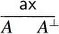
- 切规则施于两个证明所得的证明：先归纳构造二者的证明网，再用 **切连线** 相连。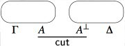
- 张量规则施于两个证明所得的证明：先归纳构造二者证明网，再用 **张量连线** 相连。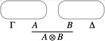
- par 规则施于一个证明所得的证明：先归纳构造该证明的证明网，再加一条“par 连线”。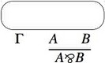

这些都能用超图形式化（公式是结点，“连线”是带假设与结论的有向超边）；于是证明网可形式地定义为由 MLL 矢列推导归纳构造的超图。注意大量超图并非证明网。

现在看：从 $\vdash \Gamma , A_1, A_2 , \ldots ,A_n$ 出发，得到 $\vdash \Gamma , (A_1\mathrel{\unicode{x214b}} A_2), \ldots ,(A_{n-1}\mathrel{\unicode{x214b}} A_n)$ 的推导，其证明网里规则施用次序的痕迹全没了。可以说，证明网就是矢列演算推导在“施用次序可交换的规则”下的等价类。

假设有人拿来一个由公理、切、par、张量连线搭成的巨大超图，声称它表示某个证明。你怎么验证它真是证明的表示，而不只是个随便的结构？

这项 **正确性** 检查是个挑战：等于为结构重建一段与矢列演算推导相应的序列构造史，乍看极复杂。MLL 证明网的第一个正确性判据是 Girard 原文的“长途判据”（long trip criterion），指数时间；后来 Danos 与 Regnier（1989）的 ACC（无环连通）判据亦然。但另有高效得多的判据，称可收缩性（Contractibility），由 Danos 与 Regnier 提出，近来 Guerrini、Martini、Masini 重述为下述优雅的图解析判据：超图是证明网，当且仅当它按下列图归约规则归约到单结点“net”。

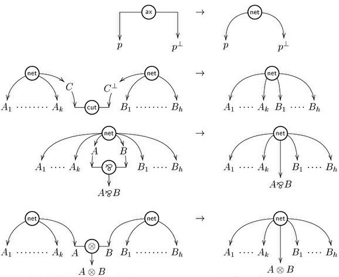

朴素地做这项检查可能耗时二次方（每施一条规则都要遍历整张图找可归约式，步数又等于超连线数目）。线性时间算法见 Guerrini（2011）、Murawski 与 Ong（2006）。

MLL 证明网的另一类正确性判据见 Retoré（2003），他为 MLL 给出二次时间算法。

证明网上的切消除格外干净：凭其并行本性，切可用两条化简规则局部消去：

- 公理移动：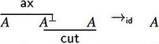
- 乘法移动：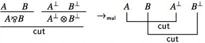

这些其实是证明网上的计算规则；有了正确性判据，就容易验证任何这类规则都保持正确性，于是证明网归约之后，仍来自同一矢列的矢列演算证明。

所以，MLL 证明网的切消除可于线性时间内完成，整个 MLL 由此得到一个简单优雅的切消除结果。

证明网方法可推广到线性逻辑更大的子集，只是能否同样优雅就不清楚了：Girard 1987 的原系统对 MELL 有效，例如给四条指数规则配上下列超图构造：

- 收缩 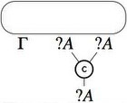
- 弱化 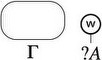
- 废弃 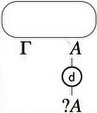
- 提升，引入“箱”的概念——箱是围绕证明网某一部分的序列化标记，图里表现为画在结论为 $A$ 与 $\mathop{?}\Gamma$ 的证明网四周的矩形。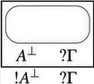

这些构造及配套的图归约，与带显式替换的 $\lambda$-演算惊人地相似（Di Cosmo 与 Kesner 1997 首先指出），但也太像相应的矢列演算规则。MLL 里那种优雅的并行化效应，到这里就续不上了：图归约规则涉及箱，又不局部。

为找回满意的系统，方案不少，始于 Danos 与 Regnier（1995）；这里特别要提 Guerrini、Martini、Masini 的优雅办法（Guerrini *et al.* 2003）[^guerrini-2003]，它清楚地显出三者之间的联系：模态逻辑的两层证明系统、MELL 的恰当证明网、$\lambda$-演算的最优归约。

Heijltjes 与 Houston（2016）近文表明：若连单位元也允许，MLL 便不可能有令人满意的证明网概念。

加性联结词可有典范处理，带一阶量化亦然（Heijltjes *et al.* 2019）。含乘法、加性两类联结词的公式，其证明网有种种技术性表述，似乎没有一种堪称典范又令人满意；它们在类证明网系统中的地位，眼下是活跃课题。尤见（Hughes 与 van Glabbeek 2005）[^hughes-2005]、（Hughes 与 Heijltjes 2016）[^heijltjes-2016][^hughes-2016]。

## 3 语义

接近线性逻辑语义，通常有两条路。一条是用现成的语义结构，把公式映射为其中的指称，借此为其各片段建立可靠性与完全性；另一条较新，直接给证明赋予语义。下面简述二者，并给若干文献线索。

### 3.1 可证性的语义

为线性逻辑片段求可靠且完全的语义，一条进路是给公式配上一切能证明它的语境之集。这样的集往往更抽象，还要带各种闭包性质。Girard（1987）的 **相语义**（phase semantics）即是一例：计算机科学里用它造反例，也用它当工具，证明某并发系统无法演化成具备某些性质的另一系统（Fages *et al.* 2001）[^fages-2001]。相语义还用于给一阶、高阶线性逻辑的切消除作语义证明（Okada 1999）[^okada-1999]。类似地，Kripke 式语义见 Allwein & Dunn 1993、Hodas & Miller 1994。Quantale（一类偏序代数结构）也早就用来为线性逻辑的部分内容提供语义模型（Yetter 1990）[^yetter-1990]。

### 3.2 证明的语义

“公式即类型”这个类比在理论计算机科学中既流行又有成果。它把逻辑系统与带类型的计算装置（如带类型 $\lambda$-演算）对应起来，给公式的每个证明配一个以该公式为类型的程序。比如重言式 $A \Rightarrow A$ 的证明，对应程序 *fun*$(x:A).x:A\rightarrow A$，即类型 $A$ 对象上的恒等函数。正因如此，构造性逻辑系统（直觉主义逻辑、算术）以及线性逻辑才如此看重证明：构造并研究证明的模型，远比构造并研究可证性的模型更受关注。光知道公式可证还不够，还想知道其证明的 **计算内容**。

线性逻辑证明的模型很多，我们认为迄今最简单直观的是基于所谓“关系语义”或“Kripke 式语义”的构造：公式解释为多重集，单边矢列解释为多重集元组，证明解释为矢列解释上的关系（Tortora de Falco 2003, Ehrhard 2012, Melliès 2018）[^ehrhard-2012][^melliès-2018][^tortora-2003]。若要纯集合论语义而不用多重集，可借相干空间（coherence spaces，即配以特殊相干关系的集合），这最初见于 Girard 1987。范畴论模型亦有可观，如 *-自治范畴（Barr 1991）[^barr-1991]、超相干性（Ehrhard 1993）[^ehrhard-1993]。

另一条证明语义之路是 Girard 的 **交互几何**（Geometry of Interaction），它能对证明作完全代数的刻画。给每个证明网配一个对应切连线的部分置换矩阵 $\sigma$，再配一个由某种动态代数表达式构成的矩阵 $M$，用以描述网内可能的路径。于是可用 **执行公式** 把证明网完整描述出来：

$$ \mathrm{EX}(\sigma ,M) = (1-\sigma^2) \left(\sum_i M(\sigma M)\right) (1-\sigma^2) $$

在 MLL 情形，此式是规范化过程的不变量。它与数据流理论的某些结果有漂亮联系，见 Abramsky 与 Jagadeesan（1994）早期工作。

围绕 **博弈语义** 发展起来的领域值得单说。博弈与线性逻辑的强联系，A. Blass（1992）很早就指出。连接逻辑与博弈其实有两个传统。一是上溯到 Lorenzen 的 **对话博弈**：一方证明公式，另一方反驳。可为 MALL 提供这样的对话博弈，证明者与反驳者完全对称（Delande *et al.* 2010）[^delande-2010]。另一传统把公式看作博弈、联结词看作博弈构造子、证明看作策略，描述玩家如何应对对手着法。对博弈规则施加不同限制，就能为实际编程语言的种种特性给出精确语义（技术上即完全抽象模型），故而近年此领域热度极高，例如见 Abramsky & Jagadeesan 1994、Abramsky & Melliès 1999、Hyland & Ong 2000。

## 4 复杂性

任何逻辑，知道有没有有效程序判定其中每个句子可证与否，都很有用。**可判定** 的逻辑（存在可证性有效程序的）常用 **复杂性类** 来描述，后者刻画判定之难易。命题线性逻辑若干片段的复杂性与可判定性，研究甚多。已知：

- MLL 可证性是 NP-完全的（Kanovich 1992）[^kanovich-1992]；
- MALL 可证性是 PSPACE-完全的（Lincoln *et al.* 1992）[^lincoln-1992]。

这里 NP 与 PSPACE 是满足 NP $\subseteq$ PSPACE 的复杂性类。出人意料的是——恐怕有人忘了，线性逻辑的新意正在于不用收缩、弱化这两条结构规则来管理公式——即便只考虑不许命题变元、只许常项的片段，这些结果仍成立（Lincoln & Winkler 1994）[^lincoln-1994]。的确，任意公式都能编码为只含常项的公式，可证性不变。

MELL 的表达力出人意料。比如 Petri 网可达性问题可编码进 MELL（Gunter & Gehlot 1989）[^gunter-1989]，而该问题等价于带状态向量加法系统（VASS）的可达性问题（Reutenauer 1989）[^reutenauer-1989]。MELL 的可判定性还等价于分支 VASS 的可达性问题（de Groote *et al.* 2004）[^groote-2004]，后者已知有非初等下界（Lazic 与 Schmitz 2015）[^lazic-2015]。所以若 MELL 可判定，它至少 TOWER-难（Lazic 与 Schmitz 2015）[^lazic-2015]。Bimbó（2015）给过 MELL 可判定性的证明，但 Straßburger（2019）指出其中有一处漏洞。

命题线性逻辑不可判定性的证明发表于 1990 年代初（Lincoln *et al.* 1992, Lincoln 1995）[^lincoln-1995][^lincoln-1992]。Kanovich（2016）表明该结果对命题线性逻辑一个大幅缩减的片段仍成立；机器检验的不可判定性证明见（Forster & Larchey-Wendling, 2019）[^forster-2019]。不过 Bimbó 与 Dunn（2022）也发表了命题线性逻辑可判定性的证明，并声称在前述论文里发现了错误。

加上无限制弱化规则的线性逻辑（也叫 **线性仿射逻辑**）可判定（Kopylov 1995）[^kopylov-1995]，且指数空间难（Urquhart 2000）[^urquhart-2000]。

线性逻辑复杂性结果的概览，见 Lincoln 1995。

## 5 对计算机科学的影响

上世纪初直觉主义逻辑刚提出时，是对传统数学家行事方式的一次挑战：排中律与反证法的使用被视为可疑，涉及无穷时尤其如此。随着直觉主义的关切长成构造性数学，拓扑学、代数、分析等课题上出现了新的构造性进路。线性逻辑既涵盖证明（算法）的动态，又涵盖资源，主要影响便不在传统数学而在计算机科学。概述其影响之前，先勾勒逻辑在计算机科学里的一般用法。

逻辑在计算规格说明中担当不同角色。下面辨认几类大体不同的进路，并指出哪些角色受了线性逻辑的影响。

在 **计算即模型** 进路里，计算被编码为数学结构，由结点、转移、状态之类组成；逻辑在外围使用，对这些结构 **作出** 陈述，即计算充当逻辑表达式的模型。内涵算子——时态逻辑、动态逻辑的模态词，或 Hoare 逻辑的三元组——常用来表达关于状态变化的命题。用逻辑表示并推理计算，大概是这方面最广泛成功的用法；线性逻辑对此影响甚微。

在 **计算即演绎** 进路里，逻辑句法的成分（公式、词项、类型、证明）直接充当所规定计算的元素。这个更精微的场合里，计算建模有两条相当不同的路：**证明规范化** 与 **证明搜索**。

线性逻辑对这两种场合的重大影响，下面概述。

### 5.1 证明规范化

**证明规范化** 进路把计算状态看作证明项，把计算过程看作规范化（又称 $\beta$-归约或切消除）。函数式编程可以拿证明规范化作理论基础来解释（Martin-Löf 1982）[^martin-löf-1982]，也曾用来为新函数式语言的设计作辩护，如 Abramsky 1993。线性逻辑给这条规格说明之路添了新类型、静态理解资源如何被使用的新的陈述手段，还为函数与环境（供给参数者）之间的对偶提供了漂亮的形式化办法。

线性逻辑显身手的另一处是 **最优归约**。为 $\lambda$-演算造高效（最优）解释器的问题，自 J.J. Lévy 最初定义后悬了很久，1990 年由 Lamping 首次解决：他用了精巧的共享图实现，规则数目相当可观。不少作者借线性逻辑的观念与直觉重建 Lamping 的解法，将其简化，引出与交互几何相连的丰富理论。进阶阅读可看 Asperti & Guerrini 1998。

线性逻辑对直觉主义逻辑的精细改造，加上它自身的对偶，提供了这样一个框架：函数与环境是相互对偶作用的同类实体。类型 $A \mathbin{-\hspace{-0.70mm}\circ} B$ 的函数，可建模为一个过程：从环境消耗一个 $A$ 型值，变为 $B$ 型值。线性逻辑中该蕴涵等价于逆否形式：$B^{\bot} \mathbin{-\hspace{-0.70mm}\circ} A^{\bot}$ 可把同一函数解释成一个过程，其中对 $B$ 型值的需求变成对 $A$ 型值的需求（直觉主义类型下不会如此：输入参数可能形同虚设）（Curien 2003）[^curien-2003]。近来博弈语义为函数式计算建模的成功，同样系于函数与环境的对偶处理（Abramsky and Jagadeesan 1994, Hyland & Ong 2000）[^abramsky-1994][^hyland-2000]。

最后一点：在把计算编码为证明规范化的领域，线性逻辑曾用来给多项式时间递归函数作基于类型的描述。比如 M. Hofmann（2003）引入带模态类型与线性类型的 $\lambda$-演算，把 Bellantoni & Cook 1992 的函数代数推到高阶类型。基于线性逻辑的类型也进了函数式程序：见 Guzman & Hudak 1990、Wadler 1991。

### 5.2 证明搜索

**证明搜索** 进路把计算状态看作矢列（公式的有结构集合），把计算过程看作在矢列中搜索证明：其间变化刻画计算的动态。这样看计算，推理规则一般自下而上读，即当作把结论变成前提的变换。逻辑编程可以拿证明搜索作理论基础来解释；线性逻辑为这条规格说明之路添了新组合子、新手段与新陈述进路：构造逻辑程序、刻画丰富动态、规定并发计算。（线性逻辑编程语言概览见 Miller 2004。）[^miller-2004]

聚焦证明系统的完全性，可用在线性逻辑内部为逻辑编程的部分操作语义作陈述性解释。例如取线性逻辑公式的子集 $L$，只由 $\top$、&、$\mathbin{-\hspace{-0.70mm}\circ} , \Rightarrow$、$\forall$ 构造。（若再加入 $\bot$，线性逻辑全部联结词都可编码。）可以看出，$L$ 中的无切证明搜索分两阶段。给定矢列 $\Gamma$; $\Delta \vdash G$：$\Gamma$ 是公式集（可收缩、可弱化），$\Delta$ 是公式多重集（不可收缩、不可弱化），$G$（“目标”公式）是单个公式，三者都出自 $L$。证明搜索如下：

1. $G$ 非原子时，只能用某条右引入规则得出该矢列。就这组联结词而言右规则都可逆，这个 **目标归约** 阶段正对应聚焦证明的异步阶段。
2. $G$ 为原子时，证明搜索从左侧语境 **判定** 选出单个公式。
3. 一旦选出 **焦点** 公式，所有左引入规则便只施于它及其产生的正子公式。这个 **反向链接** 阶段对应聚焦证明构造的异步阶段。

形式地，这些阶段用下列推理规则描述。这里引入一种新的矢列箭头，以某条左引入规则的结果公式为标记。注意 $\mathbin{-\hspace{-0.70mm}\circ}$ 的左引入规则（自下而上读）要求把 $\Delta$ 语境一分为二：$\Delta_1,\Delta_2$。若该语境有 $n \ge 0$ 个不同公式，划分自然有 $2^n$ 种。规则中的句法变元 $A$ 取原子公式。

**目标归约阶段** $$ \frac{} {\Gamma;\Delta \vdash \top}\ \top R \qquad \frac{\Gamma;\Delta \vdash B \qquad \Gamma;\Delta \vdash C} {\Gamma;\Delta \vdash B \mathbin{\&} C}\ {\mathbin{\&}}R $$ $$\frac{\Gamma;\Delta, B \vdash C} {\Gamma;\Delta \vdash B \mathbin{-\hspace{-0.70mm}\circ} C}\ \mathbin{-\hspace{-0.70mm}\circ} R \qquad \frac{\Gamma,B ;\Delta \vdash C} {\Gamma;\Delta \vdash B \Rightarrow C}\ {\Rightarrow}R \qquad \frac{\Gamma;\Delta \vdash B[y/x]} {\Gamma;\Delta \vdash \forall x. B}\ \forall R $$

**反向链接阶段** $$ \frac{\Gamma;\Delta \mathbin{|\hspace{-0.70mm}\raise 2mm {\scriptstyle\underline{\,D_1\,}}}\; A} {\Gamma;\Delta \mathbin{|\hspace{-0.70mm}\raise 2mm {\scriptstyle\underline{\,D_1\mathbin{\&} D_2\,}}}\;\, A} \ {\mathbin{\&}}L \qquad \frac{\Gamma;\Delta \mathbin{|\hspace{-0.70mm}\raise 2mm {\scriptstyle\underline{\,D_2\,}}}\; A} {\Gamma;\Delta \mathbin{|\hspace{-0.70mm}\raise 2mm {\scriptstyle\underline{\,D_1\mathbin{\&} D_2\,}}}\; A}\ {\mathbin{\&}}L \qquad \frac{\Gamma;\Delta \mathbin{|\hspace{-0.70mm}\raise 2mm {\scriptstyle\underline{\,D[t/x]\,}}}\; A} {\Gamma;\Delta \mathbin{|\hspace{-0.70mm}\raise 2mm {\scriptstyle\underline{\,\forall_{\tau}x.D\,}}}\; A}\ \forall L $$ $$\frac{\Gamma;\Delta_1 \vdash G \quad \Gamma;\Delta_2 \mathbin{|\hspace{-0.70mm}\raise 2mm {\scriptstyle\underline{\,D\,}}}\; A} {\Gamma;\Delta_1,\Delta_2 \mathbin{|\hspace{-0.70mm}\raise 2mm {\scriptstyle\underline{\,G\mathbin{-\hspace{-0.70mm}\circ} D\,}}}\; A} \ {\mathbin{-\hspace{-0.70mm}\circ}}L \qquad \frac{\Gamma;\cdot \vdash G \quad \Gamma;\Delta \mathbin{|\hspace{-0.70mm}\raise 2mm {\scriptstyle\underline{\,D\,}}}\; A} {\Gamma;\Delta \mathbin{|\hspace{-0.70mm}\raise 2mm {\scriptstyle\underline{\,G\Rightarrow D\,}}}\; A}\ {\Rightarrow}L $$

**同一性与判定规则** $$ \frac{\Gamma,D;\Delta \mathbin{|\hspace{-0.70mm}\raise 2mm {\scriptstyle\underline{\,D\,}}}\; A} {\Gamma,D;\Delta \vdash A}\ \textit{decide}{!} \qquad \frac{\Gamma;\Delta \mathbin{|\hspace{-0.70mm}\raise 2mm {\scriptstyle\underline{\,D\,}}}\; A} {\Gamma;\Delta,D \vdash A}\ \textit{decide} \qquad \frac{} {\Gamma;\cdot \mathbin{|\hspace{-0.70mm}\raise 2mm {\scriptstyle\underline{\,A\,}}}\; A}\ \textit{init} $$

限制在 $L$ 上的线性逻辑，可视为一种线性逻辑编程语言，从而充当计算系统的规格说明语言——Petri 网、进程演算、$\lambda$-演算也干这活。线性逻辑既有证明论又有各种语义，其元理论便为 $L$ 中规定的计算提供了宽广的推理道路。

线性逻辑的矢列演算用公式多重集，证明搜索便能直接编码 **多重集重写**。许多计算天然就是多重集重写，于是线性逻辑与 Petri 网（Gunter & Gehlot 1989）[^gunter-1989]、进程演算（Andreoli & Pareschi 1991, Kobayashi *et al.* 1999, Miller 1996）[^andreoli-1991][^kobayashi-1999][^miller-1996]、安全协议（Cervesato *et al.* 1999, Miller 2003）[^cervesato-1999][^miller-2003] 之间建立起众多联系。

## 6 变体

### 6.1 模态词的不同处理

传统矢列演算表述里，指数不是典范的：再引入一份规则相同的指数，比如 $\mathop{!}'$ 与 $\mathop{?}'$，竟无法证明 $\mathop{!}$ 等价于 $\mathop{!}'$、$\mathop{?}$ 等价于 $\mathop{?}'$；别的联结词则容易做到。非典范指数的应用见（Danos et. al., 1993; Nigam & Miller, 2009）[^danos-1993][^nigam-2009]。MELL 可判定性眼下还有争议（Bimbó 2015, Straßburger 2019）[^bimbó-2015][^straßburger-2019]，但把 MLL 用三对 $\mathop{!}$、$\mathop{?}$ 扩展，所得逻辑不可判定（Chaudhuri 2018）[^chaudhuri-2018]。Martini 与 Masini 1995 描述了一种“2-矢列”证明系统，其中指数是典范的。

切消除会让经典逻辑、直觉主义逻辑的证明膨胀到极大，这可以按证明系统里收缩规则的使用来分析。若对收缩设限，就可能设计出切消除复杂性大幅降低的新逻辑、新证明系统。比如 **初等线性逻辑**（ELL），把 $\mathop{!}$ 与 $\mathop{?}$ 的引入换成一条同时引入 $\mathop{!}$ 与 $\mathop{?}$ 的规则；于是 ELL 恰好编码全体 Kalmar 初等函数（可在高度固定的指数塔所界时间内计算）（Girard 1998, Baillot 2015）[^baillot-2015][^girard-1998]。指数规则的其他变体也有人研究，如 **轻线性逻辑**（Girard 1998）[^girard-1998] 与 **软线性逻辑**（Lafont 2004）[^lafont-2004] 都刻画多项式时间可计算函数：另见（Baillot & Terui 2004）[^baillot-2004]。

### 6.2 非交换线性逻辑

线性逻辑不许弱化、收缩普遍施用，却允许无限制使用 **交换** 规则。不普遍施用交换的矢列演算，左右语境是列表，公式在语境中的次序成了表达手段；此时乘法析取、乘法合取都可变为非交换的。

最早把矢列演算三条结构规则全部拒之门外的逻辑之一，见 Lambek 1958。它有 **两个** 蕴涵，却既无否定，也无指数。不少人提议把线性逻辑扩展出非交换特征，至今似无典范方案。非交换线性逻辑的样例见 Yetter 1990、Abrusci 1991、Retoré 1997、Abrusci & Ruet 1999、Guglielmi & Straßburger 2001。

### 6.3 无界行为的处理

MALL 有表达力、有新意，却可判定，因而刻画不了迭代、递归里的无界行为。如上所述，加入指数 ! 与 ? 可把 MALL 丰富成完全线性逻辑，进入能刻画无界行为的境地。另一条路，是把最小、最大不动点算子直接作为联结词加进 MALL。要让不动点确为“最小”或“最大”，其推理规则须是“高阶”的，即涉及不变量。Baelde（Baelde & Miller, 2007; Baelde 2012）[^baelde-2012][^baelde-2007] 发展出对 MALL 的这类扩展（还带一阶量化与词项相等），并用来为模型检验提供证明论基础（Heath & Miller 2018）[^heath-2018]。

## 参考文献

**以下文献从原文照录，不作翻译；中国文献条目（古今）一律译为中文。**

> 原文参考文献已转为脚注引用：文内“作者-年份”引用组后附 [^key] 标记，完整条目见本文末脚注定义。

[^abramsky-1993]: Abramsky, S., 1993, “Computational interpretations of linear logic”, *Theoretical Computer Science*, 111: 3–57.
[^abramsky-1994]: Abramsky, S., and Jagadeesan, R., 1994, “New Foundations for the Geometry of Interaction”, *Information and Computation*, 111(1): 53–119.
[^abramsky-1999]: Abramsky, S., and Melliès, Paul-André, 1999, “Concurrent Games and Full Completeness”, *14th Annual Symposium on Logic in Computer Science*, Trento: IEEE Computer Society Press., pp. 431–442.
[^abrusci-1991]: Abrusci, V. M., 1991, “Phase semantics and sequent calculus for pure non-commutative classical linear propositional logic”, *Journal of Symbolic Logic*, 56(4): 1403–1451.
[^abrusci-1999]: Abrusci, V.M., and Ruet, P., 1999, “Non-Commutative Logic I: The Multiplicative Fragment”, *Annals of Pure and Applied Logic*, 101(1): 29–64.
[^allwein-1993]: Allwein, G. and Dunn, J.M., 1993, “Kripke Models for Linear Logic”, *Journal of Symbolic Logic*, 58(2): 514–545.
[^anderson-1975]: Anderson, A. R. and Belnap, N. D., 1975, *Entailment: The Logic of Relevance and Necessity* (Volume I), Nuel D. Belnap & J. Michael Dunn (eds.), Princeton, N.J.: Princeton University Press.
[^anderson-1975-2]: Anderson, A. R., Belnap, N. D., and Dunn, J. M., 1975, *Entailment: The Logic of Relevance and Necessity* (Volume II), Princeton, N.J.: Princeton University Press.
[^andreoli-1992]: Andreoli, J.-M., 1992, “Logic programming with focusing proofs in linear logic”, *Journal of Logic and Computation*, 2(3): 297–347.
[^andreoli-1991]: Andreoli, J.-M. and Pareschi, R., 1991, “Linear objects: Logical processes with built-in inheritance”, *New Generation Computing*, 9(3–4): 445–473.
[^asperti-1998]: Asperti, A., and Guerrini, S., 1998, “The Optimal Implementation of Functional Programming Languages”, Cambridge Univ. Press.
[^avron-1988]: Avron, A., 1988, “The Semantics and Proof Theory of Linear Logic”, *Theoretical Computer Science*, 57: 161–184.
[^baelde-2012]: Baelde, D., 2012, “Least and greatest fixed points in linear logic”, ACM Transactions on Computational Logic, 13(1). doi:10.1145/2071368.2071370
[^baelde-2007]: Baelde, D. and Miller, D., 2007, “Least and greatest fixed points in linear logic”, *Logic for Programming, Artificial Intelligence, and Reasoning* (Lecture Notes in Computer Science: Volume 4790), edited by N. Dershowitz and A. Voronkov, pp. 92–106.
[^baillot-2015]: Baillot, P., 2015, “On the expressivity of elementary linear logic: Characterizing Ptime and an exponential time hierarchy”, *Information and Computation*, 241: 3–31.
[^baillot-2004]: Baillot, P., and Terui, K., 2004, “Light Types for Polynomial Time Computation in Lambda-Calculus”, *Proceedings of the Nineteenth Annual IEEE Symposium on Logic in Computer Science*, Turku, Finland, IEEE Computer Society Press, pp. 266–275.
[^barr-1991]: Barr, M., 1991, “*-Autonomous categories and linear logic”, *Mathemathical Structures in Computer Science*, 1(2): 159–178.
[^bellantoni-1992]: Bellantoni, S. and Cook, S., 1992, “A New Recursion-Theoretic Characterization of the Polytime Functions”, *Computational Complexity*, 2: 97–110.
[^bimbó-2015]: Bimbó, K., 2015, “The decidability of the intensional fragment of classical linear logic”, *Theoretical Computer Science*, 597(13): 1–17.
[^bimbó-2022]: Bimbó, K. and J. M. Dunn, 2022, “Modalities in lattice-R”, in *Relevance Logics and other Tools for Reasoning. Essays in Honor of J. Michael Dunn*, London: College Publications, pp. 89–127.
[^blass-1992]: Blass, A., 1992, “A game semantics for linear logic”, *Annals of Pure and Applied Logic*, 56: 183–220.
[^cervesato-1999]: Cervesato, I., Durgin, N., Lincoln, P., Mitchell, J., and Scedrov, A., 1999, “A meta-notation for protocol analysis”, in R. Gorrieri (ed.), *Proceedings of the 12th IEEE Computer Security Foundations Workshop—CSFW 1999*, Los Alamitos, CA: IEEE Computer Society Press, pp. 55–69.
[^chaudhuri-2018]: Chaudhuri, K., 2018, “Encoding additives using multiplicatives and subexponentials”, *Mathematical Structures in Computer Science*, 28(5): 651–666.
[^curien-2003]: Curien, P.-L., 2003, “Symmetry and interactivity in programming”, *Bulletin of Symbolic Logic*, 9(2): 169–180.
[^dal-2008]: Dal Lago, U., and Laurent, O., 2008, “Quantitative Game Semantics for Linear Logic”, *Computer Science Logic* (Lecture Notes in Computer Science: Volume 5213), Michael Kaminski and Simone Martini (eds.), Berlin: Springer, pp. 230–245.
[^danos-1993]: Danos, V., Joinet, J.-P., and Schellinx, H., 1993, “The Structure of Exponentials: Uncovering the Dynamics of Linear Logic Proofs”, pp. 159–171, in *Kurt Gödel Colloquium* (Lecture Notes in Computer Science, Volume 713), edited by G. Gottlob, A. Leitsch, and D. Mundici, Berlin: Springer.
[^danos-1997]: –––, 1997, “A New Deconstructive Logic: Linear Logic”, *Journal of Symbolic Logic*, 62(3): 755–807.
[^danos-1989]: Danos, V. and Regnier, L., 1989, “The Structure of Multiplicatives”, *Archive of Mathematical Logic*, Springer, 28:181–203.
[^danos-1995]: –––, 1995, “Proof-nets and Hilbert space”, in J.-Y. Girard, Y. Lafont, and L. Regnier (eds.), *Advances in Linear Logic*, Cambridge: Cambridge University Press, pp. 307–328.
[^groote-2004]: de Groote, P., Guillaume, B., and Salvati, S., 2004, “Vector addition tree automata”, in *Proceedings of the 19th IEEE Symposium on Logic in Computer Science* (LICS 2004), 14–17 July 2004, Turku, Finland, pp. 64–73.
[^delande-2010]: Delande, O., Miller, D., and Saurin, A., 2010, “Proof and refutation in MALL as a game”, *Annals of Pure and Applied Logic*, 161(5): 654–672.
[^di-1997]: Di Cosmo, R., and Kesner, D., 1997, “Strong normalization of explicit substitutions via cut elimination in proof nets”, (extended abstract) in *Proceedings of the Twelfth Annual IEEE Symposium on Logic in Computer Science*, Los Alamitos, CA: IEEE Computer Society Press, pp. 35–46.
[^ehrhard-1993]: Ehrhard, T., 1993, “Hypercoherences: A Strongly Stable Model of Linear Logic”, *Mathematical Structures in Computer Science*, 3(4): 365–385.
[^ehrhard-2012]: –––, 2012, “The Scott model of linear logic is the extensional collapse of its relational model”, *Theoretical Computer Science*, 13(6): 20–45.
[^fages-2001]: Fages, F., Ruet, P., and Soliman, S., 2001, “Linear Concurrent Constraint Programming: Operational and Phase Semantics”, *Information and Computation*, 165(1): 14–41.
[^forster-2019]: Forster, Y. and D. Larchey-Wendling, 2019, “Certified undecidability of intuitionistic linear logic via binary stack machines and Minsky machines”, *Proceedings of the 8th ACM SIGPLAN International Conference on Certified Programs and Proofs (CPP’19)*, New York: Association of Computing Machinery, pp. 104–117. doi:10.1145/3293880.3294096
[^gentzen-1935]: Gentzen, G., 1935, “Investigations into Logical Deduction”, in M. E. Szabo (ed.), *The Collected Papers of Gerhard Gentzen*, Amsterdam: North-Holland pp. 68–131.
[^girard-1987]: Girard, J.-Y., 1987, “Linear logic”, *Theoretical Computer Science*, 50: 1–102.
[^girard-1998]: –––, 1998, “Light Linear Logic”, *Information and Computation*, 143(2):175–204.
[^grishin-1981]: Grishin, V. N., 1981, “Predicate and set-theoretic calculi based on logic without contraction rules,” (Russian). Izvestiya Akademii Nauk SSSR Seriya Matematicheskaya 45(1): 47–68. 239. Math. USSR Izv., 18, no.1, Moscow.
[^guerrini-2011]: Guerrini, S., 2011, “A linear algorithm for MLL proof net correctness and sequentialization”, *Theoretical Computer Science*, 412: 1958–1978.
[^guerrini-2003]: Guerrini, S., Martini, S., and Masini, A., 2003, “Coherence for sharing proof-nets”, *Theoretical Computer Science*, 294(3): 379–409.
[^guglielmi-2001]: Guglielmi, A., and Straßburger, L., 2001, “Non-commutativity and MELL in the Calculus of Structures”, *Computer Science Logic* (Lecture Notes in Computer Science, Volume 2142), Berlin: Springer Verlag, pp. 54–68.
[^gunter-1989]: Gunter, C. A., and Gehlot, V., 1989, “Nets as Tensor Theories”, in G. De Michelis (ed.), *Proceedings of the Tenth International Conference on Application and Theory of Petri Nets* (Lecture Notes in Computer Science: Volume 616), Bonn: Springer-Verlag, pp. 174–191.
[^guzman-1990]: Guzman, J.C. and Hudak, P., 1990, “Single-threaded polymorphic lambda calculus”, in *Proceedings of the Fifth IEEE Symposium on Logic in Computer Science*, Philadelphia: IEEE Computer Society Press.
[^heath-2018]: Heath, Q. and Miller, D., 2018, “A proof theory for model checking”, *Journal of Automated Deduction*, doi:10.1007/s10817-018-9475-3.
[^heijltjes-2016]: Heijltjes, W. and Houston, R., 2016, “Proof equivalence in MLL is PSPACE-complete”, *Logical Methods in Computer Science* 12(1).
[^heijltjes-2018]: Heijltjes, W. B., Hughes, D. J. D., and Straßburger, L., 2018, “Proof nets for first-order additive linear logic”, *4th International Conference on Formal Structures for Computation and Deduction*, (FSCD 2019: Volume 131), Dagstuhl: Leibniz-Zentrum für Informatik, pp. 22:1–22:22.
[^hodas-1994]: Hodas, J., and Miller, D., 1994, “Logic programming in a fragment of intuitionistic linear logic”, *Information and Computation*, 110(2): 327–365.
[^hofmann-2003]: Hofmann, M., 2003, “Linear types and non-size increasing polynomial time computation”, *Information and Computation*, 183(1): 57–85.
[^howard-1980]: Howard, W.A., 1980, “The formulae-as-type notion of construction, 1969”, in J.P. Seldin and R. Hindley (eds.), *To H. B. Curry: Essays in Combinatory Logic, Lambda Calculus, and Formalism*, New York: Academic Press, pp. 479–490.
[^hughes-2005]: Hughes, D.J.D. and van Glabbeek, R., 2005, “Proof Nets for Unit-Free Multiplicative-Additive Linear Logic”, *ACM Transactions on Computational Logic*, 6: 784–842.
[^hughes-2016]: Hughes, D.J.D. and Heijltjes, W. B., 2016, “Conflict nets: efficient locally canonical mall proof nets”, *31st Annual ACM/IEEE Symposium on Logic in Computer Science* (LICS), 2016.
[^hyland-2000]: Hyland, J.M.E., and Ong, C.-H.L., 2000, “On Full Abstraction for PCF: I. Models, observables and the full abstraction problem, II. Dialogue games and innocent strategies, III. A fully abstract and universal game model”, *Information and Computation*, 163: 285–408.
[^kanovich-1992]: Kanovich, M.I., 1992, “Horn Programming in Linear Logic is NP-Complete”, in *Proceedings of the Seventh Annual Symposium on Logic in Computer Science*, Santa Cruz, IEEE Computer Society Press, pp. 200–210.
[^kanovich-2016]: –––, 2016, “The undecidability theorem for the Horn-like fragment of linear logic (Revisited)”, *Mathematical Structures in Computer Science*, 26: 719–744.
[^kobayashi-1999]: Kobayashi, N., Shimizu, T., and Yonezawa, A., 1999, “Distributed concurrent linear logic programming”, *Theoretical Computer Science*, 227(1–2): 185–220.
[^kopylov-1995]: Kopylov, A. P., 1995, “Decidability of Linear Affine Logic”, Symposium on Logic in Computer Science (LICS’95), IEEE Computer Society Press, pp. 496–505.
[^lafont-2004]: Lafont, Y., 2004, “Soft linear logic and polynomial time”, *Theoretical Computer Science*, 318(1–2): 163–180.
[^lamarche-1996]: Lamarche, F., 1996, “From Proof Nets to Games: extended abstract”, in *Linear Logic 96 Tokyo Meeting*, *Electronic Notes in Theoretical Computer Science*, 3: 107–119.
[^lambek-1958]: Lambek, J., 1958, “The mathematics of sentence structure”, *American Mathematical Monthly*, 65: 154–169.
[^lamping-1990]: Lamping, J., 1990, “An algorithm for optimal lambda-calculus reductions”. 17th Annual Symposium on Principles of Programming Languages, San Francisco, ACM Press, pp. 16–30.
[^laurent-2005]: Laurent, O., Quatrini, M., and Tortora de Falco, L., 2005, “Polarized and focalized linear and classical proofs”, *Annals of Pure and Applied Logic*, 134 (2–3): 217–264.
[^lazic-2015]: Lazic, R. and Schmitz, S., 2015, “Nonelementary complexities for branching VASS, MELL, and extensions”, *ACM Transactions on Computational Logic*, 16(3): pp. 20:1–20:30.
[^liang-2009]: Liang, C. and Miller, D., 2009, “Focusing and Polarization in Linear, Intuitionistic, and Classical Logics”, *Theoretical Computer Science*, 410(46): 4747–4768.
[^lincoln-1993]: Lincoln, P., Scedrov, A., and Shankar, N., 1993, “Linearizing intuitionistic implication”, *Annals of Pure and Applied Logic*, 60(2): 151–177.
[^lincoln-1995]: Lincoln, P., 1995, “Deciding provability of linear logic formulas”, *Proceedings of the Workshop on Advances in Linear Logic*, J.-Y. Girard, Y. Lafont, and L. Regnier (eds.), Cambridge: Cambridge University Press, pp. 197–210.
[^lincoln-1992]: Lincoln, P., Mitchell, J., Scedrov, A., and Shankar, N., 1992, “Decision problems for propositional linear logic”, *Annals of Pure and Applied Logic*, 56: 239–311.
[^lincoln-1994]: Lincoln, P., and Winkler, T., 1994, “Constant-Only Multiplicative Linear Logic is NP-Complete”, *Theoretical Computer Science*, 135: 155–169.
[^martini-1995]: Martini, S. and Masini, A., 1995, “On the fine structure of the exponential rule”, in *Advances in linear logic*, edited by J.-Y. Girard and Y. Lafont and L. Regnier, pp. 197–210, New York: Cambridge University Press.
[^martin-löf-1982]: Martin-Löf, P., 1982, “Constructive Mathematics and Computer Programming”, *Sixth International Congress for Logic, Methodology, and Philosophy of Science*, Amsterdam: North-Holland, pp. 153–175.
[^melliès-2018]: Melliès, P.-A., Tabareau, N. and Tasson, C., 2018, “An explicit formula for the free exponential modality of linear logic”, *Mathematical Structures in Computer Science*, 28(7): 1253–1286.
[^miller-1996]: Miller, D., 1996, “Forum: A multiple-conclusion specification language”, *Theoretical Computer Science*, 165(1): 201–232.
[^miller-2003]: –––, 2003, “Encryption as an abstract data-type: An extended abstract”, in I. Cervesato (ed.), *16th Workshop on Foundations of Computer Security*, Asilomar, IEEE Computing Society, pp. 3–14, 2003.
[^miller-2004]: –––, 2004, “Overview of linear logic programming”, *Linear Logic in Computer Science*, T. Ehrhard, J.-Y. Girard, P. Ruet, and P. Scott (eds.) (London Mathematical Society Lecture Notes: Volume 316), Cambridge: Cambridge University Press, pp. 119–150.
[^murawski-2006]: Murawski, A. S., and Ong, C.-H. L., 2006, “Fast verification of MLL proof nets via IMLL”, *ACM Transactions on Computational Logic*, 7(3): 473–498.
[^nigam-2009]: Nigam, V. and Miller, D., 2009, “Algorithmic specifications in linear logic with subexponentials”, Proceedings of the 11th ACM SIGPLAN conference on Principles and practice of declarative programming (PPDP), 2009, pp. 129–140.
[^okada-1999]: Okada, M., 1999, “Phase Semantic Cut-Elimination and Normalization Proofs of First- and Higher-Order Linear Logic”, *Theoretical Computer Science*, 227(1–2): 333–396.
[^ono-1998]: Ono, H., 1998, “Proof-theoretic methods in nonclassical logic. An Introduction”, in M. Takahashi, M. Okada, and M. Dezani-Ciancaglini (eds.), *Theories of Types and Proofs* (Mathematical Society of Japan Memoirs: Volume 2), 207–254. doi:10.2969/msjmemoirs/00201C060
[^read-1988]: Read, S., 1988, *Relevant Logic*, Oxford: Blackwell.
[^retoré-1997]: Retoré, C., 1997, “Pomset logic: a non-commutative extension of classical linear logic”, *Typed Lambda Calculi and Applications* (Lecture notes in Computer Science: Volume 1210), Berlin: Springer Verlag, pp. 300–318.
[^retoré-2003]: Retoré, C., 2003, “Handsome proof-nets: perfect matchings and cographs”, *Theoretical Computer Science*, 294(3): 473–488.
[^reutenauer-1989]: Reutenauer, C., 1989, “Aspects mathématiques des réseaux de Petri”, Etudes et Recherches en Informatique. Masson.
[^schellinx-1991]: Schellinx, H., 1991, “Some Syntactical Observations on Linear Logic”, *Journal of Logic and Computation*, 1(4): 537–559.
[^tortora-2003]: Tortora de Falco, L., 2003, “Obsessional experiments for linear logic proof-nets”, *Mathematical Structures in Computer Science*, 13(6): 799–855.
[^troelstra-1992]: Troelstra, A. S., 1992, “Lectures on Linear Logic”, *CSLI Lecture Notes* (Number 29), Stanford: CSLI Publications.
[^straßburger-2019]: Straßburger, L., 2019, “On the Decision Problem for MELL”, *Theoretical Computer Science*, 768: 91–98. doi:10.1016/j.tcs.2019.02.022
[^urquhart-2000]: Urquhart, A., 2000, “The Complexity of Linear Logic with Weakening”, *Logic Colloquium ’98* (Lecture Notes in Logic 13), Urbana: Association for Symbolic Logic, pp. 500–515.
[^wadler-1991]: Wadler, P., 1991, “Is there a use for linear logic?”, *Proceedings of ACM/SIGPLAN Workshop Partial Evaluation and Semantics-Based Program Manipulation*, New Haven: ACM Press, pp. 255–273, 1991.
[^yetter-1990]: Yetter, D.N., 1990, “Quantales and (noncommutative) linear logic”, *Journal of Symbolic Logic*, 55(1): 41–64.

## 学术工具

* [如何引用本词条](https://plato.stanford.edu/cgi-bin/encyclopedia/archinfo.cgi?entry=logic-linear)。
* [预览本词条的 PDF 版本](https://leibniz.stanford.edu/friends/preview/logic-linear/)，见 [SEP 学会之友](https://leibniz.stanford.edu/friends/)。
* 在 [InPhO](https://www.inphoproject.org/entity?sep=logic-linear&redirect=True) 查找与本词条相关的话题与思想家。
* 在 [PhilPapers](https://philpapers.org/sep/logic-linear/) 查看本词条的增强文献目录及其数据库链接。

## 其他网络资源

- [线性逻辑文献目录](http://www.cs.cmu.edu/~carsten/linearbib/llb.html)（截至 1998 年）。
- Vincent Danos 与 Roberto Di Cosmo。[《线性逻辑入门》（课程讲义）](http://www.dicosmo.org/CourseNotes/LinLog/)（1992）。

## 相关词条

逻辑与游戏 | 经典逻辑 | 对话逻辑 | 直觉主义逻辑 | 子结构逻辑 | 证明论

**（译注：相关词条的中文站内链接将由管线在对应词条重译完成后统一挂接。）**
