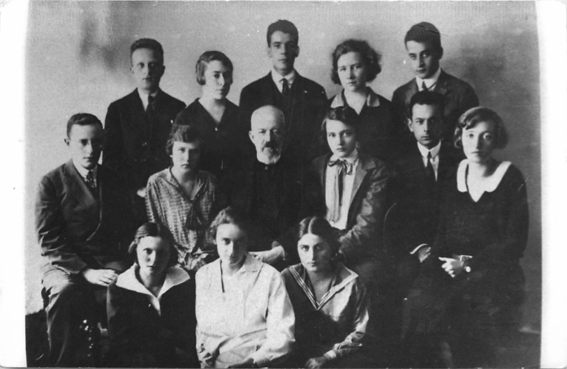

# Twardowski 的研讨班参加者（lvov-warsaw 补充材料）

**《华沙学派》词条补充材料**

## Twardowski 的研讨班参加者

> 
>
> | **上排自左**： | Henryk Mehlberg、身份未辨明的学生、Walter Auerbach、身份未辨明的学生、Leopold Blaustein |
> | --- | --- |
> | **中排自左**： | 身份未辨明的学生、Maria Kokoszyńska、Twardowski、Izydora Dąmbska、Seweryna Łuszczewska、身份未辨明的学生 |
> | **下排自左**： | Józefina Mehlberg、Halina Słoniewska、Eugenia Blaustein |

*照片由 Jan Woleński 提供（得自其师 Izydora Dąmbska 的赠礼），经许可转载。*
