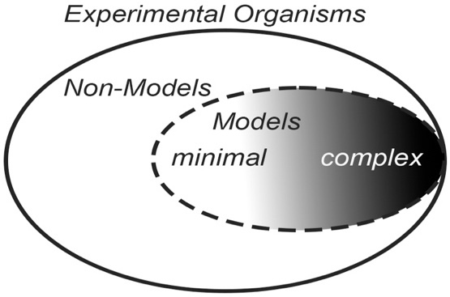

# 模式生物 Model Organisms (Michael Dietrich and Nedah Nemati)

*首次发表于 2026 年 7 月 24 日。*

模式生物是当代生物学与生物医学研究中广泛使用的一类对象。“模式生物”一词在 2000 年得到美国国立卫生研究院（NIH）的正式认可[其他网络资源]，但它的历史更久，如今在科学界与哲学界都日益通行。今天，模式生物的定义并不统一，连哪些生物算模式生物也说法不一。生物学家把模式生物当作实验工具；哲学家则越来越多地追问，模式生物本身如何算得上是科学模型——它们怎样表征别的系统，选定它们的标准何在，又有哪些更广的基础设施与实践，撑着它们在科学实验中的认知角色与实用角色。

## 1 术语史

“模式生物”一词在 20 世纪 90 年代以前偶有人用，真正流行起来，是随着基因组作图与测序工程的兴起（Ankeny and Leonelli 2020）[^ankeny-2020]。1990 年，美国卫生与公众服务部与能源部就人类基因组计划头五年发表报告，所列生物数量有限：一种细菌（大肠杆菌 *Escherichia coli*）、一种酵母（酿酒酵母 *Saccharomyces cerevisiae*）、一种果蝇（黑腹果蝇 *Drosophila melanogaster*）、一种线虫（秀丽隐杆线虫 *Caenorhabditis elegans*）和小鼠（小家鼠 *Mus musculus*）（Department of Health and Human Services et al. 1990）。这份清单的先后次序，反映的是把一批生物医学上至关重要的物种列为测序重点这一目标。当时，基因组测序被视为值得在各种生物系统里发展的重要手段；可在 NIH 看来，光有测序还不足以让一种生物成为模式生物（2000b [其他网络资源]）。

2000 年，美国国立卫生研究院（NIH）正式圈定了一套用于生物医学研究的经典模式生物：小鼠（*Mus musculus*）、大鼠（*Rattus rattus*）、果蝇（*Drosophila melanogaster*）、斑马鱼（*Danio rerio*）、蛙（*Xenopus*）、线虫（*Caenorhabditis elegans*）、社会阿米巴（*Dictyostelium discoideum*）与出芽酵母（*Saccharomyces cerevisiae*）（NIH 2000a [其他网络资源]）。次年，NIH 把拟南芥（*Arabidopsis thaliana*）这一植物收入名单；到 2007 年，名单又扩至鸡（*Gallus gallus*）、一种丝状真菌（粗糙脉孢菌 *Neurospora crassa*）、水蚤（*Daphnia*）与裂殖酵母（*Schizosaccharomyces pombe*）（Leonelli 2007; NIH 2009 [其他网络资源]）[^leonelli-2007]。这些生物各自都有某些部分，或由部分组成的系统，堪作人类身上那些具医学重要性的部分与系统的模型；它们也被当作非人目标的模型使用。

NIH 指定的模式生物，大多在生物学与医学中已用得很久。果蝇、大鼠与小鼠在 20 世纪初便已发展为实验系统，并在遗传学的建立中起了奠基作用（Kohler 1994, Rader 2004, Clause 1993, Logan 2002, 2005）[^clause-1993][^kohler-1994][^logan-2002][^rader-2004]。这些早期研究大多针对基本的生物学过程；这些生物是后来才慢慢成为其他物种中诸过程的模型的。在果蝇那里，研究的比较进路原是把黑腹果蝇与近缘物种并置，随着 20 世纪 50 年代分子生物学的兴起，它才转而充当其他物种的模型（Kohler 1991）[^kohler-1991]。大鼠走上“其他物种之模型”这条路要快得多：19 世纪起，它就被用来做人类疾病的模型；1906 年威斯塔研究所把大鼠模型加以标准化，于是它在 20 世纪初大行其道，成为变异度低、结果可重复性高的实验生物（Clause 1993, Logan 2002）[^clause-1993][^logan-2002]。另一些生物也曾被用作人类疾病的模型，却未进入 NIH 清单，用途日渐稀少。豚鼠便是一例：早在 1899 年它就被用作人类癫痫的模型，到了 20 世纪却在大鼠、小鼠面前落败，没能成为哺乳动物模式系统（Logan 2002, Endersby 2007）[^endersby-2007][^logan-2002]。

到 21 世纪头几十年，被 NIH 认定为模式生物，已成了地位与权威的标志，更不用说还能带来 NIH 之类美国联邦资助机构的经费（Gilbert 2009, Farris 2020）[^farris-2020][^gilbert-2009]。NIH 公布名单后不久，科学家们便纷纷提名别的生物当模式生物，急着表明自己手上这种生物对一批问题的价值（Wittbrodt, Shima, and Schartl 2002, Behringer et al. 2009）[^behringer-2009]。有些生物在生物学里早已用惯，又被重新命名为模式生物（Bonner 1999）[^bonner-1999]；甚至有指南教人把任何一种生物改造成模式生物（Matthews and Vosshall 2020）[^matthews-2020]。为非模式系统鸣不平的呼声也随之而起（Shuker, Lynch, and Morais 2003）。非模式生物的倡导者常挂在嘴边的一句话是：偏爱模式生物，等于有意无视生命之树上的大多数物种（参见第 6.1 节关于研究生物多样性难题的讨论）。

## 2 生物作为科学模型

NIH 在把“模式生物”确立为一个范畴、一套术语上起了关键作用，但今天这个词早已不限于 NIH 的经典清单。从生物学到医学，从神经科学到心理学，科学家在各领域都随意而宽松地用着它。尽管用途如此之广，哲学上的分歧却仍在：模式生物究竟如何充当科学模型？它们又算哪一类模型？

实验中所用的生物都算实验生物，模式生物只是其中一个子集（见图 1）。有些哲学家从物种之间的表征关系入手界定模式生物（见 2.1 节）。Ankeny 与 Leonelli 便主张，一种生物之所以起模型作用，是因为它具备宽泛的表征范围（结果得以跨物种外推）和明确的表征目标（可以代表另一系统中的特定现象），从而表征其他生物的特征。照这种看法，模式生物背后有共同体与基础设施撑着：这些共同体与设施把关于该生物整体的知识整合起来，把它的种种属性看成相互关联的系统的一部分，而不是一项项孤立的实验性状（见 3.3 节关于本领库的讨论）。换句话说，模式生物随时可以改作他用，去研究新现象，也能推广到新的物种。

强调多重目标与多重物种，恰好点出了模式生物研究在认知上的独到之处（Ankeny and Leonelli 2011, 2020）[^ankeny-2011]。不过也有人认为，单靠这类表征论的说法，抓不住模式生物的多面性。在他们看来，模式生物该被看作模型载体——理解它们不靠表征能力，而要看它们是发生上可变、经过标准化、并且演化而来的生物（Prieto and Fábregas-Tejeda 2025）[^prieto-2025]。

**图 1。**

图 1。实验生物与模式生物

实验生物分两类：不作模型用的，和作模型用的。模型与非模型之间的界线画成可渗透的，因为同一种生物可以在某个时点充当模型，换个时点又成了非模型，全看研究语境。在模式生物当中，有的只勉强够上作模型的最低标准，有的则要满足更复杂的标准：目标更多、范围更广，因而还需要标准化，需要发展出支撑其模型用途的共同体资源。图中因此把模式生物的标准画成了一道复杂度梯度。

实验生物的用处很多，加上“模式生物”一词在生物学里用得宽松，我们不妨把一切满足某种建模关系的生物都叫作模式生物——它们充当目标之所本。不过，模式生物获得认知价值的方式各不相同，为保住这一点，那些只凭单一标准（例如单凭表征）就算数的，不妨称为最低限度模式生物；那些按多重标准来界定的说明，则称为复杂模式生物（见图 1）。模式生物的定义越复杂，越常把这类特征算进去：生物是否易于操作，维持它要花多少基础设施成本，以及它的表征范围有多宽。许多生物学家就用一组特征来定义模式生物（Russell et al. 2017, Farris 2020, Wittbrodt et al. 2002）[^farris-2020][^russell-2017][^wittbrodt-2002]。可有些哲学家在把模式生物当模型看时，用的却是更简单的定义（Frigg 2023, 401; Sartori 2023, 1）[^frigg-2023][^sartori-2023]。模式生物与非模式生物的界线同样不固定：同一生物可以在某个时点是模型，换个时点又不是，全看研究语境。

下面我们逐一梳理模式生物在哲学与科学语境中被当作模型的种种方式：把模型看作替代物、探索性模型、负模型的说明，都在其列。这些说法彼此并不排斥。下文会看到，模式生物可以同时是负模型、替代物或探索性模型，组合方式不拘。

### 2.1 模式生物与表征问题

模型是否表征其目标系统、又如何表征，至今仍是悬而未决的哲学问题（Frigg and Hartmann 2025）[^frigg-2025]。模式生物满足的，是同理论模型一样的表征标准吗？比如动力学方程表征流体运动、神经网络表征认知过程所用的那种标准。

Ankeny 与 Leonelli 给出了一个颇有影响的回答：用表征范围与表征目标来刻画模式生物（Ankeny and Leonelli 2020）[^ankeny-2020]。最简单的情形是：物种 A 具有属性 p，而 p 表征物种 B 的某个特征，A 便是 B 的模型。表征范围说的是 A 能为多少个不同的物种 B 建模；表征目标指的则是 A 与 B 中被表征的属性或现象 p。范围可从一个物种直至许多物种，目标可从单一现象直至一大组生物特征。

这一说明借用了 Frigg 与 Nguyen 的科学表征 DEKI 框架，从而支持把模式生物看作与理论模型相类的东西（Frigg and Nguyen 2021; Frigg and Hartmann 2025）[^frigg-2025][^frigg-2021]。DEKI 模型有四步：模型指称（denote）一个目标系统（D），例示（exemplify）相关特征（E），给出把这些特征与目标联系起来的键或映射规则（K），再把它们归予（impute）目标（I），据以生成关于目标的信息。用 DEKI 来读，模式生物指称生物学目标，例示实验上可通达的性状，倚仗实验实践所提供的解释键，并许可人们就目标系统作出推断（Frigg and Nguyen 2021）[^frigg-2021]。

在 Ankeny 与 Leonelli 看来，模式生物之所以不同于其他实验生物，不只在它与目标的物质相似，更在它的表征力量——而这力量是靠着一段实践史立起来、维持住的。这里说的实践，包括技术、基础设施、惯例与社会组织，它们使生物随时间稳定下来，又不断被改造；他们把这整套东西叫作实践的本领库（见 3.3 节）。DEKI 虽给理解表征提供了一套图式，但建模本身就嵌在变动不居的研究实践里，模型如何指称目标，也就复杂起来。本领库里的概念要素、物质要素与社会要素，不只决定什么算模型，也决定表征关系怎样被一再修改，而不是一劳永逸地定死。

Lorenzo Sartori（2023）把 Ankeny 与 Leonelli 的表征图景及其对 DEKI 的运用推进一步，把解释键在这类本领库中的角色讲清楚了。他区分宽解释键与局部解释键：宽解释键承载的是关于模型如何与目标相关联的一般背景假设；局部解释键给出从具体模型属性到目标属性的精细映射，证成工作要的正是这种映射。宽、局部两种解释键在理想情况下互相启发，达到反思平衡；但能支撑“模型准确”这类主张的，只有局部解释键。因此在 Sartori 的说明里，事实正确性是逐案证成的，并非从一个模型系统整体继承而来。

Sartori 这类较强的表征论说明，为把模式生物的表征能力拓展到新领域备下了资源。晚近就有研究借这套框架，为在神经科学里使用新的模式生物作辩护，基础认知系统方面的研究也在其列（Rorot 2025 [其他网络资源]）。不过，并非所有哲学家都认为，把模式生物当理论模型来想，就是理解其认知功用的正解。有人索性跳出强的表征论说明，另寻模式生物研究的根基。

例如 Levy 与 Currie（2015）主张，模式生物更该理解为标本，而不是理论模型。在他们看来，实验生物是从更大种群中抽出的具体生物学样本，科学家由之作出的推断靠的是经验外推，不是表征映射。给这些外推作保的是背景知识——系统发生亲缘关系、机制保守性、种群结构等等——而不是把模型特征与目标特征联系起来的抽象键。理论模型通常带有明确的抽象、理想化与形式映射规则；Levy 与 Currie 偏要强调，模式生物是偶然的、具身的系统。它们所担的认知活儿，来自它们是精心挑选的生物学标本，而不是来自它们充当表征替代物。

许多关于模式生物的讨论，同样没有对表征作什么强承诺。Marcel Weber 便是一例：他强调的不是表征范围，也不是标本地位，而是模式生物充当因果推断工具的能力（Weber 2005）[^weber-2005]。要紧的是，Weber 强调把模式生物说成“工具”或“技术人工物”，只能作隐喻解。实验生物不是人造的机器，而是演化而来、活生生的存在者，只是经过改造、标准化与稳定化，才使实验干预成为可能。近交、遗传工程、跨物种基因转移这类做法，并没有把生物变成人工物，而恰恰例示了对自然对象的实验操作（Weber 2024）[^weber-2024]。照这种看法，模式生物的认知力量在于：它们能借受控干预让因果结构变得可通达，使科学家得以识别因果关系，并把它推广到所研究的特定生物之外。

合起来看，这些进路都不赞成这样一种想法：模式生物之取得认知地位，主要是因为它与目标处在表征关系之中。它们反倒强调，推断的根基在外推、干预与物质连续性。可要是把表征整个抛开，就留下一个大问题：科学家究竟凭什么从具体的实验系统走到关于更广阔生物学领域的断言？总得有点建模关系才行吧。

Prieto 与 Fábregas-Tejeda（2025）近来的工作，正是要解开这个结：面对表征论与非表征论之争，他们取一种混合立场。他们跟非表征论者站一边，认为模式生物本身并不是模型；可他们也承认，科学家确实常用模式生物来构造关于特定目标现象的模型。照他们的提法，模式生物最好理解为科学模型的物质载体，而不是干脆就叫模型（Prieto and Fábregas-Tejeda 2025）[^prieto-2025]。生物是物理系统，研究者从中选取某些部分、机制或行为，加以抽象和解释，再组织成关于所关注现象的模型。模型本身只是被解释的那一子集生物特征（例如某些细胞机制），并非整个生物（Prieto and Fábregas-Tejeda 2025）[^prieto-2025]。载体提供实验语境，但被映射到所关注领域、进而用来表征其他生物中现象的，只有被解释的那些部分（Prieto and Fábregas-Tejeda 2025）[^prieto-2025]。这一区分有助于调和两方：一方守着传统的表征论直觉，觉得模式生物用起来就像形式模型、数学模型；另一方认为生物本身不是模型，只是凭研究者从中抽象、解释出来的东西，支撑着模型的构造。

### 2.2 模型作为范例与替代物

许多科学家把认知价值归于模式生物，对它的表征地位却不置可否。这样用起来，模式生物可以充当范例——代表更广类别或谱系的例子（Bolker 2009）[^bolker-2009][^bolker-2009-2]——也可以充当替代模型，专为顶替某个特定的生物学目标。替代模型在生物医学与生物科学里用得极广，这与 NIH 的政策正相合：把动物模型当作人类的实验替身，做临床与转化研究。替代模式生物与所指定的目标生物或生物类别，总有几分物理上或功能上的相似。动物系统之所以能当目标系统的替身，是因为它们认知上更好操作——比如在生物医学研究里，啮齿动物之于某些人类过程与性状就是如此（见 Frigg and Hartmann 2025）[^frigg-2025]。把模型用作替代物和用作范例并不互斥，可范例要担的担子轻些。替代物得跟目标一样对操作作出反应；范例代表的却是更高的一个分类阶元（Bolker 2009）[^bolker-2009][^bolker-2009-2]。换句话说，替代物只需在与研究狭义相关的那些过程上与所代表者相合（Creager, Lunbeck, and Wise 2007）；范例却会牵出哲学问题：凭什么为整个类别或谱系建模？举例说，黑腹果蝇（*Drosophila melanogaster*）常被当作无脊椎动物遗传学的范例，斑马鱼（*Danio rerio*）常被当作脊椎动物胚胎发育的范例，都没被当成某一物种或病症的替代物。

关于替代物与范例的哲学争论，多半集中在一点：共同祖先能否证成由此及彼的外推，而又不把替代物当成目标的表征（Levy and Currie 2015, Weisberg 2013）[^levy-2015][^weisberg-2013]。Ankeny 与 Leonelli 指出，这样处理模式生物，靠的多是生物属性（共同祖先），并没有碰到那大片关于模式生物研究究竟怎么做的科学实践（Ankeny and Leonelli 2020, 56）[^ankeny-2020]。再说，一旦生物与目标各有不同的环境史，单靠共同祖先就说不通了。不过在临床与转化研究的语境里，关于替代物的哲学讨论一向少谈深层的生物学相似，多谈那些能带来实践相关性的特征。要判断一个替代物对干预与概括是否合用，研究者先看的是：相关表型或性状有没有呈现，生理机制或过程是否已知与人类同源，重点则放在症状表现，而非疾病病因（Bolker 2009）[^bolker-2009][^bolker-2009-2]。所以，哪怕某种失调的根由尚不清楚、或无法在动物模型里重现，只要行为上或生理上有相似性状，在转化框架内就足以证成替代模型的使用。

这套逻辑在精神病学与神经学研究里最吃重，靠的就是科学家 Georg Striedter 所说的内表型（2022）。研究者并不打算把精神分裂症、自闭症这类失调的全部复杂性或因果来历都复制出来，而是挑出可在物种之间测量的中间性状——工作记忆缺陷、社会互动改变、感觉运动门控受损之类（Dietrich, DiMarco, Taylor, and Lewontin 2026）。这些内表型便成了建模与干预时好操作的目标，至于它们与底层病理的关联，仍可存疑。内表型就这样把替代建模的逻辑又推远一步：看重的是认知上有用的症状，而不是对疾病起源的表征忠实。

对替代模型的哲学质疑，重点不在生物学上是否完全等价，而在 Bolker（2009）点出的那种模型与目标系统之间固有的不完整与落差。有“未知的未知”在，替代模型就被实验室语境里的选择压力塑形，也被一种经验上的不确定塑形：究竟哪些生物学方面必须纳入，模型才算仍然相关。这些缺口说明，任何模型要全盘把握目标系统的复杂性都有其限度，尽管科学中的大数据技术正日益着手处理它们（见第 5 节）。Weber（2014）还点出实验建模策略里的一项重要分别：一类模型在物理上复制目标中同种过程；另一类是替代模型或“替身”模型，它们表征的物理过程并不相同，却仍在实验室里充当功能替代品。这一分别说明，替代模型无需与目标物理同一，它只是实用的工具，替身于所研究系统的某些方面。Sara Green 还讲出模式生物一种更像工具的替代性：它们充当工具，或活体测定。兔子当年就用来做妊娠检测，后来才让位给蛙类（*Xenopus*）（Gurdon and Hopwood 2000）[^gurdon-2000]。这些动物本身算不上人类生殖的模型，但它们对人类激素敏感，反应便可作为伴随妊娠的某些人类激素变化的证据（Green 2024）[^green-2024]。总体看，替代模型例示了实验生物学的一个更大转向：优先要可测量、可操作的性状，而不是把目标的全部生物学整个复制出来。替代模型给不出一对一的表征，其用处恰在于把实践相关性与对认知缺口的坦然承认摆平——那缺口是躲不掉的。这个张力，正是下文许多当代实验模型设计与验证策略的底子。

### 2.3 探索性模型

探索性模型的独特之处，在于它们作为工具，志不在忠实表征目标系统，而在开辟新的探究路子：提出新问题、找出模式、勾画概念上或经验上的可能、帮着辨认有前途的探究方向，有时还能揭出被人忽略的现象侧面（Weber 2024）[^weber-2024]。Axel Gelfert（2016）指出，这类模型往往有意简化、理想化到这种地步：它们的认知价值就在四项一般功能上——作未来探究的起点，作原理验证演示里的一环，作已观察到的那类现象之潜在解释的来源，作试探目标是否合宜的手段。就模式生物来说，Juan Larraín 认为探索性模型还多一种视角建模的功能（2024）。比如在早期胚胎研究里，Larraín 指出，秀丽隐杆线虫（*C. elegans*）让完整细胞谱系的绘制和细胞凋亡的发现成为可能；小鼠则给出了调整型发育的原理验证演示，后来又揭出早期细胞命运里意想不到的偏向（2024）。两种情形下，它们的用处都不在映照人类发育，而在能支撑探索、生出新视角，而这些视角又催生了关于发育的新想法。探索性模型可以在认知上不可或缺，却不必对所设目标系统的表征内容许下什么强承诺。

### 2.4 负模型

此前的焦点，都放在模型与目标之间的正面映射上；可还有一大批模式生物之所以被用来研究，恰恰因为它们没有标准模式系统里那些特定的疾病或生理状况。这类系统叫负模型，常用于临床转化：当它们对特定刺激或疾病毫无生理反应时，正好借以弄清抗性机制。例子有用黑猩猩研究 HIV 发病机制（Veazey and Lackner 2017）[^veazey-2017]、用猫研究糖尿病（Hoenig 2012）[^hoenig-2012]、用穿山甲研究 Covid19（Gupta et al. 2022）[^gupta-2022]——这些模型都没能像人类那样发展出相应的疾病状况与症状。

负模型算不算可概括的模型，其认知地位一直有争议：一种动物对疾病表现出独特的适应，并不等于它与人类共享同样的机制，尽管这些适应能通过类似机制给人上生物学以启发（Stegmann 2021）[^stegmann-2021]。可话说回来，负模型在科学上照样富有生成力：既有助于转化研究（比如潜在疗法），也有助于超出原初应用语境去理解生理与病理过程（Green 2024）[^green-2024]。例如裸鼹鼠抗癌性的研究，就为与人类衰老、疼痛相关的组织力学提供了基础性的洞见（Green 2024）[^green-2024]。

Green、Dietrich、Leonelli 与 Ankeny（2018）主张，他们所说的 Krogh 生物常常可以构成负模型。August Krogh 当年专挑极端适应的生物做生理学研究（见 4.1 节）；Green 等人顺着这条线说：“Krogh 生物之被挑中，不为表征范围，也不为与其他生物相似；挑它们，是因为某些独特特征让某一给定性状（此处是某种机制）在实验上更好通达”（Green et al. 2018, 65）[^green-2018]。枪乌贼（*Loligo*）的轴突便是一例：它被选中，是因为那根轴突大得惊人，电压钳技术做起来容易许多（Green et al. 2018, 64–65; Maxson Jones 2022）[^green-2018][^maxson-2022]。从 Krogh 生物身上常见的极端适应，转到把它们当负模型用，其动因是“一种指望：弄明白某些生理局限为何在这些物种身上看不到，也许就能为人类的生理问题及其可能的解决办法提供线索”（Green at al. 2018, 64）[^green-2018]。就算这些生物的性状有转化价值，Krogh 生物通常也不像模式生物那样，能充当概括的根基。

## 3 把模式生物置于实践之中

模式生物是科学家共同体发展出来的，又被当作资源加以培育，供这些共同体使用。把它们看成知识生产之社会系统与物质系统的一部分，就会看到：模式生物身上带的，不只是内在的生物学特征。换个说法，模式生物嵌在更大的系统里；解释模式生物在实验中如何起作用、某些模式生物系统为何在历史上如此成功时，那些系统的特征都担着要紧角色。

### 3.1 模式生物的物质性、抽象与标准化

抽象与理想化，是科学中理论模型的老面孔了：理论模型可以被看成虚构物、集合或表达式（Griesemer 2005, Potochnik 2017；关于理论模型见 Frigg and Hartmann 2025）[^frigg-2025][^griesemer-2005][^potochnik-2017]。而模式生物作为物质模型，恰好提供了一个重要机会，让我们想一想：关于抽象、关于标准化的哲学说明，落到科学那套物质实践里，该怎么理解。

Ramsden 说，实验生物“同时既是人工物，又是自然的样本”（Ramsden 2011, 365）[^ramsden-2011]。与纯理论模型不同，模式生物的物质性是有分量的。它是自然对象，只为在实验室里担角色而受过些改造，于是身上既有已知的方面，也有未知的方面。作为模型，模式生物的某些部分固然可以表征目标的某些部分；可模式生物系统要想在实验里成为产生新知识的一环，它就得具备尚未被完全弄懂的能力、结构与功能。一旦弄懂了某物在模式生物中如何运作，就有望同样弄懂它在目标生物中的运作。Huber 与 Keuck 说得好：“因此，考察物质性对基于动物的建模有何作用，必须两头都顾：一头是活体生物如何在技术上被控制住（例如培育转基因小鼠），另一头是生物在多大程度上抵抗（技术引导的）标准化”（Huber and Keuck 2013, 389）[^huber-2013]。

模式生物本身也不是完全“自然”的东西。与大多数实验生物一样，模式生物已被高度标准化：多数品系通过繁育计划把自然发生的变异清除掉了，好让某些因果干预更可靠地见效。实验室之内、实验室之间的这种标准化带来了更强的实验控制，使实验结果更便于流通，也更容易在别的实验室复制、扩展——因为各家用的生物彼此十分相似。Nicole Karafyllis 把这类结果称为“生物人工物”：既是生物的，又是人工的（Karafyllis 2003）[^karafyllis-2003]。这种标准化，也许是模式生物发展早期的一个特征。Ankeny 与 Leonelli 说，“关注处于完全标准化环境中的高度标准化生物”……“是（最初的）模式生物本领库的关键组成部分”（Ankeny and Leonelli 2020, 66）[^ankeny-2020]。研究往前推进，科学家又能把当初为了控制而被削减的那类变异重新引进来。他们这么做，是因为高度标准化的模式生物可能不那么能代表一系列目标（Ankeny 2010, Love & Travisano 2013）[^ankeny-2010][^love-2013]。例如生物医学文献里就有各种办法，让模型重新接触微生物，以提高临床前转化研究中小鼠模型的质量，理由是实验控制得过死，反而会丢掉临床转化所需的认知力量（Wallis 2025）[^wallis-2025]。近年来，类似的动因也塑造着行为神经科学里的模式生物研究：研究者想找回更丰富的生态行为，认为非“自然主义”的实验室行为会妨碍对神经活动的充分理解（Ulanovsky 2025）[^ulanovsky-2025]。可是临床前生物医学跟这里情形不同——那边的模型目标（免疫反应、疾病表型之类）规定得比较清楚；行为神经科学想在模式生物身上恢复“自然主义”实验，却要面对认知上的麻烦，那麻烦恰恰由实验室语境自身的选择压力造出的“未知的未知”而来（见 2.2 节）。Nemati 主张，当行为本身就是目标时，添几分生态丰富性并不会径直让模式生物更能代表野生型模型；这类进路得靠新的技术与方法标准化，去稳住模式生物与环境的互动。结果是，把行为模式生物弄得更“自然”的尝试，同时也在设计模式生物能表达、能被用来表征哪些行为（Nemati 2026）[^nemati-2026]。

模式生物也会经历一个抽象的过程。Leonelli 把这个过程说成“个别科学家在特定语境中选择现象 P 的某些特征，以产出关于 P（某一侧面）的模型”的活动（Leonelli 2008, 521）[^leonelli-2008]。对拟南芥这样的物质模型来说，抽象就是挑出一组所关注的特征，再把这类模型（植物生态型）稳定下来，使之保住这些特征。这与使用该物质模型的科学家的认知优先次序正相合：他们得“控制不同生态型各自性状的发育，从而确保标本可复制，并确保其非局部性（即无论何时何地使用，性状都保持稳定）”（Leonelli 2008, 522）[^leonelli-2008]。可见抽象是一组实践，在特定实验语境里、对着明确说出的认知目标展开。Leonelli 一段话把整个过程概括了：“抽象包括：从拟南芥野生型中挑出有限的一组物质特征，视之为对研究可能有趣；设计把这些属性装进单一标本的办法；确保带有这些特征的标本真能栽培出来；再编成一套指南、材料与工具，让全世界的研究者都能照同样的方式栽培标本”（Leonelli 2008, 523）[^leonelli-2008]。这个意义上的抽象植根于模型的物质性，含纳了标准化的一部分，也是模式生物研究共同体得以运转所必需的。

### 3.2 实验系统

Hans-Jörg Rheinberger 说，生物学研究总“从选一个系统开始，而不是从选一个理论框架开始”（Rheinberger 1997, 25）[^rheinberger-1997]。生物学里，生物当然是这些系统的要害部件。所以要给模式生物找准位置，一条路就是把它们看成实验系统的组成部分。

Rheinberger 把实验系统说成实验活动的单元，它把“局部的、技术的、工具的、制度的、社会的与认知的诸方面”拧在一起（Rheinberger 1997, 238）[^rheinberger-1997]。一个实验系统由两样东西构成：认知物与实验条件（也叫科学对象与技术对象）。前者是研究对象，是个物质的东西，可受操作，却还没有被完全认识、完全刻画。实验条件则由一批定义明确、往往已经标准化的技术物造成。这些技术物把认知物部分地稳住，也就在实验条件之内限制了它可能的动作。要紧的是，它们并不把全部可能结果都限死；否则实验系统就生不出新东西，只能演示那套条件早已产出的已知结果。Rheinberger 的实验系统概念，正是要回应这个难题：一项实验怎么既能受控，又能出新（Weber 2024）[^weber-2024]。

Rheinberger 把这套框架用到生物学史上的许多事例。就眼下要说的事，最值得注意的是他在《具体物的认识论》里讨论的五个以生物为中心的实验系统：Carl Corren 对豌豆（*Pisum*）与玉米（*Zea maize*）的研究，Max Hartmann 对秀丽团藻（*Eudorina elegans*）的研究，Alfred Kühn 对地中海粉螟（*Ephestia kühniella*）的工作，还有威廉皇帝病毒研究所研究烟草花叶病毒的种种努力。Rheinberger 把这些生物的讨论一概归到“模式生物”名下，他所谓模式生物是：“一种取自植物界、动物界或细菌界、已被裁制以适应实验目的的活物；操作它，可以生出关于整个一类生物的构造、运作、发育或演化的洞见”（Rheinberger 2010, 7）[^rheinberger-2010]。他的分析不盯着“作为模型”的模式生物，而是把它们当作实验系统的部件。从这些案例里，Rheinberger 看出模式生物一个古怪的特征：“作为科学工作的物质支撑，它们能在整个研究纲领消失之后继续存活”（Rheinberger 2010, 8）[^rheinberger-2010]。他讲烟草花叶病毒的那段历史，当然给这话撑了腰。可他也表明，对地中海粉螟的研究没能像果蝇那样站得住（Rheinberger 2010, 127）[^rheinberger-2010]。

Gail Davies 借 Rheinberger 的实验系统，把模式生物的标准化同构成其技术条件的那些技术物的标准化区分开来（Davies 2013）[^davies-2013]。她的论证是在小鼠身上做的，但可以外推到别的模式生物。在 Davies 看来，与模式生物相关的标准化有两义。第一义是“围绕特定基因位点对动物加以标准化，以造出人类疾病的可复制动物模型”（Davies 2013, 135）[^davies-2013]，这使小鼠能当遗传工具用。第二义则落在实验系统的各个部件上。Davies 说，“笼具尺寸与设计、饲养管理程序、操作方案”这些方面的标准是必需的，“好让整个实验系统能在不同的实验室空间里复制出来”（2013, 136）。模式生物一身二任：既是实验系统里的技术物，又部分是正被研究的认知物。正因如此，以模式生物为特色的实验系统才能“自我复制，同时仍旧是新知识得以产生的安排”（Davies 2013, 136）[^davies-2013]。

### 3.3 本领库

Rachel Ankeny 与 Sabina Leonelli 把模式生物安放进一个广大的系统，叫作本领库。按他们 2015 年最初的描述，本领库是“使一项为完成特定任务而建立的短期合作得以生出相对稳定的研究者共同体的物质条件与社会条件的集合”（2015）。本领库为模式生物研究提供了语境，Ankeny 与 Leonelli 用它解释三件事：模式生物如何表征，它们为何是可信的模型，以及某些经典模式生物（*Drosophila*、*C. elegans*、*Arabidopsis* 之类）为何如此成功（Ankeny and Leonelli 2020, 40）[^ankeny-2020]。

在 Ankeny 与 Leonelli 那里，本领库是“一个分析特定科研方式之出现、发展与演化的总体框架”，着眼点在研究者如何把“概念的、物质的、后勤的与制度的”实践协调起来，编出一份撑得住、维持得下的研究计划（2020, 41）。这样一个模式生物本领库包括三块：（1）生物的特征，如大小、可操作性、表征范围与表征目标；（2）共同体的特征，如对演化保守性与数据共享的承诺，以及长期经费的来源；（3）更大格局的特征，如对模式生物研究的制度性支持，以及材料、技术、数据之有规制的交换体系（完整清单见 Ankeny and Leonelli 2020, 41–42 表 1）[^ankeny-2020]。

有些哲学家或许想把本领库里的各项特征拆开来，挑自己喜欢的，与其余部分隔离开单独处理；Ankeny 与 Leonelli 不这么看，他们依据科学实际怎么被做，主张这些特征在功能上是一体的。他们拿自己对拟南芥与秀丽隐杆线虫模式生物发展的详细历史研究作支撑，说：“要是没有种质资源中心、数据库及其使用者的精明打理，没有全球各地政府资助者的公关努力，也没有关于这些资源在研究发展（含新的数据驱动方法）中所扮角色的定期更新的论证，本领库的这些关键部件就会连同使用模式生物的大部分吸引力一道消失”（2020, 42, 45, Ankeny 2001, Leonelli 2007）[^ankeny-2001][^leonelli-2007]。换个说法，共同体层面与更大格局层面的工作，替果蝇这样的模式生物备好了必要条件，它才挣下那一串惊人的经验科学成功记录。成功记录越积越多，某些共同体实践又被加固。于是模式生物系统与它的使用者共同体缠在一起，成了“共同构成的”（Ankeny and Leonelli 2020, 45）[^ankeny-2020]。

每个模式生物各有各的本领库，哪怕彼此有相通之处。Ankeny 与 Leonelli 借此解释，例如，小鼠的本领库为何不同于果蝇的。要紧的是，本领库尽管复杂而偶然，却并非每种生物都能长出、或维持住一个。连 *Xenopus* 这种经典模式生物，早年本领库的发展也曾卡住。涡虫、美西螈之类，在生物学研究里用得也广，可按 Ankeny 与 Leonelli 的说法，它们并不具备最成功模式生物本领库中的全部特征；在他们看来，这就是不把它们算作模式生物的正当理由。且不论什么才配叫模式生物，Ankeny 与 Leonelli 的本领库概念提供了一条路子，去解释经典模式生物的历史成功与独特性。他们从不同的生物系统中辨出科学实践的重要特征，用以说明各生物研究共同体在研究产出与影响上的差别。

*表 1a、b、c。*

*表 1a*

| 生物的性状 |   |
| :---: | :---: |
| **自然的或内在的** | 实验室中的可操作性；生活史长度；繁殖率与繁育难易；生物体大小；储存难易；基因组大小；所关注特征的物理可及性 |
| **通过实验互动与向实验室转移而诱发或揭示的** | 标本的可突变性；对实验室环境的反应；可获得性 |
| **由研究者归予或投射到生物身上的** | 表征范围；表征目标；作为遗传工具的力量；充当与其他生物比较之基础的能力；带来跨层次整合的多学科用途 |

*表 1b*

| 共同体的特征 |   |
| :---: | :---: |
| **概念承诺** | 演化保守性；对生物的整体性、跨层次进路；关注处于环境之外的生物 |
| **可用的技术** | 发展良好的共同体数据库；与可用仪器和工具的适配 |
| **共享的技能与实践** | 对材料、数据与知识自由交换的承诺；跨越生物学各子领域的能力；从科学共同体之外吸引经费与注意力的公关技能 |
| **制度组织** | 具有强大组织与科学技能的魅力型领袖；高效且易获取的种质资源中心；共同的交流场所与机构 |
| **可靠的经费来源** | 来自政府资助的长期支持；确保该类经费的策略 |

*表 1c*

| 更广阔格局的特征 |   |
| :---: | :---: |
| **与政治和社会目标的契合** | 把基础分子研究视为医学与农业创新之根基的愿景 |
| **知识产权制度** | 材料、技术与数据的自由交换或其他受到良好规制的交换 |
| **制度性认同** | 存在愿意投资于模式生物研究的机构 |

表 1a、b、c。模式生物本领库的构成要素（据 Ankeny and Leonelli 2020, 43–44）[^ankeny-2020]。

## 4 生物选择的多元理据

这个星球上有数百万物种，生物学家只挑其中一小部分来做研究。挑哪一种生物、又凭什么挑，这就构成了生物选择问题。生物学家通常拿出一套实用的与认知的标准来挑。模式生物常被认为身上聚着一组与众不同的特征，正是这组特征证成了它们在生物学与医学中的用处。

### 4.1 Krogh 生物

生物学家谈选材，最常引的是诺奖得主、生理学家 August Krogh 的那条标准。1929 年它被称作“Krogh 原则”，说的是：“问题如此之多，总有某种可供选择的动物，或少数几种这样的动物，能让研究做得最方便”（Krogh 1929, Krebs 1975, Krebs and Krebs 1980, Green et al. 2018）[^green-2018][^krebs-1975][^krebs-1980][^krogh-1929]。举例说，Krogh 曾与 Christian Bohr 合作，用陆龟研究肺功能（Krogh 1929）[^krogh-1929]。Bohr 把陆龟带进肺研究，是因为它的气管分叉在颈部的位置比其他脊椎动物高得多，呼吸研究里要分别研究每一叶肺便容易些（Green et al. 2018）[^green-2018]。

Krogh 在研究中偏爱的那些生物，往往有独特的特征，且常常是极端的适应。Green 等人拿它们与模式生物对照：所谓 Krogh 生物往往不经标准化，没有支撑其使用的持久基础设施；最要紧的是，它们通常只挑出一小组专门特征，用来对应某个特定研究问题（Green et al. 2018, 5–6）[^green-2018]。

Krogh 原则在生物学家中很吃得开，但不少生物学家与哲学家已不满足于“图方便”这条理由，转而对生物选择给出了更精细的说明（Dietrich et al. 2020, Andrews and Enstipp 2016, Burian 1993, Clarke and Fujimura 1992, Gest 1995, Hopwood 2011, Robert 2008, Zallen 1993）[^andrews-2016][^burian-1993][^clarke-1992][^dietrich-2020][^gest-1995][^hopwood-2011][^robert-2008][^zallen-1993]。

### 4.2 扩展模式生物选择的理由范围

经典模式生物经 NIH 认定，地位特殊，研究者在争经费时也因此被优先考虑。2016 年的一篇新闻帖里，NIH 主管院外研究的副主任 Michael Lauer 谈到一项 NIH 内部研究：用模式生物的项目，获资助的比率高于 NIH 全部申请的比率（Lauer 2016 [其他网络资源]）。NIH 与国家科学基金会（NSF）对某些特定生物的经费一旦增加，相关论文的发表量也跟着增加（Dietrich, Ankeny, and Chen 2014, 792）。这样看来，被认定为模式生物，既牵着更高的经费命中率，也牵着更高的发表率。（译注：原文作 2106，当为 2016 之误。）

联邦经费多用于实验室研究，但也有好几笔投向了模式生物工作所必需的共同体资源与基础设施。比如拟南芥与秀丽隐杆线虫的种质资源中心和数据库，既撑起了各家实验室的研究，也在用同一模式生物的研究者之间养出一种共同体感（Leonelli and Ankeny 2012）[^leonelli-2012]。

成本一向是挑选特定模式生物的重要因素，可单凭这一条，抓不住这类决定的复杂——它们往往是多维的。还有些模式生物是从别的实验语境里挪过来的：选中它们，不只因为实践上好操作，还因为相关方法与基础设施现成可用，哪怕当初研究它们本是为了别的目的（Kaplan 2025）[^kaplan-2025]。科学家有时会把选择的理由明说出来。Isabel Rubio-Aliaga 便写道：

> 多数模式生物都合算：再生时间短，在实验室里养起来、繁殖起来容易且已标准化，个头小、占地少。再说，模式生物之被选中，是因其各项基础生物学特性，理应映照出由人类而来的那些问题，即具有相似的通路与生理、病理反应。多数模型之被选中，靠的是可实践性或生理可操作性。把它们的代谢与生物化学弄明白，数据就好解释，也便于向人类外推，应用起来自然方便（Rubio-Aliaga 2012, 17）[^rubio-aliaga-2012]。

把实践理由与生物学理由掺在一起选材，是极常见的做法（Dietrich et al. 2020）[^dietrich-2020]。不过 Rubio-Aliaga 还点出了支撑某一生物研究的重要共同体特征。她说，“一种模式生物的使用，背后有庞大的科学共同体在撑，这个共同体推动知识与工具的互通，比如突变体资源、生物信息学资源”（Rubio-Aliaga 2012, 17）[^rubio-aliaga-2012]。这类特征在 Ankeny 与 Leonelli 对模式生物何以成功的分析里十分吃重（Ankeny and Leonelli 2020，见 3.3 节）[^ankeny-2020]。Dietrich 等人依科学家们的自述，整理出一张二十条标准的清单（表 2），可用于为生物学研究挑选生物（Dietrich et al. 2020）[^dietrich-2020]。这二十条归成五簇：获取、可操作性、资源供给、经济性、前景。照这些簇与标准来挑生物，就是在一个高度语境化的判断里同时用上多条标准，彼此权衡，甚至逼得研究者回去修正对标准本身、对所考虑生物之能力的理解。

**表 2。**

| 簇 | 标准 |
| :---: | :---: |
| （A）获取 | （1）供应难易；（2）现象可及性；（3）伦理考量 |
| （B）可操作性 | （4）标准化；（5）生存力与耐久性；（6）反应性；（7）方法与技术的可得性；（8）研究者风险 |
| （C）资源供给 | （9）既往使用；（10）认知资源；（11）培训要求；（12）信息资源 |
| （D）经济性 | （13）制度支持；（14）财务考量；（15）共同体支持；（16）情感与文化属性 |
| （E）前景 | （17）商业及其他应用；（18）比较潜力；（19）转化潜力；（20）新颖性 |

表 2。生物选择的标准（据 Dietrich et al. 2020）[^dietrich-2020]

这些标准虽说是普遍适用于一切生物选择的，可用不用某种模式生物，通常援引的还是更窄的一组同类特征。比如 Rheinberger 说，“选择模式生物的操作性标准是：它维持、处理起来有多容易，关于它已积累的知识在数量与质量上如何，以及通达所研究现象有多方便”（Rheinberger 2010, 7）[^rheinberger-2010]。Love 与 Yoshida（2026）又从演化发育生物学添了一种视角：那里挑模式物种，是要在实验可操作性与整合发育保守性、演化变化的能力之间取得平衡——可见选材可以同时服侍实践目标与理论目标。Ankeny 与 Leonelli 给出的标准更宽：实验室里繁育、维持的难易，生物的标准化，数据库基础设施等资源的积累，会议、培训工作坊，以及生物品系的配送系统。最后这一类他们格外看重，因为他们主张模式生物研究的目标之一，就是造出“一个跨生物学学科作跨学科整合的平台，一个跨物种比较研究的参照点”（Ankeny and Leonelli 2020, 3）[^ankeny-2020]。他们讲到模式生物作为生物学研究工具被公认的用处时，现象可及之易也已含在其中。当然，他们还要求模式生物能被用于广泛的一组表征目标。

## 5 人工智能与模式生物

人工智能（AI）系统进了科学，也给模式生物的评估与使用带来新的认知难题。AI 模型在模式识别、特征提取这类任务上越来越好，于是它们开始充当模型：既用来改进对模式生物的科学研究，甚至也用来顶替生物本身。

### 5.1 AI 作为模式生物研究中的“发现”工具

前面说过（见 2.2 节），把模式生物映射到目标系统，核心难题在于我们对模型与目标之间的相似所知多少。两个生物系统之间哪些特征足够相似、足以证成拿一个当另一个的模型，这既是哲学难题，也是经验难题。生物科学里那些能处理大型数据集的 AI 技术，正日益接手这些经验难题，使模式生物研究有望做成一种“发现科学”（Wooley and Lin 2005）[^wooley-2005]。

比如在选模式生物这件事上，AI 技术对候选模型与目标系统之间的基因组、分子、表型相似性做高通量比较，帮科学家挑出合适的模式生物（Tee 2025）[^tee-2025]。分子测量技术的革新，还能沿动物发育与寿命提供更细致的纵向记录；模型映射因而要求更精细的时间与空间细节，模式生物研究的格局也随之改变。举例说，若能认出在发育与寿命中哪些具体时间点上、物种之间的某些特征更为接近，选模式生物、解释模式生物的方式都能改进。

AI 模型还越来越常用来缩小待检验的假设空间：借用计算模型与模拟，跑起原本跑不成的种种情景。基于 AI 的非人模式生物建模，已经由此引出新的待检验理论目标；如今同一套逻辑伸到人身上，科学家用执行任务的 AI 模型，去压缩“在人身上神经生物学上说得通”的那片空间（Kriegeskorte and Douglas 2018）[^kriegeskorte-2018]。论行为与认知功能，深度神经网络（DNN）这类执行特定任务的模型一成功，就开始撼动核心教条与理论框架——比如大语言模型（LLM）在语言研究里挑战生成语言学的关键教条（Piantadosi 2024）[^piantadosi-2024]。另一方面，更专门的卷积神经网络（CNN）被用来生成可在生物学上检验的预测，例如解剖与物理约束怎样塑造脊椎动物视网膜与初级视皮层的感受野；还被用来调和关于视网膜功能的争执（Lindsey et al. 2019 [其他网络资源]）。

还有些 AI 技术专管找出可从不同模式生物身上取来插入、以造出新模式系统的基因组序列——比如杂交嵌合体，这类系统最宜回答某些特定的科学问题。嵌合模型还能再当理论模型用：一方面缩小模式生物里待检验的假设空间，一方面检验某项生物学功能在基因组上最低限度需要什么（Green 2025）[^green-2025]。

### 5.2 人工模型“生物”

AI 模型的普遍性，并不限于拿来对模式生物作科学检验；它们还能直接顶替生物。科学家早就把虚拟动物模型当作生物学中生成假设的工具，例如用计算生物去检验演化假设（Sims 1994）[^sims-1994]。可直到近些年，AI 模型——尤其是 DNN——的行为表现才长进到这种地步：科学家已把它们当作认知模型、行为模型，用来顶替人类与非人动物。例如研究者把 AI 系统摆进结构上类似实验室生物的角色，把导航、客体永久性、问题解决这些范式搬进虚拟环境。受训练、受评估的成了人工行动者，而非活体动物；它们在一组认知任务上接受标准化行为测定，身上却没有半点生物基质（Crosby et al. 2020）[^crosby-2020]。这就给“把人工模型当模式生物用”出了道题，在心理学与行为研究里尤其尖锐：模式生物非得是活的生物不可吗？人工模型能不能也当模式生物？

照 Ankeny 与 Leonelli 对模式生物的说明，一个系统起码得处在一种以表征范围与表征目标为特征的模式化关系里，才算模式生物。动物模式生物满足这条：它们属于界定明确、有共同演化史的生物类群，这既限定了结果能概括到哪些系统，也限定了这些结果被认为表征了哪些特征。反观 DNN，它没有共同演化史，只是非生物的模型，局限摆在那里，所谓表征范围、表征目标究竟指什么，就说不清了（Scholte 2018）[^scholte-2018]。再说，这类模型运作所凭的因果机制只弄懂了一部分，要说清它们表征哪些系统、在哪方面表征，就难（Millière and Buckner 2024 [其他网络资源]）。许多情形下，人工系统所例示的功能，设计上就跟目标系统里的功能不一样。Hardalupas（2021）主张，DNN 缺一条向某类确定生物或现象投射的原则性依据，其建模地位因此模糊而有限，不如归为 Krogh 生物。人工生物不以表征某个目标系统为明确旨归，它盯的是问题，表征目标也窄（Hardalupas 2021）[^hardalupas-2021]。既没有共同的物质构成，那么“人工模式生物能否充当认知与行为能力的模式生物”一问，就得先回答更根本的问题：这类能力到底需要什么——说白了，智能、认知与复杂行为是不是非要有生物基质不可（详见 Bickle 2020）[^bickle-2020]。

近来的尝试又给生物的本体论添了乱：用 AI 模型造出新颖的生物学构件，由此生成新颖的模式生物，还生成新颖的行为（Kriegman et al. 2020）[^kriegman-2020]。只要生物学信息在引导认知与行为建模，这些流程就把模式生物的边界搅糊涂了；而这些人工生成的系统，其表征范围与表征目标、连同把结果投射回自然生物的根据，都还没个准。

## 6 模式生物研究的意涵

科学家手边约有九百万个物种，即便把模式生物的名单放宽，它也只是现存物种中极小的一份样本。从系统发生上看，NIH 的经典模式生物只占了生命之树的一丁点。一方面，若指定模式生物本就是为了给人类生物医学当模型，物种范围窄些倒也有理。另一方面，若设想模式生物该代表更广的一批物种、还得处理生物医学以外的问题，那它们生物多样性的贫乏就成了更严重的隐忧。

### 6.1 研究生物多样性的难题

模式生物研究的一些批评者认为，这些经典模式生物里有许多当初被挑中时，并没有充分顾及可用于研究的生命形式有多多样（Bolker 2019, Gest 1995, Hughes and Kaufman 2000, Gilbert 2009）[^bolker-2019][^gest-1995][^gilbert-2009][^hughes-2000]。Ralf Sommer 就说，“所有已确立的模式生物，都只是某一分类单元里众多物种之一……再说，这些生物也未能全面地代表生命之树”（Sommer 2005）[^sommer-2005]。另一些人反对一种关于分子过程之普遍性的预设，正是这种预设让模式生物研究者看轻了变异、看轻了物种之间的比较（Bolker 2012, 2019; Bolker and Raff 2009; Gest 1995; Jenner and Wills 2007; Gilbert 2009; Sedivy 2009; Sommer 2009, Farris 2020）[^bolker-2009][^bolker-2012][^bolker-2009-2][^farris-2020][^gest-1995][^gilbert-2009][^jenner-2007][^sedivy-2009][^sommer-2009]。针对这种狭隘，提出的办法不少：扩大取样面（Bolker 2012）[^bolker-2012]；取亲缘近而相似的物种（Sommer 2005）[^sommer-2005]；取“能体现演化发育生物学概念主题”的物种（Jenner and Wills 2007）[^jenner-2007]；从一个物种外推到另一个物种时更审慎（Budd 2012）[^budd-2012]。还有一位生物学家主张，干脆弃用“‘模式’与‘非模式’系统”的说法，改用更准确的术语“研究生物”（Sánchez Alvarado 2018）[^sánchez-2018]。

Dietrich、Ankeny 与 Chen 用文献计量数据追踪生物学研究所用生物的变迁，表明自 1960 年以来，大多数 NIH 经典模式生物的使用量都增长可观（Dietrich, Ankeny, and Chen 2014）。而在《遗传学》杂志内部，自 1960 年以来使用非模式生物的文章比例却急遽下滑。2010 年发表的文章里，用非模式生物的只占 25%，却贡献了该刊文章所含生物多样性的 75%。总体看，《遗传学》版面所代表的物种多样性，1960 年与 2010 年大致相当。物种数量（物种丰富度）自 1960 年以来其实还增了，只不过增量主要来自非模式物种（Dietrich, Ankeny, and Chen 2014）。对 817,239 篇出版物所作生物使用趋势分析，进一步支持了生物学研究所用生物多样性总体上升（Pierson et al. 2017）。不过 Pierson 等人指出，这股多样化势头在 20 世纪 90 年代就平了下来，样本里模式生物使用的比例“从 20 世纪 80 年代的约 26–28%，降到 2010 年代的约 21–22%”。他们据此认为，数据使人怀疑“这样一个广为接受的假设：少数几种模式生物日益主导生物医学研究，拖累了实验生物多样性的总体水平”（Pierson et al. 2017）。更早，Jamie Davies 翻查发育生物学出版物，主张模式生物与非模式生物之间并无清晰界线（Davies 2007）[^davies-2007]。他拿这一点当证据，说明并不存在对模式生物的偏爱——尽管发育研究里用得最广的恰恰就是模式生物（Davies 2007）[^davies-2007]。

这些关于研究生物多样性趋势的分析，不能理解为：那些呼吁多关注一些生物的科学家，其关切已经解决。关于研究生物多样性的大多数关切，都是对着特定研究领域说的，比如演化发育生物学。总体趋势也好，《遗传学》杂志里的趋势也罢，未必准确代表生物学其他领域的情形。

### 6.2 伦理意涵

动物系统在生物医学研究中的广泛使用，动物模式生物也在内，几十年来一直是动物伦理倡导者的批评靶子（Franco 2013, Green 2024）[^franco-2013][^green-2024]。William Russell 与 Rex Burch 一面承认动物实验的科学价值，一面从 20 世纪 50 年代起倡导更人道的实验标准（Russell and Burch 1959）[^russell-1959]。他们的《人道实验技术原理》因主张采纳 3R 而闻名：优化、减少、替代。优化，是设法减轻实验动物的痛苦；减少，是敦促研究者在保住实验质量的前提下尽量少用动物；替代，是敦促以“无感觉的材料”取代“有意识的活动脊椎动物”（Russell and Burch 1959）[^russell-1959]。3R 进路在 20 世纪 80 年代作为动物伦理中的一条温和路线被广泛接受（Franco 2013）[^franco-2013]。如今它的各种版本已是动物福利政策的常规内容，欧盟委员会的政策也在其列。

动物福利的考量对模式生物研究影响很大：最常用的模式生物小鼠与大鼠都是脊椎动物，自然逃不掉减少与替代的呼声。再者，为了弥合“作为模型的小鼠”与“作为目标的人类”之间的转化鸿沟，人们又试着把小鼠“人化”（Davies 2012, Hyun 2019）[^davies-2012][^hyun-2019]。在这类小鼠模型系统中，先繁育出免疫系统受抑制的小鼠，再把人类细胞或组织植入其自身组织，造出人—鼠嵌合体（Stripecke et al. 2020）[^stripecke-2020]。这些“人化小鼠”随后用来研究免疫系统、代谢，以及癌症之类的病理（Stripecke et al. 2020, Green 2024）[^green-2024][^stripecke-2020]。争议最大的，当属人—动物神经嵌合体，比如把人类胶质祖细胞移植进新生小鼠、任其发育所造出的那种（Hyun 2019）[^hyun-2019]。就“由模式生物推断其目标”而言，人化小鼠确实能凭人化过程造出的共享特征作出更准确的比较（Maugeri and Blasimme 2011）[^maugeri-2011]。可这些认知上的便宜，是拿新的伦理关切换来的。这类嵌合体最要紧的伦理关切是：它们会开始具有我们视为关乎道德地位的特征，认知性状也在其中（Hyun 2019, Streiffer 2005，关于动物的道德地位见 Gruen and Monsó 2024）[^gruen-2024][^hyun-2019][^streiffer-2005]。如此说来，对神经嵌合体，替代的理由还能提得更硬。

替代动物模型，这目标或可钦佩，甚至被当作硬性要求；可非动物模型一旦真的替代成功，反倒生出一个悖论。Hunter 说得好：“模式生物的悖论似乎是：只有生物学的基本机制大多被解决，从而得以更广泛地用人类组织培养和计算机模拟来做药物发现时，对模式生物的需要才会减少。可要走到那一步，偏偏又得大量使用模式生物”（Hunter 2008, 719）[^hunter-2008]。换个说法，我们对基本生物系统的了解还差得远，没法把这些知识充分落进计算机模型与模拟。要攒够那份必要的知识，还得做多得多的动物研究；所以替代动物这目标固然可嘉，短期内却实现不了。

## References（引用注释）

**以下文献从原文照录，不作翻译；中国文献译为中文。**

> 原文参考文献已转为脚注引用：文内“作者-年份”引用组后附 [^key] 标记，完整条目见本文末脚注定义。

[^andrews-2016]: Andrews, R. D. and M. R. Enstipp, 2016, “Diving Physiology of Seabirds and Marine Mammals: Relevance, Challenges and Some Solutions for Field Studies”, *Comparative Biochemistry and Physiology Part A: Molecular & Integrative Physiology*, 202: 38–52.
[^ankeny-2001]: Ankeny, Rachel A., 2001, “The Natural History of *Caenorhabditis elegans* Research”, *Nature* *Reviews Genetics*, 2: 474–478.
[^ankeny-2010]: –––, 2010, “Historiographic Reflections on Model Organisms: or How the Mureaucracy May Be Limiting Our Understanding of Contemporary Genetics and Genomics”, *History and Philosophy of the Life Sciences* 32(1): 91-104.
[^ankeny-2011]: Ankeny, R. and Sabina Leonelli, 2011, “What’s So Special about Model Organisms?” *Studies in History and Philosophy of Science*, 42: 313–323.
[^ankeny-2020]: –––, 2020, *Model Organisms*, Cambridge: Cambridge University Press.
[^behringer-2009]: Behringer, R. R., A. D. Johnson, and R. E. Krumlauf (eds.), 2009, *Emerging Model Organisms: A Laboratory Manual, Volume 1*, New York: Cold Spring Harbor Laboratory Press.
[^bickle-2020]: Bickle, John, “Multiple Realizability”, *The Stanford Encyclopedia of Philosophy* (Summer 2020 Edition), Edward N. Zalta (ed.), URL = <https://plato.stanford.edu/archives/sum2020/entries/multiple-realizability/>.
[^bolker-2009]: Bolker, Jessica A., 2009, “Exemplary and Surrogate Models: Two Modes of Representation in Biology”, *Perspectives in Biology and Medicine*, 52: 485–499.
[^bolker-2012]: –––, 2012, “Model Organisms: There’s More to Life than Rats and Flies”, *Nature*, 491: 31–33.
[^bolker-2019]: –––, 2019, “Selection of Models: Evolution and the Choice of Species for Translational Research”, *Brain, Behavior, and Evolution*, 93(2–3): 82–91.
[^bolker-2009-2]: Bolker, Jessica A. and R. A. Raff, 2009, “Beyond Worms, Flies, and Mice: It’s Time to Widen the Scope of Developmental Biology”, *Journal of NIH Research*, 9: 35–39.
[^bonner-1999]: Bonner, J. T., 1999, “The History of the Cellular Slime Moulds as a ‘Model System’ for Developmental Biology”, *Journal of Bioscience*, 24(1): 7–12.
[^budd-2012]: Budd, Aidan, 2012, “Diversity of Genome Organization,” in Maria Anisimova (ed.), *Evolutionary Genomics: Statistical and Computational Methods, Volume 1*, Dordrecht: Springer.
[^burian-1992]: Burian, R. M., 1992, “How the Choice of Experimental Organism Matters: Biological Practices and Discipline Boundaries”, *Synthese*, 92: 151–166.
[^burian-1993]: –––, 1993, “How the Choice of Experimental Organism Matters: Epistemological Reflections on an Aspect of Biological Practice”, *Journal of the History of Biology*, 26: 351–367.
[^clarke-1992]: Clarke, A. and Joan Fujimura, (eds.), 1992, *The Right Tools for the Job: At Work in the Twentieth-Century Life Sciences*, Princeton: Princeton University Press.
[^clause-1993]: Clause B. T., 1993, “The Wistar Rat as a Right Choice: Establishing Mammalian Standards and the Ideal of a Standardized Mammal”, *Journal of the History of Biology*, 26(2): 329–349.
[^creager-2007]: Creager, A. N. H., E. Lunbeck, and M. N. Wise, 2007, “Introduction,” in A. N. H. Creager, E. Lunbeck, and M. N. Wise (eds.), *Science Without Laws: Model Systems, Cases, Exemplary Narratives*, Durham: Duke University Press, pp. 1–20.
[^crosby-2020]: Crosby, M., B. Beyret, M. Shanahan, J. Hernández-Orallo, L. Cheke, and M. Halina, 2020, “The Animal-AI Testbed and Competition”, *Proceedings of Machine Learning Research*, 123: 164–176.
[^davies-2012]: Davies, Gail, 2012. “What Is a Humanized Mouse? Remaking the Species and Spaces of Translational Medicine”, *Body & Society*, 18(3/4): 126–155.
[^davies-2013]: –––, 2013, “Mobilizing Experimental Life: Spaces of Becoming with Mutant Mice”, *Theory, Culture, and Society*, 30: 129–153.
[^davies-2007]: Davies, J. A., 2007, “Developmental Biologists’ Choice of Subjects Approximates to a Power Law, with No Evidence for the Existence of a Special Group of ‘Model Organisms’”, *BMC Developmental Biology*, 7: 40. doi:10.1186/1471-213X-7-40.
[^dietrich-2014]: Dietrich, Michael R., Rachel Ankeny, and P. M. Chen, 2014, “Publication Trends in Model Organism Research”, *Genetics*, 198: 787–94.
[^dietrich-2020]: Dietrich, Michael R., Rachel Ankeny, Nathan Crowe, Sara Green, and Sabina Leonelli, 2020, “How to Choose Your Research Organism”, *Studies in History and Philosophy of Biological and Biomedical Sciences*, 80: 101227. doi:10.1016/j.shpsc.2019.101227.
[^dietrich-2026]: Dietrich, Michael R., Marina Di Marco, Peter Taylor, and Richard C. Lewontin, 2026, “The Genotype-Phenotype Distinction”, *The Stanford Encyclopedia of Philosophy* (Spring 2026 Edition), Edward N. Zalta and Uri Nodelman (eds.), URL = <https://plato.stanford.edu/archives/2026/entries/genotype-phenotype/>.
[^endersby-2007]: Endersby, Jim, 2007, *A Guinea Pig’s History of Biology*, Cambridge, MA: Harvard University Press.
[^farris-2020]: Farris, S. M., 2020, “The Rise to Dominance of Genetic Model Organisms and the Decline of Curiosity-Driven Organismal Research”, *PLoS ONE*, 15(12): e0243088.
[^franco-2013]: Franco, Nuno Henrique, 2013, “Animal Experiments in Biomedical Research: A Historical Perspective”, *Animals*, 3(1): 238–273.
[^frigg-2023]: Frigg, Roman, 2023, *Models and Theories: A Philosophical Inquiry*, New York: Routledge.
[^frigg-2025]: Frigg, Roman and Stephan Hartmann, 2025, “Models in Science”, *The Stanford Encyclopedia of Philosophy* (Summer 2025 Edition), Edward N. Zalta and Uri Nodelman (eds.), URL = <https://plato.stanford.edu/archives/sum2025/entries/models-science/>.
[^frigg-2021]: Frigg, Roman and James Nguyen, 2021, “Scientific Representation”, *The Stanford Encyclopedia of Philosophy* (Winter 2021 Edition), Edward N. Zalta (ed.), URL = <https://plato.stanford.edu/archives/win2021/entries/scientific-representation/>.
[^gelfert-2016]: Gelfert, Axel, 2016, *How to Do Science with Models: A Philosophical Primer*, Dordrecht: Springer
[^gest-1995]: Gest, Howard, 1995, “*Arabidopsis* to Zebrafish: A Commentary on ‘Rosetta Stone’ Model Systems in the Biological Sciences”, *Perspectives in Biology and Medicine*, 39: 77–85.
[^gilbert-2009]: Gilbert, Scott, 2009, “The Adequacy of Model Systems for Evo-Devo: Modeling the Formation of Organisms/Modeling the Formation of Society,” in Robert S. Cohen, Michel Morange, Anouk Barberousse, Thomas Pradeu, Jürgen Renn, and Kostas Gavroglu (eds.), *Mapping the Future of Biology: Evolving Concepts and Theories*, Dordrecht: Springer, pp. 155–169.
[^green-2025]: Green, Sara, “Philosophy of Systems and Synthetic Biology”, *The Stanford Encyclopedia of Philosophy* (Winter 2025 Edition), Edward N. Zalta and Uri Nodelman (eds.), URL = <https://plato.stanford.edu/archives/win2025/entries/systems-synthetic-biology/>.
[^green-2024]: Green, Sara, 2024, *Animal Models in Biomedical Research*, Cambridge: Cambridge University Press.
[^green-2018]: Green, Sara, Michael R. Dietrich, Sabina Leonelli, and Rachel Ankeny, 2018, “‘Extreme’ Organisms and the Problem of Generalization: Interpreting the Krogh Principle”, *History and Philosophy of the Life Sciences*, 40: 65. doi:10.1007/s40656-018-0231-0.
[^griesemer-2005]: Griesemer, James R., 2005, “The Informational Gene and the Substantial Body: On the Generalization of Evolutionary Theory by Abstraction”, in Martin R. Jones and Nancy Cartwright (eds.), *Idealization XII: Correcting the Model: Idealization and Abstraction in the Sciences*, Leiden: Brill, pp. 59–115.
[^gruen-2024]: Gruen, Lori and Susana Monsó, 2024, “The Moral Status of Animals”, *The Stanford Encyclopedia of Philosophy* (Fall 2024 Edition), Edward N. Zalta and Uri Nodelman (eds.), URL = <https://plato.stanford.edu/archives/fall2024/entries/moral-animal/>.
[^gupta-2022]: Gupta, S. K., R. Minocha, P. J. Thapa, M. Srivastava, and T. Dandekar, 2022, “Role of the Pangolin in Origin of SARS-CoV-2: An Evolutionary Perspective”, *International Journal of Molecular Science*, 23(16): 9115.
[^gurdon-2000]: Gurdon J. B. and Nick Hopwood, 2000, “The Introduction of *Xenopus laevis* into Developmental Biology: Of Empire, Pregnancy Testing and Ribosomal Genes”, *International Journal of Developmental Biology*, 44(1): 43–50.
[^hardalupas-2021]: Hardalupas, M., 2021, “How Neural Is a Neural Net? Bio-Inspired Computational Models and Their Impact on the Multiple Realization Debate”, Doctoral Thesis, University of Pittsburgh.
[^hoenig-2012]: Hoenig, M., 2012, “The Cat as a Model for Human Obesity and Diabetes”, *Journal of Diabetes Science and Technology*, 6(3): 525–33.
[^hopwood-2011]: Hopwood, Nick, 2011, “Approaches and Species in the History of Vertebrate Embryology”, in F. Pelegri (ed.), *Vertebrate Embryogenesis: Methods in Molecular Biology*, Totowa, NJ: Humana Press.
[^huber-2013]: Huber, L. and L. K. Keuck, 2013, “Mutant Mice: Experimental Organisms as Materialised Models in Biomedicine”, *Studies in History and Philosophy of Science Part C: Studies in History and Philosophy of Biological and Biomedical Sciences*, 44(3): 385–391.
[^hughes-2000]: Hughes, Cynthia L. and Thomas C. Kaufman, 2000, “A Diverse Approach to Arthropod Development”, *Evolution & Development*, 2(1): 6–8. doi:10.1046/j.1525-142x.2000.00038.x
[^hunter-2008]: Hunter, Philip, 2008, “The Paradox of Model Organisms: The Use of Model Organisms in Research Will Continue despite Their Shortcomings”, *EMBO Reports*, 9: 717–720.
[^hyun-2019]: Hyun, I., 2019, “Ethical Considerations for Human–Animal Neurological Chimera Research: Mouse Models and Beyond”, *The EMBO Journal*, 38(21): e103331.
[^jenner-2007]: Jenner, Ronald A. and Matthew A. Wills, 2007, “Opinion: The Choice of Model Organisms in Evo-Devo”, *Nature Review Genetics*, 8: 311–319.
[^kaplan-2025]: Kaplan, D. M., 2025, “Repurposing Model Organisms in Neuroscience: What is the Purpose?”, *Biology and Philosophy*, 40: 27. doi:10.1007/s10539-025-09999-9
[^karafyllis-2003]: Karafyllis, N. C. (ed.), 2003, *Biofakte. Versuch über den Menschen zwischen Artefakt und Lebewesen*, Paderborn: Mentis.
[^kohler-1991]: Kohler Robert E., 1991, “Systems of Production: Drosophila, Neurospora, and Biochemical Genetics”, *Historical Studies in the Natural Sciences*, 22(1): 87–130.
[^kohler-1994]: –––, 1994, *Lords of the Fly: Drosophila Genetics and the Experimental Life*, Chicago: University of Chicago Press.
[^krebs-1975]: Krebs, H. A., 1975, “The August Krogh Principle: ‘For Many Problems There Is an Animal on Which it Can Be Most Conveniently Studied’”, *Journal of Experimental Zoology*, 194: 221–226.
[^krebs-1980]: Krebs, H. A. and J. R. Krebs, 1980, “The August Krogh Principle”, *Comparative Biochemistry and Physiology,* 67B: 379–380.
[^kriegeskorte-2018]: Kriegeskorte, Nikolaas and Pamela K. Douglas, 2018, “Cognitive Comutational Neuroscience”, *Nature Neuroscience*, 21(9): 1148–1160.
[^kriegman-2020]: Kriegman, S., Blackiston, D., Levin, M., and Bongard, J., 2020, “A Scalable Pipeline for Designing Reconfigurable Organisms,” *Proceedings of the National Academy of Sciences*, 117(4): 1853–1859.
[^krogh-1929]: Krogh, A., 1929, “The Progress of Physiology”, *The American Journal of Physiology*, 90: 243–251.
[^larraín-2024]: Larraín, Juan, 2024, “Exploration and Perspectival Modeling with Model Organisms: Developmental Biology as a Case Study”, *Biology and Philosophy*, 39(5): 24.
[^leonelli-2007]: Leonelli, Sabina, 2007, “Growing Weed, Producing Knowledge: An Epistemic History of *Arabidopsis thaliana*”, *History and Philosophy of the Life Sciences*, 29: 55–87.
[^leonelli-2008]: –––, 2008, “Performing Abstraction: Two Ways of Modeling *Arabidopsis thaliana*”, *Biology and Philosophy*, 23: 509–528.
[^leonelli-2012]: Leonelli, Sabina and Rachel A. Ankeny, 2012, “Re-Thinking Organisms: The Epistemic Impact of Databases on Model Organism Biology”, *Studies in the History and Philosophy of the Biological and Biomedical Sciences*, 43: 29–36.
[^leonelli-2015]: –––, 2015, “Repertoires: How to Transform a Project into a Research Community”, *BioScience*, 65: 701–708.
[^levy-2015]: Levy, Arnon and Adrian Currie, 2015, “Model Organisms Are Not (Theoretical) Models”, *British Journal for the Philosophy of Science*, 66: 327–48.
[^logan-2001]: Logan, Cheryl A., 2001, “‘Are Norway Rats … Things?’: Diversity versus Generality in the Use of Albino Rats in Experiments on Development and Sexuality”, *Journal of the History of Biology*, 34: 287–314.
[^logan-2002]: –––, 2002, “Before There Were Standards: The Role of Test Animals in the Production of Scientific Generality in Physiology”, *Journal of the History of Biology*, 35: 329–363.
[^logan-2005]: –––, 2005, “The Legacy of Adolf Meyer’ s Comparative Approach: Worcester Rats and the Strange Birth of the Animal Model”, *Integrative Psychological and Behavioral Science*, 40: 169–181.
[^love-2013]: Love, Alan C. and Michael Travisano, 2013, “Microbes Modeling Ontogeny”, *Biology & Philosophy*, 28: 161–88.
[^love-2026]: Love, Alan C. and Y. Yoshida, 2026, “Reflections on Model Species in Evolutionary Developmental Biology”, in W. Tworzydlo and S.M. Bilinski (eds.), *Evo-Devo: In Search of New Model Species*. Cham, Switzerland: Springer-Nature, 1–24.
[^matthews-2020]: Matthews, Benjamin J. and Leslie B. Vosshall, 2020, “How to Turn an Organism into a Model Organism in 10 ‘Easy’ Steps”, *Journal of Experimental Biology*, 223: jeb218198. doi:10.1242/jeb.218198.
[^maugeri-2011]: Maugeri, P. and A. Blasimme, 2011, “Humanised Models of Cancer in Molecular Medicine: The Experimental Control of Disanalogy”, *History and Philosophy of the Life Sciences*, 33(4), 603–621.
[^maxson-2022]: Maxson Jones K., 2022, “‘You’ve Got to Work on This Axon’: J. Z. Young and Squid Giant Axon Preparations in 20th-Century Neurobiology”, *Berichte zur Wissenschaftsgeschichte*, 45(3): 317–331.
[^nemati-2026]: Nemati, Nedah, 2026, “What is ‘Natural’ about Naturalistic Neuroscience?” *Biology & Philosophy*, 41: article 10.
[^peirson-2017]: Peirson, Erick, Heather Kropp, Julia Damerow, and Manfred D. Laubichler, 2017, “The Diversity of Experimental Organisms in Biomedical Research May Be Influenced by Biomedical Funding”, *BioEssays*, 39(5): 1600258.
[^piantadosi-2024]: Piantadosi, S.T., 2024, “Modern Language Models Refute Chomsky’s Approach to Language”, in Gibson, Edward & Poliak, Moshe (eds.), *From Fieldwork to Linguistic Theory: A Tribute to Dan Everett*, Berlin: Language Science Press. pp. 353–414.
[^prieto-2025]: Prieto, G. I. and A. Fábregas-Tejeda, 2025, “Representing with Model Organisms: A Refined DEKI Account”, *Synthese*, 206(5): 1–28.
[^potochnik-2017]: Potochnik, Angela, 2017, *Idealization and the Aims of Science*, Chicago, University of Chicago Press.
[^rader-2004]: Rader, Karen A., 2004, *Making Mice: Standardizing Animals for American Biomedical Research, 1900–1955*, Princeton: Princeton University Press.
[^ramsden-2011]: Ramsden, Edward, 2011, “Model Organisms and Model Environments: A Rodent Laboratory in Science, Medicine and Society”, *Medical History*, 55: 365–368.
[^rheinberger-1997]: Rheinberger, Hans-Jörg, 1997, *Toward a History of Epistemic Things: Synthesizing Proteins in the Test Tube*, Palo Alto: Stanford University Press.
[^rheinberger-2010]: –––, 2010, *The Epistemology of the Concrete: Twentieth-century Histories of Life*, Durham, NC: Duke University Press.
[^robert-2008]: Robert, J. S., 2008, “The Comparative Biology of Human Nature”, *Philosophical Psychology*, 2: 425–436.
[^rubio-aliaga-2012]: Rubio-Aliaga, I., 2012, “Model Organisms in Molecular Nutrition Research”, *Molecular Nutrition and Food Research* 56: 844–853.
[^russell-2017]: Russell, J.J., J. A. Theriot, and P. Sood, et al., 2017, “Non-model model organisms”, *BMC Biology*, 15: 55.
[^russell-1959]: Russell, W. M. S. and R. L. Burch, 1959, *The Principles of Humane Experimental Technique*, London: Methuen & Co.
[^sánchez-2018]: Sánchez Alvarado, Alejandro, 2018, “To Solve Old Problems, Study New Research Organisms”, *Developmental Biology*, 433(2): 111–114. doi:10.1016/j.ydbio.2017.09.018.
[^sartori-2023]: Sartori, Lorenzo, 2023, “Model Organisms as Scientific Representations”, *The British Journal for the Philosophy of Science*, published online. doi:10.1086/728259.
[^scholte-2018]: Scholte, H. S., 2018, “Fantastic DNimals and Where to Find Them”, *Neuroimage,* 180: 112–113.
[^sedivy-2009]: Sedivy, John M., 2009, “How to Learn New and Interesting Things From Model Systems Based on ‘Exotic’ Biological Species”, *Proceedings of the National Academy of Sciences*, 106(46): 19207–19208.
[^shuker-2003]: Shuker, David, Jeremy Lynch, and Aitana Peire Morais, 2003, “Moving from Model to Non? Model Organisms? Lessons from Nasonia Wasps”, *Bioessays*, 25 (12): 1247–1248.
[^sims-1994]: Sims, K., 1994, “Evolving Virtual Creatures”, *SIGGRAPH ’94: Proceedings of the 21st Annual Conference on Computer Graphics and Interactive Techniques*, New York: Association for Computing Machinery, pp.15–22. doi:10.1145/192161.192167
[^sommer-2005]: Sommer, Ralf J., 2005, “Editorial: Mini Hot Topic Genomic Platforms for ‘Evo-Devo’”, *Current Genomic*s, 6(8): 569–570.
[^sommer-2009]: –––, 2009, “The Future of EvoDevo: Model Systems and Evolutionary Theory”, *Nature Reviews Genetics*, 10: 416–422.
[^stegmann-2021]: Stegmann, Ulrich, 2021, “Medical Toolkit Organisms and COVID-19”, *History and Philosophy of the Life Sciences*, 43(1): 1–4.
[^streiffer-2005]: Streiffer, R., 2005, “At the Edge of Humanity: Human Stem Cells, Chimeras, and Moral Status”, *Kennedy Institute of Ethics Journal*, 15(4): 347–370.
[^striedter-2022]: Striedter, Georg, 2022, *Model Systems in Biology: History, Philosophy and Practical Concerns*, Cambridge, MA: MIT Press.
[^stripecke-2020]: Stripecke R., C. Münz J. J. Schuringa, K. D. Bissig, B. Soper, T. Meeham, L. C. Yao, J. P. Di Santo, M. Brehm, E. Rodriguez, A. K. Wege, D. Bonnet, S. Guionaud, K. E. Howard, S. Kitchen, F. Klein, K. Saeb-Parsy, J. Sam, A. D. Sharma, A. Trumpp, L. Trusolino, C. Bult, and L. Shultz, 2020, “Innovations, Challenges, and Minimal Information for Standardization of Humanized Mice”, *EMBO Molecular Medicine*, 12(7): e8662. doi:10.15252/emmm.201708662
[^tee-2025]: Tee, S. H., 2025, “Model Organism Databases and Algorithms: A Computing Mechanism for Cross-Species Research,” *Foundations of Science*, 30: 625–650.
[^ulanovsky-2025]: Ulanovsky, N., 2025, *Natural Neuroscience: Toward a Systems Neuroscience of Natural Behaviors*, MIT Press.
[^us-1990]: US Department of Health and Human Services and US Department of Energy, 1990, “Understanding Our Genetic Inheritance. The US Human Genome Project: The First Five Years, 1991–1995”, Springfield, VA: National Technical Information Service. [USHHS USDOE 1990 available online].
[^veazey-2017]: Veazey, R. S. and A. A. Lackner, 2017, “Nonhuman Primate Models and Understanding the Pathogenesis of HIV Infection and AIDS”, *Institute for Laboratory Animal Research Journal*, 58(2): 160–171.
[^wallis-2025]: Wallis, J. M., 2025, “Relinquishing Experimental Control to Improve Translation”, *Synthese*, 206(3): 160.
[^weber-2005]: Weber, Marcel, 2005, *Philosophy of Experimental Biology*, Cambridge: Cambridge University Press.
[^weber-2014]: –––, 2014, “Experimental Modeling in Biology: In Vivo Representations and Stand-Ins as Modeling Strategies”, *Philosophy of Science*, 81(5): 756–769.
[^weber-2024]: –––, 2024, “Experiment in Biology”, *The Stanford Encyclopedia of Philosophy* (Summer 2024 Edition), Edward N. Zalta and Uri Nodelman (eds.), URL = <https://plao.stanford.edu/archives/sum2024/entries/biology-experiment/>.
[^weisberg-2013]: Weisberg, Michael, 2013, *Simulation and Similarity*, Oxford: Oxford University Press.
[^wittbrodt-2002]: Wittbrodt, Joachim, Akihiro Shima, and Manfred Schartl, 2002, “Medaka – A Model Organism from the Far East”, *Nature Reviews Genetics*, 3(1): 53–64.
[^wooley-2005]: Wooley, John C. and Herbert S. Lin (eds.), 2005, “Computational Modeling and Simulation as Enablers for Biological Discovery”, *Catalyzing Inquiry at the Interface of Computing and Biology*, Washington, DC: National Academies Press.
[^zallen-1993]: Zallen, D. T., 1993, “The ‘Light’ Organism for the Job: Green Algae and Photosynthesis Research”, *Journal of the History of Biology*, 26: 269–279.

## 学术工具

* [如何引用本词条](https://plato.stanford.edu/cgi-bin/encyclopedia/archinfo.cgi?entry=model-organisms)。
* [预览本词条的 PDF 版本](https://leibniz.stanford.edu/friends/preview/model-organisms/)，见 [SEP 学会之友](https://leibniz.stanford.edu/friends/)。
* 在 [InPhO](https://www.inphoproject.org/entity?sep=model-organisms&redirect=True) 查找与本词条相关的话题与思想家。
* 在 [PhilPapers](https://philpapers.org/sep/model-organisms/) 查看本词条的增强文献目录及其数据库链接。

## 其他网络资源

### 引用资源

- Lauer, Michael, 2016, “[Model Organisms, Part 3: A Look at All RPGs for Six Models](https://web.archive.org/web/20161220025927/https://nexus.od.nih.gov/all/2016/08/24/model-organisms-part-3-a-look-at-all-rpgs-for-six-models/)”, *Open Mike Blog*, August 24, 2016.
- Lindsey, Jack, Samuel A. Ocko, Surya Ganguli, and Stephane Deny, 2019, “[A Unified Theory of Early Visual Representations from Retina to Cortex through Anatomically Constrained Deep CNNs](https://doi.org/10.48550/arXiv.1901.0094)”, arXiv:1901.00945
- Millière, Raphaël and Cameron Buckner, 2024, “[A Philosophical Introduction to Language Models – Part II: The Way Forward](https://doi.org/10.48550/arXiv.2405.03207)”, arXiv:2405.03207
- National Institutes of Health, 2000a, “[Model Organisms for Biomedical Research](https://web.archive.org/web/20000815070936/http://www.nih.gov/science/models/)”, February 1, 2000.
- National Institutes of Health, 2000b, “[Currently Funded Activities and Resources Responsive to the Non-Mammalian Models Workshop Recommendations, February 1999](https://web.archive.org/web/20000818150329/http://www.nih.gov/science/models/activities/)”, August 18, 2000.
- National Institutes of Health, 2009, “[Model Organisms for Biomedical Research](https://web.archive.org/web/20000815070936/http://www.nih.gov/science/models/)”, August 30, 2009.
- Rorot, Wiktor, 2025, “[Looking for Keys in Model Organisms: Interpreting and Keying-up in Basal Cognition](https://philsci-archive.pitt.edu/27054/)”.

### 其他资源

- [模式生物](https://public.csr.nih.gov/FAQs/ReviewersFAQs/ModelOrganisms)，审稿人常见问题，美国国立卫生研究院科学研究评审中心
- [模式生物共享政策](https://grants.nih.gov/policy-and-compliance/policy-topics/sharing-policies/other/model-organism)，政策与合规（NIH）
- [模式生物的自然史](https://elifesciences.org/collections/8de90445/the-natural-history-of-model-organisms)，Ian Baldwin 等编（eLife 专题集）
- [何谓小鼠模型？](https://www.jax.org/why-the-mouse/model)（杰克逊实验室）
- 生物数据库：
- [Flybase](https://flybase.org/)
- [大鼠基因组数据库](https://rgd.mcw.edu/)
- [酿酒酵母基因组数据库（SGD）](https://www.yeastgenome.org/)
- [拟南芥信息资源（TAIR）](https://www.arabidopsis.org/)
- [线虫图谱](http://www.wormatlas.org/)

## 相关词条

动物的道德地位 | 生物学实验 | 基因型/表现型的区别 | 科学模型 | 多重可实现性 | 科学表征 | 系统与合成生物哲学

**（译注：相关词条的中文站内链接将由管线在对应词条重译完成后统一挂接。）**
