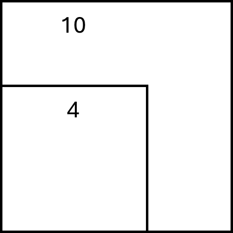
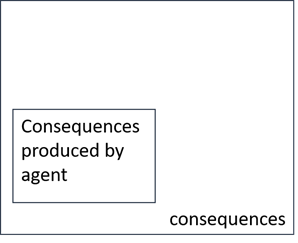

# 道德学习 Moral Learning (Tamar Kushnir、Shaun Nichols)

*首次发表于 2026 年 9 月 12 日。*

本文所说的道德学习，指在道德领域中习得规范与价值。对这类规范与价值如何习得的研究，远可追溯至古代，近在当代道德心理学中备受关注。

道德禁令几乎每种文化都有（Brown 1991）[^brown-1991]，可哪些群体在道德上算数，文化之间却差得很远。姆布提人觉得彼此之间偷东西是错的，拿外人的东西却无妨（Turnbull 1972）[^turnbull-1972]。乱伦的道德也随文化而变：有些地方（如韩国部分地区）绝对禁止表亲通婚；有些地方（如沙特阿拉伯）则容许；还有些地方（如南印度部分地区）认为与 **平行表亲**（父母同性别同胞的子女）结婚是错的，与 **交叉表亲**（父母异性别同胞的子女）结婚却不算错。道德态度跨文化既有一致也有多样，两头都说明道德学习少不了。

此外，人还会作一些关键的道德区分：“这是人们不该做的”与“这是我有义务阻止别人去做的”，两者表征不同。这类区分从何而来？同样得靠道德学习。

本词条先看道德学习可能从哪些初始状态起步，既包括情感前体，也包括认知前体。接着回顾技能库里的另一项关键本事：从证言中学习。随后检视道德认知的几个关键方面——它们的获得需要解释——包括道德/习俗区分与道德偏狭主义。关于道德获得，有一类说明求助于联想学习，这是无处不在、又极有力量的一种学习。我们会看联想学习能解释道德心理的哪些方面，又在哪儿力有不逮。之后再谈先天论：按这种说法，若不承认有一种专管道德获得的先天官能，道德认知的关键方面就无从解释。接下来一节，评述晚近用统计学习解释道德认知的尝试。最后一节讨论更宽的问题：习得的规范与价值何时才算“道德的”，又怎样被道德化。

## 1 起始状态

学习要输入，可光有输入不够：学习者还得有一套心理机制，把输入接得对学习有用。所以，无论研究哪个领域的学习机制，先得回答一个问题：在接收输入之前，学习者已经具备哪些反应、注意、编码、表征与认知状态？弄清这一点，才能理解道德知识在人生早期如何冒头；也才能理解它此后如何变化、如何长进——因为先前的加工能力、反应与知识会左右新信息怎么被处理。

讲到年幼的道德学习者，下文各种理论都假定有一套“起始状态”，只是各家对“哪些算”争执不下。分歧多半来自现代科学的学习观与历史上关于知识先天的老争论之间的牵连（见 SEP 词条“围绕先天的历史争议”与“先天和当代认知理论”）。本词条无意裁断道德知识是否先天，也不裁断哪些起始状态属于先天。我们只先清点生命早期已具备的一组情感与认知能力——不论先天还是习得——它们合起来，作为道德学习的底子，有用，或许还不可缺少。

### 1.1 情感前体

道德学习的前体之一，是情绪或广义上的情感能力。发展早期的一项情感本事，是对他人痛苦的外在表现很敏感。Simner 做过一个著名实验：给新生儿听各种录音——另一个新生儿自发啼哭、五个月婴儿啼哭、电脑合成的哭声，还有同样响的白噪声（Simner 1971）[^simner-1971]。结果，听到另一个新生儿啼哭时，婴儿哭得明显比别的条件多。后来有独立团队重复出同样结果（Sagi & Hoffman 1976; Martin & Clark 1982）[^martin-1982][^sagi-1976]。

别的哺乳动物也有类似表现。大鼠和猴子似乎天生就受不了同种成员发出的痛苦信号（Masserman et al. 1964; Greene 1969）[^greene-1969][^masserman-1964]。有一项研究读来让人不太舒服：先训练一只猴子拉链条取食，后来改装装置，让拉链同时电击隔壁笼里的另一只猴子。被电的猴子痛得尖叫，拉链的猴子很快把叫声与自己拉链联系起来。有几只猴子索性不拉了——多半就是因为这层联结。不拉，同伴免于电击，自己却也吃不上东西。作者的原话是：“大多数恒河猴宁可一直挨饿，也不肯以电击同伴为代价换取食物”（Masserman et al. 1964, 585）[^masserman-1964]。

对人类婴儿的这些结果，一种解释是：痛苦的迹象勾起了婴儿以自我为中心的难受（cf. Batson 1991）[^batson-1991]。这种难受里，人只顾给自己找安慰，未必去照看伤者。可是即便在一岁以内，婴儿面对痛苦迹象时也常有顾人的表现。Hay、Nash 与 Pederson（1981）早年观察过：另一个婴儿自发哭闹时，六个月大的婴儿怎么反应。以自我为中心的难受并不多见；婴儿多半盯着那个难受的同伴，倾身过去，比划、碰触，脸上或声音里露出凝重关切。Roth-Hanania 等（2011）做法类似：让母亲假装受伤。两个情境里，母亲露出中度疼痛的表情与声音约六十秒，同时不与孩子对视。研究者看婴儿有没有可见的关切——表情、声调、身体动作——并给安慰（如轻拍）这类亲社会行为打分。结果，八到十个月的婴儿已显出指向他人的同情关切，表情与声音都有。帮助、安慰这类亲社会行为，一岁内很少，第二年就多得多，十六个月时反应已很强烈（另见 Roberts and Strayer 1996, 456; Eisenberg et al. 1989, 58; Miller et al. 1996, 213）[^eisenberg-1989][^miller-1996][^roberts-1996]。

### 1.2 认知前体

情感能力之外，人类学习者还有一组认知能力，在生命最初几年冒出来，日后用来摸清社会世界的门道。好几位研究者认为，这属于一套演化出来的认知本领，使人能在群体里合作（Chudek & Henrich 2011; Tomasello 2018a; Cosmides & Tooby 1992）[^chudek-2011][^cosmides-1992][^tomasello-2018a]。Tomasello 主张道德与合作相连、并系于人类独有的心理，可算这一派的旗手。他写道：

> 合作与道德都指这样一些有意行动：行动者不只在追求自身利益动机，也关心他人的福祉。……要说明合作、从而说明道德，我们需要一种承认个体彼此相互依赖的心理：这种相互依赖使每个个体有理由关心同伴的生存与兴旺，也关心同伴对这种关心的回报。（2018a, 661–662）

Tomasello（2018a）讲道德起始状态，说的是发展过程中两次成熟变化，前后相继（细节见 SEP 词条“集体意向性”）。头一次在第一年末，约九个月大，出现一组认知能力，让婴儿能作为个体跟别的个体合作，**还** 包括参与共同注意、推断他人意图与目标（见下文）。第二次在幼儿期初，约三岁，出现另一组能力，让幼儿能作为 **群体的一员** 跟其他成员合作。这些能力包括：协调共同意图，采取他人视角、推断心理状态（见 SEP 词条“作为理论的民间心理学”），以及理解社会规范。按他的看法，这两步正对应人类演化中的两次转变：前者与其他灵长类共有，后者则为人类独有。

下面看四种对道德学习要紧的认知能力，并给出它们在人类发展中出现的先后：

1. 理解行动者就其 **目标** 而 **有意** 行动的能力；
2. 表征 **社会** 或 **人际目标**——包括帮助或伤害另一行动者——的能力；
3. 理解道义 **规则、社会习俗与规范** 的能力；
4. 把个体行动者视为社会 **群体** 成员，并对群体属性（如成员的典型行为与态度）作归纳推断的能力。

每小节都依据现有实证证据，简述这些能力在发展中出现的情形；1.2.5 节再简短交代它们如何见于早期社会行为。

**认知发展研究方法注记**：三岁前语言能力很弱甚至没有，婴儿发展中的社会认知仍可在受控实验里靠观察行为来评估。研究前语言期婴儿社会认知的主要范式，是用各种视觉注意指标测量其对视觉显示的辨别（优先注视、注视时长、习惯化与去习惯化等：见如 Oakes 2010）[^oakes-2010]。研究者把这些注意模式看作婴儿 **预期** 行动者在眼前情境中会做什么的迹象。关键限制是：视觉注意只有在婴儿能控制眼跳与头部运动之后（约三个月大）才可靠（见 Robertson et al. 2001）[^robertson-2001]，所以再往前的能力论断都带推测。等婴儿会伸手抓物、摆弄东西，会爬、会走，范式便少看眼睛、多看外显行为与选择。还有一点：要研究帮助他人、听从指令或规则这类早期亲社会行为、受规范引导的行为，总得有一定运动本领（例子见下文）。

#### 1.2.1 意向行动者

要看懂基于意图的道德判断，先得能读懂意图。表征意图与目标的能力，婴儿期就有了。生命最初六个月，婴儿已能凭知觉线索可靠地把行动者与无生命物体分开（Rakison & Poulin-Doubois 2001）[^rakison-2001]。再往后，婴儿又作出两项区分，都与理解意向行动有关。其一，有生命之物的运动，其 **原因** 被预期为内在于行动者，不像无生命物体那样需要外力启动（Premack 1990; Saxe, Tzelnic, & Carey 2007）[^premack-1990]。其二，行动者行动的 **后果**，被预期为由其意图与目标决定，而不是像无生命物体那样由力、方向这类可预测的物理定律决定（Woodward 1998; Gergely & Csibra 2003）[^gergely-2003][^woodward-1998]。九到十个月，即使行动者没达到目标，婴儿也照着目标去解释其行为——可见编码人类行动时，婴儿盯的是意图，不是结果（Brandone & Wellman 2009）[^brandone-2009]。

#### 1.2.2 社会目标

理解道德规范，得看行动给他人带来的是好是坏。反过来，我们的道德判断也常取决于怎么评价伤害或帮助他人的意图。Hamlin 等（2007）做过一项开创性研究，显示六到十个月的前语言婴儿已有某种表征社会目标的本事。做法是先让婴儿习惯两个场景：一个行动者（带眼睛的圆形）帮另一个行动者爬上山坡，另一个行动者则百般阻挠（另见 Kuhlmeier et al. 2003; Premack & Premack 1997）[^kuhlmeier-2003][^premack-1997]。去习惯化模式表明，婴儿区分了亲社会与反社会意图，并据此预判：爬坡的会凑近帮忙的，躲开挡道的。婴儿自己的选择（伸手去够帮忙的、害人的或中立的行动者）也表明，他们愿意接近帮忙的、主动避开挡道的。后来用不同方法、覆盖头两年各个年龄段的研究，都发现婴儿对社会目标有预期，并由此更偏爱有益者而非有害者（综述见 Hamlin 2013）[^hamlin-2013]。[^note-1]

身体伤害（与帮助）之外，还有研究表明：婴儿预期行动者该把资源分匀（两人分食物或玩具，要对半分：见 Sommerville 2018）[^sommerville-2018]。十五个月大时，婴儿更喜欢“本想帮忙、却因误信而失手伤到人”的行动者，而不是“本想害人、却失手帮了忙”的行动者（Woo & Spelke 2023）[^woo-2023]。可见到第二年，婴儿对社会目标的预期——跟对物体导向目标的预期一样——系于意图，不看结果。

#### 1.2.3 道义规则

三岁孩子掌握道义规则的本事很惊人（见如 Cummins 1996; Harris & Núñez 1996）[^cummins-1996][^harris-1996]。Harris 与 Núñez 有个代表性任务：给儿童一条明显任意的规则——“有一天 Carol 想画画。妈妈说，她要是画画，就得戴上头盔”（1996, 1581）。然后看四幅图：两幅画着 Carol 画画，一幅戴头盔，一幅没戴；另两幅里 Carol 没画画，其中一幅她戴着头盔。接着问：“指给我看，哪幅图里 Carol 不听话、没照妈妈说的做？”规则既陌生又任意，三四岁的孩子却大多答对。他们还能点出关键特征：问“那幅图里 Carol 干什么不听话的事了？”（1581），孩子多半会说头盔。

可一换成直陈条件句，这份本事就没了。Harris 与 Núñez 把头盔那类道义条件句，配上平行的直陈条件句。直陈版里，实验者说：“有一天 Carol 想画画。Carol 说，她要是画画，就总是戴头盔”（1996, 1585）。图片照旧，问题改为：“指给我看，哪幅图里 Carol 做了不一样的事、没照她自己说的做”（1585）。三四岁孩子答这类题，远不如答道义题（另见 Cummins 1996）[^cummins-1996]。道义条件句与直陈条件句明明很像，幼儿却更擅长判断“道义条件是否被遵守”，而不是“直陈条件是否为真”。

三岁孩子不只是容易学会规则，还认定规则与规范 **应当** 遵守。快三岁时，他们模仿成人示范的种种任意动作的劲头明显上来，并认定这类动作属于社会习俗或规范（见下文 1.2.5 节）。最有说服力的是，三岁孩子会当规范 **执行者**，别人犯规就抗议。Rakoczy 等（2008）最早演示了这种规范性抗议：二岁与三岁孩子先学会一个规则简单的游戏，随后看到一个木偶声称要玩游戏，做的动作却违反规则。三岁孩子当即抗议，还常带着道义口吻（“不是这样玩的”“我们不这么做”）。两岁孩子有时也抗议，但不带道义语言。

从抗议行为看，三岁孩子的规范理解还顾得上“别人未必非得守规矩”的情形。行动者说一声自己退出游戏（Racoczy et al. 2008），或者因身体限制守不了规范（Josephs et al. 2016）[^josephs-2016]，孩子就不抗议。行动者若是外群体成员，孩子会抗议他违反道德规范（伤害行为），却不抗议他违反习俗规范（游戏规则）（Schmidt et al. 2011）[^schmidt-2011]。

#### 1.2.4 社会群体

社会群体共享一套规范、实践、信念与态度，用来调节成员间的合作（Chudek & Henrich 2011; Tomasello 2019）[^chudek-2011][^tomasello-2019]。有理论认为，理解社会群体、知道自己属于哪个群体，能促使个体遵从社会与道德规范（见 SEP 词条“社会规范”）。作为社会群体认知的可能起点，婴儿已显出同质性偏好——偏爱跟自己相似的人——依据是面孔特征或语言的接触与熟悉（Kelly et al. 2005; Bar Haim et al. 2006; Kinzler et al. 2007）[^kelly-2005][^kinzler-2007]。婴儿也会预期别人如此：彼此相像的行动者应当互相喜欢、口味相近、行事相似（Liberman et al. 2021）[^liberman-2021]。这种偏好很早就影响社会学习：一种新食物，若由说同种语言的人来吃，婴儿就更愿尝（Shutts et al. 2009）[^shutts-2009]；婴儿也更爱模仿本群体成员（Over & Carpenter 2012）[^over-2012]。

还有证据表明社会群体认知出现得早：在实验室里用“最小群体”范式，就能让学前儿童认同“内群体”、疏离“外群体”（Dunham et al. 2011）[^dunham-2011]。而且，哪怕只是这种最小的群体归属，也足以让儿童觉得本群体成员人品更好、更可信、更该受到公平与道德的对待（McAuliffe & Dunham 2016）[^mcauliffe-2016]。

学前儿童很早便把群体归属同规范行为、道德行为挂钩。Roberts 等（2017）教孩子认识两个新群体（“Hibbles”与“Glerks”），并用泛泛的说法描述其中一个群体的行为（如“Hibbles 吃黄浆果”）。四岁的孩子就把这类描述当成区分两群体的规范要求，对不合者评价很低（觉得 Hibbles **应当** 吃黄浆果）。群体信息也影响学前儿童的道德判断。Rhodes & Chalik（2013）给三到九岁孩子介绍两个新类别（“Flurps”与“Zazzes”）。三岁孩子就判定：即使没有任何外在规则，伤害也不被允许——但 **仅** 当伤害发生在本群体成员之间时。作者说，“社会类别标示着内在人际义务的模式”（2013, 1003），这种义务超出习俗与规则。

#### 1.2.5 早期社会（道德）行为

前几节讲的是婴儿如何从一开始就解读社会世界，这为“看别人怎么做”的道德学习铺了路。但婴儿也边做边学：会行动，也会选择。选择可能来自观察他人（模仿），可能出于初萌的帮助或公平观念（亲社会动机），也可能出于“人应当如何”的想法（规范动机）。道德能动性与道德学习互为循环：孩子的行动与选择，出自他当下的道德知识与自我调节本领；反过来，这些行动又受道德教师（同伴、大孩子、成人）的纠正与指点，于是学得更多。

最早的亲社会行为，跟前面说的情感、认知发展一块儿冒出来。看得出，理解意图的本事与共情关切一联手，就成了早期亲社会行为的推手，尤其是帮助、安慰与分享（Paulus 2014）[^paulus-2014]。比如，只要某个举动能帮别人达成目标，幼儿会特意绕过去挪开障碍、取来够不着的东西（Dunfield et al. 2011; Warneken & Tomasello 2006; Svetlova et al. 2010）[^dunfield-2011][^svetlova-2010][^warneken-2006]。第二年出现的公平观念（资源均分），跟婴儿自己的分享行为对得上：肯分享的孩子，也指望别人分享。这类例子说明，道德认知与亲社会行动很早就牵上了手。

读懂意向行动，还打开了靠模仿学习的大门。第二年的婴儿，模仿的是他理解的示范者意图，而不是照搬人家的身体动作（Melzoff 1995; Carpenter et al. 1998）[^carpenter-1998]；哪怕示范者没做成，婴儿也会照自己推断的目标去模仿（Melzoff 1995; Gergeley et al. 2002）。

对道德学习要紧的是：三岁孩子假定，成人有意做某个动作时，怀的是 **教学意图**（Bonawitz et al. 2011）[^bonawitz-2011]。于是就有了“过度模仿”：孩子会照抄一串毫无工具用途的任意动作（Lyons et al. 2007）[^lyons-2007]。研究发现，三岁孩子会推断：成人有意做这些与目的无关的动作，其实是想教点社会性的东西；因此孩子照做，当作规范学习（Kenward et al. 2011）[^kenward-2011]。

## 2 证言学习

除了前面那些基本的情感与认知前体，儿童还有一项本事：靠证言向别人学习。所谓证言，可粗略定义为听者本身就当作可靠证据的言语断言（细节与争议见 SEP 词条“证言的认识论问题”）。口头、书面都算，出自亲身经验、二手传闻、专业行当或个人思索的也算。发展心理学的海量研究（如 Koenig et al. 2022; Koenig & Harris 2005; Harris 2012; Mills 2013）[^harris-2012][^koenig-2005][^koenig-2022][^mills-2013] 表明，孩子一旦开始懂话、说话，证言就是获得知识的重要门路。而且孩子信谁、觉得哪句话可靠，是 **挑着来的**。有时拿自己先前的知识去核对（Sobel & Kushnir 2013）[^sobel-2013]；有时信不信压根儿不看道理，而看人——说话的人熟不熟、文化上像不像自己、语气自不自信（Mills 2013）[^mills-2013]。不管出于什么理由，孩子都把证言当成根本的知识来源，地位几乎与亲眼所见平起平坐（Harris et al. 2018）[^harris-2018]。

证言怎么影响道德学习？Hills（2020）把道德证言分成两类。一类叫“传递”：说话者直接把道德断言抛给听者（如“X 是错的”）。另一类叫“传播”：说话者给出理由或道理，让听者自己琢磨、自己下判断（如“X 可能伤人”）。Hills 认为，传递在认识论上成问题——哪怕你是向道德专家请教，得到的也只是二手的道德 **知识**，谈不上更深的道德 **理解**，更谈不上养成道德 **德性**。传播问题小些，至少对成熟的道德行动者如此：他们本来就该自己得出结论、形成理解与评价。

那小孩呢？Li & Koenig（2023）认为，对儿童来说，“传递”未必那么糟；直接告诉孩子，反倒先给了他们一套可琢磨的道德原则或规范。这有研究撑腰：孩子确实能从直接的道德陈述里学到东西。Li 等（2019）让孩子（三到五岁）看一个没头没尾的动作——它弄哭了另一个孩子。多数孩子起初说这不对。随后大人告诉他们，这其实“没事”。不少（但非全部）孩子改了判断，而且越小改得越快。可见大人直说“这样不对”，哪怕与直觉相左，也能左右孩子的道德判断，年纪越小越管用。

传播的路子很多——讲道理、摆论证、一起讨论——对小孩也管用；孩子越大，讲对的道理就越比单说“不对”有效（见 Tomasello 2018b）[^tomasello-2018b]。Rottman 等（2017）给七岁孩子讲一群虚构的“外星人”，他们干一件看不出害处的中性事（如“把棉球铺进森林”）。随后给两类证言：一类是情绪谴责（“他们这么干真恶心”），一类是伤害理由（“他们这么干会害到别人”）。两类都没直说“这是错的”，可七岁孩子都对这件中性事形成了道德判断；而且听伤害理由的那组，判断更强、也更持久。

还有一种传播，发生在同伴之间的争执里（Tomasello 2018b）[^tomasello-2018b]。五岁起，孩子就会在跟同伴的讨论中为自己的道德观点辩护，也更愿意听听复杂道德问题的别的看法；跟同伴聊，比跟父母或别的权威聊更能激起这股劲（Mammen et al. 2019）[^mammen-2019]。这更说明：靠证言的道德学习是挑人的，要看对话者是谁——父母被视为道德“专家”，地位高于同伴，两者在道德学习里各管一摊。

## 3 道德认知的特征

人会作道德判断、作区分、划道德边界，这些本事都得有个解释。本节检视道德认知里几项被学习理论盯上的特征：道德/习俗区分、对行动的看重、道德受事的范围（谁配得到道德对待），以及普遍化判断的作用。要紧的是，其中许多特征在发展中出现得很早（Levine et al. 2018; Pellizzonni et al. 2010; Powell et al. 2012; Heiphetz and Young 2017; Smetana & Braeges 1990）[^heiphetz-2017][^levine-2018][^powell-2012][^smetana-1990]。

### 3.1 道德/习俗区分

很小的时候，孩子就把典型的道德违规与习俗违规分得很清（Turiel 1983）[^turiel-1983]。这方面的研究靠的是“道德/习俗”任务（综述见 Smetana 1993; Tisak 1995; Killen & Smetana 2015）[^killen-2015][^smetana-1993][^tisak-1995]。任务里，学前儿童会碰到各式违规：有的算道德（如无故打人），有的算习俗（如午睡时站起来）。孩子和大人一样，在好几项指标上都把两类违规区别对待：道德违规评为更严重；问“为什么错”时，道德违规更常被归到“伤人”。

还有一项更细的测量，叫 **权威依赖** 任务：问“要是权威没有禁止，这事还错吗？”比如，老师没立规矩，课堂上无故打人就对了吗？人们多半说，还是错。换成“午睡时站起来”这种习俗规则，说“还错”的人就少了。

再一项测量，看习俗违规是否更被认为是 **相对于** 某个群体或文化的。比起习俗违规，孩子更倾向于认定道德违规在别处、别国也一样错（Smetana 1985）[^smetana-1985]。相对主义还可用 **分歧任务** 测：给成人一个动作，说两个人对它错不错意见相反，问是必有一人对、还是两人都可能对（Goodwin & Darley 2008）[^goodwin-2008]。结果，习俗项目上更常有人说“两人都可能对”，道德项目则不然。换句话说，道德规则（打人不对）常被当作普遍有效，别的规则只相对于某些情境有效（在学校穿牛仔裤不对〔某些学校如此〕）（Wright et al. 2014）[^wright-2014]。

道德/习俗任务的结果究竟该怎么解释，争议很大（如见 SEP 词条“道德/习俗区分”）。但效应本身被反复做出来了：研究里的道德违规，在上述问题上总与习俗违规待遇不同。这种差别，从学前儿童一直到成人都在（Huebner et al. 2010）[^huebner-2010]。于是冒出一个学习论问题：这种区分是怎么学会的？

### 3.2 道德直觉与行动

人对“动手做”与“任由发生”这两类情境，道德直觉差别很大。幼儿就认为，弄出坏结果比没能阻止同样的结果更糟（Powell et al. 2012）[^powell-2012]。更一般地说，人们把社会与道德规则看作 **以行动为基础**（守住承诺；别乱扔垃圾），而不是 **以后果为基础**（尽量多守诺；尽量少乱扔）。这份对行动的看重，在电车难题一类困境里看得最清。**天桥** 案中，可以把一人推下天桥挡住电车，救下五名无辜者；典型判断是：不许推。可这样一来，行动者虽没亲手弄死那个人，却等于任由五人死去。**任由** 死亡，似乎不如亲手致死那么有道德分量。幼儿身上也有同样的判断模式（Pellizzoni et al. 2010）[^pellizzoni-2010]。

### 3.3 偏狭主义

人类学里有个老观察：许多文化中，道德禁令只管本乡本土的人，不管外人。一个著名的例子：据 Turnbull（1972），游居的姆布提人认为互相偷是错的，可从村里人那儿偷却没事。可见道德规则常常是 **偏狭的**（如 Read 1955, 255; Snare 1980, 364）[^read-1955][^snare-1980]。

同质性偏好（1.2.4 节）很可能是各种偏狭态度的重要前身。婴儿偏爱口音跟母亲一样的人（如 Kinzler, Dupoux, & Spelke 2007），这会影响他们交朋友的意愿（Kinzler et al. 2009）[^kinzler-2009]。孩子对内群体成员更慷慨（Sparks, Schinkel, & Moore 2017），给他们的人品评价也更高（Richter, Over, & Dunham 2016）。

经典而抢眼的工作来自“最小群体范式”（Tajfel 1970; Diehl 1990; Dunham 2018）[^diehl-1990][^dunham-2018][^tajfel-1970]。实验中，人只凭一条任意线索（比如“红组”这个标签）被随机分进一个此前毫无所知的群体，照样偏爱自己这组。经典研究做在成人身上，核心结果在孩子身上也成立。例如，在最小群体范式里，哪怕对该群体一无所知，孩子也更愿意相信内群体成员的证言（MacDonald et al. 2013）[^macdonald-2013]。

## 4 联想学习与道德

### 4.1 经典条件作用与道德判断

经典条件作用是最基本的联想学习。它靠的是刺激（如肉粉）与反应（如流口水）之间的天然联系：有机体一见刺激，就稳定地反应。这种反应不用学就有；刺激与反应都叫“无条件”的。无条件刺激（US）与无条件反应（UR）之间的这层关系，是学新联想的底子。拿一个中性刺激（如铃声）在 US（肉粉）出现前不久响一下，久而久之，中性刺激就与无条件刺激挂上钩，单凭自己也引来熟悉的反应（流口水）。这时，原先中性的铃声成了“条件刺激”，跟着来的口水就是“条件反应”。（见 SEP 词条“联想主义的思维理论”。）

经典条件作用到处都在，威力也大。从人到蜗牛，整个动物界都有（Kemenes & Benjamin 1989）；它牵涉的现象也广，从恐惧症（如 LeDoux 2014）[^ledoux-2014] 到药物耐受（如 Siegel et al. 1982）。

James Blair 把经典条件作用摆进道德判断的形成过程，当作关键一环。1.1 节已见，婴儿对他人的痛苦极敏感；这一点在 Blair 的理论里是顶梁柱。Blair（1995）的经典表述是：人类有一种先天机制，叫暴力抑制机制（VIM）。这个提法来自一个想法：社会性动物有抑制种内攻击的机制（见如 Lorenz 1966）[^lorenz-1966]。痛苦信号（如哭声）是激活 VIM 的无条件刺激，VIM 被激活则是对这类信号的无条件反应（Blair 1995, 5）[^blair-1995]。VIM 一激活，人就会退缩，同时生出一种厌恶体验（1995, 7）。Blair 认为，正是这份厌恶，对道德判断至关重要。可麻烦在于：能当 VIM 无条件刺激的痛苦信号很有限，只限于哭声、尖叫这类看得见听得见的痛苦迹象；道德判断却可以在毫无这类迹象时作出。Blair 的学习故事就从这儿接上。他说，经典条件作用会把痛苦的知觉线索与关于伤害的 **念头** 联在一起，具体说，是与“通过角色采择形成的受害者内部状态表征”联在一起（1995, 9）。有了这层联想，即便没有任何知觉迹象，一想到受害者的痛苦，VIM 也会被激活，厌恶体验随之而来。用 Blair 的话说，“个体可能仅仅想到某人的痛苦（比如‘多可怜的小男孩’）就产生共情唤醒，而痛苦信号并未实际得到加工”（1995, 5）。

Blair 最初那套以 VIM 为底的说明借了动物行为学，但这并非学习故事的要害。要害不在于非得是 VIM：只要（1）痛苦的知觉迹象会触发厌恶体验；（2）条件作用能把痛苦的知觉迹象与“造成他人痛苦的动作”的 **念头** 联起来；（3）这层联想使这类念头一冒出来就带来厌恶，就够了。

经过这番条件作用，正常发展的孩子一想到害人的动作，厌恶就上来了。这些念头于是格外扎眼。Blair 总结道：

> 道德社会化，是通过把“痛苦信号对该机制的激活”与“造成痛苦信号之动作（道德违规——例如一人打另一人）的表征”配对而发生的。经典条件作用的过程，使这些道德违规的表征成为该机制的触发者。（2001, 730）

这一番条件作用下来，道德违规的表征就带上了厌恶。Blair 说，道德违规之所以特殊——道德/习俗任务正照出这一点（3.1 节）——关键就在这儿。

Blair 拿这套“厌恶害人念头”的说明，去解释道德违规（如无故打人）与习俗违规（如午睡时站起来）的差别。他的说法是：道德项目会勾起厌恶，习俗项目不会。理由很简单——我们对害人动作的念头有条件反应。想到 Johnny 打 Billy，由于过往的条件作用，这念头让人难受；想到 Johnny 午睡时站起来，却没有哪段条件作用史让这念头难受（Blair 1995, 7–8）[^blair-1995]。Blair 认为，两类情形感受不同，判断也就分开了。

### 4.2 无模型强化学习与道德判断

#### 4.2.1 强化学习与操作性条件作用

经典条件作用建立的是刺激之间的联想（铃声与肉粉），这类联想能影响流口水之类的行为，却不涉及从 **行为** 中学。Skinner 提出 **操作性** 条件作用，正是要抓住一个明摆着的事实：有机体会从自己的行为里学。操作性条件作用学的是行为与后果的联想。大鼠可能学会：按杠杆跟出食物有关。这层联想接着影响行为：按杠杆有甜头，就按得更勤，这个后果便算“强化”。有时后果是苦头：大鼠学会踩红格跟电击有关，踩红格就少了，这后果便算“惩罚”。

**操作性条件作用** 是 Skinner 提出的（见如 1938），跟他的行为主义绑在一起。因此这套框架不谈行为背后的内部加工。计算认知科学研究许多同样的现象，却换个名目叫 **强化学习**，明明白白讲加工、讲价值表征。一讲价值表征，许多行为就说得通了：大鼠按杠杆，是因为它看重食物，并预期按了就有食；猴子挑葡萄不挑黄瓜，是因为葡萄在它眼里更值钱；缺水的大鼠进了 Y 形迷宫，会奔向有水的那条岔路（不是有食的那条），因为渴过之后它把水看得很重。大鼠也能习得对“按杠杆”这个动作的正价值表征（后头跟着食物时），或负价值表征（后头跟着电击时）。

缺水的大鼠把水看得比食物重，于是跑向迷宫有水的那一头。这要求它先学会一个迷宫的 **模型**，知道水与食物各在何处。这种学习叫 **基于模型的强化学习**，因为行动者给自处境建了个模型。

模型是好工具，可现实环境比 Y 形迷宫复杂得多。要给复杂环境建模型，计算上太贵；动物于是另有一套简单的联想学习——习惯学习。它又叫 **无模型** 强化学习，因为既不必建模，也不必表征模型。比如，按杠杆多次得食之后，动物干脆给“按杠杆”这个动作本身记上一笔正价值。这类价值表征驱动习惯，哪怕原先的目标已经没了，习惯照旧。

要分清动物按杠杆是冲食物去的，还是纯属习惯，并不容易。若它按杠杆专为拿食，那就是目标导向行为——它明白动作与结果的关系。若它按杠杆只因这个动作本身舒服，那就是习惯。两者之别，在“贬值”实验里见分晓：先教大鼠按杠杆出食；然后把它喂饱，再放回测试笼。有时大鼠照按不误，哪怕对出来的食物已毫无兴趣。饥饿的大鼠明知按了也不出食，某些情况下仍会习惯性地按——这时大概只能说，它就是爱按。日常生活中，无模型强化学习解释了我为什么一分钟前刚看过手机，又忍不住再看一眼：某种意义上，我就是“爱”看手机，没多想后果。这是习惯，不是奔着目标去的。

#### 4.2.2 道德直觉与强化学习

Crockett（2013）与 Cushman（2013）不约而同，拿强化学习来解释人对电车难题这类道德困境的直觉（3.2 节）。**岔道** 案里，扳一下道岔，电车就从五名无辜者转向只有一人的侧轨；人们多半说：扳得。**天桥** 案里，把一人推下天桥挡住电车，救下五人；典型判断是：推不得。Crockett 与 Cushman 认为，这两种判断出自两种不同的价值表征：基于模型的盯着后果，无模型的盯着行动（Crockett 2013, 363; Cushman 2013, 279）[^crockett-2013][^cushman-2013]。照此说来，基于模型的价值表征偏向功利主义裁决，无模型的价值表征偏向义务论裁决，如 **天桥** 案（Crockett 2013, 364; Cushman 2013, 282）[^crockett-2013][^cushman-2013]。

Cushman 把两类价值表征的区别讲得很清楚：

> 在无模型系统中，价值表征的功能作用是择取行动，而无需知道行动的实际后果；而在基于模型的系统中，价值表征的功能作用恰恰是依据行动的预期后果来择取行动。（2013, 279）

照 Cushman 说，碰上 **天桥** 案，我们心里抗拒推人，是因为无模型系统早给“推”这个行动类型记了一笔负分。负分哪来的？他说至少有一部分来自无模型强化学习：“推”通常招来苦果（伤到人），于是与负价值表征挂上了钩（2013, 282）。跟一般习惯学习一样，裁决不是掂量后果掂出来的，而是单纯对动作本身的好恶。

单是“推”这个动作，是否本身就让人难受，而不只是怕坏后果？看来是。Cushman 的一系列研究发现，人对“通常跟伤害相连”的动作会有负面反应，哪怕明知这次不会伤人（Cushman et al. 2012）。比如，让参与者拿石头砸一只一看就假的手；对照组则拿石头敲坚果。明知那手是假的，砸假手时的生理痛苦反应仍强于敲坚果。可见人会本能地缩手于惯常害人的动作，哪怕明知这一回伤不着谁（Cushman 2013, 286）[^cushman-2013]。

### 4.3 超越联想主义

联想学习在道德反应里很可能挑大梁。经典条件作用大概会让某些念头带上厌恶，因为它们跟痛苦的原初触发物连在一起。想到有人拿枪指着别人，心里就发紧——枪本身可不是痛苦的无条件刺激；是我们在后天的学习中，把枪跟那些天生会勾起共情反应的害人动作连了起来。经典条件作用正好解释：关于枪的念头，怎么同这些天然的（无条件）痛苦反应接上。同样，无模型强化学习大概会让某些动作本身带上厌恶。拿石头砸人，受害者会痛苦；这便使我们对“砸”这个动作本身也加上负价值表征。于是，明明知道这回不会出坏结果，动起手来还是别扭。

联想学习多半能左右我们厌恶哪些念头、哪些动作，可要说它足以解释道德判断，就悬了。一条理由：判定某事为错，不等于把它记成“恶心”。打孩子的父母常觉得打起来难受，却不认为打孩子是错的；许多道德判断说的是对错，不是好恶。Cushman 的实验里，参与者砸假手时觉得难受，但大概不会说这“道德上错了”。可见厌恶不足以构成错误判断；反过来，作错误判断也不必先有厌恶。我判定逃税是错的，并不需要心里先翻江倒海。

要解释道德判断，看来得请出更复杂的表征——能把规则编进去的那种（如 Mikhail 2011; Nichols 2004 and 2021; Nichols & Mallon 2008）[^mikhail-2011][^nichols-2004][^nichols-2021]。可一旦承认这类表征，新问题就来了：复杂的道德表征是怎么学来的？一种回答是：道德系统的一大块，靠的是一套专管道德的专用学习系统。

## 5 先天论与道德学习

### 5.1 语言类比

道德判断似乎牵扯到复杂表征，联想学习那套过程凑不出来。要系统说明人怎么获得复杂的道德表征，流行的一种思路是借乔姆斯基语言学的先天论。乔姆斯基认为，语法的获得靠一种领域特殊的装置：语言获得装置。照此类比，道德的获得也靠一种领域特殊的装置：道德获得装置（Dwyer 1999 and 2006; Harman 1999; Levine et al. 2018; Mikhail 2011 and 2022）[^harman-1999][^levine-2018][^mikhail-2011][^mikhail-2022]。乔姆斯基派说，孩子实际获得的语法知识，取决于先天的领域特殊过程，这些过程限定了人可能学会哪些语言。要点不只在“语言获得装置是套独特机制”；更在于不同装置跑不同程序——学认面孔的程序，跟学语法的装置，理应差得很远。

支持先天语言获得装置的核心论证，是刺激贫乏论证：学习者手头的证据不够，领域一般的学习（联想、统计之类）凭它，从起始状态走不到成熟的语法知识。道德上的乔姆斯基派照方抓药，为道德知识也提了一个刺激贫乏论证。

照语言类比说：复杂语言结构的获得靠领域特殊的语言获得装置，复杂道德结构的获得则靠领域特殊的道德获得装置。Dwyer 的说法是：

> 儿童的“心智大脑”里（在某种抽象层次上）含有一个 **道德获得装置**（或 **道德官能**），它使获得一切、且仅限人类可能的道德成为可能。道德官能以一套规则、原则与约束（普遍道德语法）来刻画；这套东西决定儿童需要注意环境中的哪些方面，并与她周遭的所见所闻一道，决定她成熟的道德能力——我们可以称之为她的“内化道德”（I-morality），或道德个人方言。（Dwyer 2006, 242）

同样，Mikhail 提出我们拥有

> 一套“普遍道德语法”（UMG），类比于语言学家的“普遍语法”（UG）概念，即一种先天的……道德获得装置，它把儿童的早期经验映射为构成其成熟道德能力状态的原则系统。（Mikhail 2008, 355; 2011, 90）[^mikhail-2008]

道德获得装置当然不同于语言获得装置；而这两者，又都不同于联想主义（第 4 节）或统计推断（见下文第 6 节）这类领域一般的学习装置。

提出先天道德获得装置，为的是解释道德认知的几个方面（见如 Dwyer et al. 2009; Mikhail 2011; Mahlmann 2023）[^mahlmann-2023][^mikhail-2011]。其中讲得最细的，大概是道德/习俗区分与道德规则的内容。

Dwyer 把儿童早期就能领会道德/习俗区分，看作一项核心能力，靠的是专属于道德的学习装置。她写道：

> 承认道德领域与习俗领域之间存在区分，并相信道德考虑带有特殊的力量与权威，看来是人类生活的普遍特征（Song, Smetana, and Kim 1987; Turiel 1983）[^turiel-1983]。（Dwyer 1999, 169–170）

后来论道德先天论时，她又写道：

> 三到四岁的孩子懂得，道德规则与习俗规则之別在于两项主要标准：前者的效力独立于任何特定权威（如上帝、父母、社会习俗），并与伤害、损伤的考虑紧密相关（见 Nucci 2001; Turiel 1983, 1998）[^nucci-2001][^turiel-1983]。（Dwyer 2006, 237）

所以 Dwyer 主张，孩子学到的一个关键点，就是明白道德规则与习俗规则不同：前者不依赖权威。

顺着语言类比，Dwyer 用刺激贫乏论证说明：道德/习俗区分靠的是一种先天学习装置（Dwyer 1999, 171–177; 2006, 239–242）。她说，领域一般学习理论的“根本错误”，在于“假定儿童达到道德成熟所需的一切信息都在她的环境中可得”（172）。接着她写道：

> 若没有一份详细说明，讲清儿童如何从父母连珠炮般的命令与评价中抽取出明确的道德规则，那么诉诸明确的道德教导，根本不足以令人满意地解释成熟道德能力的出现。我们面对的是一组复杂而彼此关联的能力：（i）它们在一个相对其成熟表现的内容与范围而言颇为贫乏的环境中随时间出现；（ii）似乎在整个人类物种中自然发展。（1999, 173）

照 Dwyer 看：领域一般学习解释不了儿童的语言能力，同样解释不了儿童的 **道德** 能力——后者见诸他们对道德/习俗区分的把握（另见 Dwyer 2006, 239–240）。所以她认定，儿童的道德能力超出了领域一般学习系统凭环境信息所能达到的水平。她的结论是：“我们来到世上，都带着一份先天道德知识；它与经验一道，决定我们成熟的道德能力”（1999, 176–177）。她还具体推测：新生儿“已有某些知识，使他们准备好识别两个规范性的社会领域”（1999, 177）。

Dwyer 盯着道德/习俗区分，别的道德乔姆斯基派则盯着规则的内容。Harman 与 Mikhail 提出，人们对电车难题的直觉模式里，透着 **双重效应原则**（Harman 1999, 113–14; Mikhail 2011, 360）[^harman-1999][^mikhail-2011]。该原则说：坏后果若只是被预见、并非有意为之，那么造成它可以是允许的。人若在心里表征了这条原则，就部分解释了：明知侧轨上要死一人，为何仍判扳道岔救五人是允许的。

Mikhail 主张，这类原则的获得多半靠道德获得装置（2011）。Harman 也给出一个刺激贫乏式的论证：

> 普通人从未被教过双重效应原则……，也说不清这样一条原则如何能从普通人可得的例子里学来。这似乎表明，相关原则早就内建于“内化道德”之中；若真如此，我们就该预期它出现在一切内化道德里（或者属于默认情形，诸如此类）。换句话说，这些原则应当是普遍道德语法的一部分。（Harman 225）

Harman 的意思是：就学习者手头的证据看，指望他不靠先天贡献就学来双重效应原则这么复杂的东西，实在难以相信。而在乔姆斯基派眼里，这份先天贡献的典型样子，就是一套专用获得装置。

### 5.2 偏狭主义与先天论

3.3 节已见，婴儿和幼儿对群体边界极敏感，归属与推断都受其左右。那么偏狭的道德规范从何而来？一种解释：这是先天部落主义的必然产物。道德乔姆斯基派不用先天学习装置解释它；但另有理论家主张，偏狭规范源自先天的部落偏见。

Clark 与同事肯定部落先天论：“部落偏见是人类认知中自然而又几乎拔不掉的特征”（Clark, Liu, Winegard, & Ditto 2019, 587）。文化演化、社会与发展心理学把它收进道德获得的说明。比如 Chalik 与 Rhodes（2020）提出，儿童有一种 **自动的群体偏见**。他们说：“儿童假定一切规范（不只是道德规范）都受某类范畴的界限约束……一旦知道某事落在某条规范的范围里……他们就假定有一条界线，规定它管谁”（80）。这种说法的底气在于：从演化上看，规范获得理应促进群体内协调（见如 Boyd & Richerson 2009; Rand & Nowak 2013）[^boyd-2009][^rand-2013]。Chudek 与 Henrich（2011, 219）说，这类压力造就了……“‘族群心理’的协同演化选择：社会群体成员倾向于采纳任意的族群标记，并优先跟共享这些标记的人来往、向他们学习，从而进一步加固协调的程度与压力”。他们还说，演化压力偏向于让人具备一种“识别并表征本共同体最常见行为、信念或策略的本领，以及采纳、乃至把它们内化为近端动机或启发式的倾向”（Chudek and Henrich 2011, 219–20）[^chudek-2011]。

## 6 统计学习与规范

道德先天论者如 Mikhail 强调：道德规则的复杂性，联想学习或明明白白的证言解释不了。不过儿童和成人还会做理性的统计推断，凭手头证据学东西（Kushnir et al. 2010; Xu & Kushnir 2013; Gopnik & Wellman 2012）[^gopnik-2012][^kushnir-2010]。统计推断有些精巧专门，有些则直白常见。比如你想知道刚考完的逻辑测验难不难，随手抽出十份卷子批一批，拿这十份推断全班。十份里八份满分，那就说明大家考得不错，题目不算难——你把抽到的样本当成了全体的代表。有意思的是，连婴儿都能从样本推总体（Xu & Kushnir 2013），而且很早就用得上好几种统计推断方法（Dewar & Xu 2010; Girotto & Gonzalez 2008; Fontanari et al. 2014）[^dewar-2010][^fontanari-2014][^girotto-2008]。

已经有一串认知现象被认为靠统计推断，包括归类（Smith et al. 2002; Kemp et al. 2007）[^kemp-2007][^smith-2002]、学词（Xu & Tenenbaum 2007）、心理理论（Kushnir et al. 2010）[^kushnir-2010] 与句法分析（Gibson et al. 2013）[^gibson-2013]。放到道德领域，理性的统计学习也许教不会儿童“什么算道德”（见第 7 节），但道德认知周围的某些复杂性，或许能靠统计学习说明。本节就来看针对上文若干现象的统计学习进路。

### 6.1 规模原则

有一个简单原则常被用来刻画道德表征，叫“规模原则”（Xu & Tenenbaum 2007）。要直观把握它，设想朋友手里有两颗骰子：一颗四面，一颗十面。他随手挑一颗，背着你掷十次，报出结果：3、2、2、3、1、1、1、4、3、2。你猜是哪颗？直觉上只能是四面那颗。严格说，这些结果十面骰也掷得出，可十次全在四以下，巧得让人起疑。这份推理正合规模原则；我们可以用嵌套结构把它画出来，比较不同假设（图 1）。

**图 1：**

图 1：数字表示骰子的最高面数；矩形表示各假设的相对大小。

规模原则说：当证据与“较小的假设”（这里就是“四面骰”）相容时，该偏向的就该是它。

#### 6.1.1 道德直觉与行动

3.2 节已见，儿童倾向于把道德规则理解成管具体动作，而不是管动作的更大后果：规则是说“别造成某种结果”，而不是“努力减少这种结果”。比如关于说谎的规则，通常理解为“人不该撒谎”，而不是“人该努力少让人撒谎”。儿童似乎分得清这一点，可谁也没明说过“撒谎是错的，但你没义务减少别人撒谎”这类话。那么，以行动而非后果定义的道德规则，孩子是怎么学来的？规模原则给了一个可能的答案。

跟骰子假设一样，关于规则范围的假设也能排成嵌套结构：行动者主动造成的后果是一小圈，行动者造成或允许的后果是外面一大圈（见图 2）。

**图 2**

图 2：规则的潜在范围。只占小框的规则（如“行动者把东西弄乱是错的”）以行动为基础；相反，覆盖大框的规则（如“行动者把东西弄乱，或任由乱象留着，都是错的”）以后果为基础。

没人正经教过孩子 **做** 与 **允许** 的区别，可他们仍能从见到的证据里推出来。要是碰上的违规样本，桩桩都是行动者有意弄出某个结果，这一模式就提示：起作用的规则本意不是禁止“任由它发生”。这步推理靠的还是规模原则（6.1 节）：看到的违规里一桩“允许”都没有；若规则本就禁止允许，那也巧得太可疑了。证据缺席，本身就是证据。

可孩子手头究竟有什么证据？Nichols 与同事分析了儿童指向语料库（CHILDES）的一部分，发现观察到的规则违规里，九成九以上都涉及有意行动（Nichols et al. 2016）[^nichols-2016]。孩子碰到的大多数规则，数据里都明显缺少支持“规则兼管行动与允许”的证据。这本身就构成证据：规则不管允许，只管行动。

#### 6.1.2 偏狭主义

规模原则也能解释：孩子怎么学到的规范是偏狭的，而不是对谁都适用。设想一个学习者要弄清某条规则是管所有人，还是只管人群里划出来的一小撮。比方有一群生物，有蓝有黄。孩子若看到几桩违规，全出在蓝色生物身上，这就提供了证据：规则只管蓝的。反过来说，规则要是管全体，样本违规却全落在蓝的头上，那就巧得可疑了。所以，推断规则范围偏狭，是恰当的。

Partington 与同事（2023）用一套新规则范式，看大人和孩子会不会作这类推断。参与者先认识两群生物——Glerks 与 Hibbles——再看若干违规样本。比如一张图里，一个 Glerk 戴丝带，标明违规。然后问：这规则只管 Glerks，还是 Glerks 和 Hibbles 都管？结果与规模原则一致：样本违规全出在 Glerks 身上时，参与者多半推断规则只管 Glerks；Glerks 只占 20% 时，这倾向比占 80% 时更强。这恰恰是理性推断：样本全来自 Glerks，若 Glerks 本来就只占两成，规则只管他们就更说得通；反过来，规则若管所有人，样本却全出在一个小少数身上，那就巧得离谱了。

### 6.2 拟合与灵活性之间的权衡

还有一个统计原则常被用来解释道德表征：拟合与灵活性要权衡。假设 **贴合数据** 当然重要，可它的 **灵活性**——能贴合多少数据——也得算进去。太灵活的假设什么数据都能装，容易过度拟合；因此它每作一个预测，都比更“有立场”的假设的预测更不靠谱。

评价一句话是普遍为真还是相对为真，正好用得上。设想一个孩子学月份与季节。她觉得“七月是夏天的月份”没错，可想知道这是普遍如此，还是只相对如此。她要是发现，世界上刚过半的人认为七月是夏天，另一半不这么看，那她合理地会断定：这句话只是相对为真。说它“普遍为真”的假设，跟共识数据对得太差。

再设想孩子得知，全世界 99% 的人认为“雪遇暖就化”是真的。这一共识让人有理由说：这是普遍真理，只是极少数人弄错了。相对主义当然也装得下：它可以说，这句话对这群人为真、对那一小群人为假。可相对主义假设对 **任何** 分布都这么说；这么能屈能伸，反倒成了它的软肋。通常更可信的是：把那一小撮算作“对普遍真理看走了眼”，而不是“对相对真理看得准”。

更一般地说：意见若大体对半，除非我们事先就知道这领域是普遍的、或者持论者在这题上不靠谱，否则理性地推一把相对主义，是让模型贴合数据的办法。反过来，意见若几乎一边倒，除非事先知道这领域是相对的、或者持论者不靠谱，否则就该守住普遍主义，别去背相对主义那套灵活包袱。

#### 6.2.1 普遍规范

人们多半认为“偷东西是错的”普遍为真（如 Goodwin & Darley 2008）[^goodwin-2008]，却认为“穿牛仔裤上学是错的”只是相对为真。换句话说，穿牛仔裤对不对看情境，偷东西在哪儿都错。这类元规范判断是怎么来的？拟合与灵活性的推理给出了一条路：若发现几乎人人都说偷不对，就支持“偷普遍为错”；此时搬出相对主义，等于凭空给模型加灵活性。反过来，若发现“穿牛仔裤上学对不对”众说纷纭，那就提示：着装这档子事，得相对于情境来说。

人作“普遍为真还是只相对为真”的判断时，真看共识吗？真看。其一，普遍主义判断与“共识很高”的判断相关：人们多半觉得（1）抢银行对不对，大家有广泛共识说不对；（2）抢银行在哪儿都错。反过来，人们多半觉得（1′）堕胎对不对，没什么广泛共识；（2′）堕胎并非普遍为错（Goodwin & Darley 2008）[^goodwin-2008]。Goodwin & Darley（2012）还直接操纵“感知到的共识”：告诉参与者美国国内对此议题共识高或低。结果，听到“共识高”的人，普遍主义回答更多；听到“共识低”的人，相对主义回答更多（另见 Ayars & Nichols 2020）[^ayars-2020]。

#### 6.2.2 道德/习俗区分

上文（3.1 节）已见，儿童总是把道德违规与习俗违规分开对待。有趣的是：比起道德违规（如打别的孩子），他们更觉得习俗违规（如午睡时站起来）是“看权威”的。老师说没规定不许午睡时站起来，孩子多半会说那就可以；老师说没规定不许打别的孩子，孩子却不这么说（Smetana, 1985; Turiel 1983）[^turiel-1983]。

上文那套普遍主义与相对主义的说明，正好能延伸到“独立于权威”。既然高共识会生出普遍主义判断——这动作在哪儿都错——那它自然也该被视为错不取决于权威。一项近期研究直接操纵共识信息：对某条未言明的禁令，共识高时，人们倾向于认为被禁的动作错不取决于权威（Ayars & Nichols 2020）[^ayars-2020]。可见统计学习似乎把普遍主义、相对主义乃至权威独立性的判断，一并解释了。

## 7 道德化

统计学习或许能解释道德表征的一部分复杂性，代价却是丢掉“道德”之所以为道德的东西（见如 Mikhail 2022）[^mikhail-2022]。所以，即便统计学习能为“以行动为基础”的规则、偏狭规则，以及“规则何以独立于权威”给出一个“如何可能”的说法，也未见得就讲对了 **道德** 规则与道德/习俗区分是怎么来的。最后一节来看：独特地属于道德的表征，可能怎么获得——或者，按情形看，压根儿没获得。

### 7.1 拒斥该区分

关于“道德表征到底特别在哪”，第一条也最简单的路，是干脆否认道德表征与非道德表征之间真有界线（如 Kelly et al. 2007; Sinnott-Armstrong & Wheatley 2012 and 2014; Sinnott-Armstrong 2016）[^kelly-2007][^sinnott-armstrong-2016][^sinnott-armstrong-2012][^sinnott-armstrong-2014]。这种怀疑论最出名的版本，冲着道德/习俗文献去。按划分道德领域的标准做法，道德本质上是跟伤害绑在一起的：一个动作只要被登记为“伤到了谁”，便算道德上错。可有些实验结果不买这个简单等号。Kelly 与同事发现，多数人认为鞭打一个玩忽职守的水手，现在算错；可同样多数人认为，三百年前鞭打一个失职水手并无不可（Kelly et al. 2007; 另见 Quintelier and Fessler 2015）[^kelly-2007][^quintelier-2015]。传统说法以为道德表征必带语境无关性；这些结果偏要显示：今天算“基于伤害”的违规，照样随语境变。若真如此，那项本被视为道德表征核心标志的特征，就并不具有决定权。对这些批评的回应，见如 Sousa et al. 2009; Kumar 2015; Dahl & Waltzer 2020（在线补充材料）；Margoni & Surian 2021。（另见 SEP 词条“道德/习俗区分”。）

### 7.2 证言

就算怀疑道德/习俗区分的人有理，还有个问题没解决：“道德”这个词平时是怎么用的。人确实会把某些越界行为稳稳地叫作“道德问题”（见如 Wright et al. 2013 and 2014）[^wright-2013][^wright-2014]。比如，救生员考试作弊这类事，多数人归为“道德”；穿睡衣去开会这类事，多数人归为“社会习俗/规范”（Wright et al. 2013, 4）[^wright-2013]。这些标签怎么贴上去，是个简单问题，怀疑论却没回答。最省事的答案是：人不过听惯了“道德”这个词跟作弊这类动作连在一起。这么解释，“道德”话语的兴起也就交代了。这一说法的一个版本，与怀疑论大致相容——“道德”的用法本来就没什么纪律。不过还有另一种可能：这个词的用法背后有更深的规律，而那规律在很大程度上正合上“以伤害界定道德”的老传统。

### 7.3 先天

更强硬的一种观点是：道德表征之所以特别，是因为有一套先天的道德获得装置。第 5 节已谈过。按这种先天论，就算统计学习能学到行动/允许区分、道德/习俗区分，人类在道德领域实际学会它们，走的也不是这条路。理论上当然可以这么说，但要证明它胜过统计学习的领域一般说明，还得拿出更多东西。换句话说：凭什么说行动/允许区分在道德领域学起来，跟习俗领域不一样？这还有待交代。

### 7.4 情感共鸣

另一种解释道德表征何以特别的路子，回到情感敏感性。Blair 的理论把道德判断系于对痛苦信号的先天敏感（见 4.1 节）。可它安放不下一个事实：我们把道德违规当成“错的”，而不只是“让人难受”（见 4.3 节）。正因它登记不了“错误性”，许多理论家坚持规则在道德表征里挑大梁，光靠情感反应不够。不过，也有人试着把规则与情感反应一起搬来：禁止那些本身容易惹人厌恶的动作的规则，或许会得到特殊对待。而这种事，多半就发生在袭击之类的核心道德违规上（见如 Nichols 2004）[^nichols-2004]。

### 7.5 可普遍化

独特地属于道德的表征从哪来？最后一个答案借康德的路子：某类动作若人人照做，还行不行得通。至少有些时候，我们觉得该做一件事，不是因为这一做有直接后果，也不是因为社会规范或强烈情感逼着，而是因为脑子里冒出一个假设：“要是人人都做/都不做 X，会怎样？”以及由此而来的祸福。投票（图集体的政治好处）、回收再利用（图环境好处）、打疫苗（图公共卫生好处），都是例子。

Levine 与同事（2020）把这种“想想人人如此会怎样”的考虑叫作 **可普遍化**。他们发现，这种琢磨众人假设行为的倾向，能解释某些情形里新道德规则的生成。这些情形可以用一个计算模型预测：看假设中“觉得在道德上可以这么干”而会这么做的人数 *n*（Levine et al. 2020, 26159）[^levine-2020]，以及这一集体行动的总体效用 *U(n)*。假设人数一旦越过伤害的坎，*U(n)* 就往下掉，这动作便判为不允许。

Levine 等（2020）的一串实验表明，这套可普遍化模型算出来的结果，跟人对个体行动可允许性的评价对得上。比如一则情境：一个虚构的湖畔小镇，人钓鱼不伤湖。然后说有一种新鱼钩：三人以内用没关系，超过三人就伤湖（后果是鱼群“全面崩溃”）。让参与者评一位渔夫的做法好坏，分两种条件：**低兴趣** 条件下，没别人想用这钩；**高兴趣** 条件下，人人都想用。要紧的是，两种条件都告诉参与者：（1）别人都已决定不用；（2）也没有禁用这钩的规矩。可即便有这两重保证，**高兴趣** 条件下的人仍比 **低兴趣** 条件下的人更不认可渔夫的做法。

可普遍化的劲头，很早就开始把本来无害的动作“道德化”。Levine 与同事（2020）用孩子看得懂的情境故事表明：四到十一岁的孩子判一个动作许不许时，也会掂量潜在的伤害临界点。Finiasz 与同事（2025）拿六到十岁的新样本重复了这一结果，还发现孩子的可普遍化倾向不只看假设中的人数，也看潜在祸害有多重。两下一合，可普遍化便成了一种机制：没有个体直接伤害、没有情感共鸣、也没有明规矩，照样能把一个动作道德化。

本词条回顾了当代道德心理学中道德学习的主要脉络。可以看出，道德学习牵涉好几套机制：先天的起始状态、联想学习、统计学习，以及情感敏感性。这里画出的，只是我们如何习得道德的大致轮廓；待发现的还多着呢。

## 脚注

[^note-1]: Hamlin 等（2007）关于 6 至 10 个月婴儿的原始发现，在大规模重复实验中未能重现，这使关于先天性与普遍性的强解释受到质疑（Lucca et al. 2025）[^lucca-2025]；但年长婴儿的结果更为稳健（如 Woo et al. 2017）[^woo-2017]。因此，至迟在生命第二年（若不再早），道德学习就能从我们最早对人际行为的观察中开始。

## References（引用注释）

**以下文献从原文照录，不作翻译；中国文献译为中文。**

> 原文参考文献已转为脚注引用：文内“作者-年份”引用组后附 [^key] 标记，完整条目见本文末脚注定义。

[^ayars-2020]: Ayars A., and S. Nichols, 2020, “Rational Learners and Metaethics: Universalism, Relativism, and Evidence from Consensus”, *Mind Lang*, 35: 67–89. doi:10.1111/mila.12232
[^bar-haim-2006]: Bar-Haim, Y., T. Ziv, D. Lamy, & R. M. Hodes, 2006, “Nature and Nurture in Own-Race Face Processing”, *Psychological Science*, 17(2): 159–163. doi:10.1111/j.1467-9280.2006.01679.x
[^batson-1991]: Batson, C., 1991, *The Altruism Question*, Hillsdale, N.J.: Lawrence Erlbaum.
[^blair-1995]: Blair, R. J. R., 1995, “A Cognitive Developmental Approach to Morality: Investigating the Psychopath”, *Cognition*, 57(1): 1–29. doi:10.1016/0010-0277(95)00676-P
[^blair-2001]: –––, 2001, “Neurocognitive Models of Aggression, the Antisocial Personality Disorders, and Psychopathy”, *Journal of Neurology, Neurosurgery & Psychiatry*, 71(6): 727–731. doi:10.1136/jnnp.71.6.727
[^bonawitz-2011]: Bonawitz, E., P. Shafto, H. Gweon, N. D. Goodman, E. Spelke, & L. Schulz, 2011, “The Double-Edged Sword of Pedagogy: Instruction Limits Spontaneous Exploration and Discovery”, *Cognition*, 120(3): 322–330.
[^boyd-2009]: Boyd R., P. J. Richerson, 2009, “Culture and the Evolution of Human Cooperation”, *Philososphical Transactions of the Royal Society of London B* (*Biological Science*), 364(1533): 3281–3288. doi:10.1098/rstb.2009.0134
[^brandone-2009]: Brandone, A. C., & H. M. Wellman, 2009, “You Can’t Always Get What You Want: Infants Understand Failed Goal-Directed Actions”, *Psychological Science*, 20(1): 85–91. doi:10.1111/j.1467-9280.2008.02246.x
[^brown-1991]: Brown, D., 1991, *Human Universals*, New York: McGraw-Hill.
[^carpenter-1998]: Carpenter, M., N. Akhtar, & M. Tomasello, 1998, “Fourteen- Through 18-Month-Old Infants Differentially Imitate Intentional and Accidental Actions”, *Infant Behavior and Development*, 21(2): 315–330. doi:10.1016/S0163-6383(98)90009-1
[^chalik-2020]: Chalik, L., & M. Rhodes, 2020, “Groups as Moral Boundaries: A Developmental Perspective”, *Advances in Child Development and Behavior*, 58: 63–93. doi:10.1016/bs.acdb.2020.05.002
[^chudek-2011]: Chudek, M., & J. Henrich, 2011, “Culture-Gene Coevolution, Norm-Psychology and the Emergence of Human Prosociality”, *Trends in Cognitive Sciences*, 15(5): 218–226. doi:10.1016/j.tics.2011.03.003
[^clark-2019]: Clark, C. J., B. S. Liu, B. M. Winegard, & P. H. Ditto, 2019, “Tribalism is human nature”, *Current Directions in Psychological Science*, 28(6): 587–592. doi:10.1177/0963721419862289
[^crockett-2013]: Crockett, M. J., 2013, “Models of morality”, *Trends in Cognitive Sciences*, 17(8): 363–366. doi:10.1016/j.tics.2013.06.005
[^cosmides-1992]: Cosmides, L., & J. Tooby, 1992, “Cognitive Adaptations for Social Exchange”, in J. H. Barkow, L. Cosmides, & J. Tooby (eds.), *The Adapted Mind: Evolutionary Psychology and the Generation of Culture*, Oxford: Oxford University Press, pp. 163–228.
[^cummins-1996]: Cummins, D., 1996, “Evidence of Deontic Reasoning in 3- and 4-Year Old Children”, *Memory and Cognition*, 24: 823–29.
[^cushman-2013]: Cushman, F., 2013, “Action, Outcome, and Value: A Dual-System Framework for Morality”, *Personality and Social Psychology Review*, 17(3): 273–292. doi:10.1177/1088868313495594
[^dahl-2020]: Dahl, A., & T. Waltzer, 2020, “Constraints on Conventions: Resolving Two Puzzles of Conventionality”, *Cognition*, 196, Article 104152. doi:10.1016/j.cognition.2019.104152
[^dewar-2010]: Dewar, K. M., & F. Xu, 2010, “Induction, Overhypothesis, and the Origin of Abstract Knowledge: Evidence from 9-month-old Infants”, *Psychological Science*, 21(12): 1871–1877. doi:10.1177/0956797610388810
[^diehl-1990]: Diehl, M., 1990, “The Minimal Group Paradigm: Theoretical Explanations and Empirical Findings”, *European Review of Social Psychology*, 1(1): 263–292.
[^dunfield-2011]: Dunfield, K., V. A. Kuhlmeier, L. O’Connell, & E. Kelley, 2011, “Examining the Diversity of Prosocial Behavior: Helping, Sharing, and Comforting in Infancy”, *Infancy*, 16(3): 227–247. doi:10.1111/j.1532-7078.2010.00041.x
[^dunham-2018]: Dunham, Y., 2018, “Mere Membership”, *Trends in Cognitive Sciences*, 22(9): 780–793.
[^dunham-2011]: Dunham, Y., A. S. Baron, & S. Carey, 2011, “Consequences of ‘Minimal’ Group Affiliations in Children”, *Child Development*, 82(3): 793–811.
[^dwyer-2010]: Dwyer, S., B. Huebner, & M. D. Hauser, 2010, “The Linguistic Analogy: Motivations, Results, and Speculations”, *Topics in Cognitive Science*, 2(3): 486–510.
[^eisenberg-1989]: Eisenberg, N., R. Fabes, P. Miller, J. Fultz, R. Shell, R. Mathy, and R. Reno, 1989, “Relation of Sympathy and Personal Distress to Prosocial Behavior: A Multimethod Study”, *Journal of Personality and Social Psychology*, 57: 55–66.
[^finiasz-2025]: Finiasz, Z., M. Shore, F. Xu, & T. Kushnir, 2025, “Children’s Cost-Benefit Analysis About Agents Who Act for the Greater Good”, *Cognition*, 256: 106051. doi:10.1016/j.cognition.2024.106051
[^fontanari-2014]: Fontanari, L., M. Gonzalez, G. Vallortigara, & V. Girotto, 2014, ““Probabilistic Cognition in Two Indigenous Mayan Groups”, *Proceedings of the National Academy of Sciences*, 111(48): 17075–17080.
[^gergely-2003]: Gergely, G., & G. Csibra, 2003, “Teleological Reasoning in Infancy: The Naı̈ve Theory of Rational Action”, *Trends in Cognitive Sciences*, 7(7): 287–292. doi:10.1016/S1364-6613(03)00128-1
[^gergely-2002]: Gergely, G., H. Bekkering, & I. Király, 2002, “Rational Imitation in Preverbal Infants”, *Nature*, 415(6873): 755.
[^gibson-2013]: Gibson, E., L. Bergen, & S. T. Piantadosi, 2013, “Rational Integration of Noisy Evidence and Prior Semantic Expectations in Sentence Interpretation”, *Proceedings of the National Academy of Sciences*, 110(20): 8051–8056. doi:10.1073/pnas.1216438110
[^girotto-2008]: Girotto, V., & M. Gonzalez, 2008, “Children’s Understanding of Posterior Probability”, *Cognition*, 106(1): 325–344. doi:10.1016/j.cognition.2007.02.005
[^goodwin-2008]: Goodwin, G. P., & J. M. Darley, 2008, “The Psychology of Meta-Ethics: Exploring Objectivism”, *Cognition*, 106(3): 1339–1366.
[^goodwin-2012]: –––, 2012, “Why are Some Moral Beliefs Perceived to be More Objective than Others?” *Journal of Experimental Social Psychology*, 48(1): 250–256. doi:10.1016/j.jesp.2011.08.006
[^gopnik-2012]: Gopnik, A., & H. M. Wellman, 2012, “Reconstructing Constructivism: Causal Models, Bayesian Learning Mechanisms, and the Theory Theory”, *Psychological Bulletin*, 138: 1085–1108. doi:10.1037/a0028044
[^greene-1969]: Greene, J. T., 1969, “Altruistic Behavior in the Albino Rat”, *Psychonomic Science*, 14(1): 47–48.
[^hamlin-2013]: Hamlin, J. K., 2013, “Moral Judgment and Action in Preverbal Infants and Toddlers: Evidence for an Innate Moral Core”, *Current Directions in Psychological Science*, 22(3): 186–193. doi:10.1177/0963721412470687
[^hamlin-2007]: Hamlin, J. K., K. Wynn, & P. Bloom, 2007, “Social Evaluation in Preverbal Infants”, *Nature*, 450(7169): 557–559. doi:10.1038/nature06288
[^harman-1999]: Harman, G., 1999, “Moral Philosophy and Linguistics”, in *The Proceedings of the Twentieth World Congress of Philosophy* (Volume 1), pp. 107–115.
[^harris-2012]: Harris, P. L., 2012, *Trusting What You’re Told: How Children Learn from Others*, Cambridge, MA: Harvard University Press. doi:10.4159/harvard.9780674065192
[^harris-1996]: Harris, P. L., & M. Núñez, 1996, “Understanding of Permission Rules by Preschool Children”, *Child Development*, 67(4): 1572–1591.
[^harris-2018]: Harris, P. L., M. A. Koenig, K. H. Corriveau, & V. K. Jaswal, 2018, “Cognitive Foundations of Learning from Testimony”, *Annual Review of Psychology*, 69: 251–273. doi:10.1146/annurev-psych-122216-011710
[^hay-1981]: Hay, D. F., A. Nash, & J. Pedersen, 1981, “Responses of Six-Month-Olds to the Distress of their Peers”, *Child Development*, 52(3): 1071–1075.
[^heiphetz-2017]: Heiphetz, L., & L. L. Young, 2017, “Can Only One Person Be Right? The Development of Objectivism and Social Preferences Regarding Widely Shared and Controversial Moral Beliefs”, *Cognition*, 167: 78–90.
[^hills-2020]: Hills, A., 2020, “Moral Testimony: Transmission Versus Propagation”, *Philosophy and Phenomenological Research*, 101(2): 399–414. doi:10.1111/phpr.12595
[^huebner-2010]: Huebner, B., J. Lee, & M. Hauser, 2010, “The Moral-Conventional Distinction in Mature Moral Competence”, *Journal of Cognition and Culture*, 10(1–2): 1–26.
[^josephs-2016]: Josephs, M., T. Kushnir, M. Gräfenhain, & H. Rakoczy, 2016, “Children Protest Moral and Conventional Violations More when they Believe Actions are Freely Chosen”, *Journal of Experimental Child Psychology*, 141: 247–255.
[^kelly-2005]: Kelly, D. J., P. C. Quinn, A. M. Slater, K. Lee, A. Gibson, M. Smith, L. Ge, & O. Pascalis, 2005, “Three-Month-Olds, but Not Newborns, Prefer Own-Race Faces”, *Developmental Science*, 8(6): F31–36. doi:10.1111/j.1467-7687.2005.0434a.x
[^kelly-2007]: Kelly, D., S. Stich, K. J. Haley, S. J. Eng, & D. M. Fessler, 2007, “Harm, Affect, and the Moral/Conventional Distinction”, *Mind & Language*, 22(2): 117–131. doi:10.1111/j.1468-0017.2007.00327.x
[^kemp-2007]: Kemp, C., Perfors, A., & Tenenbaum, J. B., 2007, “Learning Overhypotheses with Hierarchical Bayesian Models”, *Developmental science*, 10(3): 307–321.
[^kenward-2011]: Kenward, B., M. Karlsson, & J. Persson, 2011, “Over-Imitation is Better Explained by Norm Learning than by Distorted Causal Learning”, *Proceedings of the Royal Society B: Biological Sciences*, 278(1709): 1239–1246.
[^killen-2015]: Killen, M., & J. G. Smetana, 2015, “Origins and Development of Morality”, in R. Lerner, W. Overton, & P. Molenaar (eds.), *Handbook of Child Psychology and Developmental Science*, Oxford: Wiley, pp. 1–49.
[^kinzler-2007]: Kinzler, K. D., E. Dupoux, & E. S. Spelke, 2007, “The Native Language of Social Cognition”. *Proceedings of the National Academy of Sciences*, 104(30): 12577–12580. doi:10.1073/pnas.0705345104
[^kinzler-2009]: Kinzler, K. D., K. Shutts, J. DeJesus, & E. S. Spelke, 2009, “Accent Trumps Race in Guiding Children’s Social Preferences”, *Social Cognition*, 27(4): 623–634.
[^koenig-2005]: Koenig, M. A., & P. L. Harris, 2005, “Preschoolers Mistrust Ignorant and Inaccurate Speakers”, *Child Development*, 76(6): 1261–1277. doi:10.1111/j.1467-8624.2005.00849.x
[^koenig-2022]: Koenig, M. A., P. H. Li, & B. McMyler, 2022, “Interpersonal Trust in Children’s Testimonial Learning”, *Mind & Language*, 37(5): 955–974. doi:10.1111/mila.12361
[^kuhlmeier-2003]: Kuhlmeier, V., K. Wynn, & P. Bloom, 2003, “Attribution of Dispositional States by 12-Month-Olds”, *Psychological Science*, 14(5): 402–408. doi:10.1111/1467-9280.01454
[^kumar-2015]: Kumar, V., 2015, “Moral Judgment as a Natural Kind”, *Philosophical Studies*, 172(11): 2887–2910. doi:10.1007/s11098-015-0435-3
[^kushnir-2010]: Kushnir, T., F. Xu, & H. M. Wellman, 2010, “Young Children use Statistical Sampling to Infer the Preferences of Other People”, *Psychological Science*, 21(8): 1134–1140.
[^ledoux-2014]: LeDoux, J. E., 2014, “Coming to Terms With Fear”, *Proceedings of the National Academy of Sciences*, 111(8): 2871–2878. doi:10.1073/pnas.1400331111
[^levine-2018]: Levine, S., A. M. Leslie, & J. Mikhail, 2018, “The Mental Representation of Human Action”, *Cognitive Science*, 42(4): 1229–1264.
[^levine-2020]: Levine, S., M. Kleiman-Weiner, L. Schulz, J. Tenenbaum, & F. Cushman, 2020, “The Logic of Universalization Guides Moral Judgment”, *Proceedings of the National Academy of Sciences*, 117(42): 26158–26169. doi:10.1073/pnas.2014505117
[^li-2023]: Li, P. H., & M. A. Koenig, 2023, “Understanding the Role of Testimony in Children’s Moral Development: Theories, Controversies, and Implications”, *Developmental Review*, 67: 101053.
[^li-2019]: Li, P. H., P. L. Harris, & M. A. Koenig, 2019, “The Role of Testimony in Children’s Moral Decision Making: Evidence from China and United States”, *Developmental Psychology*, 55(12): 2603.
[^liberman-2021]: Liberman, Z., K. D. Kinzler, & A. L. Woodward, 2021, “Origins of Homophily: Infants Expect People with Shared Preferences to Affiliate”, *Cognition*, 212: 104695. doi:10.1016/j.cognition.2021.104695
[^lorenz-1966]: Lorenz, K., 1966, *On Aggression*, New York: Harcourt, Brace & World.
[^lucca-2025]: Lucca, K., F. Yuen, Y. Wang, N. Alessandroni, O. Allison, M. Alvarez, E. L. Axelsson, J. Baumer, H. A. Baumgartner, J. Bertels, M. Bhavsar, K. Byers-Heinlein, A. Capelier-Mourguy, H. Chijiiwa, C. S. S. Chin, N. Christner, L. K. Cirelli, J. Corbit, M. M. Daum … J. K. Hamlin, 2025, “Infants’ Social Evaluation of Helpers and Hinderers: A Large-Scale, Multi-Lab, Coordinated Replication Study”, *Developmental Science*, 28(1): e13581. doi:10.1111/desc.13581
[^lyons-2007]: Lyons, D. E., A. G. Young, & F. C. Keil, 2007, “The Hidden Structure of Overimitation”, *Proceedings of the National Academy of Sciences*, 104(50): 19751–19756.
[^macdonald-2013]: MacDonald, K., M. Schug, E. Chase, & H. Barth, 2013, “My People, Right or Wrong? Minimal Group Membership Disrupts Preschoolers’ Selective Trust”, *Cognitive Development*, 28(3): 247–259.
[^mahlmann-2023]: Mahlmann, M., 2023, *Mind and Rights: The History, Ethics, Law and Psychology of Human Rights*, Cambridge: Cambridge University Press.
[^mammen-2019]: Mammen, M., B. Köymen, & M. Tomasello, 2019, “Children’s Reasoning with Peers and Parents about Moral Dilemmas”, *Developmental Psychology*, 55(11): 2324–2335. doi:10.1037/dev0000807
[^margoni-2021]: Margoni, F., & Surian, L., 2021, “Question Framing Effects and the Processing of the Moral–conventional Distinction”, *Philosophical Psychology*, 34(1): 76–101. doi:10.1080/09515089.2020.1845311
[^martin-1982]: Martin, G. B., & R. D. Clark, 1982, “Distress Crying in Neonates: Species and Peer Specificity”, *Developmental Psychology*, 18(1): 3.
[^masserman-1964]: Masserman, J. H., S. Wechkin, & W. Terris, 1964, “‘Altruistic’ Behavior in Rhesus Monkeys”, *The American Journal of Psychiatry*, 121(6): 584–585.
[^mcauliffe-2016]: McAuliffe, K., & Y. Dunham, 2016, “Group Bias in Cooperative Norm Enforcement”, *Philosophical Transactions of the Royal Society B: Biological Sciences*, 371(1686): 20150073.
[^meltzoff-1995]: Meltzoff, A. N., 1995, “Understanding the Intentions of Others: Re-Enactment of Intended Acts by 18-Month-Old Children”, *Developmental Psychology*, 31(5): 838–850. doi:10.1037/0012-1649.31.5.838
[^mikhail-2008]: Mikhail, J., 2008, “The Poverty of the Moral Stimulus”, in W. Sinnott-Armstrong (ed.), *Moral Psychology* (Volume 1): *The Evolution of Morality: Adaptations and Innateness*, Cambridge, MA: MIT Press, pp. 353–360.
[^mikhail-2011]: –––, 2011. *Elements of Moral Cognition: Rawls’ Linguistic Analogy and the Cognitive Science of Moral and Legal Judgment*, Cambridge: Cambridge University Press.
[^mikhail-2022]: –––, 2022. Review of Shaun Nichols, *Rational Rules: Towards a Theory of Moral Learning*, *Philosophical Review*, 131(3): 399–403.
[^miller-1996]: Miller, P., N. Eisenberg, R. Fabes, and R. Shell, 1996, “Relations of Moral Reasoning and Vicarious Emotion to Young Children’s Prosocial Behavior toward Peers and Adults”, *Developmental Psychology*, 32: 210–219.
[^mills-2013]: Mills, C. M., 2013, “Knowing When to Doubt: Developing a Critical Stance when Learning from Others”, *Developmental Psychology*, 49(3): 404–418. doi:10.1037/a0029500
[^nichols-2004]: Nichols, S., 2004. *Sentimental Rules: On the Natural Foundations of Moral Judgment*, Oxford: Oxford University Press.
[^nichols-2021]: Nichols, S., 2021, *Rational Rules: Towards a Theory of Moral Learning*, Oxford: Oxford University Press.
[^nichols-2016]: Nichols, S., S. Kumar, T. Lopez, A. Ayars, and H.-Y. Chan, 2016, “Rational Learners and Moral Rules”, *Mind and Language*, 31: 530–554. doi:10.1111/mila.12119
[^nichols-2006]: Nichols, S., & R. Mallon, 2006. “Moral Dilemmas and Moral Rules”, *Cognition*, 100(3): 530–542. doi:10.1016/j.cognition.2005.07.005
[^nucci-2001]: Nucci, L. P., 2001, *Education in the Moral Domain*, Cambridge: Cambridge University Press. doi:10.1017/CBO9780511605987
[^oakes-2010]: Oakes, L. M., 2010, “Using Habituation of Looking Time to Assess Mental Processes in Infancy”, *Journal of Cognition and Development*, 11(3): 255–268. doi:10.1080/15248371003699977
[^over-2012]: Over, H., & M. Carpenter, 2012, “Putting the Social into Social Learning: Explaining both Selectivity and Fidelity in Children’s Copying Behavior”, *Journal of Comparative Psychology*, 126(2): 182–192. doi:10.1037/a0024555
[^partington-2023]: Partington, S., S. Nichols, & T. Kushnir, 2023, “Rational Learners and Parochial Norms”, *Cognition*, 233: 105366. doi:10.1016/j.cognition.2022.105366
[^paulus-2014]: Paulus, M., 2014, “The Emergence of Prosocial Behavior: Why Do Infants and Toddlers Help, Comfort, and Share?”, *Child Development Perspectives*, 8(2): 77–81. doi:10.1111/cdep.12066
[^pellizzoni-2010]: Pellizzoni, S., M. Siegal, & L. Surian, 2010, “The Contact Principle and Utilitarian Moral Judgments in Young Children”, *Developmental Science*, 13(2): 265–270.
[^powell-2012]: Powell, N. L., S. W. Derbyshire, & R. E. Guttentag, 2012, “Biases in Children’s and Adults’ Moral Judgments”, *Journal of Experimental Child Psychology*, 113(1): 186–193.
[^premack-1990]: Premack, D., 1990, “The Infant’s Theory of Self-Propelled Objects”, *Cognition*, 36(1): 1–16. doi:10.1016/0010-0277(90)90051-K
[^premack-1997]: Premack, D., & A. J. Premack, 1997, “Infants Attribute Value± to the Goal-Directed Actions of Self-Propelled Objects”, *Journal of Cognitive Neuroscience*, 9(6): 848–856. doi:10.1162/jocn.1997.9.6.848
[^quintelier-2015]: Quintelier, K. J. P., & D. M. T. Fessler, 2015, “Confounds in Moral/Conventional Studies”, *Philosophical Explorations*, 18(1): 58–67. doi:10.1080/17404622.2014.986763
[^rakison-2001]: Rakison, D. H., & D. Poulin-Dubois, 2001, “Developmental Origin of the Animate–Inanimate Distinction”, *Psychological Bulletin*, 127(2): 209–228. doi:10.1037/0033-2909.127.2.209
[^rakoczy-2008]: Rakoczy, H., F. Warneken, & M. Tomasello, 2008, “The Sources of Normativity: Young Children’s Awareness of the Normative Structure of Games”, *Developmental Psychology*, 44(3): 875–881. doi:10.1037/0012-1649.44.3.87
[^rand-2013]: Rand, D. G., & Nowak, M. A., 2013, “Human cooperation”, *Trends in Cognitive Sciences*, 17(8): 413–425. doi:10.1016/j.tics.2013.06.003
[^read-1955]: Read, K.E., 1955, “Morality and the Concept of the Person Among the Gahuku-Gama”, *Oceania*, 25: 233–282. doi:10.1002/j.1834-4461.1955.tb00651.x
[^rhodes-2013]: Rhodes, M., & L. Chalik, 2013, “Social Categories as Markers of Intrinsic Interpersonal Obligations”, *Psychological Science*, 24(6): 999–1006. doi:10.1177/0956797612466267
[^richter-2016]: Richter, N., H. Over, & Y. Dunham, 2016, “The Effects of Minimal Group Membership on Young Preschoolers’ Social Preferences, Estimates of Similarity, and Behavioral Attribution”, *Collabra*, 2(1): 8.
[^roberts-2017]: Roberts, S. O., S. A. Gelman, & A. K. Ho, 2017, “So It Is, So It Shall Be: Group Regularities License Children’s Prescriptive Judgments”, *Cognitive Science*, 41(S3): 576–600. doi:10.1111/cogs.12443
[^roberts-1996]: Roberts, W., and J. Strayer, 1996, “Empathy, Emotional Expressiveness, and Prosocial Behavior”, *Child Development*, 67: 449–70.
[^robertson-2001]: Robertson, S. S., L. F. Bacher, & N. L. Huntington, 2001, “The Integration of Body Movement and Attention in Young Infants”, *Psychological Science*, 12(6): 523–526. doi:10.1111/1467-9280.00396
[^roth-hanania-2011]: Roth-Hanania, R., M. Davidov, & C. Zahn-Waxler, 2011, “Empathy Development from 8 to 16 Months: Early Signs of Concern for Others”, *Infant Behavior and Development*, 34(3): 447–458.
[^rottman-2017]: Rottman, J., L. Young, & D. Kelemen, 2017, “The Impact of Testimony on Children’s Moralization of Novel Actions”, *Emotion*, 17(5): 811.
[^sagi-1976]: Sagi, A., & M. L. Hoffman, 1976, “Empathic Distress in the Newborn”, *Developmental Psychology*, 12(2): 175.
[^saxe-2007]: Saxe, R., T. Tzelnic, & S. Carey, 2007, “Knowing Who Dunnit: Infants Identify the Causal Agent in an Unseen Causal Interaction”, *Developmental Psychology*, 43(1): 149–158. doi:10.1037/0012-1649.43.1.149
[^schmidt-2011]: Schmidt, M. F. H., H. Rakoczy, & M. Tomasello, 2011, “Young Children Attribute Normativity to Novel Actions Without Pedagogy or Normative Language”, *Developmental Science*, 14(3): 530–539. doi:10.1111/j.1467-7687.2010.01000.x
[^shutts-2009]: Shutts, K., K. D. Kinzler, C. B. McKee, & E. S. Spelke, 2009, “Social Information Guides Infants’ Selection of Foods”, *Journal of Cognition and Development*, 10(1–2): 1–17. doi:10.1080/15248370902966636
[^simner-1971]: Simner, M. L., 1971, “Newborn’s Response to the Cry of Another Infant”, *Developmental Psychology*, 5(1): 136.
[^sinnott-armstrong-2016]: Sinnott-Armstrong, W., 2016, “The Disunity of Morality”, in S. M. Liao (ed.), *Moral Brains: The Neuroscience of Morality*, Oxford: Oxford University Press, pp. 331–354.
[^sinnott-armstrong-2012]: Sinnott-Armstrong, W., & T. Wheatley, 2012, “The Disunity of Morality and Why it Matters to Philosophy”, *The Monist*, 95(3): 355–377.
[^sinnott-armstrong-2014]: –––, 2014, “Are Moral Judgments Unified?”, *Philosophical Psychology*, 27(4): 451–474.
[^skinner-1938]: Skinner, B. F., 1938, *The Behavior of Organisms: An Experimental Analysis*, New York: Appleton-Century.
[^smetana-1985]: Smetana, J. G., 1985, “Preschool Children’s Conceptions of Transgressions: Effects of Varying Moral and Conventional Domain-Related Attributes”, *Developmental Psychology*, 21(1): 18.
[^smetana-1993]: –––, 1993, “Understanding of Social Rules”, in M. Bennett (ed.), *The Development of Social Cognition: The Child as Psychologist*, New York: Guilford Press, pp. 111–41
[^smetana-1990]: Smetana, J. G., & J. Braeges, 1990, “The Development of Toddlers’ Moral and Conventional Judgements”, *Merrill-Palmer Quarterly*, 36: 329–46.
[^smith-2002]: Smith, L. B., S. S. Jones, B. Landau, L. Gershkoff-Stowe, & L. Samuelson, 2002, “Object Name Learning Provides On-the-Job Training for Attention”, *Psychological Science*, 13(1): 13–19. doi:10.1111/1467-9280.00401
[^snare-1980]: Snare, F. E., 1980, “The Diversity of Morals”, *Mind*, 89(355), 353–369.
[^sobel-2013]: Sobel, D. M., & T. Kushnir, 2013, “Knowledge Matters: How Children Evaluate the Reliability of Testimony as a Process of Rational Inference”, *Psychological Review*, 120(4): 779.
[^sommerville-2018]: Sommerville, J. A., 2018, “Infants’ Understanding of Distributive Fairness as a Test Case for Identifying the Extents and Limits of Infants’ Sociomoral Cognition and Behavior”, *Child Development Perspectives*, 12(3): 141–145. doi:10.1111/cdep.12283
[^song-1987]: Song, M.-j., Smetana, J. G., & Kim, S. Y., 1987, “Korean Children’s Conceptions of Moral and Conventional Transgressions” *Developmental Psychology*, 23(4): 577–582. doi:10.1037/0012-1649.23.4.577
[^sousa-2009]: Sousa, P., C. Holbrook, & J. Piazza, 2009, “The Morality of Harm”, *Cognition*, 113(1): 80–92. doi:10.1016/j.cognition.2009.06.015
[^sparks-2017]: Sparks, E., Schinkel, M. G., & Moore, C., 2017, “Affiliation Affects Generosity in Young Children: The Roles of Minimal Group Membership and Shared Interests”, *Journal of Experimental Child Psychology*, 159: 242–262.
[^svetlova-2010]: Svetlova, M., S. R. Nichols, & C. A. Brownell, 2010, “Toddlers’ Prosocial Behavior: From Instrumental to Empathic to Altruistic Helping”, *Child Development*, 81(6): 1814–1827. doi:10.1111/j.1467-8624.2010.01512.x
[^tajfel-1970]: Tajfel, H., 1970, “Experiments in Intergroup Discrimination”, *Scientific American*, 223(5): 96–103.
[^tisak-1995]: Tisak, M., 1995, “Domains of Social Reasoning and Beyond”, in R. Vasta (ed.), *Annals of Child Development* (Volume 11), London: Jessica Kingsley, pp. 95–130.
[^tomasello-2018a]: Tomasello, M., 2018a, “Precis of a Natural History of Human Morality”, *Philosophical Psychology*, 31(5): 661–668. doi:10.1080/09515089.2018.1486605
[^tomasello-2018b]: –––, 2018b, “The Normative Turn in Early Moral Development”, *Human Development*, 61(4–5): 248–263. doi:10.1159/000492802
[^tomasello-2019]: –––, 2019, *Becoming Human: A Theory of Ontogeny*, Cambridge, MA: Belknap Press.
[^turiel-1983]: Turiel, E., 1983, *The Development of Social Knowledge: Morality and Convention*, Cambridge: Cambridge University Press.
[^turiel-1998]: –––, 1998. “The Development of Morality”, in W. Damon & N. Eisenberg (ed.), *Handbook of Child Psychology: Social, emotional, and personality development*, 5th edition, Oxford: John Wiley & Sons, Inc., pp. 863–932.
[^turnbull-1972]: Turnbull, C., 1972, *The Forest People*, New York: Random House.
[^warneken-2006]: Warneken, F., & M. Tomasello, 2006, “Altruistic Helping in Human Infants and Young Chimpanzees”, *Science*, 311(5765): 1301–1303. doi:10.1126/science.1121448
[^woo-2023]: Woo, B. M., & E. S. Spelke, 2023, “Toddlers’ Social Evaluations of Agents who Act on False Beliefs”, *Developmental Science*, 26(2): e13314. doi:10.1111/desc.13314
[^woo-2017]: Woo, B. M., C. M. Steckler, D. T. Le, & J. K. Hamlin, 2017, “Social Evaluation of Intentional, Truly Accidental, and Negligently Accidental Helpers and Harmers by 10-Month-Old Infants”, *Cognition*, 168: 154–163. doi:10.1016/j.cognition.2017.06.029
[^woodward-1998]: Woodward, A. L., 1998, “Infants Selectively Encode the Goal Object of an Actor’s Reach”, *Cognition*, 69(1): 1–34. doi:10.1016/s0010-0277(98)00058-4
[^wright-2013]: Wright, J. C., P. T. Grandjean, & C. B McWhite, 2013, “The Meta-Ethical Grounding of our Moral Beliefs: Evidence for Meta-Ethical Pluralism”, *Philosophical Psychology*, 26(3): 336–361.
[^wright-2014]: Wright, J. C., C. B. McWhite, and P. T. Grandjean, 2014, “The Cognitive Mechanisms of Intolerance: Do Our Meta-Ethical Commitments Matter?”, in T. Lombrozo, J. Knobe and S. Nichols (eds.), *Oxford Studies in Experimental Philosophy* (Volume 1), Oxford: Oxford University Press, pp. 28–61.
[^xu-2013]: Xu, F., & T. Kushnir, 2013, “Infants are Rational Constructivist Learners”, *Current Directions in Psychological Science*, 22(1): 28–32.
[^xu-2007]: Xu, F., & Tenenbaum, J. B., 2007, “Word Learning as Bayesian Inference”, *Psychological Review*, 114(2), 245–272. doi:10.1037/0033-295X.114.2.245

## 学术工具

* [如何引用本词条](https://plato.stanford.edu/cgi-bin/encyclopedia/archinfo.cgi?entry=moral-learning)。
* [预览本词条的 PDF 版本](https://leibniz.stanford.edu/friends/preview/moral-learning/)，见 [SEP 学会之友](https://leibniz.stanford.edu/friends/)。
* 在 [InPhO](https://www.inphoproject.org/entity?sep=moral-learning&redirect=True) 查找与本词条相关的话题与思想家。
* 在 [PhilPapers](https://philpapers.org/sep/moral-learning/) 查看本词条的增强文献目录及其数据库链接。

## 其他网络资源

[欢迎向作者提出建议。]

## 相关词条

实验伦理学 | 道德/习俗区分 | 规范认知的心理学 | 社会规范

**（译注：相关词条的中文站内链接将由管线在对应词条重译完成后统一挂接。）**
