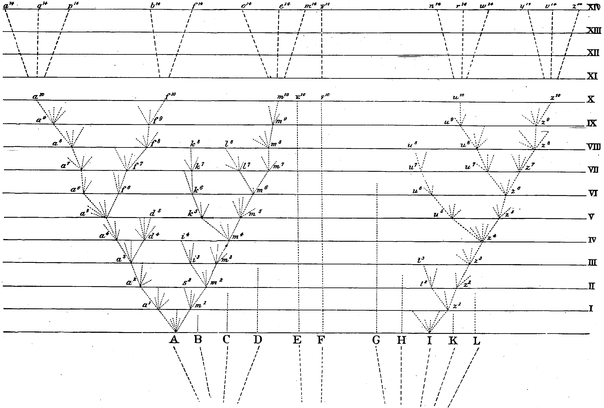

# 达尔文：从《物种起源》到《人类的由来》 from the Origin of Species to the Descent of Man (Phillip Sloan)

*首次发表于 2019 年 6 月 17 日；2024 年 3 月 13 日实质修订。*

本词条对达尔文自然选择进化理论的起源与发展作一宽泛的历史考察：从“达尔文革命”最初的达尔文阶段，一直讲到 1871 年《人类的由来》出版。达尔文之前进化观念的发展，另见“达尔文之前的进化思想”词条。达尔文进化理论及其生平发展的若干其他方面，本百科全书另有词条处理（见“达尔文主义”“物种”“自然选择”“神创论”）。余下部分聚焦其他词条未曾展开的方面，并保持历史与文本的进路。文末所列的其他词条与参考文献，可供进一步讨论。相关问题按以下标题考察：

## 1 达尔文理论的起源

### 1.1 史学编纂问题

达尔文的转型论版本，一直是大量历史与哲学研究的对象，其规模在科学史其他领域几乎无出其右：既有源源不断的专著，也有针对达尔文理论某一方面的论文集（Prestes 2023; R. J. Richards and Ruse 2016; Ruse 2013a, 2009a,b,c; Ruse and Richards 2009; Hodge and Radick 2009; Hösle and Illies 2005; Gayon 1998; Bowler 1996; Depew and Weber 1995; Kohn 1985a）[^bowler-1996][^depew-1995][^gayon-1998][^hodge-2009][^hodge-2009-2][^hösle-2005][^kohn-1985a][^prestes-2023][^richards-2009][^richards-2016][^ruse-2013a][^ruse-2009]。通俗与专业的达尔文传记研究也不断问世，带来层出不穷的新洞见（Ruse et al. 2013a; Johnson 2012; Desmond and Moore 1991, 2009; Browne 1995, 2002; Bowlby 1990; Bowler 1990）[^bowlby-1990][^bowler-1990][^browne-1995][^desmond-1991][^johnson-2012][^ruse-2013a]。此外，达尔文手稿的重大编纂项目、覆盖其整个一生的《通信集》项目，持续揭示出围绕达尔文思想的细节与新见解（Keynes [ed.] 2000; Burkhardt et al. [eds] 1985–2023; Barrett et al. [eds.] 1987）。剑桥“达尔文在线”网站（见其他网络资源）是全球达尔文研究的国际信息交换中心，也是达尔文全部原著电子版的存储库，手稿与相关二手材料一并收录，并提供不断更新的当前文献指南。

长期以来的学术传统，把达尔文理论的起源解释为一种框架的产物：本土英国博物学；以威廉·佩利（1743–1805）为代表的英国自然神学传统；约翰·赫歇尔（1792–1871）在《自然哲学研究初论》（1830 [1987]）中提出的方法论准则；以及查尔斯·莱尔（1797–1875）的地质理论。达尔文随“HMS 贝格尔号”航行期间（1831 年 12 月—1836 年 10 月），转向莱尔的均变论地质学，接受莱尔对“深时”的倡导——这被视为其思想形成中的根本事件（Norman 2013; Herbert 2005; Hodge 1983）[^herbert-2005][^norman-2013]。与这种以英语学界为主的史学相补充的，是强调达尔文理论源自英国政治经济学的社会建构论分析（Young 1985: chps. 2, 4, 5）[^young-1985]。也有人论证，达尔文探究的一个主要来源是英国废奴运动，这一关切可追溯至他在贝格尔号岁月中对奴隶制的厌恶（Desmond and Moore 2009）[^desmond-2009]。

另一方面，晚近一批史学著作依据 1960 年代以来大量可得的书信与手稿（见达尔文在线“Papers and Manuscripts”部分，其他网络资源），淡化了达尔文观点中的某些新颖之处，并质疑早期达尔文标准传记图景是否成立。这些材料让人注意到达尔文传记中先前被忽视的方面。尤其是他 1825–27 年的爱丁堡时期——达尔文自己在晚年《自传》中大体上贬低了它的重要性——如今被视为其后来发展的关键（Desmond and Moore 1991; Hodge 1985）[^desmond-1991][^hodge-1985]。作为爱丁堡大学（1825–27）的年轻医科学生，达尔文通过学生普林尼学会与比较解剖学家罗伯特·埃德蒙·格兰特（1793–1874）交往密切；在许多方面，格兰特是达尔文在贝格尔号之前科学上的第一位导师（Desmond and Moore 1991, chp. 1）[^desmond-1991]。通过格兰特，达尔文接触到让-巴蒂斯特·拉马克的转型论，以及围绕巴黎国家自然史博物馆展开的居维叶—若弗鲁瓦之争（见“达尔文之前的进化思想”词条第 4 节）。

这些不同的解释框架，让达尔文理论起源的研究成为史学中一个活跃领域。下一节考察这些起源。

### 1.2 达尔文的早期思考

就其历史起源而言，达尔文的理论在一些重要方面与主要前驱属于不同类型（Ruse 2013b; Sloan 2009a；另见“达尔文之前的进化思想”词条）[^ruse-2013b][^sloan-2009a]。放在更长的历史图景中看，达尔文的理论不涉及宇宙论，也不以自然主义方式处理世界与生命的起源，因此其理论范围比那些受布丰（1707–1788）、约翰·赫尔德（1744–1803）以及受谢林（1775–1854）启发的德国自然哲学家（*Naturphilosophen*）影响的主要前驱更为有限。这一限制也使达尔文的工作有别于 1844 年苏格兰出版家罗伯特·钱伯斯（1802–1871）匿名提出的宏大进化宇宙论——即他那部极为流行的《自然创造史的遗迹》。该书在许多方面为维多利亚时代的英国社会以及内战前的美国，接受某种形式的普遍进化理论作了准备（Secord 2000; MacPherson 2015）[^macpherson-2015][^secord-2000]。这同样使达尔文的表述有别于同时代人赫伯特·斯宾塞（1820–1903）的理论。

达尔文的理论，最初以笔记中的思考成形。这些笔记始于贝格尔号航行后期，在他 1836 年 10 月返回英国后仍继续（Barrett et al., 1987）。他关于物种可能变化的思考，最早于 1837 年 3 月记入“红笔记本”，随后在其他笔记本（B–E）中发展到 1839 年 7 月（Barrett et al. 1987; Hodge 2013a, 2009）[^barrett-1987][^hodge-2013a]。从第三本即“D”本“transmutation”笔记本（写于 1838 年 7 月至 10 月）开始，达尔文首次勾勒出后来成为其自然选择理论的雏形。在时间介于 1838 年 7 月与 1839 年 7 月之间的平行“M”“N”笔记本，以及约 1838–40 年的松散札记集“Old and Useless Notes”中，他还发展出许多关于人类进化的主要观念；这些观念直到 1871 年《人类的由来》才公开（见下文第 4 节）。

概括这一复杂问题：这些笔记表明，达尔文走过了一系列阶段。他先提出一种关于物种经由共同祖先历史传衍而转变的一般理论，随后试图建立一种生命的因果理论，解释生命趋于复杂化与多样化的倾向（Hodge 2013a, 2009, 1985; Sloan 1986）[^hodge-2013a][^sloan-1986]。这一探究针对生命的根本本性；与之相伴的，是寻求解释生命固有发展与复杂化的倾向。随后，关注的焦点发生剧烈转移，取代了这些探究。对生命因果理论的关切，让位于对控制种群的外部力量的新强调。这一论题源自他阅读托马斯·马尔萨斯（1766–1834）的《人口原理》（第 6 版，1826）：马尔萨斯假定人口按几何级数增长，食物供应按算术级数增长，由此导致人类不可避免的生存斗争。1838 年 8 月，达尔文读到这一版《人口原理》，影响极具戏剧性：他由此得以设想，物种转变背后有一种持续起作用的动态力量。

达尔文的创新，是把马尔萨斯的“人口原理”**普遍化**，使之适用于整个自然界。由此，他实际上把一种可称为“惯性”的原则引入理论——尽管他从未用过这样的说法。牛顿在《自然哲学的数学原理》（第 1 版，1687）中提出的第一运动定律，把物理体系建立在“一切物体倾向于永远保持静止或沿直线匀速运动”之上；任何偏离这一初始状态的现象，都需要用因果力量来解释。但牛顿没有为这种惯性状态寻求更深层的形而上学解释：第一定律在《原理》中只是一条“公理”。同样，人口原理给达尔文提供的是一条关于初始动态事态的假定，而这一事态本身并未在理论内得到解释——他并未试图因果地说明生物为何普遍按几何级数繁殖。对达尔文来说，人口原理同样起公理作用：它界定了一组初始条件；任何偏离这一理想状态的现象，都需要解释。

这一转向使达尔文搁置了早先建立生命因果理论的努力，转而追问：人口这股动态力量受什么控制？由此他可以强调：对人口的控制如何同物种成员间的细微个体变异、以及变化的生活条件共同作用，随时间带来形态与功能的逐渐变化，产生新变种，最终产生新物种。达尔文最重要的创新——“自然”选择概念——的框架，就此打开。

## 2 达尔文式进化

### 2.1 自然选择概念

达尔文理论区别于以往物种变化解释的首要特征，在于他为这一过程如何发生提供了因果解释。此前的理论，例如拉马克的理论（见“达尔文之前的进化思想”词条），依赖物质固有的动态属性；在这些前达尔文时代的努力中，物种变化并不是通过适应过程来解释的。写完 D 本笔记之后，达尔文转而强调控制种群增长的因素，不再倚重以生命力为基础的动态生命理论——达尔文的理论与其前驱、同时代人的理论之间的许多差异，由此得到解释。

这些差异可以概括为作为达尔文理论核心成分的自然选择概念。然而，这一概念的确切含义，以及他在《物种起源》六个版本（1859–1872）中对它的不同表述，在达尔文主义史上引出了多种解释；对这些含义的不同理解，又深刻影响了不同国家和文化对达尔文理论的接受（见下文 3.1 节）。

要看清达尔文在这些问题上思考的复杂性，一种办法是追踪这一概念从笔记时期结束（1839）到 1859 年《物种起源》出版的文本演变。这大约二十年间，达尔文的一系列思考在其物种进化理论的最终版本里层层累积，形如地层。理清这些发展的先后，对理解后来围绕这一概念的争论、以及《物种起源》历次修订所招致的各种解读，都有意义；对评估达尔文与更一般哲学问题的相关性也有帮助，比如其理论同“自然的更一般目的论”之类的议题有何关联。

自然选择理论在手稿中展开时，最早的一组主题可以概括为通过一种特定形式的类比论证发展出来的内容。它采取一种强的“比例”类比：人类选择之于家养品种的形成，正如自然选择之于自然物种的形成（White, Hodge and Radick 2021, chps. 4–5）。这就把选择过程中自然的作用与人的作用直接类比起来。这一类比的具体表述及其变化值得密切追踪。该理论第一部连贯草稿是 1842 年写成的 39 页铅笔手稿；在那里，讨论把人类能动性在家养动植物品种创造中的形态选择，类比为自然世界中一种几乎有意识的能动者的主动选择：一个“比人无限睿智的存在者（并非全知造物主）”，在“千千万万年”中作用于“一切趋向某些目的的变异”（Darwin 1842 in Glick and Kohn 1996, 91）[^darwin-1842][^glick-1996]。这一能动者挑出相对于生活条件对生物最有利的特征，其作用类似于人选择家养形态以产生不同品种。与这些近乎柏拉图式造物匠的说法交织在一起的，是对主动的“自然”之选择力量的诉求：

> 自然的变异远少得多，但它的选择要严苛、审慎得多 […] 自然让<<一个>>动物活下去，直到实际证明它较难完成必需的工作、达不到所望的目的；人却只凭眼睛判断，并不知道神经、肌肉、动脉是否随外部形态的变化而按比例发育。（Ibid., 93）

这些主题在 1844 年那份 230 页的理论草稿中延续下来。他再次提到一个智慧的“存在者”的选择作用：“其洞察力足以察觉人完全无法察觉的外层与最内层组织差异，其先见延伸至未来数世纪，以毫不失误的审慎照看，并为任一目的选出所产生的生物的后代”（Darwin 1844 in ibid., 101）。这种选择比人类选择更有先见、更有智慧。在设想这一因果能动者如何运作时，他写道：

> 按照这一宇宙似乎由造物主治理的方案，让我们考察：自然经济中是否存在任何 **次级** 手段，使选择过程能把（哪怕可塑性极小的）生物美妙而奇妙地适应于各种不同目的？我相信，这种次级手段确实存在。（Ibid., 103）。

达尔文在 1856 年回到这些问题。此前的十二年里，他出版了《火山岛地质观察》（1844）、《考察日记》第二版（1845）、《南美地质观察》（1846）、关于化石与现存蔓足类（*Cirripedia*）的四卷本（1851、54、55），以及《珊瑚礁地质观察》（1851）；还发表了若干无脊椎动物学与地质学的短篇论文，并报告了种子抗海水能力的实验——这一主题对他解释偏远岛屿的生物种群颇为重要。

这些其间的研究，使达尔文得以在广泛的经验背景上处理物种恒常性问题。这些考察的首次重大综合，是他 1856 年开始的长篇手稿“大物种书”，当今学界称为“自然选择”手稿，它构成了已出版《物种起源》的直接背景文本。手稿虽不完整，却为了解达尔文思想中的许多关键问题提供了洞见。它是面向学术共同体准备的，因此内容与呈现方式都有别于后来成为出版《物种起源》的那份“摘要”：“自然选择”有数据表格、学术文献引用，以及其他非通俗著作应有的装置，出版的《物种起源》里一概没有。

“自然选择”手稿还包含一些早期手稿所无、与自然选择概念相关的新理论发展。学者们注意到，手稿引入了“分歧原则”：在自然选择作用下，生物倾向于在自己的“生活条件”——当时对环境影响与物种相互作用关系之复合体的称呼——内部辐射分化（Kohn 1985b, 2009）[^kohn-1985b]。群体分歧的概念，或许可以看作达尔文 1830 年代最早表述中已隐含的东西；但他明确把它界定为一条“原则”，还在“自然选择”手稿后段的长篇插入中专门讨论，足见它对达尔文成熟理论的重要性。此时达尔文认为，分歧原则是自然变异与种群增长驱动力之下的生存条件之间的重要纽带。

“自然选择”手稿中，达尔文仍在暗含地诉诸过程的某种目的论秩序。不过，早期手稿中那个阳性的“智慧存在者”，如今已完全让位于选择性的“自然”，而自然改用了传统的阴性代词。这个自然，

> ……她不在乎单纯的外表；可以说，她以严厉的目光审视每一根神经、每一条血管、每一块肌肉；每一种习性、本能、体质色调——整个组织机制。这里没有任性，没有偏爱：好的将被保存，坏的将被严格毁灭。……那么，我们难道不该惊奇：自然的产物带有远比人通过人工选择所得产物更高的完善印记？自然进行着最渐进、最稳定、最不失误、最有远见的选择——对生存条件的完美适应［原文如此］。……（Darwin 1856–58 [1974: 224–225]）[^darwin-1856]

这段文字直接支撑了出版《物种起源》第一版中关于“自然选择”作用的陈述；从历史发生学看，它表明达尔文“自然选择”的含义多么难以阐释（Ospovat 1981）[^ospovat-1981]。艺术与自然之间的平行、“选择”一词暗示的意向性、“完美”适应的观念，以及把“自然”实质地设想为朝向某些目的运作的能动者——这一切都让达尔文关于目的论目的的见解，比人们通常从当代新选择论立场出发所作的解读更为复杂（Lennox 1993, 2013）[^lennox-1993]。如下文所述，达尔文此后在《物种起源》历次版本中更改这一概念的表述，使人们对他这条原理的含义产生了不同理解。

《物种起源》之所以在 1858 年夏至 1859 年 11 月间仓促准备并出版，是因为 1858 年 6 月 18 日收到阿尔弗雷德·罗素·华莱士（1823–1913）的一封信与手稿；其中概述的看法——在自然变异上施加选择、物种因而可能连续变化——与达尔文惊人地相似（Wallace 1858 in Glick and Kohn 1996, 337–45）[^glick-1996][^wallace-1858]。这一事件深刻影响了达尔文出版论证的后续形态。他把未完成的“自然选择”手稿中的详细论证迅速压缩成较短章节，同时把若干原本只针对特定生物类群、或只在手稿中适用于较有限情境的主张普遍化，于是理论以广泛概括的层次呈现出来。出版版本没有数据表格、详细脚注和二手文献引用，这也招来了可预见的批评，详见下文 3.2 节。

### 2.2 已出版《物种起源》的核心论证

《物种起源：通过自然选择，或在生存斗争中保存有利种族》（*On the Origin of Species by Means of Natural Selection, or the Preservaton of Favoured Races in the Struggle for Life*）于 1859 年 11 月 24 日由伦敦约翰·默里出版社出版（Darwin 1859 [1964]）[^darwin-1859]。已出版《物种起源》的论证结构，已是大量文献的主题，此处只能概述。达尔文自己把此书称为“一部长篇论证”，但这一论证的确切性质并不一眼可见；对它的推理与修辞策略，也有种种不同解读（Prestes 2023; White, Hodge and Radick 2021; Hodge 2013b, 1977; Hoquet 2013; Hull 2009; Waters 2009; Depew 2009; Ruse 2009; Lennox 2005; Hodge 1983b）[^depew-2009][^hodge-1983b][^hodge-2013b][^hoquet-2013][^hull-2009][^lennox-2005][^prestes-2023][^ruse-2009][^waters-2009]。

对达尔文《物种起源》所用方法论的学术重构，主要有两种形态。一种是从当前公认的科学解释模型出发，有时把它呈现为形式演绎模型（Sober 1984）[^sober-1984]；另一种更偏历史，把其方法论放在维多利亚时代讨论中公认的科学解释准则背景下来理解（见“达尔文主义”词条；Prestes 2023; White, Hodge and Radick 2021; Hodge 2013b, 1983b, 1977; Hoquet 2013; Hull 2009; Waters 2009; Depew 2009; Lennox 2005）[^depew-2009][^hodge-2013b][^hoquet-2013][^hull-2009][^lennox-2005][^prestes-2023][^waters-2009]。达尔文究竟在多大程度上汲取了同时代人——约翰·赫歇尔、威廉·惠威尔、约翰·斯图尔特·密尔——现存的方法论讨论，现有文献证据并不完全清楚。最容易得到文献支持、并由 White、Hodge 与 Radick（2021）以及 M. J. S. Hodge（1977, 1983a）特别辩护的主张，强调约翰·赫歇尔《自然哲学研究初论》（1830 [1987]）的重要性；达尔文 1831 年 12 月随“HMS 贝格尔号”出发前，在剑桥求学时读过此书。

在赫歇尔的书里，达尔文会遇到这样的主张：科学的目标，是通过满足明确的适当性标准，确定现象的“真实原因”——*vera causae*（Herschel, 1830 [1987], chp. 6）。牛顿在《原理》中把这一概念列为其“哲学推理规则”第三条（见“牛顿哲学”词条第 4 节）。阐明这类原因，正是科学解释的目标。按赫歇尔的表述，*vera causae* 是产生给定效果所必需的原因；它们确实主动地产生了这些效果；并且充分解释了这些效果。

达尔文成熟推理的另一个可能方法论来源，是他年长的同时代人、剑桥时期的导师威廉·惠威尔牧师（1794–1866）。达尔文环球航行归来后，仔细研读了他的三卷本《归纳科学史》（Whewell 1837）[^whewell-1837]（Ruse 2013c, 1975）[^ruse-2013c]。据此，有论者提出一个可信的论证：达尔文文本的实际结构，更接近“惠威尔式”的论证模型。在惠威尔关于科学方法论的论述中（Whewell 1840, 1858）[^whewell-1840]，科学探究的重点——赫歇尔也曾如此主张——应放在发现“真实原因”上。但要确定一个 *vera causa*，证据须显示：彼此不同的现象能被统摄到单一的统一“心灵概念”之下，惠威尔以牛顿的万有引力定律为例。他把这种在少数简单概念下实现理论统一的过程称为“归纳的一致”（Consilience of Inductions）；只有运用真实原因的真正科学理论才能达到（Whewell 1840: xxxix）[^whewell-1840]。因此有论者主张，达尔文的理论从根本上产生了这类一致性论证，其方法论与惠威尔更为合拍。

第三种解释与惠威尔式解读相关，出自戴维·迪普。达尔文自称面向“一般博物学读者”，迪普据此认为，达尔文发展出了他所谓的“情境化论证”，与牛津逻辑学家、修辞理论家理查德·惠特利（1787–1863）的观点相近（Depew 2009）[^depew-2009]。这一修辞策略靠个人叙述把读者带入达尔文的世界：前三章提出一系列有限的问题请读者接受，其中没有一个要求读者作出重大的理论认同跳跃；而它们大多（如自然变异与马尔萨斯式人口增长）已以某种形式见于当时的文献。

达尔文向公众呈现论证时，开头两章借用了手稿中的强类比：人类技艺在家养形态产生中的作用，与“由自然”进行的选择。由此产生的形态，被认为源于人类选择作用于同一物种个体间的细微变异。然而，手稿把这一过程解读为天佑“自然”所作有方向、甚至有意的选择，这一解读在出版著作中被淡化了：达尔文转而强调“无意识”选择——这一概念在“自然选择”手稿中未曾出现。这种选择甚至包括原住民的做法：他们只想通过保存“最好的”形态，来维持某一品种或物种的完整与存续。

不过，家养育种的类比不只是装饰性的修辞。它在文本多处反复充当达尔文援引的主要经验实例，用来让自然选择在自然界中的运作变得可见；这一援引在《物种起源》六个版本中始终未变。

从“人类选择作用于个体自然微变异而产生家养形态”这一模型出发，达尔文在第二章展开“自然”变异的蕴含，自然选择概念的讨论则推迟到第四章。第二章的焦点引出另一个重要问题：他把第一章的变异讨论扩展为一种批判分析——批判那种认为分类奠基于物种及更高级群体的定义、而定义依据本质性界定属性的通行理解。正是在这一章，达尔文最明确地阐述了自己关于有机物种本性的立场，并把它与传衍理论联系起来；也正是在这一章，他备好了攻击物种“本质主义”某一含义的材料。

达尔文对“物种问题”的分析包含一个复杂论证，对同时代人和后继者如何解读其著作影响深远；围绕这一论证的解释，已产生大量文献（见“物种”“达尔文主义”词条；Mallet 2013; R. A. Richards 2010; Wilkins 2009; Stamos 2007; Sloan 2009b, 2013; Beatty 1985）[^beatty-1985][^mallet-2013][^richards-2010][^sloan-2009b][^stamos-2007][^wilkins-2009]。

先前的传统深受 18 世纪法国博物学家布丰的有机物种构想影响：他明确区分“自然”物种与“人为”物种和变种——前者主要由可育杂交界定，后者由形态特征及对特征的测量界定（见“达尔文之前的进化思想”词条第 3.3 节）。达尔文有选择地利用了这一区分，把两大讨论传统以不寻常的方式融合起来；在他的分析中，这两条传统被创造性地糅合在一起。

尤其是，19 世纪初受哲学家康德（1724–1804）之区分影响的德国博物学史家讨论物种概念时，把“布丰式”物种界定为共同传衍与生殖连续性的物质统一体。这使它们凭历史与物质特征，有别于“林奈式”博物学传统中的分类学物种。“自然”物种与“逻辑”物种的这一区分，一直维系着两类问题的区分：一类出现在保存标本的实际分类中，靠外部特征区分；另一类关乎自然物种的统一性，奠基于生殖统一性与不育标准（Sloan 2009b）[^sloan-2009b]。

达尔文论证中引人注目的地方在于：他有选择地从这两大既有传统取材，分别瓦解它们所预设的物种“实在论”的根据。一种框架——在其当下语境中可视为“林奈式”传统——把物种看作逻辑共相或类别概念，其“实在性”常奠基于神创观念。另一种“布丰式”传统更自然主义，把物种看作物质性的传衍谱系，其连续性由某种内在原则决定，比如拥有保守的“内部模子”或起规定作用的力量（见“达尔文之前的进化思想”第 3.3 节）。到了达尔文手中，变种、种族、亚种、族与科等概念便交织成一套复杂的术语；可以表明，这是当时文献中不同讨论传统的融合。这种创造性的糅合，也让同时代人对达尔文究竟如何设想物种及其在时间中的变化困惑不已。

达尔文切入物种问题，靠的是自然变异在物种与变种层次上给类群辨别造成的实际困难；他在对亚纲蔓足类（*Cirripedia*，藤壶）长达八年的分类学修订中，对此早已熟悉。这一层次上分类区分的困难，在当时文献中已被充分认识；但达尔文巧妙地把这个 **实践** 问题变成了 **形而上学** 上的模糊：保存标本的变异让正式分类区分变得模糊，他便认为“自然”物种的边界同样模糊。

我们循此来看：达尔文在《物种起源》第二章如何运用自然变异，拆解实际分类文献中通常使用的物种与变种之分。作出区分时显露的任意性（尤其在植物与无脊椎动物中）意味着，这类物种只是“具有健全判断与广泛经验的博物学家”所定义的样子（*Origin* 1859 [1964], 47）。这些论证成了同时代人说他是个物种“唯名论者”的依据：他只把物种视为对个体连续统所作的约定性、便利性划分。

但达尔文物种讨论的这一面，只部分道出其论证的复杂。他也借用了“布丰式”传统内部的物种实在论，肯定物种与变种由共同传衍及杂交的物质关系来界定。随后，他利用实际分类中个体变异造成的物种—变种区分之模糊，瓦解“自然”物种在本体论上的固定性。变种并非只是林奈式传统所设想的那种正式分类细分；用他的话说，它们是“初期的”物种（ibid., 52）。这就巧妙地把地方变异与对环境的适应，变成了历史进化变化的首要原料。不过，这一论证的全部蕴含，直到第四章才完全显露。

在组装前两章的材料之前，达尔文先在第三章引入“生存斗争”概念。他是在“宽泛而隐喻的意义”上引入的：既有为食物与空间的直接斗争，也有沙漠中一株植物为生存而进行的斗争，涵盖有机体相互作用的不同层次。达尔文说这是运用马尔萨斯“人口按几何级数增长、食物按算术级数增长”的参数；但实际上，他 **重新解释** 了马尔萨斯原理——后者原本只谈人类人口与食物供应的关系。如今它成了支配整个有机生命的一般原则：一切生物，包括作为他者食物者，都受几何级数增长倾向的支配。

通过这一普遍化，对人口的控制只有在极端情形下才直接依赖马尔萨斯式的食物与空间限制；正常的控制则通过一张复杂的关系网施加——物种在捕食者—猎物、寄生物—宿主与食物网中相互作用。对马尔萨斯论证的这一深刻修正，让达尔文的理论带上了后来所谓“生态学”的深刻色彩。可以举达尔文本人用过的两个思想实验为例（ibid., 72–74）。第一个解释英国红三叶草的丰度：达尔文认为它取决于传粉熊蜂的数量，熊蜂又受田鼠数量控制，田鼠再受猫的控制，于是猫成了三叶草丰度的远因。第二个例子解释欧洲赤松的丰度：松树的数量间接受到牛的数量限制。

前三章的材料既已就位，达尔文就可以在第四章关于“自然”选择的宏大综合中把它们组装起来。这一长篇讨论，是他对核心理论概念的主要阐述。然而对同时代人和后继传统而言，达尔文“自然”选择概念的含义并不一目了然——原因上文已勾勒；这些含糊之处，日后成了若干持续分歧与争论的源头。

达尔文在已出版《物种起源》六个版本中对核心原理的表述颇为复杂，这在历史上引出了对其文本的几种不同解读。第一版首次引入自然选择原理时，把它描述为“保存有利变异、排斥有害变异”（ibid., 81）。在第一版第四章详述这一概念时，他仍用暗示有意选择的语言来描述自然选择，延续了手稿中强烈的艺术—自然类比。例如：

> 人靠有条理的与无意识的选择，尚能产生、而且确实产生了伟大的结果，自然又能成就什么？人只能作用于外部可见的性状；自然却不在乎外表，除非外表对某个存在者有用。她能作用于每一个内部器官，作用于体质差异的每一丝色调，作用于整个生命机制。人只为自己的利益选择；自然只为她所照看的那个存在者的利益选择。每一个被选中的性状，都由她加以充分运用；那个存在者也被置于十分适宜的生活条件之下。（Ibid., 83）

这些段落背后有手稿史作支撑，不能简单地把它们贬为纯粹的修辞意象。如前所见，有意的人类选择与“自然”的选择之间的平行，正是自然选择概念最初赖以建立的比例类比模型。

然而，这类段落中明显的意向性很快招来批评，达尔文于是从 1861 年第三版起修订论证。自此，他明确淡化前两版中带意向性与目的论色彩的语言，否认自己诉诸“自然”的选择作用不过是一种文学修辞；并决定性地转向把自然选择界定为“自然规律作用于生物”的描述，而不是生命的动力因或目的因。他在《通信集》中也后悔没有用“自然保存”而非“自然选择”来称呼自己的原理（致莱尔信，1860 年 9 月 28 日，Burkhardt《通信集》8, 397；另见其他网络资源中的“达尔文通信项目”）。为回应阿尔弗雷德·罗素·华莱士的批评，达尔文在 1869 年第五版中，采用同时代人赫伯特·斯宾塞（1820–1903）的说法“最适者生存”，作为“自然选择”的同义词（Spencer 1864, 444–45; Darwin 1869, 72）[^darwin-1869][^spencer-1864]。这一改动让自然选择的含义进一步偏离了早期文本与草稿所能提取的概念。这些 1860 年代末至 70 年代初的最终表述，成为后来“机械论”与非目的论自然选择理解传统的底本；这一解读由其弟子发展，用戴维·迪普的话说，他们“对达尔文的自然神义论，或他那幅仁慈审视的选择图景，都不怎么用得着”（Depew 2009, 253）[^depew-2009]。不过，这一更改究竟在多大程度上保留了艺术与自然之间原初的强类比，值得质疑。自最初表述以来，批评这一类比的人就论证：两种选择方式的比较，实际上对达尔文的理论不利（Wallace 1858 in Glick and Kohn 1997, 343）[^wallace-1858]。1867 年亨利·弗莱明·詹金的批评性评论，也对达尔文重提了这一批评，详见下文。

第四章的概念综合，还引入了对几个问题的讨论：自然选择在什么条件下最有效，隔离起什么作用，物种为何灭绝，以及分歧原则。其中许多论点靠富有想象地运用“思想实验”提出：达尔文构造出可能的情境，说明自然选择如何带来实质变化。

达尔文让读者把握这一过程复杂性的一个突出方式，是《物种起源》各版都有的那张唯一的图。这幅插图最初是第一版附录，后来移入第四章；达尔文在其中概括了他关于物种如何形成、如何从共同祖先点分歧的构想。它还描绘了多数谱系的频繁灭绝——第十章详加展开的问题。图画出了分歧原则，说明种群在人口增长压力下趋于分歧与碎裂的一般倾向；也提供了一种设想分类学亲缘关系与时间之关系的方式，并显示某些形态在条件稳定的漫长地质时期中保持不变而存续下来。

**图**：

图：《物种起源》中的生命之树图（*Origin* 1859：“附录”。

达尔文生命之树图引人注目之处，在于其坐标的相对性。它起初只用来表示物种层次类群的分歧：变种由“分布广泛的属”物种 A–L 内的小写字母表示，横线代表以有限世代数计量的时间段。然而细心的读者很快可以看出：达尔文在第二章对“自然”物种与“人为”物种的破坏性分析，已隐含物种—变种区分的相对性；这幅图最终可以表示一切有机关系，从固定物种内部变种分歧这一无争议层次，到不同属内物种之间的关系。字母 A–L 也可代表属、科或目层次的类群。于是，这幅图适用于林奈等级体系所有层次之间的关系：时间段可代表潜在的漫长时间跨度，分支的水平延展则代表随时间推移的分类分歧程度。短短几页论证中，图就被普遍化，用来表示最广泛的类群关系，涵盖整个地质时间。底部虚线的延伸甚至可以暗示——如达尔文在《物种起源》最后一段所论证的——一切生命都是“若干力量”的结果，“这些力量最初被吹入少数形态、或一个形态之中”（Darwin 1859 [1964], 490）[^darwin-1859]。这可能意味着一切原初形态有一个自然主义的单一来源：物质涌现，或某种生命力原则的作用。达尔文对《圣经》语言的使用，也可以读作容许超自然原因的作用。

针对后一点的批评，达尔文在 1860 年第二版的最后一段迅速加上“由造物主”一语（1860: 484），此语保留在所有后续版本中；卷首那几段引自英国自然神学、谈论借次级原因创造的文字也同样保留。这就为某些同时代人留下了概念空间，使他们可以把《物种起源》读作与传统自然神学相容——哈佛植物学家阿萨·格雷（1810–88）就是一例（Gray 1860）[^gray-1860]。

自然选择一章末尾那种理论概括的横扫之势——书末最后一段又以更一般的方式重述了一次——迫使达尔文去应对若干显而易见的反对意见；这些意见构成《物种起源》的主要“防御”章节（第五至九章），并在此后 1859 至 1872 年的多次修订中一直缠着他。正如戴维·迪普所提示，原初文本的修辞结构几乎就是“反对与回应”；随着达尔文与论敌交锋，各版本不断修订（Depew 2009; Peckham 2006）[^depew-2009][^peckham-2006]。首次出版时，达尔文预见到几条明显的反对路线，于是把原版《物种起源》的大量篇幅用于预先回应可预见的困难。他概述的主要反对路线如下。第一，物种之间显然缺少大量细微渐变——无论现存还是化石记录中；而按该理论的渐变论运作，这类渐变本应可以预见（第六、九章）。第二，极端复杂的器官与结构如何逐渐发育，例如脊椎动物的眼睛；自古希腊以来，这一器官就是外部目的论设计论证的主要支柱（第六章）。第三，动物精细本能的进化，以及社会性昆虫发育出不育中性等级这一令人困惑的问题；在手稿阶段，这对达尔文尤其困难，必须有所交代（第七章）。第四，自然物种（由互交可育界定）与人为物种（由形态差异界定）的传统区分，需要另设一章分析；在那里，他力图瓦解把杂交可育标准当作固定自然物种标志的绝对性（第八章）。

第十章里，达尔文展开他对化石记录的解释。争论点在于：拉马克派与其他转型论者，以及威廉·巴克兰（1784–1856）等居维叶式灾变论者主张（见“达尔文之前的进化思想”词条第 4.1 节），化石记录显示出一个历史序列，从较简单的动植物开始，经由转型或替换，最终在地质史中出现更复杂的形态。反对这一“地质进步论”论题的，不是别人，正是达尔文在地质学上的伟大导师查尔斯·莱尔；他在《地质学原理》中提出了反对（Lyell 1832 [1990], vol. 2, chp. xi; Desmond 1984; Bowler 1976）[^bowler-1976][^desmond-1984]。本章中，达尔文为进步论辩护，反驳莱尔。

对每一条反对路线，达尔文都向同时代人给出了可信的回应。1860 至 1872 年《物种起源》的五次修订中，他又靠大量文本插入补充论证，包括在第六版新增一章处理“杂项”反对意见，主要回应圣乔治·杰克逊·米瓦特（1827–1900）在《物种的起源》中提出的批评（Mivart 1871）[^mivart-1871]。

公开呈现既采取了压缩概述的形式，理论本身又大胆横扫，《物种起源》的主要论证因此无法从书中自身的数据获得力量。它提出的毋宁是一个基于统一性之简的论证：达尔文的理论在最后几章的综合（第十至十三章）中，能把分类学、比较解剖学、古生物学、生物地理学与胚胎学中的广泛问题，统摄到前四章的简单原则之下——论证的力量与说服力，正来自这种统摄能力。这一“一致性”论证，或许最好地反映了威廉·惠威尔方法论的影响（见上文）。

按达尔文的设想，理论一旦被接受，博物学中就会“开辟出一片宏伟的未踏足研究领域”。物种起源这一长期问题——即便还不是生命终极起源的解释——以及物种灭绝的原因，都进入了自然主义解释的领域。正是在这一背景下，他在书中唯一一次提到：“人类起源及其历史将会得到阐明”。他还说了一段预示 1871 年《人类的由来》重要议题的话：“心理学将建立在一个新的基础之上：每一种心理力量与能力，都必然是通过渐变获得的”（ibid., 488）。

## 3 《物种起源》的接受

### 3.1 达尔文理论的公众接受

达尔文主张横扫一切，《物种起源》实际提供的经验证据却相当简略；其理论又牵动若干更一般的哲学与神学议题。于是，围绕达尔文进化的争论兴起，160 多年来潮起潮落。这一理论被置入各国各文化复杂多样的接受情境；对接受情况的研究本身，如今已成一门学术产业。欧洲、拉丁美洲与英语世界的接受研究最为深入（Bowler 2013a; Gayon 2013; Largent 2013; Glick 1988, 2013; Glick and Shaffer 2014; Engels and Glick 2008; Gliboff 2008; Numbers 1998; Pancaldi, 1991; Todes 1989; Kelly 1981; Hull 1973; Mullen 1964）[^bowler-2013a][^engels-2008][^gayon-2013][^gliboff-2008][^glick-1988][^glick-2014][^hull-1973][^kelly-1981][^largent-2013][^mullen-1964][^numbers-1998][^todes-1989]。此外还有对非西方接受的分析（Jin 2020, 2019 a,b; Yang 2013; Shen 2016; Elshakry 2013; Pusey 1983）[^elshakry-2013][^jin-2020][^pusey-1983][^shen-2016][^yang-2013]。这些分析显示出西方与非西方解读达尔文理论的共同模式：这些接受即使不是由既有的思想、科学、宗教、社会与政治语境所决定，也深受其制约。

在英语世界，达尔文的理论落入复杂的社会环境：在美国，这意味着内战前的奴隶制争论（Largent 2013; Numbers 1998）[^largent-2013][^numbers-1998]；在英国，它面对的是维多利亚中期社会的大规模工业扩张与科学职业化。只看英国阅读公众语境的若干方面：1844 年匿名出版的《自然创造史的遗迹》早已流行，到 1860 年 12 月已出 11 版、售出 23,350 册（Secord，“导言”，Chambers 1844 [1994], xxvii]）[^chambers-1844]，世纪末还有更多版本；这无疑为“物种经由次级自然规律作用而进化起源”这一观念打下了基础。《遗迹》那套生命目的论发展的宏大图式——从太阳系在气态星云中的最初开端，到人类在一项伟大的“发展规律”作用下出现——也经丁尼生勋爵的史诗《悼念》（1850）传给了维多利亚读者。有这样的《遗迹》背景，有人便可以把达尔文读成对如下信念的额外支持：生命在次级规律的目的论引导下乐观地历史发展，终将获得历史救赎。这类解读还使《物种起源》看来与达尔文同时代人赫伯特·斯宾塞的进步进化论相容（见“赫伯特·斯宾塞”词条）。正因相似，斯宾塞的著作成了重要载体：达尔文的观点经修改以符合斯宾塞的进步论后，最初正是借此传入非西方语境（Jin 2020, 2019 a,b; Lightman [ed.] 2015; Pusey 1983）[^jin-2020][^pusey-1983]。这类通俗接受忽视或修改了达尔文的自然选择进化概念，以迁就进步论的替代方案。

出了英国，达尔文著作的接受情况显示出地方语境与既有思想、社会条件的分量。可以详述三个例子：法国、德国与中国。在法国，达尔文理论面对的是 1830 年代转型论争论的余波：拉马克与艾蒂安·若弗鲁瓦·圣伊莱尔的理论对阵居维叶（Gayon 2013；“达尔文之前的进化思想”词条 4.1）[^gayon-2013]。至少在法国官方学术科学内部，这些争论大体以居维叶的反转型论获胜告终。奥古斯特·孔德（1798–1857）的“实证哲学”提供的思想框架，对达尔文既有利也有弊。一方面，孔德强调科学相对于迷信与形而上学的历史进步，这使达尔文可以被召来支持科学进步论——第一部法译本（克莱芒丝·鲁瓦耶译）的序言就是这样解读的（Harvey 2008）[^harvey-2008]。另一方面，孔德的三阶段历史观主张：科学思辨与形而上学时期终将被受确定规律支配的实验科学时期历史地超越。这一来，达尔文主义反倒被归入思辨自然哲学的形而上学阶段。法国科学界领头的生理学家与方法论家克洛德·贝尔纳（1813–78）的评断正体现了这一看法。他在 1865 年关于科学方法论的论著中写道，达尔文的理论应与“歌德、奥肯、卡鲁斯、若弗鲁瓦·圣伊莱尔”之流并列，归入思辨自然哲学，而不配“实证”科学的地位（Bernard 1865 [1957], 91–92]）[^bernard-1865]。

在德意志各邦，达尔文的工作进入了一个复杂的社会、思想与政治处境——1848 年建立自由民主的努力刚刚失败。它还进入一种深受既有哲学传统影响的思想文化：康德、谢林的《自然哲学》、德国浪漫主义，以及费希特与黑格尔的唯心论（R. J. Richards 2002, 2008, 2013; Gliboff 2007, 2008; Mullen 1964）[^gliboff-2007][^mullen-1964][^richards-2002]。这些因素构成复杂的政治与哲学环境；达尔文关于自然的发展观与物种转型理论迅速被吸收，当然也经过了改造。于是，许多解读都在谢林自然哲学的背景下理解达尔文的论证。耶拿大学动物学教授恩斯特·海因里希·海克尔（1834–1919）热情鼓吹达尔文主义，更把达尔文的权威推到科学唯物主义之争的前台。海克尔比任何人都更使 *Darwinismus* 成为俾斯麦德国两极化政治与宗教争论中的主要角色（R. J. Richards 2008）[^richards-2008]。通过《自然创造史》（1868）、《人类发生学》（1874）、《宇宙之谜》（1895–99）等论战著作，海克尔以达尔文之名倡导唯物主义一元论，并拿它当大棒打击传统宗教。宗教群体与进化生物学之间的许多历史冲突，都能追溯到海克尔的论战著作；这些书历经众多版本与译本，包括直到 20 世纪初叶仍在印行的若干英美版本。

转到另一个极不相同的语境——中国：达尔文的著作经由一条奇特的路径进入中国讨论。最初讨论达尔文理论的，是海军科学学者严复（1854–1921）。他翻译了托马斯·亨利·赫胥黎 1893 年的罗曼尼斯讲演《进化论与伦理学》；严复 1877 至 1879 年在格林尼治皇家海军学院求学时接触到达尔文主义。译本于 1898 年以《天演论》之名出版，附有严复的长篇按语。按语大量取材于赫伯特·斯宾塞的著作，而严复把斯宾塞摆在赫胥黎论证的对立面。已有研究表明，这部书是中国间接了解达尔文理论的主要载体（Jin 2020, 2019 a, b; Yang 2013; Pusey 1983）[^jin-2020][^pusey-1983][^yang-2013]。在严复及其同道——如康有为（1858–1927）——的解释中，达尔文主义获得了与儒家某些方面相合的进步论解读。

从 1902 年起，达尔文接受史进入第二阶段：中国科学家马君武（1881–1940）部分翻译了《物种起源》第六版前五章。马君武曾留学日本与德国，学化学与冶金。这部节译本于 1902 至 1906 年间出版，又一次修改文本本身，以迁就斯宾塞的进步进化论，以及严复那部流行的《天演论》里已有的进步论。直到 1920 年 9 月，中国人才有了马君武对达尔文第六版的全译本。这一晚出的译本更忠实地呈现了达尔文文本，包括准确翻译了达尔文关于自然选择的最终观点（Jin 2019 a, b）。作为政治改革者、民主改革家孙中山（1866–1925）的密切同道，马君武翻译达尔文的兴趣，也与他投身中国革命政治的兴趣相关（Jin 2019a, 2022）[^jin-2019a]。

### 3.2 达尔文理论的专业接受

达尔文理论在专业人员中的接受情况相当复杂。这些人或在大学从事研究与教学，或在科学社团担任领导，或在博物馆任职；他们通常熟悉 1860 年代地质学、比较解剖学、胚胎学、生物地理学与分类理论中争论的经验证据与技术问题。这个群体通常有别于外行解释者——后者未必分得清拉马克、钱伯斯、谢林、斯宾塞与达尔文关于生命历史发展的观点。

若只看这些专业人员的接受，达尔文的工作得到的是褒贬不一的认可（Hull 1973）[^hull-1973]。达尔文身边知识圈里的许多显赫人物——亚当·塞奇威克、威廉·惠威尔、查尔斯·莱尔、理查德·欧文、托马斯·赫胥黎——早在 1840 年代就严厉批评过钱伯斯的《遗迹》，指其思辨、科学上无能（Secord 2000）[^secord-2000]。达尔文也怕遭遇同样对待；他清楚，要说服这个圈子以及与他广泛通信的更大科学专家共同体，是重大挑战。在这个群体中，他只成功了一部分。

历史研究表明，科学精英中很少有人原样接受并发展达尔文文本里的理论。对《物种起源》出版后第一个十年英格兰科学界接受情况的统计研究，显示出一幅复杂图景：科学界既没有大规模皈依达尔文观点，也没有年轻皈依者与年长抵制者之间清晰的代际分层——这与达尔文在《物种起源》末章的预测相反（Hull et al. 1978）[^hull-1978]。这些研究还表明，科学界明显愿意把两件事分开：接受达尔文“物种经由共同祖先传衍而变异”的一般主张，与认可他用自然选择作用于细微形态变异来解释这一传衍。

分析这一复杂的专业接受，关键在达尔文赋予“正常个体变异”的地位：它是进化新质的来源。如前所述，达尔文依靠一个新颖主张：微小的个体变异——早期传统视为纯粹“偶然”的差异——就是原材料；在自然选择作用下，累积的方向性变化能在其上产生重大变化，足以解释一切生命形态的起源，以及它们随时间形成的差异。但达尔文没有具体说明这种变异的原因，只提到环境对生殖器官的某种影响。《物种起源》谈到变异时说“支配遗传的规律完全未知”（Darwin 1859 [1964], 13）[^darwin-1859]。为了与自己坚持的莱尔式地质渐变论一致，他还拒绝重大“芽变”或其他不连续变化来源在这一过程中的作用。

批评者集中攻击一点：个体间的这类微差异真能随时间累积而不遇自然界限吗？达尔文于是开始一系列修改与修订；这场与批评者的往复对话，可在他对《物种起源》的修订中追踪。例如 1866 年第四版，达尔文插入一个主张：分支图所描绘的连续渐变论有误导性，转型变化未必连续进行。“远为可能的是，每一形态在长时间内保持不变，然后再次经历变异”（Darwin 1866, 132; Peckham 2006, 213）[^darwin-1866][^peckham-2006]。这种“变化—停滞—变化”模型，让变异能在一段时间内围绕均值稳定，随后再由此重新变化。不过，这样的模型大概需要比理论最初假定的数百万年更多的时间才能运作。

到 1866 年，达尔文论证中的困难已相当明显。1867 年，苏格兰工程师亨利·弗莱明·詹金（1833–1885，通常称 Fleeming Jenkin）写了一篇长篇而切中要害的批评。詹金搬出莱尔 1830 年代针对拉马克用过的论证，援引家养育种的经验证据，表明正常变异能被选择累加的程度有明确限制（Fleeming Jenkin 1867 in Hull 1973）[^hull-1973][^jenkin-1867]。他用一个大致数学化的论证主张：杂交会不断淹没性状对均值的偏离，种群中的变异因而随时间趋于回归均值；家养证据也不足以支持物种变化的论证。在詹金看来，这些论证足以推翻达尔文对连续累加偏离的依赖；只有更剧烈、不连续的变化——达尔文明言拒绝的东西——才能解释新物种的起源。

詹金还主张：要用自然选择的渐变运作解释生命史，达尔文理论所需的时间，在科学证据里根本拿不出来。为支持这一点，他援引导师、格拉斯哥物理学家威廉·汤姆森（开尔文勋爵，1824–1907）发表的关于太阳系可能年龄的物理计算（Burchfield 1975）[^burchfield-1975]。根据汤姆森关于太阳与太阳系年龄的定量物理论证，詹金判定：从生命最初出现至今的时间，不够达尔文的渐变论物种转型理论施展。

詹金多管齐下的论证，给达尔文造成相当大的困难，也为后继者对变异及其原因作更细致的经验研究搭好了舞台。时间上的困难，直到 20 世纪发现放射性才解决——放射性可以解释太阳为何没有按牛顿原理丧失热量。

作为对变异问题的解决方案，达尔文提出“暂时性假说”——泛生论。詹金评论问世一年后，他在两卷本《家养条件下动植物变异》中公布了这一假说（Darwin 1868; Olby 2013）[^darwin-1868][^olby-2013]。这一理论其实是独立于詹金评论形成的（Olby 1963）[^olby-1963]，但实际起了回应詹金批评的作用。泛生论回到一种类似布丰上世纪提出的有机分子理论，提供关于变异与遗传的因果理论（见“达尔文之前的进化思想”词条第 3.2 节）：据假定，细胞内存在不可见的物质“微芽”；微芽会受环境及其他外部原因改造，随后不断脱落进入血流（“运输”假说），并靠“彼此间的相互亲和力聚集，或聚成芽体，或聚成性要素”（Darwin 1868, vol. 2, 375）[^darwin-1868]。以这种形态，它们经由有性生殖传给下一代——细节未作解释——由“构成生物体的、经过改造的生理单位”形成新生物（ibid., 377）。在达尔文看来，这一假说把众多问题统一为连贯的因果遗传理论，解释了变异的基础，也解释了用进废退遗传——他从未放弃的理论——如何可能运作。

泛生论虽未被点名，但似乎支撑着达尔文 1869 年第五版《物种起源》中一个重要的区分。那是他直接回应詹金批评时插入的：他把“某些无人会归为单纯个体差异的变异”与普通变异分开（Darwin1869, 105; Peckham 2006, 178–179）[^peckham-2006]。这一修订让达尔文不再像早先那样倚重正常的细微个体变异，并给他此时称为“显著标记的”变异以新的地位——后者被赋予主要的进化意义。据推测，这种强变异更可能传给后代（细节仍不清楚）；以这种形态，重大变异大概能在种群中维持，而不像詹金所论证的那样被杂交淹没。

达尔文在这一问题上的挣扎，界定了一组英国生命科学家要到 1930 年代才处理完的问题。围绕体细胞变异在进化中作用的争论，使达尔文主义处于守势，迫使支持者对达尔文研究纲领作重大修订（Gayon 1998; Vorzimmer 1970）[^gayon-1998][^vorzimmer-1970]。结果是达尔文主义史上一段复杂时期：自然选择理论或被许多研究者抛弃，或被另一些人以修改形式维护（Bowler 1983, 2013a; Largent 2009）[^bowler-1983][^largent-2009]。

## 4 人类进化与《人类的由来》

### 4.1 《人类的由来》的缘起

整个 1860 年代，达尔文一直把关于人类进化的结论悄悄搁在幕后；替他的一般理论辩护的，是各路主张者：英格兰的托马斯·亨利·赫胥黎（1825–95）、美国的阿萨·格雷（1810–88）、正在成形的新德国中的恩斯特·海克尔（1834–1919）。达尔文自己在“人类问题”上立场如何，阅读公众并不清楚；他在修辞上把《物种起源》放进“借次级规律进行神创”的传统——卷首引自威廉·惠威尔与弗朗西斯·培根的话正体现了这一点——于是 1871 年之前，许多人认为达尔文比他的某些普及者更愿意接受对人类起源的宗教解释。

然而，达尔文很早就想发展自己关于人类起源的见解，并以传衍变异解释人类特性。早在 1860 年 1 月的通信中，这一点就很明显：他开始收集人类情感表达的证据（Browne 2002, chp. 9）[^browne-2002]，还专门设计问卷，从巴塔哥尼亚与火地岛的联络人那里获取信息（Radick 2018）。莱尔（1863）与 A. R. 华莱士（1864）的讨论进一步推动了他；两人都提出，自然选择解释不了“高级”理性能力、语言与伦理动机的发展（R. J. Richards 1987, chp. 4）[^richards-1987]。1867 年 2 月，达尔文决定从《家养条件下动植物变异》的巨幅手稿中抽出材料，另做“一本很小的书，‘一篇论人类起源的论文’”（Darwin to Hooker, 8 February 1867 and CD to Turner, 11 February 1867, Burkhardt, *Correspondence* 15: 74, 80）。同时，他向几位国际通信者寄去更详细的问卷，询问人类情感表达的情况。威廉·R. 格雷格（1809–1881）在《弗雷泽杂志》（1868）上的文章，以及 A. R. 华莱士 1869 年的进一步支持，又给他添了动力；两人都把人性与动物性作了鲜明区分（R. J. Richards 1987, 172–184）[^richards-1987]。这些论证否认自然选择能解释这些“高级力量”的起源。

达尔文 1868 年初开始起草关于人类问题的观点，这项工作越做越大，他深深卷入“其理论对伦理学有何蕴含”的问题。这项人类学主题的努力，产生了两部独立的书：《人类的由来与性选择》，1870 年 6 月交稿，1871 年出版；以及姊妹篇《人类与动物的情感表达》，1871 年初动笔，1872 年初出版。

正如评论者所指出的，这两部书在论证上差别很大，与达尔文的自然选择、性选择理论的关系也不同：《人类的由来》大部分篇幅里，性选择压过自然选择；而《情感表达》走描述性进路，这两种因果理论大体缺席（Radick 2018）。

性选择——为繁殖目的，雄选雌或雌选雄——达尔文在《物种起源》第四章作过一般陈述，但在原初论证中只居次要地位，共同进化论者 A. R. 华莱士还否认它的重要性。到了《人类的由来》，性选择被详加展开为进化的主要因素，甚至可能对抗普通的自然选择。它能解释性二态，也能解释生物一些不寻常的性状：精巧的取食器官、鲜艳的颜色，以及其他看似不适应的结构，如爱尔兰麋鹿的角、犀牛甲虫的大角——这些看起来都像自然选择为最优生存而运作的异常产物。把这一原理戏剧性地推及人类，自然选择与性选择的结合便用来解释人类如何从类人猿祖先起源；它也说明了人类的性二态，还是解释人种起源的一个主要因素（E. Richards 2017; R. A. Richards 2013）[^richards-2017][^richards-2013][^richards-2013-2]。

### 4.2 达尔文论心智能力

性选择在物种发育中的次要因果作用，本是《人类的由来》大半篇幅的主题；但在开头几章的“论人”部分，它起初角色暧昧，在达尔文处理心智能力起源、道德感与人种起源时，作用也各不相同。

建构这一呈现时，达尔文回到早期笔记本——他曾把它们从“转型论”讨论中分出来，专用于探究伦理学、心理学与情感（见上文 1.2 节）。对《人类的由来》开篇尤为重要的，是 1838 年 7 月启用的“M”笔记本和同年 10 月启用的“N”笔记本；他有时也取材于如今题为“Old and Useless Notes”的札记集，那些札记大体写于 1838 至 1840 年。

《人类的由来》开篇聚焦的，是关乎人类心智特性之地位与起源的广泛问题——传统上假定这些能力为人类所独有。达尔文此时把这些特性放上一条进化连续统，与长期被视为本能的动物行为特征相连。这样一来，他就站到了悠久话语传统的对立面：该传统把人与动物区分开，理由是人拥有与理性灵魂相关的“理性原则”。17 世纪中叶，笛卡尔（1596–1650）关于心身关系的革命性思考，为这一传统打下了更激进的基础。笛卡尔分离两种实体，从而加深了区分：思维实体，即 *res cogitans*，只为人拥有；广延的物质实体，即 *res extensa*，构成自然界的其余部分，包括动植物——动物由此只是没有理性能力的无生命机器。

达尔文在《人类的由来》中勾勒的人类起源理论，推倒了这道笛卡尔式壁垒；这也延续了其转型论前驱——尤其是让-巴蒂斯特·拉马克——所关心的讨论（Sloan 1999）[^sloan-1999]。但达尔文把它提到新层次：他在自己关于共同祖先分歧进化的新理论里，解释人与动物的关系。他还打破了“人是自然目的论过程顶峰”的看法，否认这种目的论秩序，并把人类特性——心智的与身体的——实际还原为动物特性：追溯它们在下等生物特性中的起源。

然而，《人类的由来》并没有用扎实论证来支持“人与动物心智特性同一”这一主张。该论著开篇概括了人与动物因共同祖先传衍而形成的“同源”——真正的同一——的 **解剖学** 证据；这些主张在《物种起源》第十三章已经提出。但把结构上的同一性搬到内在的、**非解剖学** 的“心智”特性上，其前提在文本中并未明言；例如赫胥黎、华莱士与莱尔处理人类与进化理论的关系时，也没有得出这种同一性，尽管他们承认解剖学上的连续性。

要理解达尔文的论证，不妨回到他据以推理的笔记本讨论（见上文 1.2 节）。在 1838 年 2 月启用的“C”笔记本里，有一条引人注目的札记，很早就显出他对形而上学“一元论”的坚持——心与身背后只有一种实体。与此相伴的，是“心智特性的复杂性对应物质结构复杂性”的论题。这条札记写在达尔文思考本能问题之后，也记录了他对摄政公园动物园一些动物的观察。他写道：

> 有一种活的精气遍在于此世（受有机物某些偶然条件、主要是热的制约），它按从属规律采取众多形态<<各具作用原则>>。——有一种思维[…]原则（与一类有机物——大脑——紧密相连；这一〈prin〉思维原则似乎依个体间更广泛的关系［原文如此］被赋予或假定，于是带有记忆的选择、**或理性**？便成为必需。——）它被改造为无尽形态，在程度与种类上与生物的无尽形态密切相关。——由此可见思维与作用原则中的统一性：它见于如此被赋予禀赋的个体之间〈dif〉分离的各种色调，见于心智的共同性，甚至见于种族之间细腻情感的倾向，以及动物中反复出现的习性。——（Barrett 1987, 305）[^barrett-1987]

循着这些问题进入“M”笔记本，可以看到：与一类有机物相连的单一“思维原则”这一假定，似乎构成了达尔文此后心物思考的基础。“M”本列举了人与动物共有的众多“心智”特性，大体与物质组织层次相对应，类似后来《人类的由来》表述的同一性。在这些早期讨论里，心智特性普遍扩展的范围十分深远：意识与“自由意志”扩展到一切动物，包括无脊椎动物：

> 说到自由意志：看见小狗嬉戏，谁也不能怀疑它们有自由意志；若如此，一切动物都有，那么牡蛎也有，水螅也有（植物在某种意义上也有 […]；牡蛎的自由意志，不妨设想为组织的直接效果——它的感官给了它苦乐的能力；若如此，自由意志之于心智，便如偶然之于物质 […]（Barrett 1987, 536）[^barrett-1987]。

这些主题在第一版《人类的由来》第二章重现时，达尔文似乎在暗含地借助这种心物同一理论，把它当作共同祖先传衍理论的一个明显推论。他列举了一长串传统上属人的心智与情感特性，主张它们每一个都与较简单生命形态的特性同一。清单很长：勇气、欺瞒、嬉戏、仁慈、母爱、自满、骄傲、羞耻、荣誉感、惊奇、恐惧、模仿、想象与做梦。据说这些在广泛范围的动物身上都有，连蚂蚁身上也能找到“嬉戏”与“识别”。

至于那些被悠久传统特别视为人类独有的更复杂心智特性——语言、理性、抽象概念思维、自我反思——他也说它们在其他生命形态中有其表现，没有一项为人类独有。以语言为例：笛卡尔认为语言是标示人拥有心智、有别于物质的首要特征；达尔文却把语言看作从动物声音逐步发展而来的过程，与物种分化相平行；语言“像有机体一样，可以按群分群”即是例证（Darwin 1871 [1981], 60）[^darwin-1871]。结尾分析宗教信仰时，他把宗教信念追溯到想象，以及原始民族对精灵的信仰。它甚至可与“狗对主人的深爱，连同完全的顺从、几分恐惧，或许还有其他情感”相类比（ibid., 68）。达尔文关于人与动物心智、情感特性之关系的讨论，开启了一场复杂的讨论，一直延续到当代关于动物认知、人与动物特性关系的争论（见“动物认知”“比较认知方法”“动物意识”词条）。

### 4.3 《人类的由来》的伦理理论

在达尔文看来，《人类的由来》第三章对伦理问题的处理，是一个要“完全从博物学方面”接近的题目（ibid., 71）。这个问题也给他带来了一些最困难的概念难题（CD to Gray, 15 March 1870, Burkhardt, *Correspondence* 18, 68）。讨论中，他还把自然选择理论当作解释性原因。

在“道德感”标题下，达尔文提出了一些伦理学创新，很难归入按规则功利主义、行为功利主义、康德义务论、快乐主义、情感主义等熟悉范畴划出的标准立场。在历史上，他与弗朗西斯·哈奇森（1694–1746）、亚当·斯密（1723?–1790）、大卫·休谟（1711–1776）的苏格兰“道德感”传统最为接近。更直接地说，他取材于远亲詹姆斯·麦金托什爵士（1765–1832）对道德感理论的阐述（R. J. Richards 1987, 114–122, 206–219）[^richards-1987]。

传统道德感理论把伦理行为系于一种先天属性。这种属性被认为人皆有之，但要靠教育与培养才能充分表现（见“道德情感主义”词条）。这种固有属性即“道德”感，据说可以解释伦理良知、道德义务感，也能说明那些无法还原为趋乐避苦的利他行为。它不涉及对利益的理性计算，也不像功利主义暗示的那样，要个体在行动前计算最大幸福。正因如此，达尔文批评约翰·斯图尔特·密尔版的功利主义：它依赖习得习惯与利益计算（Darwin 1871 [1981], 71n5）[^darwin-1871]。

达尔文在进化框架内重新解释道德感传统，这也意味着他的伦理理论发生了重要转变。道德感不再与动物本能相区别，而是历史地源于社会性本能，并由自然选择发展出来。由此，达尔文可以主张人与动物在伦理基础上真正同一：人类伦理行为的前身，见于其他动物、尤其是过社会生活的动物的行为。自然选择随后塑造这些伦理本能，使之有利于群体生存而非眼前个体利益（ibid., 98）。于是，人类伦理行为奠基于一种由自然选择发展出的自然属性；伦理行动因而可以在没有道德计算、没有理性慎思的情况下发生。

道德冲突一旦发生，一般被归因于本能之间的冲突；两种本能相争，自然选择偏向较强的一方，只要它有利于群体利益（ibid. 84）。在人类身上，“更持久的社会性本能”就这样压倒了不那么持久的“个体”本能。

进化伦理自然主义能否充当伦理实在论的基础，《人类的由来》出版后成了达尔文同时代人与后继者的争点。一些道德哲学家认为，达尔文只是把伦理还原为一种受自然选择相对化倾向支配的属性（Farber 1994: chp. 5）[^farber-1994]；在达尔文的哲学批评者看来，这是把伦理还原为生物学，因而再也分不清伦理善与生存优势。即便对托马斯·赫胥黎、阿尔弗雷德·罗素·华莱士这样的达尔文主义坚定支持者，达尔文的解释也不够充分（ibid., chp. 4）。达尔文之后道德哲学的大部分发展，都建立在“是与应当”区分的正统地位之上；而这一区分，正是在批判“进化”伦理理论时获得了新的力量。批判始于托马斯·赫胥黎 1893 年罗曼尼斯讲演《进化论与伦理学》——他在那里与达尔文伦理理论决裂（Huxley 1893）[^huxley-1893]。这篇讲演反映了达尔文去世十一年后赫胥黎的观点，在中国接受达尔文主义的过程中起了重要作用（Huxley 1895；见上文 3.1 节）[^huxley-1895]。这一批判路线在 G. E. 摩尔（1873–1958）的《伦理学原理》中获得了有影响的学术表达——该书本身就是对斯宾塞版进化伦理学的攻击（Moore 1903）[^moore-1903]。围绕进化伦理学是否适当的争论，至今仍在继续（见“生物利他主义”“道德与进化生物学”词条；另见 R. J. Richards 2015, 2009, 1999, 1987, Appendix 2; Charmetant 2013; Boniolo and DeAnna (eds.) 2006; Hauser 2006; Katz (ed.) 2000; Maienschein and Ruse (eds.) 1999）。

### 4.4 《人类的由来》的接受

《人类的由来》与《情感表达》的国际接受，还是一个有待细致研究的题目——就像围绕《物种起源》历史影响的大量研究那样。这两部书向 1871 年以后的读者呈现出一个更激进、更有争议的达尔文，与广受欢迎的《考察日记》作者、甚至《物种起源》作者的形象都不同；它们让达尔文观点的公众接受出现转折（Radick 2013）[^radick-2013]。《人类的由来》终于公开了达尔文关于人类起源的更激进结论；在许多读者看来——甚至包括此前同情《物种起源》的人——这似乎把达尔文的权威推到了唯物主义与反宗教力量一边。1871 年以前，公众对达尔文人类进化结论的了解，全靠《物种起源》里那句含糊的话；《人类的由来》公开了他更激进的结论。人类进化问题此前已由托马斯·赫胥黎在 1863 年《人类在自然界的位置》中部分处理（Huxley 1863）[^huxley-1863]，同年莱尔在《人类古老性的地质学证据》中也谈过（Lyell 1863）[^lyell-1863]，此后还有华莱士 1864 与 1870 年的文章（Wallace 1864 and online）；但这些作者要么没处理把人类纳入进化过程所引出的全部问题，要么强调人与动物在道德与心智上的不连续。只有海克尔从进化理论中引出了更一般的还原性人类观，但他没有涉足伦理、社会组织、人种起源，以及人类心智特性与动物心智特性的关系等具体问题——而这些《人类的由来》全都谈了。正如一位评论者所说，达尔文这部论著“比他发表过的任何东西，都更接近他早期的自然主义愿景”（Durant 1985, 294）[^durant-1985]。

达尔文把理论扩展到传统上属于哲学、神学、社会与政治理论的一系列问题，由此塑造了 1870 年以来达尔文主义更一般的历史。它为 19 世纪晚期心理学的大部分发展设定了议程（R. J. Richards 1987）[^richards-1987]，也加深了许多宗教群体对进化理论的反对；不过这里同样要区分不同群体（Ellegård 1990, chp. 14）[^ellegård-1990]。这种反对并不只是否定《圣经》对人类起源的字面叙述——这个问题在主要宗教教派内部的展开方式各不相同（Haught 2013; Finnegan 2013; Swetlitz 2013; Artigas, Glick, & Martinez 2006; Moore 1979）[^finnegan-2013][^haught-2013][^moore-1979][^swetlitz-2013]。更根本的反对在于：达尔文不承认人类根本特性与动物特性之间还有程度以外的区分。

此外，人类进化过程看来排除了某种神圣引导；达尔文在《物种起源》第五、六版中对自然选择理论的最终表述又带有非目的论性质——这些都加深了反对。1869 年第五版里，他采用斯宾塞的“最适者生存”作为“自然选择”的同义词，更给日益增长的反对添了火。结果，许多有影响的宗教思想家——约翰·亨利·纽曼（1801–1890）就是个好例子——此前对原版《物种起源》的善意解读消失了。《人类的由来》的修辞，以及“人是从一种长毛四足动物传下来的，有尾巴和尖耳朵”这一结论（Darwin 1871 [1981], 389）[^darwin-1871]，向公众呈现出一个不同的达尔文，与许多人心中那位广受欢迎的航海博物学家判然有别。

对达尔文的新反对，反映在期刊上众多敌视《人类的由来》的书评里（R. J. Richards 1987, 219–230）[^richards-1987]。争点尤其集中在达尔文对伦理原则与智力能力起源的解释：他把语言、自我反思、抽象思维与宗教信仰都说成从动物特性衍生而来（Anon. 1871）[^anon-1871]。

然而，达尔文所造就的深刻思想革命，最终连他昔日的严厉批评者也承认了。理查德·欧文（1804–1892）曾是英国比较解剖学的领军人物，自 1860 年严厉批评《物种起源》后长期与达尔文疏远；但在达尔文葬入威斯敏斯特教堂之际，他仍在给霍勒斯·沃波尔的信中写道：

> 达尔文一系列著作的巨大价值——它们总结了胚胎学、古生物学与生理学的一切证据，并经实验用于产生物种变种——体现在生物学家普遍接受“物种起源”经由进化的次级规律[…]在这方面，查尔斯·达尔文之于生物学，正如哥白尼之于天文学。[…]［哥白尼］并不知道行星怎样绕太阳运行。要知道这一点，得靠伽利略、开普勒乃至牛顿相继努力[…]而我们这位英国生物学界的哥白尼，理应得到帝国的敬意与感激——威斯敏斯特教堂的雕像就是明证。（Richard Owen to Horace Walpole, 5 November, 1882, Royal College of Surgeons of England Archives, MS0025/1/5/4）。

围绕达尔文成就的争论，此后写成一段复杂历史，牵涉 1870 年以来生命科学史的大部分，以及伦理理论、心理学、哲学、神学与社会理论。晚近学术的总体概述，见 Ruse 2013a 及下文所列本百科全书词条。

## 5 总结与结论

本文想从历史角度概述达尔文理论的具体性质，并勾勒它与十九世纪前驱理论的差异（见“达尔文之前的进化”词条）。二十世纪中叶，人们最终围绕所谓“综合”进化论形成普遍共识——把群体遗传学与进化变化的数学分析结合起来；这一共识成了半个多世纪的成功研究纲领（Smocovitis 1996; Mayr and Provine 1980; Provine 1971）[^mayr-1980][^provine-1971][^smocovitis-1996]。近几十年来，这一“综合”受到当前所谓进化发育理论（“evo-devo”）运动的挑战。就某些重要方面说，这一发展意味着回归十九世纪与二十世纪初那些据信已被抛弃的传统与探索路线：把进化与胚胎发育联系起来，对遗传学作复杂理解，重新考察外部条件对遗传的影响（Gilbert 2015; Newman 2015; Laubichler and Maienschein 2007; Gissis and Jablonka 2011; Pigliucci and Müller 2010; Amundson 2005; Gilbert, Opitz and Raff 1996）[^amundson-2005][^gilbert-2015][^gissis-2011][^laubichler-2007][^newman-2015][^pigliucci-2010]。这些争论与修正再过五十年会把进化理论引向何处，只能猜测（Gayon 2015 in Sloan, McKenny and Eggleson 2015）[^gayon-2015]。

与进化理论相关的更一般哲学问题，仍是学术探究的议题：自然目的论，伦理学，进化自然主义与宗教传统主张的关系，以及人类与有机世界其余部分之关系的蕴含。达尔文关于人类心智能力与道德特性的解释是否成立，仍在哲学上争论不休；他依赖性选择解释人类社会中性与性别角色是否适当，在一些女性主义学术中更是激烈话题。这些发展表明，仍有实质性的理论问题悬而未决，并可能以重要方式改变未来对进化理论的理解（Sloan, McKenny, & Eggleson [eds] 2015）。

## References（引用注释）

**以下文献从原文照录，不作翻译；中国文献译为中文。**

> 原文参考文献已转为脚注引用：文内“作者-年份”引用组后附 [^key] 标记，完整条目见本文末脚注定义。

[^amundson-2005]: Amundson, Ron, 2005, *The Changing Role of the Embryo in Evolutionary Thought: Roots of Evo-Devo*, Cambridge: Cambridge University Press. doi:10.1017/CBO9781139164856
[^anon-1871]: Anon., “Review of the *Descent of Man and Selection in Relation to Sex”*, *Edinburgh Review* 134 (July 1871), 195–235.
[^artigas-2006]: Artigas, Mariano, Thomas F. Glick, and Rafael A. Martínez, 2006, *Negotiating Darwin: The Vatican Confronts Evolution, 1877–1902*, Baltimore, MD: Johns Hopkins University Press.
[^barrett-1987]: Barrett, Paul H., Peter J. Gautrey, Sandra Herbert, David Kohn, and Sydney Smith (eds.), 1987, *Charles Darwin’s Notebooks: 1836–1844*, Cambridge: Cambridge University Press. [online manuscripts at Darwin’s notebooks and reading lists.]
[^beatty-1985]: Beatty, John 1985, “Speaking of Species: Darwin’s Strategy”, in Kohn 1985a: 265–281. doi:10.1515/9781400854714.265
[^bernard-1865]: Bernard, Claude, 1865 [1957], *Introduction to the Study of Experimental Medicine*, translated Henry Copley Greene, New York: Dover. Originally published in 1927, New York:Macmillan. [[Bernard 1865 available online](https://archive.org/details/BIUSante_31054/page/n155)]
[^boniolo-2006]: Boniolo, Giovanni and Gabriele De Anna (eds.) 2006, *Evolutionary Ethics an Contemporary Biology,* Cambridge: Cambridge University Press.
[^bowlby-1990]: Bowlby, John, 1990, *Charles Darwin: A New Life*, New York: Norton.
[^bowler-1976]: Bowler, Peter J., 1976, *Fossils and Progress: Paleontology and the Idea of Progressive Evolution in the Nineteenth Century*, New York: Science History.
[^bowler-1983]: –––, 1983, *The Eclipse of Darwinism: Anti-Darwinian Evolution Theories in the Decades Around 1900*, Baltimore, MD: Johns Hopkins University Press.
[^bowler-1990]: –––, 1990, *Charles Darwin: The Man and His Influence*, Oxford: Blackwell.
[^bowler-1996]: –––, 1996, *Life’s Splendid Drama: Evolutionary Biology and the Reconstruction of Life’s Ancestry, 1860–1940*, Chicago: University of Chicago Press.
[^bowler-2013a]: –––, 2013a, “Darwinism in Britain”, in Ruse 2013a: 218–225. doi:10.1017/CBO9781139026895.028
[^browne-1995]: Browne, Janet, 1995, *Charles Darwin: Voyaging*, New York: Knopf.
[^browne-2002]: –––, 2002, *Charles Darwin: The Power of Place*, Princeton: Princeton University Press.
[^burchfield-1975]: Burchfield, Joe D., 1975, *Lord Kelvin and the Age of the Earth*, Chicago: University of Chicago Press.
[^burkhardt-1985]: Burkhardt, Frederick et al., (eds.), 1985–2023, *The Correspondence of Charles Darwin*, 30 volumes. Cambridge: Cambridge University Press.
[^chambers-1844]: Chambers, Robert, 1844 [1994], *Vestiges of the Natural History of Creation*, facsimile reprint of first edition, J. Secord (ed.), Chicago: University of Chicago Press. [[Chambers 1844 available online](https://archive.org/details/vestigesofnatura00unse/page/n3)]
[^charmetant-2013]: Charmetant, Erin. 2013,“Darwin and Ethics”, in Ruse 2013a, 188–194.
[^darwin-1836]: Darwin, Charles Robert, 1836–1844 [1987], *Charles Darwin’s Notebooks: 1836–1844*, Paul H. Barrett, Peter J. Gautrey, Sandra Herbert, David Kohn, and Sydney Smith (eds.), Cambridge: Cambridge University Press. See also the Darwin Online section on [Darwin’s notebooks and reading lists](http://darwin-online.org.uk/EditorialIntroductions/vanWyhe_notebooks.html).
[^darwin-1856]: –––, 1856–1858 [1974], *Charles Darwin’s “Natural Selection”, Being the Second Part of his Big Species Book Written from 1856 to 1858*, R.C. Stauffer (ed.), 1974, Cambridge: Cambridge University Press. [[*Natural Selection* 1974 available online](http://darwin-online.org.uk/content/frameset?itemID=F1583&viewtype=text&pageseq=1)]
[^darwin-1842]: –––, 1842 [1996], “1842 Sketch On Selection Under Domestication, Natural Selection, and Organic Beings in the Wild State”, selection in Glick and Kohn 1996, 89–99.
[^darwin-1844a]: –––, 1844a [1996], “1844 Essay: Variation of Organic Beings in the Wild State”, in Glick and Kohn 1996, 99–115.
[^darwin-1859]: –––, 1859 [1964], *On the Origin of Species By Means of Natural Selection*, London: Murray. Facsimile reprint, ed. E. Mayr Cambridge, MA: Harvard University Press [[*Origin* first edition available online](http://darwin-online.org.uk/content/frameset?itemID=F376&viewtype=side&pageseq=1)]
[^darwin-1860]: –––, 1860, second edition [[*Origin* second edition available online](http://darwin-online.org.uk/content/frameset?itemID=F381&viewtype=side&pageseq=1)]
[^darwin-1861]: –––, 1861, third edition, [[*Origin* third edition available online](http://darwin-online.org.uk/content/frameset?itemID=F381&viewtype=side&pageseq=1)]
[^darwin-1862]: –––, 1862, first French edition, *De l’origine des espèces*, Clémence Royer (trans.), Paris: Guillaumin. [[*Origin* French first edition available online](http://darwin-online.org.uk/content/frameset?itemID=F655&viewtype=text&pageseq=1)]
[^darwin-1866]: –––, 1866, fourth edition, [[*Origin* fourth edition available online](http://darwin-online.org.uk/content/frameset?itemID=F385&viewtype=side&pageseq=1)]
[^darwin-1869]: –––, 1869, fifth edition, [[*Origin* fifth edition available online](http://darwin-online.org.uk/content/frameset?itemID=F387&viewtype=side&pageseq=1)]
[^darwin-1872]: –––, 1872, sixth edition, [[*Origin* sixth edition available online](http://darwin-online.org.uk/content/frameset?pageseq=100&itemID=F391&viewtype=side)
[^darwin-1868]: –––, 1868, The Variation of Animals and Plants Under Domestication, two volumes, London: John Murray. First edition available online
[^darwin-1871]: –––, 1871 [1981], The Descent of Man, and Selection in Relation to Sex, two volumes, London: John Murray. Reprinted, ed John T. Bonner and Robert May, Princeton: Princeton University Press [[*Descent* 1871 available online](http://darwin-online.org.uk/EditorialIntroductions/Freeman_TheDescentofMan.html)]
[^darwin-1872-2]: –––, 1872, *Expression of the Emotions in Man and the Animals*, London: John Murray. [[*Expression* available online](http://darwin-online.org.uk/EditorialIntroductions/Freeman_TheExpressionoftheEmotions.html)]
[^depew-2009]: Depew, David J., 2009, “The Rhetoric of the Origin of Species”, in Ruse and Richards 2009: 237–255. doi:10.1017/CCOL9780521870795.015
[^depew-1995]: Depew, David J. and Bruce H. Weber, 1995, *Darwinism Evolving: Systems Dynamics and the Genealogy of Natural Selection*, Cambridge, MA: MIT Press.
[^desmond-1984]: Desmond, Adrian J., 1984, *Archetypes and Ancestors: Palaeontology in Victorian London, 1850–1875*, Chicago: University of Chicago Press.
[^desmond-1991]: –––, and James R. Moore, 1991, *Darwin*, London: Michael Joseph.
[^desmond-2009]: –––, and James R. Moore, 2009, *Darwin’s Sacred Cause: How a Hatred of Slavery Shaped Darwin’s Views on Human Evolution*, Boston: Houghton, Mifflin, Harcourt.
[^durant-1985]: Durant, John R., 1985, “The Ascent of Nature in Darwin’s *Descent of Man*”, in Kohn 1985a: 283–306. doi:10.1515/9781400854714.283
[^ellegård-1990]: Ellegård, Alvar, 1990, *Darwin and the General Reader; the Reception of Darwin’s Theory of Evolution in the British Periodical Press, 1859–1872*, reprint of 1958 edition, Chicago: University of Chicago Press.
[^elshakry-2013]: Elshakry, Marwa, 2013, *Reading Darwin in Arabic, 1860–1950.* Chicago: University of Chicago Press.
[^engels-2008]: Engels, Eve-Marie and Thomas F. Glick (eds.), 2008, *The Reception of Charles Darwin in Europe*, London/New York: Continuum.
[^farber-1994]: Farber, Paul Lawrence, 1994, *The Temptations of Evolutionary Ethics*, Berkeley: University of California Press.
[^finnegan-2013]: Finnegan, Diarmid A., 2013, “Darwin and Protestantism”, in Ruse 2013a: 468–475. doi:10.1017/CBO9781139026895.060
[^gayon-1998]: Gayon, Jean, 1998, *Darwinism’s Struggle for Survival: Heredity and the Hypothesis of Natural Selection*, Cambridge: Cambridge University Press.
[^gayon-2013]: –––, 2013, “Darwin and Darwinism in France before 1900”, in Ruse 2013a: 243–249. doi:10.1017/CBO9781139026895.031
[^gayon-2015]: –––, 2015, “What Future for Darwinism?”, in Sloan, McKenny and Eggleson 2015: 404–423.
[^gilbert-2015]: Gilbert, Scott F., 2015, “Evolution Through Developmental Change”, in Sloan, McKenny, & Eggleson 2015: 35–60.
[^gilbert-1996]: –––, John M. Opitz, and Rudolf A. Raff, 1996, “Resynthesizing Evolutionary and Developmental Biology”, *Developmental Biology*, 173 (2): 357–372. doi:10.1006/dbio.1996.0032
[^gissis-2011]: Gissis, Snait B. and Eva Jablonka (eds.), 2011, *Transformations of Lamarckism: From Subtle Fluids to Molecular Biology*, (Vienna Series in Theoretical Biology), Cambridge, MA: MIT Press.
[^gliboff-2007]: Gliboff, Sander, 2007, “H. G. Bronn and the History of Nature”, *Journal of the History of Biology*, 40 (2): 259–294. doi:10.1007/s10739-006-9114-4
[^gliboff-2008]: –––, 2008, *H. G. Bronn, Ernst Haeckel, and the Origins of German Darwinism: A Study in Translation and Transformation*, Cambridge, MA: MIT Press.
[^glick-1988]: Glick, Thomas F. (ed.), 1988, *The Comparative Reception of Darwinism*, New edition with new preface, Chicago: University of Chicago Press.
[^glick-2013]: –––, 2013, “Darwinism in Latin America”, in Ruse 2013a: 258–263. doi:10.1017/CBO9781139026895.033
[^glick-2014]: –––, and Elinor S. Shaffer (eds.), 2014, *The Literary and Cultural Reception of Charles Darwin in Europe*, London: Bloomsbury.
[^glick-1996]: –––, and David Kohn (eds.), 1996, *On Evolution: The Development of the Theory of Natural Selection*, Indianapolis, IN: Hackett.
[^gray-1860]: Gray, Asa, 1860, “Review: The Origin of Species by Means of Natural Selection”, *American Journal of Science and Arts*, series 2, 29: 153–184, written anonymously. doi:10.2475/ajs.s2-29.86.153 [[Gray 1860 available online](https://www.darwinproject.ac.uk/letter/?docId=letters/DCP-LETT-7132.xml;query=;brand=default)]
[^haeckel-1868]: Haeckel, Ernst, 1868 [1876], *Natürliche Schöpfungsgeschichte*, Berlin: G. Reimer. Translated as *The History of Creation*, two volumes, London: Henry S. King.
[^haeckel-1874]: –––, 1874 [1879], *Anthropogenie oder Entwickelungsgeschichte des Menschen*, translated as *The Evolution of Man: A Popular Exposition of the Principal Points of Human Ontogeny and Phylogeny.* New York: Appleton.
[^haeckel-1895]: –––, 1895–99 [1901], *Die Welträthsel* (*Riddle of the Universe*). Translated by Joseph McCabe, New York/London: Harper and Brothers.
[^harvey-2008]: Harvey, Joy, 2008, “Darwin in French Dress: Translating, Publishing and Supporting Darwin in Nineteenth-Century France”, in Engels and Glick 2008: 354–374.
[^hauser-2006]: Hauser, Marc D., 2006, *Moral Minds: How Nature Designed Our Universal Sense of Right and Wrong*, New York: Ecco.
[^haught-2013]: Haught, John F., 2013, “Darwin and Catholicism”, in Ruse 2013a: 485–492. doi:10.1017/CBO9781139026895.062
[^herbert-2005]: Herbert, Sandra, 2005, *Charles Darwin, Geologist*, Ithaca, NY: Cornell University Press.
[^herschel-1830]: Herschel, John F. W., 1830 [1987], *A Preliminary Discourse on the Study of Natural Philosophy*, reprint, Chicago: University of Chicago Press. [[Herschel 1830 available online](https://archive.org/details/apreliminarydis02hersgoog/page/n10)]
[^hodge-1977]: Hodge, Jonathan [M.J.S.}, 1977, “The Structure and Strategy of Darwin’s ‘Long Argument’”, *British Journal for the History of Science*, 10(3): 237. doi:10.1017/S0007087400015685
[^hodge-1983a]: –––,1983a, “Darwin and the Laws of the Animate Part of the Terrestrial System (1835–1837): On the Lyellian Origins of His Zoonomical Explanatory Program”, *Studies in the History of Biology*, 6: 1–106.
[^hodge-1983b]: –––, 1983b, “The Development of Darwin’s General Biological Theorizing”, in D. S. Bendall, *Evolution From Molecules to Men*, Cambridge: Cambridge University Press, 43–62.
[^hodge-1985]: –––, 1985, “Darwin as a Lifelong Generation Theorist”, in Kohn 1985a: 207–243. doi:10.1515/9781400854714.207
[^hodge-2009]: –––, 2009, “The Notebook Programmes and Projects of Darwin’s London Years”, in Hodge and Radick 2009: 44–72, doi:10.1017/CCOL9780521884754.003
[^hodge-2013a]: –––, 2013a, “The Origins of the *Origin*”, in Ruse 2013a: 64–71. doi:10.1017/CBO9781139026895.007
[^hodge-2013b]: –––, 2013b, “Darwin’s Book: *On the Origin of Species*”, *Science and Education*, 22(9): 2267–2294. doi:10.1007/s11191-012-9544-7
[^hodge-2009-2]: –––, and Gregory Radick (eds.), 2009, *The Cambridge Companion to Darwin*, Second edition, 2009, doi:10.1017/CCOL9780521884754.
[^hoquet-2013]: Hoquet, Thierry, 2013, “The Evolution of the Origin (1859–1872)”, in Ruse 2013a: 158–164. doi:10.1017/CBO9781139026895.020
[^hösle-2005]: Hösle, Vittorio and Christian Illies (eds.), 2005, *Darwinism and Philosophy*, Notre Dame, IN: University of Notre Dame Press.
[^hull-1973]: Hull, David L. (ed.), 1973, *Darwin and His Critics: The Reception of Darwin’s Theory of Evolution by the Scientific Community*, Cambridge, MA: Harvard University Press.
[^hull-2009]: –––, 2009, “Darwin’s Science and Victorian Philosophy of Science”, in Hodge and Gregory Radick 2009: 173–196, doi:10.1017/CCOL9780521884754.008
[^hull-1978]: –––, Peter D. Tessner, and Arthur M. Diamond, 1978, “Planck’s Principle”, *Science*, 202(4369): 717–723. doi:10.1126/science.202.4369.717
[^huxley-1863]: Huxley, Thomas Henry, 1863, *Evidence as to Man’s Place in Nature*, London: Williams and Norgate. [[Huxley 1863 available online](https://archive.org/details/evidenceastomans00huxl/page/n8)]
[^huxley-1893]: –––, 1893, “Evolution and Ethics”, London: Macmillan. Romanes lecture.
[^huxley-1895]: –––, 1895, *Evolution and Ethics and Other Essays*, London: Macmillan. Includes a “Prolegomena”. Parts translated into Chinese by Yan Fu as 天演論 (*Tianyan lun*), 1898. [[Huxley 1895 available online](https://archive.org/details/a588314000huxluoft/page/n5)] [[Yan Fu translation of Huxley 1895 available online](https://zh.wikisource.org/zh-hant/%E5%A4%A9%E6%BC%94%E8%AB%96)]
[^jenkin-1867]: Jenkin, H. Fleeming, 1867 [1973], “[Review] The Origin of Species”, *The North British Review*, 46 (June): 277–318. Reprinted in Hull 1973: 303–350. [[Jenkin 1867 available online](http://darwin-online.org.uk/content/frameset?pageseq=1&itemID=A24&viewtype=text)]
[^jin-2019a]: Jin, Xiaoxing, 2019a, “Darwin in China, 1870–1935”, Unpublished Ph.D. Thesis, University of Notre Dame.
[^jin-2019b]: –––, 2019b, “Translation and Transmutation: The Origin of Species in China”, *The British Journal for the History of Science*, 52(1): 117–141. doi:10.1017/S0007087418000808.
[^jin-2020]: –––, 2020, “The Evolution of Evolutionism in China, 1870–1930”, *Isis* 111(1): 46–66. doi: https://doi.org/10.1086/708367.
[^jin-2022]: –––, 2022, “The Evolution of Social Darwinism in China, 1895–1930”, *Comparative Studies in Society and History* 64(3): 690–721. doi: https://doi.org/10.1017/S0010417522000214.
[^johnson-2012]: Johnson, Paul, 2012, *Darwin: Portrait of a Genius*, New York: Viking.
[^katz-2000]: Katz, Leonard D. (ed.), 2000, *Evolutionary Origins of Morality: Cross-Disciplinary Perspectives*, Exeter, UK: Imprint Academic.
[^kelly-1981]: Kelly, Alfred, 1981, *The Descent of Darwin: The Popularization of Darwinism in Germany, 1860–1914*, Chapel Hill, NC: University of North Carolina Press.
[^keynes-2000]: Keynes, Richard (ed.), 2000, *Charles Darwin’s Zoology Notes & Specimen Lists from H.M.S. Beagle*, Cambridge: Cambridge University Press. [[Keynes 2000 available online](http://darwin-online.org.uk/content/frameset?itemID=F1840&viewtype=text&pageseq=1)]
[^kohn-1985a]: Kohn, David (ed.), 1985a, *The Darwinian Heritage*, Princeton: Princeton University Press. doi:10.1515/9781400854714
[^kohn-1985b]: –––, 1985b, “Darwin’s Principle of Divergence as Internal Dialogue”, in Kohn 1985a: 245–257. doi:10.1515/9781400854714.245
[^kohn-2009]: –––, 2009, “Darwin’s Keystone: The Principle of Divergence”, in Ruse and Richards 2009: 87–108, doi:10.1017/CCOL9780521870795.008.
[^laubichler-2007]: Laubichler, Manfred Dietrich and Jane Maienschein (eds.), 2007, *From Embryology to Evo-Devo: A History of Developmental Evolution*, (Dibner Institute Studies in the History of Science and Technology), Cambridge, MA: MIT Press.
[^laubichler-2013]: –––, 2013, “Developmental Evolution”, in Ruse 2013a: 375–382. doi:10.1017/CBO9781139026895.048
[^largent-2013]: Largent, Mark, 2013, “Darwinism in the United States, 1859–1930”, in Ruse 2013a: 226–234.
[^largent-2009]: –––, 2009. “The So-Called Eclipse of Darwinism”, *Transactions of the American Philosophical Society*, 99(4): 3–21.
[^lennox-1993]: Lennox, James G., 1993, “Darwin Was a Teleologist”, *Biology & Philosophy*, 8(4): 409–421. doi:10.1007/BF00857687
[^lennox-2005]: –––, 2005, “Darwin’s Methodological Evolution”, *Journal of the History of Biology*, 38(1): 85–99. doi:10.1007/s10739-004-6511-4
[^lennox-2013]: –––, 2013, “Darwin and Teleology”, in Ruse 2013a: 152–157. doi:10.1017/CBO9781139026895.019
[^lightman-2015]: Lightman, Bernard (ed.), 2015, *Global Spencerism: The Communication and Appropriation of a British Evolutionist*, Leiden: Brill. doi:10.1163/9789004264007
[^lyell-1830]: Lyell, Charles, 1830–33 [1990], *Principles of Geology*, 3 vols. London: Murray, facsimile reprint, ed. Martin J. Rudwick, Chicago: University of Chicago Press.
[^lyell-1863]: –––, 1863, *The Geological Evidences of the Antiquity of Man*, London: John Murray. [[Lyell 1863 available online](http://archive.org/details/geologicaleviden00lyelrich)]
[^macpherson-2015]: MacPherson, Ryan, 2015, *Debating Evolution Before Darwinism: An Exploration of Science and Religion in America, 1844–1859*, Mantako, MN: Into Your Hands Press.
[^maienschein-1999]: Maienschein, Jane and Michael Ruse (eds.), 1999, *Biology and the Foundation of Ethics*, Cambridge: Cambridge University Press. doi:10.1017/CBO9780511609077
[^mallet-2013]: Mallet, James, 2013, “Darwin and Species”, in Ruse 2013a: 109–115. doi:10.1017/CBO9781139026895.013
[^malthus-1826]: Malthus, Thomas, 1826, *An Essay on the Principle of Population*, 6th edition. London.[available online]
[^mayr-1980]: Mayr, Ernst and William B. Provine (eds.), 1980, *The Evolutionary Synthesis: Perspectives on the Unification of Biology*, Cambridge, MA: Harvard University Press.
[^mivart-1871]: Mivart, St. George Jackson, 1871, *On the Genesis of Species*, London: MacMillan [available online]
[^moore-1903]: Moore, George Edward, 1903, *Principia Ethica*, Cambridge: Cambridge University Press. [[G.E. Moore 1903 available online](https://archive.org/details/principiaethican00mooruoft/page/n7)]
[^moore-1979]: Moore, James R., 1979, *The Post-Darwinian Controversies: A Study of the Protestant Struggle to Come to Terms with Darwin in Great Britain and America 1870–1900*, Cambridge: Cambridge University Press. doi:10.1017/CBO9780511622830
[^mullen-1964]: Mullen, Pierce C., 1964, “The Preconditions and Reception of Darwinian Biology in Germany, 1800–1870”, Unpublished Ph.D Dissertation, University of California, Berkeley.
[^newman-2015]: Newman, Stuart A., 2015, “The Evolution of Evolutionary Mechanisms”, in Sloan, McKenny, and Eggleson 2015: 61–89.
[^norman-2013]: Norman, David, 2013, “Charles Darwin’s Geology”, in Ruse 2013a: 46–55. doi:10.1017/CBO9781139026895.005
[^numbers-1998]: Numbers, Ronald L., 1998, *Darwinism Comes to America*, Cambridge, MA: Harvard University Press.
[^olby-1963]: Olby, Robert C., 1963, “Charles Darwin’s Manuscript of Pangenesis”, *The British Journal for the History of Science*, 1(3): 251–263. doi:10.1017/S0007087400001497
[^olby-2013]: –––, 2013, “Darwin and Heredity”, in Ruse 2013a: 116–123. doi:10.1017/CBO9781139026895.014
[^ospovat-1981]: Ospovat, Dov, 1981, *The Development of Darwin’s Theory: Natural History, Natural Theology, and Natural Selection*, Cambridge: Cambridge University Press.
[^pancaldi-1983]: Pancaldi, Giuliano, 1983 [1991], *Darwin in Italia: Impresa scientifica e frontiere culturali*, (Saggi 248), Bologna: il Mulino. Translated as *Darwin in Italy: Science across Cultural Frontiers*, Ruey Brodine Morelli (trans.), Bloomington: Indiana University Press, 1991.
[^peckham-2006]: Peckham, Morse (ed.), 2006, *The Origin of Species: a Variorum Text*, Philadelphia: University of Pennsylvania Press, reprint of 1959 edition.
[^pigliucci-2010]: Pigliucci, Massimo and Gerd Müller (eds.), 2010, *Evolution, the Extended Synthesis*, Cambridge, MA: MIT Press.
[^prestes-2023]: Prestes, Maria Elice Brzezinski (ed.), 2023, *Understanding Evolution in Darwin*’s ‘Origin’: *The Emerging Context of Evolutionary Thinking*, Cham: Springer.
[^provine-1971]: Provine, William B., 1971, *The Origins of Theoretical Population Genetics*, Chicago: University of Chicago Press.
[^pusey-1983]: Pusey, James Reeve, 1983, *China and Charles Darwin*, (Harvard East Asian Monographs 100), Cambridge, MA: Harvard University Press.
[^radick-2013]: Radick, Gregory, 2013, “Darwin and Humans”, in Ruse 2013a: 173–181. doi:10.1017/CBO9781139026895.022
[^richards-2017]: Richards, Evelleen, 2017, *Darwin and the Making of Sexual Selection*, Chicago: University of Chicago Press. doi:10.7208/chicago/9780226437064.001.0001
[^richards-2010]: Richards, Richard A., 2010, *The Species Problem: A Philosophical Analysis*, Cambridge: Cambridge University Press. doi:10.1017/CBO9780511762222
[^richards-2013]: –––, 2013, “Sexual Selection”, in Ruse 2013a: 103–108. doi:10.1017/CBO9781139026895.012
[^richards-1987]: Richards, Robert J., 1987, *Darwin and the Emergence of Evolutionary Theories of Mind and Behavior*, Chicago: University of Chicago Press.
[^richards-1999]: –––, 1999, “Darwin’s Romantic Biology: The Foundation of His Evolutionary Ethics”, in J. Maienschein and M. Ruse 1999 (eds.) 1999: 113–153. doi:10.1017/CBO9780511609077.007
[^richards-2002]: –––, 2002, *The Romantic Conception of Life: Science and Philosophy in the Age of Goethe*, Chicago: University of Chicago Press.
[^richards-2005]: –––, 2005, “Darwin’s Metaphysics of Mind”, in Hösle and Illies 2005, 166–180.
[^richards-2008]: –––, 2008, *The Tragic Sense of Life: Ernst Haeckel and the Struggle Over Evolutionary Thought*, Chicago: University of Chicago Press.
[^richards-2009]: –––, 2009, “Darwin on Mind, Morals and Emotions”, in Hodge and Radick 2009: 96–119, doi:10.1017/CCOL9780521884754.005
[^richards-2013-2]: –––, 2013, “The German Reception of Darwin’s Theory, 1860–1945”, in Ruse 2013a: 235–242. doi:10.1017/CBO9781139026895.030
[^richards-2015]: –––, 2015, “Darwin’s Evolutionary Ethics: the Empirical and Normative Justifications”, in Sloan, McKenny and Eggleson, 2015, 182–200.
[^richards-2016]: –––, and Michael Ruse, 2016, *Debating Darwin*, Chicago: University of Chicago Press.
[^ruse-1975]: Ruse, Michael, 1975, “Darwin’s Debt to Philosophy: An Examination of the Influence of the Philosophical Ideas of John F. W. Herschel and William Whewell on the Development of Charles Darwin’s Theory of Evolution”, *Studies in the History and Philosophy of Science*, 6: 159–181.
[^ruse-2009a]: –––, 2009a, “The Origin of the *Origin*”, in Ruse and R. J. Richards 2009: 14–14. doi:10.1017/CCOL9780521870795.003
[^ruse-2009b]: –––, 2009b, *Defining Darwin: Essays on the History and Philosophy of Evolutionary Biology*, Amherst, MA: Prometheus Books.
[^ruse-2009c]: –––, 2009c, *Philosophy After Darwin: Classic and Contemporary Readings*, Princeton: Princeton University Press.
[^ruse-2013a]: ––– (ed.), 2013a, *The Cambridge Encyclopedia of Darwin and Evolutionary Thought*, Cambridge: Cambridge University Press. doi:10.1017/CBO9781139026895
[^ruse-2013b]: –––, 2013b, “Evolution before Darwin”, in Ruse 2013a: 39–45. doi:10.1017/CBO9781139026895.004
[^ruse-2013c]: –––, 2013c, “The *Origin of Species*”, in Ruse 2013a: 95–102. doi:10.1017/CBO9781139026895.011
[^ruse-2009]: –––, and Robert J. Richards (eds.), 2009, *The Cambridge Companion to the “Origin of Species”*, Cambridge: Cambridge University Press. doi:10.1017/CCOL9780521870795
[^secord-2000]: Secord, James A., 2000, *Victorian Sensation: The Extraordinary Publication, Reception, and Secret Authorship of Vestiges of the Natural History of Creation*, Chicago: University of Chicago Press.
[^shen-2016]: Shen, Vincent, 2016, “Translation and Interpretation: the Case of Introducing Darwinian Evolutionism into China”, *Universitas: Monthly Review of Philosophy and Culture* , 43: 3–25.
[^sloan-1986]: Sloan, Phillip R. 1986, “Darwin, Vital Matter, and the Transformism of Species”, *Journal of the History of Biology*, 19 (3): 369–445. doi:10.1007/BF00138286
[^sloan-1999]: –––, 1999, “From Natural Law to Evolutionary Ethics in Enlightenment French Natural History”, in Maienschein and Ruse 1999: 52–83. doi:10.1017/CBO9780511609077.004
[^sloan-2009a]: –––, 2009a, “The Making of a Philosophical Naturalist”, in Hodge and Radick 2009: 21–43, doi:10.1017/CCOL9780521884754.002
[^sloan-2009b]: –––, 2009b, “Originating Species: Darwin on the Species Problem”, in Ruse and R. J. Richards 2009: 67–86. doi:10.1017/CCOL9780521870795.007
[^sloan-2015]: –––, Gerald P McKenny, and Kathleen Eggleson (eds.), 2015, *Darwin in the Twenty-First Century: Nature, Humanity, and God*, Notre Dame, IN: University of Notre Dame Press.
[^smocovitis-1996]: Smocovitis, Vassiliki Betty, 1996, *Unifying Biology: The Evolutionary Synthesis and Evolutionary Biology*, Princeton, NJ: Princeton University Press.
[^sober-1984]: Sober, Elliott, 1984, *The Nature of Selection: Evolutionary Theory in Philosophical Focus*, Cambridge, MA: MIT Press.
[^spencer-1864]: Spencer, Herbert, 1864, *Principles of Biology*, London: Williams and Noegate. [[Spencer 1864 available online](https://archive.org/details/principlesbiolo05spengoog/page/n11)]
[^stamos-2003]: Stamos, David N., 2003, *The Species Problem: Biological Species, Ontology, and the Metaphysics of Biology*, Lanham, MA: Lexington Books.
[^stamos-2007]: –––, 2007, *Darwin and the Nature of Species*, Albany, NY: State University of New York Press.
[^swetlitz-2013]: Swetlitz, Marc, 2013, “Judaism, Jews, and Evolution”, in Ruse 2013a: 493–498. doi:10.1017/CBO9781139026895.063
[^theunissen-2013]: Theunissen, Bert, 2013, “The Analogy between Artificial and Natural Selection”, in Ruse 2013a: 88–94. doi:10.1017/CBO9781139026895.010
[^todes-1989]: Todes, Daniel Philip, 1989, *Darwin Without Malthus: the Struggle for Existence in Russian Evolutionary Thought*, New York and Oxford: Oxford University Press.
[^vorzimmer-1970]: Vorzimmer, Peter J., 1970, *Charles Darwin, The Years of Controversy: The Origin of Species and Its Critics, 1859–1882*, Philadelphia: Temple University Press.
[^wallace-1858]: Wallace, Alfred R., 1858, “On the Tendency of Varieties to Depart Indefinitely from the Original Type”, in Glick and Kohn 1996, 335–345.
[^wallace-nd]: –––,“The Origin of Human Races and the Antiquity of Man Deduced from the Theory of ‘Natural Selection’”, *Journal of the Anthropological Society of London*, 2: clviii–clxxxvii. doi:10.2307/3025211
[^waters-2009]: Waters, C. Kenneth, 2009, “The Arguments in the *Origin of Species*”, in Hodge and Radick 2009: 120–144, doi:10.1017/CCOL9780521884754.006
[^whewell-1837]: Whewell, William, 1837, *History of the Inductive Sciences, from the Earliest to the Present Times*, three volumes, London: Parker.
[^whewell-1840]: –––, 1840, *The Philosophy of the Inductive Sciences*, London: Parker. [[Whewell 1840 available online](https://archive.org/details/philosofindu01whewrich/page/n8)]
[^whewell-1858]: –––, 1858, *Novum Organon Renovatum, Being the Second Part of the Philosophy of the Inductive Sciences*, thirrd edition, London: Parker. [[Whewell 1858 available online](https://archive.org/details/novumorganonren00whewgoog/page/n4)]
[^white-2021]: White, Roger M., M. J. S. Hodge, and Gregory Radick, 2021, *Darwin’s Argument by Analogy: From Artificial to Natural Selection*, Cambridge: Cambridge University Press.
[^wilkins-2009]: Wilkins, John S., 2009, *Species: a History of the Idea*, Berkeley and Los Angeles: University of California Press.
[^yang-2013]: Yang Haiyan, 2013, “Encountering Darwin and Creating Darwinism in China”, in Ruse 2013a: 250–257. doi:10.1017/CBO9781139026895.032
[^yan-1898]: Yan Fu, 1898, *Tianyan lun*, translation of Huxley 1895, [available online]
[^young-1985]: Young, Robert M., 1985, *Darwin’s Metaphor: Nature’s Place in Victorian Culture*, Cambridge: Cambridge University Press.

## 学术工具

* [如何引用本词条](https://plato.stanford.edu/cgi-bin/encyclopedia/archinfo.cgi?entry=origin-descent)。
* [预览本词条的 PDF 版本](https://leibniz.stanford.edu/friends/preview/origin-descent/)，见 [SEP 学会之友](https://leibniz.stanford.edu/friends/)。
* 在 [InPhO](https://www.inphoproject.org/entity?sep=origin-descent&redirect=True) 查找与本词条相关的话题与思想家。
* 在 [PhilPapers](https://philpapers.org/sep/origin-descent/) 查看本词条的增强文献目录及其数据库链接。

## 其他网络资源

* [查尔斯·达尔文著作全集在线](http://darwin-online.org.uk/)，由剑桥大学图书馆 John van Wyhe 维护；其中 [达尔文论文与手稿](http://darwin-online.org.uk/manuscripts.html) 部分尤值注意
* [达尔文手稿项目](http://www.amnh.org/our-research/darwin-manuscripts-project)，由 David Kohn 与美国自然历史博物馆研究图书馆合作维护
* [达尔文通信项目](https://www.darwinproject.ac.uk/)，剑桥大学
* [致查尔斯·莱尔信，1860 年 9 月 28 日，DCP-LETT-2931](https://www.darwinproject.ac.uk/letter/?docId=letters/DCP-LETT-2931.xml)
* [J.D. 胡克来信，1867 年 2 月 8 日，DCP-LETT-5395](https://www.darwinproject.ac.uk/letter/?docId=letters/DCP-LETT-5395.xml;query=;brand=default)
* [致威廉·特纳信，1867 年 2 月 11 日，DCP-LETT-5398](https://www.darwinproject.ac.uk/letter/?docId=letters/DCP-LETT-5398.xml;query=;brand=default)
* [致阿萨·格雷信，1870 年 3 月 15 日，DCP-LETT-7132](https://www.darwinproject.ac.uk/letter/?docId=letters/DCP-LETT-7132.xml;query=;brand=default)
* Ghiselin, Michael T., 2009, *[Darwin: A Reader’s Guide](http://researcharchive.calacademy.org/research/scipubs/pdfs/Occasional_Papers/ocpcas_n155_2009.pdf)* [PDF]，加州科学院临时论文第 155 号
* [赫胥黎档案](https://mathcs.clarku.edu/huxley/)，由 Charles Blinderman 与 David Joyce（克拉克大学）维护
* [恩斯特·海因里希·海克尔著作](http://www.gutenberg.org/browse/authors/h#a2037)，古腾堡计划
* [华莱士在线](http://wallace-online.org/)，由剑桥大学图书馆 John van Wyhe 维护

## 相关词条

适应主义 | 利他主义 | 生物利他主义 | 动物认知 | 动物意识 | 生物学哲学 | 比较认知学方法 | 神创论 | 达尔文主义 | 达尔文之前的进化思想 | 文化演化 | 适合度 | 生态遗传学 | 生命 | 道德与演化生物学 | 道德情感主义 | 自然选择 | 选择的单位与层次 | 牛顿的哲学 | 物种 | 赫伯特·斯宾塞 | 生物学中的目的论观念 | 威廉·惠威尔

**（译注：相关词条的中文站内链接将由管线在对应词条重译完成后统一挂接。）**

## 致谢

作者感谢 David Depew、Gregory Radick、M. J. S. Hodge、Alan Love、Xiaoxing Jin 对本文本版本提出的宝贵意见；Michael Ruse、Robert J. Richards、Edward Zalta、M. Katherine Tillman 以及《斯坦福哲学百科全书》的匿名审稿人，对早先版本另有批评。作者尤其感谢 Xiaoxing Jin 博士：本文所用信息，部分来自他篇幅可观的博士论文及后续关于达尔文主义传入中国的研究。一切解释由作者本人负责。
