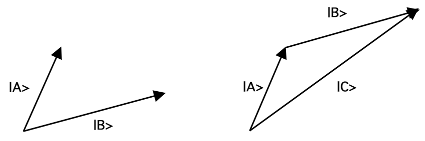
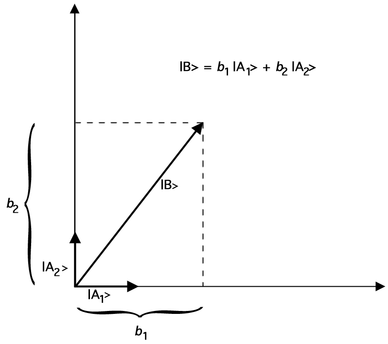

# 量子力学 Quantum Mechanics (Jenann Ismael)

*首次发表于 2000 年 11 月 29 日；2025 年 1 月 18 日实质修订。*

至少在初见之下、至少在部分上，量子力学是一台预测微观粒子行为的数学机器——或者至少，是预测我们用来探究那些行为的测量仪器之行为的机器；就这一职能而论，它成绩斐然：论威力与精度，远胜我们迄今有过的任何理论。在数学层面，这个理论已被理解得清清楚楚：部件是什么、如何拼装、整体为何如此运转、一端喂入的信息如何变成另一端的输出，这些问题都有答案。这里“运转”取机械的意义，即可以靠描述齿轮与齿轮如何咬合来回答。至于它描绘了怎样的世界，则有争议；无论物理学家还是哲学家，对按量子力学来看世界 **究竟** 是什么样的，几乎全无共识。作最起码的解释，这个理论描述的是微观世界如何作用于宏观世界、如何影响我们测量仪器的一组事实，而仪器是用日常语言或经典力学的语言描述的。分歧聚焦于这样一个问题：一个按特定方式作用于我们仪器的微观世界，就其本身而言是什么样子、甚至可能是什么样子；或者说，那些仪器本身如何能由理论所描述的那类微观部件组装而成。[^note-1]

这正是一个解释所要提供的东西：对按量子力学来看世界是什么样子——就其本身、自下而上——给出的一个恰当说明。给出解释的种种困难（不只是某种令人安心的家常解释，即不只限于“世界与常识世界相去不远”的解释，而是任何解释都难）由本百科全书的其他条目处理。这里我们只关心这个理论的数学心脏，即它作为数学机器的一面；且无论其余部分情形如何——理论的 **这一** 部分是极为通顺的。

## 1 术语

物理系统按其不变的（或“独立于态的”）性质分为若干 **类型**；而一个系统在某时刻的 **态**，等于把它随时间变化的那些性质（“依赖于态的”性质）完备刻画出来。因此，要完备地描述一个系统，就要说明它属于什么类型，以及在它历史的每一时刻处于什么态。

**物理量** 是一族互斥而合起来穷尽的物理性质（熟悉这套讲法的人会认出：这是一族具有“划分之小胞”结构的性质）。知道一个量取哪类值，就能使我们对其构成性质之间的关系了解许多。例如，二值量的值构成一个两元集合；实值量的值构成一个具有实数结构的集合。这是一件我们会反复见到的事情的特例：知道用哪类数学对象表示某个集合中的元素（此处是物理量的值；往后则是系统可取的态，或属于该系统的量），就能告诉我们关于这些元素之间关系的极多东西——甚至可以说，是全部可知的东西。

在量子力学语境中，“**可观测量**”一词与“物理量”交替使用，应视为含义相同的技术术语。理论的早期开创者选用这个词绝非偶然，但当初选它的理由如今已不被普遍接受。一个系统的 **状态空间**，就是由它全部可能态构成的空间，[^note-2] 也就是刻画其内部诸量之取值在物理上可能怎样组合。在经典理论中，若其余诸量都随附于某组量，这组量通常被称作“基本的”或“根本的”；既然这些值在数学上可能的任何组合都物理可能，状态空间径可直接取它们为坐标。[^note-3] 例如，一个由 $n$ 个粒子组成的经典力学系统，通过指定 $6n$ 个实值量的值——系统中每个粒子三个位置分量、三个动量分量——所得到的状态空间是一个 $6n$ 维坐标空间。这类系统的每个可能态对应空间中一个点，空间中每个点也对应这类系统的一个可能态。量子力学的情况略有不同：有些组合方式在数学上说得通，却不对应物理上可能的态。后文会看到：量子力学的状态空间是一类特殊矢量空间，即希尔伯特空间，其内部结构比经典对应物更丰富。

**结构** 是定义了某些运算与关系的元素集合；**数学结构** 即元素为数学对象（数、集合、矢量）、运算亦为数学运算的结构；而 **模型** 则是用来表示世界中某个物理上有意义的结构的数学结构。

量子力学的心髓，尽在表示量子力学系统状态空间的那些希尔伯特空间之中。态与量之间的内部关系，以及由此蕴含的种种系统行为，全都编织在这些空间的结构里，体现在代表它们的数学对象如何相互关联之中。[^note-4] 这意味着：理解一个系统按量子力学是什么样子，与熟悉这些空间的内部结构密不可分。熟悉希尔伯特空间，并熟悉刻画矢量穿行路径的动力学定律。做到这一步，就等于按理论自己的话，把它所描述的系统里一切可知之事，全都掌握了。

所谓“熟悉”希尔伯特空间，我指的不只是拥有一份描述或一张地图——书架上放着一本量子力学教科书的人都有那个。我指的是像熟悉你居住的城市那样熟悉它。这是一种有程度之分的实践性知识，最好通过学习求解这样一类问题来获得：我如何从 A 到 B？能否不经过 C 就到达？最短路线是什么？物理系研究生要花多年工夫摸熟希尔伯特空间：辨认熟悉的地标，走熟大路小径，摸清密道与死胡同的位置，对整体地形形成感觉。他们学会在希尔伯特空间中认路，就像出租车司机学会在城里认路一样。

要着手处理与这个理论相关的哲学问题，需要多少这类知识？起初并不多：只需知道这片地形的几何中最一般的事实（何况它不像多数城市那样杂乱，组织得极有章法），以及（表示系统之态的）矢量在其中穿行的路径。这便是此处要介绍的：先来一点不难的数学，然后简明地讲一讲理论本身。

## 2 数学

### 2.1 矢量与矢量空间

**矢量** $A$，记作“${\lvert A \rangle}$”，是由长度 $|A|$ 与方向共同刻画的数学对象。归一化矢量是长度为 1 的矢量，即 $|A| = 1$。矢量可以相加、乘以常数（包括复数），也可以彼此相乘。矢量加法把任一对矢量映为另一个矢量。做法：平移第二个矢量，使其尾部与第一个矢量的尖端重合（二者长度与方向均不变），再从第一个矢量的尾部连到第二个矢量的尖端，所得即和矢量。这条规则称为平行四边形法则。例如，矢量 ${\lvert A \rangle}$ 与 ${\lvert B \rangle}$ 相加得矢量 ${\lvert C \rangle} (= {\lvert A \rangle} + {\lvert B \rangle})$，如图 1 所示：

*Figure 1*

图 1：矢量加法

用 $n$ 乘矢量 ${\lvert A \rangle}$（$n$ 为常数），得到一个方向与 ${\lvert A \rangle}$ 相同、长度为 ${\lvert A \rangle}$ 之长 $n$ 倍的矢量。

在实矢量空间中，矢量 ${\lvert A \rangle}$ 与 ${\lvert B \rangle}$ 的（内）积或点积，记作“${\langle A \mid B \rangle}$”，是一个标量：等于二者长度（或“模”）之积，再乘以两矢量间夹角 $\theta$ 的余弦：

$$ {\langle A \mid B \rangle} = |A| |B| \cos \theta $$

设 ${\lvert A_1 \rangle}$、${\lvert A_2 \rangle}$ 为长度是 1 的矢量（“单位矢量”），且 ${\langle A_1 \mid A_2 \rangle} = 0$。（这两个单位矢量间的夹角必为 90 度。）如此一来，任何二维矢量 ${\lvert B \rangle}$ 都可以用这两个单位矢量表示为：

$$ {\lvert B \rangle} = b_1 {\lvert A_1 \rangle} + b_2 {\lvert A_2 \rangle} $$

例如，下图展示 ${\lvert B \rangle}$ 如何被表示为两个单位矢量 ${\lvert A_1 \rangle}$ 与 ${\lvert A_2 \rangle}$ 之和：

*Figure 2*

图 2：用单位矢量相加表示 ${\lvert B \rangle}$

接下来须将内积 ${\langle A \mid B \rangle}$ 的定义改造一下，使之适用于复空间。设 $c^*$ 为 $c$ 的复共轭。（当 $c$ 是形如 $a \pm bi$ 的复数时，$c$ 的复共轭 $c^*$ 定义如下：

$$ [a+bi]^* = a-bi \\ [a-bi]^* = a+bi $$

于是，对一切复数 $c$ 都有 $[c^*]^* = c$，而 $c^* = c$ 当且仅当 $c$ 是实数。）这样，复空间中 ${\lvert A \rangle}$ 与 ${\lvert B \rangle}$ 的内积便可通过复系数的共轭定义如下。设 ${\lvert A_1 \rangle}$、${\lvert A_2 \rangle}$ 即前述单位矢量，${\lvert A \rangle} = a_1 {\lvert A_1 \rangle} + a_2 {\lvert A_2 \rangle}$ 和 ${\lvert B \rangle} = b_1 {\lvert A_1 \rangle} + b_2 {\lvert A_2 \rangle}$，则

$$ {\langle A \mid B \rangle} = (a_1^*)(b_1) + (a_2^*)(b_2) $$

内积最一般、最抽象的概念（上文已定义其两个特例）如下。${\langle A \mid B \rangle}$ 是矢量空间 $V$ 上的内积，当且仅当

1. ${\langle A \mid A \rangle} = |A|^2$，且当且仅当 $A=0$ 时 ${\langle A \mid A \rangle}=0$
2. ${\langle B \mid A \rangle} = {\langle A \mid B \rangle}^*$
3. ${\langle B \mid A+C \rangle}={\langle B \mid A \rangle} + {\langle B \mid C \rangle}$。

由此可得

1. ${\lvert A \rangle}$ 的长度是 ${\lvert A \rangle}$ 与自身之内积的平方根，即 $$ |A| = \sqrt{{\langle A \mid A \rangle}} $$

且

1. 当且仅当 ${\langle A \mid B \rangle} = 0$ 时，${\lvert A \rangle}$ 与 ${\lvert B \rangle}$ 互相垂直，即 **正交**。

**矢量空间** 是对加法与常数乘法封闭的矢量集合；**内积空间** 是定义了矢量乘法运算的矢量空间；这类空间的 **维数**，是其中能容纳的两两正交非零矢量的最大个数。

$N$ 维矢量空间中，任何 $N$ 个长度为 1 且互相正交的矢量都构成该空间的一个 **规范正交基**。设 ${\lvert A_1 \rangle}, \ldots, {\lvert A_N \rangle}$ 是这样一组单位矢量，那么空间中的每个矢量都可表为如下形式的和：

$$ {\lvert B \rangle} = b_1 {\lvert A_1 \rangle} + b_2 {\lvert A_2 \rangle} + \ldots + b_N {\lvert A_N \rangle}, $$

其中 $b_i = {\langle B \mid A_i \rangle}$。这些 $b_i$ 称为 $B$ 在 $A$ 基下的 **展开系数**。[^note-5]

请注意：

1. 对给定空间中所有矢量 $A$、$B$、$C$，$$ {\langle A \mid B+C \rangle} = {\langle A \mid B \rangle} + {\langle A \mid C \rangle} $$
2. 对以 $A$ 基表出的任何矢量 $M$ 与 $Q$，$$ {\lvert M \rangle} + {\lvert Q \rangle} = \sum_{i=1}^N (m_i + q_i) {\lvert A_i \rangle}, $$ 且 $$ {\langle M \mid Q \rangle} = \sum_{i=1}^N m_i^* q_i $$

矢量还有另一种写法：把它的（相对于给定基的）展开系数写成一列，如下：

$$ {\lvert Q \rangle} = \begin{bmatrix} q_1 \\ q_2 \end{bmatrix} $$

其中 $q_i = {\langle Q \mid A_i \rangle}$，而 $A_i$ 是选定的基矢。

处理无穷维矢量空间时，无法写出挑出一个矢量所需的完整展开系数列（它得无限长），于是改为写下函数（称为 $Q$ 的“波函数”，通常记作 $\psi(i)$），它以那些系数为值。也就是说，我们写下这个函数：

$$ \psi(i) = q_i = {\langle Q \mid A_i \rangle} $$

给定矢量空间中的任意矢量与任意一组基，就能得到该矢量在这组基下的波函数；反过来，给定一个矢量在特定基下的波函数，也能构造出以它为波函数的那个矢量。矢量上的多数重要运算恰好对应其波函数上的简单代数运算，因此这就是表示态矢量的惯用方式。

两个物理系统相互作用时便构成一个复合系统。与经典力学一样，量子力学也有一条规则，可从组件的状态空间构造复合系统的状态空间。规则说：由分别为 $A$ 与 $B$ 的状态空间 $H_A$ 与 $H_B$，得到这对系统的状态空间——即 $H_A$ 与 $H_B$ 的“张量积”，记作 $H_A \otimes H_B$。这条规则有两点要紧之处。其一，只要 $H_A$ 与 $H_B$ 是希尔伯特空间，$H_A \otimes H_B$ 也是；其二，关于 $H_A \otimes H_B$ 与 $H_A$、$H_B$ 如何关联，有些事实会给复合系统与其部分之间的关系带来惊人的后果。特别地，结果表明：复合系统的态并不由其组件的态唯一决定。这意味着——至少看起来意味着——按量子力学，关于复合系统存在这样一些事实（不只是关于其空间构型的事实），它们不随附于关于其组件的事实；也就是说，关于作为整体的系统存在一些事实，不随附于关于其部分的事实及这些部分在空间中的排列方式。这个理论特征的重要性怎么强调都不为过；这个理论的大多数难题，都以这样或那样的方式牵涉其中。

说得稍细一点：设 $\{v_{i}^A\}$ 是 $H_A$ 的一组规范正交基，$\{u_{j}^B\}$ 是 $H_B$ 的一组规范正交基，则序对 $(v_{i}^A, u_{j}^B)$ 之集被取作张量积空间 $H_A \otimes H_B$ 的规范正交基。记号 $v_i^A \otimes u_j^B$ 用于序对 $(v_{i}^A,u_{j}^B)$，而 $H_A \otimes H_B$ 上的内积定义为：[^note-6]

$$ {\langle v_i^A \otimes u_m^B \mid v_j^A \otimes u_n^B \rangle} = {\langle v_i^A \mid v_j^A \rangle} {\langle u_m^B \mid u_n^B \rangle} $$

这一构造的一个结果是：虽然 $H_A \otimes H_B$ 中的每个矢量都是可表为 $v^A \otimes u^B$ 形式之矢量的线性和，但并非空间中每个矢量自身都可表为该形式；由此可得：

1. 任何复合态都唯一地确定其组件的态。
2. 若 $A$ 与 $B$ 的态是纯态（即分别可由矢量 $v^A$ 与 $u^B$ 表示），则 $(A+B)$ 的态是纯态且由 $v^A \otimes u^B$ 表示；且
3. 若 $(A+B)$ 的态是纯态且可表为 $v^A \otimes u^B$ 的形式，则 $A$ 与 $B$ 的态是纯态；但是
4. 若 $A$ 与 $B$ 的态不是纯态（即它们是混合态，定义见下），则它们并不唯一确定 $(A+B)$ 的态；特别地，后者可以是一个无法表为 $v^A \otimes u^B$ 形式的纯态。

### 2.2 算符

**算符** $O$ 是矢量空间到其自身的映射：它把空间中的任一矢量 ${\lvert B \rangle}$ 映为该空间中的另一矢量 ${\lvert B' \rangle}$，即 $O {\lvert B \rangle} = {\lvert B' \rangle}$。**线性算符** 是满足如下性质的算符：

1. $O({\lvert A \rangle} + {\lvert B \rangle}) = O {\lvert A \rangle} + O {\lvert B \rangle}$，且
2. $O(c {\lvert A \rangle}) = c(O {\lvert A \rangle})$。

正如 $N$ 维空间中任一矢量都可以（相对于选定的一组基）写成 $N$ 个数构成的列，空间上任一线性算符也可以用列记法写成 $N^2$ 个数：

$$O = \begin{bmatrix} O_{11} & O_{12} \\ O_{21} & O_{22} \end{bmatrix}$$

其中 $O_{ij} = {\langle A_i \mid O \mid A_j \rangle}$，而 $A_N$ 是该空间的基矢。于是，线性算符 $O$ 作用于矢量 $B$ 的效果由下式给出：

$$\begin{align} O {\lvert B \rangle} &= \begin{bmatrix} O_{11} & O_{12} \\ O_{21} & O_{22} \end{bmatrix} \times \begin{bmatrix} b_1 \\ b_2 \end{bmatrix} \\ &= \begin{bmatrix} (O_{11}b_1 + O_{12}b_2) \\ (O_{21}b_1 + O_{22}b_2) \end{bmatrix} \\ &= (O_{11}b_1 + O_{12}b_2)|A_1\rangle + (O_{21}b_1 + O_{22}b_2|A_2\rangle \\ &=|B'\rangle \end{align}$$

在说明希尔伯特空间是什么之前，还需要两个定义；然后便可转入量子力学。${\lvert B \rangle}$ 是 $O$ 的、本征值为 $a$ 的 **本征矢量**，当且仅当 $O {\lvert B \rangle} = a {\lvert B \rangle}$。不同算符可以有不同的本征矢量，但本征矢量与算符的关系只取决于所论的算符与矢量，而不取决于表示它们所用的特定基；换言之，这一关系在基变换下不变。**厄米算符** 则是具有如下性质的算符：存在一组由其本征矢量构成的规范正交基，且这些本征值全为实数。

最后，**希尔伯特空间** 是定义了内积且具有完备性的矢量空间；所谓完备性，是指空间中矢量的任何柯西序列都收敛于空间中的一个矢量。一切有限维内积空间都完备，我把自己限于这类空间。无穷维情形带来若干复杂问题，在此阶段深究并无益处。

## 3 量子力学

量子力学有四条基本原理：

**(3.1)**

**物理态。** 每个物理系统都伴随一个希尔伯特空间；空间中的每个单位矢量对应该系统的一个可能纯态，而每个可能纯态也对应空间中的某个矢量。[^note-7]

**(3.2)**

**物理量。** 与系统相伴随的希尔伯特空间中的厄米算符表示物理量，其本征值表示测量这些量可能得到的结果。有一个算符称为哈密顿量，在量子理论中地位特殊：追踪系统的演化时，用它表述动力学最为便当。哈密顿量——记作 $H$ 或 $\hat{H}$——代表系统的总能量，其本征值就是测量总能量可能得到的结果。它由对系统各组件的动能与势能求和而得。

**(3.3)**

**组合。** 与复合系统相伴随的希尔伯特空间，是组成它的那些简单系统（在标准非相对论理论中即单个粒子）所伴随的希尔伯特空间的张量积。

**(3.4)**

**动力学。** a. “类型 1 语境”：给定系统在 $t$ 时刻的态以及它所受的力与约束，有一个方程——**薛定谔方程**——给出任何其他时刻的态：$U {\lvert v_t \rangle} \rightarrow {\lvert v_{t'} \rangle}$。[^note-8] 就我们的目的而言，$U$ 要点有三。其一，它是 **决定论的**：系统在某时刻的态，总能在其他时刻找到唯一对应。其二，它是 **幺正的**：它是该希尔伯特空间的自同构，一个保持线性结构与内积、映空间到自身的映射。其三，它是 **线性的**：若它把态 ${\lvert A \rangle}$ 带到 ${\lvert A' \rangle}$、把态 ${\lvert B \rangle}$ 带到 ${\lvert B' \rangle}$，就把任何 $\alpha {\lvert A \rangle} + \beta {\lvert B \rangle}$ 形的态带到 $\alpha {\lvert A' \rangle} + \beta {\lvert B' \rangle}$。

**b.**

“类型 2 语境”（“测量语境”）：[^note-9] 对处于态 ${\lvert A \rangle}$ 的系统就可观测量 $B$ 实施一次“测量”，其效果是使系统坍缩到与所观测到的本征值相应的那个 $B$ 本征态。这就是所谓的 **坍缩公设**。至于它坍缩到哪个特定的 $B$ 本征态，则是概率问题；概率由一条称为 **玻恩规则** 的规则给出： $$ \Pr(b_i) = |{\langle A \mid B=b_i \rangle}|^2 $$

关于这两类语境，有两点值得注意：

- 类型 1 与类型 2 语境之别尚待用量子力学的术语来阐明：尚无人能用理论提供的术语、以完全令人满意的方式说清哪些语境是测量语境；以及
- 即便这一区分能够成立，**是否真的存在** 类型 2 语境仍是一个悬而未决的解释性问题；也就是说，是否存在这样一些语境——系统在其中受薛定谔方程 **以外** 的动力学规则支配——这仍是一个开放问题。

## 4 希尔伯特空间上的结构

上文我曾指出：正如关于城中各处位置之间关系的全部信息，都体现在地图上代表这些位置的点之间的空间关系中；我们关于量子力学中态与量之间内部关系的全部信息，也都体现在代表它们的矢量与算符之间的数学关系中。[^note-10] 从数学观点看，量子力学与经典前身的真正区别在于：态与量具有更丰富的结构——它们构成的家族，成员之间有一张更有趣的关系网络。

量子系统行为中一切有物理后果的特征，都出自这些关系的数学性质；其中最重要者，可以容易地概述如下：

**(P1)**

在希尔伯特空间中将矢量相加或以标量相乘，无论怎么做，所得矢量仍在这个空间中。若所得矢量是归一化的，则按 (3.1) 它表示系统的一个可能态；而若它是一对具有相异本征值的、关于可观测量 $B$ 的本征矢量之和，则它本身并非 $B$ 的本征矢量，但按 (3.4b)，它将伴随一组概率，对应 $B$ 测量中出现这个或那个结果的机会。

**(P2)**

希尔伯特空间上的任何厄米算符，在同空间上都有别的算符与它不共享完整的本征矢量集；事实上，容易证明还存在与它毫无共同本征矢量的算符。

若再作几条附加的解释性假设，我们可以说得更多。例如，不妨假设

**(4.1)**

与系统相伴随的希尔伯特空间上的每个厄米算符都表示一个不同的可观测量，因而每个归一化矢量表示一个不同的态；而且

**(4.2)**

一个系统对可观测量 $A$ 具有取值，当且仅当表示其态的矢量是 $A$ 算符的本征态；此时它所具有的值，就是与该本征态相联系的那个本征值。[^note-11]

由 (P2) 并据 (3.1)：没有任何量子力学态是所有可观测量的本征态（实际上，确有一些可观测量彼此毫无共同本征态）；于是再据 (3.2)：任何量子力学系统都从不对其所属的全部量同时取值（实际上，确有一些量对，没有任何态对它们赋予同时的值）。

在一对希尔伯特空间 $H_1$ 与 $H_2$ 的张量积 $H_1 \otimes H_2$ 上存在厄米算符……若 $H_1$ 与 $H_2$ 是系统 $S1$ 与 $S2$ 的状态空间，则 $H_1 \otimes H_2$ 便是复合系统 $(S1+S2)$ 的状态空间。由此按 (4.1) 可得：存在属于 $(S1+S2)$ 的可观测量，其值并不由分别属于两系统的可观测量的值所决定。

这些全都是如下做法的直接推论：把希尔伯特空间中的矢量与算符分别当作态与可观测量的表示，并应用玻恩规则（以及后文的 (4.1) 与 (4.2)）来赋予态指派以经验意义。这一部分已完全清楚；理解量子力学，难就难在把握这些推论在物理、形而上学、认识论三个层面的意涵。

凡是想弄清量子力学对世界说了什么的人，都得同一个余下的事实缠斗。这个问题不关乎希尔伯特空间，而关乎动力学——描述系统在空间中走过何种轨迹的那些规则。从物理的观点看，它比此前讨论的一切都更令人不安：它不仅给想为理论提供解释的人制造困难，还似乎指向理论基础中的一处逻辑矛盾。

设我们有一个系统 $S$ 与一台装置 $S^*$，后者测量 $S$ 上取值为 $\{a_1, a_2, a_3, ...\}$ 的可观测量 $A$。那么，$S^*$ 会有某个态（“基态”），而 $S^*$ 上会有某个可观测量 $B$，取值为 $\{b_1, b_2, b_3, ...\}$（称为它的“指针可观测量”——因为正是它扮演示意图中测量仪器正面表盘上指针的角色，来登记实验结果）。而且：若 $S^*$ 从基态启动、以适当方式与 $S$ 相互作用，而相互作用前一刻 $A$ 的值是 $a_1$，则相互作用后 $B$ 的值就是 $b_1$。若相互作用前 $A$ 的值是 $a_2$，则其后 $B$ 的值是 $b_2$。若相互作用前 $A$ 的值是 $a_3$，则相互作用后 $B$ 的值是 $b_3$，依此类推。这正是“$S^*$ 测量 $A$”的含义。于是，设我们用矢量 ${\lvert A=a_i \rangle}_s {\lvert B=b_i \rangle}_{s^*}$ 表示 $S$ 与 $S^*$ 的联合部分态。这一部分态规定 [$S$ 上的 $A$ 与 $S^*$ 上的 $B$] 如何取值；其值对应于给 $S$ 上被测可观测量与 $S^*$ 上指针可观测量所做的指派。再让“$\rightarrow$”代表对二者相互作用的动力学描述。那么，说 $S^*$ 是 $A$ 的一台测量仪器，就是说动力学定律蕴涵：

$$\begin{align} {\lvert A=a_1 \rangle}_s {\lvert B=\text{ground state} \rangle}_{s^*} &\rightarrow {\lvert A=a_1 \rangle}_s {\lvert B=b_1 \rangle}_{s^*} \\ {\lvert A=a_2 \rangle}_s {\lvert B=\text{ground state} \rangle}_{s^*} &\rightarrow {\lvert A=a_2 \rangle}_s {\lvert B=b_2 \rangle}_{s^*} \\ {\lvert A=a_3 \rangle}_s {\lvert B=\text{ground state} \rangle}_{s^*} &\rightarrow {\lvert A=a_3 \rangle}_s {\lvert B=b_3 \rangle}_{s^*} \end{align}$$

依此类推。[^note-12]

直观地说，$S^*$ 是可观测量 $A$ 的一台测量仪器，当且仅当 $S^*$ 具有某个可观察的特征。这特征是什么无所谓，只要其值能靠查看装置确定；它与馈入系统的 $A$ 值相关联，使我们能在相互作用之后从 $S^*$ 的可观察态读出那些值。用哲学的行话说：$S^*$ 是 $A$ 的测量仪器，当且仅当 $S^*$ 有某个可观察特征，它以适当的方式 **追踪** 或 **指示** 与它相互作用的系统的 $A$ 值。

现在，由上文 (3.1) 可得：$S$ 有多得数不清的态不是 $A$ 的本征态。若 $S$ 从其中某个态出发，考察薛定谔方程对 $S$ 与 $S^*$ 联合演化的论断，就会看到：相互作用后，这对系统所处之态，是 [$S$ 上的 $A$ 与 $S^*$ 上的 $B$] 诸本征态之叠加。测的是 $S$ 上哪个可观测量，无关紧要；$S$ 从哪个特定叠加出发，也无关紧要。只要把它馈入该可观测量的一台测量仪器，且相互作用确由薛定谔方程描述，结论便只取决于 $U$（实现这对系统由较早态向较晚态转变的算符）的线性。相互作用后，$S$ 与仪器的联合态，是复合系统上该可观测量诸本征态的叠加。

例如，设我们把 $S^*$ 置于基态，把 $S$ 置于态

$$ \frac{1}{\sqrt{2}} {\lvert A = a_1 \rangle}_s + \frac{1}{\sqrt{2}} {\lvert A=a_2 \rangle}_s $$

由复合系统状态空间的构成规则可知，这一对系统的联合态是

$$ \frac{1}{\sqrt{2}} {\lvert A=a_1 \rangle}_s {\lvert B=\text{ground state} \rangle}_{s^*} + \frac{1}{\sqrt{2}} {\lvert A = a_2 \rangle}_s {\lvert B = \text{ground state} \rangle}_{s^*} $$

再由 $S^*$ 是 $A$ 的测量仪器这一事实以及 $U$ 的线性可知，它们在相互作用 **之后** 的联合态是

$$ \frac{1}{\sqrt{2}} {\lvert A=a_1 \rangle}_s {\lvert B=b_1 \rangle}_{s^*} + \frac{1}{\sqrt{2}} {\lvert A = a_2 \rangle}_s {\lvert B = b_2 \rangle}_{s^*} $$

然而，这与类型 2 语境的动力学规则相矛盾。类型 2 语境的动力学规则（若这样的语境存在，此处便是一例）蕴涵：相互作用后这一对系统的态 **要么** 是

$$ {\lvert A=a_1 \rangle}_s {\lvert B=b_1 \rangle}_{s^*} $$

要么是

$$ {\lvert A=a_2 \rangle}_s {\lvert B=b_2 \rangle}_{s^*} $$

实际上，该规则还蕴涵：系统以恰为 $\frac{1}{2}$ 的概率终止于前者，以 $\frac{1}{2}$ 的概率终止于后者。

我们可以试着放弃类型 2 语境的动力学规则来恢复逻辑一致性（或者，等价地，干脆否认存在这类语境），但这样一来又冒出与经验一致的问题。因为那条规则被纳入理论绝非一时失误：系统处于某可观测量的本征态时是什么样子，我们 **知道**；测量之后测量装置处于指针可观测量之本征态，我们 **从观察中** 就知道。所以从一开始我们就 **知道**：一个理论若就测量装置在测量后的态告诉我们别的东西，无论那是什么，它就是错的。

要言之，这就是量子力学中的 **测量问题**。对理论的任何解释、任何按量子力学讲述世界样子的详细故事——尤其是世界中涉及测量的那些部分——都必须与它缠斗。

### 尚待厘清的几点

**混合态** 是纯态的加权和。它可以表示两类情形：一是系综——其成员各自处于不同纯态；二是个体系统——我们只了解其态之一部分。第一类情形下，权重反映系综中处于该纯态的成员多寡，也就是任取一成员而它处于该态的客观概率；第二种情形下，权重反映被指派该态的那个系统处于该态的认知概率。

如果不想抹平纯态与混合态之分，就需要一种办法来表示一组纯态的加权和（等价地，其相应概率函数的加权和）。这种办法要不同于把代表诸纯态的矢量加权相加；这意味着我们要么另寻表示混合态的办法，要么找到一种统一表示纯态与混合态、同时保住二者区分的办法。希尔伯特空间中有一类算符，称为 **密度算符**，恰好胜任后一角色；而且结果表明，把前文关于态矢量所说的一切改用密度算符重新表述，并非难事。所以，尽管人们口头上常把纯态说成由矢量表示，正式的规则却是：在量子力学中，态——无论纯态还是混合态——都由密度算符表示。

如前所述，混合态固然可以用来表示我们对系统的无知——即系统实际处于某个纯态而我们不知其为何时；在经典语境中，许多人也觉得这种做法足以解释混合物；但要把它一般地用于量子力学的混合物，却有严重的障碍。这些留待本百科全书其他量子力学条目详论。

严格说来，前文关于可观测量所说的一切，只适用于其取值构成离散集的情形；要把它推广到 **连续可观测量** 的情形，所需的数学细节颇为繁难，且会引出更具技术性的问题。这些同样最好留待详论。

以上应当就是着手从哲学上讨论量子力学所需的全部预备知识，但这只是第一步。对以下三点都值得继续深入：矢量与算符在希尔伯特空间中如何关联，简单系统空间如何构成复合系统空间，以及描述态矢量运动的方程。对这些了解得越多，就越能体会这个理论的问题既是什么、又难在何处。量子力学妙就妙在这份“倒挂”：学得越多，问题越难——正是这一点让哲学家对它兴味无穷。

## 脚注

[^note-1]: 的确，一经追问就会发现：我们甚至无法明确说出哪些系统算作宏观系统——或者同样有用的问法：哪些系统是“经典的”、哪些适合充当测量装置、哪些相互作用算作测量——而这还是在用理论提供的术语、用直接适用于（按理论自己的看法）构成世界的实体、量与关系的术语来说。

[^note-2]: 它有时也用来指称表示该空间的一个数学模型——一个为可能态集合提供某种地图的数学模型。

[^note-3]: 当然，如此得到的状态空间坐标描述带有任意性，其任意程度恰与为基本量的值选取数学名称的任意程度相当。

[^note-4]: 换个说法：若考察与任一量子力学系统相联系的态之集，你会发现它具有希尔伯特空间中矢量之集的结构。

[^note-5]: 请留意基与坐标系之间的对应：模为 1、沿 $N$ 维点空间诸垂直坐标轴方向的矢量，构成相应 $N$ 维矢量空间的一组规范正交基；点空间有多少种可能的坐标化，矢量空间就有多少组基。

[^note-6]: 读者可自行验证：由于 $(v_{i}^A, u_{j}^B)$ 张成 $H_A \otimes H_B$，该方程依线性性定义了整个空间上的内积；又由于 $|v| = 0$ 当且仅当 $v$ 为零矢量，可知 $v^A\otimes 0 = 0 = 0\otimes u^B$。

[^note-7]: 这个对应并非唯一：任何矢量 ${\lvert A \rangle}$ 与 $@ {\lvert A \rangle}$（$@$ 为绝对值为 1 的任一复数）都对应同一个态。可能还有别的冗余；例如，某些解释援引所谓的超选择定则，把由不同归一化矢量表示的态认同为同一个态。原理（i）将随下文混合态的定义而被修改。

[^note-8]: 该方程通常写作 $i \frac{dv}{dt} = \mathbf{H}v$ 的形式，其中 $v$ 是系统的态矢量，$\mathbf{H}$ 是表示系统能量的算符；不过，细节眼下并不重要。

[^note-9]: 加引号意在提醒：莫要把对这个词的日常理解过多掺入它在量子力学中的用法。人们通常把测量视为获取系统信息的方式，但对于一次个别的量子力学“测量”，关于被测系统在相互作用之前的态，我们能带走的信息只有一条：它并不处于被测可观测量之下、本征值不同于所观测值的那个本征态上（至少，它处于该态的概率为测度零）。当然，若坍缩公设正确，测量之后系统的态我们是知道的；可要是我在近距离开枪打人，我也能相当肯定那人随后会死——这并不使那次相互作用成为对其健康状况的一次测量。

[^note-10]: 当然，二者并非互不相干：一个系统的态，就是对属于它且随时间变化的那些量之取值的规定。一组元素之间的内部关系，是随附于诸元素内在本性的关系；其中不包含律则关系。

[^note-11]: 这两条都是强假设：第一条否认超选择定则的存在；第二条即所谓本征态-本征值链接，是界定该理论正统哥本哈根解释的原理。此处作出这两条假设，只是为了在解释语境中展示 (P2) 的若干推论。

[^note-12]: 相互作用后 $S$ 的约化态是否与相互作用前相同，并非要害；这只在一种特殊测量——即被测可观测量之值不受扰动的测量——中才成立。

## References（引用注释）

**以下文献从原文照录，不作翻译；中国文献译为中文。**

> 原文参考文献已转为脚注引用：文内“作者-年份”引用组后附 [^key] 标记，完整条目见本文末脚注定义。

### Books Useful For Beginners

### Helpful papers Deriving Quantum Mechanics from Simple Axioms

### Quantum Mechanics Textbooks

### Useful General Texts in Mathematics and Physics

### Books on Philosophy of QM

### General Texts on the Philosophy of QM

### More Specialized Readings

[^here-nd]: Here are some recent books that will be especially useful to beginners.
[^norsen-2017]: Norsen, T., 2017, *Foundations of Quantum Mechanics: An Exploration of the Physical Meaning of Quantum Theory*, Cham: Springer. This is a textbook for students who want to learn quantum mechanics, but learn it in a way that emphasizes physical clarity. The book covers topics of a standard introduction to quantum physics, but focuses attention on questions of ontology often glossed over in standard texts. The physics student who wants to learn quantum mechanics either as preparation for studying foundations or simply in a way that looks for clear answers to questions like ‘What are the basic objects in the quantum world?’, ‘What kinds of configurations can they assume?’, ‘How do they move and interact with one another?’ can do no better than starting here.
[^susskind-2014]: Susskind, L. and Friedman, A., 2014, *Quantum Mechanics: The Theoretical Minimum (2nd edition)*, New York: Basic Books. At 384 pages, this book isn’t as pithy as the title would suggest. It provides very clear presentation of the principles of quantum mechanics for the physics student without any previous background. This is how one would learn quantum mechanics in a standard university course.
[^hardy-2001]: Hardy, L., 2001 (v4), “[Quantum Theory from Five Reasonable Axioms](https://arxiv.org/abs/quant-ph/0101012)”, manuscript at arXiv.org.
[^schack-2002]: Schack, R., 2002 (v1), “[Quantum Theory from four of Hardy’s Axions](https://arxiv.org/abs/quant-ph/0210017)”, manuscript at arXiv.org.
[^darrigol-2015]: Darrigol, O., 2015, “‘Shut up and contemplate!’: Lucien Hardy’s reasonable axioms for quantum theory”, *Studies in History and Philosophy of Science* (Part B: Studies in History and Philosophy of Modern Physics), 52(B): 328–342.
[^there-nd]: There are a great many textbooks available for studying quantum mechanics. Here are a few especially important ones with some notes to guide choices among them. It is good to work with two or three texts when learning QM. No text is perfect and differences in approach can illuminate the subject from different angles.
[^ballentine-1998]: Ballentine, L., 1998, *Quantum Mechanics: A Modern Approach*, Singapore: World Scientific Publishing Company. This book is not recommended for beginners, and not recommended as a textbook. It is recommended once one has some technical background to deepen understanding of the fundamental concepts of quantum mechanics.
[^basdevant-2005]: Basdevant, J.L., and J. Dalibard, 2005, *Quantum Mechanics*, Berlin: Springer. This is a brief, but elegant introduction. There aren’t a great many problems, but detailed solutions are provided for those that are included. The book comes with a CD-ROM that is very helpful for visualization.
[^dirac-1930]: Dirac, P.A.M., 1930 [1958], *The Principles of Quantum Mechanics*, Oxford: Clarendon Press, 1930; 4th edition, revised, 1958. This is a classic, beautiful book that remains one of the clearest presentations of quantum mechanics. Everything is presented with extreme simplicity using Dirac’s formulation with non-commutative algebra. Even a beginner will be able to follow the presentation. The book emphasizes logical structure, in Dirac’s words: “problems were tackled top-down, by working on the great principles, with the details left to look after themselves.”
[^cohen-tannoudji-2006]: Cohen-Tannoudji, C., 2006, *Quantum Mechanics*, New York: Wiley-Interscience. This is a comprehensive, encyclopedic text. It’s not the best to learn from, but is a good reference book.
[^gasiorowicz-1995]: Gasiorowicz, S., 1995, *Quantum Physics* (3rd edition), New York: Wiley. This is a decent text, relatively well-written.
[^griffiths-1995]: Griffiths, D., 1995 [2018], *Introduction to Quantum Mechanics* (2nd edition), Upper Saddle River, NJ: Prentice Hall; 3rd edition, 2018. This is a standard undergraduate text for a first course in QM, and I would recommend it as a starting point for beginners. It is concise and very easy to read. There is an emphasis on conceptual development. Unfortunately, there are no worked examples in the book, and the answers to the problems are available only to instructors. It is easy to find and has recently been updated.
[^liboff-1998]: Liboff, R., 1998, *Introductory Quantum Mechanics* (4th edition), San Francisco: Addison-Wesley. This is a nicely designed book, relatively well-written. It is a good starting point for beginners, but not at comprehensive as Shankar.
[^merzbacher-1997]: Merzbacher, E., 1997, *Quantum Mechanics* (3rd edition), New York: Wiley. This is a standard graduate text in the US, not recommended for beginners, but quite good at an advanced level.
[^sakurai-1993]: Sakurai, J.J., 1993 [2021], *Modern Quantum Mechanics* (revised edition), Reading, MA: Addison Wesley; third edition, with coauthor Jim Napolitano, Cambridge: Cambridge University Press, 2021. This is generally used as a graduate text. It is well-written and there is emphasis on experimental phenomena and important questions like Bell’s Inequality. The material is introduced at a higher level than Griffiths and Shankar, with lots of mathematics. There is a wealth of problems, but unfortunately few solutions are provided, making it most useful in a classroom setting or in conjunction with a book that contains worked examples and derivations.
[^schwinger-2003]: Schwinger, J., 2003, *Quantum Mechanics* (corrected edition), Berlin: Springer. This book is extremely mathematical in emphasis. There is less emphasis on conceptual development, and it is best used after one has acquired a conceptual understanding of QM and wants to see the mathematical development. The approach is very revealing. It is a difficult text, in part because some of the formalism is abstract and unconventional, but it is well worth the effort to comprehend. The problems throughout are excellent, but again unfortunately, solutions are not included in the text.
[^shankar-1994]: Shankar, R., 1994, *Principles of Quantum Mechanics* (2nd edition), Berlin: Springer. This book is highly recommended as a starting point. It starts from ground zero, developing the mathematical tools needed to understand quantum mechanics. It is well written, and friendlier than Griffiths for students who are learning the subject on their own. QM is not introduced until page 115. The introductory chapter on linear algebra is very good. At 676 pages, it is comprehensive. It covers Feynman path integrals more thoroughly than other books, and contains solved problems. If you buy one book on QM, this is a good choice.
[^zettili-2009]: Zettili, N., 2009, *Quantum Mechanics: Concepts and Applications*, Chichester: John Wiley & Sons, Ltd. This is a very good book as well. It covers theory and problem solving in an integrated way. It is easy to follow and full of problems and solutions that are related to the experimental basis of the theory.
[^whether-nd]: Whether studying quantum mechanics on one’s own, or in a classroom setting, it is useful to have these books on hand as accompaniments. Even a seasoned teacher will find himself from time to time reaching for them:
[^benenson-2006]: Benenson, W., J. Harris, H. Stoecker, , and H. Lutz, 2006, *Handbook of Physics* (2nd edition), Berlin: Springer.
[^bronshtein-2007]: Bronshtein, I.N., and K.A. Semendyayev, 2007, *Handbook of Mathematics* (5th edition), Berlin: Springer.
[^halliday-2008]: Halliday, D., R. Resnick, and J. Walker, 2008, *Fundamentals of Physics* (8th edition), Hoboken, NJ: Wiley.
[^halmos-1957]: Halmos, P., 1957, *Introduction to Hilbert Space* (2nd edition), Providence: AMS Chelsea Publishing.
[^mechanics-nd]: The last three decades have been a golden age for studying foundations of quantum Mechanics. Most of the active research is published in journals. The discussion surrounding standard non-relativistic quantum mechanics has stabilized in a way that makes it possible to survey. Three recent books absorb and organize the work of these decades.
[^barrett-2019]: Barrett, J., 2019, *The Conceptual Foundations of Quantum Mechanics*, New York: Oxford University Press. This is a recent text on the history and conceptual foundations of quantum mechanics. It will serve an excellent primary text on the foundations of quantum mechanics for philosophy students, and will also make an excellent supplement to the standard quantum physics texts of physics students.
[^lewis-2016]: Lewis, P., 2016, *Quantum Ontology: A Guide to the Metaphysics of Quantum Mechanics* , New York: Oxford University Press. Lewis’s book gives a very good presentation of the most influential and well-developed interpretations of the formalism and provides an even-handed comparative assessment. It provides is an up-to-date survey of the landscape with sophisticated analysis and commentary. The book is well-suited for use in or for the layperson with a serious interest in foundations. The discussion is sophisticated without undue technicality and manages philosophical analysis in a jargon-free way.
[^maudlin-2019]: Maudlin, T., 2019, *Philosophy of Physics: Quantum Theory*, Princeton: Princeton University Press. This is an excellent, if challenging introduction to quantum foundations. The book is unparalleled in clarity and uncompromising in its insistence on ontological intelligibility. It is more selective than Lewis and Barrett’s book (it covers Everettian Quantum Mechanics and Bohmian Mechanics and Spontaneous Collapse theories, but the Copenhagen approach is dismissed because it doesn’t have an explicit ontology). The author makes no bones about where his own sympathies lie, but it will reward the study of any beginning student or seasoned practitioner.
[^albert-1994]: Albert, D., 1994, *Quantum Mechanics and Experience*, Cambridge, MA: Harvard University Press.
[^bell-1987]: Bell, J.S., 1987, *Speakable and Unspeakable in Quantum Mechanics*, Cambridge: Cambridge University Press.
[^busch-1991]: Busch, P., P. Lahti, and P. Mittelstaedt, 1991, *The Quantum Theory of Measurement*, Berlin: Springer-Verlag.
[^clifton-1996]: Clifton, R.K. (ed.), 1996, *Perspectives on Quantum Reality*, Dordrecht: Kluwer.
[^espagnat-1995]: d’Espagnat, B., 1995, *Veiled Reality*, Reading, MA: Addison-Wesley.
[^hughes-1989]: Hughes, R.I.G., 1989, *Structure and Interpretation of Quantum Mechanics*, Cambridge, MA: Harvard University Press.
[^omnès-1994]: Omnès, R., 1994, *The Interpretation of Quantum Mechanics*, Princeton: Princeton University Press.
[^primas-1983]: Primas, H., 1983, *Quantum Mechanics, Chemistry and Reductionism* (2nd edition), Berlin: Springer.
[^rae-1986]: Rae, A., 1986, *Quantum Physics: Illusion or Reality?*, Cambridge: Cambridge University Press.
[^redhead-1989]: Redhead, M.L.G., 1989, *Incompleteness, Nonlocality and Realism*, Oxford: Clarendon Press.
[^squires-1990]: Squires, E., 1990, *Conscious Mind in the Physical World*, Bristol, New York: Adam Hilger.
[^whitaker-1996]: Whitaker, A., 1996, *Einstein, Bohr and the Quantum Dilemma*, Cambridge: Cambridge University Press.
[^becker-2018]: Becker, A., 2018, *What is Real? The Unfinished Quest for the Meaning of Quantum Mechanics*, New York: Basic Books. This is a retelling of the early history of quantum theory that describes how Bohr’s influence persuaded a generation of physicists that the demand for a clear account of quantum ontology was somehow inappropriate. The book is a gripping tale of a turbulent time in the history of physics, when personalities clashed as deeply as philosophical sympathies.
[^carroll-2019]: Carroll, S., 2019, *Something Deeply Hidden: Quantum Worlds and the Emergence of Spacetime*, New York: Dutton. This is a lively development and well-written defense of the Everettian viewpoint that looks beyond standard non-relativistic theory and argues that the real lesson of quantum conundra and their reconciliation of quantum mechanics with General Relativity is the recognition that space-time is not fundamental.

## 学术工具

* [如何引用本词条](https://plato.stanford.edu/cgi-bin/encyclopedia/archinfo.cgi?entry=qm)。
* [预览本词条的 PDF 版本](https://leibniz.stanford.edu/friends/preview/qm/)，见 [SEP 学会之友](https://leibniz.stanford.edu/friends/)。
* 在 [InPhO](https://www.inphoproject.org/entity?sep=qm&redirect=True) 查找与本词条相关的话题与思想家。
* 在 [PhilPapers](https://philpapers.org/sep/qm/) 查看本词条的增强文献目录及其数据库链接。

## 其他网络资源

- Preskill, J.，1998，[量子计算](http://www.theory.caltech.edu/people/preskill/ph229/index.html#lecture)（加州理工学院 Physics 219 课程讲义）

## 相关词条

玻姆力学 | 坍缩理论 | 量子力学的哥本哈根诠释 | 埃弗雷特量子力学 | 科亨-施佩克尔定理（KS 定理） | 量子力学的多世界诠释 | 量子力学的模态解释 | 关系性量子力学 | 量子力学中退相干的作用

**（译注：相关词条的中文站内链接将由管线在对应词条重译完成后统一挂接。）**
