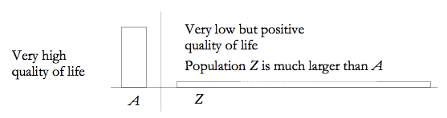
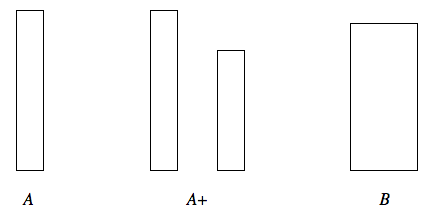

# 令人反感的结论 repugnant conclusion, the (Gustaf Arrhenius, Jesper Ryberg, and Torbjörn Tännsjö)

*首次发表于 2006 年 2 月 16 日；2017 年 1 月 16 日实质修订。*

在德里克·帕菲特最初的表述中，令人反感的结论是这样说的：“对任何至少有一百亿人、且人人享有极高生活品质的可能人口来说，总还存在某个大得多的可想见人口：在其他条件相同的情况下，这个人口的存在更好，尽管其成员的生活只是勉强值得一过”（Parfit 1984）[^parfit-1984]。这一结论把伦理学中一个如今称作 **人口伦理学** 的领域的问题凸显出来。近三十年来，哲学界对“多造些幸福的人，能否让世界变得更好？”“生儿育女有没有道德义务？”这类问题兴趣渐浓。核心难题在于：人数、生活质量（或一生的福祉——下文两词互换）与人的身份都可能变动，如何为这类事态的道德价值找到一种恰当理论？任何说得通的道德理论，在判定行动的规范地位时，都得顾及可能事态的这些方面，因此人口伦理学研究对整个道德理论都有普遍意义。顾名思义，帕菲特认为这个结论不可接受，不少哲学家也持同样看法。可是，要找到一种既躲开它、又不带出其他同样反直觉结论的理论，竟出奇地难。于是，如何对待令人反感的结论，以及它究竟透露了伦理学的什么本性，就成了现代伦理学的重大挑战之一。

## 1 如何走到令人反感的结论

有影响的道德观点会引出类似令人反感的结论这样的蕴含，帕菲特并非第一个发觉的人。亨利·西季威克差一点就承认了这一点。他指出：“……按照功利主义原则，人口该被鼓励增长到哪一点，并不在于平均幸福达到可能的最大值——马尔萨斯学派的政治经济学家似乎常这样假定——而在于幸福达到其最大值”(Sidgwick 1907，第 418 页；其他早期文献见 Broad 1930，第 249–250 页；McTaggart 1927，第 452–53 页；Narveson 1967)[^broad-1930][^mctaggart-1927][^narveson-1967][^sidgwick-1907]。不过，真正把这个结论推到晚近哲学聚光灯下的还是帕菲特：他一面强调其分量，一面揭示出要绕开它有多难(Parfit 1984)[^parfit-1984]。

帕菲特走到令人反感的结论，是出于这样一个考虑：我们的决定会影响到未来谁将出生，这时我们应当如何行事？请比较下面两个情形(见 Parfit 1984 第 16 章)[^parfit-1984]：

1. 一位孕妇患了病。只要接受一次简单治疗就能治好；若不治疗，孩子会落下永久性缺陷，一生都要承受相当多的痛苦。治好之后，孩子便不会有这样的缺陷。
2. 一位妇女患了病。这意味着她现在若怀孕，孩子会落下永久性缺陷，一生都要承受相当多的痛苦。她若把怀孕推迟几个月，等病好了再怀，孩子便不会有这样的缺陷。

两位妇女各该怎么做？情形 (1) 的答案很清楚：母亲应当接受治疗，因为孩子因此能过上好一些的生活。可到了情形 (2)，再拿“某个孩子的生活会改善”当理由去行动（即推迟怀孕），就讲不通了。因为这位妇女若推迟怀孕，被带到世上的孩子，就跟她带病怀孕会有的那个孩子不是同一个（相遇的卵子与精子都不同）。于是，对母亲患病期间出生的那个孩子来说，替代选项就是不存在；说“母亲若推迟怀孕，对这孩子更好”，就等于说“这孩子不存在对它更好”。假定这孩子的一生值得一过，这话看来就是错的，甚至毫无意义。再说，情形 (2) 里有两个假设的孩子，母亲推不推迟怀孕，两个孩子都不会因她的行动而得到“更好的生活”——两者的替代选项都是不存在：她带病推迟，第一个孩子不会存在；她不推迟，第二个孩子不会存在。（讨论见 Narveson 1967；Parfit 1984 附录 G；Adler 2012；Bykvist 2007c, 2015；Arrhenius & Rabinowicz 2015；McMahan 1981, 2009, 2013；Rabinowicz 2009；Holtug 2010；Fleurbaey & Voorhoeve 2015）[^adler-2012][^arrhenius-2015][^arrhenius-2015-2][^bykvist-2007c][^fleurbaey-2015][^holtug-2010][^mcmahan-1981][^narveson-1967][^parfit-1984][^rabinowicz-2009]。

在所比较的结果里，当事人换了一批，这该不该影响我们的道德评价？帕菲特把这件事称作“非同一性问题”（见“非同一性问题”词条）。他选了大概多数人都会觉得最靠谱的那个答案，称之为“无差别观点”(1984，第 367 页)：身份变了，答案不变。也就是说，情形 (2) 里的妇女应当推迟怀孕，正如情形 (1) 里的妇女应当接受治疗。要抓住无差别观点，最直白的办法是总体功利主义：最好的结果，就是使生活值得一过之物总量最大的那个结果(Parfit 1984，第 387 页)[^parfit-1984]。可这个观点蕴含：人口中生活质量的任何损失，都能用人口数量的足够增加来补偿——这就通向了令人反感的结论。请看下图：

**图 1。**

图 1

图中两个方块代表两个人口，*A* 与 *Z*。方块宽度表人数，高度表生活质量或一生的福祉。图中一切生活都值得一过。*Z* 中人的生活质量比 *A* 低得多，可 *Z* 的人数多得多，福祉总量也就大于 *A*。于是，尽管 *A* 中的人过得极好，*Z* 中的人仅勉强值得一过，按总体功利主义，*Z* 仍优于 *A*。本来是想给非同一性问题找一个说得通的解答，结果却弄出一个看来无法接受的结论。

就算把非同一性问题搁在一边，也还有别的论证说明：令人反感的结论没那么容易躲开。帕菲特就构造过一个。请看图 2 所示的三个入口情形。

**图 2。**

图 2

人口 *A* 里，人人享有极高的生活质量。人口 *A*+ 里有一群人，人数与 *A* 一样多，生活质量同样高；此外还有一批人，生活质量略低些。按帕菲特的术语，*A*+ 是从 *A* 经“纯粹增加”生成的。拿 *A* 与 *A*+ 相比，有理由说 *A*+ 优于 *A*，至少不更差——道理是：增加值得一过的生活，不会让人口变糟。再看人口 *B*：人数与 *A*+ 相同，人人都过着值得一过的生活，平均福利略高于 *A*+，却低于 *A*。*B* 在平均福利（从而总福利）与平等方面都更好，很难否认 *B* 优于 *A*+。可是，假如 *A*+ 至少不差于 *A*，*B* 又优于 *A*+，那么在各人口完全可比的前提下（即不计人口间可能的不可比），*B* 也优于 *A*。如此类推（*B*+ 与 *C*、*C*+ 等），最后落到人口 *Z*：其中一切生活的福利都只是极低的正值。结论就是 *Z* 优于 *A*——这正是令人反感的结论。一步一步看来都说得通，结果却荒唐。这就是悖论。那么，“纯粹”增加当真如所假定那样无害吗？若觉得可疑，也有办法绕开：从 *A* 这样的人口起步，添一些生活水平略低于 *A* 中人的新人，而添的方式要能 **提高** 现有人的福祉。然后沿着道德字母表往下，用这样的办法拉平最善者与最差者：给最差者的多过从最善者那里取走的；每一步都添些新人，好让这种改动成为可能(Parfit 1984；Tännsjö 2002)[^parfit-1984][^tännsjö-2002]。此外还有别的抽象论证指向同一方向，其中一些出自帕菲特本人（见 2.5 与 2.7 节）。看来，令人反感的结论确实极难绕过。

帕菲特在名著《理与人》里立下的主要挑战，是搞出一套仁善理论——他叫它“理论 X”。这理论要能解决非同一性问题，不引出令人反感的结论，从而挡住纯粹增加悖论，同时又不带出别的不可接受结论。可惜帕菲特自己的结论是：这套理论他没做出来。

对功利主义没多少好感的人，也许想把这个结论抛到一边，觉得它只是功利主义者的麻烦。可多数人倾向于相信：我们总归有 **某种** 义务让世界变好，至少在不违反任何义务论约束、自己代价又不算太高的时候。凡是这么想的人，即便不是功利主义者，也躲不开令人反感的结论。我们大可以假定，在图 1 的 *A* 与 *Z* 之间作选择时，别的价值与考量（承诺、权利之类）并不起决定作用。所以，只要一种道德理论承认“其他条件相同时，福祉至少要紧”，它就得面对令人反感的结论。

## 2 应对令人反感的结论的八条路径

有一批哲学家接下了帕菲特的挑战，琢磨什么才算令人满意的人口伦理学。有人认可帕菲特搭的框架，接着去发展一种能满足他最低充分性要求的伦理理论；也有人不太买账，或轻或重地挑战他对“合理理论”的要求。令人反感的结论始终是这场讨论的轴心。文献中对付它的建议，大致可分作八类：(1) 另造把福祉聚合成价值度量的方式；(2) 质疑比较与度量福祉的方式；(3) 按时间或模态特征分别计算福祉；(4) 修正“值得过的生活”这一概念；(5) 拒斥传递性；(6) 诉诸其他价值；(7) 承认令人满意的人口伦理学不可能；(8) 接受令人反感的结论。

### 2.1 另造把福祉聚合成价值度量的方式

#### 2.1.1 平均原则

面对令人反感的结论，最顺手的提议之一，是放弃总体功利主义，改用一条要求“人口中每个生命的 **平均** 福祉最大化”的原则。平均功利主义与总体功利主义在外延上等价：所比人口规模一样时，两者给出的排序相同。可一旦人数不同，二者就可能相差很远。把平均进路用到图 1、图 2 的人口比较上，这一点一目了然。若只有平均福祉要紧，那么平均福祉的损失就不能拿总福祉的增加来补偿。于是图 1 中 *A* 优于 *Z*，令人反感的结论被避开；图 2 中 *A* 优于 *A*+，纯粹增加悖论第一步就给挡住了。

尽管有这些好处，平均功利主义在哲学文献里却没赢得多少认同。原因在于它带出的蕴含大多被视为极度反直觉。比如：任何由极好生活构成的人口，都存在一个更好的人口——只由一人构成，其福祉水平还略高些(Parfit 1984 第 19 章)[^parfit-1984]。更夸张的是：若一个入口只有一人，福祉水平极低（比如终身受折磨），也另有一个更好的人口，里面数百万人生活的福祉水平只比它略低一点(Parfit 1984)[^parfit-1984]。当我们谈论的是值得结束的生活，总福祉居然不算数，这很难接受。何况平均功利主义还会引出与令人反感的结论十分相似的蕴含(见 Sikora 1975；Anglin 1977)[^anglin-1977][^sikora-1975]。

#### 2.1.2 可变价值原则

可变价值原则想在总体原则与平均原则之间折中。它的想法是：往人口里添一条值得过的生活，这份增量的价值随既有生命数而变——人少时添头大，人多时添头小(Hurka 1983, Ng 1989；Sider 1991)[^hurka-1983][^sider-1991]。照此说来，挪亚在大洪水之后生养众多的义务，就比我们今天的义务重得多。可变价值原则有时被叫作“折中理论”，因为可以说它正是总体功利主义与平均功利主义之间的折中(对更多福祉面向敏感的版本，见 Temkin 1997, 2012)[^temkin-1997]。人口小、福利高时，它像总体功利主义，把大部分价值判给福祉总量；人口大、福利低时，它学平均功利主义，把大部分价值判给平均福利。正是这一点使它有可能避开令人反感的结论：若额外生命的价值渐近递减，人口总价值就可能有个上限（正如无穷级数 1+1/2+1/4+ … 之和以 2 为上限）。只要图 1 中 *A* 的总价值高于这个上限，那边低质量的 *Z* 人口再多，*A* 也照样更可取(Hurka 1983, Ng 1989；Sider 1991；Temkin 1997, 2012)[^hurka-1983][^sider-1991][^temkin-1997]。

这些价值原则怎么精确化，蕴含就怎么变，批评者认为其中一些是致命的。比如黄有光的阐释(Ng 1989)：人口价值等于平均福利乘以生命数目的凹变换；照此，往人口里添负福利的人，竟可能比添正福利的人更好。更确切地说，黄有光的理论引出“施虐结论”(Arrhenius 2000a)[^arrhenius-2000a]：不管有多少条负福利生活（比如受折磨的生活），总有情形表明，添上这些生活比添上若干正福利生活更好。再者，说正福利的额外生命其价值渐近递减到某个上限，还算说得过去；可对负福利生活作同样的假定，就不太吸引人了。于是，只要承认一个合理的假定——添负福利生命的负价值并不随人口规模相对缩小——人口按比例扩张就能把好人口变成坏人口，这是所谓“荒谬结论”的一个版本(Parfit 1984)[^parfit-1984]。一百万条极高正福利生活加一条负福利生活，直觉上像是个好人口；但正福利的价值有上限，负福利的负价值却没有下限，按比例扩张下去（两百万正福利加两条负福利，三百万加三条，如此类推），到头来还是个坏人口。

#### 2.1.3 临界水平原则

另一条改造总体功利主义的路子，是设一个临界水平(Kavka 1982, Parfit 1984；Locke 1984；Blackorby *et al*. 1997, 2004, 2005；Broome 2004)[^blackorby-1997][^broome-2004][^kavka-1982][^parfit-1984]。和可变价值观点一样，它也把审慎价值与道德价值分开，只是分得更彻底：一条生命只有生活质量高过某个正临界水平，才对人口价值有正贡献；低于这个水平，其贡献价值或是中性的(Kavka 1982)[^kavka-1982]，或是负的(Blackorby *et al.* 1997, 2004, 2005；参见下文费尔德曼的理论)[^blackorby-1997]，或在人口排序中引入不可通约性或模糊性(Blackorby *et al.* 2005；Broome 2004；Rabinowicz 2009；参见 Parfit 2016)[^blackorby-2005][^broome-2004][^parfit-2016][^rabinowicz-2009]——哪怕此人过的生活值得一过。最简单形态下，临界水平观点是总体功利主义的改良版：一条生命的贡献价值，等于其福祉减去某个正临界水平；人口价值则是所有个体这些差额的总和。这样它就避开了令人反感的结论：只要临界水平高于 *Z* 中个体的福祉水平，按此观点 *Z* 的价值为负，自然劣于 *A*，结论就被挡住。

临界水平思路有个明显的难题：什么样的临界水平才算恰当？定得高，才躲得开各种版本的令人反感的结论；定得低，才不至于把添上明显良好的生活也排除掉(对这一挑战的尝试性回答，见 Blackorby *et al.* 1997；Broome 2004)[^blackorby-1997][^broome-2004]。批评者还怀疑另一个想法：添上值得过的生活（尽管低于临界水平），竟会对人口价值有负贡献。最后，已有论证表明这个观点会引出施虐结论（见上文）。

### 2.2 质疑比较与度量福祉的方式

令人反感的结论似乎靠的是某种福祉观：它把福祉当作可加的尺度，数值再低，只要自身相加的次数足够多，总能超过起初更大的任何数值。这就像实数的阿基米德性质：对任何正数 *x*、*y*，总有个自然数 *n*，使 *nx* 大于 *y*。所以 *A* 里有限多条生命，总能被 *Z* 里足够多的生命压过——低价值在数量上的增益压过了某些高价值的损失。然而一些理论家，包括帕菲特，主张这个价值论假定是错的。(Parfit 1986, 2016；Griffin 1986；Rachels 2001；Crisp 1988, 1992；Glover 1977；Edwards 1979；Lemos 1993；Skorupski 1999；Klint Jensen 1996；Portmore 1999；Riley 1993, 1999, 2008, 2009)[^crisp-1988][^edwards-1979][^glover-1977][^griffin-1986][^klint-1996][^lemos-1993][^parfit-1986][^portmore-1999][^rachels-2001][^riley-1993]。他们的想法是：一种善 α 可以比另一种善 β 更优越——任何数量的 α 都胜过任何数量的 β，或某个数量的 α 胜过任意数量的 β。不妨设想，从高质量的 *A* 沿字母表下滑到低质量的 *Z*，发生的是人生中最好的东西逐级丧失：按帕菲特的设想，*A* 到 *B* 的这一步丢掉了莫扎特的音乐，*B* 到 *C* 丢掉海顿的音乐，到 *D* 时威尼斯被毁，如此一路下去；最后到 *Z*，只剩“背景音乐和土豆”。照此主张，序列开头的生活所含的善，优越于末尾生活所含的善；人生中最值得的东西一旦失去，拿再多“背景音乐和土豆”也补不回来。于是不管 *Z* 里有多少人，比起 *A*，这个世界的福祉都更少，或者价值更低的福祉更少——令人反感的结论就此被挡住。

这个挡住结论的法子，显然先得假定优越论本身站得住(晚近的努力见 Parfit 2016)[^parfit-2016]。可批评者说，就算它站得住，这个观点仍可能跟某些版本的令人反感的结论兼容(如 Ryberg 1996b)[^ryberg-1996b]。何况优越论还有别的蕴含，未必好接受。假定日子有好有坏，可以按善的程度、或按其对一条生命福祉的贡献，排成一个逐级下降的序列。听起来可信的是：这样的序列可以存在，而其中任何两个相邻日子的质量只差那么一丁点。比如一条生命里的两天，差别仅在左手拇指被针扎了一下。再假定，如帕菲特所设想，有些日子的质量高到这种地步：过若干天这样的日子，胜过任意多天吃土豆、听背景音乐的日子。于是可以证明(Arrhenius 2005；Klint Jensen 2008)[^arrhenius-2005][^klint-2008]：必有两类日子，姑且叫 α 日与 β 日，使若干 α 日优于任何数目的 β 日，而两类日子之间的质量差异却只是边际的。

### 2.3 按时间或模态特征分别计算福祉

还有一条进路认为，人口伦理学的症结在于道德过于“非人格”，只要转向所谓“影响个人的”道德，问题就能解决(Narveson 1967, 1976, 1978；Roberts 1998, 2002, 2004, 2007, 2011)[^narveson-1967][^roberts-1998]。这股风在医学伦理里尤其盛行，因为人口伦理学的许多问题在那里都成了现实：胚胎或卵子选择、植入前基因检测、辅助生殖、堕胎，等等，仅举几例。这条进路的核心是一条主张——有时叫“影响个人的限制”，有时干脆叫“口号”：一个结果只有对某人更好（或更糟），才谈得上比另一个结果更好（或更糟）(Narveson 1967: Glover 1977；Temkin 1993a)[^glover-1977][^narveson-1967][^temkin-1993a]。若把这条限制作相当严格的解释，再假定“非存在与存在对一个人来说价值上不可比”，就会得出一种叫 **比较主义** 的观点。它主张：凡是唯一可实现的人——即只在所比结果之一里存在的人——其福祉一概不计(Heyd 1988；Bykvist 1998)[^bykvist-1998]。这样理解的影响个人的道德，在几处要紧地方偏离非人格的道德。假如 *A* 与 *Z* 的人口有重叠，那么 *A* 排在 *Z* 之前：两边都在的人一到 *Z* 就过得更差，而唯一可实现者的福祉又不计。可要是两边的人是不同的——比如两个未来人口——那就只好判为一样好，或价值上不可比；拿这个回答令人反感的结论，实在不能令人满意。再者，比较主义蕴含：唯一可实现者的福祉损失再大，也能被非唯一可实现者的极小增益抵消。把这条限制和比较主义解释得宽松些，可以在一定程度上绕开上述麻烦，但代价是令人反感的结论又回来了(Arrhenius 2009a；Holtug 2004)[^arrhenius-2009a][^holtug-2004]。

“非人格”与“影响个人”之分，文献里不止比较主义一种解读。不过，打着影响个人的道德旗号的各种理论有个共同点：都是福利主义理论，只是按生命的时间位置或模态特征，对人的福祉作不同计算。除了比较主义者，还有 **现在主义者**，把现在存在的人与非存在的人分开(Narveson 1973；Heyd 1988)；有 **必然主义者**，把不管我们怎么做都会存在（或将会存在）的人，与存在取决于我们选择的人分开(Singer 1993)[^singer-1993]；还有 **现实论者**，把在现实世界中已存在、现存在或将会存在的人，与未存在、现不存在、也不会存在的人分开(Bigelow and Pargetter 1988；Warren 1978；Parson 2002；对现实论的批判性讨论见 Carlson 1995；Arrhenius 2000b；Bykvist 1998, 2007b；Hare 2007；Howard-Snyder 2008)[^arrhenius-2000b][^bigelow-1988][^bykvist-1998][^carlson-1995][^hare-2007][^howard-snyder-2008][^parson-2002][^warren-1978]。这些理论除了各自的麻烦，还会掉进跟上面比较主义类似的问题里。比如现在主义的严格形态只算现在存在者的福祉，于是蕴含：现在人的任何一丁点增益，都能压过未来人的任何损失，不管那损失多大。把现在主义解释得宽松些(Dasgupta 1988, 1994)[^dasgupta-1988]，能在一定程度上绕开这个问题及其相关问题，但代价还是令人反感的结论又冒出来。

实际上，现在主义、必然主义、现实论究竟能不能躲开上面针对“非人格”理论谈的那些问题，尤其是令人反感的结论，并不清楚。举例说，*A* 是个人口，由现在人组成（比如 *x* 国的现有居民），福利极高；*B* 是更大的现在人口（比如 *y* 国的现有居民），福利极低，总福利却高于 *A*。按现在主义，哪个更好？这就全看现在主义者挑什么方法来判定“就现在人的福祉而言”何者更好、更糟、一样好。既然这一情形只涉及现在人，上面谈过的问题全都会在寻找这个方法的过程中重现。必然主义、现实论亦复如是。况且，这条限制未必帮我们躲开令人反感的结论，反倒在某些同样有吸引力的条件配合下把它蕴含出来(Arrhenius 2015)[^arrhenius-2015][^arrhenius-2015-2]。

### 2.4 修正“值得过的生活”概念

上文的讨论默认：有生活质量极高的可能生活。可克里斯托夫·费希格(1998)与戴维·贝纳塔(2006)主张，根本不存在享有正福利的生活。贝纳塔说，一个人开始存在，永远比从未存在更糟。费希格说，只有落空的偏好才算数，而且算负分；满足了的偏好没有正价值。这些“叔本华式”理论蕴含：不存在具正福利的可能生活；相反，大多数生活的福利为负，最好的可能生活也只有中性福利。

假如这样一种福祉理论是真的，令人反感的结论就变得可接受了吗？某种意义上是的：它会让这个结论落空，变成一个空洞的真理。既然不存在生活质量极高的可能生活，那么“对任何具有极高生活质量的可能人口……”这一前件对任何可能人口都是假的，结论也就空洞地真。这样一来，总体功利主义蕴含令人反感的结论，只在一种琐屑、无趣的意义上成立。

不过，贝纳塔理论的逻辑已遭质疑(Bradley 2010)[^bradley-2010]；而且一种否认“值得过的生活”之可能的福祉理论，实在颇违直觉(Ryberg 1996a)[^ryberg-1996a]。比如按费希格理论，一年完全满足偏好的生活，其福祉等于百年圆满的一生，还高于百年里只差一个偏好没满足的生活。可后面这种生活，按它说并不值得一过。

### 2.5 拒斥传递性

令人反感的结论之所以让人困惑，是因为强有力的论证似乎硬把人推向它。事实上已有一批这样的论证——思路与上文的纯粹增加推理相近(参见如 Parfit 1986；Arrhenius 2000b；Kitcher 2000；Tännsjö 2002；Rachels 2004)[^arrhenius-2000b][^kitcher-2000][^parfit-1986][^rachels-2004][^tännsjö-2002]。大致说来，这些论证的骨架相同：比较三个入口情形，第二个优于第一个，第三个优于第二个，于是第三个优于第一个；把这条推理反复用下去，就得到令人反感的结论(*Z* 优于 *A*)。对付这类论证，较激进的办法之一是干脆拒斥“优于”（或“同样好于”）的传递性。按传递性，若 *p* 优于 *q*、*q* 优于 *r*，则 *p* 优于 *r*；一旦否认“优于”的传递性，通向结论的那条推理就断了(Temkin 1987, 2012；Persson 2004；Rachels 2004)[^persson-2004][^rachels-2004][^temkin-1987]。

这个激进提议先要回答一个问题：是纯粹增加悖论这类论证本身就足以证成对传递性的拒斥，还是需要更多论证？毕竟传递性看来是“优于”这一关系的意义与逻辑的一部分(Broome 2004)[^broome-2004]。不过有人提出，其实有两个“优于”概念：一个基于内在价值，一个基于人该对被评价对象采取什么态度(Arrhenius 2004；Rabinowicz 2012)[^arrhenius-2004][^rabinowicz-2012]。前者因其意义而传递；后者面对不同的备选项集合则不传递，就像“应当被选择”一样。坦金(2012)还主张，对实践推理要紧的恰是后一个概念。这样一来，就得追问这一提议对道德和实践推理有哪些更一般的蕴含，也有人担心：放弃“优于”的传递性，等于要求对实践推理观念作大修(Temkin 1987, 2012)[^temkin-1987]。在经济与理性选择理论里，偏好排序的传递性一向被当作理性行为者定义的一部分。偏好不传递的行为者，似乎会被人用“抽钱机”榨干(见“经济学哲学”词条第 5.1 节)。然而道德理论里不传递的价值排序，最大的麻烦是它撑不起“人应当选择什么”的满意答案。举例说，配上后果主义的标准表述(一个行动是对的，当且仅当其结果至少与一切备选行动的结果一样好；见“后果主义”词条)，就会得出反直觉的结果：在纯粹增加悖论里，任何行动都不对。何况已有论证表明，纯粹增加论证之类可以在规范层面重构，用“人应当选择什么”来表述，而不靠传递性(Arrhenius 2004)[^arrhenius-2004]。这样得到的不是人口的不可传递排序，而是所有可选行动都被禁止的局面，也就是道德困境。看来，想靠放弃“优于”的传递性这类形式条件来驱除人口伦理学的悖论，怕是办不到。

### 2.6 诉诸其他价值

弗雷德·费尔德曼提出过一个按应得调整的功利主义版本，叫“公正主义”，声称它避得开令人反感的结论(Feldman 1997)[^feldman-1997]。在公正主义里，一段快乐的价值不只取决于快乐水平，还取决于接受者的应得水平。费尔德曼的提议是：有一种幸福水平，人人仅因生而为人便应得。他假定这水平相当于 100 单位快乐，而福利极低的人只享有 1 单位快乐。他给算了一笔账：应得 100 单位、恰好得到 100 单位的人，其生命内在价值是 200；应得 100 单位、却只得到 1 单位的人，其生命内在价值是 −49。由此，凡由福利极低、应得水平 100 的人构成的人口，价值为负；凡福利极高的人口，价值为正。这么看，公正主义似乎躲开了令人反感的结论。而且，费尔德曼解释这结论为何不可接受时所诉诸的直觉相当有说服力。那直觉是：总有一种福祉水平，人仅因为是人就该得到。这一直觉大概流传甚广，还能给上文谈的临界水平观点之类的想法撑腰。

不过有人指出，费尔德曼对令人反感的结论里 **其他条件不变** 条款的解读可疑(Arrhenius 2003)[^arrhenius-2003]。他默认：只要所比人口中人的应得水平相同，**其他条件不变** 就算满足了。更合理的读法是：当且仅当所比人口在福祉以外的一切价值论相关方面——包括其“应得价值”——大致同样好时，这一条款才满足。如此，要满足 **其他条件不变**，所比人口就得在应得方面同样好，也就是在“人应得什么”与“人得到什么”之间那种匹配的贡献价值上同样好。按这个解释，公正主义其实蕴含令人反感的结论：只要 *A* 与 *Z* 在应得方面同样好，公正主义就把 *Z* 排在 *A* 之前，因为 *Z* 的总福利更大。

还可以试试用平等主义考量来解纯粹增加悖论。再看图 2 里的 *A* 与 *A*+。按一条著名原则“最大化最小值”，人口该按最差者的福祉排序：最差者过得越差，人口越糟。它把 *A*+ 判为劣于 *A*，第一步就止住了纯粹增加悖论。可最大化最小值在人口伦理学里还有别的反直觉蕴含：它等于让最差者独裁——最差者里某人的福祉稍有增益，就能压过任意多境况较好者的巨大损失。

可 *A*+ 显然比 *A* 更不平等，说它在这方面劣于 *A*，也不算不讲理。比如按坦金(1993a，第 200 页)说：“平等主义的根本直觉是：有些人并非因自己的过错而境况不如他人，这是坏事。”*A*+ 正是如此：多出来的人没做过什么，不该比境况较好者差。坦金还提议，最差者越多，不平等越严重。(Temkin 1993a，第 200–2 页)[^temkin-1993a]。而在纯粹增加悖论里，要靠福祉再分配走到 *Z* 人口（见图 1），境况较差的额外人数必须极其庞大，所涉的不平等也就相当可观。这样看来，平等主义关切能解纯粹增加悖论，至少表面上说得通。

但关键问题是：通盘考虑，不平等是否使 *A*+ 劣于 *A*？*A*+ 在总福利上明显优于 *A*，多元主义平等主义者要下这个判断，就得压低总福利相对于不平等的重要性。这方面他们有几条有希望的路子，只是经不经得起进一步推敲还不好说。对平等主义进路更麻烦的是：令人反感的结论可以从平等主义者并无决定性异议的条件里推出来(Tännsjö 2008；Arrhenius 2009b)[^arrhenius-2009b][^tännsjö-2008]。

### 2.7 接受令人满意的人口伦理学不可能

帕菲特在《理与人》里查了个遍，也没找到他想要的理论 X——那种既躲开令人反感的结论、又躲开其他同样不诱人结论的理论；不过他似乎并未因此放弃希望(Parfit 1984 第 451 页)[^parfit-1984]。另一些理论家则对这场寻求更悲观，并把悲观写成了较形式化的样子：可以证明，不存在满足一组看来合理之充分性条件的人口伦理学。这样的证明已有人给出好几个(Arrhenius 2000b, 2011)[^arrhenius-2000b]。这类定理究竟说明了伦理学的什么，并不很清楚。阿伦尼乌斯说，一个不可能性定理留给我们三条路：(1) 放弃定理所依据的某些条件；(2) 当道德怀疑论者；(3) 想办法把那些证明的分量解释掉——哪条都不好选(参见 Temkin 2012)[^temkin-2012]。

### 2.8 接受令人反感的结论

面对令人反感的结论，许多人一致认为它极度反直觉。但有人提出：就此断定它在道德上不可接受，为时过早。支持“应当接受”的理由有两类。第一类说，结论反直觉不假，可有些理论考量分量更重，重到我们该接受它——比如“没有哪种说得通的理论能躲开这个结论”，或“拒斥它就得拒斥那些绕不过去的主张（例如纯粹增加悖论的前提）”(Tännsjö 2002；Holtug 2004；Huemer 2008)[^holtug-2004][^huemer-2008][^tännsjö-2002]。第二类说，结论之所以显得不可接受，是因为我们的直觉上了当(Sikora 1978, 2004；Mackie 1985；Tännsjö 1992, 1998, 2002；Hare 1993；Ryberg 1996a, 2004)[^hare-1993][^mackie-1985][^ryberg-1996a][^sikora-1978][^sikora-1978-2][^tännsjö-1992]。等我们完全弄清它说的是什么，就不会再觉得反直觉了。比如，有人提出反感至少部分来自我们对大数目把握不住(Tännsjö 2002；Broome 2004)[^broome-2004][^tännsjö-2002]：亿万又亿万的人是什么光景，我们根本想象不出，所以直觉并不建立在 *Z* 之道德意义的可靠图景上(对这些论证的批判性讨论，见 Temkin 2012 与 Pummer 2013)[^pummer-2013][^temkin-2012]。还有几位理论家说，我们的直觉被另一种误解带偏了：误以为 *Z* 里的生活——那种仅勉强值得过的生活——很糟，其实未必。一旦明白这种生活并不凄惨，或许跟寻常有特权者的生活差不多少，结论就不刺人了(Mackie 1985；Tännsjö 1992；Ryberg 1996a)[^mackie-1985][^ryberg-1996a][^tännsjö-1992]。照这两类看法，人口伦理学固然可能是伦理研究中一个复杂的领域，至少不再包含传统上所谓核心挑战之一了。

可这个结论未必能给人多少安慰。还有别的不可能性结果：它们的充分性条件不是躲开令人反感的结论，而是躲开直觉上更难接受的“极令人反感的结论”。该结论说：对任何福利极高且完全平等的人口，以及对任何数目的、福祉极度为负的生命，总存在一个人口。它由那些负福利生命加上极低正福利生命构成，在其他条件相同的情况下，优于那个高福利人口(Arrhenius 2011)[^arrhenius-2011]。这个结论看来比令人反感的结论更难咽下。这里比的是一边人人生活质量极高，另一边的人要么只有极低正福利，要么极度负福利（各种程度的可怕痛苦都可能）。就算接受令人反感的结论，也未必得接受极令人反感的结论：比方说，我们可以接受前者而不接受后者，因为痛苦在道德上分量更重。所以，要驱除人口伦理学的悖论，光说明我们对令人反感的结论的直觉有错、或认识上不可靠，还不够；还得对极令人反感的结论也说明这一点——这在许多人看来，要求高得离谱。

## References（引用注释）

**以下文献从原文照录，不作翻译；中国文献译为中文。**

> 原文参考文献已转为脚注引用：文内“作者-年份”引用组后附 [^key] 标记，完整条目见本文末脚注定义。

[^adler-2012]: Adler, M., 2012, *Well-Being and Fair Distribution: Beyond Cost-Benefit Analysis*, Oxford: Oxford University Press.
[^anglin-1977]: Anglin, B., 1977, “The Repugnant Conclusion,” *Canadian Journal of Philosophy*, 7 (4): 745–754.
[^arrhenius-2000a]: Arrhenius, G., 2000a, “An Impossibility Theorem for Welfarist Axiology”, *Economics and Philosophy*, 16: 247–266.
[^arrhenius-2000b]: –––, 2000b, *Future Generations: A Challenge for Moral Theory*, F.D. Dissertation, Uppsala: University Printers.
[^arrhenius-2003]: –––, 2003, “Feldman’s Desert-Adjusted Utilitarianism and Population Ethics”, *Utilitas*, 15 (2): 225–236.
[^arrhenius-2004]: –––, 2004, “The Paradox of Future Generations and Normative Theory”, in J. Ryberg and T. Tännsjö (eds.) 2004.
[^arrhenius-2005]: –––, 2005, “Superiority in Value”, *Philosophical Studies*, 123 (1-2): 97–114; reprinted in M. Zimmerman and T. Rønnow-Rasmussen (eds.), *Recent Work on Intrinsic Value*, Dordrecht: Springer, 2006.
[^arrhenius-2009a]: –––, 2009a, “Can the Person Affecting Restriction Solve the Problems in Population Ethics?” in M. Roberts & D. Wassermand (eds.) 2009.
[^arrhenius-2009b]: –––, 2009b, “Egalitarianism and Population Change” in A. Gosseries & L. Meyer (eds.) 2009.
[^arrhenius-2011]: –––, 2011, “The Impossibility of a Satisfactory Population Ethics” in H. Colonius & E. Dzhafarov (eds.) 2011.
[^arrhenius-2015]: –––, 2015, “The Affirmative Answer to the Existential Question and the Person Affecting Restriction,” in I. Hirose and A. Reisner (eds.), *Weighing and Reasoning*, Oxford: Oxford University Press, 110–128.
[^arrhenius-2015-2]: Arrhenius, G. & Rabinowicz, W., 2015, “The Value of Existence,” in I. Hirose and J. Olson (eds.), *Oxford Handbook of Value Theory*, Oxford: Oxford University Press, 424–444.
[^bayles-1975]: Bayles, M.D., 1975–76, “Harm to the Unconceived”, *Philosophy and Public Affairs*, 5: 292–304.
[^bayles-1980]: –––, 1980, *Morality and Population Policy*, Tuscaloosa: University of Alabama Press.
[^benatar-2006]: Benatar, D., 2006, *Better Never to have Been: The Harm of Coming into Existence*, Oxford: Oxford University Press.
[^bigelow-1988]: Bigelow, J., and Pargetter, R., 1988 “Morality, Potential Persons and Abortion”, *American Philosophical Quarterly*, 25 (2): 173–81.
[^blackorby-1997]: Blackorby, C., W. Bossert and D. Donaldson, 1997, “Critical Level Utilitarianism and the Population-ethics Dilemma”, *Economics and Philosophy*, 13: 197–230.
[^blackorby-2004]: –––, 2004, “Critical-Level Population Principles and the Repugnant Conclusion”, in J. Ryberg and T. Tännsjö (eds.) 2004.
[^blackorby-2005]: –––, 2005, *Population Issues in Social Choice Theory, Welfare Economics, and Ethics*, Cambridge: Cambridge University Press.
[^blackorby-1984]: Blackorby, C., and D. Donaldson, 1984, “Social Criteria for Evaluating Population Change”, *Journal of Public Economics*, 25: 13–33.
[^boonin-vail-1996]: Boonin-Vail, D., 1996, “Don’t Stop Thinking About Tomorrow: Two Paradoxes About Duties to Future Generations”, *Philosophy and Public Affairs*, 25 (4): 267–307.
[^bradley-2010]: Bradley, B., 2010, “Benatar and the Logic of Betterness,” *Journal of Ethics and Social Philosophy*, March: 1–5; [available online](http://www.jesp.org/articles/download/BenataronBetternessNote.pdf).
[^broad-1930]: Broad, C. D., 1930 (1979), *Five Types of Ethical Theory*, London: Routledge and Kegan Paul.
[^broome-1992]: Broome, J., 1992, *Counting the Cost of Global Warming*, Cambridge: The White Horse Press.
[^broome-1999]: –––, 1999, *Ethics out of Economics*, Cambridge: Cambridge University Press.
[^broome-2004]: –––, 2004, *Weighing Lives*, Oxford: Oxford University Press.
[^broome-2005]: –––, 2005, “Should We Value Population?,”*The Journal of Political Philosophy* 13 (4): 399–413
[^bykvist-1998]: Bykvist, K., 1998, *Changing Preferences: A Study in Preferentialism*, F.D. Dissertation, Uppsala University.
[^bykvist-2007]: –––, 2007, “The Good, the Bad, and the Ethically Neutral,” *Economics and Philosophy*, 23: 97–105.
[^bykvist-2007b]: –––, 2007b, “Violations of Normative Invariance: Some Thoughts on Shifty Oughts,” *Theoria*, 73: 98–120.
[^bykvist-2007c]: –––, 2007c, “The Benefits of Coming into Existence,” *Philosophical Studies*, 135 (3): 335–362.
[^bykvist-2015]: –––, 2015, “Being and Wellbeing,” in I. Hirose and A. Reisner (eds.), *Weighing and Reasoning*, Oxford: Oxford University Press, 87–94.
[^carlson-1995]: Carlson, E., 1995, *Consequentialism Reconsidered*, Dordrecht: Kluwer Academic Publisher.
[^carlson-1998]: –––, 1998, “Mere Addition and Two Trilemmas of Population Ethics,” *Economics and Philosophy*, 14: 283–306.
[^colonius-2011]: Colonius, H. & Dzhafarov, E. (eds.), 2011, *Descriptive and Normative Approaches to Human Behavior*, Advanced Series on Mathematical Psychology, Singapore: World Scientific Publishing Company.
[^crisp-1988]: Crisp, R., 1988, *Ideal Utilitarianism: Theory and Practice*, D. Phil. Dissertation, University of Oxford.
[^crisp-1992]: –––, 1992, “Utilitarianism and the Life of Virtue”, *The Philosophical Quarterly*, 42: 139–160.
[^dasgupta-1988]: Dasgupta, P., 1988, “Lives and Well-Being”, *Social Choice and Welfare*, 5: 103–126.
[^dasgupta-1994]: –––, 1994, “Savings and Fertility: Ethical Issues”, *Philosophy & Public Affairs*, 23: 99–127.
[^edwards-1979]: Edwards, R. B., 1979, *Pleasures and Pains: A Theory of Qualitative Hedonism*, New York: Cornell University Press.
[^fehige-1998]: Fehige, C., 1998, “A Pareto Principle for Possible People”, in C. Fehige and U. Wessels, eds., *Preferences*, Berlin: Walter de Gruyter, 508–543.
[^fehige-1998-2]: Fehige, C. and U. Wessels: 1998, “Preferences—An Introduction”, in C. Fehige and U. Wessels, eds., *Preferences*, Berlin: Walter de Gruyter, xx–xliii.
[^feldman-1995]: Feldman, F., 1995, “Justice, Desert, and the Repugnant Conclusion”, *Utilitas*, 7: 189–206.
[^feldman-1997]: –––, 1997, *Utilitarianism, Hedonism, and Desert: Essays in Moral Philosophy*, Cambridge: Cambridge University Press.
[^fleurbaey-2015]: Fleurbaey, M. & Voorhoeve, A., 2015, “On the Social and Personal Value of Existence,” in I. Hirose and A. Reisner (eds.), *Weighing and Reasoning*, Oxford: Oxford University Press, 95–109.
[^glover-1977]: Glover, J., 1977, *Causing Death and Saving Lives*, UK: Penguin Books.
[^glover-1992]: –––, 1992, “Future People, Disability, and Screening”, in P. Laslett and J.S. Fishkin (eds.), *Justice Between Age Groups and Generations*, New Haven: Yale University Press, 127–14
[^gosseries-2009]: Gosseries, A. & Meyer, L. (eds.), 2009, *Intergenerational Justice*, Oxford: Oxford University Press.
[^griffin-1986]: Griffin, J., 1986, *Well-Being: Its Meaning, Measurement, and Moral Importance*, Oxford: Clarendon Press.
[^hanser-1990]: Hanser, M., 1990, “Harming Future People”, *Philosophy and Public Affairs*, 19: 47–70.
[^hare-2007]: Hare, C., 2007, “Voices from Another World: Must We Respect the Interests of People Who Do Not, and Will Never, Exist?,” *Ethics*, 117: 498–523.
[^hare-1993]: Hare, R., 1993, “Possible People” in his *Essays on Bioethics*, Oxford: Clarendon Press, 67–83.
[^heller-1997]: Heller, J. C., & N. Fotion (eds.), 1997, *Contingent Future Persons*, Dordrecht: Kluwer Academic Publishers.
[^heyd-1989]: Heyd, D., 1989, “Procreation and Value: Can Ethics Deal With Futurity Problems?”, *Philosophia*, 18: 151–170.
[^heyd-1992]: –––, 1992, *Genethics. Moral Issues in the Creation of People*, Berkeley: University of California Press.
[^holtug-2004]: Holtug, N., 2004, “Person-Affecting Moralities,” in J. Ryberg and T. Tännsjö (eds.) 2004, 129–162.
[^holtug-2010]: –––, 2010, *Persons, Interests, and Justice*, Oxford: Oxford University Press.
[^howard-snyder-2008]: Howard-Snyder, F., 2008, “Damned If You Do; Damned If You Don’t!,” *Philosophia*, 36: 1–15.
[^hudson-1987]: Hudson, J. L., 1987, “The Diminishing Marginal Value of Happy People,” *Philosophical Studies*, 51: 123–137.
[^huemer-2008]: Huemer, M., 2008, “In Defence of Repugnance,” *Mind*, 117 (468): 899–933.
[^hurka-1983]: Hurka, T., 1983, “Value and Population Size”, *Ethics*, 93: 496–507.
[^kavka-1982]: Kavka, G.S., 1982, “The Paradox of Future Individuals”, *Philosophy and Public Affairs*, 11: 93–112.
[^kitcher-2000]: Kitcher, P., 2000, “Parfit’s Puzzle”, *Noûs*, 34: 550–577.
[^klint-1996]: Klint Jensen, K., 1996, *Om afvejning af værdier*, Ph.D. Dissertation, University of Copenhagen.
[^klint-2008]: –––, 2008, “Millian Superiorities and the Repugnant Conclusion,” *Utilitas*, 20: 279–300.
[^lemos-1993]: Lemos, N. M., 1993, “Higher Goods and the Myth of Tithonus”, *The Journal of Philosophy*, 90 (9): 482–496.
[^locke-1987]: Locke, D., 1987, “The Parfit Population Problem”, *Philosophy*, 62: 131–157.
[^mackie-1985]: Mackie, J. L., 1985, “Parfit’s Population Paradox”, in J. Mackie & P. Mackie (eds.) *Persons and Values*, Oxford: Oxford University Press.
[^mcmahan-1981]: McMahan, J., 1981, “Problems of Population Policy”, *Ethics*, 92: 96–127.
[^mcmahan-2009]: –––, 2009, “Asymmetries in the Morality of Causing People to Exist”, in M. Roberts & D. Wasserman(eds.) *Harming Future Persons: Ethics, Genetics and the Nonidentity Problem*, Berlin: Springer.
[^mcmahan-2013]: –––, 2013, “Causing People to Exist and Saving People’s Lives,” *The Journal of Ethics*, 17: 5–35.
[^mctaggart-1927]: McTaggart, J. M. E., 1927, *The Nature of Existence*, Cambridge: Cambridge University Press.
[^narveson-1967]: Narveson, J., 1967, “Utilitarianism and New Generations”, *Mind*, 76: 62–72.
[^narveson-1976]: –––, 1976, “Moral Problems of Population.”, in M.D. Bayles, ed., *Ethics and Population*, Cambridge, MA: Schenkman Publishing Company Inc., 59–80
[^narveson-1978]: –––, 1978, “Future People and Us.”, in R.I. Sikora and B. Barry, eds., *Obligations to Future Generations*, Philadelphia: Temple University Press, 38–60.
[^ng-1989]: Ng, Y.-K., 1989, “What Should We Do About Future Generations? Impossibility of Parfit’s Theory X”, *Economics and Philosophy*, 5: 135–253.
[^österberg-1996]: Österberg, J, 1996, “Value and Existence: the Problem of Future Generations” in S. Lindström, R. Sliwinski, and J. Österberg (eds.) *Odds and Ends* (Uppsala Philosophical Studies), Uppsala: Department of Philosopy, Uppsala University, 1996.
[^parfit-1976]: Parfit, D., 1976, “On Doing the Best for Our Children.”, in M.D. Bayles, ed., *Ethics and Population*, Cambridge, Mass.; Schenkman Publishing Company Inc., 100–115.
[^parfit-1982]: –––, 1982, “Future Generations: Further Problems”, *Philosophy and Public Affairs*, 11: 113–172.
[^parfit-1984]: –––, 1984, *Reasons and Persons*, Oxford: Clarendon Press.
[^parfit-1986]: –––, 1986, “Overpopulation and the Quality of Life.”, in P. Singer, ed., *Applied Ethics*, Oxford: Oxford University Press, 145–164. Reprinted in J. Ryberg and T. Tännsjö (eds.) 2004.
[^parfit-2004]: –––, 2004. “Postscript”, in J. Ryberg and T. Tännsjö (eds.) 2004, 257.
[^parfit-2016]: –––, 2016, “Can We Avoid the Repugnant Conclusion? ”, *Theoria*, 82 (2): 110–27.
[^parson-2002]: Parson, J., 2002, “Axiological Actualism”, *Australasian Journal of Philosophy*, 80 (2): 137–147.
[^persson-2004]: Persson. I., 2004, “The Root of the Repugnant Conclusion and its Rebuttal”, in J. Ryberg and T. Tännsjö (eds.) 2004, 187–200.
[^portmore-1999]: Portmore, D. W., 1999, “Does the Total Principle Have Any Repugnant Implications?” *Ratio*, 12 (1): 80–98.
[^pummer-2013]: Pummer, T., 2013, “Intuitions about large number cases” *Analysis*, 73 (1): 80–98.
[^rabinowicz-2003]: Rabinowicz, W., 2003, “Ryberg’s Doubts About Higher and Lower Pleasures—Put to Rest?”, *Ethical Theory and Moral Practice*, 6: 231–7.
[^rabinowicz-2009]: –––, 2009, “Broome and the Intuition of Neutrality”, *Philosophical Issues*, 19 (1): 389–411.
[^rabinowicz-2012]: –––, 2012, “Value Relations Revisited”, *Economics and Philosophy*, 28 (2): 133–164.
[^rachels-2001]: Rachels, S., 2001, “A Set of Solutions to Parfit’s Problems”, *Noûs*, 35: 214–238.
[^rachels-2004]: –––, 2004, “Repugnance or Intransitivity: A Repugnant but Forced Choice”, in J. Ryberg and T. Tännsjö (eds.) 2004, 163–186.
[^riley-1993]: Riley, J., “On Quantities and Qualities of Pleasure”, *Utilitas*, 5: 291–300, 1993.
[^riley-1999]: –––, 1999, “Is Qualitative Hedonism Incoherent?”, *Utilitas*, 11: 347–58.
[^riley-2008]: –––, 2008, “Millian Qualitative Superiorities and Utilitarianism, Part I”, *Utilitas*, 20: 257–78.
[^riley-2009]: –––, 2009, “Millian Qualitative Superiorities and Utilitarianism, Part II”, *Utilitas*, 21: 127–43.
[^roberts-1998]: Roberts, M. A., 1998, *Child versus Childmaker: Future Persons and Present Duties in Ethics and the Law*, Lanham, MD: Rowman & Littlefield.
[^roberts-2002]: –––, 2002, “A New Way of Doing the Best That We Can: Person-based Consequentialism and the Equality Problem”, *Ethics*, 112: 315–350.
[^roberts-2004]: –––, 2004, “Person-Based Consequentialism and the Procreation Obligation”, in J. Ryberg and T. Tännsjö (eds.) 2004, 99–128.
[^roberts-2007]: –––, 2007, “The Non-Identity Fallacy: Harm, Probability and Another Look at Parfit’s Depletion Example,” *Utilitas*, 19 (3): 267–311.
[^roberts-2011]: –––, 2011, “The Asymmetry: A Solution,” *Theoria*, 77: 333–367.
[^roberts-2009]: Roberts, M. A. & Wassermand, D., 2009 (eds.) *Harming Future Persons: Ethics, Genetics and the Nonidentity Problem*, Springer.
[^ryberg-1996a]: Ryberg, J., 1996a, “Is the Repugnant Conclusion Repugnant?”, *Philosophical Papers*, 25: 161–177.
[^ryberg-1996b]: –––, 1996b, “Parfit’s Repugnant Conclusion,” *The Philosophical Quarterly*, 46 (183): 202–213.
[^ryberg-1998]: –––, 1998, “Generation-Relative Ethics – A Critical Note on Dasgupta”, *Theoria*, 69 (1): 23–33.
[^ryberg-2002]: –––, 2002, “Higher and Lower Pleasures – Doubts on Justification”, *Ethical Theory and Moral Practice*, 5: 415–29.
[^ryberg-2004]: –––, 2004, “The Repugnant Conclusion and Worthwhile Living”, in J. Ryberg and T. Tännsjö (eds.) 2004, 239–256.
[^ryberg-2004-2]: Ryberg, J. and T. Tännsjö, 2004 (eds.), *The Repugnant Conclusion. Essays on Population Ethics*, Dordrecht: Kluwer Academic Publishers.
[^ryberg-2004-3]: Ryberg, J. and T. Tännsjö, 2004, “Introduction”, in J. Ryberg and T. Tännsjö (eds.) 2004, 1–6.
[^sider-1991]: Sider, T. R., 1991, “Might Theory X be a Theory of Diminishing Marginal Value?”, *Analysis*, 51: 265–71.
[^sidgwick-1907]: Sidgwick, H., 1907, *The Methods of Ethics*, 7th edition, London: Macmillan.
[^sikora-1975]: Sikora, R. I., 1975, “Utilitarianism: The Classical Principle and the Average Principle,” *Canadian Journal of Philosophy*, 5: 409–419.
[^sikora-1978]: –––, 1978, “Is It Wrong to Prevent the Existence of Future Generations?” In R. I. Sikora and B. Barry (eds.) 1978, 112–166.
[^sikora-1981]: –––, 1981, “Classical Utilitarianism and Parfit’s Repugnant Conclusion: A Reply to McMahan,” *Ethics*, 92: 128–133.
[^sikora-1978-2]: Sikora, R. I. & Barry, B. (eds.), 1978, *Obligations to Future Generations*, Philadelphia: The White Horse Press.
[^singer-1980]: Singer, P., 1980, “A Utilitarian Population Principle”, in Bayles (ed.) 1980, 81–99.
[^singer-1993]: –––, 1993 *Practical Ethics*, 2ⁿᵈ ed., Cambridge: Cambridge University Press.
[^sprigge-1968]: Sprigge, T.L.S., 1968, “Professor Narveson’s Utilitarianism”, *Inquiry*, 11: 332–346.
[^tännsjö-1992]: Tännsjö, T., 1992, “Who are the Beneficiaries?”, *Bioethics*, 6: 288–296.
[^tännsjö-1997]: –––, 1997, “Doom Soon?”, *Inquiry*, 40: 243–252.
[^tännsjö-1998]: –––, 1998, *Hedonistic Utilitarianism*, Edinburgh: Edinburgh University Press.
[^tännsjö-2002]: –––, 2002, “Why We Ought to Accept the Repugnant Conclusion”, *Utilitas*, 14, 339–359, reprinted in J. Ryberg and T. Tännsjö (eds.) 2004, 219–238.
[^tännsjö-2008]: –––, 2008, “Egalitarianism and the Putative Paradoxes of Population Ethics”, *Utilitas*, 20: 187–198.
[^temkin-1987]: Temkin, L.S., 1987, “Intransitivity and the Mere Addition Paradox”, *Philosophy and Public Affairs*, 16: 138–187.
[^temkin-1993a]: –––, 1993a, *Inequality*, New York: Oxford University Press.
[^temkin-1993b]: –––, 1993b, “Harmful Goods, Harmless Bads.”, in R.G. Frey and C.W. Morris (eds.), *Value, Welfare, and Morality*, Cambridge: Cambridge University Press, 291–324.
[^temkin-1996]: –––, 1996, “A Continuum Argument for Intransitivity”, *Philosophy and Public Affairs*, 25: 175–210.
[^temkin-1997]: –––, 1997, “Rethinking the Good: Moral Ideals and the Nature of Practical Reasoning”, in J. Dancy (ed.), *Reading Parfit*, Malden, MA and Oxford: Blackwell, 290–301.
[^temkin-2012]: –––, 2012, *Rethinking the Good: Moral Ideals and the Nature of Practical Reasoning*, New York: Oxford University Press.
[^vallentyne-1995]: Vallentyne, P., 1995, “Taking Justice Too Seriously”, *Utilitas*, 7: 207–216.
[^vallentyne-2000]: ––– 2000, “Melinda Roberts, Child versus Childmaker: Future Persons and Present Duties in Ethics and the Law”, *Noûs*, 34: 634–647.
[^warren-1978]: Warren, M., 1978, “Do Potential People Have Moral Rights?”, pp. 14–30 in R. I. Sikora and B. Barry (eds.) *Obligations to Future Generations*, Philadelphia: Temple University Press.
[^woodward-1986]: Woodward, J., 1986, “The Non-Identity Problem”, *Ethics*, 96: 804–831.

## 学术工具

* [如何引用本词条](https://plato.stanford.edu/cgi-bin/encyclopedia/archinfo.cgi?entry=repugnant-conclusion)。
* [预览本词条的 PDF 版本](https://leibniz.stanford.edu/friends/preview/repugnant-conclusion/)，见 [SEP 学会之友](https://leibniz.stanford.edu/friends/)。
* 在 [InPhO](https://www.inphoproject.org/entity?sep=repugnant-conclusion&redirect=True) 查找与本词条相关的话题与思想家。
* 在 [PhilPapers](https://philpapers.org/sep/repugnant-conclusion/) 查看本词条的增强文献目录及其数据库链接。

## 其他网络资源

[欢迎向作者提出建议。]

## 相关词条

后果主义 | 应得 | 经济学哲学 | 规范经济学与经济正义 | 环境伦理学 | 代际正义 | 非同一性问题 | 实践理性 | 亨利·西季威克 | 内在价值与外在价值 | 福祉

**（译注：相关词条的中文站内链接将由管线在对应词条重译完成后统一挂接。）**

## 致谢

编者感谢 Fairley Cessna 指出本词条中若干排印错误，并专门写信相告。
