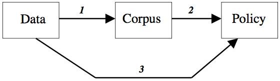

# 风险 Risk (Sven Ove Hansson)

*首次发表于 2007 年 3 月 13 日；2022 年 12 月 8 日实质修订。*

自 1970 年代以来，风险研究已发展成一个重要的跨学科领域。以风险为工作重心的哲学家固然不多，但风险研究与好几个哲学分支之间有着重要关联。本词条概述其中发展最充分的那些关联，并介绍风险哲学的一些主要论题。全文共七节，依次讨论风险的定义，以及认识论、科学哲学、技术哲学、伦理学、决策理论、经济学哲学中的风险研究。

## 1 风险的定义

在非技术语境里，“风险”常相当含糊地指这样一种情形：某个不受欢迎的事件可能发生，但并不确定。到了技术语境，这个词有好几种更专门的用法和含义，其中五种尤为重要，因为各学科广泛使用它们：

1. 风险 = 可能发生、也可能不发生的 **不受欢迎的事件**。

这种用法的一例是：“肺癌是影响吸烟者的主要风险之一。”

1. 风险 = 可能发生、也可能不发生的某个不受欢迎事件的 **原因**。

这种用法的一例是：“吸烟是工业化国家里最重要的健康风险，远非其他因素可比。”（这里隐含所指的不受欢迎事件，是由吸烟引起的疾病。）(1) 与 (2) 都是风险的定性含义。该词也有定量含义，其中下面这一种最为古老：

1. 风险 = 可能发生、也可能不发生的某个不受欢迎事件的 **概率**。

这一用法以下述陈述为例：“吸烟者因与吸烟相关的疾病而缩短寿命的风险约为 50%。”

1. 风险 = 可能发生、也可能不发生的某个不受欢迎事件在统计上的 **期望值**。

一个可能的负面事件，其期望值是概率与某种严重程度度量之积。衡量事故严重程度，通常用死亡人数。以这一度量计，与某潜在事故相关联的“风险”（含义 4）即等于统计上预期的死亡人数；换用别的严重程度度量，就得到别的风险度量。

期望值从 17 世纪起就有人计算，但“风险”一词在此含义上的使用却相当晚近。它经由影响深远的《反应堆安全研究》WASH-1400 进入风险分析（Rasmussen et al., 1975, Rechard 1999）[^rechard-1999]。今天，它已是许多学科里“风险”的标准技术含义，一些风险分析者甚至视之为该词唯一正确的用法。

1. 风险 = 决策是在 **已知概率** 条件下作出的（即“风险下决策”，与“不确定性下决策”相对）

除上述五种常见含义外，“风险”还有一些更技术性的含义，在各自的专门领域里已站稳脚跟。经济分析中使用的几种主要风险定义，将在下文第 7.1 节介绍。

上述含义大多曾被哲学家提及，但关于风险的哲学文献有相当大一部分用的是本节开头那个更非正式的用法，即这样一种事态：某个不受欢迎的事件可能发生，也可能不发生。好几位哲学家批评风险的技术定义过于狭窄，未能涵盖风险评估本该包含的全部方面（Buchak 2014; Pritchard 2015; Shrader-Frechette 1991）[^buchak-2014][^pritchard-2015][^shrader-frechette-1991]。语言学证据则表明，风险的技术定义对该词的非技术用法几乎毫无影响（Boholm et al. 2016）[^boholm-2016]。

**术语说明：** 有些哲学家区分“主观”概率与“客观”概率；另一些人则把“概率”一词专留给主观概念。此处取前一种用法，即“概率”既可指主观概率，也可指客观机遇。

## 2 认识论

有风险，就必定有某物未知，或某个结果未知。所以，关于风险的知识其实是关于知识之匮乏的知识。知识与知识之匮乏这样搅在一起，风险问题在认识论上就变得棘手。

在未加规范化的用法里，“风险”与“不确定性”沿主观—客观这条线相区别。“不确定性”似乎属于主观领域，“风险”则带有很强的客观成分。某人若不知道草蛇是否有毒，那么对该蛇能否毒害自己，她就处于不确定状态。可这一物种根本没有毒液，被它毒害的风险并不存在。“风险”与“不确定性”的关系，似乎部分类似于“真”与“信念”的关系。

规范化的决策论用法与此不同。在决策论中，相关概率可获得时，决策被说成是在“风险下”作出的；概率不可获得或只部分可获得时，则说成是在“不确定性下”作出的。部分确定的概率有时用概率区间表示，比如“明天下雨的概率在 0.1 与 0.4 之间”。（完全没有任何概率信息的情形，有时称作“无知下的决策”。）

风险与不确定性这一区分在决策论上固然有用，从认识论看却仍需澄清。概率能被确定地知道，这极少见。严格说来，唯一清晰的“风险”（已知概率）案例，似乎只是理想化的教科书案例，涉及骰子、硬币这类据信可确定知道其公平的装置。在现实情境中，即便我们照着某个确定的概率估计行事，也不能完全确定这个估计恰好正确，于是仍有不确定性。由此可见，几乎一切决策都是在“不确定性下”作出的。把某个决策问题当作“风险下”的决策来处理，并不意味着该决策真是在概率完全已知的条件下作出的。它只是说：为了简化描述，人们选择把它当作概率已知的情形。这在决策论中常常是极有用的理想化。但在实际应用中，要紧的是分清哪些概率可以当作已知，哪些并不确定、因而更需不断更新。前者的典型例子，是由大量有据可查的使用经验推断出的某技术部件失效频率；后者则以专家对某新型部件预期失效频率的估计为例。

风险认识论的一大难题，是如何处理我们关于独特复杂系统之知识的局限。这类系统对风险估计至关重要：气候系统、生态系统、世界经济，等等。它们每一个都含有太多组分与潜在相互作用，重要方面因而无法预测。但尽管有这种不确定性，关于这些系统许多方面仍能给出相当可靠的陈述。人为气候变化就是一例：细节多半未知，总体图景却清楚。人为气候变化是否存在、其主要成因与机制、它给社会造成了何种风险，这些方面的总体性质都不存在合理的怀疑（Mayer et al. 2017; Lewandowsky et al. 2018）[^lewandowsky-2018][^mayer-2017]。这种关于复杂系统的部分知识具有何种认识论地位，其中所涉不确定性又是何种性质，都还有待进一步澄清（McKinney 1996, Shrader-Frechette 1997）[^mckinney-1996][^shrader-frechette-1997]。

风险科学中通常区分“客观风险”与“主观风险”。前者原则上相当不成问题，因为它取的是概率的频率论解释；后者则含糊得多。1970 年代关于风险的心理测量学文献，常把主观风险设想为对客观风险的主观估计。晚近文献呈现出更复杂的图景：对风险（严重程度）的主观评价，很大程度上取决于传统客观风险度量未涵盖的因素，比如控制感、对自然的干预。若在此意义上使用这两个术语，主观风险会受对客观风险的主观估计影响，却不能与之等同。心理学文献常把主观风险设想为个体对某个危险（或所谓危险）严重性的总体评估。这种个体评估通常称作“风险感知”，但严格说来这名字有误导：它关乎的不是感知，而是态度与期待。主观风险可以用态度测量与心理量表的方法来研究（Sjöberg 2004）[^sjöberg-2004]。

概率论进路在哲学中如同在其他学科中一样占主导，但有些哲学家探究了一种替代性的模态风险说明。照这种说明，“说一个目标事件有风险，就是说（在保持该事件相关初始条件不变的情况下）它在邻近的可能世界中发生”（Pritchard 2016, 562）[^pritchard-2016]。目标事件在其中发生的最近可能世界越远，风险越小。这一进路与心理学对风险的说明颇有相通之处，但可能世界之间究竟如何度量距离、如何确定，却远不清楚。

## 3 科学哲学

价值在科学中的作用，在风险问题上格外有争议。风险评估屡屡被批评含有“隐藏的”价值，致使对风险的接受度过高（Cranor 2016; 2017; Intemann 2016; Heinzerling 2000）[^cranor-2016][^heinzerling-2000]。另有一场讨论：风险评估中是否应加强某些价值的分量，例如正义（Shrader-Frechette 2005a）、人权（Shrader-Frechette 2005b）、未来人的权利与福利（Caney 2009; Ng 2005）[^caney-2009]。风险问题还激起激烈争论：政策决策究竟需要何等水平的科学证据？科学自己的证明标准一旦用于实际问题——而实际问题需要的证明或证据标准与科学不同——就容易出岔子。

在实践中，接受或拒绝某个科学陈述（例如某个假说）的决定，总伴随着出错的可能。这种错误的机会常称作归纳风险（Hempel 1965, 92）[^hempel-1965]。错误分两大类型：一是断定存在某个现象或效应，而实际并无，称为第一类错误（假阳性）；二是漏掉一个确实存在的现象或效应，称为第二类错误（假阴性）。在科学内部，第一类错误一般被视为比第二类更成问题。通行的统计显著性标准大幅降低了第一类错误的风险，却防不住第二类错误（Shrader-Frechette 2008; John 2017）[^john-2017]。

关于风险评估的许多争论，都涉及第一类错误与第二类错误之间的风险平衡。科学把避免第一类错误放在比避免第二类错误更高的位置，但一旦错误带有实践后果，这个平衡就可能移动。试看一例：某飞机发动机是否有严重缺陷，尚不确定。此时第二类错误——缺陷存在却当作不存在——会被认为比第一类错误——缺陷不存在却当作存在——更严重。（第一类与第二类错误的区分，取决于对所研究效应的界定。在风险讨论中，这种界定大多没有争议。Lemons et al. 1997; van den Belt and Gremmen 2002。）[^lemons-1997][^belt-2002]

在这一案例里，优先避免第二类错误而非避免第一类错误，相当无争议。换句话说，推迟航班、事后发现发动机状况良好，总好过带着一台后来发现会出故障的发动机起飞。但在别的案例中，两类错误之间的平衡就有争议了。比如：为防范化学物质对人的健康与环境可能造成的负面效应而采取行动，究竟该要求多强的证据？这类争论十分常见。

**图 1。**

图 1. 科学数据用于政策目的。

一个简单而能说明问题的模型，可以澄清这类争论：科学数据如何既影响科学判断，又影响实践决策（Hansson 2008）。科学知识始于来自实验和其他观察的数据（见图 1）。经过批判性评估，这些数据生成科学知识库（箭头 1）。粗略地说，知识库由这样一些陈述组成：在（足够详细的）教科书里，它们暂时可以正当地、无保留地说出来。判定某个科学假说是否暂时可被接纳为知识库的一部分时，举证责任在拥护者一方；同样，声称存在某个尚未获证之现象的人，也负有举证责任。这些证明标准对科学的健全至关重要。

用科学信息为政策服务，最明显的做法是取用知识库中的信息（箭头 2）。在许多场合，这是唯一明智的选择。但在风险管理决策里，完全依赖知识库可能带来不利后果。设想对某种此前未作毒理学研究的物质开展毒理学调查，结果没有定论：它们引起了有科学根据的怀疑——该物质对人的健康有危险——却未构成充分的科学证明。既然证据不足以支持给科学知识库增添条目，这一信息就无法按标准途径（经由箭头 1 和 2）影响政策。箭头 1 所代表的过程有避免第一类错误的严格要求，于是它滤掉了那些在此案例中本可能具有实践相关性、并能证成某些保护措施的信息。

遇到这类案例，人们常走一条从数据直达政策的路径（箭头 3）。也就是说，第一类与第二类错误之间的平衡，是在具体案例中按实践考量定下的，而不再依靠那套强调避免第一类错误的标准科学程序。

这里要紧的是分清两类与风险相关的决策过程：一类决定关于风险的哪些陈述该进科学知识库；另一类决定与风险相关的信息该怎样影响保护健康与环境的实际措施。这两类决策的证据标准若总是一模一样，那才是奇怪的巧合。科学中为何要有严格的证明标准、知识库为何要有高准入门槛，自有强有力的理由；同时，也可以有正当的政策理由，让风险管理决策受到这样一些危险迹象的影响：它们在科学上可信，却尚未得到充分确证，不够资格进入科学知识库。

**归纳风险** 一词通常专指直接随接受或拒绝某个假说而来的（第一类与第二类）风险。**认知风险** 则指信念形成中范围更宽的一类风险，例如选择方法论、接受某个背景假定、决定如何解释数据时所冒的风险（Biddle 2016）[^biddle-2016]。

涉及风险的政策议题，常成为大规模虚假信息宣传的目标，这类宣传以否认科学及其他形式的伪科学为特征（Oreskes 2010）。不少哲学家积极驳斥无效主张，在风险议题上捍卫科学（Cranor 2005; 2016; 2017; Goodwin 2009; Prothero 2013; Shrader-Frechette 2014; Hansson 2017）[^cranor-2005][^goodwin-2009][^hansson-2017][^prothero-2013]。

## 4 技术哲学

安全与避免风险，是实际工程的主要关切。安全工程也日益成为学术研究的对象，只是这些讨论大多分散在各个技术领域里：同样的基本想法或“安全哲学”，在化学、核能、电气工程中各有名称。尽管如此，各安全工程领域的基本思路看来大体相同（Möller and Hansson 2008）[^möller-2008]。

简单的安全原则往往可以写成经验法则，在安全工程中居于核心位置。其中最重要的三条是：固有安全、安全系数、多重屏障。

固有安全又称一级预防，要点是消除危险源；与之相对的二级预防，则是降低危险源所带来的风险。举个简单的例子：某工艺过程使用易燃材料，固有安全就是用不可燃材料把它们替换掉，二级预防则是移除或隔离点火源、以及（或）加装灭火设备。由此可见，二级预防通常要靠附加的安全设备。之所以优先选固有安全而非二级预防，主要理由是：只要危险源还在，它就可能被某个未曾预料的触发事件现实化。控制措施再好，只要易燃材料还在，某条未预见的因果链就可能点起火来。

设计房屋、桥梁、车辆、工具时所用的数值因子叫安全系数，目的是让构造物比其功能所要求的最低限度更结实。规范与标准里已订有整套安全系数体系。最常见的含义是：不致发生某类特定失效的最大载荷，与相应的最大预期载荷之比。桥梁等构造物通常要造得能承受预测最大载荷的两三倍，也就是采用二或三的安全系数。

安全系数也用于管理毒理学和生态毒理学。例如在食品毒理学中，人可接触的最高剂量，传统上取实验动物身上未引起可观察负面效应的最高剂量（按每公斤体重计）的百分之一。如今高于 100 的安全系数已很常见（Dourson and Stara 1983; Pressman et al. 2017）[^dourson-1983][^pressman-2017]。

安全屏障往往成链布置。理想情形下，每道屏障都独立于前一道，第一道失效，第二道仍然完好，依此类推。古堡便是一例：敌人若越过第一道城墙，还有一层层防线护住守军。有些工程安全屏障遵循同样的同心物理屏障原则，另一些则按时间或功能、而非空间意义串联。工程师从 **泰坦尼克号** 灾难中得出的教训之一是：只顾改进早期屏障的构造，却忽视了后期屏障（那次是救生艇），并没有多大用处。

建造安全屏障的主要难题，是让各道屏障尽可能彼此独立。若两道或更多屏障对同一类冲击敏感，同一种破坏力就能一举把它们全部除掉。例如同一间厂房里装三个安全阀，每个的失效概率都是 1/1,000，却不能由此推出三个全失效的概率是 $1 \times 10^{-9}$。三个阀门可能在同一场火灾里一起毁掉，也可能因维护中的同一个失误一起受损。许多类型的设备都有这种情形。

固有安全、安全系数、多重屏障有一个重要的共同点：既防范能取得有意义概率估计的风险；也防范无法概率化的危险，比如某个未预料的事件引发事故。不过，安全工程背后的原则究竟如何，它们与其他工程设计原则是什么关系，仍有待技术哲学家更细致地探究（Doorn and Hansson 2015）[^doorn-2015]。

预测新兴技术与未来技术的风险，人们作过许多尝试。哲学家在这些努力中常扮演的角色，是指出此类预测所涉的困难与不确定性（Allhoff 2009; Gordijn 2005）[^allhoff-2009][^gordijn-2005]。经验表明，即便为使新产品安全付出极大努力，仍需要上市后监管（PMS）来发现意外问题。例如 1990 年前后汽车安全气囊大规模上市之前，安全工程师曾用代表各种体重体型的假人（含婴儿与孕妇）做过不同碰撞情形的实验室测试。尽管这些测试促成了构造调整，充气的气囊还是造成了相当数量（多为轻微）的伤害。工程师仔细分析实际事故的经验，才把这类伤害的频率与严重程度大幅降下来（Wetmore 2008）[^wetmore-2008]。对药品和某些医疗器械，许多法域在法律上要求上市后监管。

## 5 伦理学

### 5.1 道德理论的一个困难

直到晚近，道德哲学都没有系统处理风险问题。对此有一种可能的辩护：不确定性与知识匮乏在现实生活中造成的复杂局面，尽可交给决策论去分析。按两门学科传统的分工，道德哲学负责评价确定情境中的行为；决策论则把这类评价视为既定，加上可获得的概率信息，推出关于不确定世界中理性行为的评价。照此看法，应对不确定性或知识匮乏无须额外的道德价值投入，因为决策论只以合理性标准运作。

例子很容易找，足以显示两门学科这种分工的问题所在。试比较两个行为：从高楼上把一块砖砸向某人；从高楼上把一块砖扔下去，却不先确认下面没人会被砸中。两者的道德差异，并不显然能在概率演算里表达出来。要作伦理分析，就得援引风险施加相对于故意为恶的道德方面。更一般地说，一套相当完整的风险伦理说明，必须区分有意与无意的风险暴露，还要区分自愿冒险、施加于接受者的风险、施加于不接受者的风险。在把风险当作结果之概率混合的框架里，这些统统做不到。原则上，结果可以定义得足够宽，把一切相关道德方面都包进来——权利侵害、故意性以及其他相关心理状态。可即便如此，仍涵盖不了冒险 **本身** 的道德意涵，因为这些意涵并非任何潜在结果的内在属性。

我们需要能指导冒险与风险施加决策的道德分析方法。第一步，是考察标准道德理论如何处理以决策论方式呈现的风险问题，也就是把风险看作（确定性）情景的概率混合，再对之作出（道德）评价。

### 5.2 功利主义

功利主义理论处理这类问题，有两条显而易见的进路。一是 **实际论** 方案：一组潜在结果的概率混合，其效用等同于实际实现的那个结果的效用。试举一例：某座桥要过一次极重的运输，此前需决定是否加固。不加固，桥有 50% 的风险塌掉。假设决定不加固，而一切顺利，桥没坏——按实际论，这个决定就是对的。这当然与通常的道德直觉相悖。

另一条既有的功利主义进路，是期望效用最大化：一组潜在结果之混合的效用，定义为这些结果之效用的概率加权平均值。

期望效用标准受到多方面批评。其一，它不允许一种常见的谨慎：对巨大灾难作不成比例的回避。举例说，若像多数功利主义者那样，把人的死亡同等且可加地赋值，这个框架就不允许人偏好“一人死亡的千分之一概率”胜过“五十人死亡的十万分之一概率”。其二，它也不允许对公平的常见诉求：不成比例地回避加于特定个体的高概率风险。于是在“让一人承受 0.9 的死亡概率”与“让一百人各承受 0.01 的死亡概率”之间，它要求选前者。总之，期望效用最大化禁止了一些在冒险与风险施加问题上看来在道德上站得住的立场。

不过要注意：期望效用标准并不必然从功利主义推出。宽泛意义上的功利主义（Scanlon 1982）[^scanlon-1982] 与其他评价不确定结果的方式相容——最明显的是与实际后果功利主义相容，原则上也可以与最大化最小值之类的标准相容。所以，针对期望效用最大化的批评，并不必然表明功利主义思想有缺陷。

### 5.3 权利论道德理论

权利论道德理论如何应对风险，这个问题由罗伯特·诺齐克提出：“施加多么微小的伤害概率——只要该伤害侵害某人权利——才算也侵害了他的权利？”（Nozick 1974, 74）[^nozick-1974]。

要把权利论道德理论扩展到不确定情形，可以这样规定：若 *A* 有权利要求 *B* 不造成某个结果，则 *A* 也有权利要求 *B* 不实施任何会（哪怕略微）提高该结果概率的行为。可惜这种严格的权利扩展在社会实践中站不住脚。不妨说，*A* 有权利不被 *B* 杀死；但把这项权利扩展到 *B* 一切使 *A* 死亡风险略微增加的行为——比如在 *A* 居住的城镇里开车——就不合理了。这样严格的解释会让人类社会无法存在。

于是，“不被暴露于风险”这项权利必须容许推翻，好让它在概率增幅极小的某些（不必是全部）情形中让路。可究竟何时该让路，仍缺一个可信的标准。诺齐克指出：概率阈值在“一种认为偷人一分钱、一根别针或任何东西都侵害其权利的传统中”并不可信；而在伤害确定会发生的情形里，“该传统 **并不** 选取某种伤害的阈值度量作为下限”（Nozick 1974, 75）[^nozick-1974]。

### 5.4 义务论道德理论

义务论理论应对风险，难题与权利论理论相似。不伤害他人的义务，可以扩展为不实施提高他人受伤害风险之行为的义务。但只要不给这条规则设例外，我们所知的社会就无法存在。为这类例外定标准，困难与权利论一样。任何合理的道德义务体系都含有禁止杀害他人的一般禁令；这条禁令可以、也应该扩展到含有较大致死风险的行为，却不能扩展到一切使致死风险微量上升的行为——那会把许多我们几乎没人愿意放弃的行为举止都排除掉。总得在合理与不合理的风险施加之间划一条界。而这类划界看来非求助于概率、求助所获利益之大小不可，这些概念却不在义务论理论的内部资源里。

### 5.5 契约论

比起上述几种理论，契约论似乎稍更有希望。它为确定性情形给出的标准——所有当事方一致同意——也可用于含风险选项。也就是说，风险施加可被接受，当且仅当它得到共识支持。契约论设想的这种共识，或为实际，或为假设。

在一个每个人都实施着对许多人生活有边际而可累加之影响的复杂社会里，实际共识并不现实。按实际共识的标准，任何本地市民对任何想在他居住的城镇里开车的人都有否决权。市民们于是互相封锁，造出一个僵局社会。

假设的共识则被契约论发展为处理个体间问题的标准。设想一个假设的初始情境：未来社会的秩序尚未确定，未来公民聚在一起选择秩序；每个人对自己将在各种可选安排中占据何种位置，一无所知。按约翰·罗尔斯的正义理论，他们于是都会选最大化最小值方案，即这样一种秩序——任何人在其中所能处的最差位置都尽可能好。罗尔斯为这一方案论证时，严重依赖如下假定：参与者对自己最终落在未来社会秩序中某个位置的概率毫无所知（Rawls 1957; 1971; 1974）[^rawls-1957]。约翰·海萨尼在罗尔斯之前讨论过这一问题，他的假定是：发现自己处于某一特定社会位置的概率，等于将拥有该位置的人口比例，而且这一点所有参与者都知道。于是，若某类社会中有五分之一人口将是客籍工人，海萨尼初始情境中的每个参与者都会假定自己有百分之二十的概率成为客籍工人；而在罗尔斯的初始情境里，没人对概率可能是多少有半点线索。海萨尼的参与者会选期望效用（概率加权效用）最高的社会秩序，把一切潜在未来位置都算进去，而不只看最不利的那一个（Harsanyi 1953; 1955; 1975）[^harsanyi-1953]。

然而，讨论我们现存社会中的各种风险时，契约论的假设初始情境派不上多少用场。现实生活里的风险与不确定性，跟在初始情境中作为关键要求的那种关于自身社会位置与条件的假设不确定性（或无知），性质颇为不同。除了我们不试图设想掉“我是谁”时本来就有的那些工具，初始情境这一思想实验似乎并未多给我们任何用于风险道德评价的智识工具。

### 5.6 小结与展望

总之，从道德观点评价风险这一问题，在上述各类道德理论的通行版本里似乎都找不到令人满意的解法。解决办法可能包含以下三个要素：

1. 把关注点从风险转到冒险与施加风险的行为上，或许有用。风险通常按概率与严重程度两维（或按二者之积一维）描述；而这类行为除了这两维，还带有许多道德上相关的属性：谁在因果上促成了风险、以什么方式、怀着什么意图，风险与相关利益又如何分配。
2. 假定每个人对不因他人行为而暴露于负面冲击（如健康或财产受损）的风险，都有一项初显的道德权利，可以说明不少重要的道德直觉。但这是初显权利，为使社会生活至少还能运转，它在不少情形中必须让路。承认这项权利，于是引出可称为 **豁免问题** 的东西：它何时才算正当地被压倒？
3. 豁免问题的部分解法，可能在于允许风险与利益的互惠交换：*A* 获准开车、使 *B* 承受某些风险，作为交换，*B* 也获准开车、使 *A* 承受相应风险。要应对现代社会的复杂性，这条原则还得用于不同类型风险与利益的交换。一个人对风险的暴露，若属于某个对他有利的公平冒险社会体系，便可视为可接受。这样的体系可以被要求含有一些机制，用以消除或补偿由疾病与失能造成的社会不平等。（Hansson 2003; 2013）[^hansson-2003]

关于风险接受这一总体问题的讨论，见于 Macpherson（2008）、Hansson（2013）与 Oberdiek（2014）；风险施加中的正义问题，见 Ferretti 2010 与 Heyward & Roser 2016；权利与风险的问题见 Thomson 1986，特别强调责任问题的讨论则见 Kermisch 2012 与 van de Poel, et al. 2012。

## 6 决策理论

给定我们拥有的价值，怎样尽可能达成有价值的结果？这是决策理论要回答的问题。决策理论把我们的价值与目标视为既定，只分析如何尽可能高水平地达成它们。风险与不确定性下的决策，是它的主要论题之一。通常的假定是：一组潜在结果的价值若已知（例如来自道德哲学），那么单凭工具性考量就足以确定在风险或不确定性下如何行动才能取得最好结果。（对这一预设的批判性讨论，见 Hansson 2013, 49–51。）[^hansson-2013] 决策论分析中当作既定的价值，可以是道德哲学所发展、分析的那类道德价值，但不必是。

### 6.1 决策权重

决策理论历来偏爱后果主义，因为其结构适合多数决策的形式模型。风险的标准决策论进路是期望效用最大化，可以看作（行为）功利主义的一种平滑扩展。在期望效用理论中，一个不确定情境的价值，等于其一切可能结果之概率加权价值的总和。设 $p$ 是给结果赋概率的函数，$u$ 是给结果赋价值的函数，那么具有三个可能结果 $x_1$、$x_2$、$x_3$ 的情境，其价值等于

$$p(x_1) \cdot u(x_1) + p(x_2) \cdot u(x_2)+ p(x_3) \cdot u(x_3).$$

不过，也有人提出过颇有影响的替代决策规则。为此辩护的理由有两大类。其一，人们举出一些例子，在其中硬说期望效用最大化是唯一在规范上合理的决策规则，似乎难以服人（Allais 1953; Ellsberg 1961）[^allais-1953][^ellsberg-1961]。其二，大量心理学实验表明，人类决策者往往严重偏离期望效用最大化。前者质疑期望效用的规范健全性，后者则暴露它作为描述模型的短处。

有一类重要的替代决策规则，是把期望效用计算中的概率换成别的数字（“决策权重”）。这条进路由威廉·费尔纳（William Fellner，1961）提出。这类构造大多用一个变换函数 *r* 来变换全部概率：行为人不再最大化标准的期望效用 $$p(x) \cdot u(x)$$，而是最大化 $$r(p(x)) \cdot u(x)$$

具有这种结构的决策规则已提出若干。最早的一批里就有 Handa（1977）。目前这一传统中最著名的是前景理论（Kahneman and Tversky 1979; Tversky and Kahneman 1986）[^kahneman-1979][^tversky-1986]，它被发展出来，就是为了比期望效用理论更准确地描述心理学决策实验的观察结果。前景理论相当复杂，在其他方面也偏离期望效用理论：对结果的关注让位于对损失与收益的关注，而两者被不对称地对待。（亦见第 7.3 节。）

上面定义的函数 $r$ 有个问题：它给出的变换后概率，除了 *r* 是恒等函数的平凡情形，加起来不等于 1（Fishburn 1978）[^fishburn-1978]。为解决这一点，Quiggin（1982）引入最大化 **预期效用**（亦称秩依概率效用）的规则。他不把 $p(x)$ 换成个体概率的函数 $r(p(x))$，而换成一个还依赖该问题中其他概率与效用的函数。先把结果从最差到最好排序，得到结果向量 $\langle x_1, x_2 ,\ldots , x_n\rangle$，使 $u(x_1) \leq u(x_2) \leq \ldots \leq u(x_n)$；再给每个结果赋一个决策权重，既看其概率，也看它在排序中的位置。概率相同的结果可以有不同的决策权重，Fishburn 的平凡化结果因此不适用。有证据表明，秩依效用模型在经验上可能比前景理论更适当（Harrison and Ross 2017）[^harrison-2017]。

还有一些模型，用别的类型的决策权重替换期望效用最大化中的概率（Gilboa and Schmeidler 1994; Buchak 2014）[^buchak-2014][^gilboa-1994]。

### 6.2 悲观、谨慎与预防原则

分析风险时，决策论上要紧的是分清两对都与风险相关的概念：悲观与乐观；谨慎与冒险。

悲观与乐观关涉一个人关于未来事件的、与价值相关的信念模式。对某种未来发展，她若把不想要的结果估得高于最可几赋值、把想要的结果估得低于它，她便在此程度上是悲观的；反之，若把想要的结果估得更高、不想要的结果估得更低，她便在此程度上是乐观的。

谨慎（风险厌恶）与冒险（风险偏好）关涉的是决策与行动，不是信念。在不同行动方案间作选择时，谨慎的人倾向于挑那种最坏结果概率尽可能小的方案，即便这使她无法最大化所选方案的期望效用；冒险的人则寻求最好结果概率高的选项，即便牺牲期望效用最大化也在所不惜。（亦见第 7.2 节。）

**预防原则** 常被当作一条要求谨慎的一般指令，但“预防原则”一词通常并不是这个意思。这是一条在国际条约与欧洲立法中界定的原则。它关涉这样一种情形：科学上有合理理由怀疑存在对健康或环境的某个风险，证据却不足以确凿地表明该风险确实存在。预防原则说，此时我们可以、而且常常应当采取针对潜在危险的措施。至少自 1992 年起，这一界定就是标准：那年预防原则同时被写入联合国《里约宣言》和欧洲联盟的《罗马条约》（今称《欧洲联盟运行条约》）（Pyhälä et al., 2010）。它在实践中如何适用，取决于如何解释这样一类科学证据——它们表明存在某种危险，强度却不足以让科学家把该危险当作已知。评价这类证据，会带出有待澄清的方法论与认识论问题，尤其需要科学哲学中发展出的概念工具。

此外，关于预防原则的其他界定，哲学讨论仍在继续。这类提议中有不少比那个界定得较窄的法律概念更接近一般的（决策论）谨慎（Munthe 2011）[^munthe-2011]。

## 7 经济分析中的风险

风险在经济活动中居于核心。在资本主义市场经济里，承担经济风险本就是企业家角色的一部分；关于投资与金融市场活动的决策，离开所涉风险便无从理解。因此毫不奇怪，以数学模型为重的现代经济理论发展出了好几套关于冒险的形式模型。

### 7.1 经济风险的度量

组合分析由哈里·马科维茨（Harry Markowitz，1952）、詹姆斯·托宾（James Tobin，1958）等人于 1950 年代提出，是风险经济分析的重要一步。他们采用一个简单的统计度量——标准差（或方差，即标准差的平方）——来衡量风险程度。于是在两个投资方案之间比较时，经济结果算出的标准差较大的那个，就被视为风险较大者。在多个此类方案的比较中，每个方案都能用两个数字刻画：期望值，以及标准差（风险程度）。投资者通常偏好期望值尽可能高、风险尽可能低的投资，但各人对期望与避风险所赋的相对权重不同。给定这些权重，个体的最优组合便可确定。

1960 年代后期以来，出现了替代性的风险度量。其中影响最大的也许出自迈克尔·罗斯柴尔德（Michael Rothschild）与约瑟夫·斯蒂格利茨（Joseph Stiglitz，1970）：把概率质量从分布中心移向尾部而保持均值不变，该分布的风险就增加了。据此（均值保持扩散）可构造一种度量，其数学性质比旧的标准差度量更可人。

### 7.2 风险态度的度量

我们对风险的态度各不相同：有人甘愿承担别人认为过大的风险。确定性等值结果这一概念可以刻画这类差异。考虑一个有风险的结果 *X*。另一个结果 *Y* 是 *X* 的确定性等值结果，当且仅当（1）*Y* 不含任何不确定性；（2）行为人认为 *X* 与 *Y* 一样好。例如，设 *X* 是一张彩票：50% 的机会赢到你赋值为 10 尤特尔（效用单位）的东西，50% 的机会一无所获。这张彩票的期望效用是 5 尤特尔。若你对确定得到 3 尤特尔与得到 *X* 无差异，你的态度就是风险厌恶。风险厌恶（风险回避、谨慎）的一般标准是 $CE(X) < EU(X)$；同理，若 $CE(X) = EU(X)$，你对 *X* 是风险中性的；若 $EU(X) < CE(X)$，你就是风险偏好（寻求风险、喜爱风险）的。

经济学里的风险厌恶通常与金钱相关。设 *X* 是一张有 50% 机会赢 100 欧元的彩票，你认为它值 30 欧元。于是 $EU(X) = u(100)/2$，$CE(X) = u(30)$，也就意味着 $u(30) = u(100)/2$。若这是稳定的模式，那么金钱的效用——在横轴为金额 *x*、纵轴为效用 $u(x)$ 的图上——就表现为一条凹的（山形）曲线；风险偏好的行为则表现为凸的（谷形）曲线。只要效用函数 *u* 二次连续可微，这一点就能用阿罗—普拉特风险厌恶／偏好度量更精确地表达：行为人在任一点 *x* 的风险厌恶等于 $-u''(x)/u'(x)$。所以，具有效用函数 $u_1$ 的人在点 *x* 处比具有 $u_2$ 的人更厌恶风险，当且仅当 $$-{u_1}''(x)/{u_1}'(x) > -{u_2}''(x)/{u_2}'(x)$$（Arrow 1965; Pratt 1964）[^arrow-1965][^pratt-1964]。这一度量的好处是：在保持偏好关系不变的效用变换下它保持不变（即效用乘以正常数、加上任意常数时不变）。另一方面，从哲学上可以质疑：风险态度能否由金钱效用的变化充分表示？可以说，谨慎与金钱效用是两回事，理应有各自独立的表示。

### 7.3 实验经济学

实验经济学的研究表明，实际行为人往往不符合理论推导出的合理性标准。试图刻画风险下实际行为的最流行的描述性理论之一，是丹尼尔·卡尼曼与阿莫斯·特沃斯基于 1980 年前后提出的前景理论（Kahneman & Tversky 1979; Tversky & Kahneman 1986）[^kahneman-1979][^tversky-1986]。它把决策过程分作两个阶段：第一阶段是 **编辑**，辨认各选项中的收益与损失——它们相对于某个中性参照点（通常是当前资产状况）来定义；第二阶段是 **评价**，各选项按类似期望效用分析的方式评价，但效用与概率都换成了别的类似度量。效用换成一种在收益与损失之间不对称的度量；客观概率则经一个函数变换，该函数给分布两端附近的概率差以比中心附近更大的权重。于是，把某个负面结果的概率从 2% 降到 1%，比从 51% 降到 50% 造成的差别更大。

前景理论能解释实际行为偏离标准经济模型的某些方式。比如接近零或接近一的概率变化被赋予过高权重，这可以解释人们为什么既买保险又买彩票。但作为风险下理性行为的规范理论，前景理论并不成立。规范理论与描述理论，大概只能分道而行。

### 7.4 风险—收益分析

风险—收益分析（RBA），亦称成本—收益分析（CBA），是一套以数值权衡利弊的决策辅助技术。典型的风险—收益分析把多维问题压缩到单一维度，办法是给一切潜在结果赋予货币价值。不确定结果通常按期望效用模型评价：以不想要事件的概率乘上代表严重程度的货币额，即得反值（Sen 2000; Sunstein 2005）[^sen-2000][^sunstein-2005]。

要让总体方案在简单的数值上可比，一切后果——包括人的生命损失——都得赋予货币价值。给生命定价的讨论，似乎始于 1950 年美国空军对兰德公司一份报告的批评。该报告推荐一种军事战略，其造成的机组死亡率在军方看来高得不可接受，原因是机组人员的损失未计入计算；这一遗漏相当于把士兵生命的价值设为零。回应批评时，兰德公司开始在分析中纳入生命价值，却在如何推导这一价值上大费周章（Banzhof 2014）。其雇员托马斯·谢林提议，生命价值应从个体自身对死亡风险的估值作边际分析得出（Schelling 1968）[^schelling-1968]：一个人若愿以 $400 的补偿换取 1/10,000 的死亡风险，这就被当作表达了 10,000 $\times$ $400 即 $4,000,000 的生命价值。

关于风险—收益分析的哲学讨论，大多集中在给生命损失定价这一点上（MacLean 1994; Heinzerling 2000; 2002）[^heinzerling-2000][^maclean-1994]。有人声称，生命与金钱不可通约，确定并使用这类“生命价值”是对人命的不尊重。辩护者则回应：这些数值只是技术性构造，代表社会为救一条人命往往愿意支付（或者说，应当支付）的数额。既然决策者用于救生政策的资源总量固定，风险—收益分析就能帮他们尽可能多救人（Sunstein 2005）[^sunstein-2005]。

成本—收益分析里的许多价值赋值，都基于对（假设的）支付意愿的估计或测量。这类估计会偏向富裕者，因为他们比别人出得起钱让事情按自己的意愿办。这可以用按收入作的调整来校正所报告的支付意愿。但支付意愿研究在实施与解释上都有不小的问题（Grüne-Yanoff 2009）[^grüne-yanoff-2009]。

风险—收益分析还带出若干颇有哲学意味的问题（Hansson 2007）[^hansson-2007]。它天生偏于定量，于是容易漏掉难以量化的问题，比如文化贫乏、社会孤立、社会阶层间紧张加剧的风险。又因其聚合式结构，它常常漏掉社会正义以及其他分配方面——而这些其实并非不能作定量处理。

## References（引用注释）

**以下文献从原文照录，不作翻译；中国文献译为中文。**

> 原文参考文献已转为脚注引用：文内“作者-年份”引用组后附 [^key] 标记，完整条目见本文末脚注定义。

[^allais-1953]: Allais, M., 1953, “Le comportement de l’homme rationnel devant le risque: critique des postulats et axiomes de l’école Américaine”, *Econometrica*, 21: 503–546.
[^allhoff-2009]: Allhoff, F., 2009, “Risk, Precaution, and Emerging Technologies”, *Studies in Ethics, Law, and Technology*, 3(2), published online 25 June, 2009. doi:10.2202/1941-6008.1078
[^arrow-1965]: Arrow, K.J., 1965, *Aspects of the Theory of Risk-Bearing. Yrjö Jahnsson Lectures*. Helsinki: Yrjö Jahnssonin Säätiö.
[^banzhaf-2014]: Banzhaf, H.S., 2014, “Retrospectives: the Cold-War origins of the value of statistical life”, *Journal of Economic Perspectives* 28(4): 213–26.
[^biddle-2016]: Biddle, J.B., 2016, “Inductive risk, epistemic risk, and overdiagnosis of disease”, *Perspectives on Science* 24(2): 192–205.
[^boholm-2016]: Boholm, M. et al., 2016, “The Concepts of Risk, Safety, and Security: Applications in Everyday Language.”, *Risk Analysis* 36 (2): 320–338.
[^buchak-2014]: Buchak, L., 2014, *Risk and Rationality*, Oxford: Oxford University Press.
[^caney-2009]: Caney, S., 2009, “Climate Change and the Future: Discounting for Time, Wealth, and Risk”, *Journal of Social Philosophy*, 40(2): 163–186.
[^cranor-1997]: Cranor C., 1997, “The Normative Nature of Risk Assessment: Features and Possibilities”, *Risk: Health, Safety & Environment*, 8: 123–36.
[^cranor-2005]: –––, 2005. “The Science Veil Over Tort Law Policy: How Should Scientific Evidence Be Utilized in Toxic Tort Law?”, *Law and Philosophy*, 24(2): 139–210.
[^cranor-2016]: –––, 2016, *Toxic Torts: Science, Law and the Possibility of Justice* (second edition), Cambridge: Cambridge University Press.
[^cranor-2017]: –––, 2017, *Tragic Failures: How and Why We Are Harmed by Toxic Chemicals*, Oxford: Oxford University Press, 2017.
[^doorn-2015]: Doorn, N., and S.O. Hansson, 2015, “Design for the value of safety”, in J. van den Hoven, I. van de Poel, and P. Vermaas (eds), *Handbook of Ethics, Values and Technological Design*, Dordrecht: Springer, 491–511.
[^dourson-1983]: Dourson, M.L., & Stara, J.F., 1983, “Regulatory history and experimental support of uncertainty (safety) factors”, *Regulatory Toxicology and Pharmacology* 3(3): 224–238.
[^ellsberg-1961]: Ellsberg, D., 1961, “Risk, Ambiguity, and the Savage Axioms”, *Quarterly Journal of Economics*, 75: 643–669.
[^fellner-1961]: Fellner, W. 1961, “Distortion of subjective probabilities as a reaction to uncertainty”, *Quarterly Journal of Economics*, 75: 670–689.
[^ferretti-2010]: Ferretti, M.P., 2010, “Risk and Distributive Justice: The Case of Regulating New Technologies”, *Science and Engineering Ethics*, 16(3): 501–515.
[^fishburn-1978]: Fishburn, P.C., 1978, “On Handa’s ‘New theory of cardinal utility’ and the maximization of expected return”, *Journal of Political Economy*, 86: 321–324.
[^gigerenzer-2002]: Gigerenzer, G., 2002, *Calculated Risks: How to Know When Numbers Deceive You*, New York: Simon and Schuster.
[^gilboa-1994]: Gilboa, I. and D. Schmeidler, 1994, “Additive representations of non-additive measures and the Choquet integral”, *Annals of Operations Research*, 52: 43–65.
[^goodwin-2009]: Goodwin, W., 2009, “How Does the Theologizing of Physics Contribute to Global Warming?”, *Environmental Philosophy*, 6(2): 21–42.
[^gordijn-2005]: Gordijn, B., 2005, “Nanoethics: From Utopian Dreams and Apocalyptic Nightmares Towards a More Balanced View”, *Science and Engineering Ethics*, 11(4): 521–533.
[^grüne-yanoff-2009]: Grüne-Yanoff, T., 2009, “Mismeasuring the Value of Statistical Life”, *Journal of Economic Methodology*, 16 (2): 109–123.
[^handa-1977]: Handa, J., 1977, “Risk, probabilities, and a new theory of cardinal utility”, *Journal of Political Economy*, 85: 97–122.
[^hansson-2003]: Hansson, S. O., 2003, “Ethical criteria of risk acceptance”, *Erkenntnis*, 59: 291–309.
[^hansson-2004]: –––, 2004, “Weighing Risks and Benefits”, *Topoi*, 23: 145–152.
[^hansson-2006]: –––, 2006, “Economic (ir)rationality in risk analysis”, *Economics and Philosophy*, 22: 231–241.
[^hansson-2007]: –––, 2007, “Philosophical Problems in Cost-Benefit Analysis”, *Economics and Philosophy* 23: 163–183.
[^hansson-2013]: –––, 2013, *The Ethics of Risk: Ethical analysis in an uncertain world*, New York: Palgrave MacMillan.
[^hansson-2017]: –––, 2017, “Science denial as a form of pseudoscience”, *Studies in History and Philosophy of Science*, 63:39–47.
[^harrison-2017]: Harrison, G.W. and D. Ross, 2017, “The empirical adequacy of cumulative prospect theory and its implications for normative assessment”, *Journal of Economic Methodology*, 24: 150–165.
[^harsanyi-1953]: Harsanyi, J.C., 1953, “Cardinal utility in welfare economics and in the theory of risk-taking”, *Journal of Political Economy*, 61: 434–435.
[^harsanyi-1955]: Harsanyi, J.C., 1955, “Cardinal welfare, individualistic ethics, and interpersonal comparisons of utility”, *Journal of Political Economy*, 63: 309–321.
[^harsanyi-1975]: Harsanyi, J.C., 1975, “Can the maximin principle serve as a basis for morality? A critique of John Rawls’s theory”, *American Political Science Review*, 69: 594–606.
[^heinzerling-2000]: Heinzerling, L., 2000, “The rights of statistical people.”, *Harvard Environmental Law Review* 24: 189–207.
[^heinzerling-2002]: –––, 2002, “Markets for arsenic”, *Georgetown Law Journal*, 90: 2311–2339.
[^hempel-1965]: Hempel, C.G., 1965, *Aspects of scientific explanation, and other essays in the philosophy of science*, New York: Free Press.
[^heyward-2016]: Heyward, C., and D. Roser (eds.), 2016, *Climate Justice in a Non-Ideal World*, Oxford: Oxford University Press.
[^intemann-2015]: Intemann, K., 2015, “Distinguishing Between Legitimate and Illegitimate Values in Climate Modeling.”, *European Journal for Philosophy of Science*, 5(2): 217–232.
[^jellinek-1981]: Jellinek, S. D., 1981, “On The Inevitability Of Being Wrong”, *Annals of the New York Academy of Science*, 363: 43–47.
[^john-2017]: John, S., 2017, “From Social Values to P-Values: The Social Epistemology of the Intergovernmental Panel on Climate Change”, *Journal of Applied Philosophy*, 34 (2): 157–171.
[^kahneman-1979]: Kahneman, D. and A. Tversky 1979, “Prospect theory: An analysis of decision under risk”, *Econometrica*, 47: 263–293.
[^kermisch-2012]: Kermisch, C., 2012, “Risk and Responsibility: A Complex and Evolving Relationship”, *Science and Engineering Ethics*, 18(1): 91–102.
[^lemons-1997]: Lemons, J., et al., 1997, “The Precautionary Principle: Scientific Uncertainty and Type I and Type II Errors”, *Foundations of Science*, 2(2): 207–236.
[^lewandowsky-2018]: Lewandowsky, S., J. Cook & E. Lloyd, 2018, “The ‘Alice in Wonderland’ Mechanics of the Rejection of (Climate) Science: Simulating Coherence by Conspiracism”, *Synthese* 195 (1):175–196.
[^maclean-1986]: MacLean, D. (ed.), 1986, *Values at Risk* (Maryland Studies in Public Philosophy), Totowa, NJ: Rowman and Littlefield.
[^maclean-1994]: –––, 1994, “Cost-benefit analysis and procedural values”, *Analyse & Kritik*, 16(2): 166–180.
[^machina-1987]: Machina, M.D. and M. Rothschild, 1987, “Risk”, in J. Eatwell, M. Milgate, and P. Newman (eds.), *The New Palgrave: A Dictionary of Economic Theory and Doctrine* (Volume 4), London and New York: Macmillan and Stockton, pp. 201–205.
[^macpherson-2008]: Macpherson, J.A.E., 2008, “Safety, Risk Acceptability, and Morality”, *Science and Engineering Ethics*, 14(3): 377–390.
[^markowitz-1952]: Markowitz, H.M., 1952, “Portfolio Selection”, *Journal of Finance*, 7(1): 77–91.
[^mayer-2017]: Mayer, L. et al., 2017, “Understanding Scientists’ Computational Modeling Decisions About Climate Risk Management Strategies Using Values-Informed Mental Models”, *Global Environmental Change* 42:107–116.
[^mckerlie-1986]: McKerlie, D., 1986, “Rights and Risk”, *Canadian Journal of Philosophy*, 16: 239–52.
[^mckinney-1996]: McKinney, W.J., 1996, “Prediction and Rolston’s Environmental Ethics: Lessons From the Philosophy of Science”, *Science and Engineering Ethics*, 2(4): 429–440.
[^möller-2008]: Möller, N. and S.O. Hansson, 2008, “Principles of engineering safety: risk and uncertainty reduction”, *Reliability Engineering and System Safety*, 93: 776–783.
[^munthe-2011]: Munthe, Christian, 2011, *The Price of Precaution and the Ethics of Risk*, Dordrecht: Springer.
[^ng-2005]: Ng, Y.-K., 2005, “Intergenerational Impartiality: Replacing Discounting by Probability Weighting”, *Journal of Agricultural and Environmental Ethics*, 18(3): 237–257.
[^nozick-1974]: Nozick, Robert, 1974, *Anarchy, State, and Utopia*, New York: Basic Books.
[^oberdiek-2014]: Oberdiek, J., 2014, *Imposing Risk: A Normative Framework*, Oxford: Oxford University Press.
[^pratt-1964]: Pratt, J. W., 1964, “Risk Aversion in the Small and in the Large”, *Econometrica*, 32: 122–136.
[^pressman-2017]: Pressman, P., R. Clemens, W. Hayes, & C. Reddy, 2017, “Food additive safety: A review of toxicologic and regulatory issues”, *Toxicology Research and Application* 1:1–22.
[^pritchard-2015]: Pritchard, D., 2015, “Risk”, *Metaphilosophy*, 46(3): 436–461.
[^pritchard-2016]: –––, 2016, “Epistemic risk”, *Journal of Philosophy* 113(11): 550–571.
[^prothero-2013]: Prothero, D., 2013, “The Holocaust Denier’s Playbook and the Tobacco Smokescreen: Common Threads in the Thinking and Tactics of Denialists and Pseudoscientists”, pp. 341–358 in M. Pigliucci and M. Boudry (eds), *Philosophy of Pseudoscience. Reconsidering the demarcation problem*, Chicago: University of Chicago Press.
[^pyhälä-2010]: Pyhälä, M., A.C. Brusendorff & H. Paulomäki, 2010, “The precautionary principle”, pp. 203–226 in M. Fitzmaurice, D. M. Ong & P. Merkouris (eds.), *Research Handbook on International Environmental Law*. Cheltenham: Edward Elgar.
[^quiggin-1982]: Quiggin, J., 1982, “A theory of anticipated utility”, *Journal of Economic Behavior & Organization*, 3: 323–343.
[^rasmussen-1975]: Rasmussen, Norman, *et al*., 1975, “Reactory Safety Study”, *WASH-1400*, Washington, DC: US NRC.
[^rawls-1957]: Rawls, J., 1957, “Justice as Fairness”, *Journal of Philosophy*, 54: 653–662.
[^rawls-1971]: –––, 1971, *A Theory of Justice*, Cambridge, Mass.: Harvard University Press.
[^rawls-1974]: –––, 1974, “Some Reasons for the Maximin Criterion”, *American Economic Review*, 64: 141–146.
[^rechard-1999]: Rechard, R.P., 1999, “Historical relationship between performance assessment for radioactive waste disposal and other types of risk assessment”, *Risk Analysis*, 19(5): 763–807.
[^rothschild-1970]: Rothschild, M. and J. Stiglitz, 1970, “Increasing risk: 1. A definition”, *Journal of Economic Theory*, 2: 225–243.
[^scanlon-1982]: Scanlon, T.M., 1982, “Contractualism and Utilitarianism,” in A. Sen and B. Williams, *Utilitarianism and Beyond*, Cambridge: Cambridge University Press.
[^schelling-1968]: Schelling, T.C., 1968, “The Life You Save May Be Your Own”, in *Problems in Public Expenditure Analysis*, S.B. Chase, Jr. (ed.), 127–162. Washington, DC: Brookings Institution.
[^schelling-1996]: –––, 1996, “Research By Accident”, *Technological Forecasting And Social Change*, 53: 15–20.
[^sen-2000]: Sen, A., 2000, “The discipline of cost-benefit analysis”, *Journal of Legal Studies*, 29: 931–952.
[^shrader-frechette-1991]: Shrader-Frechette, K., 1991, *Risk and Rationality. Philosophical Foundations for Populist Reforms*, Berkeley: University of California Press.
[^shrader-frechette-1997]: –––, 1997, “Hydrogeology and Framing Questions Having Policy Consequences”, *Philosophy of Science* (Supplement), 64: S149–S160.
[^shrader-frechette-2005]: –––, 2005, “Flawed Attacks on Contemporary Human Rights: Laudan, Sunstein, and the Cost-Benefit State”, *Human Rights Review*, 7(1): 92–110.
[^shrader-frechette-2005-2]: –––, 2005, *Environmental Justice: Creating Equality, Reclaiming Democracy*, New York: Oxford University Press.
[^sjöberg-2004]: Sjöberg, L., 2004, “The Methodology of Risk Perception Research”, *Quality and Quantity*, 34: 407–418.
[^sunstein-2005]: Sunstein, C.R., 2005, “Cost-Benefit Analysis and the Environment”, *Ethics*, 115: 351–385.
[^thompson-1985]: Thompson, P. B., 1985, “Risking or Being Willing: Hamlet and the DC-10”, *Journal of Value Inquiry*, 19: 301–310.
[^thomson-1985]: Thomson, J.J., 1985, “Imposing Risks”, in *To Breathe Freely*, Mary Gibson (ed.), Totowa, NJ: Rowman and Allanheld, 124–140.
[^thomson-1986]: –––, 1986, *Rights, Restitution and Risk: Essays in Moral Philosophy*, Cambridge, Mass.: Harvard University Press.
[^tobin-1958]: Tobin, J., 1958, “Liquidity preference as behavior towards risk”, *Review of Economic Studies* 25(2): 65–86.
[^tversky-1986]: Tversky, A. and D. Kahneman, 1986, “Rational Choice and the Framing of Decisions”, *Journal of Business*, 59: 251–278.
[^belt-2002]: van den Belt, H. and B. Gremmen., 2002, “Between Precautionary Principle and ‘Sound Science’: Distributing the Burdens of Proof.”, *Journal of Agricultural and Environmental Ethics*, 15(1): 103–122.
[^poel-2012]: van de Poel, I., et al., 2012, “The Problem of Many Hands: Climate Change as an Example”, *Science and Engineering Ethics*, 18(1): 49–67.
[^wagner-1995]: Wagner, W. E., 1995, “The Science Charade In Toxic Risk Regulation”, *Columbia Law Review*, 95: 1613–1723.
[^weinberg-1972]: Weinberg, A. M., 1972, “Science and Trans-Science”, *Minerva*, 10: 209–222.
[^wetmore-2008]: Wetmore, J.M., 2008, “Engineering with Uncertainty: Monitoring Air Bag Performance”, *Science and Engineering Ethics*, 14(2): 201–218.

## 学术工具

* [如何引用本词条](https://plato.stanford.edu/cgi-bin/encyclopedia/archinfo.cgi?entry=risk)。
* [预览本词条的 PDF 版本](https://leibniz.stanford.edu/friends/preview/risk/)，见 [SEP 学会之友](https://leibniz.stanford.edu/friends/)。
* 在 [InPhO](https://www.inphoproject.org/entity?sep=risk&redirect=True) 查找与本词条相关的话题与思想家。
* 在 [PhilPapers](https://philpapers.org/sep/risk/) 查看本词条的增强文献目录及其数据库链接。

## 其他网络资源

[欢迎向作者提出建议。]

## 相关词条

法律中的因果关系 | 概率因果关系 | 后果主义 | 自利契约论 | 经济学哲学 | 博弈论 | 正义与厄运 | 科学知识的社会维度 | 技术哲学

**（译注：相关词条的中文站内链接将由管线在对应词条重译完成后统一挂接。）**
