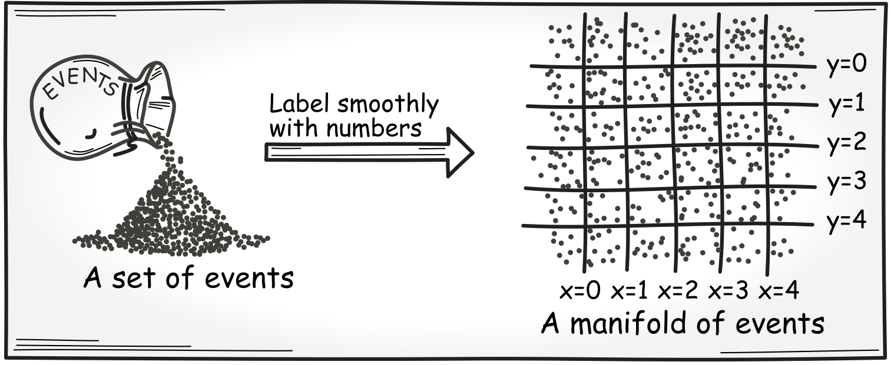
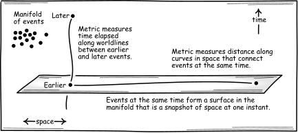
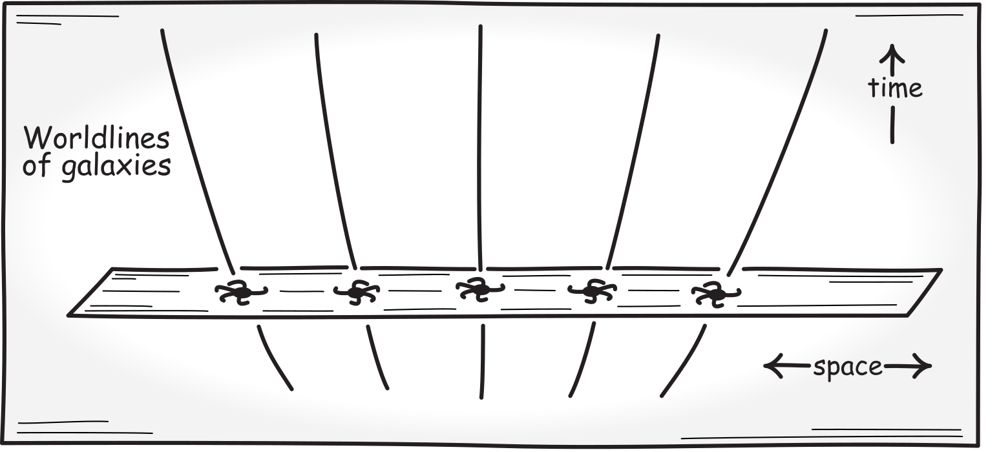
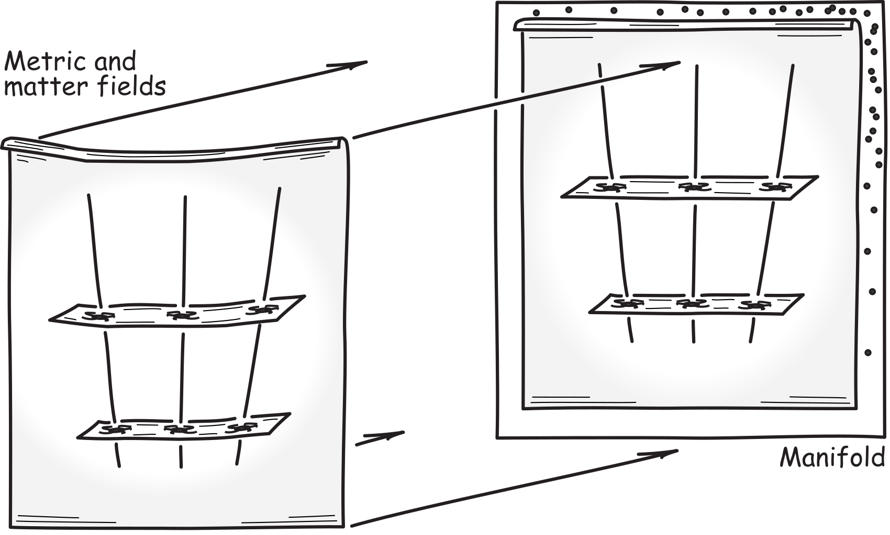
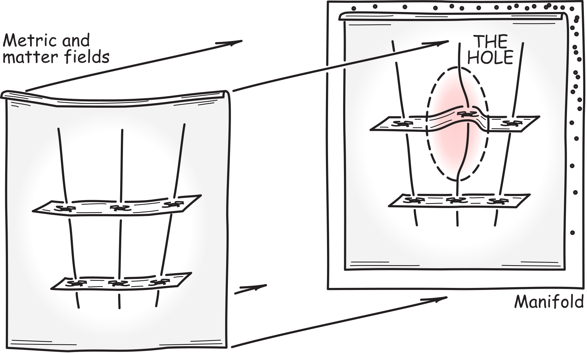
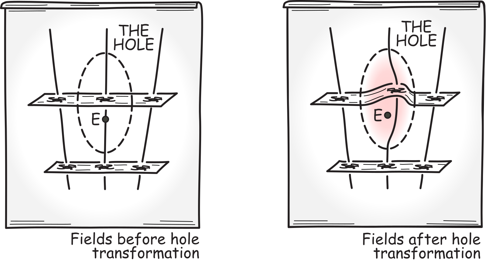

# 空穴论证 the hole argument (John D. Norton, Oliver Pooley, and James Read)

**首次发表于 1999 年 2 月 1 日；2023 年 6 月 6 日实质修订。**

什么是空间？什么是时间？它们独立于其中的事物与过程而存在吗？还是说，它们的存在寄生于那些事物与过程？它们像一块画布吗——无论画家是否作画，画布都在那里？还是说它们更像亲子关系——没有父母与子女，就没有亲缘？也就是说，是不是直到存在具有空间性质的事物、具有时间绵延的过程，才谈得上空间与时间？

这些问题争论已久，并且至今仍在争论。当人们在现代时空物理学的语境中、尤其是在爱因斯坦广义相对论的语境中追问这些问题时，空穴论证（hole argument）便应运而生。在这个语境里，空间与时间融合为单一的存在者——时空，我们要追问的是它的地位。一种看法认为时空是一种实体：一种独立于其中发生的过程而存在的东西。这就是时空实体论（spacetime substantivalism）。空穴论证试图表明，这一观点在一大类时空理论中会导致令人不快的结论。具体而言，它试图表明时空实体论会导致决定论（determinism）的失败，也就是说：给定时刻宇宙状态的完整描述，连同所论理论的自然律（例如广义相对论的定律，即爱因斯坦场方程），并不能唯一地决定宇宙将如何向未来演化。它还提出了一个证实论两难，因为它似乎会引出一个出人意料的结论：世上存在一些我们永远无法知道的事实。这些问题虽然在逻辑上并不自相矛盾，也未经验反驳，但许多人仍会认为它们令人不快。

由此，空穴论证为分析物理理论中所谓的“规范冗余”（gauge redundancies）提供了一个模板：即此类理论中存在多余数学结构的现象。我们从中学到：多余数学结构的认定无法靠任何先验或纯数学的规则达成，而需要某些物理上的依据。与此一致，空穴论证提供了两条可用的依据：（i）可证实性——候选多余结构的变化不会对可被观察证实的东西造成任何差别；（ii）决定论——理论的定律无法固定该候选多余结构。

空穴论证是爱因斯坦于 1913 年末为其广义相对论之探索而发明的，当时的目的与现在略有不同。后来，它在现代语境中由 John³ = John Earman $\times$ John Stachel $\times$ John Norton 复活并重新表述。

关于涵盖空穴论证之历史面向及其在哲学与物理学中之意义的综述，见 Stachel (2014)。该文的技术层次高于本文。另一篇近期的空穴论证综述，见 Pooley (2021)。

## 1 现代时空理论：初学者指南

如今几乎所有现代时空理论都以同一种方式构建。理论先设定一个事件流形（manifold of events），然后再给这些事件指派进一步的结构，以表现时空的内容。一个标准例子是爱因斯坦的广义相对论。作为空穴论证的宿主，我们将考察它最著名的一个应用：现代相对论宇宙学的膨胀宇宙。

这一个例子就展示了空穴论证的核心内容。只需再稍费笔墨，这个论证就可以变得更精确、更一般。我们将在这些脚注中同步完成这一工作，[^note-1] 它们面向具备微分几何与广义相对论背景的读者。

以下是现代相对论宇宙学的两个基本构件：事件流形，以及定义在它之上的场。

**事件流形**。考虑我们的宇宙，相对论宇宙学试图为之建立模型。它的时空是纵贯全部时间的全部空间。这个时空中的事件是通常空间几何中无维度点的推广。通常空间几何中的几何点只是空间中的某个特定位置，没有广延。相应地，时空中的事件是宇宙学空间在某个特定时刻的一个特定点。

至此我们定义的只是一组事件的集合。要成为一个四维流形，这组事件还须再有一点组织。在真实的时空中，我们的观念是：每个事件都处在某些事件的某个邻域之中；而这个邻域又处在更大的事件邻域之内；如此等等。这份额外的组织来自一个要求：我们能够用四个数来给事件贴标签——或者至少，对流形的任何足够小的区块都能这样做。这些标签构成坐标系。四个数恰好足以给事件贴标签，这一事实使流形成为四维的。我们现在可以挑出某个事件的邻域：取时空坐标与起始事件相差不超过一个单位（或两个、三个单位，等等）的全部点的集合。这就给出了事件的嵌套邻域。图 1 展示了如何通过给事件指派 “$x$” 与 “$y$” 坐标，把一组事件做成二维流形。

**Figure 1：事件流形的形成。**

**度规结构与物质场**。规定了事件构成四维流形之后，关于这些事件我们仍有大量 **未曾** 说出的东西。我们没有规定哪些事件处于另一些事件的未来与过去，这些事件之间流逝了多少时间，哪些事件彼此同时从而能构成三维空间，哪些空间距离分隔开这些事件，以及更多相关的性质。

这些额外的性质通过规定度规场（metric field）引入。要看这个场如何提供这些信息，请想象一条连接时空一对事件的曲线。流逝的时间与空间距离的信息，就由沿这类曲线度量的时间与距离给出。见图 2：

**Figure 2：度规场的功能。**

这些信息本可以由一份巨大的目录来提供，它逐一给出沿连接曲线度量的每一对事件之间的空间或时间距离。但这份目录会是大量冗余的：如果我们知道沿某条曲线从 $A$ 到 $B$ 以及从 $B$ 到 $C$ 的距离，那么沿同一条曲线从 $A$ 到 $C$ 的距离也就知道了。我们需要的最少信息，是每个事件与所有（粗略地说）与它无穷接近的事件之间的时间与空间距离。度规场提供的就是这份信息。它之所以是一个“场”，是因为这份信息只属于单个事件。我们随后只需把曲线上相继的无穷接近点之间的距离逐一加总，就能拼出沿任何曲线的时间与空间距离。

宇宙的物质由物质场（matter fields）表示。最简单的物质——构成星系的大块——可以由世界线（worldlines）表示，每条世界线描绘一个星系贯穿时间的全部历史。在标准模型中，星系彼此退行，这由星系世界线在走向更晚时刻时彼此散开来表示。见图 3：

**Figure 3：膨胀宇宙中的星系。**

## 2 广义协变性的自由

牛顿第一定律说，不受力的物体沿直线轨迹穿过时空。显然，这条定律如其所述不可能在所有坐标系中都成立：设想一个相对于该定律成立的坐标系作加速运动的坐标系，在加速坐标系中，不受力的物体也会显得在加速！所以牛顿第一定律——借用爱因斯坦在 1910 年代探索广义相对论时引入的一个术语——不是“广义协变的”（generally covariant）。当爱因斯坦在 1915 年最终完成广义相对论时，它的新颖特征之一就是广义协变性（general covariance）：与上面表述的牛顿第一定律不同，广义相对论的爱因斯坦场方程若在某个坐标系中成立，则在所有与该坐标系经平滑但任意的变换相联系的坐标系中都成立。广义相对论的确是第一个允许以这种方式自由使用任意时空坐标系的时空理论。如今几乎所有现代时空理论的表述都共享这一特征，包括狭义相对论的现代版本，以及（也许令人意外！）牛顿时空理论（关于后者，见如 Friedman (1983)）。

在其原初形态中，广义协变性被“被动地”（passively）理解：即描述时空中的结构时，可以任意选取坐标系。这一自由与另一个自由密切相关，即“主动的”（active）广义协变性。按照主动广义协变性，我们可以把度规场之类的结构以与坐标变换同样多的不同方式铺展到流形上，而这些场在流形上重新分布的结果将保持所论理论的解的地位。被动广义协变性与如此定义的主动广义协变性并不等价，因为一个理论可以在被动意义上广义协变，而场在流形上的任意平滑重新分布一般并不保持解的地位：细节在此并不重要，进一步讨论见 Pooley (2017)。（关于主动与被动协变性关系的更详尽说明，另见补充材料[主动与被动协变性](spacetime-holearg.active-passive.md)。）[^note-2] 重要的是，每一种“局域”时空理论（借用 Earman & Norton (1987) 的术语）都是主动广义协变的，因而都会遭遇某种版本的空穴论证——这包括狭义相对论以及牛顿力学的某些表述。（有一种看法认为这走得太远了，认为广义相对论区别于许多其他时空理论之处在于其时空几何已经变成动力学的，并且只有在这类理论中才应当发动空穴论证：进一步讨论见 Earman (1989, Ch.9, Section 5)、Stachel (1993) 与 Iftime and Stachel (2006)。）

下文中我们将聚焦于主动广义协变性，它确为广义相对论（以及其他局域时空理论）所具有的性质。空穴论证的关键操作正是行使这一自由。图 4 展示了把度规结构与物质场铺展到时空事件流形上的一种可能方式：

**Figure 4：把度规与物质铺展到流形上的一种方式。**

图 5 展示了第二种方式：

**Figure 5：把度规与物质铺展到流形上的另一种方式。**

我们把这两种铺展之间的变换称为“洞变换”（hole transformation）。虚线区域就是空洞（The Hole）。度规场与物质场的第一次分布在被变换为第二次时：

- 在空洞之外，场保持不变；
- 在空洞之内，场被铺展得不同；
- 而洞内外的铺展平滑衔接。[^note-3]

重要的是，图 5 中变换前后的两个状态都是广义相对论爱因斯坦场方程的解——这意味着，按照该理论，它们都代表世界可能的存在方式。

## 3 不变量的保持

### 3.1 不变量

两种不同的铺展共享一个至关重要的特征，空穴论证正依赖于此：两种铺展在所有不变性质上完全一致。

粗略地说，这些不变性质是几何与动力学所固有的性质，例如沿空间曲线的距离、沿星系世界线的时间、星系的静止质量、其中的粒子数，以及一大类其他性质，例如时空在度规上是平直还是弯曲。

不变性质与非不变性质相互区别。最有名的非不变性质是依赖于坐标系选取的那些性质。例如，在二维欧氏空间中恰好只有一个事件位于坐标系的原点，即 $x=0,$ $y=0$。但当我们改变坐标系时，是哪一个事件位于原点也随之改变。所以“位于原点”不是不变量。而两点之间的空间距离无论用什么坐标系来描述都相同。它是不变量。

虽然场在两种情形下铺展不同，但它们在所有不变性质上一致；所以，用不变量的语言说，它们是相同的。

### 3.2 不变量与可观测量

时空理论的不变量与其可观测量（observables，即可以被观察证实的那些量）之间有一种特殊关系：

> 一切可观测量都可以还原为不变量。

例如，若某人从星系 A 旅行到星系 B，与这段旅程相关的所有可观测量都将是不变量。它们包括旅程中流逝的时间、飞船在旅程中任一时刻是否在加速、出发时所在星系与抵达时所在星系的年龄，以及一切可能涉及以粒子或光脉冲发送信号的操作。

因此，既然洞变换的两种度规与物质场的铺展（分布）在不变量上一致，它们也就在一切可观测量上一致。它们在观察上不可区分。

## 4 什么代表时空？

回想我们最初的关切：我们想知道，能否把时空设想为一种实体——即某种独立于在它之中展开的物质事件而存在的东西。为此，我们需要知道，在上述结构中是什么代表着时空。对这个问题的一种流行回答是：事件流形代表时空。这个选择很自然，因为现代时空理论正是先设定事件流形、再在其上定义进一步的结构而构建起来的。于是，在一种把物理理论“按字面”理解的实在论观点下，把流形视为一种独立存在的、承载性质的、从而扮演容器的结构——正如我们期望时空所扮演的那样——是非常自然的。[^note-4]

有人可能想知道：流形上定义的某些进一步结构，是否代表时空的进一步性质，而非时空之内的内容物。特别是，度规场包含关于空间距离与时间流逝的重要信息。它难道不该也被视为承载时空的一部分，而非时空之内的内容物吗？

针对这条思路，有人会反驳说：广义相对论使得人们很难把度规场单纯看作承载时空的一部分。因为除空间与时间信息之外，度规场还代表引力场，因此它也携带能量与动量——引力场的能量与动量（尽管广义相对论中一个臭名昭著的技术难题使得人们无法在时空的任何特定事件处认定引力场的能量与动量 **密度**）。这些能量与动量在时空中与其他物质场自由交换。携带能量与动量（照这种想法）正是时空之内所容物质的一个自然的区分性特征。

所以，广义相对论的度规场似乎难以简单定性。我们希望它要么专属作为容器的时空，要么专属作为内容物的物质；可它似乎两者都沾。但无论如何，这里的关键（与关于空穴论证的某些历史论著相反）在于：要发动空穴论证，根本不必先了结这个问题！只要你处理的理论在上文阐明的意义上是主动广义协变的，空穴论证就会冒出头来，下面我们就会看到。

## 5 时空实体论的代价

到目前为止，我们把实体论学说刻画为“时空拥有独立于其内容的存在”这一观点。这种表述唤起了有力却含混的直观图景，但它不够清晰，难以用在物理理论的解释事业中。如果我们用一个事件流形来表示时空，如何刻画其存在的独立性？它是不是这样一个反事实主张：倘若没有度规场与物质场，事件流形依然存在？标准表述设定一切时空至少具有度规结构，这一反事实便被它自动否定了。这似乎是对流形实体论过于廉价的反驳。想必应当有一个改进的表述。幸运的是，我们无需为找到它而绞尽脑汁。就眼下目的而言，我们只需考察实体论观点的一个后果，而把精确表述该观点的任务放到一边。

在莱布尼茨与克拉克那场关于空间与时间的著名论战中，莱布尼茨讥讽实体论者牛顿的代言人克拉克（Clarke）：如果把东与西对调，世界会有什么变化？对莱布尼茨来说没有任何变化，因为物体之间的一切空间关系都会被这种对调保持。但牛顿式实体论者不得不承认，世界上的物体如今位于不同的空间位置，因此两个系统在物理上是不同的。

相应地，当我们把度规场与物质场以不同方式铺展到事件流形上时，我们就是在以不同的方式把度规性质与物质性质指派给流形的事件。例如，设想一个星系穿过空洞中的某个事件 E。经过洞变换之后，这个星系可能不再穿过那个事件。对流形实体论者而言，这必须是客观的物理事实：星系要么穿过 E，要么不穿过。两种分布代表两种物理上不同的可能性。

**Figure 6：星系是否穿过事件 $E$？**

也就是说，流形实体论者必须（看起来）否定一个由莱布尼茨的讥讽所启发、并以其命名的等价：[^note-5]

> **莱布尼茨等价（Leibniz Equivalence）**。若两个场的分布经一个平滑变换相联系，则它们代表同一个物理系统。

补充材料[通过地图投影直观理解莱布尼茨等价](spacetime-holearg.leibniz-equivalence.md)借助地球表面不同地图投影的类比，阐发了莱布尼茨等价的核心观念。

## 6 不快的后果

现在我们可以把上面的部件拼装起来，为流形实体论者制造不快的后果。考虑经洞变换相联系的两种度规场与物质场分布。由于流形实体论者否定莱布尼茨等价，实体论者必须主张这两个系统代表不同的物理系统。但区分二者的性质极为难以捉摸：它们既逃过（a）观察证实，也逃过（b）宇宙学理论的决定能力。

（a）**观察证实**。实体论者必须坚持：星系是否穿过事件 $E$ 会造成物理差别。但我们已经注意到，两种分布在观察上等价：任何观察都无法告诉我们，我们是身处星系穿过事件 $E$ 的世界，还是错过事件 $E$ 的世界。

从图 6 可能不太容易看出两种分布在观察上等价。左边的第一种分布中，中间的星系沿一条看似直线的路径运动，并且恰好保持在两侧星系的空间中点上。右边的第二种分布中，这一切似乎都被破坏了：星系看起来在向右急转时加速，从而更靠近它右侧的星系。

图 6 的呈现所显示的这些差别全都是非不变量的差别。对右边的分布而言，星系在图中确实向右偏转，但与此同时，事件之间的距离也被拉长了，正如补充材料[通过地图投影直观理解莱布尼茨等价](spacetime-holearg.leibniz-equivalence.md)中各种地图投影里距离被拉长一样。所以星系始终保持在两侧星系的空间中点上；只是从图形的画法上看不像是这样。

类似地，沿星系世界线的一个加速度矢量决定星系是否在加速。这个加速度矢量是不变量。所以，如果左边分布中的星系加速度矢量为零，那么右边分布中对应的星系加速度矢量也为零。记住：洞变换保持不变量。所以若星系在左边分布中不受加速，它在右边分布中也不受加速。

（b）**决定论**。相对论宇宙学的物理理论无法在两种情形之间做出选择。这表现为理论的一种非决定论（indeterminism）。我们可以规定整个事件流形上度规场与物质场的分布，唯独在标示为空洞的区域之内除外。然后，理论无法告诉我们场在空洞之内将如何发展。原有分布与变换后的分布都是洞外度规场与物质场向空洞之内的合法延拓，因为二者都满足相对论宇宙学理论的全部定律。理论没有任何资源能让我们坚持其中只有一个是可取的。

必须看到，这个不快的后果并不只在于决定论的失败。我们对这类失败再熟悉不过了，它当然不足以自动否证一个物理理论。最著名的、广受赞誉的非决定论理论的例子是量子理论：在标准诠释中，对系统的测量可以导致向多个可能结果之一的不确定性坍缩。鲜为人知的是，在经典物理中同样可以构造非决定论系统。多数例子涉及一些古怪情形，例如物体以无界速度从空间无穷远处凭空出现，即所谓“太空入侵者”（Earman 1986a, 第三章；另见词条“因果决定论”）。它们也可能由超任务（Supertasks）中无穷多物体的相互作用产生。更晚近，出现了一个极其简单的例子：单个质块停在一个穹顶顶端，在任意的延时之后、沿任意方向自发地开始运动（Norton 2003, Section 3）。

空穴论证中决定论失败的问题不在于失败这一事实，而在于它失败的方式。如果我们否定流形实体论并接受莱布尼茨等价，那么由洞变换诱导的非决定论就被根除了。尽管向洞内延拓的场在数学上有不可数多种互不相同的方式，但在莱布尼茨等价之下，它们在物理上全部相同。也就是说，物理场向洞内的延拓终究是唯一的。于是，这种非决定论是实体论者形而上学承诺的直接后果。类似地，如果我们接受莱布尼茨等价，我们也就不再为两种分布无法被任何可能的观察区分而困扰：它们只是同一物理实在的不同数学描述，因而理应在一切可观测量上一致。

所以，空穴论证所邀请的反实体论结论是：我们可以往任何物理理论里塞进无法被观察固定的对象或性质（此处即时空事件）。如果它们对观察的不可见性尚不足以作为它们不合法的警示，那么发现它们把非决定论带给一个原本决定论的理论，理应足以作为警示。因此，这样的对象或性质（此处即时空事件）应当连同任何要求保留它们的学说一道被抛弃。

## 7 空穴论证概要

概括起来，空穴论证等于下述内容：[^note-6]

1. 若两个度规场与物质场的分布经洞变换相联系，则流形实体论者必须主张这两个系统代表两个不同的物理系统（即他们必须否定莱布尼茨等价）。
2. 这种物理上的区别超越观察与理论的决定能力，因为：
3. 两种分布在观察上同一。
4. 理论的定律无法在两种向洞内的场延拓之间做出选择。
5. 因此，流形实体论者倡导了一种成问题的形而上学，应当予以抛弃。

## 8 空穴论证的历史

### 8.1 爱因斯坦落入空洞……

空穴论证是爱因斯坦在 1913 年末发明的，是一种绝望之举：当时他为广义相对论的探索遭遇了看似不可逾越的障碍。此前一年，他立志寻找一个在上文意义上广义协变的引力理论。他甚至已经考虑过本质上正是他 1915 年 11 月最终敲定、如今出现在所有教科书中的那些著名的广义协变方程。

不幸的是，爱因斯坦至少起初没能看出这些方程是可取的。牛顿引力理论在弱引力场中近乎完美地成立。所以爱因斯坦的理论在这个情形下必须退回牛顿理论，这一点至关重要。但无论怎么努力，爱因斯坦都没能看出他的方程及其许多变体能与牛顿理论恰当衔接。1913 年年中，他发表了一个折中方案：一个非广义协变的相对论引力理论纲要。（关于这些挣扎的更多细节，见 Norton (1984)。）

找不到可取的广义协变理论，令爱因斯坦深感困扰。1913 年晚些时候，他试图把失败转化为某种胜利：他以为自己能够表明，任何广义协变理论都不可取。任何这类理论都会违反他所称的“因果律”（Law of Causality）——我们如今称之为决定论。他试图用空穴论证来证明这个惊人的主张。

在其最初形态中，爱因斯坦考虑一个充满物质的时空，唯独一个区域——空洞——没有物质。（所以在原初形态里，“洞”一词比在现代版本中更贴切。）然后他问：洞外度规场与物质场的完整规定能否固定洞内的度规场。由于他默认了抛弃莱布尼茨等价，爱因斯坦认为这个否定的答案足以给一切广义协变理论定罪。

### 8.2 ……又爬了出来

爱因斯坦带着他那个协变性受限的畸形理论又挣扎了两年。1915 年末，随着他的错误的证据不可阻挡地累积，爱因斯坦被逼到近乎绝望、最终屈服的境地。他带着新的紧迫感回到寻找广义协变方程的工作，这部分地出于一个认识：堂堂大卫·希尔伯特（David Hilbert）已经亲自投入对他理论的分析。1915 年 11 月末，爱因斯坦的探索以广义协变形式的理论完成而圆满落幕。

很长时间里，人们认为希尔伯特比爱因斯坦早五天得到了最终理论。希尔伯特论文校样形式的新证据现在表明，事情可能并非如此。更重要的是，证据清楚地表明，希尔伯特与爱因斯坦一样，至少曾一度相信空穴论证排斥一切广义协变理论，而且这一信念至少保持到其论文校样之时。（见 Corry, Renn and Stachel 1997。）

虽然爱因斯坦已默认撤回了对广义协变理论的反对，但他并未公开他认为空穴论证在何处失效。这一步他最终迈出，是他发表了 John Stachel 所谓的“点重合论证”（point-coincidence argument）之时。这个论证因爱因斯坦 (1916, p.117) 对其广义相对论的评述而广为人知，其实质是为莱布尼茨等价辩护。他力主：一个理论的物理内容由它所允许的时空重合的目录穷尽。例如，在一个只处理粒子的理论中，重合就是粒子世界线的交点。这些重合在场的变换下保持。因此，可以互相变换的两个场系统具有相同的物理内容；它们代表同一个物理系统。

多年间，空穴论证被当作一位在其他方面洞若观火的爱因斯坦所犯的一个平凡错误。是 John Stachel (1980) 认出了它极不平凡的性质，并把这一认识带给现代物理学史与物理学哲学共同体。（另见 Stachel 1986。）在 Earman and Norton (1987) 中，该论证被重塑为明确针对时空实体论的论证。进一步的历史讨论见 Howard and Norton (1993)、Janssen (1999)、Klein (1995) 与 Norton (1987)。四卷本的全景式详尽论述是 Renn (2007)；关于空穴论证哲学复兴的历史，见 Weatherall (2020)。

关于逻辑经验主义者对爱因斯坦点重合论证的挪用与误用，见 Giovanelli (2013)。

## 9 对空穴论证的回应

对空穴论证的回应，至少与写过它的作者一样多。本节对该文献做一次整理：自 1980 年代该论证在哲学文献中复兴以来，我们考察五大类回应。在对该论证的审视过程中，如今它的几乎所有方面都已被掂量与检验过。

### 9.1 否定实体论

一条思路径直同意：空穴论证使得接受莱布尼茨等价成为必然。它试图把这种接受所涉及的内容变得更透明，办法是寻找单一数学结构来表示一个物理时空系统，而不是莱布尼茨等价所允许的可互变换结构的等价类。其中一种尝试涉及“莱布尼茨代数”（Leibniz algebra）概念（见 Earman 1989, Ch. 9, Sect. 9）。这类尝试能否成功并不清楚。正如可互变换的场代表同一个物理系统，也存在着不同但可互变换、具有相同物理意涵的莱布尼茨代数。如果流形与莱布尼茨代数这两种形式体系可以互译，那么可以预期空穴论证也会在这种翻译下在后者中重现。（见 Rynasiewicz 1992。）

另一种进路试图通过以“狄拉克可观测量”（Dirac observables）及相应的规范固定约定对时空点做个体化，来解释莱布尼茨等价并论证广义相对论与空穴论证的相容（Lusanna and Pauri 2006）。更一般地，我们很可以怀疑：时空实体论面临的困难是否是上文所述特定形式体系的假象。Bain (1998, 2003) 考察了转向其他形式体系（不限于莱布尼茨代数）的效果。

### 9.2 接受非决定性

对空穴论证的另一种回应是接受广义相对论等广义协变的时空理论是非决定论的。也许（照这种想法）这种非决定论并不可怕，因为它只是关于哪些对象例示哪些性质的非决定论，而不是关于例示了哪些性质样式的非决定论。然而，这是否足以化解对非决定论的担忧并不明显：至少，若另有回应可取，它们似乎更可取。

与此相关的一种回应是 **重新定义** 决定论，并论证：在相关意义上，尽管有空穴论证，广义相对论这类理论终究是决定论的。围绕空穴论证对决定论定义的修改已由 Belot (1995b)、Brighouse (1994, 2020)、Butterfield (1989)、Melia (1999) 与 Pooley (2021) 探讨。

### 9.3 度规本质主义

Maudlin (1990) 对空穴论证做出了极具原创性的回应：他主张每个时空事件本质地（essentially）携带其度规性质；也就是说，若（在场的重新分布之后）我们试图给它指派不同的度规性质，它就不再是那个事件了。这样一来，虽然对广义相对论（或所论的任何主动广义协变理论）的每一类可互变换解似乎都有一类不同的可能世界与之相联，事实上其中只有一个世界在形而上学上可能，于是空穴论证失效。Teitel (2019) 考察了这一本质主义回应的一个精细化版本，但结论是它并不优于对空穴论证的标准模态回应。Butterfield (1989) 把可互变换的系统刻画为不同的可能世界，并运用对应体理论（counterpart theory）论证至多只有一个能代表现实时空。（关于巴特菲尔德对应体论证的更新版本，见 Butterfield & Gomes 2023a, 2023b。）

### 9.4 精致实体论

Maudlin 的度规本质主义是“精致实体论”（sophisticated substantivalism）的一例。这一术语由 Belot & Earman (2001) 以略带贬义的口吻引入，指这样一类观点：实体论者否认经洞变换相联系的系统代表不同的可能性终究是合法的，从而绕开空穴论证。精致实体论的另一版本是反此性（anti-haecceitist）实体论，按照它，物理时空点不拥有跨世界同一性。“宇宙的物质内容从现实世界的分布被移位”的那些世界之间的区别，正以这类同一性为前提。于是，广义相对论及其他主动广义协变理论的表观非决定论，便通过否认这类同一性而得以避免。这一立场目前是对空穴论证的流行回应：讨论见 Hoefer (1996) 与 Pooley (2006b)；对该立场在形而上学上晦涩难明的担忧，见 Dasgupta (2011)。

精致实体论的另一相关版本主张：代表时空的与其说是单靠事件流形，不如说是某种更丰富的结构，例如事件流形连同度规性质。（例如见 Hoefer 1996。）这一逃逸路线的动机是：事件流形缺乏时空本质性的性质。例如，事件流形中没有过去与未来、时间流逝或空间距离的观念。于是人们可能忍不住把时空等同于事件流形 **加上** 供给这些时空观念的某个进一步结构。如此一来（照这种想法），以非刚性方式个体化时空点的正是度规结构。这条逃离空穴论证的路线有时成功，有时失败。在某些重要的特殊情形中，可以对该观点发动替代版本的空穴论证：见 Norton (1988)。

### 9.5 数学/形式主义回应

对空穴论证可能最简单的挑战是：莱布尼茨等价是现代数学物理文献中的标准预设，甚至考虑否定它都是不值得认真对待的数学错误。但可以这样回应：接受莱布尼茨等价在物理学文献中固然广泛，但它不是一条只能以自相矛盾为代价才能否定的 **逻辑真理**。它承载着非平凡的假定，其意涵必须以清醒的反思加以接受——这一点由连大卫·希尔伯特本人都早期接受空穴论证所表明。（见上文 8.2 节。）如果否定莱布尼茨等价是一个连合格数学家都不会犯的低级错误，那么我们的合格标准已经高到不可企及，因为它必须把 1915 年鼎盛期的大卫·希尔伯特排除在外。

不过，这个问题近来被 Weatherall (2018) 重新揭开：他论证，可互变换的数学结构在标准数学实践中被当作同一结构，因此它们应当表示同一个物理系统，从而排除了对莱布尼茨等价的否定。Curiel (2018) 以不同依据论证了与 Weatherall 类似的平凡性结论：在标准物理实践中，洞变换没有 **物理** 对应物。对这类论证的回应、并为“这种‘数学结构主义’不足以封堵空穴论证”辩护的观点，见 Pooley & Read (2021)；同样地，Roberts (2020) 回应说：应当由自然——而非数学实践——来决定两个数学结构是否代表同一个物理系统。

晚近，一些作者主张把数学基础从集合论正统加以修改就足以封堵空穴论证：在同伦类型理论的特定语境中对这类论证的讨论，见 Ladyman & Presnell (2020) 与 Dougherty (2020)。另外，Halvorson and Manchak (2021) 论证：由于存在唯一的保度规映射（“等距”）联系广义相对论中经洞变换相联系的两个解，空穴论证随之被封堵；对该论证的怀疑性回应，见 Menon & Read (2023)。

Belot (2018) 反对对莱布尼茨等价作出单向的裁定。他一方面允许洞变换所联系的系统在物理上相同，另一方面论证：在广义相对论的某些区段，某些保持度规的变换可能联系物理上不同的系统。

## 10 空穴论证的更广意义

空穴论证在科学哲学中具有更广的意义，涉及对理论实体的实在论、量子引力理论，以及物理理论中的规范自由度问题。本节讨论这三重关系；另有补充材料对第三点展开。

### 10.1 科学实在论的界限

空穴论证给科学实在论的兴起提出了一种新的障碍。按照那种观点，我们应当按字面解读成熟理论的断言。于是，如果广义相对论描述了一个事件流形与一个度规结构，那么在严格的科学实在论者看来，那里实实在在存在的就是这些。有人主张，不这样想就会让这些理论的成功沦为无法解释的奇迹。如果时空真的不具有广义相对论赋予它的几何结构，我们如何解释理论的成功？

这个观点固然动人，但空穴论证表明：必须对我们对成功理论的字面解读施加某些限制。或者至少说，坚持这种字面解读要付出高昂代价。空穴论证让我们看到，我们可能不得不承认，实际存在的东西比字面解读所说的要少一点，免得我们被迫设定一些既超越观察、又超越理论决定能力的物理实在性质。

### 10.2 空穴论证与引力的量子化

现代理论物理学最顽固的难题之一是引力的量子化。爱因斯坦 1915 年的广义相对论以时空曲率来思考引力，带来了一场革命；但如今人们普遍同意，它不可能是引力的最终说明。原因在于：它仍是一个经典理论。它不按量子理论处理物质。

把量子理论与广义相对论纳入单一理论的问题仍未解决。（见“量子引力”词条。）竞争者众多，著名的有弦论与圈量子引力。有人提出的问题是：空穴论证向我们表明（照这种主张），任何成功的量子引力理论都不能设定一个独立的、作为容器的时空。John Stachel 是空穴论证这一结论的早期支持者，见 Stachel (2006)。圈量子引力论者常常专门以此批评弦论进路，因为弦论进路有这样一个背景时空。见 Rovelli and Gaul (2000) 与 Smolin (2006)；关于这些“背景独立”问题的哲学讨论，见 Pooley (2017) 与 Read (2023)。

在一个相关进展中，Gryb and Thébault (2016) 论证：在适当假定下，空穴论证问题与量子引力的“时间问题”本质上是同一个问题。更多讨论见“量子引力”词条中的“时间问题”。

### 10.3 空穴论证与规范自由度

空穴论证在物理学哲学日益认识到规范变换（gauge transformations）重要性的过程中发挥了作用：它们作用于我们物理理论中的某些自由度，而这些自由度被认为在物理实在中没有对应物。空穴论证的分析为物理学哲学家提供了一个便利的模板，供他们判断某物是否为规范自由度。如导言所述，我们从空穴论证中学到：多余数学结构的认定无法靠任何先验或纯数学的规则达成（至少在假定上文讨论的数学/形式主义回应不成立的前提下）。而需要某些物理依据。空穴论证提供了两条可用的依据：（i）可证实性——候选多余结构的变化不会对可被观察证实的东西造成任何差别；（ii）决定论——理论的定律无法固定该候选多余结构。关于空穴论证与规范自由度的更详细讨论，见补充材料[作为分析规范自由度之模板的空穴论证](spacetime-holearg.gauge.md)。

## 脚注

[^note-1]: 该论证的形式沿袭 Earman and Norton (1987) 最初给出的版本。关于空穴论证在介于本文正文与这些脚注之间的技术层次上的展开，见 Norton (1992a, Section 5.12)。

    一般而言，空穴论证所发动的理论类是“局域时空理论”。这些理论的模型由 $n+1$ 元组

    $$ (M, O_1 , \ldots ,O_n) $$

    构成，其中 $O_1 , \ldots ,O_n$ 是定义在微分流形 $M$ 上的几何对象场。理论中的模型类由某组不变（如张量）方程划界，它们就是理论的定律：

    $$ L_1 =0, \ldots ,L_m =0 $$

    其中诸量 $L_i$ 是几何对象 $O_i$ 的函数。理论被假定是完备的，即任何满足这些定律的模型都在该理论的模型集中。对局域时空理论的这一刻画足够一般，足以涵盖几乎所有常见时空理论的表述，包括广义相对论、狭义相对论与牛顿理论。

[^note-2]: 简要地说，被动与主动广义协变性的区分如下。被动广义协变性允许使用微分流形的全部坐标卡，按现代方法表述的理论自动拥有它。主动广义协变性考虑由坐标变换诱导的对偶点变换。它们相当于流形 $M$ 上的微分同胚（diffeomorphism），场的变换相应于把对象场 $O$ 与其在微分同胚 $h$ 下的拖带 $h^* O$ 相联系的映射。

    把爱因斯坦的原初分析从被动变换转写为主动变换是件别扭的事。当爱因斯坦最初表述空穴论证时，二者的区分并不那么界限分明，因为他所处的数学环境更为贫乏；这一点是如今解读爱因斯坦关于坐标系统的种种断言时出现大量混乱的原因。见 Norton (1989, 1992)。关于被动与主动变换之区分的近期讨论，见 Pooley (2017)。

[^note-3]: 也就是说，洞变换是流形 $M$ 上的一个微分同胚，它在某个任意选定的邻域之外是恒等映射，而在该邻域之内平滑地偏离恒等。此类变换的显式构造见 Muller (1995) 与 Macdonald (2006)。

    广义协变性这一概念一直是一桩旷日持久的争讼，可上溯至广义相对论的最初岁月：Kretschmann 曾主张广义协变性要求只是一个没有物理内容的数学条件。详尽综述见 Norton (1993)。

[^note-4]: 更一般地，流形实体论主张局域时空理论的流形 $M$ 就是代表时空的数学结构。

[^note-5]: 对任何时空模型 $(M, O_1 , \ldots ,O_n)$ 与流形 $M$ 上的任何微分同胚，莱布尼茨等价断言如下两个模型

    $$ (M, O_1 , \ldots ,O_n) \text{ and } (hM, h^* O_1 , \ldots ,h^* O_n) $$

    代表同一个物理系统。

[^note-6]: 论证的一般形式本质上相同。第一句推广为：

    *1.* 若局域时空理论的两个模型 $(M, O_1 , \ldots ,O_n)$ 与 $(hM, h^* O_1 , \ldots ,h^* O_n)$ 经洞变换 $h$ 相联系，则流形实体论者必须主张这两个系统代表两个不同的物理系统。

    另请注意：陈述 1 与 2 是前提，陈述 3 是由它们得出的结论。其中有一个被省略的前提：往物理理论里塞进既超越观察又超越理论之决定能力的隐藏性质，是不可取的。

[^note-7]: 为这些主张提供依据的计算如下。在牛顿理论中，势场 $U$ 由泊松方程固定：

    $$ \Delta U = -4\pi \varrho $$

    其中 $\varrho$ 是物质密度。若 $U(r)$ 满足此方程，则 $U(r)+K(t)$ 也满足它，因为 $\Delta K(t) = 0$，故 $\Delta(U(r)+K(t)) = \Delta U(r)$。

[^note-8]: 可观察的电磁场强 $\mathbf{E}$ 与 $\mathbf{B}$ 通过下述关系与标势 $\phi$ 及矢势 $\mathbf{A}$ 相联系：

    $$\begin{align} \mathbf{B} &= \boldsymbol{\nabla} \times \mathbf{A} \\ \mathbf{E} &= -\boldsymbol{\nabla} \phi - \partial \mathbf{A}/\partial t \end{align}$$

    由此可知 $\mathbf{B}$ 与 $\mathbf{E}$ 在下述规范变换下不变：

    $$\begin{align} \mathbf{A}' &= \mathbf{A} - \boldsymbol{\nabla} \lambda \\ \phi' &= \phi + \partial \lambda /\partial t \end{align}$$

    该规范变换由标量场 $\lambda$ 生成，$\lambda$ 可以是空间与时间的任意函数。为制造洞型变换，我们选取一个除某个足够小的时空区域外处处为零、而在该区域内平滑地偏离零的 $\lambda$。所得的两组势 $(\phi , \mathbf{A})$ 与 $(\phi ', \mathbf{A}')$ 在洞外处处一致，但在洞内平滑地产生差别。

    与前文一样，任何想把这两组势之间的差别说成某种物理实在之物的企图，都面临同样的问题。这些差别不表达在任何可观察的东西中。一切可观测量都由场强 $\mathbf{E}$ 与 $\mathbf{B}$ 导出，而两组势在 $\mathbf{E}$ 与 $\mathbf{B}$ 上一致。进一步，麦克斯韦方程组也无法在两组势之间做出选择：因为麦克斯韦方程组完全由这同一组 $\mathbf{E}$ 与 $\mathbf{B}$ 场表达。

## 参考文献

**以下非中文文献条目从原文照录，不作翻译；中国文献条目一律译为中文（本条无中国文献）。**

- Bain, Jonathan, 1998, *Representations of Spacetime: Formalism and Ontological Commitment*, Ph.D. Dissertation, Department of History and Philosophy of Science, University of Pittsburgh.
- –––, 2003, “Einstein Algebras and the Hole Argument,” *Philosophy of Science*, 70: 1073–1085.
- Belot, Gordon, 1995a, “Indeterminism and Ontology,” *International Studies in the Philosophy of Science*, 9: 85–101.
- –––, 1995b, “New Work for Counterpart Theorists”, *British Journal for the Philosophy of Science*, 46(2): 185–195.
- –––, 1996, *Whatever is Never and Nowhere is Not: Space, Time and Ontology in Classical and Quantum Gravity* Ph. D. Dissertation, Department of Philosophy, University of Pittsburgh.
- –––, 1996a, “Why General Relativity *Does* Need an Interpretation,” *Philosophy of Science*, 63 (Supplement): S80–S88.
- –––, 2018, “Fifty Million Elvis Fans Can’t be Wrong,” *Noûs*, 52: 946–981.
- Belot, Gordon and Earman, John, 2001, “Pre-Socratic Quantum Gravity”, in C. Callender and N. Huggett (eds.), *Physics Meets Philosophy at the Planck Scale*, Cambridge: Cambridge University Press. pp. 213–255.
- Brighouse, Carolyn, 1994, “Spacetime and Holes,” in D. Hull, M. Forbes and R. M. Burian (eds.), *PSA 1994*, Volume 1, pp. 117–125.
- –––, 2020, “Confessions of a (Cheap) Sophisticated Substantivalist”, *Foundations of Physics *, 50: 348–359.
- Butterfield, Jeremy, 1988, “Albert Einstein meets David Lewis,” in A. Fine and J. Leplin (eds.), *PSA 1988*, Volume 2, pp. 56–64.
- –––, 1989, “The Hole Truth,” *British Journal for the Philosophy of Science*, 40: 1–28.
- Brading, Katherine and Castellani, Elena (eds.), 2003, *Symmetries in Physics:Philosophical Reflections*, Cambridge: Cambridge University Press, pp. 334–345.
- Corry, Leo, Renn, Juergen, and Stachel, John, 1997, “Belated Decision in the Hilbert-Einstein Priority Dispute,” *Science*, 278: 1270–73.
- Curiel, Erik, 2018, “On the Existence of Spacetime Structure,” *British Journal for the Philosophy of Science*, 69: 447–483.
- Dasgupta, Shamik, 2011, “The Bare Necessities”, *Philosophical Perspectives*, 25: 115–160.
- Dougherty, John, 2020, “The Hole Argument, Take $n$”, *Foundations of Physics*, 50: 330–347.
- Earman, John, 1986, “Why Space is not a Substance (At Least Not to First Degree),” *Pacific Philosophical Quarterly*, 67: 225–244.
- –––, 1986a, *A Primer on Determinism*, Dordrecht: Reidel.
- –––, 1989, *World Enough and Space-Time: Absolute Versus Relational Theories of Space and Time*, Cambridge, MA: MIT Bradford.
- –––, 2003, “Tracking down gauge: an ode to the constrained Hamiltonian formalism”, in K. Brading and E. Castellani (eds.), *Symmetries in Physics: Philosophical Reflections*, Cambridge: Cambridge University Press, pp. 140–162.
- Earman, John and Norton, John D., 1987, “What Price Spacetime Substantivalism,” *British Journal for the Philosophy of Science*, 38: 515–525.
- Einstein, Albert, 1916, “The Foundation of the General Theory of Relativity,” in H.A. Lorentz et al., *The Principle of Relativity*, New York: Dover, 1952, pp. 111–164.
- Friedman, Michael, 1983. *Foundations of Space-Time Theories: Relativistic Physics and Philosophy of Science, *Princeton, NJ: Princeton University Press.
- Giovanelli, Marco, 2013 “Erich Kretschmann as a Proto-Logical-Empiricist: Adventures and Misadventures of the Point-Coincidence Argument,” *Studies in History and Philosophy of Modern Physics*, 44: 115–134.
- Gomes, Henrique and Butterfield, Jeremy, 2023a, “The Hole Argument and Beyond, Part I: The Story so Far”.
- –––, 2023b, “The Hole Argument and Beyond, Part II: Treating Non-isomorphic Spacetimes”.
- Gryb, Sean and Thébault, Karim P. Y., 2016, “Regarding the ‘Hole Argument’ and the ‘Problem of Time’,” *Philosophy of Science*, 83: 563–584.
- Halvorson, Hans and Manchak, J.B., “Closing the Hole Argument”, *British Journal for the Philosophy of Science*, 2021.
- Healey, Richard, 1999, “On the Reality of Gauge Potentials,” *Philosophy of Science*, 68: 432–55.
- Hoefer, Carl, 1996, “The Metaphysics of Space-Time Substantivalism,” *Journal of Philosophy*, 93: 5–27.
- Hoefer, Carl and Cartwright, Nancy, 1993, “Substantivalism and the Hole Argument,” in J. Earman *et al*. (eds.), *Philosophical Problems of the Internal and External Worlds: Essays on the Philosophy of Adolf Gruenbaum*, Pittsburgh: University of Pittsburgh Press/Konstanz: Universitaetsverlag Konstanz, pp. 23–43.
- Howard, Don and Norton, John D., 1993, “Out of the Labyrinth? Einstein, Hertz and the Goettingen Answer to the Hole Argument,” in John Earman, Michel Janssen, John D. Norton (eds.), *The Attraction of Gravitation: New Studies in History of General Relativity* Boston: Birkhäuser, pp. 30–62.
- Iftime, Mihaela and Stachel, John, 2006, “The Hole Argument for Covariant Theories,” *General Relativity and Gravitation*, 38: 1241–1252.
- Janssen, Michel, 1999, “Rotation as the Nemesis of Einstein’s ‘Entwurf’ Theory,” in Hubert Goenner *et al*. (eds.), *Einstein Studies: Volume 7. The Expanding Worlds of General Relativity*, Boston: Birkhaeuser, pp. 127–157.
- Jammer, Max, 1993, *Concepts of Space: The History of Theories of Space in Physics*, third enlarged edition, New York: Dover, Chapter 6. “Recent Developments.”
- Klein, Martin J. *et al*. (eds.), 1995, *The Collected Papers of Albert Einstein: Volume 4. The Swiss Years: Writing, 1912–1914*, Princeton: Princeton University Press.
- Ladyman, James and Presnell, Stuart, 2020, “The Hole Argument in Homotopy Type Theory”, *Foundations of Physics*, 50: 319–329.
- Lusanna, Luca and Pauri, Massimo, 2006 “Explaining Leibniz Equivalence as Difference of Non-inertial Appearances: Dis-solution of the Hole Argument and Physical Individuation of Point-Events,” *Studies in History and Philosophy of Modern Physics*, 37: 692–725
- Liu, Chuang, 1996, “Realism and Spacetime: Of Arguments Against Metaphysical Realism and Manifold Realism,” *Philosophia Naturalis*, 33: 243–63.
- –––, 1996a, “Gauge Invariance, Indeterminism, and Symmetry Breaking,” *Philosophy of Science*, 63 (Supplement): S71–S80.
- Leeds, Stephen, 1995, “Holes and Determinism: Another Look,” *Philosophy of Science*, 62: 425–437.
- Macdonald, Alan, 2001, “Einstein’s Hole Argument,” *American Journal of Physics*, 69: 223–25
- Maudlin, Tim, 1989, “The Essence of Spacetime,” in A. Fine and J. Leplin (eds.), *PSA 1988*, Volume 2, pp. 82–91.
- –––, 1990, “Substances and Spacetimes: What Aristotle Would have Said to Einstein,” *Studies in the History and Philosophy of Science*, 21: 531–61.
- Melia, Joseph, 1999, “Holes, Haecceitism and Two Conceptions of Determinism”, *British Journal for the Philosophy of Science*, 50(4):639–664.
- Menon, Tushar and Read, James, 2023, “Some Remarks on Recent Mathematical-*cum*-formalist Responses to the Hole Argument”, *Philosophy of Science*.
- Muller, Fred A., 1995, “Fixing a Hole,” *Foundations of Physics Letters*, 8: 549–562.
- Mundy, Brent, 1992, “Spacetime and Isomorphism,” in D. Hull, M. Forbes and K. Okruhlik (eds.), *PSA 1992*, Volume 1, pp. 515–527.
- Norton, John D., 1984, “How Einstein found his Field Equations: 1912–1915,” *Historical Studies in the Physical Sciences*, 14: 253–316; reprinted in Don Howard and John Stachel (eds.), *Einstein and the History of General Relativity: Einstein Studies*, Volume 1, Boston: Birkhäuser, 1989, pp. 101–159.
- –––, 1987, “Einstein, the Hole Argument and the Reality of Space,” in John Forge (ed.), *Measurement, Realism and Objectivity*, Dordrecht: Reidel, pp. 153–188 .
- –––, 1988, “The Hole Argument,” in A. Fine and J. Leplin (eds.), *PSA 1988*, Volume 2, pp. 56–64.
- –––, 1989, “Coordinates and Covariance: Einstein’s view of spacetime and the modern view,” *Foundations of Physics*, 19: 1215–1263.
- –––, 1992, “The Physical Content of General Covariance,” in J. Eisenstaedt and A. Kox (eds.), *Studies in the History of General Relativity* (Volume 3: Einstein Studies), Boston: Birkhauser, pp. 281–315.
- –––, 1992a, “Philosophy of Space and Time,” in M.H. Salmon *et al*., *Introduction to the Philosophy of Science*, Englewood Cliffs, NJ: Prentice-Hall; reprinted Hackett Publishing, pp. 179–231.
- –––, 1993, “General Covariance and the Foundations of General Relativity: Eight Decades of Dispute,” *Reports on Progress in Physics*, 56: 791–858.
- –––, 2003, “Causation as Folk Science,” *Philosophers’ Imprint*, 3 (4) [[available Online](http://www.philosophersimprint.org/003004/)].
- –––, 2003a, “General Covariance, Gauge Theories, and the Kretschmann Objection,” in K. Brading and E. Castellani (eds.), *Symmetries in Physics: Philosophical Reflections*, Cambridge: Cambridge University Press, pp. 110–123.
- –––, 2019, “Ontology of Space and Time: The Hole Argument”, in *Einstein for Everyone*: [available online](https://sites.pitt.edu/~jdnorton/teaching/HPS_0410/chapters/significance_GR_hole_argument/significance_GR_hole_argument.html).
- Pooley, Oliver, 2002, *The Reality of Spacetime*, D.Phil. thesis, University of Oxford.
- –––, 2006a, “A Hole Revolution, or are We Back Where We Started?”, *Studies in History and Philosophy of Modern Physics*, 37(2): 372–380.
- –––, 2006b, “Points, Particles, and Structural Realism,” in D. Rickles *et al. *(eds), *The Structural Foundations of Quantum Gravity*, Oxford: Oxford University Press, pp. 83–120.
- –––, 2013, “Substantivalist and Relationalist Approaches to Spacetime,” in R. W. Batterman (ed.), *The Oxford Handbook of Philosophy of Physics*, Oxford: Oxford University Press, pp. 522–586.
- –––, 2017, “Background Independence, Diffeomorphism Invariance and the Meaning of Coordinates”, in D. Lehmkuhl, G. Schiemann and E. Scholz (eds.), *Towards a Theory of Spacetime Theories,* Basel: Birkhäuser, pp. 105–144.
- –––, 2021, “The Hole Argument”, in E. Knox and A. Wilson (eds.), *The Routledge Companion to Philosophy of Physics*, London: Routledge, pp. 145–159.
- Pooley, Oliver and Read, James, 2021, “On the Mathematics and Metaphysics of the Hole Argument”, *British Journal for the Philosophy of Science*.
- Read, James, 2023, *Background Independence in Classical and Quantum Gravity, *Oxford: Oxford University Press.
- Renn, Juergen, *et al*. (eds.), 2007, *The Genesis of General Relativity: Sources and Interpretations*, (Boston Studies in the Philosophy of Science, Volume 250), 4 Volumes, Berlin: Springer.
- Rickles, Dean, 2005, “A New Spin on the Hole Argument,” *Studies in History and Philosophy of Modern Physcis*, 36: pp. 415–34.
- Roberts, Bryan W., 2020, “Regarding ‘Leibniz Equivalence’”, *Foundations of Physics* 50: 250–269.
- Rovelli, Carlo and Gaul, Marcus, 2000, “Loop Quantum Gravity and the Meaning of Diffeomorphism Invariance”, in Jerzy Kowalski-Glikman (ed.), *Towards Quantum Gravity,* Berlin: Springer, pp. 277–324.
- Rynasiewicz, Robert, 1992, “Rings, Holes and Substantivalism: On the Program of Leibniz Algebras,” *Philosophy of Science*, 45: 572–89.
- –––, 1994, “The Lessons of the Hole Argument,” *British Journal for the Philosophy of Science*, 45: 407–436.
- –––, 1996, “Is There a Syntactic Solution to the Hole Problem,” *Philosophy of Science*, 64 (Proceedings): S55–S62.
- –––, 2012, “Simultaneity, convention, and gauge freedom” *Studies in History and Philosophy of Modern Physics*, 43: 90–94.
- Smolin, Lee, 2006, “The Case for Background Independence”, in Dean Rickles, Steven French and Juha T. Saatsi (eds.), *The Structural Foundations of Quantum Gravity*, Oxford: Oxford University Press. pp. 196–239.
- Stachel, John, 1980, “Einstein’s Search for General Covariance,” in Don Howard and John Stachel (eds.), *Einstein and the History of General Relativity* (Einstein Studies, Volume 1), Boston: Birkhäuser, 1989, pp. 63–100. [This paper was first paper read at the Ninth International Conference on General Relativity and Gravitation, Jena.]
- –––, 1986, “What can a Physicist Learn from the Discovery of General Relativity?,” *Proceedings of the Fourth Marcel Grossmann Meeting on Recent Developments in General Relativity*, R. Ruffini (ed.), Amsterdam: North-Holland, pp. 1857–1862.
- –––, 1993, “The Meaning of General Covariance,” in J. Earman *et al*. (eds.), *Philosophical Problems of the Internal and External Worlds: Essays on the Philosophy of Adolf Gruenbaum*, Pittsburgh: University of Pittsburgh Press/Konstanz: Universitaetsverlag Konstanz, pp. 129–160.
- –––, 2006, “Structure, Individuality and Quantum Gravity”, in Dean Rickles, Steven French and Juha T. Saatsi (eds.), *The Structural Foundations of Quantum Gravity*, Oxford: Oxford University Press. pp. 53–82.
- –––, 2014 “The Hole Argument and Some Physical and Philosophical Implications,” *Living Reviews in Relativity*, 17(1): [available online](http://www.livingreviews.org/lrr-2014-1).
- Teller, Paul, 1991, “Substances, Relations and Arguments About the Nature of Spacetime,” *The Philosophical Review*, 100(3): 363–97.
- Teitel, Trevor, 2019, “Holes in Spacetime: Some Neglected Essentials,” *Journal of Philosophy*, forthcoming, [preprint available online](http://philsci-archive.pitt.edu/id/eprint/15972).
- Weatherall, James O., 2018, “Regarding the ‘Hole Argument’,” *British Journal for the Philosophy of Science*, 69: 329–350, [preprint available online](http://philsci-archive.pitt.edu/id/eprint/11578).
- –––, 2020. “Some Philosophical Prehistory of the (Earman-Norton) Hole Argument”, *Studies in History and Philosophy of Modern Physics*, 70: 79–87.
- Wilson, Mark, 1993, “There’s a Hole and a Bucket, Dear Leibniz,” in P. A. French, T. E. Uehling and H. K. Wettstein (eds.), *Philosophy of Science*, Notre Dame: University of Notre Dame Press, pp. 202–241.

## 学术工具

* [如何引用本词条](https://plato.stanford.edu/cgi-bin/encyclopedia/archinfo.cgi?entry=spacetime-holearg)。
 [预览本词条的 PDF 版本](https://leibniz.stanford.edu/friends/preview/spacetime-holearg/)，见 [SEP 学会之友](https://leibniz.stanford.edu/friends/)。
* 在 [InPhO](https://www.inphoproject.org/entity?sep=spacetime-holearg&redirect=True) 查找与本词条相关的话题与思想家。
* 在 [PhilPapers](https://philpapers.org/sep/spacetime-holearg/) 查看本词条的增强文献目录及其数据库链接。

## 其他网络资源

### 预印本

- Iftime, Mihaela, 2006，《规范与空穴论证》（Gauge and the Hole Argument），[arXiv.org 预印本](http://arxiv.org/abs/gr-qc/0612141)
- Lyre, Holger, 1999，《规范、空洞及其“联络”》（Gauges, Holes, and their “Connections”），[arXiv.org 预印本](http://arxiv.org/abs/gr-qc/9904036v1)

### 其他资源

- [John Norton 的 “Goodies” 资源页](http://www.pitt.edu/~jdnorton/Goodies/index.html)

## 相关词条

因果决定论 | 爱因斯坦的科学哲学 | 广义相对论的早期哲学解释 | 对称性与对称性破缺 | 实体

**（译注：相关词条的中文站内链接将由管线在对应词条重译完成后统一挂接。）**

### 致谢

我们感谢 Erik Curiel、Robert Rynasiewicz 与 Edward N. Zalta 对早期草稿提出的有益意见；感谢学科编辑 Guido Bacciagaluppi 对修订提出的建议。
