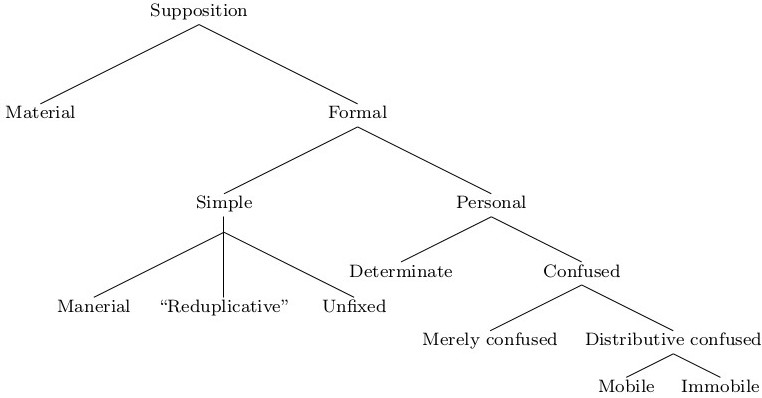

# 舍伍德的威廉 William of Sherwood (Sara L. Uckelman)
*首次发表于 2016 年 5 月 11 日；2024 年 9 月 26 日实质修订。*

舍伍德的威廉（Guilelmus、Willelmus、Schyrwode、Shirwode、Shyreswode 等拼法）是 13 世纪的英格兰逻辑学家，任教于巴黎大学，站在逻辑学的实在论传统一边。他于世纪中叶写下的《逻辑导论》，是 13 世纪影响最大的四部逻辑教科书之一，与之并列的还有欧塞尔的兰伯特《纲要》、罗吉尔·培根《逻辑的技艺与科学》和西班牙的彼得《逻辑摘要》。罗吉尔·培根在《第三著作》（1267）里单单把他挑出来大加称许，说他“比阿尔伯特[大帝]高明得多；因为在 *philosophia communis*（共同哲学）上，无人出其右”（Kretzmann 1966, pp. 5–6；Kretzmann 1968, pp. 3–4）[^kretzmann-1966][^kretzmann-1968]。

## 1 生平与著述

舍伍德的威廉约生于 1200—1205 年间，出生地大概在诺丁汉郡，卒于 1266—1272 年间。他的求学经历已难考实；不过，从其著作屡被征引、又影响了西班牙的彼得、欧塞尔的兰伯特、大阿尔伯特与托马斯·阿奎那等人来看，1235—1250 年间他多半在巴黎大学讲逻辑。此后他似乎告别了逻辑。1252 年他在牛津任硕士（教师），两年上下之后出任林肯大教堂司库；更晚又先后任白金汉郡艾尔斯伯里、诺福克郡阿特尔伯勒两地的教区长。1266 年他尚在人世，1272 年已不在了（Kretzmann 1968, p. 3）[^kretzmann-1968]。

生平难考，一半是因为他长期以来被同其他一些同名的 13 世纪英格兰人混为一谈，如莱斯特的威廉（卒于 1213 年）、达勒姆的威廉（卒于 1249 年）（参 Grabmann 1937, pp. 11–13；Kretzmann 1966, p. 3；Mullinger 1873, p. 177）[^grabmann-1937][^kretzmann-1966][^mullinger-1873]。他有时还被认作同姓的其他人：或是彼得·伦巴德《箴言四书》一部今已佚失评注（题作《舍伍德注〈箴言四书〉》）的作者——16 世纪的约翰·利兰尚知此书（Kretzmann 1966, p. 12）[^kretzmann-1966]；或是写过一篇论不可解命题的论文、今存剑桥圣约翰学院 MS 100 的里卡德·德·希雷伍德。这类混淆，再添上匿名文献常见的老难题，叫人很难把哪些著作确凿归到威廉名下。

可以确凿归于舍伍德的著作有两部：一部《逻辑导论》和一部论非范畴词的论文《非范畴词论》。《导论》全篇仅存一份手稿，即约 13 世纪末或 14 世纪的法国国家图书馆 MS Lat. 16,617；其标题为 *Introductiones Magistri Guilli. de Shyreswode in logicam*（“舍伍德的威廉导师《逻辑导论》”）。紧接其后的是《非范畴词论》，同样明确署名舍伍德。《非范畴词论》另见于博德利图书馆 MS Digby 55，标题同样明确：*Sincategoreumata Magistri Willielmi de Sirewode*（“舍伍德的威廉导师《非范畴词论》”）。《导论》第五章则另存于约 1293/94 年抄写的伍斯特座堂手稿 MS Q. 13，由 Pinborg 与 Ebbesen 编辑刊行（1984）。

《导论》几乎可以肯定写于威廉在巴黎大学讲逻辑之时；Ebbesen（2020, fn. 6）论证其成书当在 1230 年代。此书最初由 Grabmann 编辑刊行（1937），Kretzmann 将其译成英文（1966）；Brands 与 Kann（1995）出了新的校勘本，附德译。有人认为（Mullinger 1873, p. 177）[^mullinger-1873]，此书深受 11 世纪拜占庭逻辑学家米哈伊尔·康斯坦丁·普塞洛斯一部《纲要》式论著的影响。《导论》首次记下了那条三段论助记诀“Barbara, Celarent…”，奥古斯都·德摩根形容它是“有魔力的词……比任何曾经造出的词都更充满意义”；舍伍德甚至可能就是这条诀的发明人，尽管其中各个专名更早已见于文字（Kretzmann 1966, pp. 66–67）[^kretzmann-1966]。

舍伍德这部非范畴词论文，长期以来被认作：即便不是此类论文中最早的，至少也是最早仍可寓目的一部（Boehner 1952, p. 7）[^boehner-1952]。文本最初由 O'Donnell 编辑（1941）；这一版本连同巴黎手稿，正是 Kretzmann 1968 年英译的底本。O'Donnell 本后来为 Kann 与 Kirchhoff 的校勘本（2012）所取代，后者同样附德译。Kirchhoff（2008）则是对《非范畴词论》的详尽讨论与评注。

在巴黎手稿里，《逻辑导论》与《非范畴词论》之后还跟着三部逻辑论文，故有人暂且把它们归于舍伍德。其一为论不可解命题的论文（ff. 46–54），Roure 编辑（1970）；其二为见于巴黎 Bibl. Nat. 16617 的义务理论论文，Green 编辑（1963）并暂归舍伍德；其三为《相反者的请求》，de Rijk 编辑（1976），讨论前提集中隐匿矛盾所生的种种难题。藏于不列颠博物馆国王图书馆 MS 9 E XII 的《威廉导师的谬误论证》，以及上文归于里卡德·德·舍伍德名下的那篇论文，作者也可能是他。

此外还有三部论文曾归于舍伍德名下，但证据不那么扎实：前述彼得·伦巴德《箴言四书》评注、一部《神学辨析集》，以及一部《布道集》，即布道文汇编（Kretzmann 1968, p. 4）[^kretzmann-1968]。

## 2 学说语境

与西班牙的彼得、欧塞尔的兰伯特、罗吉尔·培根并列，舍伍德的威廉是最早一批词项主义逻辑学家；在他们所处的语境里，12 世纪新发现并译出的亚里士多德材料，经约翰·勒佩奇等人的著述，已完全融入逻辑与哲学课程（Uckelman & Lagerlund, 2016）。词项主义时期的特点，是发展出一批超出亚里士多德、也超出单纯评注的逻辑体裁与技术。词项逻辑两大主干：一是研究词项特性，二是研究非范畴词的意义与功能。舍伍德的《导论》在第五章（全篇最有趣的一章）处理前者，其《非范畴词论》处理后者。《导论》其余各章则处理标准亚里士多德材料：第一章论语句，对应《解释篇》；第二章论谓项，对应《范畴篇》；第三章论三段论，对应《前分析篇》；第四章论辩证推理，对应《论题篇》；第六章论诡辩推理，对应《辨谬篇》。本文着重谈其逻辑与语义理论中不寻常、有特色的方面，主要见于《导论》第五章与《非范畴词论》。

## 3 语义理论

### 3.1 词项特性

中世纪语义理论以词项特性学说为基础：它说明词项在语句这一更大语境中怎样起作用，也说明这些不同作用如何解释各类支配推理的规则。舍伍德把词项的主要特性列为四种：（1）意谓；（2）指代；（3）结合；（4）称谓（Kretzmann 1966, p. 105）[^kretzmann-1966]。这一分类不同于另一种流行说法——后者列出的是（1）意谓；（2）指代与结合；（3）扩展与限制；（4）称谓；（5）关系。

舍伍德将“意谓”界说为“把某物的形式呈交理解力”，此说上承 12 世纪语义理论（Kretzmann 1966, p. 105, fn. 2）[^kretzmann-1966]。指代与结合则互为对称：“指代”是“把对某物的理解置于另一物之下的一种安排”，“结合”是“把对某物的理解置于另一物之上的一种安排”（Kretzmann 1966, p. 105）[^kretzmann-1966]。能有指代的，只有实体名词、代词和限定摹状词；能有结合的，只有形容词、分词和动词（Kretzmann 1966, p. 106）[^kretzmann-1966]。

最后是“称谓”：“一个词项在当下的正确施用，即这样一种特性——凭借它，词项所意谓的东西能借动词‘是’而被说成属于某物”（Kretzmann 1966, p. 106）[^kretzmann-1966]。换句话说，一个词项的 **被称谓者**，就是当下实存、且该词项此刻能真正断言于其上的那些事物。称谓夹在指代与结合之间：实体名词、形容词、分词都可有称谓，代词与动词则不能（Kretzmann 1966, p. 106）[^kretzmann-1966]。

三者之中，核心在指代；本章大半篇幅都在把指代分成各类：

这一划分中的多数概念，以及舍伍德与 13 世纪同人、14 世纪后学的异同，可参见论中世纪词项特性理论的词条。这里只简评其指代理论的两个特色。

第一个特色是纳入“manerial”指代，此类型在舍伍德之外不见。有人以为 *manerialis* 是 *materialis* 的讹写，因而认为他讲的其实是质料指代（Grabmann 1937）[^grabmann-1937]。可是手稿上写的是 *n* 而非 *t*；何况这种指代同质料指代并不相同——质料指代与形式指代相对，而它本身又是形式指代的一类。舍伍德说，manerial 指代是简单指代的一种，其中“一个词可以完全脱离事物而被设定为其 **所意谓者**”；他举的例子是“人是种”。解释说：这属于 manerial 指代，因为“人”一词“为其自身之中的种性而指代”（Kretzmann 1966, p. 111）[^kretzmann-1966]。*maneries* 意为“性质、方式、样式、做法”，12 世纪讨论共相时已见其踪。例如索尔兹伯里的约翰提到，苏瓦松主教若斯兰说，*genus* 与 *species* 二词有时“该理解为普遍种类的事物”，有时他又“把它们解释为事物的样式（*maneries*）”（Hall, Book II, ch. 17, p. 84）。约翰自称不知若斯兰此说从何而来；但它在阿伯拉尔那里出现过，也见于 12 世纪的《小桥谬误论》（Hall, Book II, ch. 17, p. 84, fnn. a, b；de Rijk 1962, pp. 139, 562）[^rijk-1962]。

第二个特色是他对单称词项（又称“离散”词项）的处理，如专名或“这只猫”之类的指示短语。此类词项在论指代的著作里常被略过不提，或者提了之后又排除在外（Brumberg-Chaumont 2013, p. 173）[^brumberg-chaumont-2013]。舍伍德却承认，单称词项既能作简单指代，也能作人称指代（Brumberg-Chaumont 2013, p. 174）[^brumberg-chaumont-2013]；这使他成为“唯一一位把这一立场[离散指代属人称指代]的全部蕴含都担当起来、并赋予离散词项真正语义变化能力的逻辑学家”（Brumberg-Chaumont 2013, pp. 184–185）[^brumberg-chaumont-2013]。

### 3.2 全称肯定命题的语义学

语句由两类部分合成：主要部分与次要部分。主要部分是名词与动词，也就是主语与谓语——词项逻辑第一分支所关注的，正是它们的特性。次要部分即其余者：“形容词性的名称、副词，以及连词与介词，因为它们并非语句存在所必需”（Kretzmann 1968, p. 13）[^kretzmann-1968]。这些词本身没有意谓，唯与有意谓的主语、谓语连用时才有（Kretzmann 1966, p. 24）[^kretzmann-1966]。既无自身意谓，它们便不具备词项的通常特性——指代、结合与扩展；但它们仍有一种意谓功能。说明这种功能，正是舍伍德非范畴词论文的宗旨。

这篇论文恰能让我们看到有人所称的一种英格兰特有的非范畴词进路（Uckelman & Lagerlund 2016）[^uckelman-2016]。舍伍德与其英格兰同代人罗吉尔·培根，都把“每个”这类周延词项算作非范畴词；而在约翰·勒佩奇、西班牙的彼得、巴黎的尼古拉等欧陆学者的著作里，周延词项通常是在摘要性论著专论“周延”的一章中处理——这一章在任何英格兰摘要中都不见（Braakhuis 1981, pp. 138–139）[^braakhuis-1981]。论及“每个”时，舍伍德主张：含有“所有”的命题，要求谓项词项真正代表的对象至少有三个：

> 规则 [II]：“每个”或“所有”这个记号，要求至少有三个被称谓者（Kretzmann 1968, p. 23）[^kretzmann-1968]。

（记住：**被称谓者** 既须存在，又须为主语所代表或指涉。）此说的依据出自亚里士多德，舍伍德引其言曰：“对于两个人，我们说他们两人，或两者，而不说他们全部”（Kretzmann 1968, p. 23）[^kretzmann-1968]。也就是说，若不足三个，说“两者”或“一个”要比说“全部”更合适（详见 Mora-Márquez 2015, p. 197）[^mora-márquez-2015]。

舍伍德还有一点值得注意：就我们所知，他是头一个把“是”当作非范畴词项来处理的逻辑学家（Kretzmann 1968, p. 90）[^kretzmann-1968]。他论证说，“是”是歧义的，可标示（1）现实存在（*esse actuale*），也可标示（2）习惯性存在（*esse habituale*）（Kretzmann 1968, p. 92；Kretzmann 1966, p. 125；*habituale* 在 1966 年译本中译作“relational”，在 1968 年译本中译作“conditional”）[^kretzmann-1966][^kretzmann-1968]。由此，“每个人都是动物”便有两解。若“是”标示现实存在，则“每个人都是动物”“在无人存在时为假”（Kretzmann 1968, p. 93）[^kretzmann-1968]；若标示习惯性存在，那么“就[“每个人都是动物”]作为必然命题而言，它相当于这个条件句：‘如果它是人，它就是动物’”（Kretzmann 1966, p. 125）[^kretzmann-1966]。如此分析全称肯定直言句，可谓舍伍德早已“抢先采用”了现代为这类句子规定的真值条件。此说的一个后果，是承认 **可能物** 的存在——它们可能存在，却实际不存在；这类 **可能物** 具有一种减损的存在（*esse diminutum*）（Kretzmann 1968, p. 93）[^kretzmann-1968]。这在 13 世纪实属异数（Knuuttila 1993）[^knuuttila-1993]，后来遭到奥卡姆的威廉斥责（Freddoso & Schuurman 1980, p. 99）[^freddoso-1980]。

## 4 直言命题与三段论

### 4.1 单称命题与对当六角形

直言语句历来分为全称（“所有 P 都是 Q”“没有 P 是 Q”）与特称（“有的 P 是 Q”“有的 P 不是 Q”）两类；自亚里士多德以来，逻辑学家惯于借传统对当方阵来考察它们。舍伍德却明确划出第三类直言语句——单称语句，其主项为单称词项。他论证道：

> [单称命题]与[特称命题]的分别在于：两个单称命题若质不同，彼此就不是下反对关系，按理论说倒成矛盾关系——例如“苏格拉底在跑”与“苏格拉底不在跑”（Kretzmann 1968, p. 31）[^kretzmann-1968]。

在中世纪逻辑学家中，舍伍德属于最早把单称语句明确纳入对当方阵的一批。由此得出的是对当六角形：它呈现单称语句如何蕴涵、又如何可由主谓词项相同的特称、全称语句推出。舍伍德《导论》现存各手稿中都不见此六角形的图；但 Khomskii 论证说，文本里很可能一度有过这幅图（Khomskii 2010）[^khomskii-2010]。

### 4.2 三段论助记诀

三段论由两点刻画：一是格，即各词项的相对排布；二是式，即连接各词项的三重系词组合：

> | 第一格 | 第二格 | 第三格 |
> | --- | --- | --- |
> | P__M | M__P | P__M |
> | M__S | M__S | S__M |
> | P__S | P__S | P__S |

这里的 P 是结论谓项（大项），S 是结论主项（小项），M 是中项。

《导论》里，舍伍德给学生留下一首助记诗，专记三格之别：

> 三格之别，都收在这句诗里：
>
> *Sub pre prima bis pre secunda tertia bis sub*（Kretzmann 1968, p. 66）[^kretzmann-1968]。

意思是：第一格里，中项先作主项、后作谓项；第二格里，它两度作谓项；第三格里，它两度作主项。同一句诗也见于罗吉尔·培根（Bacon 2009, ¶290）[^bacon-2009]；欧塞尔的兰伯特内容相同，只是说得啰嗦得多（Lambert 2015, p. 139）[^lambert-2015]。接着，舍伍德又说：

> 各式连同其还原，则收在下列诗句中：
>
> > Barbara celarent darii ferio baralipton Celantes dabitis fapesmo frisesomorum Cesare camestres festino baroco Darapti felapton disamis datisi bocardo ferison（Kretzmann 1968, p. 66）[^kretzmann-1968]

Kretzmann 指出，这是“这些著名助记诗现存最早的版本，说不定就是舍伍德所造……不过 13 世纪已有同类设计的其他尝试”，而 *Festino* 一词“见于一份至迟 1200 年的手稿”（Kretzmann 1968, pp. 66–67，引 Bochenski）[^kretzmann-1968]。类似的诗句也见于 12 世纪的《如其所言之逻辑》与《我们的逻辑》，两部文本都影响了舍伍德（Bacon 2009, p. 146）[^bacon-2009]（Brumberg-Chaumont 2013, p. 184）[^brumberg-chaumont-2013]。后来在同一条脚注里，Kretzmann 把舍伍德的诗句同西班牙的彼得的诗句相较，断定二者的差别“强烈提示曾有一个更早的版本，为两人所共同取材”（Kretzmann 1968, p. 67）[^kretzmann-1968]。此诗用的是扬抑抑六音步——荷马（希腊文）、奥维德与维吉尔（拉丁文）所用的一种古典诗体；这说明“这位佚名助记诀作者受过诗的训练，而且，下文将见，他还精通亚里士多德、于逻辑富有机想”（Corcoran, et al., 2018, p. 13）。

舍伍德对这套助记名称的解释如下：

> 这些诗句里，“a” 指全称肯定命题，“e” 指全称否定命题，“i” 指特称肯定命题，“o” 指特称否定命题，“s” 指简单换位（*conversio simplex*），“p” 指限量换位（*conversio per accidens*），“m” 指前提易位，“b” 与 “r” 同处一词时则指归谬还原。前两行属第一格，第三行四个词属第二格，其余各词属第三格（Kretzmann 1968, p. 67）[^kretzmann-1968]。

顺带一提，“a” 与 “i” 恰好是拉丁文 *affirmo*（“我肯定”）的头两个元音，“e” 与 “o” 则是 *nego*（“我否定”）里的两个元音。名称本身都是传统套路，可舍伍德对它们的解释 **并不** 传统。其一，他没有说明名称首字母标示着可还原为 Barbara、Celarent、Darii、Ferio 四个基本三段论中的哪一个；其二，他把 “b” 与 “r” 当作 **归谬还原** 的提示，也不循惯例。

## 5 模态

《导论》给“模态”下了两个定义，随宽严二义而别：“宽泛地说，模态是对行为的限定，就此而言，它与一切副词同类”；严格说来则不然，并非所有副词都算模态，只有限定谓项在主语中内属的才算（Kretzmann 1966, p. 40）[^kretzmann-1966]。因此，按宽义，“苏格拉底必然在跑”与“苏格拉底飞快地跑”都是模态语句；按狭义则只有前者是。六种模态为“真”“假”“可能”“偶然”“不可能”“必然”；不过“前两种并不使模态命题有别于直言语句”（Kretzmann 1966, pp. 40–41）[^kretzmann-1966]。其余四种模态才生成严格意义上的模态命题，相应语句中的模态副词是“可能地”“偶然地”“不可能地”“必然地”。这些模态副词个个都是非范畴词项；《非范畴词论》中专辟一章讨论 *necessario*（“必然地”）与 *contingenter*（“偶然地”）。

此处须注意，舍伍德的模态观与现代看法相去甚远。现代模态逻辑把诸模态作名词式处理，如“必然：”“不可能：”等。舍伍德却不肯承认“苏格拉底在跑这件事是必然的”这类语句为真正的模态语句（Kretzmann 1966, p. 43）[^kretzmann-1966]，而把它视为直言语句，将“必然的”断言于“苏格拉底在跑这件事”。同理，“苏格拉底必然地在跑”也不算模态语句，因为这里的“必然地”修饰“跑”，并不修饰“谓项在主语中的内属”。真正称得上模态构造的，只有“苏格拉底必然在跑”这一形态（Kretzmann 1966, p. 42）[^kretzmann-1966]。模态副词修饰谓项与主语的内属，这种副词构造何以重要，《非范畴词论》论模态副词的各章有充分强调。除上述一章外，那里还分析了模态副词同“只有”“除非”“如果”等其他非范畴词项的相互作用（Uckelman 2020, §5）[^uckelman-2020]。

自亚里士多德以来，指出“可能”有两义已是惯例。第一义与“必然”相容；第二义下，必然者并不（只）是可能的——这第二义通常叫“偶然”。舍伍德提到这一区分，却说自己要用较宽的义，即可能与必然相容（Kretzmann 1966, p. 41）[^kretzmann-1966]。不过他另作一层区分，且确实坚持：即“不可能”与“必然”各有两义，而以时间概念表述：

> [不可能]一义，指无论现在、将来还是过去都不能为真者，此即“自性不可能”……另一义，指现在或将来不能为真、但过去本可为真者……此即“偶性不可能”。同理，某物无论现在、将来还是过去都不能为假，便说它“自性必然”……但若某物现在或将来不能为假、过去却本可[为假]，则为“偶性必然”（Kretzmann 1966, p. 41）[^kretzmann-1966]。

舍伍德说，模态命题之所以必须与直言命题分开，理由在于：

> [既]然我们的处理以三段论为取向，就须在那些对三段论有影响的差别下考察它们。这类差别有……模态的与直言的，以及其他同类者。三段论彼此之别，正由此而来（Kretzmann 1966, p. 39）[^kretzmann-1966]。

尽管如此，“在一切归于舍伍德名下的著作中，都找不到对模态三段论的讨论”（Kretzmann 1966, p. 39, fn. 58）[^kretzmann-1966]。舍伍德模态学说的更多内容，见 Uckelman 2008。

## 6 影响

罗吉尔·培根的那番推许，并非同代人提到他的唯一明确记载。前述伍斯特座堂手稿 MS Q. 13 中《导论》第五章之后，紧接一组匿名笔记（Pinborg 与 Ebbesen 1984 亦曾编刊，题为《疑问集》）[^pinborg-1984]。Pinborg 与 Ebbesen 论证：这些讲课笔记无论供教师还是学生用，都不像是对 1290 年代——即手稿抄写之时——的讲授所作，而应成于 1260 或 1270 年代，他们倾向于 1270 年前后（Pinborg and Ebbesen 1984, p. 104）[^pinborg-1984]。由此可见，舍伍德的著作当时仍在讲授、仍在流传。

除这些明文提及外，舍伍德的著作显然在 13 世纪后半叶巴黎大学的逻辑学家间影响甚广。最直接的传承线，由舍伍德的威廉通向名气远大于他的同僚西班牙的彼得。多年间人们相信彼得是头一个翻译普塞洛斯文本的人（Mullinger 1873, p. 176）[^mullinger-1873]；直到舍伍德《导论》重见天日——它比彼得早二十年，且更贴近普塞洛斯的原作。彼得的《逻辑摘要》显然受惠于舍伍德。Kretzmann 说：“《纲要》之成为中世纪遥遥领先的最流行逻辑教科书，其中许多特色，分明是由《导论》里那些较艰深的讨论、以及不那么讨喜的助记装置修改而来”（Kretzmann 1968, p. 6）[^kretzmann-1968]。反过来说，舍伍德写自己的非范畴词论文时，似也受彼得那部论文影响；Kretzmann 列举了舍伍德文中若干段落，说它们“可读作对彼得所持立场的暗指”（1968, p. 7）。其他影响见于大阿尔伯特——他取用舍伍德的称谓概念，未取西班牙的彼得那套（Kretzmann 1966, p. 5）[^kretzmann-1966]——以及托马斯·阿奎那，其对模态命题的分析即步舍伍德后尘（Kretzmann 1966, p. 5；Uckelman 2008）[^kretzmann-1966][^uckelman-2008]。

舍伍德假道西班牙的彼得而间接影响逻辑与语义学的发展，这一点不可小觑；但他在 13 世纪之后的直接影响反倒有限，部分正因彼得的影响太大。到了 14 世纪，他那套词项特性进路纵有余绪，也几乎全被奥卡姆的威廉、让·布里丹、萨克森的阿尔伯特等人盖过（Bos 2011, p. 773）[^bos-2011]。

## References（引用注释）

**以下文献从原文照录，不作翻译；中国文献译为中文。**

> 原文参考文献已转为脚注引用：文内“作者-年份”引用组后附 [^key] 标记，完整条目见本文末脚注定义。

[^bacon-2009]: Bacon, Roger, *Art and Science of Logic*, 2009, trans. Thomas S. Maloney, Toronto: PIMS.
[^boehner-1952]: Boehner, Philotheus, 1952, *Medieval Logic: An Outline of Its Development from 1250 to c. 1400*, Manchester: Manchester University Press.
[^bos-2011]: Bos, E. P., 2011, “Kirchhoff, Raina, *Die ”Syncategoremata“ des Wilhelm von Sherwood: Kommentierung und historische Einordnung*,” *Speculum* 86, no. 3: 773–775.
[^braakhuis-1981]: Braakhuis, H. A. G., 1981, “English Tracts on Syncategorematic Terms from Robert Bacon to Walter Burley”, in H. A. G. Braakhuis, C. H. Kneepkens, and L. M. de Rijk, eds. *English Logic and Semantics: From the End of the Twelfth Century to the Time of Ockham and Burleigh*, Nijmegen: Ingenium Publishers.
[^brands-1995]: Brands, Hartmut and Christoph Kann (eds. and trans.), 1995, William of Sherwood. *Introductiones in Logicam / Einführung in die Logik*, Hamburg: Felix Meiner Verlag.
[^brumberg-chaumont-2013]: Brumberg-Chaumont, Julie, 2013, “The Role of Discrete Terms in the Theory of the Properties of Terms”, *Vivarium* 51: 169–204.
[^corcoran-2018]: Corcoran, John, Daniel Novotný, and Kevin Tracy, 2018, “Deductions and Reductions Decoding Syllogistic Mnemonics”, *Entelekya Logico-Metaphysical Review* 2, no. 1: 5–39.
[^ebbesen-2020]: Ebbesen, Sten, 2020, “What Was Logic Like in England in the Decades Preceding the Foundation of King’s Hall, Cambridge?”, in John Marenbon, editor, *King’s Hall, Cambridge and the Fourteenth-Century Universities* (Brill): 87–100.
[^freddoso-1980]: Freddoso, Alfred J. and Henry Schuurman (trans.), 1980, William of Ockham. *Ockham’s Theory of Propositions: Part II of the* Summa Logicae, Notre Dame: University of Notre Dame Press; reprinted St. Augustine’s Press, 1998.
[^grabmann-1937]: Grabmann, Martin (ed.), 1937, William of Sherwood, *Introductiones in Logicam (Introduction to Logic)*, München: Verlag der Bayerischen Akademie der Wissenschaften.
[^green-1963]: Green, Romuald, 1963, *An Introduction to the Logical Treatise* De Obligationibus*, With Critical Texts of William of Sherwood [?] and Walter Burley*, Ph.D. Dissertation, Katholieke Universiteit Leuven. (A revised version of this essential but unpublished dissertation has widely circulated in manuscript form under the title *The Logical Treatise* ‘De obligationibus’: *An Introduction with Critical Texts of William of Sherwood and Walter Burley*.)
[^hall-2013]: Hall, J. B. (trans.), 2013, John of Salisbury. *Metalogicon*, Turnhout: Brepols.
[^kann-2012]: Kann, Christoph and Raina Kirchhoff (eds.), 2012, William of Sherwood. *Syncategoremata*, Hamburg: Felix Meiner Verlag.
[^khomskii-2010]: Khomskii, Yurii, 2010. “William of Sherwood, Singular Propositions and the Hexagon of Opposition”, in Jean-Yves Beziau and Gillman Payette (eds.), *New Perspectives on the Square of Opposition*, Bern: Peter Lang.
[^kirchhoff-2008]: Kirchhoff, Raina, 2008, *Die “Syncategoremata” des Wilhelm von Sherwood: Kommentierung und historische Einordnung*, Studien und Texte zur Geistesgeschichte des Mittelalters, 98, Leiden and Boston: Brill.
[^knuuttila-1993]: Knuuttila, Simo, 1993, *Modalities in Medieval Philosophy*, London: Routledge.
[^kretzmann-1966]: Kretzmann, Norman (ed. & tr.), 1966, William of Sherwood. *William of Sherwood’s Introduction to Logic*, Minneapolis: University of Minnesota Press.
[^kretzmann-1968]: ––– (ed. & tr.), 1968, William of Sherwood. *Treatise on Syncategorematic Words*, Minneapolis: University of Minnesota Press.
[^lambert-2015]: Lambert of Auxerre, 2015, *Logica or Summa Lamberti*, T. S. Maloney, trans., Notre Dame, IN: University of Notre Dame.
[^mora-márquez-2015]: Mora-Márquez, Ana María, 2015, “Boethius of Dacia (1270s) and Radulphus Brito (1290s) on the Universal Sign ‘Every’”, *Logica Universalis* 9: 193–211.
[^mullinger-1873]: Mullinger, James Bass, 1873, *The University of Cambridge: From the Earliest Times to the Royal Injunctions of 1535*, Cambridge: Cambridge University Press.
[^o’donnell-1941]: O’Donnell, J. Reginald, 1941, “The *Syncategoremata* of William of Sherwood”, *Medieval Studies*, 3: 46–93.
[^pinborg-1984]: Pinborg, Jan and Sten Ebbesen, 1984, “Thirteenth Century Notes on William of Sherwood’s Treatise on Properties of Terms, an Edition of *Anonymi Dubitationes et Notabilia circa Guilelmi de Shyreswode Introductionem Logicalium Tractactum V* from MS Worcester Cath. Q. 13”, *Cahiers de l’Institut du Moyen Âge Grec et Latin*, 47: 104–141.
[^rijk-1962]: de Rijk, L. M., 1962, *Logica Modernorum* (Volume 1): On the Twelfth Century theories of Fallacy, Assen: Van Gorcum.
[^rijk-1976]: –––, 1976, “Some Thirteenth Century Tracts on the Game of Obligation III”, *Vivarium*, 14: 26–49.
[^roure-1970]: Roure, Marie Louise, 1970, “La problématique des propositions insolubles du XIIIe siècle et du début du XIVe, suivie de l’édition des traités de William Shyreswood, Walter Burleigh et Thomas Bradwardine”, *Archives d’Histoire Doctrinale et Littéraire du Moyen Age*, 37: 205–326.
[^uckelman-2008]: Uckelman, Sara L., 2008, “Three 13th-Century Views of Quantified Modal Logic”, in Carlos Areces and Rob Goldblatt, *Advances in Modal Logic* (Volume 7), London: College Publications, 389–406.
[^uckelman-2020]: –––, 2020, “William of Sherwood on Necessity and Contingency”, in Nicola Olivetti, Rineke Verbrugge, Sara Negri, and Gabriel Sandu (eds.), *Advances in Modal Logic* (Volume 13), London: College Publications, pp. 597–612.
[^uckelman-2016]: Uckelman, Sara L. and Henrik Lagerlund, 2016, “Logic in the Thirteenth Century”, in Stephen Read and Catarina Dutilh Novaes (eds.), *Cambridge Companion to Medieval Logic*, Cambridge: Cambridge University Press.

## 学术工具

* [如何引用本词条](https://plato.stanford.edu/cgi-bin/encyclopedia/archinfo.cgi?entry=william-sherwood)。
* [预览本词条的 PDF 版本](https://leibniz.stanford.edu/friends/preview/william-sherwood/)，见 [SEP 学会之友](https://leibniz.stanford.edu/friends/)。
* 在 [InPhO](https://www.inphoproject.org/entity?sep=william-sherwood&redirect=True) 查找与本词条相关的话题与思想家。
* 在 [PhilPapers](https://philpapers.org/sep/william-sherwood/) 查看本词条的增强文献目录及其数据库链接。

## 其他网络资源

- [《无缺环的哲学史》](http://historyofphilosophy.net/thirteenth-century-logic)第 225 期：“术语毫不含糊：十三世纪逻辑”。
- [与舍伍德的威廉相关的文献目录](http://community.dur.ac.uk/s.l.uckelman/wosbib.pdf)。

## 相关词条

罗吉尔·培根 | 欧塞尔的兰伯特 | 中世纪的义务理论 | 西班牙的彼得（彼得·希斯帕努斯）的逻辑 | 传统逻辑方阵 | 中世纪词项属性理论

**（译注：相关词条的中文站内链接将由管线在对应词条重译完成后统一挂接。）**
