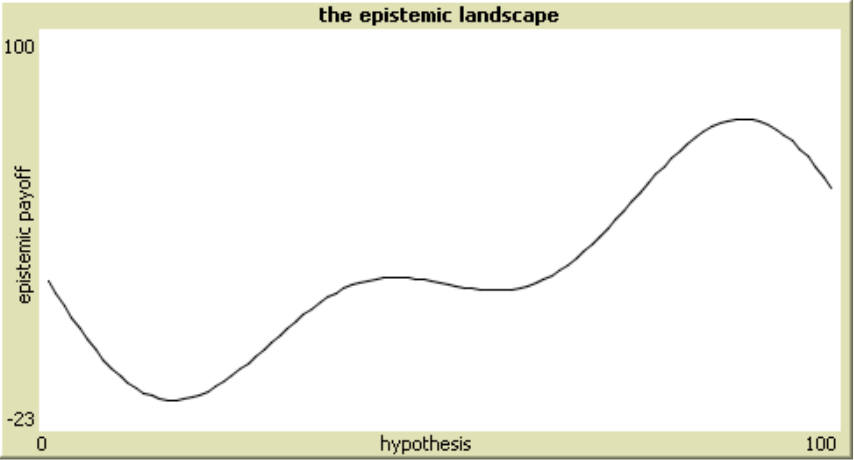
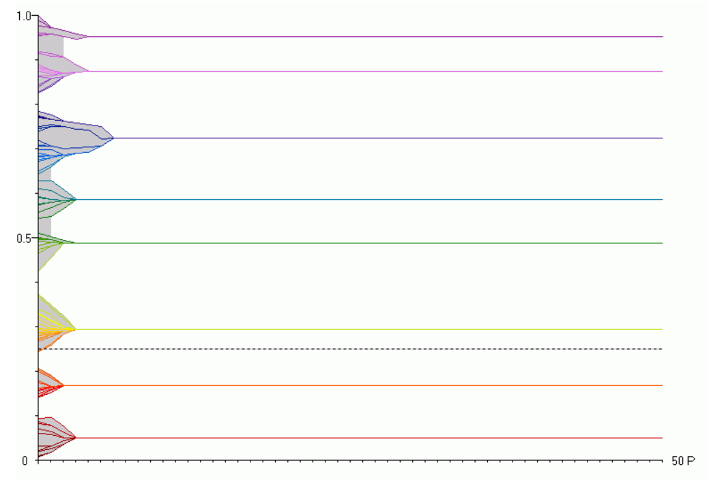
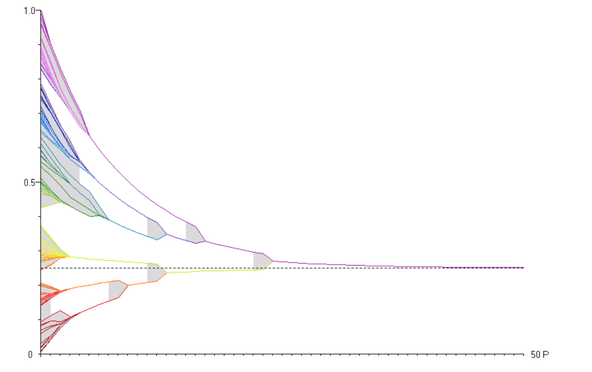
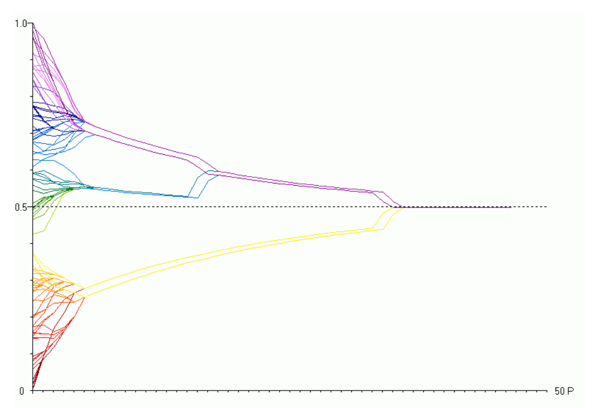

# Agent-Based Modeling in the Philosophy of Science
**First published Thu Sep 7, 2023**

*Šešelja, Dunja*

Agent-based models (ABMs) are computational models that simulate behavior of individual agents in order to study emergent phenomena at the level of the community. Depending on the application, agents may represent humans, institutions, microorganisms, and so forth. The agents’ actions are based on autonomous decision-making and other behavioral traits, implemented through formal rules. By simulating decentralized local interactions among agents, as well as interactions between agents and their environment, ABMs enable us to observe complex population-level phenomena in a controlled and gradual manner.

This entry focuses on the applications of agent-based modeling in the philosophy of science, specifically within the realm of formal social epistemology of science. The questions examined through these models are typically of direct relevance to philosophical discussions concerning social aspects of scientific inquiry. Yet, many of these questions are not easily addressed using other methods since they concern complex dynamics of social phenomena. After providing a brief background on the origins of agent-based modeling in philosophy of science (Section 1), the entry introduces the method and its applications as follows. We begin by surveying the central research questions that have been explored using ABMs, aiming to show *why* this method has been of interest in philosophy of science (Section 2). Since each research question can be approached through various modeling frameworks, we next delve into some of the common frameworks utilized in philosophy of science to show *how* ABMs tackle philosophical problems (Section 3). Subsequently, we revisit the previously surveyed questions and examine the insights gained through ABMs, addressing *what* has been found to answer each question (Section 4). Finally, we turn to the epistemology of agent-based modeling and the underlying epistemic function of ABMs (Section 5). Given the often highly idealized nature of ABMs, we examine *which epistemic roles* support the models’ capacity to engage with philosophical issues, whether for exploratory or explanatory goals. The entry concludes by offering an outlook on future research directions in the field (Section 6).

Since the literature on agent-based modeling of science is vast and growing, it is impossible to give an exhaustive survey of models developed on this topic. Instead, this entry aims to provide a systematic overview by focusing on paradigmatic examples of ABMs developed in philosophy of science, with an eye to their relevance beyond the confines of formal social epistemology.

## 1. Origins

The method of agent-based modeling was originally developed in the 1970s and ’80s with models of social segregation (Schelling 1971; Sakoda 1971; see also Hegselmann 2017)[^hegselmann-2017][^sakoda-1971][^schelling-1971] and cooperation (Axelrod & Hamilton 1981)[^axelrod-1981] in social sciences, and under the name of “individual-based modeling” in ecology (for an overview see Grimm & Railsback 2005)[^grimm-2005]. Following this tradition, ABMs drew the interest of scholars studying social aspects of scientific inquiry. By representing scientists as agents equipped with rules for reasoning and decision-making, agent-based modeling could be used to study the social dynamics of scientific research. As a result, ABMs of science have been developed across various disciplines that include science in their subject domain: from sociology of science, organizational sciences, cultural evolution theory, the interdisciplinary field of meta-science (or “science of science”), to social epistemology and philosophy of science. While ABMs developed in philosophy of science often tackle themes that are similar or related to those examined by ABMs of science in other domains, they are motivated by philosophical questions—issues embedded in the broader literature in philosophy of science. Their introduction was influenced by several parallel research lines: analytical modeling in philosophy of science, computational modeling in related philosophical domains, and agent-based modeling in social sciences. In the following, we take a brief look at each of these precursors.

One of the central ideas behind the development of formal social epistemology of science is succinctly expressed by Philip Kitcher in his *The Advancement of Science*:

> The general problem of social epistemology, as I conceive it, is to identify the properties of epistemically well-designed social systems, that is, to specify the conditions under which a group of individuals, operating according to various rules for modifying their individual practices, succeed, through their interactions, in generating a progressive sequence of consensus practices. (Kitcher 1993: 303)[^kitcher-1993]

Such a perspective on social epistemology of science highlighted the need for a better understanding of the relationship between individual and group inquiry. Following the tradition of formal modeling in economics, philosophers introduced analytical models to study tensions inherent to this relationship, such as the tension between individual and group rationality. In this way, they sought to answer the question: how can individual scientists, who may be driven by non-epistemic incentives, jointly form a community that achieves epistemic goals? Most prominently, Goldman and Shaked (1991) developed a model that examines the relationship between the goal of promoting one’s professional success and the promotion of truth-acquisition, whereas Kitcher (1990, 1993) proposed a model of the division of cognitive labor, showing that a community consisting of scientists driven by non-epistemic interests may achieve an optimal distribution of research efforts. This work was followed by a number of other contributions (e.g., Zamora Bonilla 1999; Strevens 2003)[^strevens-2003][^zamora-1999]. Analytic models developed in this tradition endorsed economic approaches to the study of science, rooted in the idea of a “generous invisible hand”, according to which individuals interacting in a given community can bring about consequences that are beneficial for the goals of the community without necessarily aiming at those consequences (Mäki 2005)[^mäki-2005].

Around the same time, computational methods entered the philosophical study of rational deliberation and cooperation in the context of game theory (Skyrms 1990, 1996; Grim, Mar, & St. Denis 1998)[^grim-1998][^skyrms-1990][^skyrms-1996], theory evaluation in philosophy of science (Thagard 1988)[^thagard-1988] and the study of opinion dynamics in social epistemology (Hegselmann & Krause 2002, 2005; Deffuant, Amblard, Weisbuch, & Faure 2002)[^deffuant-2002][^hegselmann-2002][^hegselmann-2005]. Computational models introduced in this literature included ABMs: for instance, a cellular automata model of the Prisoner’s Dilemma, or models examining how opinions change within a group of agents.

Agent-based modeling was first applied to the study of science in sociology of science, with the model developed by Nigel Gilbert (1997) (cf. Payette 2011)[^payette-2011]. Gilbert’s ABM aimed at reproducing regularities that had previously been identified in quantitative sociological research on indicators of scientific growth (such as the growth rate of publications and the distribution of citations per paper). The model followed an already established tradition of simulations of artificial societies in social sciences (cf. Epstein & Axtell 1996)[^epstein-1996]. In contrast to abstract and highly-idealized models developed in other social sciences (such as economics and archaeology), ABMs in sociology of science tended towards an integration of simulations and empirical studies used for their validation (cf. Gilbert & Troitzsch 2005)[^gilbert-2005].

Soon after, ABMs were introduced to the philosophy of science through pioneering works by Zollman (2007), Weisberg and Muldoon (2009), Grim (2009), Douven (2010)—to mention some of the most prominent examples. In contrast to ABMs developed in sociology of science, these ABMs followed the tradition of abstract and highly-idealized modeling. Similar to analytical models, they were introduced to study how various properties of individual scientists—such as their reasoning, decision-making, actions and relations—bring about phenomena characterizing the scientific community—such as a success or a failure to acquire knowledge. By representing inquiry in an abstract and idealized way, they facilitated insights into the relationship between some aspects of individual inquiry and its impact on the community while abstracting away from numerous factors that occur in actual scientific practice. But in contrast to analytical models, ABMs proved to be suitable for scenarios often too complex for analytical approaches. These scenarios include heterogeneous scientific communities, with individual scientists differing in their beliefs, research heuristics, social networks, goals of inquiry, and so forth. Each of these properties can change over time, depending on the agents’ local interactions. In this way ABMs can show how certain features characterizing individual inquiry suffice to generate population-level phenomena under a variety of initial conditions. Indeed, the introduction of ABMs to philosophy of science largely followed the central idea of generative social science: to explain the emergence of a macroscopic regularity we need to show how decentralized local interactions of heterogeneous autonomous agents can generate it. As Joshua Epstein summed it up: “If you didn’t grow it, you didn’t explain its emergence” (2006).

## 2. Central Research Questions

ABMs of science typically model the impact of certain aspects of individual inquiry on some measure of epistemic performance of the scientific community. This section surveys some of the central research questions investigated in this way. Its aim is to explain why ABMs were introduced to study philosophical questions, and how their introduction relates to the broader literature in philosophy of science.

### 2.1 Theoretical diversity and the incentive structure of science

How does a community of scientists make sure to hedge its bets on fruitful lines of inquiry, instead of only pursuing suboptimal ones? Answering this question is a matter of coordination and organization of cognitive labor which can generate an optimal diversity of pursued theories. The importance of a synchronous pursuit of a plurality of theories in a given domain has long been recognized in the philosophical literature (Mill 1859; Kuhn 1977; Feyerabend 1975; Kitcher 1993; Longino 2002; Chang 2012)[^chang-2012][^feyerabend-1975][^kitcher-1993][^kuhn-1977][^longino-2002][^mill-1859]. But how does a scientific community achieve an optimal distribution of research efforts? Which factors influence scientists to divide and coordinate their labor in a way that stimulates theoretical diversity? In short, how is theoretical diversity achieved and maintained?

One way to address this question is by examining how different incentives of scientists impact their division of labor. To see the relevance of this question, consider a community of scientists all of whom are driven by the same epistemic incentives. As Kitcher (1990) argued, in such a community everyone might end up pursuing the same, initially most promising line of inquiry, resulting in little to no diversity. Traditionally, philosophers of science tried to address this worry by arguing that a diversity in theory choice may result from diverse methodological approaches (Feyerabend 1975)[^feyerabend-1975], diverse applications of epistemic values (Kuhn 1977)[^kuhn-1977], or from different cognitive attitudes towards theories, such as acceptance and pursuit-worthiness (Laudan 1977)[^laudan-1977]. Kitcher, however, wondered whether non-epistemic incentives, such as fame and fortune—usually thought of as interfering with the epistemic goals of science—might actually be beneficial for the community by encouraging scientists to deviate from dominant lines of inquiry.

The idea that scientists are rewarded for their achievements through credit, which impacts their research choices, had previously been recognized by Merton (1973) and Hull (1978, 1988). For example, a scientist may receive recognition for being the first to make a discovery (known as the “priority rule”), which may incentivize a specific approach to research. Yet, such non-epistemic incentives could also fail to promote an optimal kind of diversity. For instance, they may result in too much research being spent on futile hypotheses and/or in too few scientists investigating the best theories. Moreover, an incentive structure will have undesirable effects if rewards are misallocated to scientists that are well-networked rather than assigned to those who are actually first to make discoveries, or if credit-driven science lowers the quality of scientific output. This raises the question: which incentive structures promote an optimal division of labor, without having epistemically or morally harmful effects?

ABMs provide an apt ground for studying these issues: by modeling individual scientists as driven by specific incentives, we can examine their division of labor and the resulting communal inquiry. We will look at the models studying these issues in Section 4.1.

### 2.2 Theoretical diversity and the communication structure of science

Another way to study theoretical diversity is by focusing on the communication structure of scientific communities. In this case we are interested in how the information flow among scientists impacts their distribution of research across different rival hypotheses. The importance of scientific interaction for the production of scientific knowledge has traditionally been emphasized in social epistemology (Goldman 1999)[^goldman-1999]. But how exactly does the structure of communication impact scientists’ generation of knowledge? Are scientists better off communicating within strongly connected social networks, or rather within less connected ones, and under which conditions of inquiry? These and related questions belong to the field of *network epistemology*, which studies the impact of communication networks on the process of knowledge acquisition. Network epistemology has its origin in economics, sociology and organizational sciences (e.g., Granovetter 1973; Burt 1992; Jackson & Wolinsky 1996; Bala & Goyal 1998)[^bala-1998][^burt-1992][^granovetter-1973][^jackson-1996] and it was first combined with agent-based modeling in the philosophical literature by Zollman (2007) (see also Zollman 2013)[^zollman-2013].

Simulations of scientific interaction originated in the idea that different communication networks among scientists, characterized by varying degrees of connectedness (see Figure 1), may have a different impact on the balance between “exploration” and “exploitation” of scientific ideas. Suppose a scientist is trying to find an optimal treatment for a certain disease, since the existing one is insufficiently effective. On the one hand, she could pursue the currently dominant hypothesis concerning the causes of the disease, hoping that it will eventually lead to better results. On the other hand, she could explore novel ideas hoping to have a breakthrough leading to a more successful cure for the disease. The scientist thus faces a trade-off between exploitation as the use of existing ideas and exploration as the search of new possibilities, long studied in theories of formal learning and in organizational sciences (March 1991)[^march-1991]. The information flow among scientists could impact this trade-off in the following way: if an initially misleading idea is shared too quickly throughout the community, scientists may lock-in on researching it, prematurely abandoning the search for better solutions. Alternatively, if the information flow is slow and sparse, important insights gained by some scientists, which could lead to an optimal solution, may remain undetected by the rest of the community for a lengthy period of time. ABMs were introduced to investigate whether and in which circumstances the information flow could have either of these effects. For instance, if scientists are assumed to be rational agents, could a tightly connected community end up exploring too little and miss out on significant lines of inquiry?

Besides studying communities consisting of “epistemically uncompromised” scientists—that is, agents whose inquiry and actions are directed at discovering and promoting the truth—similar questions can be posed about communities in which epistemic interests have been overridden. For instance, the impact of industrial interest groups on science may lead to biased or deceptive practices, which may sway the scientific community away from its epistemic goals (Holman & Elliott 2018)[^holman-2018]. While recent philosophical discussions on this problem have largely focused on the role of non-epistemic values in science (Douglas 2009; Holman & Wilholt 2022; Bueter 2022; Peters 2021)[^bueter-2022][^douglas-2009][^holman-2022][^peters-2021], ABMs were introduced to examine how epistemically pernicious strategies can impact the process of inquiry, as well as to identify interventions that can be used to mitigate their harmful effects.

In addition to the problem of theoretical diversity, network epistemology has been applied to a number of other themes, such as optimal forms of collaboration, factors leading to scientific polarization, effects of conformity on the collective inquiry, effects of demographic diversity, the position of minorities, optimal regulations of dual-use research, argumentation dynamics, and so forth. We will look at the models studying theoretical diversity and the communication structure of science in Section 4.2 and Section 4.6.

(a)

(b)

(c)

Figure 1: Three types of idealized communication networks, representing an increasing degree of connectedness: (a) a cycle, (b) a wheel, and (c) a complete graph. The nodes in each graph stand for scientists, while edges between the nodes stand for information channels between two scientists.

### 2.3 Cognitive diversity

A diversity of cognitive features of individuals can be beneficial in various problem-solving situations, including business and policy-making (Page 2017)[^page-2017]. But how does the diversity of cognitive features of scientists, including their background beliefs, reasoning styles, research preferences, heuristics and strategies impact the inquiry of the scientific community? In philosophy of science, this issue gained traction with Kuhn’s distinction between normal and revolutionary science (Kuhn 1962)[^kuhn-1962], suggesting that different propensities may push scientists towards one type of research rather than another (see also Hull 1988)[^hull-1988]. This raises the question: how does the distribution of risk-seeking, maverick scientists and risk-averse ones impact the inquiry of the community? Put more generally: do some ways of dividing labor across different research heuristics result in a more successful collective inquiry than others?

By equipping agents with different cognitive features we can use ABMs to represent different cognitively diverse (or uniform) populations, and to study their impact on some measure of success of the communal inquiry. We will look at the models studying these issues in Section 4.3.

### 2.4 Social diversity

A scientific community is socially diverse when its members endorse different non-epistemic values, such as moral and political ones, or when they have different social locations, such as gender, race and other aspects of demography (Rolin 2019)[^rolin-2019]. The importance of social diversity has long been emphasized in feminist epistemology, both for ethical and epistemic reasons. For instance, many have pointed out that social diversity is an important catalyst for cognitive diversity, which in turn is vital for the diversity of perspectives, and therefore for scientific objectivity (Longino 1990, 2002; Haraway 1989; Wylie 1992, 2002; Grasswick 2011; Anderson 1995; for a discussion on different notions of diversity in the context of scientific inquiry see Steel et al. 2018)[^anderson-1995][^grasswick-2011][^haraway-1989][^longino-1990][^longino-2002][^steel-2018][^wylie-1992][^wylie-2002].

Moreover, in the field of social psychology and organizational sciences, it has been argued that social diversity is epistemically beneficial even if it doesn’t promote cognitive diversity. Instead, it may counteract epistemically pernicious tendencies of homogeneous groups, such as unwarranted trust in each other’s testimony or unwillingness to share dissenting opinions (for an overview of the literature see Page 2017; Fazelpour & Steel 2022)[^fazelpour-2022][^page-2017]. While these hypotheses have received support in virtue of empirical studies, ABMs have proved a complementary testing ground, allowing for an investigation of minimal sets of conditions which need to hold for social diversity to be epistemically beneficial.

Another problem tackled by means of ABMs concerns factors that can undermine social diversity or disadvantage members of minorities in science. For instance, how does one’s minority status impact one’s position in a collaborative environment, given the norms of collaboration that can emerge in scientific communities? Or how does one’s social identity impact the uptake of their ideas? We will look at the models studying these issues in Section 4.4 and Section 4.7.

### 2.5 Peer-disagreement in science

Scientific disagreements are commonly considered vital for scientific progress (Kuhn 1977; Longino 2002; Solomon 2006)[^kuhn-1977][^longino-2002][^solomon-2006]. They typically go hand in hand with theoretical diversity (see Section 2.1 and 2.2) and stimulate critical interaction among scientists, important for the achievement of scientific objectivity. Nevertheless, an inadequate response to disagreements may lead to premature rejections of fruitful inquiries, to fragmentation of scientific domains and hence to consequences that are counterproductive for the progress of science. This raises the question: how should scientists respond to disagreements with their peers, to lower the chance of a hindered inquiry? Which epistemic and methodological norms should they follow in such situations?

This issue has been discussed in the context of the more general debate on peer-disagreement in social epistemology. The problem of peer disagreement concerns the question: what is an adequate doxastic attitude towards *p*, upon recognizing that one’s peer disagrees on *p*? Should one follow a “Conciliatory Norm”, demanding, for instance, to lower the confidence in *p*, split the difference by taking the middle ground between the opponent’s belief and one’s own on the issue, or to suspend one’s judgment on *p*? Or should one rather follow a “Steadfast Norm” demanding to stick to one’s guns and keep the same belief with the same confidence as before encountering a disagreeing peer? (For initial arguments in favor of the Conciliatory Norm see, e.g., Elga 2007, Christensen 2010, Feldman 2006; for arguments in favor of the Steadfast Norm see, e.g., De Cruz & De Smedt 2013, Kelp & Douven 2012; for reasons why norms are context-dependent see, e.g., Kelly 2010 [2011], Konigsberg 2013, Christensen 2010, Douven 2010; for a recent critical review of the debate as applied to scientific practice see Longino 2022.)

Similarly, in case of scientific disagreements and controversies we can ask: should a scientist who is involved in a peer disagreement strive towards weakening her stance by means of a conciliatory norm, or should she remain steadfast? What makes this issue particularly challenging in the context of scientific inquiry is that we are not only interested in the epistemic question of an adequate doxastic response to a disagreement, but also in the methodological (or inquisitive) question of how the norms impact the success of collective inquiry as a process. In particular, if scientists encounter multiple disagreements throughout their research on a certain topic, will their collective inquiry benefit more from individuals adopting conciliatory attitudes or steadfast ones? ABMs naturally lend themselves as a method for investigating these issues: by modeling scientists as guided by different normative responses to a disagreement, we can study the impact of the norms on the communal inquiry. We will look at the models studying these issues in Section 4.5.

### 2.6 Scientific polarization

Closely related to the issue of scientific disagreements is the problem of scientific polarization. While scientific controversies typically resolve over time, they may include periods of polarization, with different parts of the community maintaining mutually conflicting attitudes even after an extensive debate. But how and why does polarization emerge? Do scientific communities polarize only if scientists are too dogmatic or biased towards their viewpoints, or can polarization emerge even among rational agents?

Following a range of formal models in social and political sciences addressing a similar issue in society at large (for a review see Bramson et al. 2017)[^bramson-2017], ABMs have been used to examine the emergence of polarization in the context of science. What makes agent-based modeling particularly apt for this task is not only that we can model different aspects of individual inquiry that may contribute to the emergence of polarization (such as different background beliefs, different communication networks, different trust relationships, and so on), but we can also observe the formation of polarized states, their duration (as stable or temporary states throughout the inquiry) and their features (such as the distribution of scientists across the opposing views). We will look at the models studying these issues in Section 4.6.

### 2.7 Scientific collaboration

As acquiring and analyzing scientific evidence can be highly resource-demanding for any individual scientist, scientific collaboration is a widespread form of group inquiry. Of course, this is not the only reason why scientists collaborate: incentives leading to collaborations range from epistemic ones (such as increasing the quality of research) to non-epistemic ones (such as striving for recognition). This raises the question: when is collaborating beneficial, and which challenges may occur in collaborative research? Inspired by these questions, philosophers of science have investigated why collaborations are beneficial (Wray 2002)[^wray-2002], which challenges they pose on epistemic trust and accountability (Kukla 2012; Wagenknecht 2015)[^kukla-2012][^wagenknecht-2015], what kind of knowledge emerges through collaborative research (such as collective beliefs or acceptances, (M. Gilbert 2000; Wray 2007; Andersen 2010)[^andersen-2010][^gilbert-2000][^wray-2007], which values are at stake in collaborations (Rolin 2015)[^rolin-2015], what an optimal structure of collaborations is (Perović, Radovanović, Sikimić, & Berber 2016)[^perović-2016], and so on.

ABMs of collaboration were introduced to study the above and related questions, focusing on how collaborating can impact inquiry. While collaborations can indeed be beneficial, determining conditions under which they are such is not straightforward. For instance, depending on how scientists engage in collaborations, minorities in the community may end up disadvantaged. We will look at the models studying these issues in Section 4.7.

### 2.8 Summing up

Beside the above themes, ABMs have been applied to the study of numerous other topics in philosophy of science: from the allocation of research funding, testimonial norms, strategic behavior of scientists, all the way to different procedures for theory-choice (see Section 4.8 where we list models studying additional themes). Moreover, one ABM can simultaneously address multiple questions (for example, social diversity and scientific collaboration are often inquired together).

To study the questions presented in this section, philosophers have utilized different representational frameworks. Even if models are aimed at the same research question, they are often based on different modeling approaches. For instance, individual scientists may be represented as Bayesian reasoners, as agents with limited memory, as agents searching for peaks on an epistemic landscape, as agents that form their opinions by averaging information they receive from other scientists and from their own inquiry, or as agents that are equipped with argumentative reasoning. Similarly, the process of evidence gathering may be represented in terms of pulls from probability distributions, as foraging on an epistemic or an argumentation landscape, or as receiving signals from others and from the world. We now look into some of the common modeling frameworks employed in the study of the above questions.

## 3. Common Modeling Frameworks

When developing a model examining certain aspects of scientific inquiry, one first has to decide on a number of relevant representational assumptions, such as:

1. How to represent the process of *inquiry* and *evidence gathering*?
2. What do *agents* in the simulation stand for (e.g., individual scientists, research groups, scientific labs, etc.)?
3. What are the *units of appraisal* in scientific inquiry (e.g., hypotheses, theories, research programs, methods, etc.)?
4. How do scientists *reason* and evaluate their units of appraisal?
5. How do scientists *exchange information*?

Similarly, if we wish to model a scenario in which scientists bargain about the division of tasks or resources, we will have to decide how to represent their *interactions* and *rewards* they get out of them. These modeling choices are guided by the research question the model aims to tackle, as well as the epistemic aim of the model.

The majority of ABMs developed in philosophy of science are built as simple and highly idealized models. The simpler a model is, the easier it is to understand and analyze mechanisms behind the results of simulations (we return to this issue in Section 5). In this section, we delve into several common modeling frameworks that have been used in this way. Each framework offers a different take on the above representational choices and has served as the basis for a variety of ABMs. Particular models will not be discussed just yet—we leave this for Section 4.

### 3.1 Epistemic landscape models

Modeling the process of inquiry as an exploration of an epistemic landscape draws its roots from models of fitness landscapes in evolutionary biology, first introduced by Sewall Wright (1932). By representing a genotype as a point on a multidimensional landscape, where the “height” of the landscape corresponds to its fitness, the model has been used to study evolutionary paths of populations.

The idea of *epistemic* landscapes entered philosophy of science with the work of Weisberg and Muldoon (2009) and Grim (2009). In this reinterpretation of the model, the landscape represents a research topic, consisting of multiple projects or multiple hypotheses. A research topic can be understood either in a narrow sense (e.g., the study of treatments for a certain disease) or in a broader sense (e.g., the field of astrophysics). A point on the landscape stands for a certain hypothesis or a specific approach to investigating the topic. Approaches can vary in terms of different background assumptions, methods of inquiry, research questions, etc. Accordingly, the landscape can be modeled in terms of $n$ dimensions, where $n-1$ dimensions represent different aspects of scientific approaches, while the $n^{th}$ dimension (visualized as the “height” of the landscape) stands for some measure of epistemic value an agent gets by pursuing the corresponding approach. For instance, in case of a three-dimensional landscape, the *x* and *y* coordinates form a two-dimensional disciplinary matrix in which approaches are situated, while *z* coordinate measures their “epistemic significance” (see Figure 2). The latter can be understood in line with Kitcher’s idea that significant approaches are those that enable the conceptual and explanatory progress of science (Kitcher 1993: 95)[^kitcher-1993].

ABMs of science have utilized two-dimensional and three-dimensional landscapes, as well as the generalized framework of NK-landscapes, in which the number of dimensions and the ruggedness of the landscape are parameters of the model.[^note-1] Scientists are modeled as agents who explore the landscape, trying to find its peak(s), that is, the epistemically most significant points. The framework allows for different ways of measuring the success and efficiency of inquiry: in terms of the success of the community in discovering the peak(s) of the landscape (rather than getting stuck in local maxima), the success in discovering any of the areas of non-zero vicinity, the time required for such discoveries, and so forth.

*Figure 2:*

Figure 2: Two representations of Weisberg and Muldoon’s epistemic landscape: a three-dimensional representation on the left and a two-dimensional representation of the same landscape on the right, where the height of the landscape is represented by different shades of gray: the lighter the shade, the more significant the point on the landscape (adapted from Weisberg & Muldoon 2009)[^weisberg-2009].

#### 3.1.1 Application to the problem of cognitive diversity

The framework of epistemic landscapes has been applied to a variety of research questions in philosophy of science. Weisberg and Muldoon (2009) introduced it to examine the impact of cognitive diversity on the performance of scientific communities. What makes the epistemic landscape framework particularly attractive for the study of cognitive diversity and the division of labor is its capacity to represent various research strategies (as different heuristics of exploring the landscape), as well as a coordinated distribution of research efforts (cf. Pöyhönen 2017)[^pöyhönen-2017].

Weisberg and Muldoon’s ABM employs a three-dimensional landscape (see Figure 2), built on a discrete toroidal grid, with two peaks representing the highest points of epistemic significance. To study cognitive diversity, the model examines three research strategies, implemented as three types of agents:

- The “controls” who aim to find a higher point on the landscape than their current location, while ignoring the exploration of other agents.
- The “followers” who aim to find already explored approaches in their direct neighborhood, which have a higher significance than their current location.
- The “mavericks” who also aim to find points of higher significance given previously explored points, but rather than following in the footsteps of other scientists, they prioritize the discovery of new, so far unvisited, points.

The control strategy represents individual learning that disregards social information, while the follower and the maverick strategies represent different ways of taking the latter into account. The model examines how homogeneous populations of each type of explorers, or heterogeneous populations consisting of diverse groups of explorers, impact the efficiency of the community in discovering the highest points on the landscape, and in covering all points of non-zero significance.

Following Weisberg and Muldoon’s contribution, the framework of epistemic landscapes became highly influential, resulting in various refinements and extensions of the model. For instance, Alexander, Himmelreich, and Thompson (2015) introduced the “swarm” strategy, which describes scientists who can with certain probability identify points of higher significance in their surrounding and adjust their approach so that it is similar, but different from approaches pursued by others who are close to them. Thoma (2015) introduced “explorer” and “extractor” strategies, the former of which describes a scientist seeking approaches very different from those pursued by others, while the latter (similar to Alexander and colleagues’ swarm researcher) seeks approaches that are similar to, yet distinct from those pursued by others. Moreover, Fernández Pinto and Fernández Pinto (2018) examined alternative rules for the follower strategy. Finally, Pöyhönen (2017) introduced a “dynamic” landscape, such that the exploration of patches “depletes” their significance.

#### 3.1.2 Applications to network epistemology

Another application domain of the epistemic landscape framework is the communication structure of science and its impact on communal inquiry. To study these issues Grim and Singer (Grim 2009; Grim, Singer, Fisher, et al. 2013)[^grim-2009][^grim-2013] developed ABMs employing a two-dimensional landscape, where points on the *x*-axis represent alternative hypotheses for a given domain of phenomena, while the *y*-axis indicates the “epistemic goodness” of each hypothesis or the epistemic payoff an agents gets by pursuing it. Depending on how well the best hypothesis is hidden, the shape of the epistemic terrain will represent a more or less “fiendish” research problem (see Figure 3). For instance, if the best hypothesis is a narrow peak in the landscape (as in Figure 3c) finding it will resemble a search for a needle in a haystack and therefore a fiendish research problem.[^note-2] An inquiry is considered successful if any scientist (eventually followed by the rest of the community) discovers the highest peak on the landscape, while it is unsuccessful if the community converges on a local maximum. The model is used to study how different social networks with varying degrees of connectedness (such as those in Figure 1), and different epistemic landscapes with different degrees of fiendishness impact the success of inquiry.

(a)

(b)

*Figure 3:*

(c)

Figure 3: Epistemic landscapes with an increasing degree of fiendishness (adapted from Grim, Singer, Fisher, et al. 2013: 443)[^grim-2013]

#### 3.1.3 Other applications

Beside the above themes, the framework of epistemic landscapes has appeared in many other variants. For instance, De Langhe (2014a) proposed an ABM aimed at studying different notions of scientific progress, which makes use of a “moving epistemic landscape”: a landscape in which the significance of approaches can change as a result of exploration of other approaches. Balietti, Mäs, and Helbing (2015) developed an epistemic landscape model to study the relationship between fragmentation in scientific communities and scientific progress, in which agents explore a two-dimensional landscape, representing a space of possible answers to a certain research question, with the correct answer located at the center of the landscape. Currie and Avin (2019) proposed a reinterpretation of the three-dimensional landscape aimed at studying the diversity of scientific methods, in which the *x* and *y* axis stand for different investigative techniques or methods of acquiring evidence, and the *z* axis for the “sharpness” of the obtained evidence. Sharpness here refers to the relationship between research results and a hypothesis, where the more the evidence increases one’s credence in the hypothesis, the sharper it is. The model also represents the “independence” of evidence as the distance between two points on the landscape according to the *x* and *y* coordinates: the further apart two methods are, the less overlapping their background theories are, and the more independent the evidence obtained by them is.

Finally, epistemic landscape modeling has inspired related landscape models. The argumentation-based model of scientific inquiry by Borg, Frey, Šešelja, and Straßer (2018, 2019) is one such example. The model, inspired by abstract argumentation frameworks (Dung 1995)[^dung-1995], employs an “argumentation landscape”. The landscape is composed of “argumentation trees” that represent rival research programs (see Figure 4). Each program is a rooted tree, with nodes as arguments and edges as a “discovery relation”, representing a path agents take to move from one argument to another. Arguments in one theory may attack arguments in another theory. In contrast to epistemic landscapes, argumentation landscapes aim to capture the dialectic dimension of inquiry where some points on the landscape, assumed to be acceptable arguments, may subsequently be rejected as undefendable. This allows for an explicit representation of false positives (accepting a false hypothesis) as an argument on the landscape an agent accepts without knowing there exists an attack on it, and false negatives (rejecting a true hypothesis) as an argument an agent rejects, without knowing that it can be defended. The model has been used to study how argumentative dynamics among scientists, pursuing rival research programs, impacts their efficiency in acquiring knowledge under various conditions of inquiry (such as different social networks, different degrees of cautiousness in decision making, and so on).

*Figure 4:*

Figure 4: Argumentation-based ABM by Borg, Frey, Šešelja, and Straßer (2019) employing an argumentative landscape. The landscape represents two rival research programs (RP), with darker shaded nodes standing for arguments that have been explored by agents and are thus visible to them; brighter shaded nodes stand for arguments that are not visible to agents. The biggest node in each RP is the root argument, from which agents start their exploration via the discovery relation, connecting arguments within one RP. Arrows stand for attacks from an argument in one RP to an argument in another RP.

### 3.2 Bandit models

In the previous section we saw how epistemic landscape models have been used to represent inquiries involving mutually compatible research projects (as in Weisberg and Muldoon’s model) as well as inquiries involving rival hypotheses (as in Grim and Singer’s model). Another framework used to study the latter scenario is based on “bandit problems”.

The name of bandit models comes from the term “one-armed bandit”—a colloquial name for a slot machine. Multi-armed bandit problems, introduced in statistics (Robbins 1952; Berry & Fristedt 1985)[^berry-1985][^robbins-1952] and studied in economics (Bala & Goyal 1998; Bolton & Harris 1999)[^bala-1998][^bolton-1999], are decision-making problems that concern the following kind of scenario: suppose a gambler is about to play several slot machines. Each machine gives a random payoff according to a probability distribution unknown to the gambler. To determine which machine will give a higher reward in the long run, the gambler has to experiment by pulling arms of the machines. This will allow her to learn from the obtained results. But which strategy should she use? For instance, should she alternate between the machines for the first couple of pulls, and then play only the machine that has given the highest reward during the initial test run? Or should she rather have a lengthy test phase before deciding which machine is better? While in the first case she might start *exploiting* her current knowledge before she has sufficiently *explored*, in the second case she might explore for too long. In this way the gambler faces a trade-off between exploitation (playing the machine that has so far given the best payoff) and exploration (continued testing of different machines). The challenge is thus to come up with the strategy that provides an optimal balance between exploration and exploitation, so as to maximize one’s total winnings.

As we have seen above (see Section 2.2), the exploration/exploitation trade-off may also occur in the context of scientific research. Whether scientists are attempting to determine if a novel treatment for a disease is superior to an existing one, or selecting between two novel methods of evidence gathering with varying success rates, they may encounter the exploration/exploitation trade-off. In other words, they may have to decide when to cease exploring alternatives and begin exploiting the one that appears most suitable for the task.

ABMs based on bandit problems were first introduced to philosophy of science by Zollman (2007, 2010). A bandit ABM usually looks as follows. In analogy to slot machines, each scientific theory (or hypothesis, or method) is represented as having a designated probability of success. Scientists are typically modeled as “myopic” agents in the sense that they always pursue a theory they believe to give a higher payoff. They gather evidence for a theory by making a random draw from a probability distribution. Subsequently, they update their beliefs in a Bayesian way, on the basis of results of their own research (the gathered evidence) as well as results of neighboring scientists in their social network (such as those in Figure 1). Scientists are thus not modeled as passive observers of evidence for all the available theories, but rather as agents who actively determine the type of evidence they gather by choosing which theory to pursue. The inquiry of the community is considered successful if, for example, scientists reach a consensus on the better of the two theories.

Bandit models of this kind build on the analytical framework developed by economists (Bala & Goyal 1998)[^bala-1998] who examined the relationship between different communication networks in infinite populations and the process of social learning. Applied to the context of science, this variation of bandit problems concerns the puzzle mentioned above in Section 2.2: assuming a scientific community is trying to determine which of the two available hypotheses offers a better treatment for a given disease, could the structure of the information flow among the scientists impact their chances of converging on the better hypothesis? By applying Bala and Goyal’s framework to the context of science and scenarios involving finite populations, Zollman initiated the field of network epistemology (see Zollman 2013)[^zollman-2013], which studies the impact of social networks on the process of knowledge acquisition.

Beside the aim of examining network effects on the formation of scientific consensus, bandit models of scientific interaction have been applied to a number of other topics, such as the impact of preferential attachment on social learning (Alexander 2013)[^alexander-2013], bias and deception in science (Holman & Bruner 2015, 2017; Weatherall, O’Connor, & Bruner 2020)[^holman-2015][^holman-2017][^weatherall-2020], optimal forms of collaboration (Zollman 2017)[^zollman-2017], factors leading to scientific polarization (O’Connor & Weatherall 2018; Weatherall & O’Connor 2021b)[^o’connor-2018][^weatherall-2021b], effects of conformity (Weatherall & O’Connor 2021a)[^weatherall-2021a], effects of demographic diversity (Fazelpour & Steel 2022)[^fazelpour-2022], regulations of dual-use research (Wagner & Herington 2021)[^wagner-2021], social learning in which a dominant group ignores or devalues testimony from a marginalized group (Wu 2023), or disagreements on the diagnosticity of evidence for a certain hypothesis (Michelini & Osorio et al. forthcoming).

### 3.3 Bounded confidence models of opinion dynamics

As we have seen above, the performance of a scientific community is sometimes assessed in terms of its success in achieving consensus on the true hypothesis. The question how consensus is formed and which factors benefit or hinder its emergence is also studied within the theme of *opinion dynamics* in epistemic communities. Models of opinion dynamics aim at investigating how opinions form and change in a group of agents who adjust their views (or beliefs) over a number of rounds or time-steps, resulting in the formation of *consensus*, *polarization*, or a *plurality* of views. A modeling framework that has been particularly influential in this context originates from the work of Hegselmann and Krause (2002, 2005, 2006), drawing its roots from analytical models of consensus formation (French 1956; DeGroot 1974; Lehrer & Wagner 1981)[^degroot-1974][^french-1956][^lehrer-1981].[^note-3]

The basic model functions as follows. At the start of the simulation (that is, at time $t=0$) each agent $x_i$ is assigned an opinion on a certain issue, expressed by a real number $x_i(0) \in {(0,1]}$. Agents then exchange their opinions (or beliefs) with others and adjust them by taking the average of those beliefs that are “not too far away” from their own. These are opinions that fall within a “confidence interval” of size $\epsilon$, which is a parameter of the model. In this way, agents have bounded confidence in opinions of others. By iterating this process, the model simulates the social dynamics of the opinion formation (see Figure 5a).

Applied to the context of scientific inquiry, scientists are usually represented as truth seeking agents who are trying to determine the value of a certain parameter $\tau$ for which they only know that it lies in the interval $(0,1]$ (Hegselmann & Krause 2006)[^hegselmann-2006]. At the start of the simulation each agent is assigned a random initial belief. As the model runs, agents adjust their beliefs by receiving a (noisy) signal about $\tau$ and by learning opinions of others who fall within their confidence interval. For instance, an agent’s belief can be updated in terms of the weighted average of others’ opinions and the signal from the world.[^note-4] Such dynamics represent scientists as agents who are able to generate evidence that points in the direction of $\tau$, though their updates are also influenced by their prior beliefs and the beliefs of their peers (see Figure 5b & Figure 5c).

(a)

(b)

*Figure 5:*

(c)

Figure 5: Examples of runs of Hegselmann and Krause’s model, with the *x*-axis representing time steps in the simulation and the *y*-axis opinions of 100 agents. The change of each agent’s opinion is represented with a colored line. The value of $\tau$ (the assumed position of the truth) is represented as a black dotted line. Figure (a) shows opinion dynamics in a community without any truth-seeking agents, resulting in a plurality of diverging views. Figure (b) shows the opinion dynamics in a community in which all agents are truth-seekers, which achieves a consensus close to the truth. Figure (c) shows the opinion dynamics in a community in which only half of the population are truth-seekers, which also achieves a consensus close to the truth (adapted from Hegselmann & Krause 2006; for other parameters used in the simulations see the original article)[^hegselmann-2006].

An early application of the bounded confidence model was the problem of the division of cognitive labor (Hegselmann & Krause 2006)[^hegselmann-2006]. Since agents can be modeled as updating their beliefs only on the basis of social information (that is, by averaging over opinions of others who fall in one’s confidence interval) or on the basis of both social information and the signal from the world, the model can be used to study the opinion dynamics in a community in which not everyone is a “truth-seeker”. The model then examines what kind of division of labor between truth-seekers and agents who only receive social information allows the community to converge to the truth.

Subsequent applications of the framework in social epistemology and philosophy of science focused on the study of scientific disagreements and the question: what is the impact of different norms guiding disagreeing scientists on the efficiency of collective inquiry (Douven 2010; De Langhe 2013)[^douven-2010][^douven-2010-2]? If agents update their beliefs both in view of their own research and in view of other agents’ opinions they represent scientists that follow a Conciliatory Norm by “splitting the difference” between their own view and the views of their peers (see above Section 2.5). In contrast, if they update their beliefs only in view of their own research they represent scientists that follow a Steadfast Norm. Other application themes of this framework include the impact of noisy data on opinion dynamics (Douven & Riegler 2010)[^douven-2010][^douven-2010-2], opinion dynamics concerning complex belief states, such as beliefs about scientific theories (Riegler & Douven 2009)[^riegler-2009], updating via an inference to the best explanation in a social setting (Douven & Wenmackers 2017)[^douven-2017], deceit and spread of disinformation (Douven & Hegselmann 2021)[^douven-2021], network effects and theoretical diversity in scientific communities (Douven & Hegselmann 2022)[^douven-2022], and so forth.

### 3.4 Evolutionary game-theoretic models of bargaining

Game theory studies situations in which the outcome of one’s action depends not only on one’s choice of an action, but also on actions of others. A “game” in this sense is a model of a strategic interaction between agents (“players”), each of whom has a set of available actions or strategies. Each combination of the players’ strategic responses has a designated outcome or a “payoff”. In contrast to traditional game theory, which focuses on agents’ rational decision-making aimed at maximizing their payoff in one-off interactions, the evolutionary approach focuses on repeated interactions in a population. A game is assumed to be played over and over again by players who are randomly drawn from a large population. While agents start with a certain strategic behavior, they learn and gradually adjust their responses according to specific rules called “dynamics” (for example, by imitating other players or by considering their own past interactions). As a result, successful strategies will diffuse across the community. In this way, evolutionary game-theoretic models can be used to explain how a distribution of strategies across the population changes over time as an outcome of long-term population-level processes. While the standard approach to game theory has primarily focused on combinations of players’ strategies that lead to a “stable” state, such as the Nash equilibrium—a state in which no player can improve their payoff by unilaterally changing their strategy—the evolutionary approach has been used to study how equilibria emerge in a community (see the entries on game theory and on evolutionary game theory).

Evolutionary game theory was originally introduced in biology (Lewontin 1961; Maynard Smith 1982)[^lewontin-1961][^maynard-1982]. It subsequently gained interest of social scientists and philosophers as a tool for studying cultural evolution, that is, for investigations into how beliefs and norms change over time (Axelrod 1984; Skyrms 1996)[^axelrod-1984][^skyrms-1996]. The models can be implemented using a mathematical treatment based on differential equations, or using agent-based modeling. While the former approach employs certain idealizations, such as an infinite population size or perfect mixing of populations, ABMs were introduced to study scenarios in which such assumptions are relaxed (see, e.g., Adami, Schossau, & Hintze 2016)[^adami-2016].

Applications of evolutionary game theory to social epistemology of science were especially inspired by models of bargaining, studying how different bargaining norms emerge from local interactions of individuals (Skyrms 1996; Axtell, Epstein, & Young 2001)[^axtell-2001][^skyrms-1996]. The framework was introduced to the study of epistemic communities by O’Connor and Bruner (2019), building up on Bruner’s (2019) model of cultural interactions.[^note-5]

The basic idea of bargaining models is as follows: agents bargain over shares of available resources, where their demands and expectations about others’ demands evolve endogenously in view of their previous interactions. Applied to the context of science, bargaining concerns not only explicit negotiations over financial resources, but also situations in which scientists need to agree how to divide their workload in joint projects (O’Connor & Bruner 2019)[^bruner-2019][^o’connor-2019][^o’connor-2019-2]. For example, if two scientists are working on a joint paper or if they are organizing a conference together they will have to agree on how much time and effort each of them will devote to it. The norms determining such a division of labor may not be fair. For example, if scientist *A* puts much less effort into the project than scientist *B*, but they both get the same recognition for its success, *B* will be disadvantaged. Similarly, if they agree on *A* being the first author in a collaborative paper, while *B* ends up working much more on it, the outcome will again be unfair. Such norms may become entrenched in the scientific community, especially in the context of interactions between members of majority and minority groups in academia. But how do such norms emerge? Are biases favoring members of certain groups over others necessary for the emergence of such discriminatory patterns, or can they become entrenched due to other, perhaps more surprising factors?

Evolutionary game-theoretic models have been used to study these and related questions. Bargaining is represented as a strategic interaction between two agents, each of whom makes a demand concerning the issue at hand (for instance, a certain amount of workload, the order of authors’ names in a joint publication, and so on). Depending on each agent’s demand, each gets a certain payoff. For instance, suppose *A* and *B* wish to organize a conference and they start by negotiating who will cover which tasks. If they both make a high demand in the sense that each is willing to put only a minimal effort into the project while expecting the other to cover the rest of the tasks, they will fail to organize the event. If *B*, on the other hand, makes a low demand (by taking on a larger portion of the work) while *A* makes a high demand, they will be able to organize the conference, though the division of labor will be unfair (assuming they both get equal credit for successfully realizing the project).

The game, originating in the work of John Nash (1950), is called the “Nash demand game” (or the “mini-Nash demand game”). Each player in the game makes their demand (Low, Med or High). If the demands do not jointly exceed a given resource, each player gets what they asked for. If they do exceed the available resource, no-one gets anything. In the example above, High can be interpreted as demanding to work less than the other on the organization of the conference, or demanding the first authorship in a joint paper while putting relatively lower effort into it. Similarly, Low corresponds to the willingness to take on a larger portion of the work (relative to the order of authors in case of the joint paper), while Med corresponds to demanding a fair distribution of labor. Table 1 displays the payoffs in such a game. Any combination of demands that gives a joint payoff of 10 is a Nash equilibrium, which means that either player’s strategy is the best response to the other player’s one. While a Nash equilibrium may correspond to a fair distribution of resources (if both players demand Med), it may also correspond to an unfair one (if one player demands Low and the other one High). This raises the question: which equilibrium will the community achieve if agents learn from their previous interactions? In particular, if the individuals are divided into sub-groups (which may be of different sizes), where their membership can be identified by means of markers visible to other agents, they can develop strategies conditional on the group membership of their co-players. Which equilibrium state will such a community evolve to? To study such questions, evolutionary models employ rules or dynamics that determine how players update their strategies and how the distribution of strategies across the community changes over time.[^note-6]

*Table 1:*

|   | Low | Med | High |
| --- | --- | --- | --- |
| Low | L,L | L,5 | L,H |
| Med | 5,L | 5,5 | 0,0 |
| High | H,L | 0,0 | 0,0 |

Table 1: A payoff table in the Nash demand game. The rows show the strategic options of Player1 and the columns the options of Player2. Each cell shows the payoff Player1 gets for the given combination of options, followed by the payoff for Player2. Players can make three demands: Low, Med and High for the total resource of 10. The payoffs are represented as L, M and H, where $\mathrm{M}= 5$, $\mathrm{L} < 5 < \mathrm{H}$, and $\mathrm{L} + \mathrm{H} = 10$. (cf. O’Connor & Bruner 2019; Rubin & O’Connor 2018)[^bruner-2019][^o’connor-2019][^o’connor-2019-2][^o’connor-2018][^rubin-2018]

The modeling framework based on bargaining has been used to study norms in scientific collaborations and inequalities that may emerge through them. For example, O’Connor and Bruner (2019) investigate the emergence of discriminatory norms in academic interactions between minority and majority members. Rubin and O’Connor (2018) study the emergence of discriminatory patterns and their effects on diversity in collaboration networks, while Ventura (2023) examines the impact of the structure of collaborative networks on the emergence of discriminatory norms even if there are no visible markers of an agent’s membership to a sub-group. Moreover, Klein, Marx, and Scheller (2020) use a similar framework to study the relationship between rationality and inequality, that is, the success of different strategies for bargaining (such as maximizing expected utility) and their impact on the emergence of inequality.

### 3.5 Summing up

Besides the above frameworks, numerous additional approaches have been used to build simulations in social epistemology and philosophy of science. Some prominent frameworks not mentioned above include the Bayesian framework “Laputa” developed by Angere (2010—in Other Internet Resources) and Olsson (2011), aimed at studying social networks of information and trust, the model of argumentation dynamics by Betz (2013), or the influential framework by Hong and Page (2004) utilized in the study of cognitive diversity (for more on these frameworks see the entry on computational philosophy). Another evolutionary framework used in philosophy of science was proposed by Smaldino and McElreath (2016). The model represents a scientific community as a population consisting of scientific labs that employ culturally transmitted methodological practices, where the practices undergo natural selection from one generation of scientists to the next, and it has been employed, for example, to study the selection of conservative and risk-taking science (O’Connor 2019)[^o’connor-2019][^o’connor-2019-2]. In the next section we take a look at some of the central results obtained by ABMs in philosophy of science, based on the above and some other frameworks.

## 4. Central Results

To provide an overview of the main findings obtained by means of ABMs in philosophy of science, we will revisit the research questions discussed in Section 2 and look at how they have been answered through specific models.

### 4.1 Theoretical diversity and the incentive structure of science

Before we survey ABMs that study the incentive structure of science, we first look into the results of some analytical models which inspired the development of simulations. To get a more precise grip on how individual incentives shape epistemic coordination and theoretical diversity, philosophers introduced formal analytical models, inspired by research in economics. One of the central results from this body of literature is that the optimal distribution of labor can be achieved when scientists act according to their self-interest rather than following epistemic ends (e.g., Kitcher 1990; Brock & Durlauf 1999; Strevens 2003)[^brock-1999][^kitcher-1990][^strevens-2003]. More precisely, the models show that if we assume scientists aim at maximizing rewards from making discoveries, they will succeed to optimally distribute their research efforts if they take into account the probability of success of each research line and how many other scientists currently pursue it. Assuming that all scientists evaluate theories in the same way, their interest in fame and fortune, rather than epistemic goals alone, will lead some of them to select avenues that initially appear less promising.[^note-7]

ABMs were introduced to address similar questions, but assuming more complex scenarios. For example, Muldoon and Weisberg (2011) developed an epistemic landscape model (see Section 3.1) to examine the robustness of Kitcher’s and Strevens’ results under the assumption that scientists have varying access to information about the pursued research projects in their community and the future success of those projects. Their results indicate that once scientists have limited information about what others are working on, or about the degree to which projects are likely to succeed, their self-organized division of labor fails to be optimal. Another example is the model by De Langhe & Greiff (2010) who generalize Kitcher’s model to a situation with multiple epistemic standards determining the background assumptions of scientists, acceptable methods, acceptable puzzles, and so on. The simulations show that once scientific practice is modeled as based on multiple standards, the incentive to compete fails to provide an optimal division of labor.

A closely related question concerns the “priority rule”—a norm that allocates credit for a scientific discovery to the first one to make it (Strevens 2003, 2011)[^strevens-2003][^strevens-2011]—and its impact on the division of labor. While Kitcher’s and Strevens’s models suggested that the priority rule incentivizes the optimal distribution of scientists across rival research programs, a range of formal models, including ABMs, were developed to reexamine these results and shed additional light on this norm. For instance, Rubin and Schneider (2021) examine what happens if credit is assigned by individuals, rather than by the scientific community as a whole, as in Strevens’ model. They further suppose that news about simultaneous discoveries by two scientists spreads through a networked community. The simulations show that more connected scientists are more likely to gain credit than the less connected ones, which may, on the one hand, disadvantage minority members in the community, and on the other hand, undermine the role of the priority rule as an incentive resulting in the optimal division of labor. Besides the question of how the priority rule impacts the division of labor, ABMs have also been used to study other effects of the priority rule. For example, Tiokhin, Yan, and Morgan (2021) develop an evolutionary ABM showing that the priority rule leads the scientific community to evolve towards research based on smaller sample sizes, which in turn reduces the reliability of published findings.

The impact of incentives on the division of labor in science has also been analyzed in terms of incentives to “exploit” existing projects in contrast to incentives to “explore” novel ideas. For instance, De Langhe (2014b) developed a generalized version of Kitcher and Strevens’ model in which agents achieve the optimal division of labor by weighing up relative costs and benefits of exploiting available theories and exploring new ones. Within the framework of bandit models and network epistemology (see Section 3.2), Kummerfeld and Zollman (2016) proposed an ABM that examines a scenario in which scientists face two rival hypotheses, one of which is better though the agents don’t know which one. While agents always choose to pursue (or exploit) a hypothesis that seems more promising, they may also occasionally research (and thereby explore) the alternative one. The simulations show that if the community is left to be self-organized in the sense that each scientist explores to the extent that they consider individually optimal, agents will be incentivized to leave exploration to others. As a result, scientists will fail to develop a sufficiently high incentive for exploring novel ideas, that is, an incentive which would be optimal from the perspective of their community at large.

### 4.2 Theoretical diversity and the communication structure of science

#### 4.2.1 The “Zollman effect”

The study of theoretical diversity in terms of network epistemology led to a novel hypothesis: that the communication structure of a scientific community can promote or hinder the emergence of theoretical diversity and thereby impact the division of cognitive labor. The idea was first demonstrated by bandit models developed by Zollman (2007, 2010; see Section 3.2) and came to be known as the “Zollman effect” (Rosenstock, Bruner, & O’Connor 2017)[^o’connor-2017][^rosenstock-2017]. ABMs by Grim (2009) Grim, Singer, Fisher, and colleagues (2013), and Angere & Olsson (2017) produced similar findings based on different modeling frameworks.[^note-8] These models show that in highly connected communities early erroneous results may spread quickly among scientists, leading them to investigate a sub-optimal line of inquiry. As a result, scientists may prematurely abandon the exploration of different hypotheses, and instead exploit the inferior ones. In light of these findings, Zollman (2010) emphasized that for an inquiry to be successful it needs a property of “transient diversity”: a process in which a community engages in a parallel exploration of different theories, which lasts sufficiently long to prevent a premature abandonment of the best theory, but which eventually gets replaced by a consensus on it. Besides the result that connectivity can be harmful, it has also been shown that learning in less connected networks is slower, which indicates a trade-off between accuracy and speed in the context of social learning (Zollman 2007; Grim, Singer, Fisher, et al. 2013)[^grim-2013][^zollman-2007].

Subsequent studies showed, however, that the Zollman effect is not very robust within the parameter space of the original model (Rosenstock et al. 2017)[^rosenstock-2017]. In particular, the result holds for those parameters that can be considered characteristic of difficult inquiry: scenarios in which there is a relatively small number of scientists, the evidence is gathered in relatively small batches, and the difference between the objective success of the rival hypotheses is relatively small. Moreover, additional models showed that if the diversity (and hence, exploration) of pursued hypotheses is generated in some other way, more connected communities may outperform less connected ones. For instance, Kummerfeld and Zollman (2016) showed that relaxing the trade-off between exploration and exploitation by allowing agents to occasionally gain information about the hypothesis they are not currently pursuing is a way to generate diversity, leading a fully connected community to perform better than less connected ones. Another way of generating diversity was examined by Frey and Šešelja (2020): they show that if scientists have a dose of caution or “rational inertia” when deciding whether to abandon their current theory and start pursuing the rival, a fully connected community gets a sufficient degree of exploration to outperform less connected groups. Similar points have been made with ABMs based on other modeling frameworks, such as the bounded confidence model by Douven and Hegselmann (2022), or an argumentation-based ABM by Borg, Frey, Šešelja, and Straßer (2018), each of which shows a different way of preserving transient diversity in spite of a high degree of connectivity.

#### 4.2.2 The spread of disinformation

ABMs studying epistemically pernicious strategies in scientific communities have largely employed network epistemology bandit models (see Section 3.2). For instance, a model by Holman and Bruner (2015) examines how an interference of industry-sponsored agents may impact the information flow in the medical community, and which strategies scientists could employ to protect themselves from such a pernicious influence. For this purpose, they consider a scenario in which medical doctors regularly communicate with industry-sponsored agents about the efficacy of a certain pharmaceutical product as a treatment for a given disease. Since the industry-sponsored agents are motivated by financial rather than epistemic interests and they are unlikely to change their minds no matter how much opposing evidence they receive, they are not merely biased, but “intransigently biased”. Their simulations indicate two ways in which a scientific community can protect itself from the pernicious influence of the intransigently biased agent: first, by increasing their connectivity, and second, by learning how to reorganize their social network on the basis of trustworthiness, which leads them to eventually ignore the biased agent. In a follow-up model, Holman and Bruner (2017) also show how the industry can bias a scientific community without corrupting any of the individual scientists that compose it, but by simply helping industry-friendly scientists to have successful careers.

Using a similar network-epistemology approach, Weatherall, O’Connor and Bruner (2020) developed a bandit model to study the “Tobacco strategy”, employed by the tobacco industry in the second half of the twentieth century to mislead the public about the negative health effects of smoking (analyzed in detail by Oreskes & Conway 2010)[^oreskes-2010]. In particular, the model examines how certain deceptive practices can mislead public opinion without even interfering with (epistemically driven) scientific research. The authors look into two such propagandist strategies: a “selective sharing” of research results that fit the industry’s preferred position, and a “biased production” of research results where additional research gets funded, but only suitable findings get published. The results show that both strategies are effective in misleading policymakers about the scientific output under various examined parameters since in both cases the policymakers update their beliefs on the basis of a biased sample of results, skewed towards the worse theory. The authors also look into strategies employed by journalists reporting on scientific findings and show that incautiously aiming to be “fair” by reporting an equal number of results from both sides of the controversy may result in the spread of misleading information.

Another example of ABMs developed to examine deception in science is an argumentation-based model by Borg, Frey, Šešelja, and Straßer (2017, 2018; see Section 3.1.3). Assuming the context of rival research programs where scientists have to identify the best out of three available ones, deceptive communication is represented in terms of agents sharing only positive findings about their theory, while withholding news about potential anomalies. The underlying idea is that deception consists in providing some (true) information while at the same time withholding other information, which leads the receiver to make a wrong inference (Caminada 2009)[^caminada-2009]. Unlike the previous two models discussed in this section, where not all agents display biased or deceptive behavior, Borg et al. study network effects in a population consisting entirely of deceptive scientists. Such a scenario represents a community that is driven, for instance, by confirmation bias and an incentive to shield one’s research line from critical scrutiny. The simulations show that, first, reliable communities (consisting of no deceivers) are significantly more successful than the deceptive ones, and second, increasing the connectivity makes it more likely that deceptive populations converge on the best theory.

### 4.3 Cognitive diversity

As we have seen in Section 2.1, the problem of cognitive diversity concerns the relation between the diversity of cognitive features of scientists (including their background beliefs, reasoning styles, research preferences, heuristics and strategies) and the inquiry of the scientific community. Philosophers of science have especially been interested in how the division of labor across different research heuristics impacts the performance of the community.

A particularly influential ABM tackling this issue is the epistemic landscape model by Weisberg and Muldoon (2009). The model examines the division of labor catalyzed by different research strategies, where scientists can act as the “controls”, “followers” or “mavericks” (see above Section 3.1). In view of the simulations, Weisberg and Muldoon argue that, first, mavericks outperform other research strategies. Second, if we consider the maverick strategy to be costly in terms of the necessary resources, then introducing mavericks to populations of followers can lead to an optimal division of labor. While Weisberg and Muldoon’s ABM eventually turned out to include a coding error (Alexander et al. 2015)[^alexander-2015], their claim that cognitive diversity improves the productivity of scientists received support from adjusted versions of the model, albeit with some qualifications.

First, Thoma’s (2015) model showed that cognitively diverse groups outperform homogeneous ones if scientists are sufficiently flexible to change their current approach and sufficiently informed about the research conducted by others in the community. Second, Pöyhönen (2017) confirmed that if we consider the maverick strategy to be slightly more time-consuming, mixed populations of mavericks and followers may outperform communities consisting only of mavericks in terms of the average epistemic significance of the obtained results. According to Pöyhönen, another condition that needs to be satisfied if cognitive diversity is to be beneficial concerns the topology of the landscape: diverse populations outperform homogeneous ones only in case of more challenging inquiries (represented in terms of rugged epistemic landscapes), but not in case of easy research problems (represented by landscapes such as Weisberg and Muldoon’s one, Figure 2). The importance of the topology of the landscape was also emphasized by Alexander and colleagues (2015) who use NK-landscapes to show that whether social learning is beneficial or not crucially depends on the landscape’s topology. Finally, there are other research strategies (such as Alexander and colleagues’ “swarm” one, see Section 3.1.1) that outperform Weisberg and Muldoon’s mavericks, while small changes in the follower strategy may significantly improve its performance (Fernández Pinto & Fernández Pinto 2018)[^fernández-2018].

Another aspect of cognitive diversity that received attention in the modeling literature concerns the relationship between diversity and expertise. This issue was first studied in economics by Hong and Page (2004). The model examined how heuristically diverse groups, consisting of agents with diverse problem-solving approaches, compare with groups consisting solely of experts with respect to finding a solution to a particular problem. Hong and Page’s original result suggested that “diversity trumps ability” in the sense that groups consisting of individuals employing diverse heuristic approaches outperfom groups consisting solely of experts, that is, agents who are the best “problem-solvers”. While this finding became quite influential, subsequent studies showed that it does not hold robustly once more realistic assumptions about expertise are added to the model (Grim, Singer, Bramson, et al. 2019; Reijula & Kuorikoski 2021; see also Singer 2019)[^grim-2019][^reijula-2021][^singer-2019][^singer-2019-2].

The problem of cognitive diversity and the division of labor in scientific communities was also studied by Hegselmann and Krause’s bounded-confidence model (Hegselmann & Krause 2006; see above Section 3.3)[^hegselmann-2006]. The ABM examines opinion dynamics in a community that is diverse in the sense that only some individuals are active truth seekers, while others adjust their beliefs by exchanging opinions with those agents who have sufficiently similar beliefs to their own. Hegselmann and Krause investigate conditions under which such a community can reach consensus on the truth, combining agent-based modeling and analytical methods. They show that, on the one hand, if all agents in the model are truth seekers, they achieve a consensus on the truth. On the other hand, if the community divides labor, its ability to reach a consensus on the truth will depend on the number of truth seeking agents, the position of the truth relative to the agents’ opinions, the degree of confidence determining the scope of opinion exchange and the relative weight of the truth signal (in contrast to the weight of social information). For instance, under certain parameter settings even a single truth-seeking agent will lead the rest of the community to the truth.

### 4.4 Social diversity

As we have seen in Section 2.4, ABMs were introduced to study two issues that concern social diversity in the context of science: first, epistemic effects of socially diverse scientific groups, and second, factors that can undermine social diversity or disadvantage members of minorities in science.

Concerning the former question, Fazelpour and Steel (2022) developed a network epistemology bandit model (see Section 3.2) to study effects of social (or demographic) diversity on collective inquiry. The model examines how different degrees of trust between socially distinct sub-groups impact the performance of the scientific community. The simulations show that social diversity can improve group inquiry by reducing the excessive trust scientists may place in each other’s findings. This is particularly relevant in cases of difficult inquiry in tightly connected communities, where a high degree of trust may lead to a premature endorsement of an objectively false hypothesis. The authors also demonstrate how social diversity can counteract negative effects of conformity in the choice of research paths, under the condition that the tendency to conform isn’t too high. Using a similar bandit framework, Wu (2023) examines how a marginalized group learns in environments in which members of the dominant group ignore or devalue results coming from the former. She shows that in such situations, members of the marginalized group can achieve an epistemic advantage in the sense of forming more accurate beliefs than the members of the dominant group. In this way, the model aims to explain the “inversion thesis” from standpoint epistemology, according to which marginalized groups may have an epistemically privileged status (Wylie 2003)[^wylie-2003].

With regard to the latter question, we previously mentioned the model by Rubin and Schneider (2021), which shows how minority members can become disadvantaged due to the priority rule in science and the structure of the scientific community (Section 4.1). In a follow-up model, Rubin (2022) demonstrates how the organizational structure of the scientific community can also influence the emergence of “citation gaps”, where publications by members of underrepresented and minority groups are cited less than those by members of the majority. The impact of one’s minority status on one’s position in scientific collaborations was mainly studied by means of evolutionary game-theoretic models of bargaining (see Section 3.4). The models show different ways in which minorities can become discriminated against merely due to their minority status and the impact of such a status on the bargaining and collaborative practices (Rubin & O’Connor 2018; O’Connor & Bruner 2019; Ventura 2023)[^bruner-2019][^o’connor-2019][^o’connor-2019-2][^o’connor-2018][^rubin-2018][^ventura-2023]. Moreover, the results show that such an outcome may have a negative impact on scientific progress, and it may help to explain why gender and racial minorities tend to cluster in academic subdisciplines (O’Connor & Bruner 2019; Rubin & O’Connor 2018)[^bruner-2019][^o’connor-2019][^o’connor-2019-2][^o’connor-2018][^rubin-2018]. We will revisit these models below in Section 4.7, devoted to the issue of scientific collaboration.

### 4.5 Peer-disagreement in science

As we have seen in Section 2.5, peer disagreement debate highlighted different norms that can guide scientists. ABMs were introduced to examine the impact of these norms on the communal inquiry. To this end, Douven (2010) and De Langhe (2013) enhanced the bounded confidence model by Hegselmann and Krause (2006; see Section 3.3) to study the impact of the Conciliatory and Steadfast Norms on the goals of inquiry.[^note-9]

Both models suggest that the impact of these norms is context dependent. In Douven’s model, when data received through inquiry is not very noisy—in the sense that it is indicative of the truth rather than resulting from measurement errors—conciliating populations will be faster in discovering the truth than the steadfast ones. Nevertheless, if the data becomes noisy, the simulations show a trade-off between accuracy and speed. While steadfast populations get within a moderate distance of the truth relatively quickly, they don’t improve their accuracy in the subsequent rounds of the simulation. In contrast, conciliating populations end up closer to the truth but it takes them relatively longer to do so. This indicates that whether a norm is optimal for the communal goals may largely depend on contextual issues of inquiry, such as obtaining noise-free evidence. De Langhe comes to a similar conclusion, using a model that represents longstanding scientific disagreements and an inquiry involving multiple rivaling epistemic systems. The model is inspired by Goldman’s (2010) idea that even though disagreeing peers may share the evidence concerning the issue in question, they may not share the evidence for the epistemic system within which they evaluate the former kind of evidence. His simulations suggest that while conciliating within one’s epistemic system is beneficial, that is not the case when it comes to disagreements between different epistemic systems.[^note-10]

### 4.6 Scientific polarization

The initial work on ABMs of polarization in scientific communities is based on Hegselmann and Krause’s bounded confidence model (Hegselmann & Krause 2006; see Section 3.3)[^hegselmann-2006].[^note-11] The model shows that a community can polarize when some agents form their opinions by disregarding the evidence coming from the world and by instead taking into account only what they learn from others, who have sufficiently similar views. Subsequent models, based on different frameworks, sought to examine whether polarization can emerge even if all agents are truth-seekers, that is, rational agents who form their opinions only in view of epistemic considerations.

For example, a model by Singer et al. (2019) shows the emergence of polarization in groups of deliberating agents who share reasons for their beliefs, and who merely use a coherence-based approach to manage their limited memory (by forgetting those reasons that conflict with the view supported by most of their previous considerations). Using the Bayesian modeling framework Laputa, Olsson (2013) shows how polarization can emerge over the course of deliberation if agents assign different degrees of trust to the testimony of others, depending on how similar views they hold. In another Bayesian framework based on bandit models, O’Connor and Weatherall (2018) show how a community of scientists who share not only their testimony, but unbiased evidence, can end up in a polarized state if they treat evidence obtained by other scientists, whose beliefs are too far off from their own, as uncertain. Moreover, Michelini, Osorio and colleagues (forthcoming) combine bandit models with the bounded-confidence framework to study polarization in communities that disagree on the diagnostic value of evidence for a certain hypothesis (modeled by the Bayes factor). Their results indicate that an initial disagreement on the diagnosticity of evidence can lead to polarization, depending on the sample size of the performed studies and the confidence interval within which scientists share their opinions.

Polarization in epistemic communities has also been studied by ABMs simulating argumentative dynamics. For example, using the framework by Betz (2013), Kopecky (2022) proposes a model that shows how certain ways in which rational agents engage in argumentative exchange in an open debate forum can result in polarized communities, even if agents don’t have a preference for whom they argue with.

### 4.7 Scientific collaboration

As discussed in Section 2.7, ABMs have been used to study when collaborating is beneficial and how it impacts inquiry. To examine why collaborations emerge and when they are beneficial, Boyer-Kassem and Imbert (2015) developed a computational model in which scientists collaborate by sharing intermediate results. They study collaborative groups in a larger competitive community, driven by the priority rule, where collaborators have to equally share the reward for making a discovery. Their simulations suggest that collaborating is beneficial both for communal and individual inquiry. When scientists collaborate, they proceed faster with their inquiry, making it more likely that they will belong to a team that is first to make a discovery. Moreover, while the scientific community may profit from all scientists fully collaborating (since solutions found by some scientists will be shared with everyone), for individual scientists other collaborative constellations may be better (see also Boyer-Kassem & Imbert forthcoming).

To examine conditions for optimal collaboration Zollman (2017) proposed a network-epistemology model. The model starts from the assumption that by collaborating scientists teach each other different conceptual schemes aimed at solving scientific problems, and that collaboration comes at a cost. His findings suggest that reducing the costs of collaborations and enlarging the size of the collaborative group benefits those involved, though encouraging scientists to engage with different collaborative groups may not lead to efficient inquiry.

While the above models studies socially uniform communities, ABMs have also been employed to study socially diverse collaborative environments and discriminatory patterns that can endogenously emerge in them. These models are typically based on evolutionary game-theoretic frameworks examining bargaining norms that accompany academic collaborations (see Section 3.4). Bruner (2019) initially used this framework to show that in cultural interactions involving a division of resources, minority members can become disadvantaged merely due to the smaller size of their group.[^note-12] O’Connor and Bruner (2019) use this approach to study the emergence of similar patterns in epistemic communities. The simulations show that minorities can become disadvantaged in scientific collaborations due to the size of their group, where the effect is increased the smaller their group is. Rubin and O’Connor (2018) use a similar framework to examine diversity and discrimination in epistemic collaboration networks, with a special focus on the role of homophily—the tendency to preferentially establish links with members of one’s own social group in contrast to members of the outgroup. Their results suggest that discriminatory norms, likely to emerge in academic interaction, may promote homophily and decrease social diversity in collaborative networks. Furthermore, Ventura (2023) shows how inequality can emerge in collaboration networks even in the absence of demographic categories since scientists can become disadvantaged merely due to the structure of the collaboration network and their specific position in it.

### 4.8 Additional themes

As mentioned in Section 2.8, ABMs have been applied to the study of many additional themes in philosophy of science: the problem of allocating funding to research grants (Harnagel 2019; Avin 2019a,b)[^avin-2019a][^harnagel-2019], examining Popperian and Kuhnian models of scientific progress (De Langhe 2014a), the dynamics of normal and revolutionary science (De Langhe 2017), pluralism of scientific methods (Currie & Avin 2019)[^currie-2019], the impact of methods guiding research design and data analysis on the quality of scientific findings (Smaldino & McElreath 2016)[^smaldino-2016], strategic behavior of scientists as a motivated exchange of beliefs (Merdes 2021)[^merdes-2021][^merdes-2021-2], journals’ publishing strategies (Zollman 2009)[^zollman-2009], meta-inductive learning (Schurz 2009, 2012)[^schurz-2009][^schurz-2012], the impact of evidential strength on the accuracy of scientific consensus (Santana 2018)[^santana-2018], the management and structure of scientific groups (Sikimić & Herud-Sikimić 2022)[^sikimić-2022], the reliability of testimonial norms, which guide how one should change beliefs in light of others’ claims (Mayo-Wilson 2014)[^mayo-wilson-2014], the assessment of source reliability (Merdes, Von Sydow, & Hahn 2021)[^merdes-2021][^merdes-2021-2], the impact of “epistemic stubbornness” as an unwillingness to change one’s scientific stance in face of countervailing evidence (Santana 2021)[^santana-2021], the impact of different theory-choice evaluations on the efficiency of inquiry (Borg et al. 2019)[^borg-2019], and so forth.

## 5. Epistemology of Agent-Based Modeling

In the previous section we delved into various results obtained by means of agent-based modeling. But how seriously should we take each of these findings? What exactly do they tell us about science? Given that one of the main cognitive functions of models in science is to help us to learn about the world (cf. the entry on models in science), this raises the question: what exactly can we learn with ABMs, and which methodological steps do we have to follow to acquire such knowledge? These issues are a matter of the epistemology of agent-based modeling.[^note-13]

### 5.1 The challenge of abstract modeling

In an early discussion on simulations in social sciences, Boero and Squazzoni (2005) proposed a classification of ABMs into case-based models, typifications, and theoretical abstractions—based on the properties of the represented target. While a case-based model represents an empirical scenario that is delineated in time and space, typifications represent classes of empirical phenomena. Finally, theoretical abstractions, as their name suggests, abstract away from various features of empirical targets and aim at simplified and general representation of social phenomena.

Following the tradition of abstract ABMs in social sciences, the majority of simulations in philosophy of science have been developed within the so-called “KISS” (*Keep it Simple, Stupid*) approach.[^note-14] As such, they belong to the third type of ABMs listed above. The main advantage of constructing simple models is that they allow for an easier understanding of the represented causal mechanisms than complex models do. However, this also raises the question: what can we learn from these models about real science, given their highly idealized character? For instance, do results of such simulations increase our understanding of scientific communities? Can we use them to provide potential explanations of certain episodes from the history of science, or to formulate normative recommendations for how scientific inquiry should be organized? These questions have been a matter of philosophical debate, closely related to the discussion on the epistemic function of highly idealized or toy-models across empirical sciences.[^note-15] In particular, critics have argued that if abstract ABMs are to be informative of empirical targets, they first need to be verified and empirically validated.

### 5.2 Verification and validation: from exploratory to explanatory functions of ABMs

In the context of agent-based modeling, verification is a method of evaluating the accuracy of the computer program underlying an ABM relative to its conceptual design. Validation, on the other hand, concerns the evaluation of the link between the model and its purported target. Irrespective of the purpose for which the model was built, it always requires some degree of verification to ensure that its simulation code does not suffer from bugs and other unintended issues. The type of required validation depends on the purpose of the model and its intended target. As Mayo-Wilson and Zollman (2021) have argued, validation isn’t always necessary for some modeling purposes, such as illustrating that certain events or situations are theoretically possible. Models can instead be justified by “plausibility arguments” and in view of stylized historical case studies. According to Mayo-Wilson and Zollman, ABMs play a role analogous to thought experiments in that they can be used to evoke normative intuitions, to justify counterfactual claims, to illustrate possibilities and impossibilities, and so on. Moreover, when it comes to questions concerning the dynamics of social systems, they are more apt for the task than mere thought experiments due to the complexity of such target phenomena.

Empirical validation is also not required if the function of an ABM is to provide a proof-of-concept or a how-possibly explanation. A model provides a *proof-of-concept* (sometimes also called a “proof-of-possibility” or “proof-of-principle”) if it merely demonstrates a theoretical possibility of a certain phenomenon (cf. Arnold 2008)[^arnold-2008]. The target phenomenon may be represented in an abstract, idealized way, disregarding the empirical adequacy of the modeling assumptions. Gelfert (2016: 85–86) distinguishes two specific functions of the proof-of-concept modeling. First, a model may exemplify how an approach or methodology can generate a potential representation of a given target phenomenon. For instance, if an ABM shows how the framework of epistemic landscapes can be used to represent cognitive diversity, it provides a proof-of-concept in this sense of the term. Second, a model may provide results showing that a certain causal mechanism can be found within the model-world. For instance, if a highly idealized simulation shows that a certain kind of cognitive diversity results in efficient inquiry of the modeled community, it provides a proof-of-concept in the latter sense. While proof-of-concept modeling is sometimes taken to be just a preliminary step in the development of more realistic models (see for instance Gräbner 2018), it has also been considered as providing valuable philosophical insights already on its own (see for example Šešelja 2021a).

Similarly, simulations provide *how-possibly explanations* (HPEs) if they show how a certain target phenomenon can possibly result from certain preconditions (Rosenstock et al. 2017; Gräbner 2018; Frey & Šešelja 2018; Šešelja 2022b)[^frey-2018][^rosenstock-2017]. In contrast to how-actually explanations, or explanations simpliciter, which are accounts of how phenomena actually occur, HPEs (sometimes also called “potential explanations”) cover accounts of possible ways in which phenomena can occur.[^note-16] According to a broad reading of the notion proposed by Verreault-Julien (2019), HPEs are propositions that have the form “It is possible that ‘p because q’.”, where *p* is the explanandum, *q* the explanans, and the possibility may refer to various types of modalities such as epistemic, logical, causal, and so forth.

The above epistemic functions—providing a proof-of-concept or an HPE—are often considered a kind of exploratory modeling, where the represented target can be an abstract, theoretical phenomenon (Ylikoski & Aydinonat 2014; Šešelja 2021a)[^ylikoski-2014][^ylikoski-2014-2]. In contrast, to provide explanations of empirical phenomena, many have argued that ABMs need to be empirically validated. This has been emphasized as important in case models are supposed to explain certain patterns from actual scientific practice, to provide evidence supporting existing empirical (including historical) hypotheses, or to provide suggestions for interventions through science policy (Arnold 2014; Martini & Fernández Pinto 2017; Thicke 2020; Šešelja 2021a)[^arnold-2014][^martini-2017][^thicke-2020].

Validation of ABMs consists in examining whether the model is a reasonable representation of the target, where “reasonable” may refer to different aspects of the model (Gräbner 2018). For instance, we may test how well mechanisms represented in the model conform to our empirical knowledge about them, whether the exogenous inputs for the model are empirically plausible, to what extent the output of the model replicates existing knowledge about the target, or whether it can predict its future states. Different authors have suggested different elaborations of these points with respect to ABMs in philosophy of science (see Thicke 2020; Šešelja 2022b; Bedessem 2019; Politi 2021; Pesonen 2022)[^bedessem-2019][^pesonen-2022][^politi-2021][^thicke-2020].

While some of these steps may be challenging, others may be more feasible. For instance Martini and Fernández Pinto (2017) argue that ABMs of science can be calibrated on empirical data. Harnagel (2019) exemplifies how this could be done by calibrating an epistemic landscape model with bibliometric data.

Others have argued that results of simulations should at least be analyzed in terms of their *robustness*. Robustness analysis (RA) includes:

1. parameter RA, examining the stability of results with respect to changes in parameter values of the model, usually studied by means of sensitivity analysis;[^note-17]
2. structural RA, which focuses on the stability of results under changes in structural features of the model and its underlying assumptions;
3. representational RA, which studies the stability of the results with respect to changes in the representational framework, modelling technique, or modelling medium (Weisberg 2013: Chapter 9; Houkes, Šešelja, & Vaesen forthcoming)[^weisberg-2013].

The main purpose of RA in the context of ABMs is to help with understanding conditions (in the model world) under which results of the model hold: whether they depend on specific parameter values or on specific assumptions about the causal factors involved in the represented target, or whether the result is just an artifact of certain idealizing assumptions in the model. This can benefit our understanding of the model and its results in at least two ways. On the one hand, if an RA shows that the result holds under various changes in parameter values, structural and representational assumptions, this may increase our confidence that the result is not a mere artifact of idealizations in the model (see, e.g., Kuorikoski, Lehtinen, & Marchionni 2012)[^kuorikoski-2012].[^note-18] On the other hand, if the result holds only for specific parameter values or under specific structural or representational assumptions, this can help to delineate the context of application of the model (for example, the context of difficult inquiry, the context of inquiry involving a small scientific community, and so on).

### 5.3 The “family of models perspective”

The importance of robustness analysis suggests that determining the epistemic function of a single ABM in isolation may be difficult. In order to assess whether the results of an ABM are explanatory of a certain empirical target, it is useful to check whether they are robust under changes in the idealizing modeling assumptions. One way to do so is to construct a new model by replacing some assumptions in the previous one. Moreover, using a model based on an entirely different representational framework may additionally help in such robustness studies. This is why the value of using multiple models to study the same research question has been increasingly emphasized in the modeling literature.

For instance, Aydinonat, Reijula, and Ylikoski (2021) have argued for the importance of the “family-of-models perspective”. The authors consider models as argumentative devices, where an argument supported by a given model can be strengthened by means of analyses based on subsequent models. The approach according to which phenomena should be studied by means of multiple models has also been endorsed in the broader context of modeling in social sciences (cf. Page 2018; Kuhlmann 2021)[^kuhlmann-2021][^page-2018].

In sum, even though ABMs in philosophy of science tend to be highly idealized, they can have exploratory roles, such as identifying possible causal mechanisms underlying scientific inquiry, offering how-possibly explanations, or providing conjectures and novel perspectives on historical case-studies (cf. Šešelja 2022a). In addition, they can play more challenging epistemic roles (such as providing explanations of empirical phenomena or evidence for empirical hypotheses) if accompanied by validation procedures, which may benefit from looking into classes of models aimed at the same target phenomenon.

## 6. Conclusion and Outlook

This entry has provided an overview of applications of agent-based modeling to issues studied by philosophers of science. Since such applications are primarily concerned with social aspects of scientific inquiry, ABMs in philosophy of science are mainly developed within the subfield of formal social epistemology of science. While agent-based modeling has experienced rapid growth in this domain, it remains to stand the test of time. In particular, foundational issues concerning the epistemic status of abstract models and their methodological underpinnings (for instance, the KISS vs. the KIDS approach, see [^note-14]) remain open. Having said that, theoretical achievements made with the existing models have been remarkable and they provide a firm ground for further growth of agent-based modeling as a philosophical method.

One avenue that has received relatively little attention is the combination of agent-based modeling and empirical methods. Although early philosophical discussions on ABMs emphasized the fruitful combination of experimental and computational methods (see, e.g., Hartmann, Lisciandra, & Machery 2013)[^hartmann-2013], this area has not been explored extensively, leaving ample opportunities for future research. For instance, highly idealized ABMs can benefit from validation in terms of experimental studies (as exemplified by Mohseni et al. 2021)[^mohseni-2021]. Moreover, qualitative research, such as ethnographic studies of scientific communities, can help to empirically inform assumptions used to build models (see, e.g., Ghorbani, Dijkema, & Schrauwen 2015)[^ghorbani-2015].

Another emerging line of inquiry comes from the recent developments in artificial intelligence. In particular, big data and machine-learning models can be a fruitful way of generating input for ABMs, such as the behavior of agents (see, e.g., Kavak, Padilla, Lynch, & Diallo 2018; Zhang, Valencia, & Chang 2023)[^kavak-2018]. For instance, natural language processing technology has been used to represent agents who express their arguments in terms of natural language (Betz 2022)[^betz-2022]. Such enhancements provide novel opportunities for highly idealized models: from their robustness analyses in which certain assumptions are de-idealized to the exploration of novel questions and phenomena.

## References（引用注释）

> 原文参考文献已转为脚注引用：文内“作者-年份”引用组后附 [^key] 标记，完整条目见本文末脚注定义。

## Academic Tools

> |   | [How to cite this entry](https://plato.stanford.edu/cgi-bin/encyclopedia/archinfo.cgi?entry=agent-modeling-philscience). |
> | --- | --- |
> |   | [Preview the PDF version of this entry](https://leibniz.stanford.edu/friends/preview/agent-modeling-philscience/) at the [Friends of the SEP Society](https://leibniz.stanford.edu/friends/). |
> |   | [Look up topics and thinkers related to this entry](https://www.inphoproject.org/entity?sep=agent-modeling-philscience&redirect=True) at the Internet Philosophy Ontology Project (InPhO). |
> |   | [Enhanced bibliography for this entry](https://philpapers.org/sep/agent-modeling-philscience/) at [PhilPapers](https://philpapers.org/), with links to its database. |

## Other Internet Resources

- Angere, Staffan, 2010, “[Knowledge in a Social Network](https://lucris.lub.lu.se/ws/portalfiles/portal/6180842/4393835.pdf)”, Lund University, unpublished manuscript.
- [the CoMSES Model Library, a digital repository of ABMs](https://www.comses.net/)
- [NetLogo](https://ccl.northwestern.edu/netlogo/)

## Related Entries

computational philosophy | epistemology, formal | epistemology: social | game theory | game theory: evolutionary | models in science | scientific knowledge: social dimensions of

### Acknowledgments

Many thanks to Wybo Houkes, Matteo Michelini, Samuli Reijula, Christian Straßer, Krist Vaesen and Soong Yoo for valuable discussions and comments on earlier drafts. I am also grateful to the anonymous reviewer for the helpful comments and suggestions. The research for this paper is supported by the Deutsche Forschungsgemeinschaft (DFG, German Research Foundation)—project number 426833574.

## Notes（原文脚注）

[^note-1]: NK-landscapes were first applied to the modeling of biological systems (Kauffman & Levin 1987; Kauffman 1993)[^kauffman-1993][^kauffman-1987]. They are named after the two parameters underlying their generation: *N*—representing the number of components (or aspects) of the system that contribute to its performance (such as its fitness), and *K*—representing the degree to which the contribution of each component is dependent on other components. For the application of NK-landscapes to epistemic landscape models see Alexander, Himmelreich, & Thompson 2015; Pöyhönen 2017; for their use in problem-solving search see, for instance, Lazer & Friedman 2007; for a mathematical characterization of NK-landscapes see, for instance, Csaszar 2018.

[^note-2]: The fiendishness of a landscape is formally expressed as the probability that for *n* random points on the landscape, the highest point is not within the basin of attraction of the global maximum, i.e., within the set of points on the landscape for which hill-climbing leads to the maximum (Grim, Singer, Fisher, et al. 2013: 444)[^grim-2013].

[^note-3]: Hegselmann and Krause’s model is closely related to the model by Deffuant and Weisbuch (e.g., Deffuant, Neau, Amblard, & Weisbuch 2000; Deffuant, Amblard, Weisbuch, & Faure 2002)[^deffuant-2002][^deffuant-2000].

[^note-4]: Such an update of one’s opinion is modeled with the following function:

$$x_i (u+1) = \alpha\frac{1}{|X_i(u)|} \sum_{j \in X_i(u)} x_j(u) + (1 - \alpha)\tau$$

where $x_i(u)$ is the opinion of agent $x_i$ after the *u*th update, $\alpha \in {(0,1]}$ is the weighting factor determining how much the opinions of others and one’s own research influence the change of one’s belief, $\tau \in {(0,1]}$ is the true value of the parameter of interest,

$$X_i(u):= \{j : |x_i(u) - x_j(u) | \leq \varepsilon\}$$

where $\varepsilon \in [0,1]$ is the confidence interval determining the agents whose opinions are taken into account, and $|X_i(u)|$ the cardinality of $X_i(u)$. The basic model, in which agents update only by averaging over opinions of others within their confidence interval while ignoring the signal from the world, is a special instance of the above function where $\alpha=1$. For an overview of variations of the model see Douven 2019.

[^note-5]: While O’Connor & Bruner 2019 and Bruner 2019 employ computational models with infinite populations, O’Connor 2017 develops ABMs to study the robustness of these results.

[^note-6]: Some of the dynamics commonly used in these models are the ‘replicator dynamics’ or the ‘myopic best response’ dynamics. The replicator dynamics, typically employed in infinite population models, is based on the idea that strategies resulting in higher payoffs are increasingly adopted by the community, while those that give lower payoffs are gradually dropped. In the ‘myopic best response’ dynamics agents consider which strategy would have gotten them the best payoff in the current round and use that one in the next round.

[^note-7]: For a complementary rational-choice model see Rueger 1996, who showed that if we assume scientists are risk-averse inquirers, it is rational for each individual to split their working time across different research lines (already in view of epistemic goals), thereby individually contributing to theoretical diversity. For more recent game-theoretic models studying credit-based incentives of scientists and their impact on the division of labor see, e.g., Zollman 2018; Heesen 2019.

[^note-8]: See also models by Lazer & Friedman (2007); Fang, Lee, & Schilling (2010); Derex, Perreault, & Boyd (2018) developed in organizational sciences, which gave similar results as Zollman’s model while employing different representational frameworks. Empirical studies in the form of computer-based experiments by Mason, Jones, & Goldstone (2008); Derex & Boyd (2016) also came to similar conclusions, while an experiment run by Mason & Watts (2012) indicated that a higher degree of connectivity is rewarding once the exploration/exploitation trade-off is relaxed.

[^note-9]: See Hartmann, Martini, & Sprenger (2009) for another formal treatment of issues pertaining to peer disagreement, based on the Lehrer-Wagner model (Lehrer & Wagner (1981)), which focuses on the notion of epistemic peerhood and the ‘equal weights view’ by Elga 2007.

[^note-10]: Šešelja (2021b) argues that the results of these models concern methodological norms, rather than the epistemic ones. See also Douven and Kelp (2011) for an overview of arguments on the problem of peer disagreement in science obtained by means of ABMs.

[^note-11]: For an earlier model of polarization by Axelrod (1997), see the entry on computational philosophy.

[^note-12]: The reason for this is that agents in the minority learn how to interact with the majority members at a faster rate than the other way around, leading them to learn faster that making low demands is a safe strategy. Bruner (2019) and O’Connor (2017) call this phenomenon the “cultural Red King effect” in analogy to the “Red King effect” in biology, according to which organisms in mutualistic relationships may under certain conditions evolve slowly to gain advantage over the other. Mohseni, O’Connor, & Rubin (2021) obtained similar findings by means of an experimental study.

[^note-13]: For a collection of papers on the epistemology of computer simulations in social sciences see Squazzoni (2009); for a discussion of various cognitive functions of simulations see Epstein (2008) and Edmonds (2017); for an overview of discussions on the cognitive functions of models in science in general see the entry on models in science.

[^note-14]: See, e.g., Epstein & Axtell (1996), Axelrod (1997), Hegselmann & Krause (2002), Epstein (2006). In contrast to the KISS approach, Edmonds & Moss (2004), argued for an alternative ‘KIDS’ (*Keep it Descriptive, Stupid*) approach, which emphasizes integration of ABMs and empirical studies and aims at developing models that are descriptively adequate with respect to central features of the empirical target, where any simplification has to be justified.

[^note-15]: See, e.g., Grüne-Yanoff (2009); Alexandrova (2008); Reiss (2012); Reutlinger, Hangleiter, & Hartmann (2018); Nguyen (2020); Fumagalli (2016); Ylikoski (2014).

[^note-16]: The notion of HPE was introduced by Dray (1957) in the context of explanations in history. Subsequently, it became the subject of extensive debates in the literature on scientific modeling, especially in biology and in social sciences (see, e.g., Bokulich (2014, 2017); Forber (2010, 2012); Reydon (2012); Hempel (1965); Ylikoski & Aydinonat (2014).

[^note-17]: Sensitivity analysis is a more general method of investigating how the output of the simulation changes given variations in the inputs (Saltelli et al. 2008)[^saltelli-2008].

[^note-18]: Whether a positive outcome of RA has any evidential value has been a matter of controversy (for an overview of the discussion see Houkes, Šešelja, & Vaesen 2023).

[^adami-2016]: Adami, Christoph, Jory Schossau, and Arend Hintze, 2016, “Evolutionary Game Theory Using Agent-Based Methods”, *Physics of Life Reviews*, 19: 1–26. doi:10.1016/j.plrev.2016.08.015

[^alexander-2013]: Alexander, J. McKenzie, 2013, “Preferential Attachment and the Search for Successful Theories”, *Philosophy of Science*, 80(5): 769–782. doi:10.1086/674080

[^alexander-2015]: Alexander, Jason McKenzie, Johannes Himmelreich, and Christopher Thompson, 2015, “Epistemic Landscapes, Optimal Search, and the Division of Cognitive Labor”, *Philosophy of Science*, 82(3): 424–453. doi:10.1086/681766

[^alexandrova-2008]: Alexandrova, Anna, 2008, “Making Models Count”, *Philosophy of Science*, 75(3): 383–404. doi:10.1086/592952

[^andersen-2010]: Andersen, Hanne, 2010, “Joint Acceptance and Scientific Change: A Case Study”, *Episteme*, 7(3): 248–265. doi:10.3366/epi.2010.0206

[^anderson-1995]: Anderson, Elizabeth, 1995, “Knowledge, Human Interests, and Objectivity in Feminist Epistemology”:, *Philosophical Topics*, 23(2): 27–58. doi:10.5840/philtopics199523213

[^angere-2017]: Angere, Staffan and Erik J. Olsson, 2017, “Publish Late, Publish Rarely!: Network Density and Group Performance in Scientific Communication”, in Boyer-Kassem, Mayo-Wilson, and Weisberg 2017: 34–62 (ch. 2).

[^arnold-2008]: Arnold, Eckhart, 2008, *Explaining Altruism: A Simulation-Based Approach and Its Limits*, (Practical Philosophy 11), Frankfurt: Ontos Verlag. doi:10.1515/9783110327571

[^arnold-2014]: –––, 2014, “What’s wrong with social simulations?”, *The Monist*, 97(3): 359–377. doi:10.5840/monist201497323

[^avin-2019a]: Avin, Shahar, 2019a, “Centralized Funding and Epistemic Exploration”, *The British Journal for the Philosophy of Science*, 70(3): 629–656. doi:10.1093/bjps/axx059

[^avin-2019b]: –––, 2019b, “Mavericks and Lotteries”, *Studies in History and Philosophy of Science Part A*, 76: 13–23. doi:10.1016/j.shpsa.2018.11.006

[^axelrod-1984]: Axelrod, Robert M., 1984, *The Evolution of Cooperation*, New York: Basic Books.

[^axelrod-1997]: –––, 1997, *The Complexity of Cooperation: Agent-Based Models of Competition and Collaboration*, (Princeton Studies in Complexity), Princeton, NJ: Princeton University Press.

[^axelrod-1981]: Axelrod, Robert and William D. Hamilton, 1981, “The Evolution of Cooperation”, *Science*, 211(4489): 1390–1396. doi:10.1126/science.7466396

[^axtell-2001]: Axtell, Robert L, Joshua M. Epstein, and H. Peyton Young, 2001, “The Emergence of Classes in a Multi-Agent Bargaining Model”, in *Social Dynamics*, Steven N. Durlauf and H. Peyton Young (eds.), (Economic Learning and Social Evolution 4), Cambridge, MA: MIT Press, 191–211 (ch. 7).

[^aydinonat-2021]: Aydinonat, N. Emrah, Samuli Reijula, and Petri Ylikoski, 2021, “Argumentative Landscapes: The Function of Models in Social Epistemology”, *Synthese*, 199(1–2): 369–395. doi:10.1007/s11229-020-02661-9

[^bala-1998]: Bala, Venkatesh and Sanjeev Goyal, 1998, “Learning from Neighbours”, *The Review of Economic Studies*, 65(3): 595–621. doi:10.1111/1467-937X.00059

[^balietti-2015]: Balietti, Stefano, Michael Mäs, and Dirk Helbing, 2015, “On Disciplinary Fragmentation and Scientific Progress”, *PLOS ONE*, 10(3): e0118747. doi:10.1371/journal.pone.0118747

[^bedessem-2019]: Bedessem, Baptiste, 2019, “The Division of Cognitive Labor: Two Missing Dimensions of the Debate”, *European Journal for Philosophy of Science*, 9(1): article 3. doi:10.1007/s13194-018-0230-8

[^berry-1985]: Berry, Donald A. and Bert Fristedt, 1985, *Bandit Problems: Sequential Allocation of Experiments*, (Monographs on Statistics and Applied Probability), Dordrecht: Springer Netherlands. doi:10.1007/978-94-015-3711-7

[^betz-2013]: Betz, Gregor, 2013, *Debate Dynamics: How Controversy Improves Our Beliefs*, (Synthese Library : Studies in Epistemology, Logic, Methodology and Philosophy of Science 357), Dordrecht: Springer. doi:10.1007/978-94-007-4599-5

[^betz-2022]: –––, 2022, “Natural-Language Multi-Agent Simulations of Argumentative Opinion Dynamics”, *Journal of Artificial Societies and Social Simulation*, 25(1): article 2. doi:10.18564/jasss.4725

[^boero-2005]: Boero, Riccardo, and Flaminio Squazzoni, 2005, “Does Empirical Embeddedness Matter? Methodological Issues on Agent-Based Models for Analytical Social Science”, *Journal of Artificial Societies and Social Simulation*, 8(4). [[Boero and Squazzoni 2005 available online](https://www.jasss.org/8/4/6.html)]

[^bokulich-2014]: Bokulich, Alisa, 2014, “How the Tiger Bush Got Its Stripes: ‘How Possibly’ vs. ‘How Actually’ Model Explanations:”, *The Monist*, 97(3): 321–338. doi:10.5840/monist201497321

[^bokulich-2017]: –––, 2017, “Models and Explanation”, in *Springer Handbook of Model-Based Science*, Lorenzo Magnani and Tommaso Bertolotti (eds.), Cham: Springer International Publishing, 103–118. doi:10.1007/978-3-319-30526-4_4

[^bolton-1999]: Bolton, Patrick and Christopher Harris, 1999, “Strategic Experimentation”, *Econometrica*, 67(2): 349–374. doi:10.1111/1468-0262.00022

[^borg-2017]: Borg, AnneMarie, Daniel Frey, Dunja Šešelja, and Christian Straßer, 2017, “Examining Network Effects in an Argumentative Agent-Based Model of Scientific Inquiry”, in *Logic, Rationality, and Interaction: 6th International Workshop, LORI 2017, Sapporo, Japan, September 11-14, 2017*, Alexandru Baltag, Jeremy Seligman, and Tomoyuki Yamada (eds.), (Lecture Notes in Computer Science 10455), Berlin/Heidelberg: Springer Berlin Heidelberg, 391–406. doi:10.1007/978-3-662-55665-8_27

[^borg-2018]: –––, 2018, “Epistemic Effects of Scientific Interaction: Approaching the Question with an Argumentative Agent-Based Model”, *Historical Social Research*, 43(1): 285–309.

[^borg-2019]: –––, 2019, “Theory-Choice, Transient Diversity and the Efficiency of Scientific Inquiry”, *European Journal for Philosophy of Science*, 9(2): article 26. doi:10.1007/s13194-019-0249-5

[^boyer-kassem-2015]: Boyer-Kassem, Thomas and Cyrille Imbert, 2015, “Scientific Collaboration: Do Two Heads Need to Be More than Twice Better than One?”, *Philosophy of Science*, 82(4): 667–688. doi:10.1086/682940

[^boyer-kassem-2021]: –––, forthcoming, “Explaining Scientific Collaboration: A General Functional Account”, *The British Journal for the Philosophy of Science*, first online: August 2021. doi:10.1086/716837

[^boyer-kassem-2017]: Boyer-Kassem, Thomas, Conor Mayo-Wilson, and Michael Weisberg (eds.), 2017, *Scientific Collaboration and Collective Knowledge: New Essays*, New York: Oxford University Press. doi:10.1093/oso/9780190680534.001.0001

[^bramson-2017]: Bramson, Aaron, Patrick Grim, Daniel J. Singer, William J. Berger, Graham Sack, Steven Fisher, Carissa Flocken, and Bennett Holman, 2017, “Understanding Polarization: Meanings, Measures, and Model Evaluation”, *Philosophy of Science*, 84(1): 115–159. doi:10.1086/688938

[^brock-1999]: Brock, William A. and Steven N. Durlauf, 1999, “A Formal Model of Theory Choice in Science”, *Economic Theory*, 14(1): 113–130. doi:10.1007/s001990050284

[^bruner-2019]: Bruner, Justin P., 2019, “Minority (Dis)Advantage in Population Games”, *Synthese*, 196(1): 413–427. doi:10.1007/s11229-017-1487-8

[^bueter-2022]: Bueter, Anke, 2022, “Bias as an Epistemic Notion”, *Studies in History and Philosophy of Science*, 91: 307–315. doi:10.1016/j.shpsa.2021.12.002

[^burt-1992]: Burt, Ronald S., 1992, *Structural Holes: The Social Structure of Competition*, Cambridge, MA: Harvard University Press. doi:10.4159/9780674029095

[^caminada-2009]: Caminada, Martin, 2009, “Truth, Lies and Bullshit: Distinguishing Classes of Dishonesty”, in *Proceedings of the Social Simulation Workshop at the Twenty-First International Joint Conference on Artificial Intelligence (IJCAI), Pasadena, CA, USA*, pp. 39–50.

[^chang-2012]: Chang, Hasok, 2012, *Is Water H₂O? Evidence, Realism and Pluralism*, (Boston Studies in the Philosophy of Science, 293), Dordrecht ; New York: Springer. doi:10.1007/978-94-007-3932-1

[^christensen-2010]: Christensen, David, 2010, “Higher-Order Evidence”, *Philosophy and Phenomenological Research*, 81(1): 185–215. doi:10.1111/j.1933-1592.2010.00366.x

[^csaszar-2018]: Csaszar, Felipe A., 2018, “A Note on How NK Landscapes Work”, *Journal of Organization Design*, 7(1): article 15. doi:10.1186/s41469-018-0039-0

[^currie-2019]: Currie, Adrian and Shahar Avin, 2019, “Method Pluralism, Method Mismatch, & Method Bias”, *Philosopher’s Imprint*, 19: article 13.

[^de-2013]: De Cruz, Helen and Johan De Smedt, 2013, “The Value of Epistemic Disagreement in Scientific Practice. The Case of *Homo floresiensis*”, *Studies in History and Philosophy of Science Part A*, 44(2): 169–177. doi:10.1016/j.shpsa.2013.02.002

[^de-2013-2]: De Langhe, Rogier, 2013, “Peer Disagreement under Multiple Epistemic Systems”, *Synthese*, 190(13): 2547–2556. doi:10.1007/s11229-012-0149-0

[^de-2014a]: –––, 2014a, “A Comparison of Two Models of Scientific Progress”, *Studies in History and Philosophy of Science Part A*, 46: 94–99. doi:10.1016/j.shpsa.2014.03.002

[^de-2014b]: –––, 2014b, “A Unified Model of the Division of Cognitive Labor”, *Philosophy of Science*, 81(3): 444–459. doi:10.1086/676670

[^de-2017]: –––, 2017, “Towards the Discovery of Scientific Revolutions in Scientometric Data”, *Scientometrics*, 110(1): 505–519. doi:10.1007/s11192-016-2108-x

[^de-2010]: De Langhe, Rogier and Matthias Greiff, 2010, “Standards and the Distribution of Cognitive Labour: A Model of the Dynamics of Scientific Activity”, *Logic Journal of the IGPL*, 18(2): 278–293. doi:10.1093/jigpal/jzp058

[^deffuant-2002]: Deffuant, Guillaume, Frédéric Amblard, Gérard Weisbuch, and Thierry Faure, 2002, “How Can Extremism Prevail? A Study Based on the Relative Agreement Interaction Model”, *Journal of Artificial Societies and Social Simulation*, 5(4). [[Deffuant et al. 2002 available online](https://www.jasss.org/5/4/1.html)]

[^deffuant-2000]: Deffuant, Guillaume, David Neau, Frederic Amblard, and Gérard Weisbuch, 2000, “Mixing Beliefs among Interacting Agents”, *Advances in Complex Systems*, 3(01n04): 87–98. doi:10.1142/S0219525900000078

[^degroot-1974]: DeGroot, Morris H., 1974, “Reaching a Consensus”, *Journal of the American Statistical Association*, 69(345): 118–121. doi:10.1080/01621459.1974.10480137

[^derex-2016]: Derex, Maxime and Robert Boyd, 2016, “Partial Connectivity Increases Cultural Accumulation within Groups”, *Proceedings of the National Academy of Sciences*, 113(11): 2982–2987. doi:10.1073/pnas.1518798113

[^derex-2018]: Derex, Maxime, Charles Perreault, and Robert Boyd, 2018, “Divide and Conquer: Intermediate Levels of Population Fragmentation Maximize Cultural Accumulation”, *Philosophical Transactions of the Royal Society B: Biological Sciences*, 373(1743): 20170062. doi:10.1098/rstb.2017.0062

[^douglas-2009]: Douglas, Heather E., 2009, *Science, Policy, and the Value-Free Ideal*, Pittsburgh, PA: University of Pittsburgh Press.

[^douven-2010]: Douven, Igor, 2010, “Simulating Peer Disagreements”, *Studies in History and Philosophy of Science Part A*, 41(2): 148–157. doi:10.1016/j.shpsa.2010.03.010

[^douven-2019]: –––, 2019, “Computational Models in Social Epistemology”, in Fricker, Graham, Henderson, & Pedersen 2019: 457–465.

[^douven-2021]: Douven, Igor and Rainer Hegselmann, 2021, “Mis- and Disinformation in a Bounded Confidence Model”, *Artificial Intelligence*, 291: 103415. doi:10.1016/j.artint.2020.103415

[^douven-2022]: –––, 2022, “Network Effects in a Bounded Confidence Model”, *Studies in History and Philosophy of Science*, 94: 56–71. doi:10.1016/j.shpsa.2022.05.002

[^douven-2011]: Douven, Igor and Christoph Kelp, 2011, “Truth Approximation, Social Epistemology, and Opinion Dynamics”, *Erkenntnis*, 75(2): 271–283. doi:10.1007/s10670-011-9295-x

[^douven-2010-2]: Douven, Igor and Alexander Riegler, 2010, “Extending the Hegselmann-Krause Model I”, *Logic Journal of the IGPL*, 18(2): 323–335. doi:10.1093/jigpal/jzp059

[^douven-2017]: Douven, Igor and Sylvia Wenmackers, 2017, “Inference to the Best Explanation versus Bayes’s Rule in a Social Setting”, *The British Journal for the Philosophy of Science*, 68(2): 535–570. doi:10.1093/bjps/axv025

[^dray-1957]: Dray, William H., 1957, *Laws and Explanation in History*, (Oxford Classical & Philosophical Monographs), London: Oxford University Press.

[^dung-1995]: Dung, Phan Minh, 1995, “On the Acceptability of Arguments and Its Fundamental Role in Nonmonotonic Reasoning, Logic Programming and *n*-Person Games”, *Artificial Intelligence*, 77(2): 321–357. doi:10.1016/0004-3702(94)00041-X

[^edmonds-2017]: Edmonds, Bruce, 2017, “Different Modelling Purposes”, in *Simulating Social Complexity: A Handbook*, Bruce Edmonds and Ruth Meyer (eds.), second edition, (Understanding Complex Systems), Cham: Springer, 39–58. doi:10.1007/978-3-319-66948-9_4

[^edmonds-2005]: Edmonds, Bruce and Scott Moss, 2005, “From KISS to KIDS – An ‘Anti-Simplistic’ Modelling Approach”, in *Multi-Agent and Multi-Agent-Based Simulation: Joint Workshop MABS 2004*, Paul Davidsson, Brian Logan, and Keiki Takadama (eds.), (Lecture Notes in Computer Science 3415), Berlin, Heidelberg: Springer Berlin Heidelberg, 130–144. doi:10.1007/978-3-540-32243-6_11

[^elga-2007]: Elga, Adam, 2007, “Reflection and Disagreement”, *Noûs*, 41(3): 478–502. doi:10.1111/j.1468-0068.2007.00656.x

[^epstein-2006]: Epstein, Joshua M., 2006, *Generative Social Science: Studies in Agent-Based Computational Modeling*, (Princeton Studies in Complexity), Princeton, NJ: Princeton University Press.

[^epstein-2008]: Epstein, Joshua M, 2008, “Why Model?”, *Journal of Artificial Societies and Social Simulation*, 11(4): article 12. [[Epstein 2008 available online](https://jasss.soc.surrey.ac.uk/11/4/12.html)]

[^epstein-1996]: Epstein, Joshua M. and Robert Axtell, 1996, *Growing Artificial Societies: Social Science from the Bottom Up*, (Complex Adaptive Systems), Washington, DC: Brookings Institution Press.

[^fang-2010]: Fang, Christina, Jeho Lee, and Melissa A. Schilling, 2010, “Balancing Exploration and Exploitation Through Structural Design: The Isolation of Subgroups and Organizational Learning”, *Organization Science*, 21(3): 625–642. doi:10.1287/orsc.1090.0468

[^fazelpour-2022]: Fazelpour, Sina and Daniel Steel, 2022, “Diversity, Trust, and Conformity: A Simulation Study”, *Philosophy of Science*, 89(2): 209–231. doi:10.1017/psa.2021.25

[^feldman-2006]: Feldman, Richard, 2006, “Epistemological Puzzles about Disagreement”, in *Epistemology Futures*, Stephen Hetherington (ed.), Oxford/New York: Oxford University Press, 216–326.

[^feldman-2010]: Feldman, Richard and Ted A. Warfield (eds.), 2010, *Disagreement*, Oxford/New York: Oxford University Press. doi:10.1093/acprof:oso/9780199226078.001.0001

[^fernández-2018]: Fernández Pinto, Manuela and Daniel Fernández Pinto, 2018, “Epistemic Landscapes Reloaded: An Examination of Agent-Based Models in Social Epistemology.”, *Historical Social Research/Historische Sozialforschung*, 43(1): 48–71. doi:10.12759/HSR.43.2018.1.48-71

[^feyerabend-1975]: Feyerabend, Paul K., 1975, *Against Method*, London: New Left Books.

[^forber-2010]: Forber, Patrick, 2010, “Confirmation and Explaining How Possible”, *Studies in History and Philosophy of Science Part C: Studies in History and Philosophy of Biological and Biomedical Sciences*, 41(1): 32–40. doi:10.1016/j.shpsc.2009.12.006

[^forber-2012]: –––, 2012, “Conjecture and Explanation: A Reply to Reydon”, *Studies in History and Philosophy of Science Part C: Studies in History and Philosophy of Biological and Biomedical Sciences*, 43(1): 298–301. doi:10.1016/j.shpsc.2011.10.018

[^french-1956]: French, John R. P. Jr, 1956, “A Formal Theory of Social Power.”, *Psychological Review*, 63(3): 181–194. doi:10.1037/h0046123

[^frey-2018]: Frey, Daniel and Dunja Šešelja, 2018, “What Is the Epistemic Function of Highly Idealized Agent-Based Models of Scientific Inquiry?”, *Philosophy of the Social Sciences*, 48(4): 407–433. doi:10.1177/0048393118767085

[^frey-2020]: Frey, Daniel and Dunja Šešelja, 2020, “Robustness and Idealizations in Agent-Based Models of Scientific Interaction”, *The British Journal for the Philosophy of Science*, 71(4): 1411–1437. doi:10.1093/bjps/axy039

[^fricker-2019]: Fricker, Miranda, Peter J. Graham, David Henderson, and Nikolaj J. L. L. Pedersen (eds.), 2019, *The Routledge Handbook of Social Epistemology*, New York: Routledge. doi:10.4324/9781315717937

[^fumagalli-2016]: Fumagalli, Roberto, 2016, “Why We Cannot Learn from Minimal Models”, *Erkenntnis*, 81(3): 433–455. doi:10.1007/s10670-015-9749-7

[^gelfert-2016]: Gelfert, Axel, 2016, *How to Do Science with Models: A Philosophical Primer*, (SpringerBriefs in Philosophy), Cham: Springer International Publishing. doi:10.1007/978-3-319-27954-1

[^ghorbani-2015]: Ghorbani, Amineh, Gerard Dijkema, and Noortje Schrauwen, 2015, “Structuring Qualitative Data for Agent-Based Modelling”, *Journal of Artificial Societies and Social Simulation*, 18(1): article 2. doi:10.18564/jasss.2573

[^gilbert-2000]: Gilbert, Margaret, 2000, *Sociality and Responsibility: New Essays in Plural Subject Theory*, Lanham, MD/Oxford: Rowman & Littlefield Publishers.

[^gilbert-1997]: Gilbert, Nigel, 1997, “A Simulation of the Structure of Academic Science”, *Sociological Research Online*, 2(2): 91–105. doi:10.5153/sro.85

[^gilbert-2005]: Gilbert, G. Nigel and Klaus G. Troitzsch, 2005, *Simulation for the Social Scientist*, second edition, Maidenhead/New York: Open University Press.

[^goldman-2010]: Goldman, Alvin I., 2010, “Epistemic Relativism and Reasonable Disagreement”, in Feldman and Warfield 2010: 187–215. doi:10.1093/acprof:oso/9780199226078.003.0009

[^goldman-1999]: –––, 1999, *Knowledge in a Social World*, Oxford: Clarendon Press. doi:10.1093/0198238207.001.0001

[^goldman-1991]: Goldman, Alvin I. and Moshe Shaked, 1991, “An Economic Model of Scientific Activity and Truth Acquisition”, *Philosophical Studies*, 63(1): 31–55. doi:10.1007/BF00375996

[^graebner-2018]: Graebner, Claudius, 2018, “How to Relate Models to Reality? An Epistemological Framework for the Validation and Verification of Computational Models”, *Journal of Artificial Societies and Social Simulation*, 21(3): article 8. doi:10.18564/jasss.3772

[^granovetter-1973]: Granovetter, Mark S., 1973, “The Strength of Weak Ties”, *American Journal of Sociology*, 78(6): 1360–1380. doi:10.1086/225469

[^grasswick-2011]: Grasswick, Heidi Elizabeth (ed.), 2011, *Feminist Epistemology and Philosophy of Science: Power in Knowledge*, (Feminist Philosophy Collection), Dordrecht/New York: Springer. doi:10.1007/978-1-4020-6835-5

[^grim-2009]: Grim, Patrick, 2009, “Threshold Phenomena in Epistemic Networks.”, in *Complex Adaptive Systems and the Threshold Effect: Views from the Natural and Social Sciences*, (Papers from the 2009 AAAI Fall Symposium 3), 53–60. [[Grim 2009 available online](https://aaai.org/papers/00916-threshold-phenomena-in-epistemic-networks/)]

[^grim-1998]: Grim, Patrick, Gary Mar, and Paul St. Denis, 1998, *The Philosophical Computer: Exploratory Essays in Philosophical Computer Modeling*, with the Group for Logic and Formal Semantics, Cambridge, MA: MIT Press.

[^grim-2019]: Grim, Patrick, Daniel J. Singer, Aaron Bramson, Bennett Holman, Sean McGeehan, and William J. Berger, 2019, “Diversity, Ability, and Expertise in Epistemic Communities”, *Philosophy of Science*, 86(1): 98–123. doi:10.1086/701070

[^grim-2013]: Grim, Patrick, Daniel J. Singer, Steven Fisher, Aaron Bramson, William J. Berger, Christopher Reade, Carissa Flocken, and Adam Sales, 2013, “Scientific Networks on Data Landscapes: Question Difficulty, Epistemic Success, and Convergence”, *Episteme*, 10(4): 441–464. doi:10.1017/epi.2013.36

[^grimm-2005]: Grimm, Volker and Steven F. Railsback, 2005, *Individual-Based Modeling and Ecology*, (Princeton Series in Theoretical and Computational Biology), Princeton, NJ: Princeton University Press. doi:10.1515/9781400850624

[^grüne-yanoff-2009]: Grüne-Yanoff, Till, 2009, “Learning from Minimal Economic Models”, *Erkenntnis*, 70(1): 81–99. doi:10.1007/s10670-008-9138-6

[^haraway-1989]: Haraway, Donna Jeanne, 1989, *Primate Visions: Gender, Race, and Nature in the World of Modern Science*, New York/London: Routledge. doi:10.4324/9780203421918

[^harnagel-2019]: Harnagel, Audrey, 2019, “A Mid-Level Approach to Modeling Scientific Communities”, *Studies in History and Philosophy of Science Part A*, 76: 49–59. doi:10.1016/j.shpsa.2018.12.010

[^hartmann-2013]: Hartmann, Stephan, Chiara Lisciandra, and Edouard Machery, 2013, “Editorial: Formal Epistemology Meets Experimental Philosophy”, *Synthese*, 190(8): 1333–1335. doi:10.1007/s11229-013-0269-1

[^hartmann-2009]: Hartmann, Stephan, Carlo Martini, and Jan Sprenger, 2009, “Consensual Decision-Making Among Epistemic Peers”, *Episteme*, 6(2): 110–129. doi:10.3366/E1742360009000598

[^heesen-2019]: Heesen, Remco, 2019, “The Credit Incentive to Be a Maverick”, *Studies in History and Philosophy of Science Part A*, 76: 5–12. doi:10.1016/j.shpsa.2018.11.007

[^hegselmann-2017]: Hegselmann, Rainer, 2017, “Thomas C. Schelling and James M. Sakoda: The Intellectual, Technical, and Social History of a Model”, *Journal of Artificial Societies and Social Simulation*, 20(3): article 15. doi:10.18564/jasss.3511

[^hegselmann-2002]: Hegselmann, Rainer and Ulrich Krause, 2002, “Opinion Dynamics and Bounded Confidence Models, Analysis, and Simulation”, *Journal of Artificial Societies and Social Simulation*, 5(3). [[Hegselmann and Krause 2002 available online](https://www.jasss.org/5/3/2.html)]

[^hegselmann-2005]: –––, 2005, “Opinion Dynamics Driven by Various Ways of Averaging”, *Computational Economics*, 25(4): 381–405. doi:10.1007/s10614-005-6296-3

[^hegselmann-2006]: –––, 2006, “Truth and Cognitive Division of Labor: First Steps towards a Computer Aided Social Epistemology”, *Journal of Artificial Societies and Social Simulation*, 9(3): article 10. [[Hegselmann and Krause 2006 available online](https://www.jasss.org/9/3/10.html)]

[^hempel-1965]: Hempel, Carl G., 1965, *Aspects of Scientific Explanation: And Other Essays in the Philosophy of Science*, New York: Free Press.

[^holman-2015]: Holman, Bennett and Justin P. Bruner, 2015, “The Problem of Intransigently Biased Agents”, *Philosophy of Science*, 82(5): 956–968. doi:10.1086/683344

[^holman-2017]: –––, 2017, “Experimentation by Industrial Selection”, *Philosophy of Science*: 1008–1019. doi:10.1086/694037

[^holman-2018]: Holman, Bennett and Kevin C. Elliott, 2018, “The Promise and Perils of Industry-Funded Science”, *Philosophy Compass*, 13(11): e12544. doi:10.1111/phc3.12544

[^holman-2022]: Holman, Bennett and Torsten Wilholt, 2022, “The New Demarcation Problem”, *Studies in History and Philosophy of Science*, 91: 211–220. doi:10.1016/j.shpsa.2021.11.011

[^hong-2004]: Hong, Lu and Scott E. Page, 2004, “Groups of Diverse Problem Solvers Can Outperform Groups of High-Ability Problem Solvers”, *Proceedings of the National Academy of Sciences*, 101(46): 16385–16389. doi:10.1073/pnas.0403723101

[^houkes-nd]: Houkes, Wybo, Dunja Šešelja, and Krist Vaesen, forthcoming, “Robustness Analysis”, in *The Routledge Handbook of Philosophy of Scientific Modeling*, Natalia Carrillo, Tarja Knuuttila, and Ram Koskinen (eds.). [[Houkes, Šešelja, and Vaesen forthcoming available online](http://philsci-archive.pitt.edu/22010/)]

[^hull-1978]: Hull, David L., 1978, “Altruism in Science: A Sociobiological Model of Co-Operative Behaviour among Scientists”, *Animal Behaviour*, 26: 685–697. doi:10.1016/0003-3472(78)90135-5

[^hull-1988]: –––, 1988, *Science as a Process: An Evolutionary Account of the Social and Conceptual Development of Science*, (Science and Its Conceptual Foundations), Chicago, IL: University of Chicago Press.

[^jackson-1996]: Jackson, Matthew O. and Asher Wolinsky, 1996, “A Strategic Model of Social and Economic Networks”, *Journal of Economic Theory*, 71(1): 44–74. doi:10.1006/jeth.1996.0108

[^kauffman-1993]: Kauffman, Stuart A., 1993, *The Origins of Order: Self Organization and Selection in Evolution*, New York: Oxford University Press.

[^kauffman-1987]: Kauffman, Stuart and Simon Levin, 1987, “Towards a General Theory of Adaptive Walks on Rugged Landscapes”, *Journal of Theoretical Biology*, 128(1): 11–45. doi:10.1016/S0022-5193(87)80029-2

[^kavak-2018]: Kavak, Hamdi, Jose J. Padilla, Christopher J. Lynch, and Saikou Y. Diallo, 2018, “Big Data, Agents, and Machine Learning: Towards a Data-Driven Agent-Based Modeling Approach”, in *Proceedings of the Annual Simulation Symposium (ANSS ’18)*, San Diego, CA, USA: Society for Computer Simulation International, article 12 (12 pages).

[^kelly-2010]: Kelly, Thomas, 2010 [2011], “Peer Disagreement and Higher‐Order Evidence”, in Feldman and Warfield 2010: 111–174. An abridged version was published in *Social Epistemology: Essential Readings*, Alvin I. Goldman and Dennis Whitcomb (eds.), Oxford/New York: Oxford University Press, 2011, 183–217. doi:10.1093/acprof:oso/9780199226078.003.0007

[^kelp-2012]: Kelp, Christoph and Igor Douven, 2012, “Sustaining a Rational Disagreement”, in *EPSA Philosophy of Science: Amsterdam 2009*, Henk W. De Regt, Stephan Hartmann, and Samir Okasha (eds.), Dordrecht: Springer Netherlands, 101–110. doi:10.1007/978-94-007-2404-4_10

[^kitcher-1990]: Kitcher, Philip, 1990, “The Division of Cognitive Labor”, *The Journal of Philosophy*, 87(1): 5–22. doi:10.2307/2026796

[^kitcher-1993]: –––, 1993, *The Advancement of Science: Science without Legend, Objectivity without Illusions*, New York: Oxford University Press. doi:10.1093/0195096533.001.0001

[^klein-2020]: Klein, Dominik, Johannes Marx, and Simon Scheller, 2020, “Rationality in Context: On Inequality and the Epistemic Problems of Maximizing Expected Utility”, *Synthese*, 197(1): 209–232. doi:10.1007/s11229-018-1773-0

[^konigsberg-2013]: Konigsberg, Amir, 2013, “The Problem with Uniform Solutions to Peer Disagreement”, *Theoria*, 79(2): 96–126. doi:10.1111/j.1755-2567.2012.01149.x

[^kopecky-2022]: Kopecky, Felix, 2022, “Arguments as Drivers of Issue Polarisation in Debates Among Artificial Agents”, *Journal of Artificial Societies and Social Simulation*, 25(1): article 4. doi:10.18564/jasss.4767

[^kuhlmann-2021]: Kuhlmann, Meinard, 2021, “On the Exploratory Function of Agent-Based Modelling”, *Perspectives on Science*, 29(4): 510–536. doi:10.1162/posc_a_00381

[^kuhn-1962]: Kuhn, Thomas S., 1962, *Structure of Scientific Revolutions*, Chicago: The University of Chicago Press.

[^kuhn-1977]: –––, 1977, *The Essential Tension: Selected Studies in Scientific Tradition and Change*, Chicago: University of Chicago Press.

[^kukla-2012]: Kukla, Rebecca, 2012, “‘Author TBD’: Radical Collaboration in Contemporary Biomedical Research”, *Philosophy of Science*, 79(5): 845–858. doi:10.1086/668042

[^kummerfeld-2016]: Kummerfeld, Erich and Kevin J. S. Zollman, 2016, “Conservatism and the Scientific State of Nature”, *The British Journal for the Philosophy of Science*, 67(4): 1057–1076. doi:10.1093/bjps/axv013

[^kuorikoski-2012]: Kuorikoski, Jaakko, Aki Lehtinen, and Caterina Marchionni, 2012, “Robustness Analysis Disclaimer: Please Read the Manual before Use!”, *Biology & Philosophy*, 27(6): 891–902. doi:10.1007/s10539-012-9329-z

[^laudan-1977]: Laudan, Larry, 1977, *Progress and Its Problems: Toward a Theory of Scientific Growth*, Berkeley, CA: University of California Press.

[^lazer-2007]: Lazer, David and Allan Friedman, 2007, “The Network Structure of Exploration and Exploitation”, *Administrative Science Quarterly*, 52(4): 667–694. doi:10.2189/asqu.52.4.667

[^lehrer-1981]: Lehrer, Keith and Carl Wagner, 1981, *Rational Consensus in Science and Society*, (Philosophical Studies Series 24), Dordrecht/Boston: D. Reidel Publishing Company. doi:10.1007/978-94-009-8520-9

[^lewontin-1961]: Lewontin, Richard C., 1961, “Evolution and the Theory of Games”, *Journal of Theoretical Biology*, 1(3): 382–403. doi:10.1016/0022-5193(61)90038-8

[^longino-1990]: Longino, Helen E., 1990, *Science as Social Knowledge: Values and Objectivity in Scientific Inquiry*, Princeton, NJ: Princeton University Press.

[^longino-2002]: –––, 2002, *The Fate of Knowledge*, Princeton, NJ: Princeton University Press.

[^longino-2022]: –––, 2022, “What’s Social about Social Epistemology?”, *The Journal of Philosophy*, 119(4): 169–195. doi:10.5840/jphil2022119413

[^mäki-2005]: Mäki, Uskali, 2005, “Economic Epistemology: Hopes and Horrors”, *Episteme*, 1(3): 211–222. doi:10.3366/epi.2004.1.3.211

[^march-1991]: March, James G., 1991, “Exploration and Exploitation in Organizational Learning”, *Organization Science*, 2(1): 71–87. doi:10.1287/orsc.2.1.71

[^martini-2017]: Martini, Carlo and Manuela Fernández Pinto, 2017, “Modeling the Social Organization of Science: Chasing Complexity through Simulations”, *European Journal for Philosophy of Science*, 7(2): 221–238. doi:10.1007/s13194-016-0153-1

[^mason-2008]: Mason, Winter A., Andy Jones, and Robert L. Goldstone, 2008, “Propagation of Innovations in Networked Groups.”, *Experimental Psychology: General*, 137(3): 422–433. doi:10.1037/a0012798

[^mason-2012]: Mason, Winter and Duncan J. Watts, 2012, “Collaborative Learning in Networks”, *Proceedings of the National Academy of Sciences*, 109(3): 764–769. doi:10.1073/pnas.1110069108

[^maynard-1982]: Maynard Smith, John, 1982, *Evolution and the Theory of Games*, Cambridge/New York: Cambridge University Press. doi:10.1017/CBO9780511806292

[^mayo-wilson-2014]: Mayo-Wilson, Conor, 2014, “Reliability of Testimonial Norms in Scientific Communities”, *Synthese*, 191(1): 55–78. doi:10.1007/s11229-013-0320-2

[^mayo-wilson-2021]: Mayo-Wilson, Conor and Kevin J. S. Zollman, 2021, “The Computational Philosophy: Simulation as a Core Philosophical Method”, *Synthese*, 199(1–2): 3647–3673. doi:10.1007/s11229-020-02950-3

[^merdes-2021]: Merdes, Christoph, 2021, “Strategy and the Pursuit of Truth”, *Synthese*, 198(1): 117–138. doi:10.1007/s11229-018-01985-x

[^merdes-2021-2]: Merdes, Christoph, Momme Von Sydow, and Ulrike Hahn, 2021, “Formal Models of Source Reliability”, *Synthese*, 198(S23): 5773–5801. doi:10.1007/s11229-020-02595-2

[^merton-1973]: Merton, Robert King, 1973, *The Sociology of Science: Theoretical and Empirical Investigations*, Chicago: University of Chicago Press.

[^michelini-nd]: Michelini, Matteo, Javier Osorio, Wybo Houkes, Dunja Šešelja, and Christian Straßer, forthcoming, “Scientific Disagreements and the Diagnosticity of Evidence: How Too Much Data May Lead to Polarization”, *Journal of Artificial Societies and Social Simulation*. [[Michelini et al. preprint available online](http://philsci-archive.pitt.edu/id/eprint/22017)]

[^mill-1859]: Mill, John Stuart, 1859, *On Liberty*, London: John W. Parker and son.

[^mohseni-2021]: Mohseni, Aydin, Cailin O’Connor, and Hannah Rubin, 2021, “On the Emergence of Minority Disadvantage: Testing the Cultural Red King Hypothesis”, *Synthese*, 198(6): 5599–5621. doi:10.1007/s11229-019-02424-1

[^muldoon-2011]: Muldoon, Ryan and Michael Weisberg, 2011, “Robustness and Idealization in Models of Cognitive Labor”, *Synthese*, 183(2): 161–174. doi:10.1007/s11229-010-9757-8

[^nash-1950]: Nash, John F. Jr, 1950, “The Bargaining Problem”, *Econometrica*, 18(2): 155–162. doi:10.2307/1907266

[^nguyen-2020]: Nguyen, James, 2020, “It’s Not a Game: Accurate Representation with Toy Models”, *The British Journal for the Philosophy of Science*, 71(3): 1013–1041. doi:10.1093/bjps/axz010

[^o’connor-2017]: O’Connor, Cailin, 2017, “The Cultural Red King Effect”, *The Journal of Mathematical Sociology*, 41(3): 155–171. doi:10.1080/0022250X.2017.1335723

[^o’connor-2019]: –––, 2019, “The Natural Selection of Conservative Science”, *Studies in History and Philosophy of Science Part A*, 76: 24–29. doi:10.1016/j.shpsa.2018.09.007

[^o’connor-2019-2]: O’Connor, Cailin and Justin Bruner, 2019, “Dynamics and Diversity in Epistemic Communities”, *Erkenntnis*, 84(1): 101–119. doi:10.1007/s10670-017-9950-y

[^o’connor-2018]: O’Connor, Cailin and James Owen Weatherall, 2018, “Scientific Polarization”, *European Journal for Philosophy of Science*, 8(3): 855–875. doi:10.1007/s13194-018-0213-9

[^olsson-2011]: Olsson, Erik J., 2011, “A Simulation Approach to Veritistic Social Epistemology”, *Episteme*, 8(2): 127–143. doi:10.3366/epi.2011.0012

[^olsson-2013]: –––, 2013, “A Bayesian Simulation Model of Group Deliberation and Polarization”, in *Bayesian Argumentation: The Practical Side of Probability*, Frank Zenker (ed.), (Synthese Library 362), Dordrecht: Springer Netherlands, 113–133. doi:10.1007/978-94-007-5357-0_6

[^oreskes-2010]: Oreskes, Naomi and Erik M. Conway, 2010, *Merchants of Doubt: How a Handful of Scientists Obscured the Truth on Issues from Tobacco Smoke to Global Warming*, New York: Bloomsbury Press.

[^page-2017]: Page, Scott E., 2017, *The Diversity Bonus: How Great Teams Pay Off in the Knowledge Economy*, Princeton/Oxford: Princeton University Press.

[^page-2018]: –––, 2018, *The Model Thinker: What You Need to Know to Make Data Work for You*, New York: Basic Books.

[^payette-2011]: Payette, Nicolas, 2011, “Agent-Based Models of Science”, in *Models of Science Dynamics. Understanding Complex Systems*, Andrea Scharnhorst, Katy Börner, and Peter van den Besselaar (eds.), Berlin/Heidelberg: Springer, 127–157. doi:10.1007/978-3-642-23068-4_4

[^perović-2016]: Perović, Slobodan, Sandro Radovanović, Vlasta Sikimić, and Andrea Berber, 2016, “Optimal Research Team Composition: Data Envelopment Analysis of Fermilab Experiments”, *Scientometrics*, 108(1): 83–111. doi:10.1007/s11192-016-1947-9

[^pesonen-2022]: Pesonen, Renne, 2022, “Argumentation, Cognition, and the Epistemic Benefits of Cognitive Diversity”, *Synthese*, 200(4): article 295. doi:10.1007/s11229-022-03786-9

[^peters-2021]: Peters, Uwe, 2021, “Illegitimate Values, Confirmation Bias, and Mandevillian Cognition in Science”, *The British Journal for the Philosophy of Science*, 72(4): 1061–1081. doi:10.1093/bjps/axy079

[^politi-2021]: Politi, Vincenzo, 2021, “Formal Models of the Scientific Community and the Value-Ladenness of Science”, *European Journal for Philosophy of Science*, 11(4): article 97. doi:10.1007/s13194-021-00418-w

[^pöyhönen-2017]: Pöyhönen, Samuli, 2017, “Value of Cognitive Diversity in Science”, *Synthese*, 194(11): 4519–4540. doi:10.1007/s11229-016-1147-4

[^reijula-2021]: Reijula, Samuli and Jaakko Kuorikoski, 2021, “The Diversity-Ability Trade-Off in Scientific Problem Solving”, *Philosophy of Science*, 88(5): 894–905. doi:10.1086/714938

[^reiss-2012]: Reiss, Julian, 2012, “The Explanation Paradox”, *Journal of Economic Methodology*, 19(1): 43–62. doi:10.1080/1350178X.2012.661069

[^reutlinger-2018]: Reutlinger, Alexander, Dominik Hangleiter, and Stephan Hartmann, 2018, “Understanding (with) Toy Models”, *The British Journal for the Philosophy of Science*, 69(4): 1069–1099. doi:10.1093/bjps/axx005

[^reydon-2012]: Reydon, Thomas A.C., 2012, “How-Possibly Explanations as Genuine Explanations and Helpful Heuristics: A Comment on Forber”, *Studies in History and Philosophy of Science Part C: Studies in History and Philosophy of Biological and Biomedical Sciences*, 43(1): 302–310. doi:10.1016/j.shpsc.2011.10.015

[^riegler-2009]: Riegler, Alexander and Igor Douven, 2009, “Extending the Hegselmann–Krause Model III: From Single Beliefs to Complex Belief States”, *Episteme*, 6(2): 145–163. doi:10.3366/E1742360009000616

[^robbins-1952]: Robbins, Herbert, 1952, “Some Aspects of the Sequential Design of Experiments”, *Bulletin of the American Mathematical Society*, 58(5): 527–535.

[^rolin-2015]: Rolin, Kristina, 2015, “Values in Science: The Case of Scientific Collaboration”, *Philosophy of Science*, 82(2): 157–177. doi:10.1086/680522

[^rolin-2019]: –––, 2019, “The Epistemic Significance of Diversity”, in Fricker, Graham, Henderson, & Pedersen 2019: 158–166.

[^rosenstock-2017]: Rosenstock, Sarita, Justin Bruner, and Cailin O’Connor, 2017, “In Epistemic Networks, Is Less Really More?”, *Philosophy of Science*, 84(2): 234–252. doi:10.1086/690717

[^rubin-2022]: Rubin, Hannah, 2022, “Structural causes of citation gaps”, *Philosophical Studies*, 179(7): 2323–2345.

[^rubin-2018]: Rubin, Hannah and Cailin O’Connor, 2018, “Discrimination and Collaboration in Science”, *Philosophy of Science*, 85(3): 380–402. doi:10.1086/697744

[^rubin-2021]: Rubin, Hannah and Mike D. Schneider, 2021, “Priority and Privilege in Scientific Discovery”, *Studies in History and Philosophy of Science Part A*, 89: 202–211. doi:10.1016/j.shpsa.2021.08.005

[^rueger-1996]: Rueger, Alexander, 1996, “Risk and Diversification in Theory Choice”, *Synthese*, 109(2): 263–280. doi:10.1007/BF00413769

[^sakoda-1971]: Sakoda, James M., 1971, “The Checkerboard Model of Social Interaction”, *The Journal of Mathematical Sociology*, 1(1): 119–132. doi:10.1080/0022250X.1971.9989791

[^saltelli-2008]: Saltelli, Andrea, Marco Ratto, Terry Andres, Francesca Campolongo, Jessica Cariboni, Debora Gatelli, Michaela Saisana, and Stefano Tarantola, 2008, *Global Sensitivity Analysis: The Primer*, Chichester: John Wiley & Sons.

[^santana-2018]: Santana, Carlos, 2018, “Why Not All Evidence Is Scientific Evidence”, *Episteme*, 15(2): 209–227. doi:10.1017/epi.2017.3

[^santana-2021]: Santana, Carlos, 2021, “Let’s *Not* Agree to Disagree: The Role of Strategic Disagreement in Science”, *Synthese*, 198(S25): 6159–6177. doi:10.1007/s11229-019-02202-z

[^schelling-1971]: Schelling, Thomas C., 1971, “Dynamic Models of Segregation”, *The Journal of Mathematical Sociology*, 1(2): 143–186. doi:10.1080/0022250X.1971.9989794

[^schurz-2009]: Schurz, Gerhard, 2009, “Meta-Induction and Social Epistemology: Computer Simulations of Prediction Games”, *Episteme*, 6(2): 200–220. doi:10.3366/E1742360009000641

[^schurz-2012]: –––, 2012, “Meta-Induction in Epistemic Networks and the Social Spread of Knowledge”, *Episteme*, 9(2): 151–170. doi:10.1017/epi.2012.6

[^dunja-2021a]: Šešelja, Dunja, 2021a, “Exploring Scientific Inquiry via Agent-Based Modelling”, *Perspectives on Science*, 29(4): 537–557. doi:10.1162/posc_a_00382

[^dunja-2021b]: –––, 2021b, “Some Lessons from Simulations of Scientific Disagreements”, *Synthese*, 198(Suppl 25): 6143–6158. doi:10.1007/s11229-019-02182-0

[^dunja-2022a]: –––, 2022a, “Agent‐based Models of Scientific Interaction”, *Philosophy Compass*, 17(7): e12855. doi:10.1111/phc3.12855

[^dunja-2022b]: –––, 2022b, “What Kind of Explanations Do We Get From Agent-Based Models of Scientific Inquiry?”, in *Proceedings of the 16th International Congress of Logic, Methodology and Philosophy of Science and Technology*, Hanne Andersen, Tomávs Marvan, Hasok Chang, Benedikt Löwe, and Ivo Pezlar (eds.), London: College Publications.

[^sikimić-2022]: Sikimić, Vlasta and Ole Herud-Sikimić, 2022, “Modelling Efficient Team Structures in Biology”, *Journal of Logic and Computation*, 32(6): 1109–1128. doi:10.1093/logcom/exac021

[^singer-2019]: Singer, Daniel J., 2019, “Diversity, Not Randomness, Trumps Ability”, *Philosophy of Science*, 86(1): 178–191. doi:10.1086/701074

[^singer-2019-2]: Singer, Daniel J., Aaron Bramson, Patrick Grim, Bennett Holman, Jiin Jung, Karen Kovaka, Anika Ranginani, and William J. Berger, 2019, “Rational Social and Political Polarization”, *Philosophical Studies*, 176(9): 2243–2267. doi:10.1007/s11098-018-1124-5

[^skyrms-1990]: Skyrms, Brian, 1990, *The Dynamics of Rational Deliberation*, Cambridge, MA: Harvard University Press.

[^skyrms-1996]: –––, 1996, *Evolution of the Social Contract*, Cambridge/New York: Cambridge University Press.

[^smaldino-2016]: Smaldino, Paul E. and Richard McElreath, 2016, “The Natural Selection of Bad Science”, *Royal Society Open Science*, 3(9): 160384. doi:10.1098/rsos.160384

[^solomon-2006]: Solomon, Miriam, 2006, “*Groupthink* versus *The Wisdom of Crowds*: The Social Epistemology of Deliberation and Dissent”, *The Southern Journal of Philosophy*, 44(S1): 28–42. doi:10.1111/j.2041-6962.2006.tb00028.x

[^squazzoni-2009]: Squazzoni, Flaminio (ed.), 2009, *Epistemological Aspects of Computer Simulation in the Social Sciences*, (Lecture Notes in Computer Science 5466), Berlin/Heidelberg: Springer. doi:10.1007/978-3-642-01109-2

[^steel-2018]: Steel, Daniel, Sina Fazelpour, Kinley Gillette, Bianca Crewe, and Michael Burgess, 2018, “Multiple Diversity Concepts and Their Ethical-Epistemic Implications”, *European Journal for Philosophy of Science*, 8(3): 761–780. doi:10.1007/s13194-018-0209-5

[^strevens-2003]: Strevens, Michael, 2003, “The Role of the Priority Rule in Science”:, *Journal of Philosophy*, 100(2): 55–79. doi:10.5840/jphil2003100224

[^strevens-2011]: –––, 2011, “Economic Approaches to Understanding Scientific Norms”, *Episteme*, 8(2): 184–200. doi:10.3366/epi.2011.0015

[^thagard-1988]: Thagard, Paul, 1988, *Computational Philosophy of Science*, Cambridge, MA: MIT Press. doi:10.7551/mitpress/1968.001.0001

[^thicke-2020]: Thicke, Michael, 2020, “Evaluating Formal Models of Science”, *Journal for General Philosophy of Science*, 51(2): 315–335. doi:10.1007/s10838-018-9440-1

[^thoma-2015]: Thoma, Johanna, 2015, “The Epistemic Division of Labor Revisited”, *Philosophy of Science*, 82(3): 454–472. doi:10.1086/681768

[^tiokhin-2021]: Tiokhin, Leonid, Minhua Yan, and Thomas J. H. Morgan, 2021, “Competition for Priority Harms the Reliability of Science, but Reforms Can Help”, *Nature Human Behaviour*, 5(7): 857–867. doi:10.1038/s41562-020-01040-1

[^ventura-2023]: Ventura, Rafael, 2023, “Structural Inequality in Collaboration Networks”, *Philosophy of Science*, 90(2): 336–353. doi:10.1017/psa.2022.73

[^verreault-julien-2019]: Verreault-Julien, Philippe, 2019, “How Could Models Possibly Provide How-Possibly Explanations?”, *Studies in History and Philosophy of Science Part A*, 73: 22–33. doi:10.1016/j.shpsa.2018.06.008

[^wagenknecht-2015]: Wagenknecht, Susann, 2015, “Facing the Incompleteness of Epistemic Trust: Managing Dependence in Scientific Practice”, *Social Epistemology*, 29(2): 160–184. doi:10.1080/02691728.2013.794872

[^wagner-2021]: Wagner, Elliott and Jonathan Herington, 2021, “Agent-Based Models of Dual-Use Research Restrictions”, *The British Journal for the Philosophy of Science*, 72(2): 377–399. doi:10.1093/bjps/axz017

[^weatherall-2021a]: Weatherall, James Owen and Cailin O’Connor, 2021a, “Conformity in Scientific Networks”, *Synthese*, 198(8): 7257–7278. doi:10.1007/s11229-019-02520-2

[^weatherall-2021b]: –––, 2021b, “Endogenous Epistemic Factionalization”, *Synthese*, 198(S25): 6179–6200. doi:10.1007/s11229-020-02675-3

[^weatherall-2020]: Weatherall, James Owen, Cailin O’Connor, and Justin P. Bruner, 2020, “How to Beat Science and Influence People: Policymakers and Propaganda in Epistemic Networks”, *The British Journal for the Philosophy of Science*, 71(4): 1157–1186. doi:10.1093/bjps/axy062

[^weisberg-2013]: Weisberg, Michael, 2013, *Simulation and Similarity: Using Models to Understand the World*, (Oxford Studies in Philosophy of Science), Oxford/New York: Oxford University Press.

[^weisberg-2009]: Weisberg, Michael and Ryan Muldoon, 2009, “Epistemic Landscapes and the Division of Cognitive Labor”, *Philosophy of Science*, 76(2): 225–252. doi:10.1086/644786

[^wray-2002]: Wray, K. Brad, 2002, “The Epistemic Significance of Collaborative Research”, *Philosophy of Science*, 69(1): 150–168. doi:10.1086/338946

[^wray-2007]: –––, 2007, “Who Has Scientific Knowledge?”, *Social Epistemology*, 21(3): 337–347. doi:10.1080/02691720701674288

[^wright-1932]: Wright, Sewall, 1932, “The Roles of Mutation, Inbreeding, Crossbreeding, and Selection in Evolution”, *Proceedings of the Sixth International Congress on Genetics*, 1: 356–366.

[^wu-2023]: Wu, Jingyi, 2023, “Epistemic Advantage on the Margin: A Network Standpoint Epistemology”, *Philosophy and Phenomenological Research*, 106(3): 755–777. doi:10.1111/phpr.12895

[^wylie-1992]: Wylie, Alison, 1992, “The Interplay of Evidential Constraints and Political Interests: Recent Archaeological Research on Gender”, *American Antiquity*, 57(1): 15–35. doi:10.2307/2694833

[^wylie-2002]: –––, 2002, *Thinking from Things: Essays in the Philosophy of Archaeology*, Berkeley, CA: University of California Press.

[^wylie-2003]: –––, 2003, “Why Standpoint Matters”, in *Science and Other Cultures: Issues in Philosophies of Science and Technology*, Robert Figueroa and Sandra Harding (eds.), New York/London: Routledge, 26–48.

[^ylikoski-2014]: Ylikoski, Petri, 2014, “Agent-Based Simulation and Sociological Understanding”, *Perspectives on Science*, 22(3): 318–335. doi:10.1162/POSC_a_00136

[^ylikoski-2014-2]: Ylikoski, Petri and N. Emrah Aydinonat, 2014, “Understanding with Theoretical Models”, *Journal of Economic Methodology*, 21(1): 19–36. doi:10.1080/1350178X.2014.886470

[^zamora-1999]: Zamora Bonilla, Jesús P., 1999, “The Elementary Economics of Scientific Consensus”, *Theoria: An International Journal for Theory, History and Foundations of Science*, 14(3): 461–488.

[^zhang-2021]: Zhang, “Synergistic Integration Between Machine Learning and Agent-Based Modeling: A Multidisciplinary Review”, *IEEE Transactions on Neural Networks and Learning Systems*, 34(5): 2170–2190. doi:10.1109/TNNLS.2021.3106777

[^zollman-2007]: Zollman, Kevin J. S., 2007, “The Communication Structure of Epistemic Communities”, *Philosophy of Science*, 74(5): 574–587. doi:10.1086/525605

[^zollman-2009]: –––, 2009, “Optimal Publishing Strategies”, *Episteme*, 6(2): 185–199. doi:10.3366/E174236000900063X

[^zollman-2010]: –––, 2010, “The Epistemic Benefit of Transient Diversity”, *Erkenntnis*, 72(1): 17–35. doi:10.1007/s10670-009-9194-6

[^zollman-2013]: –––, 2013, “Network Epistemology: Communication in Epistemic Communities”, *Philosophy Compass*, 8(1): 15–27. doi:10.1111/j.1747-9991.2012.00534.x

[^zollman-2017]: –––, 2017, “Learning to Collaborate”, in Boyer-Kassem, Mayo-Wilson, and Weisberg 2017: 65–77 (ch. 3).

[^zollman-2018]: –––, 2018, “The Credit Economy and the Economic Rationality of Science”, *The Journal of Philosophy*, 115(1): 5–33. doi:10.5840/jphil201811511
