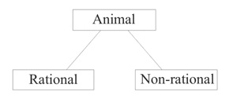

# Analysis
**First published Mon Apr 7, 2003; substantive revision Thu Jul 18, 2024**

*Beaney, Michael, Raysmith, Thomas*

Analysis has always been at the heart of philosophical method, but it has been understood and practised in many different ways. Perhaps, in its broadest sense, it might be defined as a process of identifying or working back to what is more fundamental by means of which something, initially taken as given, can be derived, explained or reconstructed. The derivation, explanation or reconstruction is sometimes conceived as the corresponding process of synthesis, but it is more often counted as part of the analytic project as a whole. This allows great variation in specific method, however. The aim may be to get back to basics and elucidate connections, but there may be all sorts of ways of doing this, each of which might be called ‘analysis’. The dominance of ‘analytic’ philosophy in the English-speaking world, and its growing influence in the rest of the world, might suggest that a consensus has formed concerning the role and importance of analysis. But this assumes that there is agreement on what ‘analysis’ means, and this is far from clear. Throughout the history of philosophy there have also been powerful criticisms of analysis, but these have always been to specific forms of analysis, which has only encouraged the development of newer forms. If we look at the history of philosophy, and even at just the history of (recent Western) analytic philosophy, we find a rich and extensive repertoire of conceptions and techniques of analysis which philosophers have continually drawn upon and modified in different ways. Analytic philosophy is thriving precisely because of the range of conceptions and techniques of analysis that it involves. It may have fragmented into various interlocking subtraditions and, increasingly, is now being ‘backdated’ and widened in scope to include earlier and contemporaneous traditions, but those subtraditions and related traditions are held together by their shared history and methodological interconnections. There are also forms of analysis in traditions clearly distinct from Western analytic philosophy, and these also need to be recognized and brought into debates about analytic methodologies, to open up new approaches and perspectives. It is the aim of this article to indicate something of the range of conceptions of analysis in the history of philosophy and their interconnections, as well as their role in understanding the history of philosophy itself, and to provide a bibliographical resource for those wishing to explore analytic methodologies and the philosophical issues they raise.

## 1. General Introduction

The word ‘analysis’ derives from the ancient Greek term ‘*analusis*’. The prefix ‘*ana*’ means ‘up’ and ‘*lusis*’ (from the verb ‘*luein*’) means ‘loosening’, ‘separating’, or ‘release’, so that ‘*analusis*’ means ‘loosening up’, ‘breaking up’, or ‘dissolution’. One of its earliest recorded uses occurs in Homer’s *Odyssey*, where Penelope is described as ‘analysing’—i.e., ‘unravelling’—by night the shroud she was weaving by day, to stave off her suitors, having promised to decide who to marry (in Odysseus’ long absence) when the shroud was finished. The term was then extended, metaphorically, in talking of ‘unravelling’ or ‘dissolving’ problems (Beaney 2017, pp. 94–5, where the brilliance of Penelope’s solution to her own problem is noted!)[^beaney-2017]. Philosophical and methodological terms often have their roots in metaphorical uses of everyday terms, and this talk of ‘unravelling’ and related talk of weaving and unweaving a web may perhaps be the most important of all. They are metaphors that are widely used in many cultures, making a cross-cultural investigation especially appropriate and fruitful.

We can use the metaphor in introducing the account offered here. Over the course of the history of philosophy, a complex web of conceptions and practices of analysis has been woven, and our aim is to unravel selected parts of this to give some sense of its nature and structure. The idea of ‘unravelling’ itself provides an initial thread to find our way through this web, but this thread is interwoven with many other threads, and the term ‘analysis’, too, is only one of a web of terms used in conceptualizing and practising analysis. (In this substantially revised and expanded version of the entry on ‘Analysis’, we will be considering examples from various ‘non-Western’ traditions, to give a more rounded picture of the world-wide web of analysis, but here we will have to be even more selective to maintain perspicuity.)

### 1.1 Characterizations of Analysis

If asked what ‘analysis’ means, most people today immediately think of breaking something down into its components; and this is how analysis tends to be officially characterized. In the *Concise Oxford Dictionary*, for example, ‘analysis’ is defined as the “resolution into simpler elements by analysing (opp. *synthesis*)”, the only other uses mentioned being the mathematical and the psychological [COD Quotation]. And in the *Oxford Dictionary of Philosophy*, ‘analysis’ is defined as “the process of breaking a concept down into more simple parts, so that its logical structure is displayed” [ODP Quotation]. The restriction to concepts and the reference to displaying ‘logical structure’ are important qualifications, but the core conception remains that of breaking something down.

This conception may be called the *decompositional* conception of analysis. This is clearly connected to the idea of unravelling. We may need to take something apart to understand how it is composed or works, and we can see how an analytic project may have a decompositional–compositional structure. We need to identify the key elements that enable us to explain how something is put together or works.

This is not the only conception, however, and is arguably neither the dominant conception in the pre-modern period nor the conception that is characteristic of at least one major strand in ‘analytic’ philosophy. In ancient Greek thought, ‘analysis’ referred primarily to the process of working back to first principles by means of which something could then be demonstrated. This conception may be called the *regressive* conception of analysis (see Section 2). Since the aim is to see how something is then derived or explained, the complementary process—‘synthesis’ or ‘progression’, as we might call it—is also involved in the analytic project as a whole. Indeed, following through the implications of something may be one way to identify the more basic propositions or principles (see the supplementary section on Ancient Greek Geometry). So analysis here may have a regressive–progressive structure.

In the work of Frege and Russell, on the other hand, before the processes of decomposition and/or regression could take place, the statements to be analysed had first to be translated into their ‘correct’ logical form (see Section 6). This suggests that analysis also involves an *interpretive* or *transformative* dimension. This too, however, has its roots in earlier thought (see especially the supplementary sections on Ancient Greek Geometry and Medieval European Philosophy), and is exemplified in an even more striking form in Indian analytic philosophy (see the supplementary sections on Medieval Indian Philosophy and Indian Analytic Philosophy). Once again, there is a bidirectional process involved, translating into and out of the privileged conceptual or logical framework, so that analysis may also have an interpretive–reinterpretive structure.

These three conceptions should not be seen as competing. In actual practices of analysis, which are invariably richer than the accounts that are offered of them, all three conceptions are typically reflected, though to differing degrees and in differing forms. To analyse something, we may first have to interpret it in some way, translating an initial statement, say, into the privileged language of logic, linguistic theory, mathematics, or science, before articulating the relevant elements and structures, and all in the service of identifying fundamental principles by means of which to explain it. The complexities that this schematic description suggests can only be appreciated by considering particular examples of analysis.

There is a fourth conception, however, which fits comfortably into a holistic worldview rather than the atomistic worldview associated with the decompositional conception. This involves a movement not from what is initially given to its parts, but from what is initially given to the wider whole. This can be called the *connective* conception. The idea here is that something can only be properly understood in its connective relations to appropriate things in the wider context or whole. It might be regarded as an *elucidatory* rather than *explanatory* conception, and in the period of ordinary language philosophy in twentieth-century analytic philosophy, in reacting to the earlier phase of logical atomism, was contrasted with the reductive or decompositional conception (see the supplementary section on Oxford Linguistic Philosophy). Connective analysis may also be seen as capturing the *complementarity* involved in the other conceptions. For in seeing something as connected to other things in a larger whole, one may also be seeing that whole as decomposable into parts, or a system of thought as generated from certain axioms, or a set of claims as interpretable within a more technical language. So connective analysis itself connects the decompositional–compositional, regressive–progressive and interpretive–reinterpretive structures that analytic projects as a whole typically have.

These four conceptions, then, should be seen as *aspects* of analytic projects that are themselves to be understood as wholes. Analysis can itself be analysed, and in what follows, we do so by going back into the history of philosophy, identifying particular examples and accepted models to illustrate the range of forms of analysis, and interpreting and connecting them to provide as rich an account as we can (in the space of this entry) of analytic methodology in philosophy.

Philosophical analysis, of course, is only one *type* of analysis, and there are indefinitely many other types, such as geometrical analysis, linguistic analysis, logical analysis, mathematical analysis, hermeneutic analysis, psychological analysis, psychoanalysis, phenomenological analysis, political analysis, economic analysis, feminist analysis, and so on. This is hardly surprising, for in every science or field of thinking, analytic techniques are employed, and the analysis can be qualified in the respective way. Philosophical analysis has its own forms, but they interconnect with—and are inspired by—related types of analysis such as geometrical analysis, logical analysis, linguistic analysis, conceptual analysis, psychological analysis, mathematical analysis, and so on. The intricate web of analysis does indeed reach through the whole world of conceptual thought.

### 1.2 Terms for Analysis

Understanding conceptions of analysis is not simply a matter of attending to the use of the word ‘analysis’ and its cognates—or obvious equivalents in languages other than English, such as ‘*analusis*’ in Greek or ‘*Analyse*’ in German. Socratic definition is arguably a form of conceptual analysis, yet the term ‘*analusis*’ does not occur anywhere in Plato’s dialogues (see Section 2 below). Nor, indeed, do we find it in Euclid’s *Elements*, which is the classic text for understanding ancient Greek geometry: Euclid presupposed what came to be known as the method of analysis in presenting his proofs ‘synthetically’. In Latin, ‘*resolutio*’ was used to render the Greek word ‘*analusis*’ in its methodological use (with ‘*decompositio*’ also used in other contexts), and although ‘resolution’ has a different range of meanings, it is often used synonymously with ‘analysis’ (see the supplementary section on European Renaissance Philosophy). In Aristotelian syllogistic theory, and especially from the time of Descartes, forms of analysis have also involved ‘reduction’; and in early analytic philosophy it was ‘reduction’ that was seen as the goal of philosophical analysis (see especially the supplementary section on The Cambridge School of Analysis).

When it comes to considering philosophical traditions outside the Western canon, we need to be open-minded about the prospects of methodologies being ‘analytic’, or at least analogous to analytic methodologies, even if rather different terms are used or they are conceived or practised in rather different ways. In an early text of ancient Indian philosophy, for example, scholarly debate is described as an ‘unravelling’ (‘*nibbeṭhanam*’), invoking just that basic metaphor we have seen in the case of ‘analysis’ (see the supplementary section on Ancient Indian Philosophy.) And even if the differences outweigh the similarities, this in itself may shed light on what ‘analysis’ means, by way of contrast (see, for example, the supplementary section on Ancient Chinese Philosophy). One sign of just how extensively analytic methodologies can be found across the range of philosophical traditions is the ease with which later commentators, especially in the modern period, describe them as ‘analytic’. It is not anachronistic, as there are often strong grounds for doing so. Talk of ‘analysis’ has evolved dramatically across the centuries and the interwoven threads of continuity are not only natural but enrich our thinking and deepen our sense of a common humanity and rationality.

Further details of characterizations of analysis that have been offered in the history of philosophy, including all the classic passages and remarks (to which occurrences of ‘[Quotation]’ throughout this entry refer), can be found in the supplementary document on

> [Definitions and Descriptions of Analysis](analysis.s1.md).

A list of key reference works, monographs and collections can be found in the

> [Annotated Bibliography, §1](analysis.bib1.md).

### 1.3 Guide to this Entry

This entry comprises three sets of documents:

1. The present document
2. Six supplementary documents
3. An annotated bibliography on analysis, divided into six documents

The present document provides an overview, with introductions to the various conceptions of analysis in the history of philosophy. It also contains links to the supplementary documents, the documents in the bibliography, and other internet resources. The supplementary documents expand on certain topics under each of the six main sections. The annotated bibliography contains a list of key readings on each topic, and is also divided according to the sections of this entry.

## 2. Ancient Conceptions of Analysis

As noted above, the word ‘analysis’ derives from the ancient Greek term ‘*analusis*’, which originally meant ‘loosening up’ or ‘dissolution’ and was then readily extended to the solving or dissolving of a problem. It was in this sense that it was employed in ancient Greek geometry and the method of analysis that was developed influenced both Plato and Aristotle. Also important, however, was the influence of Socrates’s concern with definition, in which the roots of modern conceptual analysis can be found. What we already have in ancient Greek thought, then, is a complex web of methodologies, of which the most important are Socratic definition, which Plato elaborated into his method of division, his related method of hypothesis, which drew on geometrical analysis, and the method(s) that Aristotle developed in his *Analytics*. Far from a consensus having established itself over the last two millennia, the relationships between these methodologies are the subject of increasing debate today. At the heart of all of them, too, lie the philosophical problems raised by Meno’s paradox, which anticipates what we now know as the paradox of analysis, concerning how an analysis can be both correct and informative (see the supplementary section on Moore), and Plato’s attempt to solve it through the theory of recollection, which has spawned a vast literature on its own.

‘Analysis’ was first used in a methodological sense in ancient Greek geometry, and the model that Euclidean geometry provided has been an inspiration ever since. Although Euclid’s *Elements* dates from around 300 BCE, and hence after both Plato and Aristotle, it is clear that it draws on the work of many previous geometers, most notably, Theaetetus and Eudoxus, who worked closely with Plato and Aristotle. Plato is even credited by Diogenes Laertius (*LEP*, I, 299) with inventing the method of analysis, but whatever the truth of this may be, the influence of geometry starts to show in his middle dialogues, and he certainly encouraged work on geometry in his Academy.

The classic source for our understanding of ancient Greek geometrical analysis is a passage in Pappus’s *Mathematical Collection*, which was composed around 300 CE, and hence drew on a further six centuries of work in geometry from the time of Euclid’s *Elements*:

> Now analysis is the way from what is sought—as if it were admitted—through its concomitants (*akolouthôn*) in order[,] to something admitted in synthesis. For in analysis we suppose that which is sought to be already done, and we inquire from what it results, and again what is the antecedent of the latter, until we on our backward way light upon something already known and being first in order. And we call such a method analysis, as being a solution backwards (*anapalin lysin*).
>
> In synthesis, on the other hand, we suppose that which was reached last in analysis to be already done, and arranging in their natural order as consequents (*epomena*) the former antecedents and linking them one with another, we in the end arrive at the construction of the thing sought. And this we call synthesis. [Full Quotation]

Analysis is clearly being understood here in the regressive sense—as involving the working back from ‘what is sought’, taken as assumed, to something more fundamental by means of which it can then be established, through its converse, synthesis (progression). For example, to demonstrate Pythagoras’s theorem—that the square of the hypotenuse of a right-angled triangle is equal to the sum of the squares on the other two sides—we may assume as ‘given’ a right-angled triangle with the three squares drawn on its sides. In investigating the properties of this complex figure we may draw further (auxiliary) lines between particular points and find that there are a number of congruent triangles, from which we can begin to work out the relationship between the relevant areas. Pythagoras’s theorem thus depends on theorems about congruent triangles, and once these—and other—theorems have been identified (and themselves proved), Pythagoras’s theorem can be proved. (The theorem is demonstrated in Proposition 47 of Book I of Euclid’s *Elements*.)

The basic idea here provides the core of the conception of analysis that one can find reflected, in its different ways, in the work of Plato and Aristotle (see the supplementary sections on Plato and Aristotle). Although detailed examination of actual practices of analysis reveals more than just regression to first causes, principles or theorems, but *decomposition*, *transformation* and *connection* as well (see especially the supplementary section on Ancient Greek Geometry), the regressive conception dominated views of analysis in Europe until well into the early modern period.

Ancient Greek geometry was not the only source of later conceptions of analysis, however. Plato may not have used the term ‘analysis’, but concern with definition was central to his dialogues, and definitions have often been seen as what ‘conceptual analysis’ should yield. The definition of ‘knowledge’ as ‘true belief with an account’, to put it in Platonic terms, is one example. (The stock example is the definition of ‘knowledge’ as ‘justified true belief’, but it is controversial that this is Plato’s own definition and even whether it was offered at all before the middle of the twentieth century.) Plato’s concern may have been with real rather than nominal definitions, with ‘essences’ rather than mental or linguistic contents (see the supplementary section on Plato), but conceptual analysis, too, has frequently been given a ‘realist’ construal. Certainly, the roots of conceptual analysis can be traced back to Plato’s search for definitions, as we shall see in Section 4.

Ancient Greek methodologies can be fruitfully compared with methodologies in other philosophical traditions. In ancient Chinese philosophy, for example, there is no Chinese character that could obviously be translated as ‘analysis’, but there was clearly a concern with finding reasons for things, which involved identifying and formulating principles, which suggests something akin to the regressive conception of analysis. There was also concern with how names divide things up, which bears comparison with Plato’s method of division, and in the Mohist tradition, with providing definitions of key concepts, such as mathematical and epistemic concepts, and with certain forms of argumentation (see the supplementary section on Ancient Chinese Philosophy).

In ancient Indian philosophy, a web of analytic methodologies begins to be woven to rival those in ancient Greek philosophy in the areas of language, logic and epistemology. Here the key inspiration is not Greek geometrical analysis but Sanskrit grammatical analysis, first systematized by Pāṇini in the *Aṣṭādhyāyī* (*Book in Eight Chapters*) in the fifth century BCE. Rules are formulated for grammatical transformations, which form the basis for the sophisticated linguistic analyses that are used in the development of Indian logic and the Nyāya school of philosophy (see the supplementary sections on Ancient Indian Philosophy and Medieval Indian Philosophy). This leads to the emergence of a rich Indian tradition of analytic philosophy in the early modern period that precedes by several centuries the emergence of the analytic tradition in the West that originates in the work of Frege, Russell and Moore (see the supplementary section on Indian Analytic Philosophy).

Further discussion can be found in the supplementary document on

> [Ancient Conceptions of Analysis](analysis.s2.md).

Further reading can be found in the

> [Annotated Bibliography, §2](analysis.bib2.md).

## 3. Medieval and Renaissance Conceptions of Analysis

While the early medieval period in Europe was something of a dark age for philosophy, it thrived in other parts of the world. Indeed, were it not for the Arabic philosophers in the eleventh and twelfth centuries, who were the main source of the transmission of Greek philosophy, the dark age would have lasted longer. There was no such dark age in Indian philosophy, and the division between ‘ancient’ and ‘medieval’ is problematic anyway, as there was a continual development from its beginnings in the *Upaniṣads*, and a fascinating debate between the various Vedic and Buddhist schools that deepened well into the modern period. This debate centred on the inference-schema first formulated by Gautama in the second century CE, which was analysed into five components by the Nyāya school, the school of logic and epistemology that evolved into the analytic philosophy of early modern India, and into three components by the Buddhists. There is a striking similarity between this inference-schema and one of the basic forms of Aristotelian syllogistic theory, but there are also crucial differences, reflected in the different natures of Sanskrit and Greek grammar, at least as they were understood by Indian and Greek scholars, respectively.

Buddhism began influencing Chinese philosophy from the first century CE and there was explicit reflection on the nature of decompositional analysis—of a whole into its parts. Fazang, writing in the seventh century, using two famous metaphors, of a statue of a golden lion and of a rafter forming part of a building, argued that the relationship between a whole and its parts has six characteristics, some of which might seem counterintuitive until we appreciate the *interdependence* of a whole and all its parts. In the Neo-Confucianism that sought to respond to Buddhist and Daoist attacks on early Confucianism, this interdependence claim was embedded in a conception of *lǐ* (理), understood as the ‘pattern’ or ‘principle’ that unifies and underlies all things, a conception that can be compared to the Neoplatonist conception of the One or God, to which everything can ultimately be traced back. Here we have clear articulations of a connective conception of analysis.

As far as the later medieval and renaissance periods in Europe are concerned, conceptions of analysis were largely influenced by ancient Greek thought. Knowledge of these conceptions was often second-hand, however, filtered through a variety of commentaries and texts that were not always reliable. Medieval and renaissance methodologies tended to be uneasy mixtures of Platonic, Aristotelian, Stoic, Galenic, and Neoplatonic elements, many of them claiming to have some root in the geometrical conception of analysis and synthesis. However, in the late medieval period, clearer and more original forms of analysis started to take shape. In the literature on so-called ‘syncategoremata’ and ‘exponibilia’, for example, we can trace the development of a conception of interpretive analysis. Sentences involving more than one quantifier such as ‘Some donkey every man sees’, for example, were recognized as ambiguous, requiring ‘exposition’ to clarify. This parallels similar developments in Indian logic, where sentences involving quantifiers were reformulated in language that increasingly became more technical, building on the grammatical analyses that successive Sanskrit scholars had offered.

In John Buridan’s masterpiece of the mid-fourteenth century, the *Summulae de Dialectica*, we can find three of the four conceptions outlined in Section 1.1 above. He distinguishes explicitly between divisions, definitions, and demonstrations, corresponding to decompositional, interpretive, and regressive analysis, respectively. Here, in particular, we have anticipations of modern analytic philosophy as much as reworkings of ancient philosophy. Unfortunately, however, these clearer forms of analysis became overshadowed during the Renaissance, despite—or perhaps because of—the growing interest in the original Greek sources. As far as understanding analytic methodologies was concerned, the humanist repudiation of scholastic logic muddied the waters.

Further discussion can be found in the supplementary document on

> [Medieval and Renaissance Conceptions of Analysis](analysis.s3.md).

Further reading can be found in the

> [Annotated Bibliography, §3](analysis.bib3.md).

## 4. Early Modern Conceptions of Analysis

In Europe, the scientific revolution in the seventeenth century brought with it new forms of analysis. The newest of these emerged through the development of more sophisticated mathematical techniques, but even these still had their roots in earlier conceptions of analysis. By the end of the early modern period, decompositional analysis had become dominant (as outlined in what follows), but this, too, took different forms, and the relationships between the various conceptions of analysis were often far from clear.

In common with the Renaissance, the early modern period in Europe was marked by a great concern with methodology. This might seem unsurprising in such a revolutionary period, when new techniques for understanding the world were being developed and that understanding itself was being transformed. But what characterizes many of the treatises and remarks on methodology that appeared in the seventeenth century is their appeal, frequently self-conscious, to ancient methods (despite, or perhaps—for diplomatic reasons—because of, the critique of the *content* of traditional thought), although new wine was generally poured into the old bottles. The model of geometrical analysis was a particular inspiration here, albeit filtered through the Aristotelian tradition, which had assimilated the regressive process of going from theorems to axioms with that of moving from effects to causes (see the supplementary section on Aristotle). Analysis came to be seen as a method of discovery, working back from what is ordinarily known to the underlying reasons (demonstrating ‘the fact’), and synthesis as a method of proof, working forwards again from what is discovered to what needed explanation (demonstrating ‘the reason why’). Analysis and synthesis were thus taken as complementary, although there remained disagreement over their respective merits.

There is a manuscript by Galileo, dating from around 1589, an appropriated commentary on Aristotle’s *Posterior Analytics*, which shows his concern with methodology, and regressive analysis, in particular (see Wallace 1992a and 1992b). Hobbes wrote a chapter on method in the first part of *De Corpore*, published in 1655, which offers his own interpretation of the method of analysis and synthesis, where decompositional forms of analysis are articulated alongside regressive forms {Quotations}. But perhaps the most influential account of methodology, from the middle of the seventeenth century until well into the nineteenth century, was the fourth part of the Port-Royal *Logic*, the first edition of which appeared in 1662 and the final revised edition in 1683. Chapter 2 (which was the first chapter in the first edition) opens as follows:

> The art of arranging a series of thoughts properly, either for discovering the truth when we do not know it, or for proving to others what we already know, can generally be called method.
>
> Hence there are two kinds of method, one for discovering the truth, which is known as *analysis*, or the *method of resolution*, and which can also be called the *method of discovery*. The other is for making the truth understood by others once it is found. This is known as *synthesis*, or the *method of composition*, and can also be called the *method of instruction*. {Fuller Quotations}

That a number of different methods might be assimilated here is not noted, although the text does go on to distinguish four main types of ‘issues concerning things’: seeking causes by their effects, seeking effects by their causes, finding the whole from the parts, and looking for another part from the whole and a given part (ibid., 234). While the first two involve regressive analysis and synthesis, the third and fourth involve decompositional analysis and synthesis—or decompositional and connective analysis, as we might also understand it.

As the authors of the *Logic* make clear, this particular part of their text derives from Descartes’s *Rules for the Direction of the Mind*, written around 1627, but only published posthumously in 1684. The specification of the four types was most likely offered in elaborating Descartes’s Rule Thirteen, which states: “If we perfectly understand a problem we must abstract it from every superfluous conception, reduce it to its simplest terms and, by means of an enumeration, divide it up into the smallest possible parts” (*PW*, I, 51. Cf. the editorial comments in *PW*, I, 54, 77). The decompositional conception of analysis is explicit here, and if we follow this up into the later *Discourse on Method*, published in 1637, the focus has clearly shifted from the regressive to the decompositional conception of analysis. All the rules offered in the earlier work have now been reduced to just four. This is how Descartes reports the rules he says he adopted in his scientific and philosophical work:

> The first was never to accept anything as true if I did not have evident knowledge of its truth: that is, carefully to avoid precipitate conclusions and preconceptions, and to include nothing more in my judgements than what presented itself to my mind so clearly and so distinctly that I had no occasion to doubt it.
>
> The second, to divide each of the difficulties I examined into as many parts as possible and as may be required in order to resolve them better.
>
> The third, to direct my thoughts in an orderly manner, by beginning with the simplest and most easily known objects in the order to ascend little by little, step by step, to knowledge of the most complex, and by supposing some order even among objects that have no natural order of precedence.
>
> And the last, throughout to make enumerations so complete, and reviews so comprehensive, that I could be sure of leaving nothing out. (*PW*, I, 120.)

The first two are rules of analysis (decompositional analysis) and the second two rules of synthesis (connective analysis). But although the analysis/synthesis structure remains, what is involved here is decomposition/composition (decomposition/connection) rather than regression/progression. Nevertheless, Descartes insisted that it was geometry that influenced him here: “Those long chains composed of very simple and easy reasonings, which geometers customarily use to arrive at their most difficult demonstrations, had given me occasion to suppose that all the things which can fall under human knowledge are interconnected in the same way” (Ibid. {Further Quotations}).

Descartes’s geometry did indeed involve the breaking down of complex problems into simpler ones. More significant, however, was his use of algebra in developing ‘analytic’ geometry as it came to be called, which allowed geometrical problems to be transformed into arithmetical ones and more easily solved. In representing the ‘unknown’ to be found by ‘*x*’, we can see the central role played in analysis by the idea of taking something as ‘given’ and working back from that, which made it seem appropriate to regard algebra as an ‘art of analysis’, alluding to the regressive conception of the ancients. Illustrated in analytic geometry in its developed form, then, we can see all four of the conceptions of analysis outlined in Section 1.1 above, despite Descartes’s own emphasis on the decompositional conception. For further discussion of this, see the supplementary section on Descartes and Analytic Geometry.

Descartes’s emphasis on decompositional analysis was not without precedents, however. Not only was it already involved in ancient Greek geometry, but it was also implicit in Plato’s method of collection and division. We might explain the shift from regressive to decompositional (conceptual) analysis, as well as the connection between the two, in the following way. Consider a simple example, as represented in the diagram below, ‘collecting’ all animals and ‘dividing’ them into *rational* and *non-rational*, in order to define human beings as rational animals.

On this model, in seeking to define anything, we work back up the appropriate classificatory hierarchy to find the higher (i.e., more basic or more general) ‘Forms’, by means of which we can lay down the definition. Although Plato did not himself use the term ‘analysis’—the word for ‘division’ was ‘*dihairesis*’—the finding of the appropriate ‘Forms’ is essentially analysis. As an elaboration of the Socratic search for definitions, we clearly have in this the origins of conceptual analysis. There is little disagreement that ‘Human beings are rational animals’ is the kind of definition we are seeking, defining one concept, the concept *human being*, in terms of other concepts, the concepts *rational* and *animal*. But the construals that have been offered of this have been more problematic. Understanding a classificatory hierarchy *extensionally*, that is, in terms of the classes of things denoted, the classes higher up are clearly the larger, ‘containing’ the classes lower down as subclasses (e.g., the class of animals includes the class of human beings as one of its subclasses). *Intensionally*, however, the relationship of ‘containment’ has been seen as holding in the opposite direction. If someone understands the concept *human being*, at least in the strong sense of knowing its definition, then they must understand the concepts *animal* and *rational*; and it has often then seemed natural to talk of the concept *human being* as ‘containing’ the concepts *rational* and *animal*. Working back up the hierarchy in ‘analysis’ (in the regressive sense) could then come to be identified with ‘unpacking’ or ‘decomposing’ a concept into its ‘constituent’ concepts (‘analysis’ in the decompositional sense). Of course, talking of ‘decomposing’ a concept into its ‘constituents’ is, strictly speaking, only a metaphor (as Quine was famously to remark in §1 of ‘Two Dogmas of Empiricism’), but in the early modern period, this began to be taken more literally.

As far as the history of analytic philosophy is concerned, however, the most significant development in the early modern period was the emergence of Indian analytic philosophy, as it should undoubtedly be characterized. Building on Gaṅgeśa’s fourteenth-century text, *Jewel of Reflection on the Truth* (*Tattvacintāmaṇi*), the earlier work of the Nyāya school, which had focused on logic and epistemology, was elaborated with ever greater technical sophistication into what became known as the Navya-Nyāya or new Nyāya school. No one who reads their commentaries and expositions can fail to be struck by how closely their concerns match those of analytic philosophers today (see the entry on Analytic Philosophy in Early Modern India). Not only do we find conceptual analysis being pursued, in the sense of seeking necessary and sufficient conditions for the application of key philosophical concepts, but there is also explicit use of interpretive analysis in finding precise formulations to resolve philosophical debates, especially in responding to the epistemological scepticism of the Buddhists.

There was similar concern to counteract the influence of Buddhism in early modern Chinese philosophy, where it took the form of developing new versions of Confucianism. Dai Zhen was the most significant figure, his work characterized by seeking to uncover the original meaning of Confucianism in the ancient texts, by careful philological analysis that also sifted out the wheat from the chaff—as Dai saw it—in the extensive commentaries on those texts. Dai talks explicitly of a ‘principle of analysis’, as ‘*fēnlǐ*’ (分理) might be translated, ‘*fēn*’ (分) meaning ‘divide’ or ‘separate’, forming the first part of *fēnxī*’ (分析), as used in Chinese today for ‘analysis’ or ‘analyse’, where ‘*xī*’ (析) means ‘divide’ or ‘separate’, too. This is clearly ‘analysis’ in its decompositional sense, but Dai saw identifying the parts of something as essential in understanding the ‘pattern’ (*lǐ* 理) that unifies those parts, so a connective conception of analysis is also at work here.

For further discussion, see the supplementary document on

> [Early Modern Conceptions of Analysis](analysis.s4.md).

For further reading, see the

> [Annotated Bibliography, §4](analysis.bib4.md).

## 5. Modern Conceptions of Analysis, outside Analytic Philosophy

As suggested in the supplementary document on Kant, both the decompositional and regressive conceptions of analysis found their classic statements in the work of Kant at the end of the eighteenth century. But Kant was only expressing conceptions widespread in Europe at the time. The decompositional conception can be found in a very blatant form, for example, in the writings of Moses Mendelssohn, for whom, unlike Kant, it was applicable even in the case of geometry {Mendelssohn Quotation}. Typified in Kant’s and Mendelssohn’s view of concepts, it was also reflected in scientific practice. Indeed, its popularity was fostered by the chemical revolution inaugurated by Lavoisier in the late eighteenth century, the comparison between philosophical analysis and chemical analysis being frequently drawn. As Lichtenberg put it, “Whichever way you look at it, philosophy is always analytical chemistry” {Lichtenberg Quotation}. The regressive conception, meanwhile, is given a particularly clear formulation in the work of Johann Heinrich Lambert {Lambert Quotation}.

This decompositional conception of analysis set the methodological agenda for philosophical approaches and debates in the (late) modern period (from the nineteenth century onwards) in Europe. Responses and developments, very broadly, can be divided into two. On the one hand, an essentially decompositional conception of analysis was accepted, but a critical attitude was adopted towards it. If analysis simply involved breaking something down, then it appeared destructive and life-diminishing, and the critique of analysis that this view engendered was a common theme in idealism and romanticism in all its main varieties—from German, British, and French to North American. One finds it reflected, for example, in remarks about the negating and soul-destroying power of analytical thinking by Schiller {Schiller Quotation}, de Staël {Staël Quotation}, Hegel {Hegel Quotation}, and de Chardin {de Chardin Quotation}, in Bradley’s doctrine that analysis is falsification {Bradley Quotation}, and in the emphasis placed by Bergson on ‘intuition’ {Bergson Quotation}.

On the other hand, analysis was seen more positively, but the Kantian decompositional conception underwent a certain degree of modification and development. In the nineteenth century, this was exemplified, in particular, by Bolzano and the neo-Kantians. Bolzano’s most important innovation was the method of variation, which involves considering what happens to the truth-value of a sentence when a constituent term is substituted by another. This formed the basis for his reconstruction of the analytic/synthetic distinction, Kant’s account of which, with respect to judgements, he found defective. The neo-Kantians emphasized the role of structure in conceptualized experience and had a greater appreciation of forms of analysis in mathematics and science. In many ways, their work attempts to do justice to philosophical and scientific practice while recognizing the central idealist claim that analysis is a kind of abstraction that inevitably involves falsification or distortion. On the neo-Kantian view, the complexity of experience is a complexity of form and content rather than of separable constituents, requiring analysis into ‘moments’ or ‘aspects’ rather than ‘elements’ or ‘parts’. In the 1910s, the idea was articulated with great subtlety by Ernst Cassirer {Quotation}, and became familiar in Gestalt psychology.

The Kantian regressive conception of analysis, too, underwent modification and development, as can be seen, for example, in the works of his idealist successor, J. G. Fichte. Although Kant wrote the *Prolegomena* according to the analytic or regressive method, he nonetheless maintained that the proper method of a scientific philosophy is synthetic or progressive {Quotation}. In opposition to this, Fichte, in his introductory remarks to Part II of his *Foundation to the Entire Wissenschaftslehre*, states that the philosophical investigations that follow can only be conducted according to an analytic method. This is because, as Fichte explains, these investigations are reflective discoveries of individual intellectual acts that are already present and synthetically unified within a larger whole, which whole is the condition for the possibility of these reflective investigations in the first place (*FGA,* I, 2, 283–5). Fichte thus modifies the Kantian conception of regressive analysis by combining it with the decompositional and connective conceptions. His method is analytic in the regressive sense in that it is a reflection aimed at articulating its own condition of possibility, analytic in the decompositional sense in that it is a decomposition of a synthetically unified whole into its component acts, and analytic in the connective sense in that these component acts are always related to the synthetically unified whole they comprise.

In the twentieth century, both (Western) analytic philosophy and phenomenology can be seen as developing far more sophisticated conceptions of analysis, which draw on but go beyond mere decompositional analysis. The following Section offers an account of analysis in analytic philosophy, illustrating the range and richness of the conceptions and practices that arose. But it is important to see these in the wider context of twentieth-century methodological practices and debates, for it is not just in ‘analytic’ philosophy—despite its name—that analytic methods are accorded a central role. Phenomenology, in particular, contains its own distinctive set of analytic methods, with similarities and differences to those of analytic philosophy. Phenomenological analysis has frequently been compared to conceptual clarification in the ordinary language tradition, for example, and the method of ‘phenomenological reduction’ that Husserl invented in 1905 offers a striking parallel to the reductive project opened up by Russell’s theory of descriptions, which also made its appearance in 1905.

Just like Frege and Russell, Husserl’s initial concern was with the foundations of mathematics, and in this shared concern we can see the continued influence of the regressive conception of analysis. According to Husserl, the aim of ‘eidetic reduction’, as he called it, was to isolate the ‘essences’ that underlie our various forms of thinking, and to apprehend them by ‘essential intuition’ (‘*Wesenserschauung*’). The terminology may be different, but this resembles Russell’s early project to identify the ‘indefinables’ of philosophical logic, as he described it, and to apprehend them by ‘acquaintance’ (cf. *POM*, xx). Furthermore, in Husserl’s later discussion of ‘explication’ (cf. *EJ*, §§ 22–4 {Quotations}), we find appreciation of the ‘transformative’ dimension of analysis, which can be fruitfully compared with Carnap’s account of explication (see the supplementary section on Rudolf Carnap and Logical Positivism). Carnap himself describes Husserl’s idea here as one of “the synthesis of identification between a confused, nonarticulated sense and a subsequently intended distinct, articulated sense” (1950, 3 {Quotation}).

Phenomenology is not the only source of analytic methodologies outside those of the analytic tradition. Mention might be made here, too, of R. G. Collingwood, working within the tradition of British idealism, which was still a powerful force prior to the Second World War. In his *Essay on Philosophical Method* (1933), for example, he criticizes Moorean philosophy, and develops his own response to what is essentially the paradox of analysis (concerning how an analysis can be both correct and informative), which he recognizes as having its root in Meno’s paradox. In his *Essay on Metaphysics* (1940), he puts forward his own conception of metaphysical analysis, in direct response to what he perceived as the mistaken repudiation of metaphysics by the logical positivists. Metaphysical analysis is characterized here as the detection of ‘absolute presuppositions’, which are taken as underlying and shaping the various conceptual practices that can be identified in the history of philosophy and science (see Beaney 2005)[^beaney-2005]. Even among those explicitly critical of central strands in analytic philosophy, then, analysis in one form or another can still be seen as alive and well.

When it comes to the various traditions of Asian philosophy, their further development was disrupted by colonialism, which decimated the Indian analytic tradition, for example. There was argument about the respective merits of Indian and European forms of logic and analysis, reflected in debates about the so-called ‘Hindu syllogism’, which led some Indian philosophers to return to the older, Vedic sources of philosophy to find something that was more distinctive and hence less readily comparable to Western forms of philosophy, by which it always seemed (mistakenly) to come off second-best. It was not until the 1970s, in the pioneering work of B. K. Matilal, that the Indian analytic tradition finally began to be recognized in the West (see the supplementary section on Indian Philosophy).

Colonialism also had a transformative effect on Chinese philosophy. As the Qing dynasty disintegrated around the turn of the twentieth century, there was growing rejection of Confucianism and a turn towards the West for social and cultural renewal. Western logical and philosophical texts were translated, and a new generation of Chinese intellectuals returned from studying in Europe and the US to introduce new ideas and reconstruct their own historical traditions to offer new resources for understanding and changing the present (see the supplementary section on Chinese Philosophy).

For further discussion, see the supplementary document on

> [Modern Conceptions of Analysis, outside Analytic Philosophy](analysis.s5.md).

For further reading, see the

> [Annotated Bibliography, §5](analysis.bib5.md).

## 6. Conceptions of Analysis in Analytic Philosophy

If anything characterizes ‘analytic’ philosophy in the West, then it is presumably the emphasis placed on analysis. But as the foregoing sections have shown, there is a wide range of conceptions of analysis, so such a characterization says nothing that would distinguish analytic philosophy from much of what has either preceded or developed alongside it. Given that the decompositional conception is frequently offered as the main conception today, it might be thought that it is this that characterizes analytic philosophy. But this conception was prevalent in the early modern period, shared by both the British Empiricists and Leibniz, for example. Given that Kant denied the importance of decompositional analysis, however, it might be suggested that what characterizes analytic philosophy is the *value* it places on such analysis. This might be true of Moore’s early work, and of one strand within analytic philosophy; but it is not generally true. What characterizes analytic philosophy as it was founded by Frege and Russell is the role played by *logical analysis*, which depended on the development of modern logic. Although other and subsequent forms of analysis, such as linguistic analysis, were less wedded to systems of formal logic, the central insight motivating logical analysis remained.

Pappus’s account of method in ancient Greek geometry suggests that the regressive conception of analysis was dominant at the time—however much other conceptions may also have been implicitly involved (see the supplementary section on Ancient Greek Geometry). In the early modern period, the decompositional conception became widespread (see Section 4). What characterizes analytic philosophy—or at least that central strand that originates in the work of Frege and Russell—is the recognition of what was called earlier the *interpretive* or *transformative* dimension of analysis (see Section 1.1). Any analysis presupposes a particular framework of interpretation, and work is done in *interpreting* what we are seeking to analyse as part of the process of regression and decomposition. This may involve *transforming* it in some way, in order for the resources of a given theory or conceptual framework to be brought to bear. Euclidean geometry provides a good illustration of this. But it is even more obvious in the case of analytic geometry, where the geometrical problem is first ‘translated’ into the language of algebra and arithmetic in order to solve it more easily (see the supplementary section on Descartes and Analytic Geometry). What Descartes and Fermat did for analytic geometry, Frege and Russell did for analytic philosophy. Analytic philosophy is ‘analytic’ much more in the sense that analytic geometry is ‘analytic’ than in the crude decompositional sense that Kant understood it.

The interpretive dimension of modern philosophical analysis can also be seen as anticipated in medieval scholasticism (see the supplementary section on Medieval European Philosophy), and it is remarkable just how much of modern concerns with propositions, meaning, reference, and so on, can be found in the medieval literature. They can also be found in early modern Indian philosophy (see the supplementary section on Indian Analytic Philosophy). Interpretive analysis is also illustrated in the nineteenth century by Bentham’s conception of *paraphrasis*, which he characterized as “that sort of exposition which may be afforded by transmuting into a proposition, having for its subject some real entity, a proposition which has not for its subject any other than a fictitious entity” [Full Quotation]. He applied the idea in ‘analysing away’ talk of ‘obligations’, and the anticipation that we can see here of Russell’s theory of descriptions has been noted by, among others, Wisdom (1931) and Quine in ‘Five Milestones of Empiricism’ [Quotation].

What was crucial in the emergence of twentieth-century analytic philosophy, however, was the development of quantificational theory, which provided a far more powerful interpretive system than anything that had hitherto been available. In the case of Frege and Russell, the system into which statements were ‘translated’ was predicate logic, and the divergence that was thereby opened up between grammatical and logical form meant that the process of translation itself became an issue of philosophical concern. This induced greater self-consciousness about our use of language and its potential to mislead us, and inevitably raised semantic, epistemological and metaphysical questions about the relationships between language, logic, thought and reality which have been at the core of analytic philosophy ever since.

Both Frege and Russell (after the latter’s initial flirtation with idealism) were concerned to show, against Kant, that arithmetic is a system of analytic and not synthetic truths. In the *Grundlagen*, Frege had offered a revised conception of analyticity, which arguably endorses and generalizes Kant’s logical as opposed to phenomenological criterion, i.e., (AN_{L}) rather than (AN_{O}) (see the supplementary section on Kant):

> (AN) A truth is *analytic* if its proof depends only on general logical laws and definitions.

The question of whether arithmetical truths are analytic then comes down to the question of whether they can be derived purely logically. (Here we already have ‘transformation’, at the theoretical level—involving a reinterpretation of the concept of analyticity.) To demonstrate this, Frege realized that he needed to develop logical theory in order to formalize mathematical statements, which typically involve multiple generality (e.g., ‘Every natural number has a successor’, i.e. ‘For every natural number *x* there is another natural number *y* that is the successor of *x*’). This development, by extending the use of function-argument analysis in mathematics to logic and providing a notation for quantification, was essentially the achievement of his first book, the *Begriffsschrift* (1879), where he not only created the first system of predicate logic but also, using it, succeeded in giving a logical analysis of mathematical induction (see Frege *FR*, 47–78).

In his second book, *Die Grundlagen der Arithmetik* (1884), Frege went on to provide a logical analysis of number statements. His central idea was that a number statement contains an assertion about a concept. A statement such as ‘Jupiter has four moons’ is to be understood not as predicating of Jupiter the property of having four moons, but as predicating of the concept *moon of Jupiter* the second-level property *has four instances*, which can be logically defined. The significance of this construal can be brought out by considering negative existential statements (which are equivalent to number statements involving the number 0). Take the following negative existential statement:

> (0a) Unicorns do not exist.

If we attempt to analyse this *decompositionally*, taking its grammatical form to mirror its logical form, then we find ourselves asking what these unicorns are that have the property of non-existence. We may then be forced to posit the *subsistence*—as opposed to *existence*—of unicorns, just as Meinong and the early Russell did, in order for there to be something that is the subject of our statement. On the Fregean account, however, to deny that something exists is to say that the relevant *concept* has no instances: there is no need to posit any mysterious *object*. The Fregean analysis of (0a) consists in *rephrasing* it into (0b), which can then be readily formalized in the new logic as (0c):

> (0b) The concept *unicorn* is not instantiated.
>
> (0c) ~(∃*x*) *Fx*.

Similarly, to say that God exists is to say that the concept *God* is (uniquely) instantiated, i.e., to deny that the concept has 0 instances (or 2 or more instances). On this view, existence is no longer seen as a (first-level) predicate, but instead, existential statements are analysed in terms of the (second-level) predicate *is instantiated*, represented by means of the existential quantifier. As Frege notes, this offers a neat diagnosis of what is wrong with the ontological argument, at least in its traditional form (*GL*, §53). All the problems that arise if we try to apply decompositional analysis (at least straight off) simply drop away, although an account is still needed, of course, of concepts and quantifiers.

The possibilities that this strategy of ‘translating’ into a logical language opens up are enormous: we are no longer forced to treat the surface grammatical form of a statement as a guide to its ‘real’ form, and are provided with a means of representing that form. This is the value of logical analysis: it allows us to ‘analyse away’ problematic linguistic expressions and explain what is ‘really’ going on. This strategy was employed, most famously, in Russell’s theory of descriptions, which was a major motivation behind the ideas of Wittgenstein’s *Tractatus* (see the supplementary sections on Bertrand Russell and Ludwig Wittgenstein). Although subsequent philosophers were to question the assumption that there could ever be a definitive logical analysis of a given statement, the idea that ordinary language may be systematically misleading has remained.

To illustrate this, consider the following examples from Ryle’s classic 1932 paper, ‘Systematically Misleading Expressions’:

> (Ua) Unpunctuality is reprehensible.
>
> (Ta) Jones hates the thought of going to hospital.

In each case, we might be tempted to make unnecessary reifications, taking ‘unpunctuality’ and ‘the thought of going to hospital’ as referring to objects. It is because of this that Ryle describes such expressions as ‘systematically misleading’. (Ua) and (Ta) must therefore be rephrased:

> (Ub) Whoever is unpunctual deserves that other people should reprove him for being unpunctual.
>
> (Tb) Jones feels distressed when he thinks of what he will undergo if he goes to hospital.

In these formulations, there is no overt talk at all of ‘unpunctuality’ or ‘thoughts’, and hence nothing to tempt us to posit the existence of any corresponding entities. The problems that otherwise arise have thus been ‘analysed away’.

At the time that Ryle wrote ‘Systematically Misleading Expressions’, he, too, assumed that every statement had an underlying logical form that was to be exhibited in its ‘correct’ formulation [Quotations]. But when he gave up this assumption (for reasons indicated in the supplementary section on Susan Stebbing and the Cambridge School of Analysis), he did not give up the motivating idea of logical analysis—to show what is wrong with misleading expressions. In *The Concept of Mind* (1949), for example, he sought to explain what he called the ‘category-mistake’ involved in talk of the mind as a kind of ‘Ghost in the Machine’. His aim, he wrote, was to “rectify the logical geography of the knowledge which we already possess” (1949, 9), an idea that was to lead to the articulation of *connective* rather than *reductive* conceptions of analysis, the emphasis being placed on elucidating the relationships between concepts without assuming that there is a privileged set of intrinsically basic concepts (see the supplementary section on Oxford Linguistic Philosophy).

What these various forms of logical analysis suggest, then, is that what characterizes analysis in analytic philosophy is something far richer than the mere ‘decomposition’ of a concept into its ‘constituents’. But this is not to say that the decompositional conception of analysis plays no role at all. It can be found in the early work of Moore, for example (see the supplementary section on G. E. Moore). It might also be seen as reflected in the approach to the analysis of concepts that seeks to specify the necessary and sufficient conditions for their correct employment. Conceptual analysis in this sense goes back to the Socrates of Plato’s early dialogues (see the supplementary section on Plato). But it arguably reached its heyday in the 1950s and 1960s. As mentioned in Section 2 above, the definition of ‘knowledge’ as ‘justified true belief’ is perhaps the most famous example, although the claim made by Gettier in his classic paper of 1963 in criticizing this definition that it was the dominant conception is now recognized as historically false. (For details of this, see the entry in this Encyclopedia on The Analysis of Knowledge.) The specification of necessary and sufficient conditions may no longer be seen as the primary aim of conceptual analysis, especially in the case of philosophical concepts such as ‘knowledge’, which are fiercely contested; but consideration of such conditions remains a useful tool in the analytic philosopher’s toolbag.

For a more detailed account of these and related conceptions of analysis, see the supplementary document on

> [Conceptions of Analysis in Analytic Philosophy](analysis.s6.md).

For further reading, see the

> [Annotated Bibliography, §6](analysis.bib6.md).

## 7. Conclusion

The history of philosophy reveals a rich source of conceptions of analysis. The origin of analytic methodology in the West lay in ancient Greek geometry, but it developed in different though related ways in the two Greek traditions stemming from Plato and Aristotle, the former based on the search for definitions and the latter on the idea of regression to first causes. The origin of analytic methodology in India lay in Sanskrit grammar, and it developed through elaboration of the inference-schema of the *Nyāya* school of logic and epistemology, which in turn influenced Chinese philosophy through Buddhism. These traditions defined methodological space until well into the early modern period, and indeed, in the Indian tradition, reached its high point in the analytic philosophy developed by the *Navya-Nyāya* school. The creation of analytic geometry in the seventeenth century introduced a more reductive form of analysis in Europe, and an analogous and even more powerful form was introduced around the turn of the twentieth century in the logical work of Frege and Russell. Although conceptual analysis, construed decompositionally from the time of Leibniz and Kant, and mediated by the work of Moore, is often viewed as characteristic of analytic philosophy, logical analysis, taken as involving translation into a logical system, is what inaugurated the analytic tradition in Europe. Analysis has also frequently been seen as reductive, but connective forms of analysis are no less important, not least in reflecting the complementarity of analysis and synthesis. As shown in this entry, connective analysis, historically inflected, would seem to be particularly appropriate in analysing analysis itself.

## References（引用注释）

> 原文参考文献已转为脚注引用：文内“作者-年份”引用组后附 [^key] 标记，完整条目见本文末脚注定义。

> [Annotated Bibliography on Analysis](analysis.bib1.md)

## Academic Tools

> |   | [How to cite this entry](https://plato.stanford.edu/cgi-bin/encyclopedia/archinfo.cgi?entry=analysis). |
> | --- | --- |
> |   | [Preview the PDF version of this entry](https://leibniz.stanford.edu/friends/preview/analysis/) at the [Friends of the SEP Society](https://leibniz.stanford.edu/friends/). |
> |   | [Look up topics and thinkers related to this entry](https://www.inphoproject.org/entity?sep=analysis&redirect=True) at the Internet Philosophy Ontology Project (InPhO). |
> |   | [Enhanced bibliography for this entry](https://philpapers.org/sep/analysis/) at [PhilPapers](https://philpapers.org/), with links to its database. |

## Other Internet Resources

- [Analysis](http://analysis.oxfordjournals.org/), a journal in philosophy
- [Bertrand Russell Archives](http://www.mcmaster.ca/russdocs/russell.htm)
- [Wittgenstein Archives at the University of Bergen](http://wab.uib.no/)

## Related Entries

abstract objects | analytic/synthetic distinction | Aristotle | Bolzano, Bernard | Buridan, John [Jean] | Descartes, René | descriptions | Early Modern India, analytic philosophy in | Fichte, Johann Gottlieb | Frege, Gottlob | Hegel, Georg Wilhelm Friedrich | Kant, Immanuel | knowledge: analysis of | Leibniz, Gottfried Wilhelm | logical constructions | logical form | Merleau-Ponty, Maurice | Moore, George Edward | necessary and sufficient conditions | Ockham [Occam], William | Plato | Russell, Bertrand | Stebbing, Susan | Wittgenstein, Ludwig

### Acknowledgments

This entry was first composed by Michael Beaney in 2002–3 and updated in 2007 and 2014: acknowledgements for each of these can be found in the archived versions. The most substantial revision, with the help of Thomas Raysmith, has been made for this current version (2023), in covering many more philosophical traditions. Various people have made comments and suggestions over the years, and trying to name everyone would inevitably miss many out. So we just record our thanks here: we have tried to respond appropriately in all cases. For institutional support over the last six years, however, we would especially like to thank the Institut für Philosophie at the Humboldt-Universität zu Berlin. As we seek to broaden the account of analysis offered here, in seeking greater inclusivity to avoid Eurocentrism, which cannot be done in a single revision, we invite anyone who has further suggestions of what to cover or comments on the article itself to email us at the addresses given below.

[^what-nd]: What follows here is a selection of forty classic and recent works published over the last half-century or so that offer representative cover of the range of different conceptions of analysis in the history of philosophy. A fuller bibliography, which includes all references cited, is provided as a set of supplementary documents, divided to correspond to the sections of this entry:

[^anderson-2015]: Anderson, R. Lanier, 2015, *The Poverty of Conceptual Truth: Kant’s Analytic/Synthetic Distinction and the Limits of Metaphysics*, Oxford: Oxford University Press

[^baker-2004]: Baker, Gordon, 2004, *Wittgenstein*’*s Method*, Oxford: Blackwell, especially essays 1, 3, 4, 10, 12

[^baldwin-1990]: Baldwin, Thomas, 1990, *G. E. Moore*, London: Routledge, ch. 7

[^beaney-2005]: Beaney, Michael, 2005, ‘Collingwood’s Conception of Presuppositional Analysis,’ *Collingwood and British Idealism Studies* 11.2: 41–114

[^beaney-2007]: –––, (ed.), 2007, *The Analytic Turn: Analysis in Early Analytic Philosophy and Phenomenology*, London: Routledge [includes papers on Frege, Russell, Wittgenstein, C. I. Lewis, Bolzano, Husserl]

[^beaney-2013]: –––, (ed), 2013, *The Oxford Handbook of the History of Analytic Philosophy*, Oxford: Oxford University Press

[^beaney-2017]: –––, 2017, *Analytic Philosophy: A Very Short Introduction*, Oxford: Oxford University Press

[^byrne-1997]: Byrne, Patrick H., 1997, *Analysis and Science in Aristotle*, Albany: State University of New York Press

[^cohen-1986]: Cohen, L. Jonathan, 1986, *The Dialogue of Reason: An Analysis of Analytical Philosophy*, Oxford: Oxford University Press, chs. 1–2

[^dummett-1991]: Dummett, Michael, 1991, *Frege: Philosophy of Mathematics*, London: Duckworth, chs. 3–4, 9–16

[^engfer-1982]: Engfer, Hans-Jürgen, 1982, *Philosophie als Analysis*, Stuttgart-Bad Cannstatt: Frommann-Holzboog [Descartes, Leibniz, Wolff, Kant]

[^fung-2020]: Fung, Yiu-ming, (ed.), 2020, *Dao Companion to Chinese Philosophy of Logic*, Switzerland: Springer

[^ganeri-2001]: Ganeri, Jonardon, (ed.), 2001, *Indian Logic: A Reader*, London: Routledge

[^ganeri-2011]: –––, 2011, *The Lost Age of Reason: Philosophy in Early Modern India 1450–1700*, Oxford: Oxford University Press

[^garrett-2003]: Garrett, Aaron V., 2003, *Meaning in Spinoza*’*s Method*, Cambridge: Cambridge University Press, ch. 4

[^gaukroger-1989]: Gaukroger, Stephen, 1989, *Cartesian Logic*, Oxford: Oxford University Press, ch. 3

[^gentzler-1998]: Gentzler, Jyl, (ed.), 1998, *Method in Ancient Philosophy*, Oxford: Oxford University Press [includes papers on Socrates, Plato, Aristotle, mathematics and medicine]

[^hacker-1996]: Hacker, P. M. S., 1996, *Wittgenstein*’*s Place in Twentieth-Century Analytic Philosophy*, Oxford: Blackwell

[^hintikka-1974]: Hintikka, Jaakko and Remes, Unto, 1974, *The Method of Analysis*, Dordrecht: D. Reidel [ancient Greek geometrical analysis]

[^hylton-2005]: Hylton, Peter, 2005, *Propositions, Functions, Analysis: Selected Essays on Russell’s Philosophy*, Oxford: Oxford University Press

[^hylton-2007]: –––, 2007, *Quine*, London: Routledge, ch. 9

[^jackson-1998]: Jackson, Frank, 1998, *From Metaphysics to Ethics: A Defence of Conceptual Analysis*, Oxford: Oxford University Press, chs. 2–3

[^kretzmann-1982]: Kretzmann, Norman, 1982, ‘Syncategoremata, exponibilia, sophistimata,’ in N. Kretzmann *et al.*, (eds.), *The Cambridge History of Later Medieval Philosophy*, Cambridge: Cambridge University Press, 211–45

[^krishna-1997]: Krishna, Daya, 1997, *Indian Philosophy: A New Approach*, Delhi: Sri Satguru Publications

[^lapointe-2011]: Lapointe, Sandra, 2011, *Bolzano’s Theoretical Philosophy*, Basingstoke: Palgrave Macmillan

[^matilal-2005]: Matilal, Bimal Krishna, 2005, *Epistemology, Logic, and Grammar in Indian Philosophical Analysis*, 2nd edn., ed. Jonardon Ganeri, Oxford: Oxford University Press; 1st edn. 1971

[^menn-2002]: Menn, Stephen, 2002, ‘Plato and the Method of Analysis,’ *Phronesis* 47: 193–223

[^mou-2001]: Mou, Bo, (ed.), 2001, *Two Roads to Wisdom? Chinese and Analytic Philosophical Traditions*, Chicago: Open Court

[^otte-1997]: Otte, Michael and Panza, Marco, (eds.), 1997, *Analysis and Synthesis in Mathematics*, Dordrecht: Kluwer

[^rorty-1967]: Rorty, Richard, (ed.), 1967, *The Linguistic Turn*, Chicago: University of Chicago Press [includes papers on analytic methodology]

[^rosen-1980]: Rosen, Stanley, 1980, *The Limits of Analysis*, New York: Basic Books, repr. Indiana: St. Augustine’s Press, 2000 [critique of analytic philosophy from a ‘continental’ perspective]

[^sayre-1969]: Sayre, Kenneth M., 1969, *Plato*’*s Analytic Method*, Chicago: University of Chicago Press

[^sayre-2006]: –––, 2006, *Metaphysics and Method in Plato*’*s Statesman*, Cambridge: Cambridge University Press, Part I

[^strawson-1992]: Strawson, P. F., 1992, *Analysis and Metaphysics: An Introduction to Philosophy*, Oxford: Oxford University Press, chs. 1–2

[^sweeney-1994]: Sweeney, Eileen C., 1994, ‘Three Notions of *Resolutio* and the Structure of Reasoning in Aquinas,’ *The Thomist* 58: 197–243

[^timmermans-1995]: Timmermans, Benoît, 1995, *La résolution des problèmes de Descartes à Kant*, Paris: Presses Universitaires de France

[^urmson-1956]: Urmson, J. O., 1956, *Philosophical Analysis: Its Development between the Two World Wars*, Oxford: Oxford University Press

[^wilson-1990]: Wilson, Fred, 1990, *Psychological Analysis and the Philosophy of John Stuart Mill*, Toronto: University of Toronto Press

[^zhang-2002]: Zhang, Dainian, 2002, *Key Concepts in Chinese Philosophy*, tr. and ed. Edmund Ryden, New Haven: Yale University Press, orig. publ. in Chinese in 1948; rev. edn. 1989
