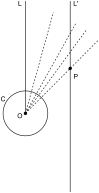
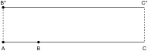

# Arabic and Islamic Philosophy of Mathematics
**First published Sat Apr 9, 2022**

*Zarepour, Mohammad Saleh*

Philosophy of pure mathematics deals with two major groups of questions. One pertains to the ontology of mathematical entities and the other to the epistemology of mathematical concepts and judgments (Avigad 2007)[^avigad-2007]. The nature and existence of mathematical objects (e.g., numbers and geometrical shapes), the existence and qualifications of infinities (e.g., infinite magnitudes and infinite collections of numbers or numbered things), and the existence and qualifications of continua are some of the most significant ontological issues with which philosophers of mathematics are concerned. On the other hand, some of the most important and challenging epistemological issues about mathematics are the following: the mechanisms through which we grasp mathematical knowledge, the epistemic status of mathematical axioms and principles, the nature of mathematical proofs (that are writable on paper) and their connection to what goes on in the mind of mathematicians, and the role of mathematical knowledge in attaining a better understanding of the physical world.

It is very well known that the medieval Islamic civilization played a pivotal role in the historical development of technical aspects of mathematics. Standing on the shoulders of their pre-Islamic Greek, Indian, and Persian ancestors, Muslim mathematicians have made numerous innovations in various branches of mathematics and have written a great number of books and essays introducing mathematical notions and proving mathematical theorems (Al-Daffaʾ 1977; R. Rashed 1984b [1994]; 1996 [2012]; 2015; Berggren 2016)[^al-daffaʾ-1977][^berggren-2016][^rashed-1984b]. However, it is very difficult (if not impossible) to find a book from the medieval Islamic era that is exclusively devoted to a comprehensive and systematic study of philosophy of mathematics. Nevertheless, many of the aforementioned philosophical issues about mathematics have been addressed, by great Muslim medieval thinkers, in various works whose central subject was mathematics, physics, metaphysics, or even theology (*kalām*). Putting these scattered engagements together, it becomes clear that although philosophy of mathematics has never been treated as an independent discipline in the medieval Islamic world, Muslim thinkers came up with very interesting and profound ideas, insights, and arguments about at least some philosophical issues related to mathematics. This entry briefly reviews the most remarkable examples of such insights and arguments, some of which have been the subject of long-standing debates and discussions among Muslim thinkers. Accordingly, the technical mathematical works of Arab and Muslim scholars will be discussed only to the extent that they contain materials related to the *philosophy* of mathematics.

## 1. Ontology of Mathematics

### 1.1 What Mathematical Objects Are Not

Traces of the philosophical views of Pythagoras and Plato regarding the nature of mathematical objects can be found in the works of early Muslim thinkers. This could be partially due to the early Arabic translations of works by Pythagorean and Platonist mathematicians. Most of the mathematicians in the tradition of Nicomachus, Proclus, and Iamblichus were Pythagorean and Platonist (Endress 2003)[^endress-2003]. Some of their most important works have been translated into Arabic and have influenced Muslim mathematicians and philosophers. For example, Nicomachus’s *Introduction to Arithmetic* was translated into Arabic by Ḥabīb Ibn Bahrīz (d. early ninth century) from Syriac and by Thābit Ibn Qurra (d. 901) from Greek (Brentjes 2022: sec. 1)[^brentjes-2022]. The inspiration of the Pythagorean and Platonist approaches to the philosophy of mathematics is easily detectable in, for example, the works of the Brethren of Purity (*Ikhwān al-ṣafāʾ*) and early Mutazilites (The Brethren of Purity [Epistles]; Endress 2003: 132–33; Marquet 2006; Fazlıoğlu 2014: 2; El-Bizri 2018; Baffioni 2022)[^baffioni-2022][^el-bizri-2018][^endress-2003][^fazlıoğlu-2014][^marquet-2006]. The main characteristics of Pythagoreanism and Platonism regarding the ontology of mathematics can be captured by the following theses (Zarepour 2019: 198)[^zarepour-2019]:

- **Separateness of Mathematical Objects (SM):** Mathematical objects are independent immaterial substances, fully separate (*mufāriq*) from matter and material objects.
- **Principalness of Mathematical Objects (PM):** Mathematical objects are the principles (*mabādiʾ*) of natural things. Mathematical objects have some sort of primacy over natural forms which makes the latter dependent on (or grounded in or caused by) the former.

Plato was committed to both of these theses. By contrast, the Pythagoreans endorsed only the latter thesis. This is so at least if we trust Aristotle’s report (*Metaphysics* 987b23–987b25). Although Pythagoreanism considers numbers to be the causes and principles of all other existing things, it does not treat numbers as entities that are necessarily separate from matter (Zhmud 1989; De Smet 2022). From our perspective today, this is to some extent surprising because, compared to (PM), (SM) seems to enjoy more *prima facie* plausibility. But precisely because of the presence of strong tendencies towards Pythagoreanism in early Islamic thought (Brentjes 2022)[^brentjes-2022], (PM) was more explicitly defended than (SM). In any case, Avicenna’s brutal criticism of these two theses (along with his more general criticism of the Platonic theory of separate universal forms) made Pythagoreanism and Platonism extremely unpopular in post-Avicennian philosophy. In the *Metaphysics of “The Healing”*, Avicenna (d. 937) argues against (SM) and (PM) not only by rejecting arguments attributed to the defenders of these two theses (Avicenna [Mph]: chap. VII.2) but also by developing his own positive arguments against them (Avicenna [MPh]: chap. VII.3).

According to an argument that Avicenna attributes to the defenders of (SM), on the one hand, mathematical objects are separate in definition (or in mind). They can be defined (or conceived) with no reference to matter or material beings. On the other hand, everything that is separate in definition (or in mind) is separate in existence. Therefore, the argument concludes, mathematical objects are separate in existence. They exist as fully separate beings which have no association with matter or material beings (Avicenna [MPh]: chap. VII.2, sec. 5). However, Avicenna finds this argument wanting. He argues that there is a difference between (a) defining (or conceiving) something without the condition of materiality and (b) defining (or conceiving) something with the condition of immateriality. He says that mathematical objects are separate in definition only in the sense of (a). But the second premise of the argument under discussion is true only if the separation in definition is considered in the sense of (b). The mere fact that something can be defined without the condition of materiality does not entail that that thing can exist in the extramental realm fully separate from matter. But mathematical objects cannot be defined with the condition of immateriality. It is not plausible to suppose immateriality as an essential component of the definitions of mathematical objects, or so Avicenna claims. Thus, this argument is fallacious and cannot establish (SM) (Avicenna [MPh], chap. VII.2, secs. 16–17; Marmura 2006: 360–63; Porro 2011: 292–93; Zarepour 2019: sec. 4.1)[^marmura-2006][^porro-2011][^zarepour-2019].

A simple argument that Avicenna attributes to the advocates of (PM) goes as follows: Mathematical objects are separate. In other words, (SM) is true. Moreover, the principles (or causes) of material things cannot be themselves material. They must be separate. Therefore, mathematical objects are the principles of material (or, natural) things (Avicenna [MPh]: chap. VII.2, sec. 7). Avicenna thinks that this argument is not only unsound due to the falsity of (SM) but also invalid. Even if we accept both that mathematical objects are separate and that the principles of natural things must be separate, we cannot validly conclude that mathematical objects are the principles of natural things. There might exist other separate non-mathematical things which form the principles of natural beings. The argument in question is valid only if we presuppose that mathematical objects are the only separate existents. But this is something for which we have no proof. Therefore, this argument fails to establish (PM) (Avicenna [MPh]: chap. VII.2, sec. 21; Marmura 2006: 365–66; Porro 2011: 294; Zarepour 2019: sec. 4.2)[^marmura-2006][^porro-2011][^zarepour-2019].

Avicenna’s own argument against the separateness or immateriality of mathematical objects can be summarized as follows: There are some mathematical objects in the sensible world. Otherwise, we could not grasp their concepts (e.g., the concepts triangle, circle, two, etc.) (Avicenna [MPh]: sec. VII.3, sec. 1). Now, if there are also some fully separate mathematical objects (entirely detached from the sensible world), then these two groups of (sensible/non-separate and non-sensible/separate) mathematical objects must share similar essences and definitions (Avicenna [MPh]: chap. VII.3, sec. 2). Otherwise, there is no way we can know separate material objects. This is because it does not seem that we have any direct access to a realm of fully immaterial mathematical objects (This reminds us of Benacerraf’s (1973)[^benacerraf-1973] epistemological challenge to mathematical Platonism). Even if such things exist, we know them only through the mediation of knowing their sensible counterparts. We have no justification for the existence of separate mathematical objects which have no sensible counterpart in the material world. But this leaves unjustified the claim that mathematical objects can essentially be immaterial and separate. Avicenna takes this argument as establishing that (SM) is implausible (Avicenna [MPh], chap. VII.3, sec. 3; Zarepour 2019: sec. 5)[^zarepour-2019]. We will later see that this argument reveals interesting aspects of Avicenna’s accounts of the epistemology and ontology of mathematics.

Finally, Avicenna argues that even if separate mathematical objects exist, they cannot be the principles (or causes) of natural things. It seems intuitively plausible that if a separate mathematical object is the principle of any material existent, it must in the first place be the principle of its own sensible counterpart. Note that, according to Avicenna, the claim that a separate mathematical object, say a triangle, exists cannot be justified unless we have come to know it through knowing a sensible counterpart of it that exists in the material world. Now if that separate triangle is the cause of any material thing, it must in the first place be the principle of its own sensible counterpart, or so Avicenna believes. But if the sensible triangle is caused by the separate triangle, then we can legitimately ask why the former needs the latter. It is either the essence or (some of) the accidents of the sensible triangle that make it dependent on its separate counterpart. However, if it is due to the essence of the sensible triangle, then the separate triangle itself needs a principle. This is because the separate and the sensible triangles share the same essence. Thus, if it is the essence of the sensible triangle which makes it need the separate triangle, then the separate triangle (having the same essence as its sensible counterpart) must itself be caused by another separate triangle. Repeating the same line of argument, we can conclude that there must exist an infinite chain of causally connected triangles. Since such infinite regresses are unacceptable, what makes a sensible mathematical object need its separate counterpart is not their shared essence. But it is also impossible that (some of) the accidents of a sensible mathematical object make it dependent on its separate counterpart. The accidents of the sensible object do not exist unless that object itself exists. But it is also assumed that the sensible object itself does not exist unless the separate object exists. This means that the separate object has some sort of explanatory priority over the accidents of the sensible object. Therefore, the accidents of a sensible mathematical object cannot explain, in a non-circular way, why this object needs its separate counterpart (Avicenna [MPh]: chap. VII.3, sec 4). Thus, it seems that there is no convincing justification for why a separate mathematical object must be the cause of its sensible counterpart, let alone the cause (or principle) of any other natural thing. Avicenna takes this argument as refuting (PM).

These arguments show that mathematical objects are neither separate entities fully detached from the sensible world nor the causes of natural things. Avicenna’s refutation of Platonism and Pythagoreanism regarding mathematical objects was so convincing and influential that these approaches almost completely disappeared in post-Avicennian philosophy. This was so despite the strong presence of Pythagorean and/or Platonic elements in other (i.e., non-mathematical) aspects of the philosophy of some post-Avicennian thinkers, like Suhrawardī (d. 1191) (Walbridge 2000; De Smet 2022)[^walbridge-2000]. The details of some Avicennian criticisms of (SM) and (PM)—which were usually taken as auxiliary parts of Avicenna’s general criticism of the Platonic account of universal forms—were of course criticized by later philosophers (Arnzen 2011; Benevich 2019)[^arnzen-2011][^benevich-2019]. These criticisms did not revive mathematical Platonism and/or Pythagoreanism in post-Avicennian Islamic philosophy. Having said that, the discussions of the weakness and strength of the arguments for and against mathematical Platonism continued to be of interest to post-Avicennian philosophers. Perhaps the most important work in which such arguments are collected is a book, entitled *The Platonic Intelligible Forms*, written between 1329 and 1339, by an unknown author (see the Arabic text of the book in Badawī 1947: 1–145, and its German translation in Arnzen 2011: Appendix 1)[^badawī-1947][^arnzen-2011].

### 1.2 What Mathematical Objects Are

Now that we know what mathematical objects are not for Muslim philosophers, we must thus ask what they are. In his *Metaphysics* (VI.1, 1026a13–19) Aristotle classifies different theoretical sciences based on the ontological status of the objects they study (Cleary 1994)[^cleary-1994]. Aristotle’s main criteria for distinguishing different sciences from each other are the extent and qualification of the association of the subject-matter of the sciences with movement and materiality. Employing a similar approach, in his *The Aims of Aristotle’s Metaphysics* (*Maqāla fī aghrāḍ kitāb mā baʿd al-ṭabīʿa*), al-Fārābī (d. 950) argues that the subject matters of mathematics—i.e., mathematical objects—are abstracted (*mujarrad*) from matter in estimation (*wahm*) but not in the extramental world. On the one hand, mathematical objects are different from the objects that metaphysics studies because the latter objects are fully detached from matter both in estimation and in the extramental world. On the other hand, mathematical objects are different from the sensible physical objects because they cannot be separated from matter, either in estimation or in the extramental world. Thus, mathematics occupies an intermediate position between metaphysics and physics. The association of mathematical objects with matter is stronger than that of the objects of metaphysics but weaker than that of the objects of physics. (The original Arabic of al-Fārābī’s book can be found in al-Fārābi 1890: 34–38, and Kiankhah 2015: 147–57. For two English translations, see Bertolacci 2006: 66–72, and McGinnis & Reisman 2007: 78–81.)[^fārābi-1890][^mcginnis-2007][^bertolacci-2006][^kiankhah-2015]

In his *Enumeration of the Sciences* (*ʾIḥṣāʾ al-ʿulūm*), al-Fārābī puts forward a more detailed discussion of the ontology of mathematics. He distinguishes applied/practical (*ʿamalī*) mathematics from pure/theoretical (*naẓarī*) mathematics. The objects of applied arithmetic are numbers as they are associated with sensible things. Applied arithmetic considers the number of sensible things existing in the material world. By contrast, pure arithmetic considers an absolute conception of number and plurality. It studies numbers that are abstracted from all the numbered things in the sensible world. Similarly, applied geometry considers the geometrical properties of specific physical objects, whereas pure geometry deals with geometrical shapes regardless of whether or not they are attached to specific physical objects (al-Fārābi [Enum]: chap. 3; Endress 2003: 139–40)[^endress-2003].

Following the main line of al-Fārābī’s approach, Avicenna develops a more detailed discussion of the division of the sciences (Marmura 1980; Gutas 2003)[^gutas-2003][^marmura-1980] according to which mathematical objects exist in the extramental world in association with determinate species of matter (e.g., wood, gold, etc.). Through the function of the faculty of estimation, mathematical objects can be abstracted in the mind from the specific species of matter they are attached to in the extramental world. Nevertheless, they must still be conceived as material things. In other words, mathematical objects in the mind are separate from determinate species of matter, though not from materiality itself (Avicenna [MPh]: chap. I.2; Di Vincenzo 2021: 20–27). Avicenna argues that numbers (*aʿdād*) and magnitudes (*maqādīr*)—as the most general representatives of the objects of arithmetic and geometry, respectively—are accidents (*aʿrāḍ*) and properties of physical objects existing in the sensible world (Avicenna [MPh]: chap. III.3–4). Neither numbers nor magnitudes have independent immaterial subsistence in the extramental world. Magnitudes (or geometrical shapes, to be more specific) cannot be detached from materiality even in the mind (Avicenna [MPh]: chap. III.4 sec.2 and VII.2, sec. 21). By contrast, numbers can be considered fully separate from matter and materiality. Nevertheless, such a consideration of numbers is metaphysical, rather than mathematical (Endress 2003: 142; Zarepour 2016: sec. 4)[^endress-2003][^zarepour-2016]. Numbers, inasmuch as they are subject to mathematical studies, must be receptive to decrease and increase. Therefore, even in the mind, they must be conceived as properties of material things (Avicenna [MPh]: chap. I.3, secs. 17–19). In sum, mathematical objects exist in the extramental world as the properties of physical things constituted of determinate species of matter. Mathematical objects can be abstracted from these determinate species of matter in the mind. But they must still be thought of as properties of material things. Otherwise, they cannot be the subject of mathematical studies. Avicenna’s discussion of the roles of the faculty of estimation and the process of abstraction in mathematical studies has been interpreted in two different ways. Some scholars (McGinnis 2006; 2017; Ardeshir 2008; Fazlıoğlu 2014; Tahiri 2016; 2018)[^ardeshir-2008][^fazlıoğlu-2014][^tahiri-2016] think that mathematical objects are in the first place mental objects, and abstraction is a mechanism for constructing mathematical objects. Attributing a literalist view to Avicenna, some others (Marmura 1980; 2005; Zarepour 2016; 2021; McGinnis 2019)[^marmura-1980][^zarepour-2016] argue that mathematical objects literally exist in the physical world and abstraction is a cognitive process for grasping mathematical concepts, rather than producing mathematical objects. These different interpretations remind us of the contrast between the literalist (Mueller 1970; 1990)[^mueller-1970] and the abstractionist (Lear 1982; Hussey 1991)[^hussey-1991][^lear-1982] readings of Aristotle’s ontology of mathematics. The most obvious objection to the literalist view is that, unlike physical objects, which are inexact and imperfect, mathematical objects seem to be perfect and exact (or idealized). For instance, it seems that there exists no perfectly circular physical object whose circumference is not (at least to a modest extent) serrated. To rebut this objection against the literalist reading of Avicenna’s ontology of mathematics, it has been argued that he endorses the existence of perfect mathematical objects in the physical world (Zarepour 2016: sec. 5; 2021: sec. 4)[^zarepour-2016].

This is probably due to the emphasis of Avicenna and al-Fārābī on the role of estimation (*wahm*) in conceiving mathematical objects that, in post-Avicennian philosophy, mathematics is often referred to as an estimative (*wahmī* or *mawhūm*) science (Pines 1974)[^pines-1974]. Before or contemporary with Avicenna, many Muslim thinkers had emphasized that mathematical objects exist, in one way or another, in the physical world. For instance, in *The Book of Instruction* (*Kitāb al-tafhīm* ([Instr]), al-Bīrūnī (d. ~1048) defends an account of the nature of mathematical objects which seems to have strong affinities with the literalist reading of Avicenna (Samian 2011; 2014)[^samian-2011]. In the same vein, Ibn al-Haytham (d. 1040), in the first pages of his *Resolution of Doubts* (*Ḥall shukūk*, [Doubts]), argues that geometrical objects exist in the sensible world. They can be abstracted from matter through the activity of the faculty of imagination (*takhayyul*), whose function in Ibn al-Haytham’s theory of mind is very similar to the function of estimation in Avicenna’s psychology. However, by contrast with Avicenna and Aristotle (*De anima* 428a5–18), Ibn al-Haytham thinks that imagined forms, that are abstracted from physical objects, have a more real existence. For him, the real (*ḥaqīqī*) existence of mathematical objects is instantiated in imagination and distinction (*tamyīz*)—another cognitive faculty in Ibn al-Haytham’s philosophy of mind, which plays a crucial role in grasping universal concepts through the mediation of imagined forms. (See Ighbariah & Wagner 2018: secs. 79–81. R. Rashed [1993: 2:8–19] believes that there were two different Muslim thinkers named ‘Ibn al-Haytham’. Sabra [1998; 2003] rejects Rashed’s view and here I follow Sabra’s position.)[^ighbariah-2018]

In post-Avicennian philosophy, the claim that mathematical objects are mental (or estimative or imaginative) became the most popular view and was increasingly emphasized by different thinkers. The inclination towards this approach was partially due to powerful criticisms of Avicenna’s account of the ontology of mathematics. For instance, Suhrawardī offered strong objections to the existence of numbers in the physical world as accidents of sensible things. Consider a group of four individuals. Avicenna thinks that four-ness (*ʾarbaʿīya*) is an accident of these four persons. But Suhrawardī finds it untenable. He argues that

> either ‘four-ness’ must be complete in each one of the individuals, which is not the case, or else there must be something of four-ness in each one, which can only be the unity. Therefore, either the totality of four-ness must have no locus other than the intellect, or else neither four-ness nor anything of four-ness can be in each one. On this latter supposition, too, four-ness is only in the intellect. (Suhrawardī *The Philosophy of Illumination* [1999: 48])

He believes that it is only our mind which can impose a unity to a plurality of four distinct sensible entities. There is nothing in the extramental world which can naturally bind four detached things in such a way that they collectively accept the accident of four-ness. Thus, for Suhrawardī numbers (and mathematical objects in general) are only mind-dependent (*iʿtibārī*) things (Ziai 1990: 108; Walbridge 2000: 63 and 78–79)[^walbridge-2000][^ziai-1990]. A similar line of argument is developed by Mullā Ṣadrā (d. 1640). He accepts that there are pluralities in the extramental world. But he insists that it is only through the activity of our mind that a group of distinct objects can be considered a unity. There is nothing in the extramental world which bestows unity to an arbitrary group of distinct objects (Mullā Ṣadrā, *Al-Shawāhid al-rubūbīya*, [1982: 65]). This line of argument against the consideration of numbers as properties of physical objects reminds us of Frege’s criticism of this idea (Frege 1884: §§ 21–25)[^frege-1884].

A turning point in the rendition of mathematical objects as mental objects is to appeal to the notion of *nafs al-ʾamr* to describe the ontological status of mathematical objects and to clarify the nature of the truth-makers of mathematical propositions. The phrase ‘*nafs al-ʾamr*’ literally means *the thing itself*. But its technical content is hard to capture in translation. Although this phrase also appears in Avicenna’s writings, it is probably Naṣīr al-Dīn al-Ṭūsī (d. 1274) who used the phrase for the first time in a technical and theory-laden sense. Different philosophers have understood this phrase as referring to different things including divine knowledge, the Active Intellect, the realm of ideas, etc. (Kaş 2021; Spiker 2021)[^kaş-2021][^spiker-2021]. The significance of the theory of *nafs al-ʾamr* for the philosophy of mathematics is that it may enable us to preserve judgment-realism even without object-realism. Some philosophers (e.g., Sayyid al-Sharīf al-Jurjānī, d. 1413) have used this theory to show that although mathematical objects are merely estimative (*wahmī*) and have no mind-independent existence, mathematical judgments are certain (*yaqīnī*), and their truth-values are mind-independent. In other words, regarding mathematics, judgment-realism can still be defended even when object-realism is rejected (Fazlıoğlu 2014; Hasan 2017)[^fazlıoğlu-2014][^hasan-2017].

Another important issue pertinent to the ontology of mathematics is the nature of algebraic objects. An algebraic unknown (or, an algebraic variable, as we call it today) can indifferently refer to either a number or a geometrical magnitude. So, the nature of an algebraic object is not the same as either numbers or geometrical shapes. Unfortunately, the hybrid ontology of this special type of mathematical objects has rarely (if at all) been discussed as an ontology different from those of numbers and magnitudes. But it has been argued that the familiarity of philosophers such as al-Fārābī and Avicenna with the algebraic theory put forward by al-Khwārizmī (d. 850) in his *Kitāb al-jabr wa al-muqābala* inspired them to develop a general ontology of things (*ashyāʾ*) that is neither Platonic nor Aristotelian (R. Rashed 1984a; 2008; 2015: 716–18; 2018)[^rashed-1984a].

### 1.3 Infinity

The problem of infinity is one of the philosophical topics relating to mathematics that was most extensively discussed in medieval Islamic philosophy. There are many treatises which argue that no number can be infinite. For instance, in response to a series of questions raised by Abū Mūsā ʿĪsā Ibn Usayyid, Thābit Ibn Qurra discusses the nature of numbers and argues that there is no infinite number. Moreover, he shows that the infinite sets of numbers can be of different sizes (Pines 1968; Sabra 1997; Mancosu 2009: sec. 2; M. Rashed 2009; Zarepour 2020b: sec. 4.2)[^mancosu-2009][^pines-1968][^rashed-2009][^sabra-1997][^zarepour-2020b]. Yaḥyā Ibn ʿAdī (d. 974), in his *Treatise on the Infinite* (*Maqala fī ghayr al-mutanāhī*), provides a different set of arguments to establish that infinity is not predicable upon numbers (McGinnis 2010: sec. 3). But the following three arguments for finitism are probably the most discussed in the Islamic tradition:

(1) *The Collimation Argument* (*burhān al-musāmita*): Consider the line $L$ which begins from the center $O$ of a circle $C$, intersects the circumference of $C$, and extends infinitely. Suppose, moreover, that there is a distinct line $L'$ that is parallel to $L$ and infinitely extended in both directions. Now suppose that $L$ starts to rotate around $O$ and gets closer to $L'$, while $L'$ is motionless and fixed. As a result, $L$ and $L'$ intersect. So, there is a time at which the two lines are parallel and there is a time at which they are intersected. Therefore, there must be a moment of time $T$ and a point $P$ on $L'$ at which the two lines intersect each other for the first time, or so the argument goes. But obviously there are no such $T$ and $P$. For every $T$ in which $L$ and $L'$ are intersected, we can find an earlier moment of time $T'$ (i.e., $T' < T$) in which the two lines were already intersected. So, it seems that we have a contradiction. On the one hand, there must be a first moment of intersection (or such is the expectation of the defenders of the argument). On the other hand, there cannot be such a moment. Therefore, the initial assumption of the argument—that is the existence of infinite lines—must be rejected. There is no infinite one-dimensional magnitude and, consequently, no infinite magnitudes in general.

Figure 1

A variation of the above scenario—that likely originated from Aristotle’s *De Caelo* (I.5, 272a8–20)—was proposed by Abū Sahl al-Qūhī (d. 1000) to reject the Aristotelian dogma that an infinite distance cannot be traversed in a finite time. This is because the above argument shows that $L$ can traverse $L'$ in a finite period of time equal to half the time of the rotation of $L$ around *O* for one round (R. Rashed 1999; McGinnis 2010: sec. 3)[^rashed-1999]. By contrast, Avicenna employs the Collimation Argument in certain places (Avicenna *Al-Najāt* [1985: 233–44]; [Ph1]: chap. II.8, [8]) to reject the possibility of circular motion in an infinite void and in other places (Avicenna *ʿUyūn al-ḥikma*, chap. 3, 20) to reject the actual infinitude of magnitudes (Zarepour 2020b: sec. 3.1; R. Rashed 2016: 302–6; 2018: sec. 11.2)[^rashed-2016][^zarepour-2020b]. The Collimation Argument is criticized by, among others, Abū al-Barakāt al-Baghdādī (d. 1165) in his *Al-Muʿtabar* (vol. 2, 83–84 and 86), al-Ṭūsī in his *Talkhīṣ al-Muḥassal* ([1985: 217]), and al-Ḥillī (d. 1325) in his *Nihāya al-marām fī ʿilm al-kalām* (vol. 1, 256–258). The argument is also defended by, among others, Fakhr al-Dīn al-Rāzī (d. 1209) in his *Al-Mabāḥith al-mashriqīya* (vol. 1, 196) and Mullā Ṣadrā in his *Asfār* (vol. 4, 21–23).

(2) *The Ladder Argument* (*burhān al-sullam*): If infinite lines can exist, then there can be an acute angle whose sides are infinite. Suppose that $AB$ and $AC$ are two infinite lines which intersect at $A$ and make such an acute angle. $AB$ and $AC$ extend infinitely in the directions of $B$ and $C$, respectively. Now consider parallel lines $B_{i} C_{i}$ (for integers $i ≥1$) which intersects $AB$ and $AC$ so that the distance between every two consecutive lines is equal to the distance of $B_{1} C_{1}$ from $A$. Thus, each line is longer than the previous line by a fixed length, say $d$ (i.e., for every integer $i≥1,$ $B_{i+1} C_{i+1} - B_{i}C_{i} = d$). Now consider $BC$. It is farther than any $B_{i}C_{i}$ from $A$. Thus, $BC$ is longer than any $B_{i}C_{i}.$ This indicates that $BC$ must be actually infinite. However, $BC$ is confined between two lines (i.e., $AB$ and $AC$). It terminates at $B$ and $C$. Therefore, it must be finite as well. Accordingly, $BC$ must be both finite and infinite. This is impossible. So, the initial assumption we build the argument upon is false. No infinite line (and, *a fortiori*, no infinite magnitude) can exist (R. Rashed 2016; 2018: sec. 11.2; Zarepour 2020b: sec. 3.2)[^rashed-2016][^zarepour-2020b].

Figure 2

The Ladder Argument is a rehabilitation of an Aristotelian argument presented in *De Caelo* (I.5, 271b26–272a7). Avicenna discusses this argument in the *Physics of “The Healing”* (Avicenna [Ph2]: chap. III.8, [7]). The argument has been the subject of a long-standing debate in post-Avicennian philosophy (McGinnis 2018). The argument was criticized by, among others, Abū al-Barakāt in his *Al-Muʿtabar* (vol. 2, 84–86) and Najm al-Dīn al-Kātibī al-Qazwīnī (d. 1277) in his *Ḥikma al-ʿayn* ([2002: 38–39]). On the other hand, defenses of the Ladder Argument can be found in, among others, al-Ṭūsī’s commentary on Avicenna’s *Pointers and Reminders* (in Avicenna [Pointers]: namaṭ I, 183–191) and Mullā Ṣadrā’s commentary on al-Abharī’s *Hidāya* (*Sharḥ Al-Hidāya al-Athīrīya*, 65–69).

(3) *The Mapping Argument* (*burhān al-taṭābuq or al-taṭbīq*): Consider an actually infinite line $AC$ which starts from $A$ and extends infinitely in the direction of $C$. Remove a finite segment $AB$ from the beginning of $AC$. Suppose that $B^{*}C^{*}$ is a copy of (and, accordingly, of the same length as) $BC$. Compare the size of $B^{*}C^{*}$ with $AC$ by mapping the former upon the latter so that the two lines are parallel and $B^{*}$ is right in front of $A$. $B^{*}C^{*}$ must extend infinitely in the direction of $C^{*}$. Otherwise, $B^{*}C^{*}$ would be finite. This means that $BC$ would be finite too. As a result, $AC$—which is the sum of $BC$ with the finite segment $AB$—would be finite. Since this contradicts the initial assumption that $AC$ is actually infinite, $B^{*}C^{*}$ must extend infinitely in the direction of $C^{*}$. But if so, then $B^{*}C^{*}$ and $AC$ correspond to each other, in the sense that no part of one of them remains uncovered by the other. So, based on the fourth common notion of the first book of Euclid’s *Elements*—according to which things which correspond to one another are equal to one another ([1908: vol. 1, 155])—we can conclude that $AC$ is equal to $B^{*}C^{*}$. This indicates that $AC$ would also be equal to $BC$, which is a proper part of $AB$. However, the fifth Euclidean common notion states that such a whole-part equality is absurd ([1908: vol. 1, 155]). Therefore, $AC$ cannot be equal to $BC$. Consequently, the initial assumption that $AC$ can be an actually infinite line must be rejected. There can be no such actually infinite magnitude.

Figure 3

Earlier versions of the Mapping Argument can be found in different places of al-Kindī’s oeuvre (Rescher & Khatchadourian 1965; Shamsi 1975; Adamson 2007: chap. 4; Zarepour 2020b: n. 52)[^adamson-2007][^rescher-1965][^shamsi-1975][^zarepour-2020b]. More precise versions of this argument are presented by Avicenna (Marmura 1960; McGinnis 2010: sec. 4; Zarepour 2020b)[^marmura-1960][^zarepour-2020b]. The strength and accuracy of the versions of the argument these thinkers provide depend, partially at least, on the precision of their construal of the notion of equality of geometric magnitudes. It has been shown that some of Muslim thinkers have pretty detailed accounts of this notion (R. Rashed 2019)[^rashed-2019].

Like the other two arguments, the primary goal of the Mapping Argument is to show that no infinite continuous magnitude actually exists. Having read Euclid’s *Elements* (bks 7–9), Muslim thinkers knew that numbers could be easily represented by magnitudes. Therefore, any argument for the impossibility of infinite magnitudes can be taken as an argument against the infinity of numbers. But how about infinite collections? None of the three arguments is directly applicable to infinite collections of discrete entities. Nevertheless, it has been argued that Avicenna was likely aware that the Mapping Argument could be modified so that it is applicable to infinite collections of discrete numbered things (Zarepour 2020b: sec. 4)[^zarepour-2020b]. The sizes of two collections of discrete entities can be compared by employing the very notion of ‘mapping’ that we previously used in the case of continuous magnitudes. However, in the case of the collections of discrete entities, this notion must be cashed out in terms of one-to-one correspondence between the elements of the two collections in question. Two collections of discrete entities correspond to each other if every member of one collection can be paired with one (and only one) member of the other so that no member of any of these collections remains unpaired. Avicenna seems to have been aware that an infinite collection of discrete entities can be put in one-to-one correspondence with some of its proper subcollections. And he finds this as absurd as the correspondence of an infinite magnitude with its proper submagnitude. He explicitly mentions that the Mapping Argument can rule out the possibilities of both infinite magnitudes and infinite collections of discrete entities (e.g., numbers and numbered things). However, he does not himself make it explicit how this argument actually works in the case of discrete things. He does not provide any concrete example of the application of the Mapping Argument to the case of the infinite collections of objects. Such an example can be found in the works of post-Avicennian philosophers like Fakhr al-Dīn al-Rāzī (*Sharḥ ʿUyun al-ḥikma, al-Ṭabīʿīyāt* [1994: 53]). Al-Ghazālī (d. 1111) has mentioned the Mapping Argument in his *Maqāṣid* ([2000: 97–98]) and the earliest transmission of this argument to the Latin tradition is probably through the Latin translation of *Maqāṣid* in the third quarter of the twelfth century.

These arguments are usually discussed in the context of physics. This is because they are devised in the first place to show that no infinite can actually exist in the physical world. But if, endorsing literalism, we consider mathematical objects as properties of physical objects, then the impossibility of the existence of actual infinites in the physical world implies the impossibility of infinitely extended geometric lines and infinite sets of numbers. But those who reject literalism about the ontology of mathematics have different views regarding the applicability of such arguments to mathematical objects. For instance, Fakhr al-Dīn al-Rāzī believes that the Mapping Argument cannot reject the infinitude of the collection of natural numbers because he renders mathematical objects as mind-dependent and fully immaterial entities (*Sharḥ ʿUyun al-ḥikma, al-Ṭabīʿīyāt* [1994: 53–57]). Although we can appeal to the Mapping Argument to reject the existence of an infinite collection of distinct physical objects in the extramental world, this argument cannot reject the existence of an infinite number of mind-dependent objects like numbers, or so al-Rāzī seems to believe (Zarepour 2020b: 4.1)[^zarepour-2020b].

Interestingly, some Muslim philosophers have argued that even the mind has its own limitations in terms of perceiving infinite things. For instance, Ibn al-Haytham believes that although we can imagine finite lines of any arbitrary length (i.e., regardless of how long they are), we cannot imagine an actually infinite line. Accordingly, although we can imagine a finite line longer than the size of the universe, we cannot conceive an actually infinite line. Ibn al-Haytham contends that actual infinities do not exist either in the extramental world or even in the mind (Masoumi Hamedani 2013; Ighbariah & Wagner 2018: 80)[^ighbariah-2018][^masoumi-2013].

### 1.4 Continuity

The views of Muslim thinkers regarding mathematical continuum are intertwined with the position they uphold in the debate between atomism and hylomorphism about the nature of the physical world. For Avicenna there is no gap between the physical world and the realm of mathematical objects. This is so at least if we accept interpretations of Avicenna as a literalist regarding the ontology of mathematics. He believes that geometrical magnitudes are continuous in the sense that they have no actual part. Correspondingly, physical dimensions are continuous and have no actual parts. We can of course divide any continuous magnitude into smaller parts. In the physical world, there is a practical lower limit for the length of the physical dimensions which can in practice be broken down into smaller magnitudes. By contrast, in our faculty of estimation, this limit disappears, and all magnitudes are potentially infinitely divisible. Despite this practical difference, theoretically speaking, there is no difference between the structure of geometrical lines and physical dimensions. As a result, geometrical continuity implies that physical atomism is false. Indeed, Avicenna appeals to mathematical continuity to reject physical atomism (Avicenna [Ph2]: chap. III.3–5; Lettinck 1999; Dhanani 2015; McGinnis 2019: sec. 3)[^dhanani-2015][^lettinck-1999].

In contrast with Avicenna, there are philosophers who endorse mathematical continuity and physical atomism simultaneously. For instance, Shahrastānī (d. 1153) insists that the judgment of the faculty of estimation is not reliable enough to convince us that the physical magnitudes can bear potentially infinite divisions. He believes that physical magnitudes are not infinitely divisible. The number of their parts, either actual or even potential, is finite. Shahrastānī reminds us that although the size of the universe is imaginable to be infinite, philosophers usually reject that the universe is infinite. Relying on a similar approach, Shahrastānī contends that although every magnitude is imaginable as infinitely divisible, there are strong arguments which show that the faculty of estimation is mistaken in this case and no physical magnitudes are infinitely divisible. Infinite extendibility of the size of the universe in the estimation is compatible with the universe being finite. Similarly, infinite divisibility of magnitudes in the estimation could be compatible with their having only a finite number of (potential) parts in the extramental world, or so Shahrastānī seems to believe (al-Shahrastānī *Summa philosophiae*, 513; McGinnis 2019). This means that if we take mathematical objects as merely estimative constructions, then we can reconcile purely mathematical continuity with physical atomism.

Proposing a subtle modification, Fakhr al-Dīn al-Rāzī (*Al-Manṭiq*, vol. 6, chapter 6, 63) argues against Democritus that everything that is divisible in imagination is divisible in the extramental world. He believes that there is a lower limit to the length of divisible magnitudes that we can imagine. It is not true that every magnitude, no matter how small, is divisible in the estimation. He does not reject that in Euclidean geometry magnitudes are infinitely divisible. But he seems not to accept that it is possible to make a visual image (through the faculty of estimation) of every magnitude we can talk about in the context of Euclidean geometry. Embracing physical atomism (in his later works), al-Rāzī denies that continuous Euclidean geometry can represent the real structure of the extramental world (Setia 2006; Eftekhari 2018; 2019)[^eftekhari-2018][^setia-2006]. The claim that continuity has no reality other than in the faculty of estimation is often restated in the works of the later atomists like ʿAḍūd al-Dīn al-ʾĪjī (d. 1355) (Hasan 2017: 233–35)[^hasan-2017].

## 2. Epistemology of Mathematics

### 2.1 Grasping Mathematical Concepts

Most Muslim thinkers who have talked about the epistemology of mathematical concepts believe that these concepts are formed through some cognitive mechanisms whose first input is the data we receive through our external senses. The details of such mechanisms are spelled out in different ways by different philosophers, depending on their general picture of human cognitive psychology. For instance, Avicenna puts forward a thought experiment showing that no mathematical concepts can be grasped in the absence of sense perception (Avicenna [MPh], chap. VII.3, sec. 1; Zarepour 2019: sec. 5; 2021, sec. 3)[^zarepour-2019]. This indicates that Avicenna endorses some sort of concept empiricism about mathematics. On the literalist interpretation of Avicenna’s ontology of mathematics, mathematical objects exist in the sensible world as non-sensible connotational attributes (*maʿānī*) of physical objects. Like all other connotational attributes, mathematical entities are perceived by the faculty of estimation. For instance, it is the faculty of estimation which perceives two-ness when we see two books. In such an experience, the sensible data collected by the external senses would be transferred to the faculty of estimation through the mediation of the faculty of common sense (*ḥiss mushtarak*). Estimation enables us to overlook all other characteristics of the experience we have had and to perceive two-ness that is not directly accessible to our external senses.

Even on the literalist account of the ontology of mathematics, there are still many mathematical entities with which mathematicians might engage but which do not exist in the extramental world (e.g., a complex and extraordinary geometrical shape with no counterpart in the sensible world). Avicenna believes that the faculty of imagination (*mutakhayyila*) can construct mental images of such objects by analyzing, synthesizing, separating, and combining the images of simpler items that have previously been perceived by and stored in our cognitive faculties (Zarepour 2021: sec. 3)[^zarepour-2021]. But if we endorse the abstractionist construal of Avicenna’s ontology of mathematics, then *all* mathematical objects are mental constructions. There exists no mathematical object in the extramental world which could directly be perceived by the estimation. On this interpretation, the faculty of estimation cooperates with the faculty of imagination to produce idealized objects, none of which has a counterpart outside our minds. It is the mental acts conducted by these faculties which enable us to construct geometric shapes and numbers (Ardeshir 2008; Tahiri 2016; 2018)[^ardeshir-2008][^tahiri-2016].

In any case, since estimation is a bodily faculty, it cannot engage with fully immaterial things. So, it perceives mathematical entities as things associated with matter (though not with specific species of it). The objects of estimation are not intelligible universal concepts. So, the cognitive process of grasping mathematical concepts must be completed by adding the Active Intellect to our story (Zarepour 2021)[^zarepour-2021]. On one reading of Avicenna’s epistemology (Nuseibeh 1989; Davidson 1992: chap. 4; Goodman 1992 [2006]; Black 2014)[^black-2014][^davidson-1992][^goodman-1992][^nuseibeh-1989], the act of the faculty of estimation prepares our soul to receive the universal concepts that will be *emanated* by the Active Intellect. On another account of Avicenna’s epistemology (Hasse 2001; Gutas 2012)[^gutas-2012][^hasse-2001], the Active Intellect is merely a reservoir of intelligible concepts to which we find access because of the preparatory and ineliminable function of the internal faculties. In sum, the acquisition of mathematical concepts is a process that begins with sense perception and ends with the function of the Active Intellect. And between these two stages, the operation of the internal faculties in general and the faculties of estimation and imagination in particular is necessary and inescapable.

Very similar, though much less sophisticated, pictures of the procedure of grasping mathematical concepts are presented in the works of Avicenna’s contemporary scientists. For example, Ibn al-Haytham talks about only two faculties: imagination (*takhayyula*) and distinction (*tamyīz*). Imagination is the faculty which constructs idealized mathematical objects according to the impressions that are left to us through our sense perceptions. For instance, imagination enables us to abstract geometrical magnitudes from the sensible bodies we see in the external world. However, the transition from the images of mathematical objects to mathematical concepts is something that must be carried out by the faculty of distinction. This faculty plays a twofold role. On the one hand, it contributes to analyzing, synthesizing, separating, and combining previously perceived (or produced images). This role is assigned to *mutakhayyila* in Avicenna’s psychology. On the other hand, the faculty of distinction is a replacement of the Active Intellect. In Ibn al-Haytham’s philosophy, the final step of the conceptualization is carried out by the faculty of distinction. It has been argued that the Active Intellect and the divine light do not play any significant role in Ibn al-Haytham’s theory of knowledge (Ighbariah & Wagner 2018)[^ighbariah-2018].

Developing an account more or less similar to that of Avicenna, al-Bīrūnī accepts that some mathematical entities like lines and points exist in the physical world but they cannot be grasped by our external senses. Nevertheless, the data we receive through our sense experiences enable us to perceive these objects and/or to produce idealized constructions that do not exist in the extramental world (Samian 2011)[^samian-2011]. However, he does not seem to have a clear picture of cognitive psychology in which the roles of different faculties are explicitly distinguished. That is why he wavers between two pictures, in one of which estimation (*wahm*) is the first faculty to apprehend mathematical objects, while in the other, this role must be played by intellect (*ʿaql*). On the latter view, nothing below the level of the intellect can perceive mathematical objects. Al-Bīrūnī’s hesitation between the two rival views becomes more apparent especially when we accept that both the Persian and Arabic versions of *Kitāb al-tafhīm* are written by himself. For instance, in the Arabic version, he claims that points cannot be conceived by any faculty other than the intellect (al-Bīrūnī [Astro]: 3). By contrast, in the Persian version, he attributes this role to estimation (al-Bīrūnī [Instr]: 7). He does not seem to consider any clear boundary between the intelligible (*maʿqūl*) and the estimative (*mawhūm*).

In the context of the theories of *nafs al-ʾamr* proposed by later Muslim thinkers, external senses, estimation, and intellect all cooperate with each other to give us a conception of mathematical entities as they are in *nafs al-ʾamr*. However, the process through which we can have access to and know about the realm of *nafs al-ʾamr* is by no means less mysterious than the role of the Active Intellect in Avicenna’s philosophy.

### 2.2 Epistemological States of the Principles of Mathematics

Every proposition is an ordered structure constituted from concepts. But to know a proposition, it does not suffice just to know its conceptual components. We also need to take some further steps. Following Aristotle and Euclid, most (if not all) Muslim philosophers believe in foundationalist/axiomatic accounts of epistemology, according to which all instances of knowledge are eventually built upon the foundations (*mabādi’*) of basic concepts and propositions which can be known directly and immediately. Non-basic concepts and propositions can be derived from basic ones by definitions (*taʿārīf* or *ḥudūd*) and syllogisms (*qiyāsāt*), respectively. This means that after acquiring the conceptual components of a proposition *P* we still need to take the following three steps:

1. ordering and combining the acquired concepts to form *P* as a structured unity,
2. assenting to the truth (*taṣdīq*) of foundational propositions, and
3. establishing the truth of *P* with some syllogisms from the foundational propositions.

For Avicenna, the faculty of imagination plays crucial roles in steps (1) and (3). Imagination enables us to arrive at meaningful propositions by exploring our storage of previously grasped concepts and combining them to make various ordered structures of concepts (and to examine whether or not they form a meaningful proposition). Moreover, imagination enables us to consider combinations of propositions in order to find the suitable (series of consecutive) syllogism(s) which can lead us to the desired proposition. The most crucial part of this process is to find suitable middle terms for the syllogisms which can lead us to the desired conclusion. In Avicenna’s philosophy, the faculty of imagination undertakes this search operation. An immediate question regarding this view is how imagination, as a bodily faculty, can entertain universal concepts that are supposed to be fully immaterial intelligible entities. Various possible answers to this question are investigated by, among others, Gutas (2001)[^gutas-2001], Adamson (2004)[^adamson-2004], and Black (2013)[^black-2013]. In Ibn al-Haytham’s philosophy, this is the faculty of distinction that plays the central role regarding (1) and (3). (More on (3) will be said in the next section).

Things get more complicated when we turn to (2). Following the ancient Greek tradition, Muslim philosophers categorize the foundational principles of the demonstrative sciences into three groups: common notions/axioms (*al-uṣūl al-mutaʿārafa*), hypotheses (*al-uṣūl al-mawḍūʿa*), and postulates (*muṣādarāt*). Roughly speaking, common notions are the most obvious propositions that we can know—the first principles that we grasp. Hypotheses and postulates are not as obvious as axioms. They in principle need to be proved. These two groups of principles are usually distinguished based on the epistemic attitude of the student who is learning them. Hypotheses are the foundational principles that seem plausible to the student even though she has no proof for them. By contrast, postulates seem dubious to the student, in the sense that she might have some feelings and ideas against the plausibility of these principles. The most often repeated example of postulates in the works of medieval Muslim thinkers is probably the parallel postulate of Euclidean geometry. This classification is defended by, among others, al-Nayrīzī (d. 922; in Besthorn & Heiberg 1893: 14–26)[^besthorn-1893], al-Fārābi (*Al-Manṭiq*, chaps. 87–90), Avicenna (*al-Burhān*, chap. I.12), and al-Ṭūsī (*Asās al-ʾiqtibās*, chap. V.1.15).

Since mathematical hypotheses and postulates must eventually be proved based on previously known propositions, it seems that the epistemic status of mathematical propositions depends, in the end, on how we grasp the most obvious of these principles. In other words, it seems that all mathematical propositions can be derived from axioms through the fully *a priori* (= sense-experience-independent) mechanism of demonstrative syllogism.

Muslim thinkers have no consensus regarding the epistemic status of the principles of mathematics and the cognitive mechanisms through which we assent to the truth of these principles. For example, it can be shown that, according to Avicenna, every basic proposition of mathematics is included in either *awwalīyāt* (primary data) or *fiṭrīyāt* (or, more completely, *muqaddamāt fiṭrīyāt al-qiyās*, which is translated to ‘data with built-in syllogisms’ by Gutas (2012)[^gutas-2012]). ‘The whole is greater than the part’ and ‘four is even’ are two of the most famous examples, respectively, of *awwalīyāt* and *fiṭrīyāt*. According to Avicenna, *awwalīyāt* have no middle terms and, therefore, no syllogism can be made to demonstrate them. They are too basic and obvious to need a proof (or to be provable at all). As soon as we grasp all the concepts from which an *awwalī* proposition is constituted, we immediately assent to the truth of that proposition. These propositions are self-evident and necessary. No one can have a rational doubt about them. Unlike *awwalīyāt*, *fiṭrīyāt* have middle terms and must be proved. However, the syllogism through which a *fiṭrī* proposition must be established is so simple that as soon as the minor term (i.e., subject) and the major term (i.e., predicate) are grasped, the middle term appears in the mind and the truth of that proposition is assented to. For example, immediately after grasping the concepts four and even, the concept divisible-by-two appears in our mind and we can affirm the fact that ‘(every) four is even’ through the following syllogism (Mousavian & Ardeshir 2018)[^mousavian-2018]:

(Every) four is divisible by two.

(Every) divisible by two is even.

Therefore:

(Every) four is even.

The truths of both *awwalīyāt* and *fiṭrīyāt* are assented to through the natural operation (*fiṭra*) of the intellect. So, after grasping the conceptual components of them, we can grasp these propositions without appealing to the data we receive from our sense experiences. These propositions are constituted from *non-a priori* concepts. But after we grasp the conceptual components of them, these propositions can be justified through *a priori* mechanisms. We should be cautious, however, that *a priority* does not entail innateness in the sense of being given at birth. Avicenna rejects that we possess any instance of propositional knowledge at birth. (For different views regarding the epistemic status of the Avicennian *awwalīyāt* and *fiṭrīyāt*, see Zarepour 2020a; 2020c; Gutas 2020.)[^gutas-2020][^zarepour-2020a]

More or less similar accounts of the basic propositions of mathematics can be found in philosophers like al-Fārābi and al-Ṭūsī. However, both some of Avicenna’s contemporaries and some post-Avicennian thinkers took a more empirical and/or more skeptical approach to the truth of mathematical propositions. For example, in his first commentary on Euclid’s *Elements*, *Sharḥ musạ̄darāt*, Ibn al-Haytham follows the mainstream view that basic propositions of mathematics are self-evident, necessary, and rationally indubitable. But, in his second commentary, *Ḥall shukūk* ([Doubts]), he endorses a more empirical position and argues that we acquire these instances of knowledge by facing frequent use of them in daily life. Consider, for example, the common notion ‘things which correspond with one another are equal to one another’. Ibn al-Haytham says that we accept this proposition because we have repeatedly seen that when a body is mapped or superposed upon another body and the lengths of them do not exceed each other, our intellect (*ʿaql*) judges that these bodies (or, more precisely, their lengths) are equal. Without having such experiences, we could not come to assent to the truth of this axiom. Therefore, our knowledge of such axioms is somewhat sense-experience-dependent (Ibn al-Haytham [Doubts]: 31; R. Rashed 2019)[^rashed-2019].

In his *Optics* (Sabra 1989)[^sabra-1989], Ibn al-Haytham puts forward an interesting treatment of the principle ‘the whole is greater than the part’, which has striking similarities with Avicenna’s treatment of *fiṭrīyāt.* He argues that this principle can be proved through the following argument:

The whole exceeds the part.

Everything which exceeds something else is greater than it.

Therefore:

The whole is greater than the part.

The premises themselves of this argument must be justified through the operation of the intellect or the faculty of distinction (to use Ibn al-Haytham’s own terminology) upon the data we receive through our senses (Sabra 1989: vol. I, 133–34; Ighbariah & Wagner 2018)[^ighbariah-2018][^sabra-1989]. The traces of these attitudes towards the axioms and common notions can be found in the works of Fakhr al-Dīn al-Rāzī and some of later *mutikallimūn* (Morrison 2014: 220–22; Hasan 2017: sec. 2.4.2; Ighbariah and Wagner 2018: 66–68)[^hasan-2017][^ighbariah-2018][^morrison-2014].

### 2.3 *Ars Analytica* and *Ars Inveniendi*

It is worth mentioning that Muslim thinkers have also developed interesting theories of how we can arrive at the unknown propositions of mathematics from the known ones. In other words, they have offered detailed accounts of how step (3)—introduced in the previous section—can be taken in the context of mathematics in general and geometry in particular. A central question in this context was if and how (and to what extent) what is going on in the mind of a mathematician when she discovers (or invents) a mathematical truth corresponds to what she presents as the proof of this discovery (or invention) on paper. In particular, it was important for Muslim thinkers to know whether or not the order of the steps a mathematician takes to discover a mathematical truth is identical to the order of different stages of the justifications she provides for that truth.

One of the earliest attempts in this context is Thābit Ibn Qurra’s theory of the psychology of mathematical invention. However, it was probably his grandson, Ibrāhīm Ibn Sinān (d. 946), who established an independent area of studies pertinent to the aforementioned questions in his *On the Method of Analysis and Synthesis in the Problems of Geometry* (R. Rashed & Bellosta 2000: chap. I)[^rashed-2000]. He categorizes geometrical problems into different groups based on different criteria and, providing concrete examples, explains how each group of problems must be analyzed (*taḥlīl*) and how a solution for them can be synthesized (*tarkīb*). He highlights the possible errors and mistakes that one might make in the process of analysis and synthesis and elaborates how they can be avoided. The next important figure in this area is al-Sijzī (d. ~1020), who wrote a book (*Geometrical Treatise on Problem Solving*) on different methods which can facilitate the procedure of problem solving in geometry. But the most mature work among these kinds of studies is perhaps Ibn al-Haytham’s *Fī al-taḥlīl wa al-tarkīb* (*On Analysis and Synthesis*; R. Rashed 2006 [2017: 219–304])[^rashed-2006]. An interesting issue discussed in this area of philosophy of mathematics was the nature of undecidable problems; claims for whose truth or falsity we have no proof. This issue was discussed in particular by al-Samawʾal (d. 1180) in the context of the classification of geometrical problems in his *al-Bāhir fī al-jabr*. His classification project can be understood as a succession to that of Ibn Sinān (R. Rashed 1984b [1994: 41–43]; 2008: sec. 3; 2015: 726–32)[^rashed-1984b].

### 2.4 Applicability and Reliability of Mathematics

If we take mathematical objects as pure mental or estimative (*mawhūm*) objects that are constructed by the mechanism of abstraction and have no extramental reality, then it is hardly justifiable that mathematics and/or mathematical models on their own can give us reliable knowledge of the extramental world. It should come as no surprise that those who endorse a non-Platonic, non-literalist account of the ontology of mathematics will find this science less certain and perhaps less valuable than sciences like physics and metaphysics. That is why some contemporary scholars, who have read Avicenna as defending a purely abstractionist account of the ontology of mathematics, argue that for him, mathematics is less useful and inferior to the other two sciences (Hasan 2017: 225–26; Fazlıoğlu 2014: 11–13)[^fazlıoğlu-2014][^hasan-2017]. This rendition of Avicenna’s view is of course problematic if we take him as a literalist regarding the nature of mathematical objects. Motivated by similar concerns, Averroes believes that the fact that the realm of mathematical objects is detached from the extramental reality makes mathematics play a less significant role in human perfection than physics and metaphysics (Endress 2003: 150)[^endress-2003].

Doubts about the capability of mathematics to represent the extramental world accurately are even more prevalent among atomists (Dhanani 1994: 101–40; Pines 1936 [1997: 110])[^dhanani-1994][^pines-1936]. For instance, endorsing physical atomism in his later works, Fakhr al-Dīn al-Rāzī believes that since magnitudes are supposed to be continuous in Euclidean geometry, this science cannot present an accurate picture of the discontinuous atomistic world (Setia 2006: 126–28)[^setia-2006].

In his *Al-Mawāqif*, al-ʾĪjī challenges the reliability of mathematical sciences due to their engagement with estimative entities that are frailer (*awhan*) than a spider’s web. This analogy refers to the Quran 29:41 (Fazlıoğlu 2014: 6–7)[^fazlıoğlu-2014]. A similarly skeptical view of mathematics is defended by Shams al-Dīn Muḥammad al-Bukhārī (d. 1429) in his commentary on al-Kātibī al-Qazwīnī’s *Ḥikma al-ʿayn*. Like many of his predecessors, al-Bukhārī contends that, compared to physics and metaphysics, mathematics is a less reliable source of knowledge regarding the concretely existing things. It is in response to such views that al-Jurjānī appeals to the machinery of *nafs al-ʾamr* to defend the reliability of mathematics. He accepts that mathematical objects are estimative and imaginary. But he believes that they are imagined correctly and in accordance with the extramental reality. In this respect, they are entirely different from fictional entities, like *ruby mountains* or *two-headed men*, which do not reflect anything in the extramental reality (Hasan 2017: 7)[^hasan-2017]. Although mathematics originates from estimation, it can still express significant truths about things as they are in *nafs al-ʾamr*. He therefore believes that the judgment of estimation can in principle conform to that of intellect; particularly in the context of mathematics where the products of estimation are constructed in accordance with what we perceive from the extramental world through our senses. Although mathematical objects are estimative entities, they are not the outcome of a fanciful imagination which has no connection to reality, or so al-Jurjānī seems to believe (Fazlıoğlu 2014; Hasan 2017)[^fazlıoğlu-2014][^hasan-2017]. The theory of *nafs al-ʾamr* was, among other things, the most promising attempt by Muslim thinkers to reconcile an anti-realist account of the ontology of mathematics with a realist account of mathematical truths. This theory is intended to provide an explanation of how mathematics, as the study of purely estimative entities, can be useful in the study of the physical world. Unfortunately, the extent of the success of this project has not been comprehensively studied yet.

## 3. Conclusion

What is presented here is just a brief report of the interesting philosophical views that medieval Muslim thinkers developed about mathematics. It is by no means exhaustive. Many aspects of the views I discussed here have not yet been studied in the secondary literature. It is no exaggeration to say that the philosophy of mathematics of many Muslim philosophers has not been sufficiently addressed by contemporary historians of philosophy. But I hope that the things brought together in this entry have shown that the Islamic tradition is a rich resource for innovative ideas and theories pertinent to the philosophy of mathematics (and not—as is usually thought—only to the technical aspects of mathematics).

## References（引用注释）

> 原文参考文献已转为脚注引用：文内“作者-年份”引用组后附 [^key] 标记，完整条目见本文末脚注定义。

### Primary Sources

### Secondary Sources

## Academic Tools

> |   | [How to cite this entry](https://plato.stanford.edu/cgi-bin/encyclopedia/archinfo.cgi?entry=arabic-islamic-phil-math). |
> | --- | --- |
> |   | [Preview the PDF version of this entry](https://leibniz.stanford.edu/friends/preview/arabic-islamic-phil-math/) at the [Friends of the SEP Society](https://leibniz.stanford.edu/friends/). |
> |   | [Look up topics and thinkers related to this entry](https://www.inphoproject.org/entity?sep=arabic-islamic-phil-math&redirect=True) at the Internet Philosophy Ontology Project (InPhO). |
> |   | [Enhanced bibliography for this entry](https://philpapers.org/sep/arabic-islamic-phil-math/) at [PhilPapers](https://philpapers.org/), with links to its database. |

## Other Internet Resources

[Please contact the author with suggestions.]

## Related Entries

al-Farabi | al-Kindi | Arabic and Islamic Philosophy, disciplines in: metaphysics | Arabic and Islamic Philosophy, disciplines in: natural philosophy and natural science | Aristotle, Special Topics: mathematics | continuity and infinitesimals | Ibn al-Haytham | Ibn Sina [Avicenna] | infinity | mathematics, philosophy of | mathematics, philosophy of: Platonism

[^abū-1939]: Abū al-Barakāt, *Al-Muʿtabar fī al-ḥikma*, ʿAbdallāh al-ʿAlawī al-Ḥaḍramī (ed.), Hyderabad: Dāʾira al-maʿārif al-ʿuthmānīya, 1939.

[^avicenna-1956]: Avicenna, [*al-Burhān*], *al-Shifāʾ, al-Manṭiq, al-Burhān* (*Healing. Logic. Book of Demonstration*), Abū l-ʿAlā ʿAfīfī (ed.), Cairo: al-Maṭbaʿa al-amīrīya, 1956.

[^avicenna-1957]: –––, [Pointers], *Al-Ishārāt wa al-tanbihāt, al-Ṭabī’īyāt, with Tūsī’s Commentary at the Bottom of Page* (*Pointers and Reminders*), Sulaymān Dunyā (ed.), Cairo: Dār al-Maʿārif, 1957.

[^avicenna-1980]: –––, *ʿUyūn al-ḥikma* (*Elements of Philosophy*), A. Badawī (ed.), Beirut: Dār al-ʿIlm, 1980.

[^avicenna-1985]: –––, *Al-Najāt*, Muhammad Taqī Danishpazhūh (ed.), Tehran: Tehran University Press, 1985.

[^avicenna-2005]: –––, [Mph], *The Metaphysics of “The Healing”*, Michael E. Marmura (ed. and trans.), Provo, UT: Brigham Young University Press, 2005.

[^avicenna-2009]: –––, *The Physics of “The Healing”*, 4 books. Translated in 2 volumes by Jon McGinnis (ed. and trans.), Provo, UT: Brigham Young University Press, 2009.

[^ph1-nd]: [Ph1], *Books I & II*

[^ph2-nd]: [Ph2], *Books III & IV*

[^badawī-1947]: Badawī, ʿAbd al-Raḥmān (ed.), 1947, *Al-muthul al-ʿaqlīya al-aflāṭūnīya*, Cairo: Printing House of the Egyption Library.

[^bīrūnī-1934]: al-Bīrūnī, [Astro], *Art of Astrology: Kitāb al-tafhīm li-ʾawaʾil ṣināʿa al-tanjīm*, translated by R. Ramsay Wright, London: LUZAC & co., 1934.

[^bīrūnī-1975]: –––, [Instr], *Kitāb al-tafhīm li-ʾawaʾil ṣināʿa al-tanġīm* (*The Book of Instruction*), Jalaluddin Homaei (ed.), Tehran: Anjuman āsār-e mellī, 1975.

[^di-2021]: Di Vincenzo, Silvia, 2021, *Avicenna, ›The Healing, Logic: Isagoge‹: A New Edition, English Translation and Commentary of the Kitāb al-Madḫal of Avicenna’s Kitāb al-Šifāʾ*, Berlin: De Gruyter. doi:10.1515/9783110726565

[^euclid-1908]: Euclid, *The Thirteen Books of Euclid’s Elements*, translated by Thomas Little Heath in 3 volumes, Cambridge: Cambridge University Press, 1908.

[^fārābi-1890]: al-Fārābi, 1890, *Alfārābi’s Philosophische Abhandlungen*, F. Dieterici (ed.), Leiden: E. J. Brill. Arabic versions.

[^fārābi-1987]: –––, [*Al-Manṭiq*], *Al-Manṭiq ʿinda al-Fārābī*, Majid Fakhry (ed.), Beirut: Dār al-mashriq, 1987.

[^fārābi-1996]: –––, [Enum], *ʾIḥṣāʾ al-ʿulūm* (*Enumeration of the Sciences*), Ali Bou-Melhem (ed.), Beirut: Dār wa maktaba al-hilāl, 1996.

[^ghazālī-2000]: al-Ghazālī, [*Maqāṣid*], *Maqāṣid al-falāsifa*, Maḥmūd Bījū (ed.), Damascus: Maṭbaʿa al-ṣabāḥ, 2000.

[^ibn-1998]: al-Ḥillī, Ibn al-Muṭahhar, *Nihāya al-marām fī ʿilm al-kalām*, Fāḍil al-ʿIrfān (ed.), Qum: Mu’assasa al-imām al-Ṣādiq, 1998.

[^khwārizmī-1937]: al-Khwārizmī, *Kitāb al-jabr wa al-muqābala*, Ali Moustafa Musharrafa and Muhammad Mursi Ahmad (eds), Cairo: Maṭbaʿa Būl Bārbiya, 1937.

[^ibn-1985]: Ibn al-Haytham, [Doubts], *Kitāb fī ḥall shukūk kitāb Uqlīdis fī al-ʾuṣūl wa sharḥ maʿānīh* (*Resolution of Doubts*), Fuat Sezgin (ed.), Frankfurt am Main: Institute for the History of Arabic-Islamic Science at the Johann Wolfgang Goethe University, 1985.

[^ibn-2005]: –––, *Sharḥ musạ̄darāt kitāb Uqlīdis*, Ahmed Azzab Ahmed (ed.), Cairo: Dār al-kutub wa al-wathāʾiq al-qawmīya, 2005.

[^ibn-1988]: Ibn ʿAdī, “Maqāla fī ghayr al-mutanāhī” (“Treatise on the Infinite”), in *Maqālāt Yaḥyā Ibn ʿAdī al-falsafīya*, Sahban Khalifat (ed.), Amman: The University of Jordan, 1988, 135–140.

[^kātibī-2002]: al-Kātibī al-Qazwīnī, Najm al-Dīn, *Ḥikma al-ʿayn*, Ṣāliḥ Āydīn Bin ʿAbd al-Ḥamīd al-Turkī (ed.), Cairo, 2002.

[^mcginnis-2007]: McGinnis, Jon and David C. Reisman, 2007, *Classical Arabic Philosophy: An Anthology of Sources*, Indianapolis, IN: Hackett Publishing Company.

[^mullā-1982]: Mullā Ṣadrā, *Al-Shawāhid al-rubūbīya*, Sayyed Jalal al-Din Ashtiani (ed.), Mashhad: Mashhad University Press, 1982.

[^mullā-1990]: –––, [*Asfār*], *Al-Ḥikma al-mutaʿāliya fī al-ʾasfār al-ʿaqliya al-arbaʿa*, Beirut: Dār iḥyā al-turāth al-ʿarabī, 1990.

[^mullā-2001]: –––, *Sharḥ Al-Hidāya al-Athīrīya*, M. M. Fūlādkār (ed.), Beirut: Dār iḥyā al-turāth al-ʿarabī, 2001.

[^nicomachus-1958]: Nicomachus, *Kitāb al-madkhal ilā ʿilm al-ʿadad* (كتاب المدخل الى علم العدد, Introduction to Arithmetic), translation from the original Greek by Thābit Ibn Qurrah, Wilhelm Kutsch (ed.), Beirut, 1958.

[^rāzī-1987]: al-Rāzī, Fakhr al-Dīn, 1987, *Al-Maṭālib al-ʿāliya fī ʿilm al-ʾilāhī*, Ahmad Hijazi al-Saqa (ed.), Cairo: Dār al-Kātib al-ʿArabī.

[^rāzī-1992]: –––, 1992, *Al-Mabāḥith al-mashriqīya*, Qum: Bīdār.

[^rāzī-1994]: –––, *Sharḥ ʿUyun al-ḥikma, al-Ṭabīʿīyāt*, M. Hejazi and A. A. Saqa (eds), Tehran, 1994.

[^samaw’al-1972]: al-Samaw’al, *al-Bāhir fī al-jabr* (The splendid book on algebra). Critical edition as *Al-Bahir en Algèbre d’As-Samaw’al*, Salah Ahmad and Roshdi Rashed (eds), Damascus: Presses de l’Université de Damascus, 1972.

[^shahrastānī-1937]: al-Shahrastānī, [*Summa philosophiae*], *The Summa Philosophiae of al-Shahrastānī: Kitāb nihāyatu l-iqdām fī ʿilmi ʾl-kalām*, Alfred Guillaume (ed.), London: Oxford University Press, 1937.

[^sijzī-1996]: al-Sijzī, *Geometrical Treatise on Problem Solving*, Jan P. Hogendijk (ed.), Muhammad Bagheri (trans.), Tehran: Fatemi, 1996.

[^suhrawardī-1999]: Suhrawardī, *The Philosophy of Illumination*, John Walbridge and Hossein Ziai (eds/), Provo, UT: Brigham Young University Press, 1999.

[^brethren-2012]: The Brethren of Purity, [Epistles], *Epistles of the Brethren of Purity: On Arithmetic and Geometry - An Arabic Critical Edition and English Translation of EPISTLES 1 & 2*, Nader El-Bizri (ed./trans.), Oxford: Oxford University Press, 2012.

[^naṣīr-1948]: al-Ṭūsī, Naṣīr al-Dīn, *Asās al-ʾiqtibās*, Mudarris Razavi (ed.), Tehran: Tehran University Press, 1948.

[^naṣīr-1985]: –––, *Talkhīṣ al-Muḥassal*, Beirut: Dār al-ʾaḍwāʾ, 1985.

[^adamson-2004]: Adamson, Peter, 2004, “Non-Discursive Thought in Avicenna’s Commentary on the Theology of Aristotle”, in *Interpreting Avicenna: Science and Philosophy in Medieval Islam, Proceedings of the Second Conference of the Avicenna Study Group*, Jon McGinnis and David Reisman (eds), Leiden: Brill, 87–111. doi:10.1163/9789047405818_008

[^adamson-2007]: –––, 2007, *Al-Kindī*, Oxford: Oxford University Press. doi:10.1093/acprof:oso/9780195181425.001.0001

[^al-daffaʾ-1977]: Al-Daffaʾ, Ali Abdullah, 1977, *The Muslim Contribution to Mathematics*, London: Croom Helm.

[^ardeshir-2008]: Ardeshir, Mohammad, 2008, “Ibn Sīnā’s Philosophy of Mathematics”, in Rahman, Street, and Tahiri 2008: 43–62. doi:10.1007/978-1-4020-8405-8_2

[^arnzen-2011]: Arnzen, Rüdiger, 2011, *Platonische Ideen in der arabischen Philosophie: Texte und Materialien zur Begriffsgeschichte von suwar aflatuniyya und muthul aflatuniyya*, Berlin: De Gruyter. doi:10.1515/9783110259827

[^avigad-2007]: Avigad, Jeremy, 2007, “Philosophy of Mathematics”, in *The Edinburgh Companion to Twentieth-Century Philosophies*, Constantin Boundas (ed.), Edinburgh: Edinburgh University Press, 234–251.

[^baffioni-2022]: Baffioni, Carmela, 2022, “The ‘Brethren of Purity’ and the Pythagorean Tradition”, in Caiazzo, Macris, and Robert 2022: 296–321. doi:10.1163/9789004499461_011

[^benacerraf-1973]: Benacerraf, Paul, 1973, “Mathematical Truth”, *The Journal of Philosophy*, 70(19): 661–679. doi:10.2307/2025075

[^benevich-2019]: Benevich, Fedor, 2019, “A Rebellion Against Avicenna? Suhrawardī and Abū l-Barakāt on ‘Platonic Forms’ and ‘Lords of Species’”, *Ishrāq: Islamic Philosophy Yearbook*, 9: 23–53.

[^berggren-2016]: Berggren, 2016, *Episodes in the Mathematics of Medieval Islam*, second edition, New York: Springer. doi:10.1007/978-1-4939-3780-6

[^bertolacci-2006]: Bertolacci, Amos, 2006, *The Reception of Aristotle’s Metaphysics in Avicenna’s Kitāb al-Šifāơ: A Milestone of Western Metaphysical Thought*, (Islamic Philosophy, Theology, and Science 63), Leiden: Brill.

[^besthorn-1893]: Besthorn, Rasmus O. and Johan L. Heiberg, 1893, *Codex Leidensis 399, I: Euclidis Elementa ex interpretatione Al-Hadschdschadschii cum commentariis Al-Narizii; Arabice et Latine ediderunt notisque instruxerunt*, Copenhagen: Libraria Gyldendaliana.

[^black-2013]: Black, Deborah L., 2013, “Rational Imagination: Avicenna on the Cogitative Power”, in *Philosophical Psychology in Arabic Thought and the Latin Aristotelianism of the Thirteenth Century*, Luis Xavier López-Farjeat and Jörg Alejandro Tellkamp (eds), Paris: Vrin, 59–81.

[^black-2014]: –––, 2014, “How Do We Acquire Concepts? Avicenna on Abstraction and Emanation”, in *Debates in Medieval Philosophy: Essential Readings and Contemporary Responses*, Jeffrey Hause (ed.), New York: Routledge, 126–144.

[^brentjes-2022]: Brentjes, Sonja, 2022, “Nicomachean Number Theory in Arabic and Persian Scholarly Literature”, in Caiazzo, Macris, and Robert 2022: 112–140. doi:10.1163/9789004499461_005

[^caiazzo-2022]: Caiazzo, Irene, Constantinos Macris, and Aurélien Robert (eds.), 2022, *Brill’s Companion to the Reception of Pythagoras and Pythagoreanism in the Middle Ages and the Renaissance*, Leiden: Brill. doi:10.1163/9789004499461

[^cleary-1994]: Cleary, John J., 1994, “Emending Aristotle’s Division of Theoretical Sciences”, *The Review of Metaphysics*, 48(1): 33–70.

[^davidson-1992]: Davidson, Herbert A., 1992, *Alfarabi, Avicenna, & Averroes, on Intellect: Their Cosmologies, Theories of the Active Intellect, and Theories of Human Intellect*, New York: Oxford University Press.

[^de-2022]: De Smet, Daniel, 2022, “Pythagoras’ Philosophy of Unity as a Precursor of Islamic Monotheism: Pseudo-Ammonius and Related Sources”, in Caiazzo, Macris, and Robert 2022: 277–295. doi:10.1163/9789004499461_010

[^dhanani-1994]: Dhanani, Alnoor, 1994, *The Physical Theory of Kalām*, Leiden: Brill.

[^dhanani-2015]: –––, 2015, “The Impact of Ibn Sīnā’s Critique of Atomism on Subsequent *Kalām* Discussions of Atomism”, *Arabic Sciences and Philosophy*, 25(1): 79–104. doi:10.1017/S0957423914000101

[^eftekhari-2018]: Eftekhari, Banafsheh, 2018, “The Inconsistency Between Geometrical Continuism and Kalām Atomism in Fakhr al-Dīn Rāzī”, *Philosophy of Science* (Iran), 8(15): 1–26. [[Eftekhari 2018 available online](https://philosophy.ihcs.ac.ir/article_3234.html?lang=en)]

[^eftekhari-2019]: –––, 2019, “Fakhr Rāzī’s Theory of Motion in Interaction with Aristotelian Physics”, *Philosophy of Science*, 9(17): 1–25. [[Eftekhari 2019 available online](https://philosophy.ihcs.ac.ir/article_4164.html?lang=en)]

[^el-bizri-2018]: El-Bizri, Nader, 2018, “The Occult in Numbers: The Arithmology and Arithmetic of the Ikhwān al-Ṣafā”, in *The Occult Sciences in Pre-Modern Islamic Cultures*, Nader El-Bizri and Eva Orthmann (eds), Beirut: Orient-Institut / Würzburg: Ergon Verlag, 17–40.

[^endress-2003]: Endress, Gerhard, 2003, “Mathematics and Philosophy in Medieval Islam”, in *The Enterprise of Science in Islam: New Perspectives*, Jan P. Hogendijk and Abdelhamid I. Sabra (eds), Cambridge MA: The MIT Press, 121–176.

[^fazlıoğlu-2014]: Fazlıoğlu, İhsan, 2014, “Between Reality and Mentality -Fifteenth Century Mathematics and Natural Philosophy Reconsidered-”, *Nazariyat İslam Felsefe ve Bilim Tarihi Araştırmaları Dergisi (Journal for the History of Islamic Philosophy and Sciences)*, 1(1): 1–39. doi:10.15808/Nazariyat.1.1.M0001

[^frege-1884]: Frege, Gottlob, 1884, *Die Grundlagen der Arithmetik: eine logisch-mathematische Untersuchung über den Begriff der Zahl*, Breslau: w. Koebner; translated by J. L. Austin as *The Foundations of Arithmetic: A Logic-Mathematical Enquiry into the Concept of Number*, Oxford: Blackwell, second revised edition, 1953.

[^goodman-1992]: Goodman, Lenn Evan, 1992 [2006], *Avicenna*, London: Routledge. Updated edition, Ithaca, NY: Cornell University Press, 2006

[^gutas-2001]: Gutas, Dimitri, 2001, “Intuition and Thinking: The Evolving Structure of Avicenna’s Epistemology”, in Wisnovsky 2001:, 1–38.

[^gutas-2003]: –––, 2003, “Medical Theory and Scientific Method in the Age of Avicenna”, in *Before and After Avicenna: Proceedings of the First Conference of the Avicenna Study Group*, David C. Reisman and Ahmed H. Al-Rahim (eds), Leiden: Brill, 145–162.

[^gutas-2012]: –––, 2012, “The Empiricism of Avicenna”, *Oriens*, 40(2): 391–436. doi:10.1163/18778372-00402008

[^gutas-2020]: –––, 2020, “The Myth of a Kantian Avicenna”, *Philosophy East and West*, 70(3): 833–840. doi:10.1353/pew.2020.0039

[^hasan-2017]: Hasan, Moiz, 2017, “Foundations of Science in the Post-Classical Islamic Era: The Philosophical, Historical, and Historiographical Significance of Sayyid Al-Sharīf Al-Jurjānī’s (d. 1413) Project”, PhD Dissertation, University of Notre Dame.

[^hasse-2001]: Hasse, Dag Nikolaus, 2001, “Avicenna on Abstraction”, in Wisnovsky 2001: 39–72.

[^hussey-1991]: Hussey, Edward, 1991, “Aristotle on Mathematical Objects”, *Apeiron*, 24(4): 105–133. doi:10.1515/APEIRON.1991.24.4.105

[^ighbariah-2018]: Ighbariah, Ahmad and Roy Wagner, 2018, “Ibn Al-Haytham’s Revision of the Euclidean Foundations of Mathematics”, *HOPOS: The Journal of the International Society for the History of Philosophy of Science*, 8(1): 62–86. doi:10.1086/695957

[^kaş-2021]: Kaş, Murat, 2021, “Apprehension and Existence, Appearance and Reality: The Reception of Nafs al-amr Debates after the 13th Century”, *Ilahiyat Studies*, 12(1): 7–39. doi:10.12730/13091719.2021.121.216

[^kiankhah-2015]: Kiankhah, Leila, 2015, “A Research on and a Critical Edition of ‘the Goals of Metaphysics’”, *Sophia Prennis*, 11(2): 119–157. [[Kiankhah 2015 available online](http://www.javidankherad.ir/article_32894.html)]

[^lear-1982]: Lear, Jonathan, 1982, “Aristotle’s Philosophy of Mathematics”, *The Philosophical Review*, 91(2): 161–192. doi:10.2307/2184625

[^lettinck-1999]: Lettinck, Paul, 1999, “Ibn Sina on Atomism: Translation of Ibn Sina’s Kitab Al-Shifa, Al-Tabi’iyyat I: Al-Sama’ Al-Tabi’i Third Treatise, Chapter 3-5”, *Al-Shajarah: Journal of the International Institute of Islamic Thought and Civilization (ISTAC)*, 4(1): 1–51.

[^mancosu-2009]: Mancosu, Paolo, 2009, “Measuring the Size of Infinite Collections of Natural Numbers: Was Cantor’s Theory of Infinite Number Inevitable?”, *The Review of Symbolic Logic*, 2(4): 612–646. doi:10.1017/S1755020309990128

[^marmura-1960]: Marmura, Michael E., 1960, “Avicenna and the Problem of the Infinite Number of Souls”, *Mediaeval Studies*, 22: 232–239. doi:10.1484/J.MS.2.305953

[^marmura-1980]: –––, 1980, “Avicenna on the Division of the Sciences in the ‘Isagoge’ of His ‘Shifa’”, *Journal for the History of Arabic Science*, 4(2): 239–251.

[^marmura-2005]: –––, 2005, “Translator’s Introduction”, in *The Metaphysics of the Healing*, Michael E Marmura (ed.), Provo, UT: Brigham Young University Press, xix–xxv.

[^marmura-2006]: –––, 2006, “Avicenna’s Critique of Platonists in Book VII, Chapter 2 of the Metaphysics of His Healing”, in *Arabic Theology, Arabic Philosophy: From the Many to the One: Essays in Celebration of Richard M. Frank*, James Montgomery (ed.), Louvain: Peeters Publishers, 355–369.

[^marquet-2006]: Marquet, Yves, 2006, *Les “Frères de la pureté”, Pythagoriciens de l’Islam: la marque du Pythagorisme dans la rédaction des épîtres des Iḫwān al-Ṣafāʾ*, Paris: S.E.H.A.

[^masoumi-2013]: Masoumi Hamedani, Hossein, 2013, “The Theologian and the Mathematician: Fakhr al-Dīn al-Rāzī and the Geometrical Works of Ibn al-Haytham”, *Journal for the History of Science* (Iran), 11(1): 139–157.

[^mcginnis-2006]: Mcginnis, Jon, 2006, “A Penetrating Question in the History of Ideas: Space, Dimensionality and Interpenetration in the Thought of Avicenna”, *Arabic Sciences and Philosophy*, 16(1): 47–69. doi:10.1017/S0957423906000233

[^mcginnis-2010]: –––, 2010, “Avicennan Infinity: A Select History of the Infinite through Avicenna”, *Documenti e Studi Sulla Tradizione Filosofica Medieval*, 21: 199–221.

[^mcginnis-2017]: –––, 2017, “Experimental Thoughts on Thought Experiments in Medieval Islam”, in *The Routledge Companion to Thought Experiments*, Michael T. Stuart, Yiftach Fehige, and James Robert Brown (eds), London: Routledge, 77–91.

[^mcginnis-2018]: –––, 2018, “Mind the Gap: The Reception of Avicenna’s New Argument against Actually Infinite Space”, in *Illuminationist Texts and Textual Studies: Essays in Memory of Hossein Ziai*, Ali Gheissari, Ahmed Alwishah, and John Walbridge (eds.), Leiden: Brill, 272–305. doi:10.1163/9789004358393_015

[^mcginnis-2019]: –––, 2019, “A Continuation of Atomism: Shahrastānī on the Atom and Continuity”, *Journal of the History of Philosophy*, 57(4): 595–619. doi:10.1353/hph.2019.0068

[^morrison-2014]: Morrison, Robert, 2014, “What Was the Purpose of Astronomy in Ījīʾs *Kitāb al-Mawāqif fī ʿilm al-kalām*?” in *Politics, Patronage and the Transmission of Knowledge in 13th–15th Century Tabriz*, Judith Pfeiffer (ed.), Leiden: Brill, 201–229. doi:10.1163/9789004262577_009

[^mousavian-2018]: Mousavian, Seyed N. and Mohammad Ardeshir, 2018, “Avicenna on the Primary Propositions”, *History and Philosophy of Logic*, 39(3): 201–231. doi:10.1080/01445340.2017.1408739

[^mueller-1970]: Mueller, Ian, 1970, “Aristotle on Geometrical Objects”, *Archiv Für Geschichte Der Philosophie*, 52(2): 156–171. doi:10.1515/agph.1970.52.2.156

[^mueller-1990]: –––, 1990, “Aristotle’s Doctrine of Abstraction in the Commentators”, in *Aristotle Transformed: The Ancient Commentators and Their Influence*, Richard Sorabji (ed.), Ithaca, NY: Cornell University Press, 463–480.

[^nuseibeh-1989]: Nuseibeh, Sari, 1989, “Al-’Aql al-Qudsi: Avicenna’s Subjective Theory of Knowledge”, *Studia Islamica*, 69: 39–54. doi:10.2307/1596066

[^pines-1968]: Pines, Shlomo, 1968, “Thābit b. Qurra’s Conception of Number and Theory of the Mathematical Infinite”, *Actes du XIe Congrès International d’Histoire des Sciences [1965], Sect. III: Histoire des Sciences Exactes (Astronomie, Mathématiques, Physique)*, Wroclaw, 160–166. Reprinted in *The Collected Works of Shlomo Pines*, volume 2, Leiden: Brill, 1986, 423–429.

[^pines-1974]: –––, 1974, “Philosophy, Mathematics and the Concepts of Space in the Middle Ages”, in *The Interaction Between Science and Philosophy*, Yehuda Elkana (ed.), Atlantic Highlands, NJ: Humanities Press, 75–90.

[^pines-1936]: –––, 1936 [1997], *Beiträge zur islamischen Atomenlehre*, Berlin: Heine. Translated as *Studies in Islamic Atomism*, Tzvi Langermann (ed.), Michael Schwarz (trans.), Jerusalem: The Magnes Press, 1997.

[^porro-2011]: Porro, Pasquale, 2011, “Immateriality and Separation in Avicenna and Thomas Aquinas”, in *The Arabic, Hebrew and Latin Reception of Avicenna’s Metaphysics*, Dag Nikolaus Hasse and Amos Bertolacci (eds), Berlin: De Gruyter, 275–307.

[^rahman-2008]: Rahman, Shahid, Tony Street, and Hassan Tahiri (eds.), 2008, *The Unity of Science in the Arabic Tradition: Science, Logic, Epistemology and Their Interactions*, Dordrecht: Springer Netherlands. doi:10.1007/978-1-4020-8405-8

[^rashed-2009]: Rashed, Marwan, 2009, “Thabit ibn Qurra sur l’existence et l’infini: les Rèponses aux questions posées par Ibn Usayyid”, in *Thābit ibn Qurra: Science and Philosophy in Ninth-Century Baghdad*, Berlin: Walter de Gruyter, 619–674.

[^rashed-1984a]: Rashed, Roshdi, 1984a, “Mathématiques et Philosophie Chez Avicenne”, in *Etudes Sur Avicenne*, Jean Jolivet and Roshdi Rashed (eds), Paris: Les Belles Lettres, 29–39.

[^rashed-1984b]: –––, 1984b [1994], *Entre arithmétique et algèbre: recherches sur l’histoire des mathématiques arabes*, Paris: Les Belles lettres. Translated as *The Development of Arabic Mathematics: Between Arithmetic and Algebra*, Angela F. W. Armstrong (trans.), Dordrecht: Springer, 1994.

[^rashed-1993]: –––, 1993, *Les mathématiques infinitésimales du IXe au XIe siècle: Ibn al-aytham, théorie des coniques, constructions géométriques et géométrie pratique*, vol. 2, London: Al-Furqān.

[^rashed-1996]: –––, 1996 [2012], *Fondateurs et commentateurs*, volume 1 of *Les mathématiques infinitésimales du IXe au XIe siècle*, London: Al-Furqān Islamic Heritage Foundation. Translated as *Founding Figures and Commentators in Arabic Mathematics*, volume 1 of *A History of Arabic Sciences and Mathematics*, Nader El-Bizri (ed.), Roger Wareham, Chris Allen, and Michael Barany (trans.), New York: Routledge, 2012. doi:10.4324/9780203636596

[^rashed-1999]: –––, 1999, “Al-Qūhī vs. Aristotle: On Motion”, *Arabic Sciences and Philosophy*, 9(1): 7–24. doi:10.1017/S0957423900002587

[^rashed-2006]: –––, 2006 [2017], *Ibn Al-Haytham: Astronomie, Géométrie sphérique et trigonométrie*, volume 5 of *Les mathématiques infinitésimales du IXe au XIe siècle*, London: Al-Furqān Islamic Heritage Foundation. Translated as *Ibn Al-Haytham’s Geometrical Methods and the Philosophy of Mathematics*, volume 5 of *A History of Arabic Sciences and Mathematics*, J. V. Field (trans.), New York: Routledge. doi:10.4324/9781315168456

[^rashed-2008]: –––, 2008, “The Philosophy of Mathematics”, in Rahman, Street, and Tahiri 2008: 153–182. doi:10.1007/978-1-4020-8405-8_6

[^rashed-2015]: –––, 2015, *Classical Mathematics from Al-Khwarīzmī to Descartes*, Michael H. Shank (trans.), New York: Routledge. doi:10.4324/9781315753867

[^rashed-2016]: –––, 2016, “Avicenne, « philosophe analytique » des mathématiques”, *Les Études philosophiques*, 2016/2(117): 283–306. doi:10.3917/leph.162.0283

[^rashed-2018]: –––, 2018, “Avicenna: Mathematics and Philosophy”, in *The Philosophers and Mathematics*, Hassan Tahiri (ed.), (Logic, Epistemology, and the Unity of Science 43), Cham: Springer International Publishing, 249–262. doi:10.1007/978-3-319-93733-5_11

[^rashed-2019]: –––, 2019, “Ibn al-Haytham, Ibn Sīnā, al-Ṭūsī: Égalité ou congruence”, *Arabic Sciences and Philosophy*, 29(2): 157–170. doi:10.1017/S0957423919000018

[^rashed-2000]: Rashed, Roshdi and Hélène Bellosta, 2000, *Ibrāhīm ibn Sinān. Logique et géométrie au Xe siècle*, Leiden: Brill.

[^rescher-1965]: Rescher, Nicholas and Haig Khatchadourian, 1965, “Al-Kindi’s Epistle on the Finitude of the Universe”, *Isis*, 56(4): 426–433. doi:10.1086/350044

[^sabra-1989]: Sabra, Abdelhamid Ibrahim, 1989, *The Optics of Ibn al-Haytham*, London: The Warburg Institute.

[^sabra-1997]: –––, 1997, “Thābit Ibn Qurra on the Infinite and Other Puzzles: Edition and Translation of His Discussions with Ibn Usayyid”, *Zeitschrift für Geschichte der Arabisch-Islamischen Wissenschaften*, 11: 1–33.

[^sabra-1998]: –––, 1998, “One Ibn al-Haytham or Two? An Exercise in Reading the Bio-Bibliographic Sources”, *Zeitschrift für Geschichte der Arabisch-Islamischen Wissenschaften*, 12: 1–40.

[^sabra-2003]: –––, 2003, “One Ibn al-Haytham or Two? Conclusion”, *Zeitschrift für Geschichte der Arabisch-Islamischen Wissenschaften*, 15: 95–108.

[^samian-2011]: Samian, A.L., 2011, “Reason and Spirit in Al-Biruni’s Philosophy of Mathematics”, in *Reason, Spirit and the Sacral in the New Enlightenment*, Anna-Teresa Tymieniecka (ed.), Dordrecht: Springer Netherlands, 137–146. doi:10.1007/978-90-481-9612-8_9

[^samian-2014]: –––, 2014, “The Question of Divinity in Newton’s and al-Biruni’s Philosophies of Mathematics: A Comparative Perspective”, in *Islamic Philosophy and Occidental Phenomenology in Dialogue*, Anna-Teresa Tymieniecka, Nazif Muhtaroglu, and Detlev Quintern (eds.), Dordrecht: Springer Netherlands, 113–123. doi:10.1007/978-94-007-7902-0_9

[^setia-2006]: Setia, ʿAdī, 2006, “Atomism versus Hylomorphism in the Kalām of al-Fakhr al-Dīn al-Rāzī: A Preliminary Survey of the Maṭālib al-ʿaliyyah”, *Islam & Science*, 4(2): 113–140. [[Setia 2006 available online](https://cis-ca.org/_media/pdf/2006/2/A_avhitkoaaaapstma.pdf)]

[^shamsi-1975]: Shamsi, F.A., 1975, “Al-Kindi’s Epistle: On What Cannot Be Infinite and of What Infinity May Be Attributed”, *Islamic Studies*, 14(2): 123–144.

[^spiker-2021]: Spiker, Hasan, 2021, *Things as They Are: Nafs Al-Amr & the Metaphysical Foundations of Objective Truth*, Abu Dhabi: Tabah Research.

[^tahiri-2016]: Tahiri, Hassan, 2016, *Mathematics and the Mind: An Introduction into Ibn Sīnā’s Theory of Knowledge*, (SpringerBriefs in Philosophy), Cham: Springer International Publishing. doi:10.1007/978-3-319-25238-4

[^tahiri-2018]: –––, 2018, “The Foundations of Arithmetic in Ibn Sīnā”, in *The Philosophers and Mathematics*, Hassan Tahiri (ed.), Cham: Springer, 297–314. doi:10.1007/978-3-319-93733-5_13

[^walbridge-2000]: Walbridge, John, 2000, *The Leaven of the Ancients: Suhrawardī and the Heritages of the Greeks*, Albany, NY: State University of New York Press.

[^wisnovsky-2001]: Wisnovsky, Robert (ed.), 2001, *Aspects of Avicenna*, Princeton, NJ: Markus Wiener.

[^zarepour-2016]: Zarepour, Mohammad Saleh, 2016, “Avicenna on the Nature of Mathematical Objects”, *Dialogue: Canadian Philosophical Review*, 55(3): 511–536. doi:10.1017/S0012217316000524

[^zarepour-2019]: –––, 2019, “Avicenna against Mathematical Platonism”, *Oriens*, 47(3–4): 197–243. doi:10.1163/18778372-04700100

[^zarepour-2020a]: –––, 2020a, “Avicenna’s Notion of Fiṭrīyāt: A Comment on Dimitri Gutas’ Interpretation”, *Philosophy East and West*, 70(3): 819–833. doi:10.1353/pew.2020.0038

[^zarepour-2020b]: –––, 2020b, “Avicenna on Mathematical Infinity”, *Archiv Für Geschichte Der Philosophie*, 102(3): 379–425. doi:10.1515/agph-2017-0032

[^zarepour-2020c]: –––, 2020c, “Non-Innate A Priori Knowledge in Avicenna”, *Philosophy East and West*, 70(3): 841–848. doi:10.1353/pew.2020.0040

[^zarepour-2021]: –––, 2021, “Avicenna on Grasping Mathematical Concepts”, *Arabic Sciences and Philosophy*, 31(1): 95–126. doi:10.1017/S0957423920000090

[^zhmud’-1989]: Zhmud’, Leonid Ja., 1989, “‘All Is Number’? ‘Basic Doctrine’ of Pythagoreanism Reconsidered”, *Phronesis*, 34(1–3): 270–292. doi:10.1163/156852889X00189

[^ziai-1990]: Ziai, Hossein, 1990, *Knowledge and Illumination: A Study of Suhrawardī’s Ḥikmat al-Ishrāq*, Atlanta, GA: Scholars Press.
