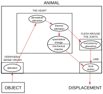

# Aristotle’s *De Motu Animalium*
**First published Wed Dec 3, 2025**

*Corcilius, Klaus*

Aristotle’s *On the motion of animals* (*De motu animalium*, *Mot. An.*) is a short but densely written zoological treatise of a mere seven Bekker pages in length (which is to say about 20 pages in an average modern translation). It is devoted to an important philosophical question, namely the question of “how the soul moves the body” (*Mot. An.* 6, 700b9–10), which Aristotle declares “a most difficult problem” in his *Physics* (*Phys.* VIII, 2, 253a7–11). In order to address the problem adequately, *Mot. An.* makes use of the full spectrum of conceptual resources that Aristotle’s mature philosophy of nature has to offer. The result is his *general theory of animal self-motion* (Corcilius 2008a)[^corcilius-2008a]. The theory offers – according to Aristotle’s standards – a scientific explanation of the efficient causation of animal self-motion. It does so by offering an account of how the soul sets the body into motion. The theory combines theoretical elements of Aristotle’s philosophy of nature, most notably his hylomorphism and his cardiocentrism, which many scholars in the late nineteenth and twentieth centuries thought were inconsistent with each other. This combination of seemingly incompatible theoretical elements was one of the main reasons why *Mot. An.* was believed to be inauthentic for a long time, until Farquharson (1912), Jaeger (1913), and then later Nussbaum (1978) put its authenticity beyond doubt (Rapp 2020: 13–17)[^rapp-2020][^rapp-2020-2]. Still, *Mot. An.* is a challenging treatise and the account of animal self-motion it proposes has not been properly understood until fairly recently. This is so not only because it is difficult to see whether, and if so how exactly, Aristotle’s hylomorphic theory of the soul can accommodate an efficient causal role for the soul in episodes of animal self-motion, but also because the account operates at an unusually high level of zoological abstraction. Aristotle offers a “common account” that covers all kinds of animal self-motion, from the rational self-movements of human agents down to the self-locomotion of the humblest insects. From today’s perspective, we may say that the theory touches on core issues in theoretical domains as diverse as zoology, philosophy of mind, philosophy of action, moral psychology, and human biology. This high level of theoretical abstraction has led to misunderstandings about the scope and character of Aristotle’s theory. A further obstacle to its ready accessibility for uninitiated readers is the fact that *Mot. An.* is not a self-standing treatise. It is part of Aristotle’s philosophy of nature, which means that it builds on Aristotle’s previous and no less difficult discussion of the principle of animal self-motion in his work *On the Soul* or *De anima* (*An.* III 9–11). An adequate interpretation of *Mot. An.* therefore depends on the interpretation of other so-called psychological and biological works. However, unfortunately, for varying reasons modern interpreters argued for an incompatibility of the theories in *An.* III 9–11 and *Mot. An.* (Nussbaum 1983: 135–136, and Kollesch 1985: 58–59)[^kollesch-1985][^nussbaum-1983]. It further adds to its inaccessibility that *Mot. An.* stands in complex relations to other parts of Aristotle’s philosophy. It contains references to diverse areas of Aristotle’s oeuvre and discusses questions of cosmological and even metaphysical order that in one way or the other relate to his theory of animal self-motion (especially in chapters 3–4 and 6). Most importantly perhaps, the theory of animal self-motion in *Mot. An.* seems to be relevant for Aristotle’s account of human action and moral responsibility developed in his works on moral philosophy. This holds especially for the so-called “practical syllogism” which is formally introduced in chapter 7 of our treatise. All of this makes *Mot. An.* a fascinating treatise not just for the scientific explanation of animal self-motion, but for general philosophical reasons as well. As the treatise contains many more or less explicit references to his *Physics*, *De caelo*, *On the Soul*, his zoological corpus, his moral philosophy, and his *Metaphysics* (for a full list of references see Düring 1966: 296)[^düring-1966], it is likely that the treatise was written at a late point in Aristotle’s career. This entry addresses the following issues.

## 1. Subject matter and basic character of Aristotle’s theory of animal self-motion

The account of animal self-motion in *Mot. An.* is devoted to the explanation of the voluntary self-movements of animals. Although Aristotle particularly emphasizes the motion of the animal as a whole from place to place, it is pretty clear that he counts the movements of bodily parts, such as the purposeful lifting of an arm, as voluntary self-motions as well; indeed, in chapter 7, Aristotle even introduces staying put as an example of self-motion (701a7–16). More precisely, what *Mot. An.* is concerned with is the *common cause of the movement of animals* (1, 698a4–7; 6, 700b9–11). “Common cause” here indicates that Aristotle does not ask his question of how the soul moves the body with a view to the self-motions of humans or any other species in particular but with a view to the self-motions of all animals capable of moving themselves. His answer is stated in his *general theory of animal self-motion*. This theory is an according to Aristotle’s standards scientific explanation of the movements of all animals that are capable of moving themselves from one place to the other. Since the explananda in view concern all the various ways of moving from place to place such as flying, swimming, walking, crawling, hopping, and the like, this theory displays an unusually high level of zoological abstraction, one that cuts across fundamental taxonomical distinctions such as that between animals with spines and animals without (*Mot. An.* 9, 702b18–20). *Mot. An.* is not so much interested in the particular features of the movements of flying, swimming, crawling or walking animals. Aristotle has already dealt with the different ways in which the various kinds of living beings realize their movements from place to place with the aid of their limbs in his short work *On the Progression of Animals* (*De incessu animalium*, which he refers to at the beginning of *Mot. An.* 1, 698a1–4; on the *De incessu*, see Falcon & Stavrianeas 2021)[^falcon-2021]; rather, what *Mot. An.* is interested in is what all these particular kinds of movement share as their *common* efficient cause (cp. the methodological discussion in the Parts of Animals (*Part. An.*) I 1, 639a15–b5, and the *Posterior Analytics* (*Anal. Post.*) I 4, 73b25-74a3; II 14, 98a20–23, which emphasize that scientific explanations ought to be given on a “commensurate universal” level, on which see Corcilius 2020: 316). This common cause is the mechanism by which the “soul moves the body”, which is to say the mechanism by which cognition moves the animal from place to place. As the theory covers the entire range of animal and human self-motion, the *philosophical* issue behind the *Mot. An.*’s question of how the soul moves the body is the issue of the basic nature of animal and human action. To appreciate the character and importance of that question for Aristotle’s philosophy we should broaden our perspective for a moment and go beyond the contents of *Mot. An.*

### 1.1 The task and basic idea of the theory: the problem of self-motion and Aristotle’s solution

It is characteristic of living things that they are able not only to set other things in motion, but to set themselves in motion as well. Self-motion is one of the main characteristic phenomena of living things (*An.* II 2, 413a22–25). According to Aristotle’s understanding of it, which he seems to share with his predecessors, “self-motion” means to move something in the transitive sense of ‘move’, that is, to set something in motion—except in this case this something is not outside the animal but is rather the animal itself. This, however, seems paradoxical: how can anything transitively set itself in motion?

This is the *problem* of self-motion (Corcilius 2021)[^corcilius-2021]. The problem of self-motion is a question already raised by Aristotle’s predecessors. They offered different, and sometimes even contradictory, answers. Notwithstanding their differences, however, there is some common ground. The predecessors agreed, for example, that self-motion is a phenomenon of such a special quality that its originators—the self-movers—must be attributed special features: only living beings, i.e., beings endowed with a soul, are capable of self-motion. The predecessors also agreed that self-motion is a process in which the soul sets the body into motion. Hence, Aristotle’s predecessors basically agreed in dividing self-movers into two parts—“body” and “soul”—and they also agreed in attributing the active role of setting the body into motion to one of them, namely to the soul (see Aristotle’s report about his predecessors in *An.* I 2, 403b24–404b8). At first sight, Aristotle’s own solution does not look so different from that of his predecessors. He agrees that only what is alive and endowed with soul is capable of setting itself into motion (*Phys.* VIII 4, 255a5–18; *Mot. An.* 6, 700b11–13) and he also basically agrees that animal self-motion is a process in which something inside the animal which is distinct from the body sets the body into motion (*Mot. An.* 4, 700a6–11), even though, as he emphasizes, it is very difficult to see just how exactly to distinguish between the moving and the moved part (*Phys.* VIII 4, 254b28–33). This is a question that Aristotle addresses only in *Mot. An.* 9, as we will see below. However, his idea of *how* this happens is very different from that of his predecessors. In any case, with the distinction between soul and body as moving and moved part in place, the fact that something sets itself transitively in motion looks less paradoxical, given that it is no longer one and the same item which sets itself in motion but *something* within the living being—the soul—that sets something *else* in motion—the body. In this regard it is striking that Aristotle strongly underlines the separation of active mover and passively moved body. As the newly established Greek text by Primavesi shows, in the *Mot. An.* he does not use the otherwise idiomatic locution “self-motion”, preferring the somewhat clumsy, albeit more precise, two-place reflexive expression “moving oneself by oneself (auto hauto kinein)” in its stead, leaving the subject expression “auto” rigidly in the nominative regardless of syntactic context (Primavesi & Corcilius 2018: cxl; Rapp & Primavesi 2020, 134)[^primavesi-2018][^rapp-2020][^rapp-2020-2]. Aristotle thus clearly distinguishes between the active subject and the passive object of movement already at a linguistic level. This corresponds to the fundamental importance of the distinction between the mover (soul) and the moved (body) for his account. But, of course, the internal distinction between a moving and a moved part can only be a preliminary solution. For at once a new and no less difficult question arises: *how* can the soul set the body in motion? This is precisely the problem Aristotle purports to address in *Mot. An.* (6, 700b9–11; see 1, 698a4–14).

Note that for Aristotle the question poses itself under particularly stringent conditions, unlike for his predecessors. His predecessors started out from the assumption that nothing which is not itself in motion is capable of setting something else in motion. As Aristotle says, this is why they attributed motion to the soul, conceiving of it as something that is in motion itself (*An.* I 2, 403b30ff). For them, therefore, the task of explaining animal self-motion basically consisted only in showing how the soul, as something which is already itself in motion, transmits its own movements to the body. This “easy” way of accounting for animal self-motion is not open to Aristotle because of two of his other theoretical commitments. On the one hand, he subscribes to a conception of the soul according to which the soul is not materially extended. Therefore, for him—in contrast to most of his predecessors—the soul is not the *kind* of thing to undergo motion nor, indeed, to undergo, experience or suffer anything. Aristotle conceives of the soul as something *of* animated bodies, namely as their *principle* which explains what they are, do and undergo. He defines the soul as the “substantial being according to the definition” of the living body (ousia kata ton logon: *An.* II 1, 412b10f). Later in his treatise on the soul Aristotle defines the soul as the sum of the basic vital functions animated bodies possess insofar as they are alive. These basic vital functions are the so-called “powers of the soul (dynameis tês psyches)”, namely vegetative self-preservation, perception, and the capacity for thinking (Corcilius & Gregoric 2010; Johansen 2012)[^corcilius-2010][^johansen-2012]. Unlike bodies, vital functions are not materially extended. This is why the soul is not the right *kind* of thing to be moved (Aristotle argues for that thesis at length in *An.* I 2sq., 405b31–407b11; 4–5, 408a30–409b18). The other theoretical commitment that aggravates the problem of self-motion for Aristotle stems from his general kinematics in *Physics* VIII. It bars him from explaining animal self-motion by the aid of a self-moving soul. In *Physics* VIII he argues that self-motion in the strict sense (*X* sets *X* in motion) is an impossibility. There must always be some one item *X* which sets some other item *Y* in motion, and *X* and *Y* must necessarily be distinct from each other. For any movement there must be an origin—a mover—distinct from what it moves. In his *Physics* Aristotle thus dissolves the concept of strict self-motion (which seems to originate in Plato, *Phaedrus* 245c–246a; *Laws* X 895e–896a) into a *system* of movement consisting of at least two distinct elements, namely a passive moved thing and an active mover (*Phys.* VIII 4, 255a12–19; 5, 257a33–b27, with application to self-movers: 4, 254b27–33). This commits him to the thesis that the causation of movement is always transitive, including the so-called self-motion of animals. These two theoretical commitments—the immovable soul and the transitivity of self-motion—present Aristotle’s theory of animal self-motion with a formidable challenge. He must show how the immovable soul sets the body in motion. This is why he says that the explanation of animal self-motion is “a most difficult problem” (*Phys.* VIII 2, 253a7–11). In what follows, we will describe Aristotle’s solution to the problem as it emerges from his writings (for competing approaches see below).

### 1.2 Solution: the actuality of the perceptual soul as the unmoved mover of the body

Aristotle rises to the challenge with the introduction of a highly innovative bio-mechanical conception of the causation of movement. By combining teleological with kinematic theoretical elements, he conceives of the soul as the *unmoved mover* of the living body. According to this conception, in the simplest cases the causation of animal self-motion consists in a three-stage process.

*Stage 1* is *the unmoved mover*. This stage consists in the perception of an external object by an animal, which is also an object of the animal’s desire. As perception is a basic vital function of animals and hence a part of the soul, it follows that the actuality of perception of an external object is a psychic act. Perception involves the *actuality of the perceptual soul*. And as Aristotle does not conceive of the soul as a possible bearer of mental states—only the living being can be a bearer of affections and mental states “in virtue of its soul ”—the soul is itself not in any way moved or changed during the act of perception (*An.* I 4, 408b5–18). The actuality of the perceptual soul therefore can act as the unmoved mover of an ensuing physiological process in the animal body, and this process in turn can issue in the self-motion of the animal as a whole (on the actuality of the perceptual soul “without coming to be or passing away”, see Corcilius 2025)[^corcilius-2025].

*Stage 2* is *the moved mover*. This stage is the internal process of the *animal’s physical reaction to the object* presented to it by perception. It is here that Aristotle’s natural teleological conceptions of the living body, of pleasure and pain and of appetitive desire from his work *On the Soul* (*De anima*) exert their explanatory force. As the animal body is an instrument, or tool, of the soul (*An.* II 1, 412a27–b6), it will react to the perception of external objects in ways that preserve the soul’s (and thereby also the animal’s) functions: if a perceived object is conducive to the animal’s self-preservation, its perception will be pleasant for the animal, and if a perceived object is detrimental for its self-preservation, its perception will be painful. On Aristotle’s theory, what is conducive to an animal’s self-preservation is “in accordance with its nature” and hence *biologically good* for it, while what is detrimental to its self-preservation is *biologically bad* for it. In Aristotle’s natural teleology, animals feel pleasure whenever what they perceive is in accordance with their nature (*Hist. An.* IX 1, 589a8–9), and they feel pain whenever what they perceive is against their nature and hence biologically bad for them; indeed, on Aristotle’s account, pleasure and pain, in the most basic form they take in nature, *are* perceptions of objects that are in this biological way either good or bad for the perceiving animal insofar as they are such (*An.* III 7, 431a8–14; cp. *EN* VI 2, 1139a21–22); and pleasure and pain, for their part, are necessary and sufficient for corresponding desires, i.e., they are necessary and sufficient for the pursuit of pleasant objects and the avoidance of painful ones. Animals by their natures pursue what is conducive to their biological self-preservation and avoid what is detrimental to it (*An.* III 7, 431a8–14; *An.* II 3, 413b22–24, 414b1–16; cp. *De somn.* 1, 454b29–31; on Aristotle’s biological conception of pleasure and pain and non-rational desire, see Corcilius & Gregoric 2013; cp. Richardson 1992: 395)[^corcilius-2013][^richardson-1992]. The second moved mover stage in the process of animal self-motion thus consists in the physical reaction of the (natural-teleologically oriented) instrumental body to the object of desire as it is presented to the animal by perception. In other words, the perception of an object of desire triggers a self-preserving physical reaction of the animal’s instrumental body, the first manifestation of which is the activity of desire. On Aristotle’s account, desire materially consists of certain thermic discharges in the body: if the perceived object is pleasant, the body will tend to produce internal heat; if painful, it will tend to produce a chilling effect. Aristotle calls these endogenous thermal bodily reactions “desire” (orexis, see *Mot. An.* 7, 701b33–702a21; cp. *An.* I 1, 403a25–403b1). Note, however, that desire is not just a thermic reaction to a perceived object; it crucially involves also the perception of the object. In more complex cases, higher cognitive functions such as mental representation, anticipation, memory, and even rational thinking can take the place of perception, and also other kinds of desire can take the place of biologically basic appetitive desire (*Mot. An.* 6, 700b17–24). Desire’s thermic discharge in turn triggers a chain of processes that run unconsciously inside the body and produce the mechanical forces that set into motion the animal’s limbs and ultimately the animal as a whole.

*Stage 3* of the process is the *moved thing*, i.e., the movement of the animal body from place to place in direction of the desired objects as it results from the above causal chain of inner bodily processes in stage 2.

Stage 1 is explained in Aristotle’s *De anima* and briefly summarized in *De motu animalium* 6, stages 2 and 3 are explained in the *Mot. An.*

So much for the basic idea behind Aristotle’s bio-mechanical conception of the efficient causation of episodes of animal self-motion by the unmoved soul: the animal soul, when actual in the perception of objects that are biologically good or bad for the animal, acts as an unmoved mover because the living body, by its natural design as teleologically subservient to the soul, reacts to these perceptions in self-preserving ways with certain thermic reactions (desire). Desire in turn produces the mechanical force required to move the animal from one place to the other by means of a complex chain of inner bodily processes.

That this is indeed Aristotle’s basic answer to the question of how the soul moves the body is confirmed by the fact that his bio-mechanical conception of the causation of animal self-motion is in line with his general scheme of the efficient causation of motion in the eighth book of his *Physics*:

> For there must be three things—the moved, the mover, and the instrument of motion. Now the moved must be in motion, but it need not move anything else; the instrument of motion must both move something else and be itself in motion (for it changes together with the moved, with which it is in contact and continuous, as is clear in the case of things that move other things locally, in which case the two things must up to a certain point be in contact); and the mover—that is to say, that which causes motion in such a manner that it is not merely the instrument of motion—must be unmoved. (*Phys.* VIII 5, 256b14–20, transl. Hardie and Gaye)

According to this general account, the causation of any kind of movement is to be explained in terms of a tripartite scheme consisting of an unmoved mover, a moved mover and the moved thing. If we apply the scheme to animal self-motion, the following sequence should result: the perception of a desired object should act as the *unmoved mover* (*Stage* 1 above). It should be unmoved because perception involves the activity of the perceiving soul, and the soul, as emphasized by Aristotle, is necessarily unmoved (*An.* I 3, 405b31–407b11; 4, 408a30–5). The instrumental body’s thermic reaction to the perception of the object—desire and the processes that follow upon desire inside the body—should be the *moved mover*, i.e., the “instrument of motion”, (*Stage* 2 above), and the animal body should be the passively *moved* thing (*Stage* 3 above). And this is in fact how Aristotle applies his general tripartite scheme in the tenth chapter of the third book of *De anima* to the explanation of the efficient cause of animal self-motion. First, he introduces the unmoved starting point of motion:

> The first (mover) of them all is the object of desire; for it imparts motion without being moved, by being apprehended by thought or mental representation (noêthênai ê phantastênai). However, in number there are several movers. (*An.* III 10, 433b11–13)

The perception or, more generally, the cognition of an object of desire either by perception, mental representation, or thinking, marks the beginning of the process. Given that cognition involves the activity of the soul and the soul is necessarily unmoved, Aristotle in effect is saying that the soul moves the body as an unmoved mover. Note that, strictly speaking and despite what might appear to some (for discussion see Richardson 1992: 387ff.)[^richardson-1992], it is not the external object of desire that moves the animal as the first mover; it rather is the *mental act* (the actuality of the soul) of the awareness of an external object of desire, namely either perception, thought, or mental representation, provided that they lead to the animal’s desire. Note also that in *An.* III 10, as well as in *Mot. An.* 6, Aristotle uses the term “thought” in a wide and inclusive sense, specifically coined by him for the explanation of animal self-motion, and that includes perception (see *An.* III 10, 433a10–12; *Mot. An.* 6, 700b17–22). In the above quote he says that “in number” there are several unmoved movers because not only thought and phantasia, i.e., the mental representation of objects of desire, but also perception can play the role of the unmoved mover in animals. For they are all capable of triggering desires of different kinds. In the immediate sequel Aristotle applies his tripartite scheme from *Physics* VIII to the causation of animal self-motion:

> Since there are three things (in the causation of motion)—first, what initiates motion, second, that by which it initiates motion, and further, third, what is moved—and (since) that which initiates motion occurs two times—in one instance with the unmoved and in the other with that which initiates motion while being moved, it follows that the unmoved is the practical good, and that which initiates motion while being moved is that which is capable of desiring, for what desires is moved insofar as it is desiring, and desire, when actual, is a kind of motion; and what is moved, is the animal. (*An.* III 10, 433b13–18, reading, with Förster 1912, oregomenon in 433b17)[^förster-1912]

This is the same tripartite scheme as we have seen it in his general physics in *Physics* VIII. The mere fact that he applies his general tripartite scheme of the causation of movement from *Physics* to animal self-motion puts it beyond doubt that Aristotle considered his explanation of animal self-motion by way of the soul as the unmoved mover to be scientifically well-founded. In the end, it is his distinction between the unmoved mover—the actuality of the cognitive soul—and the moved mover—desire etc.—within the animal that allows Aristotle to solve the problem of self-motion as he described it in *Phys.* VIII 4, 254b28–33 (quoted above). Desire as the moved mover plays an all-important role in the story. The act of perception or cognition can play the role of the unmoved mover of the body only because living beings by their natural design as instrumental bodies react to the objects of their cognition by way of psychophysical (thermal) movements that result in desire (pursuit or avoidance) in self-preserving ways. This is why Aristotle says in the *De anima* that animals are capable of setting themselves in motion *insofar as they are capable of desiring* (*An.* III 10, 433b17f, 27–28), calling desire a “moved mover” three times (*An.* III 10, 433b16–18; *Mot. An.* 6, 700b35–701a1, 701a4 sq.).

Aristotle’s answer to the question of how animals set themselves into motion, then, is this: it is the activity of the perceiving or otherwise cognizing soul that sets the body in motion. When it does so it does so in such a way that the animal either pursues or avoids the objects presented to it by perception or cognition. In the simplest cases this happens whenever the object, in the biological way characterized, is either good or bad for the animal. This either pursuing or avoiding reaction is an internally caused thermal process (heat, coldness) which in suitable instrumental bodies that are equipped with the right organs can lead to the dislocation of the animal as a whole. With this explanation Aristotle can claim to have mastered the above-mentioned challenge of explaining self-motion as a setting-the-body-in-motion by its unmoved soul (*An.* III 10, 433b11–18; *Mot. An.* 11, 703b3–4). He can claim to have done so on the basis of his novel bio-mechanical and natural teleological conception of the causation of movement. And this is precisely what he seems to be doing when he praises himself for having discovered a way of conceiving of the causation of movement by way of recognizing something good in his *Metaphysics* (*Metaph.* XII 10, 1075b8–10; see also *Phys.* VIII 5, 256b14–27).

So much for the first, still rudimentary and rather abstract discussion of the question of how the soul sets the body in motion: the soul imparts motion to the body as an *unmoved mover* by providing a starting point of motion, namely the cognition of a realizable object of desire (i.e., the practical good). This is the main result of Aristotle’s discussion of animal self-motion in his *De anima*, namely an account of stage 1 of the process. What is missing is a treatment of stages 2 and 3. This will follow in the *Mot. An.* where Aristotle offers an account of how the soul moves the body. Note, though, that according to Aristotle’s general account of the causation of motion and change causal interaction between the soul and the body, as it is said to occur in the transition from (i) to (ii), i.e., the transition from stage 1 to stage 2, requires the distinctness of the agent and the patient of the process: nothing can act on itself insofar as it is one thing. For *X* to act on *Y*, *X* needs to be distinct from *Y* in some way. Hence, if the soul is to impart motion to the body, there *must* be a way in which the soul is distinct from the body. In chapters 8 and 9 of *Mot. An.* Aristotle will offer an argument for the thesis that the soul is *locally* distinct from the body, even though it is in the body. The question whether, and if so how, that distinctness of the moving soul from the body can be squared with his hylomorphism will be discussed later. These two theoretical tasks, i.e. offering an account of how the soul imparts motion to the body on the one hand and how the soul is distinct from the body so as to be able to act on it on the other, are the main business of the argument of *Mot. An.* as far as it regards the common theory of animal self-motion.

Aristotle offers an extended discussion of the question which part of the soul is responsible for the causation of animal self-motion in *An.* III 9–10. This is because the *De anima* is predominantly concerned with defining the soul as the first principle for the explanation of the phenomena of living things. This is to say that in the *De anima* he is concerned only with stage 1 of the above three-stage account of animal self-motion. His discussion there culminates in the forward-looking application of the tripartite scheme of the causation of motion to animal self-motion just discussed. At the end of the section in the *De anima* devoted to animal self-motion, Aristotle reserves the theoretical treatment of the bodily side of the process for a separate group of works. Other than *De anima*, that treatment is no longer going to deal with the soul as such but with something else, namely the performances of animated bodies that they exhibit due to their souls, i.e., the “actions and affections common to body and soul”:

> The instrument by which desire initiates motion is already something bodily; accordingly, it is necessary to examine it among the functions common to body and soul. (*An.* III 10, 433b19–21, transl. Shields)

The reference to functions common to body and soul corresponds to the discussion of animal self-motion in *Mot. An.*, as scholars agree (Jaeger 1913; Nussbaum 1978; Kollesch 1985; Rapp & Primavesi 2020; Laks 2020; Polansky 2024)[^jaeger-1913][^nussbaum-1978][^rapp-2020][^kollesch-1985][^laks-2020][^polansky-2024][^rapp-2020-2]. Before we delve into *Mot. An.*, however, a brief survey of the methodological underpinnings of the *Mot. An.* as part of the group of writings on the “actions and affections common to body and soul” will be useful.

## 2. The methodological underpinning of *Mot. An.* in the works on “actions and affections common to body and soul”

Even if we did not possess the direct reference to the functions common to body and soul just quoted, *Mot. An.* would have to be grouped together with the writing on the “actions and affections common to body and soul”. *Mot. An.* is strikingly similar to the larger part of the works collected under the name of *Short Treatises on Natural Philosophy* (Parva Naturalia, on which see King 2001)[^king-2001] in scope and purpose. On the most likely scenario, then, *Mot. An.* is part of the explanatory project of the *Parva Naturalia* (Jaeger 1913; van der Eijk 1994: 68–72; Rashed 2004; Morel 2020; Polansky 2024; Primavesi & Corcilius 2018)[^jaeger-1913][^primavesi-2018][^eijk-1994][^morel-2020][^polansky-2024][^rashed-2004]. Like *On Memory and Recollection* (De memoria), *On Sleep and Wakefulness* (De somno et vigilia), *On Dreams* (De insomniis) or *On Youth and Old Age* (De juventute et senectute), *Mot. An.* is concerned with processes that take place in animals, asking how the phenomenon under discussion comes about. Like the Parva naturalia, and unlike De incessu animalium, *Mot. An.* does not speak very much of final causes (with an exception in the case of the explanation of sleep) but shows much more interest in the efficient causal explanation of the processes common to body and soul. Also like the *Parva naturalia*, the investigation in *Mot. An.* seems to be immediately continuous with the investigation in the *De anima*. The first chapter of *On Perception and Perceptible Objects* (De sensu et sensibilibus, *Sens.*), which offers an introduction to the *Parva naturalia* as a whole, outlines the division of explanatory labor between the *De anima* and the *Parva naturalia* as follows:

> Since we have drawn our distinctions about the soul by itself, and about each of its capacities in turn, we must next make our investigation of animals and of all things that have life, as to which of their actions are special to some and which are common to all of them. What has been said about the soul, then, is to be assumed throughout, but let us speak about what remains, starting with what comes first. It is evident that the most important [actions and affections], both those that are common and those that are special to certain animals, are common to body and soul: perception, memory, spirit, appetite, and, in general, desire, and in addition to these, pleasure and pain. For these belong to pretty much all animals. (*Sens.* 1, 436a1–11)

Aristotle here announces that he is going to explain the psycho-physical processes of animals (“actions and affections common to body and soul”), and that he is going to do so in a way that takes its start from the definition of the soul in *De anima*. *De anima* offers a definition of the soul itself—of the “soul by itself”, as the text says above. The *Parva naturalia*, for their part, offer explanations for psycho-physical processes that animals engage in or undergo by virtue of the fact that they *possess* a soul (on the mutual cross-references between the *Parva naturalia* and the *An.* see the list in King 2001: 34 sqq. and 152)[^king-2001]. Exactly that same picture applies to the *Mot. An.* It explicitly refers back to the investigation of the soul itself in the *De anima* (*Mot. An.* 6, 700b4–6), while *De anima* III 10, 433b19–21 looks forward to the theory of animal self-motion as to be treated in the works dedicated to the functions common to body and soul, as we have just seen above. This forward-looking reference clearly refers to the account of animal self-motion in *Mot. An.* as a treatment of a function “common to body and soul”. We may conclude, then, that the account of animal self-motion in *Mot. An.* is part of the *Parva naturalia’s* project of rendering explanatory accounts of the actions and affections common to body and soul, that it is immediately continuous with the investigation into the soul itself in the *De anima*, and in particular with the investigation into the psychic principle responsible for animal self-motion in *An.* III 9–11. *An.* defines the soul, while *Mot. An.*, along with the rest of the *Parva naturalia*, investigates what animals do or undergo *insofar* as they possess a soul, and a perceptual soul in particular (see *Sens.* 1, 436b1 sqq.). This impression is reinforced by the fact that the affections of desire and pleasure pain take center stage in the account of animal self-motion to come in *Mot. An.*, while the beginning of *On Perception and Perceptible Objects* just quoted explicitly mentions desire and pleasure and pain as examples for affections common to body and soul*.* Finally, and decisively, the forward-looking passage in *An.* III 10, 433b19–21, quoted above continues with a short description of what to expect from the treatment of the functions (or actions and affections) common to body and soul. That description matches some important contents of *Mot. An.* (*An.* III 10, 433b19–27, see already Jaeger 1913: 41–42)[^jaeger-1913].

> For now, though, to summarize: something initiates motions instrumentally when the starting point and the end point are the same, for instance, in a hinge—since here the convex is the end point and the concave the starting point (for which reason the one is at rest and the other is moved), and though different in account they are inseparable in magnitude. For all things are moved by pushing and pulling; consequently, it is necessary, just as in the case of a circle, for something to remain fixed and for the motion to begin from there. (*An.* III 10, 433b21–27, transl. Shields)

This makes it clear that *An.* understands the account of animal self-motion to be given *in Mot. An.* as an account in which the soul acts as the *unmoved mover* of the animal. This is exactly what we will get in the *Mot. An.* (see also *Mot. An.* 6, 700b4–6, where Aristotle refers back to *An.* when pointing out that the soul is unmoved). Note that Aristotle here, when he speaks about the problem of self-motion in analogy to the movement of a door, illustrates the main *explanandum* of *Mot. An.* as a sort of mechanical problem. The difference is that the movement of the door is instrumental (organikôs) because doors are not self-movers. Doors require an external mover to either open or close them. This is not so in animal motion which is supposed to be self-motion. Animal self-motion can in that respect be compared to a self-opening and -closing door. However, what Aristotle seems to find particularly important in the analogy is that the movement of the door is made possible by the fact that there is a hinge or a joint, i.e., something that combines movement and rest within the same magnitude. All movement, he says, happens by way of pushing and pulling, and for pushing and pulling to occur it requires an unmoved starting point. This, as we will see, will be important for the account of animal self-motion, in which the perceptual soul imparts motion to the animal pretty much like a door hinge. When the animal perceives an object of desire the actuality of its perceptual soul in presenting the object of perception will act like a point of support, and in this sense as a starting point, for the movement of the animal’s body. In order to be able to have this causal effect on the body the perceptual soul has to be distinct from the body it acts upon but it also ought not to be different from the body in magnitude, in a way that is analogous to the concave and the convex parts that constitute the door hinge. And this is precisely what *Mot. An.* 8–9 will argue, namely that the perceptual soul is located in the heart, while it itself remains without magnitude. For this makes the soul both, distinct from the heart and the rest of the body and at the same time not different from the body in magnitude or extension. There can be little doubt, then, that *Mot. An.* is the treatise about the functions “common to body and soul” that was announced in *An.* II 10. It clearly is a part of the project of the so-called *Parva naturalia*.

## 3. The account of animal self-motion in *Mot. An.*

The proper theory of animal self-motion as expounded in *Mot. An.* consists of two main parts: an account of how the soul imparts motion to the body in voluntary self-motion and a proof of the claim that the perceptual soul is different from the body so as to be able to act on it and set it into motion, while having a position in the body. Part one is dealt with in chapters 6–8, part two in chapters 8–9; chapter 10 summarizes the theory in a memorable analogy that compares the self-moving animal to a political community with good laws. Chapter 11 ends the treatise with a discussion of the non-voluntary and involuntary movements of parts of the animal body. Chapter 11 is a kind of coda or appendix to the main theory. Chapters 1–5 introduce and discuss two mechanical principles that will turn out to be important for the second main part of the theory. From the fact that Aristotle discusses some cosmological implications of these mechanical principles in these chapters, we can infer that they must have been important for him, not only for reasons that regard his theory of animal self-motion but also for reasons outside of his theory having to do with the general kinematics of his *Physics* and even with his theory of the first unmoved mover from his *Metaphysics*. There is no space here to discuss these cosmological digressions. We will discuss the above sections in turn.

### 3.1 The mechanical underpinnings of animal self-motion

After a short introduction into the subject matter of the treatise, *Mot. An.* begins by invoking Aristotle’s general schema for the causation of motion from *Physics* VIII, according to which every episode of motion/change structurally requires three structural elements: an unmoved mover, a moved mover and a moved thing. Aristotle says that he has shown in his *Physics* that every moved thing is moved by a self-mover and that every self-motion is set into motion by something unmoved. Now, he says, we should see how this universal account of the causation of motion applies to episodes of animal self-motion (*Mot. An.* 1, 698a7–16):

> But we must grasp this not only universally on the basis of the account, but also as applying to particular cases and to perceptible things, for the sake of which we also seek the universal accounts and to which, we believe, these accounts should fit. (698a11–14, my translation)

After this remarkable statement Aristotle goes on to introduce his first mechanical principle of animal self-motion. This is the *internal resting point principle*. According to this principle, every self-motion requires an internal resting point, which remains unmoved in relation to the motion, and from which the motion takes its start. Self-motion would not be possible without something at rest inside the self-moved thing. Aristotle illustrates the principle with the functioning of a familiar body part, namely the joints. Joints are natural devices of motion. They make motion possible because joints can “become one and two” according to whether they are bent (two) or extended (one). This is of course the same mechanical function of “instrumentally initiating motion” Aristotle has announced in *De anima* III 10 by way of the example of the door hinge (433b21–27). Just like door-hinges, joints provide a unitary but internally complex structure that enables animals to initiate motion. This is because joints can *bend*, i.e., they can transition from a state of rest to a state of movement by folding one of their parts so as to form a *system of motion* consisting of an unmoved mover and a moved part. Aristotle illustrates the workings of joints by way of a geometrical analogy. Animals, he says, “use their joints like the center of a circle”.

*Figure 1*

Here, point *A* is a single point on the line *D*-*B* (is “one”). However, if the line *A*-*C* folds at point *A* when it bends to *A*-*C*, *A* becomes “two”. The reason is that *A* is then at the same time both the end point of line *D*-*A* and the starting point of line *A*-*C*. According to Aristotle, joints behave analogously to point *A* (living beings “use their joints like the center of a circle”, a18). For example, in an outstretched arm, the elbow joint is “one” because it is part of the arm as a whole as it is formed by the upper and the lower arm. Once the elbow joint bends, however, it becomes “two” because it now forms both the end point of the upper arm and the starting point of the bent forearm. In this way, joints viz. the point in the joint become “both one and two” and “straight and bent” and “beginning and end” (*Metaph.* IV 6, 1016a9–16; *Phys.* VIII 8, 263a23–25; *An.* II 2, 427a9–14; *De Incessu Animalium* 9, 708b21–27). In this sense, joints have the peculiarity of being able to change into their respective opposites (*Mot. An.* 1, 698a20; 8, 702a22–26): When they are stretched, they are one in actuality, but two in potentiality, because they *can* bend, while conversely, when they are bent, they are two in actuality and one in potentiality (a18–21). Without some such internal supporting point animal motion is impossible. (For more on the functioning of joints see Primavesi & Corcilius 2018: 73–77 and Rapp 2020: 230–238, who also discusses the geometrical example)[^primavesi-2018][^rapp-2020][^corcilius-2020][^rapp-2020-2].

Note, however, that the internal resting point principle, as important as it is, does not state sufficient conditions for motion. We also need physical force (“pushing and pulling” against the resting point), about which Aristotle will speak later in his account of how the soul sets the body into motion (§3.2). Also, and importantly, the illustration of the internal supporting point principle by way of the joints is incomplete. Joints initiate motion “instrumentally” which is to say they presuppose a self-moving animal whose parts they are. Joints are supporting points only *relatively* to the motion of parts of animals (pros ho, *Mot. An.* 1, 698b1). They are not absolute starting-points of motion because they depend on some other supporting point which is provided by the animals whose joints they are. What Aristotle is looking for in *Mot. An.*, however, is such an absolute unmoved supporting point of the motion of the animal as a whole. The example of the joints therefore only provides inductive evidence for the internal supporting point principle: since wherever there is movement of the limbs of an animal, the moving limb must rest on an internal supporting point (or hang from an internal suspension point), there must be an internal immovable supporting point also for the movement of the animal as a whole. Such a supporting point must be unmoved not relatively to the movement of a part of the animal, but absolutely, i.e., with relation to the animal as a whole. As we will see below in §3.3, *Mot. An.* 8, 702a21 to 9, 703a3 contains an argument to the effect that the cognitive soul is that unmoved starting point.

The second mechanical principle underlying Aristotle’s account of animal self-motion is the *external resting point principle*. According to that principle, animal movement is not possible unless there is an external supporting point or prop for the animal as a whole that is no part of the moving system. Aristotle claims the general validity of this principle for all animal movements on land, water, or air (*Mot. An.* 2, 698b17–18). He illustrates it with the help of two examples in which the principle is not met (698b15–18) and with the discussion of what he calls a “problem question” (aporoumenon, 698b21–699a11). The first example is wanderers in the sand who cannot get ahead with their movements because what is supposed to be the external supporting point of their motions, the sand, gives way. The second example is mice trapped in pitch. Here, what is supposed to be the supporting point as it were “follows” the movement of limbs. In both cases, there is no suitable external point on which to support the movement. The ensuing “problem question” is meant to give a vivid illustration of the fact that the external supporting point must really be *external*, i.e., it must be no part of the moving object *and* be completely separate from it. The problem is this: why can one easily set a boat into motion from the outside when pushing it with a pole, while one will never be able to do this from inside of the boat, not even if one possessed superhuman power like the giant Tityos or the wind god Boreas when he blows into the sails? The answer is that the prop and mover are not separate from each other. The external support point principle requires that the external point of support must be completely outside the moving system: it must be no part of it; nor can it otherwise be in it (like sailors in the boat).

In the ensuing chapters 3 and 4 Aristotle digresses by applying the external supporting point principle to the motion of the universe as a whole (see Primavesi & Corcilius 2018, 79-96; cp. Coope 2020; Morison 2020)[^primavesi-2018][^coope-2020][^morison-2020].

### 3.2 How the soul sets the body into motion

Aristotle starts his account of the common cause of animal self-motion with a recap of the main results of his account of the psychic principle responsible for the causation of animal self-motion from *De anima* III 9–11. That is, he identifies the “movers” in the animals. These “movers” are the psychic or mental states that can play the role of movers in the causation of animal self-motion. He then identifies the intentional objects that correspond to these states. Finally, he lines up the movers and objects he has identified in the causal sequence of his tripartite scheme from *Physics* VIII as he has already done in *An.* III 10. This, along with a discussion of the goal and teleological structure of animal self-motion (which is not paralleled in the *De anima*) is the main business of *Mot. An.* 6. With the first half of chapter 7 the central part of the proper causal account of episodes of animal self-motion follows. This is the passage with the so-called “practical syllogism”, which contains a law-like account of the necessary and sufficient causal conditions for the triggering of episodes of animal self-motion. Finally, there is a somewhat sketchy account of the unconscious inner bodily chain of events that lead to the movement of the animal as whole in the second half of chapter 7 and the first half of chapter 8 (up until 702a21).

#### 3.2.1 Lining up the causal factors of animal self-motion

Aristotle’s account of the causation of animal self-motion is *commensurately universal* with the phenomenon of animal self-motion (see introduction), meaning that it applies to all animals capable of moving themselves, as he himself points out in the beginning of the treatise in *Mot. An.* 1, 698a4–7. This plays out even in the terminology that Aristotle uses. Already in *An.* III 10, 433a9 sqq. he had coined an abstract vocabulary, specifically designed for the purposes of a common account of animal self-motion, which he also uses in *Mot. An.* 6, when starting with his proper account of how the soul moves the body. Thus, even though the internal “movers” of animals are diverse in different and sometimes even in the same animals, they can be grouped together in two main classes, which will play equivalent roles in the accounts of their respective self-motions. Aristotle says that all cognitive and conative attitudes can be “reduced (anagesthai)” to “thought (nous)” and “desire (orexis)”. In the case of thought this is because other cognitive attitudes, such as perception or mental representation (*phantasia*), can “take the same place (chôra)” as thought because they are all discriminative so as to provide the animal with information relevant for its self-motion. Nussbaum aptly paraphrases that expression as saying that they can take the same “slots of explanation” (1978: 333). Desire on the other hand comprises all of its three kinds, namely appetite (epithymia), which is the biologically basic desire for pleasure, spiritedness (thymos), the desire for honor and social recognition, and wish (boulēsis), which is rational desire. Choice (prohairesis) is a mixture of the two because it involves both desire and cognition. This “inclusive” terminology of “thought” and “desire” allows Aristotle to conveniently refer to the common psychological factors that are operative in all animal self-motion, without having to take into account the specific features of different species of animals. *Mot. An.* is more interested in the explanatory roles that these factors play in his common theory of animal self-motion than the specific features of different species of self-moving animals. Now, on this basis, Aristotle moves on to the corresponding objects, saying that the *object* of thought (noêton) and the *object* of desire (orekton) are the “first movers”. Here, the underlying idea is that these objects affect the corresponding psychic capacities of the animal and therefore come “first” in the causal chain of events. As we know from the *De anima* this does not mean that the objects of desire and thought “out there” are the movers of the animal without further qualification but that they are so *in virtue of being cognized by the self-moving animal* (*An.* III 10, 433b12). Before he moves on to insert the moving factors into his threefold causal scheme from *Physics* VIII and *De anima* III 10, Aristotle adds that not all objects of thought and desire qualify as objects of animal self-motion. Only such objects of cognition and desire whose realization lies within the animal’s power do. They have to be “achievable by action” (prakta, 700b25) in the sense that the animal needs to deem their realization as something it can achieve. This excludes unfulfillable wishes of human beings but also all other practical goods that animal do not feel are in their reach. The resulting line-up of the causal factors of animal self-motion is as follows.

- Unmoved mover: the object of thought and desire insofar as it is cognized
- Moved mover: desire (as an occurrent event)
- Moved thing: the animal

Chapter 6 closes with the remark that “For the animal moves and progresses in virtue of desire or choice, when some alteration has taken place in respect of perception or phantasia”. (701a4–6) This statement goes beyond the mere line-up of causal factors we’ve learned about previously in the chapter. Aristotle points forward to the way in which the above causal structure of unmoved mover, moved mover, and moved thing is put into action by the *perception of an object of desire*. This will be the topic of the next section.

#### 3.2.2 The efficient causal account of episodes of animal self-motion

Aristotle explains this first triggering step in the coming about of episodes of animal self-motion by way of the so-called “practical syllogism” (what follows is the interpretation expounded and defended in Corcilius 2008a sqq. For a different view see Nussbaum 1978, Essay 4. Another recent interpretation is offered in Cooper 2020. See also Morel 2008)[^nussbaum-1978][^cooper-2020][^corcilius-2008a][^morel-2008] Note that the way Aristotle uses the “practical syllogism” is not the way the practical syllogism is understood in the tradition, which typically takes it to be an illustration of the process of human deliberation (see Cooper 1975, section I)[^cooper-1975]. In Aristotle, what is called the “practical syllogism” serves to illustrate how the perception of an object of desire triggers the process of animal self-motion as it is analyzed in the above threefold schema. The “practical syllogism” (which is an expression Aristotle himself does not use, see Etheridge 1968: 30 and Kenny 1979: 111–112)[^etheridge-1968][^kenny-1979] is an analogy in which Aristotle likens the triggering of episodes of animal self-motion by the perception of an object of desire to the psychological act of drawing a conclusion from theoretical premises: desire and the cognition of a desired object are analogous to the thinking of premises of a theoretical syllogism and the resulting movement is analogous to the drawing of the conclusion (to symperasma ginetai hê praxis, *Mot. An.* 7, 701a12–13; 20; 22–23). The “premises” of the “practical syllogism” are the “premise of the good” on the one hand and the “premise of the possible” on the other, i.e., a desire for a practical good and the cognition of such an object of desire here and now and in the immediate reach of the animal (701a23–25). Aristotle does not use the “practical syllogism” to state *reasons* an agent might have for acting thus and so (as he would if the “practical syllogism” served to illustrate human deliberation) but to illustrate the working of the *proximate efficient cause* of the episodes of animal self-motion including human self-motion (eschatê aitia, *Mot. An.* 7, 701a33–36). However, given that desire and the cognition of an object of desire are closely related to the reasons one might have for acting thus and so, deliberation and the “practical syllogism” are closely related (see below). In illustrating the proximate moving cause of animal self-motion in the “practical syllogism”, Aristotle uses the triggering mechanism of human self-motion (action) as an example for all self-moving animals, as he usually does in his zoology. This is not because *Mot. An.* 7 is “anthropological” but simply because human beings are the most articulate kind of blooded animals and blooded animals in turn are more articulate than other animals, which however exhibit features that are analogous to blooded animals. Hence, the human being is in many respects (not in all, see *Hist. An.* I 16, 494b19–24) the richest, clearest, best known, and thus also the most informative example for features that hold of all animals (cp. *De somn*. 2, 455b31–34; *Hist. An.* I 6, 491a19–26; *De Incessu Animalium* 5; see Lloyd 1983: 26–43; Falcon 2024: 12, chapter 3)[^falcon-2024][^lloyd-1983]. The point of the analogy of the “practical syllogism” is to show how the process of animal self-motion *must* come about once the agent and the patient of the efficient causal relation corresponding to the first stage of the process come in contact with each other: whenever an animal or a human agent perceives a suitable object of desire, that perception will trigger the actuality of the animal’s desire for that object. The desire will in turn trigger a chain of internal bodily events which—provided the desire is strong enough—will lead to the motion of the animal as a whole. This is how the “practical syllogism” in *Mot. An.* illustrates the necessary and sufficient conditions for the triggering of episodes of animal self-motion, which is the first stage of the threefold scheme of the causation of animal self-motion.

*The “Practical Syllogism” in Aristotle*

| Drawing a theoretical conclusion in the mind | Drawing a practical “conclusion” in acting / self-moving |
| --- | --- |
| Thinking two premises concerning theoretical, i.e., unmoved, things | Two ‘premises’ leading to action / movement: the premise of the ‘good’ and the premise of the “possible” |
| **↓** | **↓** |
| Result in: contemplation of a theoretical proposition (= the conclusion) | Result in: an episode of action / self-movement of the agent / animal |

The chain of internal bodily events triggered by the desire as it results from the “practical syllogism” is the subject of the next section.

So much for the basic role of the “practical syllogism” in Aristotle’s account of animal self-motion. We may say that the “practical syllogism” formulates a law-like account of the triggering of episodes of animal self-motion. According to that account, whenever an animal that desires some given object, say food, and it perceives such an object in its immediate environment, then its perception will activate its desire. With the actuality of desire we are already in the second stage of the threefold causal structure of animal self-motion, that of the moved mover. What follows in the causal sequence, namely the chain of inner bodily events leading to the movement of the animal, will be a chain of *moved movers* as well. But before we come to this next phase in the causation of episodes of animal self-motion a word on the examples of “practical syllogisms” is in place. Most of the examples Aristotle gives illustrate the triggering mechanism of episodes of animal self-motion with simple expressions that stand for desire and cognition (perception): For instance, “Every human being should walk” is an expression for a desire, “I am a human being” is an expression for a cognition, and “straightaway he walks” is that statement of the “conclusion” resulting from these “premises” (*Mot. An.* 7, 701a13–14). One example (in 701a17–22) illustrates how this mechanism comes about specifically in human self-movers when they rationally think and deliberate about their actions. But Aristotle is eager to show that the same basic mechanism triggers the actuality of desire even in these more complicated cases of deliberate action, namely the desire for a given object and a cognition of such an object here and now. The only difference is that in human deliberation the way the agent comes to cognize the relevant object of desire turns out to be more demanding, because it involves means-end reasoning and deliberation.

#### 3.2.3 The chain of inner bodily events leading to the movement of the animal

Next comes Aristotle’s description of the second, the moved-mover stage of the process. Once desire has been triggered by perception, it will in turn trigger an unconscious but complex chain of inner bodily events that (in standard cases) lead to the motion of the animal as a whole. Once again using analogies, this time with automatic puppets, Aristotle emphasizes that the nature of the process is that of a *natural chain* of events that takes place in a body naturally designed for it. This ensures that the process runs swiftly. As we have seen, the process starts with the *perception* of an object of desire. Aristotle says that perceptions “immediately are present as certain qualities” (701b17–18) and that these qualities, given that they are either pleasant or painful for the animal, lead to thermic reactions in the animal body, namely “heatings and chillings”. Aristotle, as we have seen above as well, identifies these endocrine thermic reactions of the animal body with desire: “for what is painful is an object of avoidance, and what is pleasant is an object of pursuit” (*Mot. An.* 8, 701b35–36). The thermic changes of desire in turn lead to the contraction or the expansion of the connate pneuma, a gaseous body located in the region of the heart where the perceptual capacity is also located (on connate pneuma see below), and which transforms the qualitative changes of perception and desire into mechanical force. At this point the causal chain bifurcates. While the impulse of the connate pneuma provides the animal with the mechanical force to use its tendons and press upon its joints, the thermic alteration of desire also alters the consistency of the flesh around the joints so as to prepare them for motion. Figure 2 below gives an abstract representation of the chain of inner bodily events. Aristotle emphasizes that all of this happens quickly, and indeed almost simultaneously (hama te kai tachy, *Mot. An.* 8, 702a20), because the members of the causal chain triggered by the causal mechanism illustrated by the “practical syllogism” are by their natures correlative to each other.

*Figure 2:* illustration taken from Corcilius & Gregoric 2013: 73 (redrawn) [An [extended description of Figure 2](https://plato.stanford.edu/entries/aristotle-de-motu/figdesc.html#fig2) is in the supplement.]

### 3.3 Mechanics of animal self-motion. The perceptual soul as the unmoved mover of the animal and its position in the body

At this point, Aristotle returns to the mechanics of animal self-motion that he has touched upon in his discussion of the joints towards the beginning to the treatise. His argument comes in three steps. First, he shows that the starting point of animal self-motion cannot behave like a joint because joints, as we have seen above, are “instrumental movers”, i.e., they themselves begin at the endpoint of some other part of the body (*Mot. An.* 8, 702a21–b11). This makes joints only *relative* starting-points. The second step consists in an argument for the thesis that the absolute starting point of animal self-motion, the “moving soul” must be located in the middle of the body in the region of the heart. There must, then, be something in the middle of the body that is “in potentiality one but two in actuality” (*Mot. An.* 9, 702b26–27), like a joint, and that acts as an absolute mover in that it does not have its starting point at the endpoint of some other part of the body. The third step of the argument is a proof for the thesis that only an extensionless supporting point could do the required job to serve as a prop or a platform for the movements of both halves of the animal body simultaneously, and that that extensionless supporting point is the extensionless perceptual soul located (or better “positioned”) in the heart (*Mot. An.* 9, 703a1–3). The manuscripts contain Figure 3 which illustrates how point *A* provides a supporting point for the movement of *C* and *B*. The decisive move in the proof consists in the claim that the simultaneous movement of the two halves of the body *B* and *C* necessarily requires a non-bodily supporting point for that movement (for a full reconstruction of the arguments see Primavesi & Corcilius 2018: 153–161, and Gregoric 2020)[^primavesi-2018][^corcilius-2020][^gregoric-2020].

*Figure 3*

All of this strongly suggests that Aristotle’s proof of the function of the perceptual soul as the mechanical supporting point and thus the unmoved mover of the animal is his answer to a problem he identified already in his *Physics* VIII 4, 254b28–22:

> For what is unclear in this case is not whether they [i.e., the animals] are moved by something, but rather how we should distinguish in them between the mover and the moved. For just as in ships and things not composed by nature, so too in animals the mover and the moved seem to be distinct, and in this way the entire animal moves itself. (*Phys.* VIII 4, 254b28–33, transl. Reeve; see 255a10–19 and *An.* II 1, 413a8–9)

Aristotle here assigns to the mover of the animal the *mechanical function* of being an internal supporting point (or platform) for its self-motion. As we have just seen, *Mot. An*. makes the actual cognition of an object of desire, which is an actuality of the perceptual soul, the internal unmoved supporting point for its movement towards the object its desire. In that respect the perceptual soul works like a leverage point (as Aristotle explicitly says in *Phys.* VIII 6, 259b15–20). This function of an absolute supporting point was what he hinted at with his description of an “organic” mover, i.e., the joints, to illustrate the fact that the mover of the animal needs to be such as to be one in extension but two in account in *An.* III 10, 433b19–27 (quoted above in §1.2). This is exactly what Aristotle claims for the perceptual soul *qua* unmoved mover of the animal in *Mot. An.* 9, 702b12–703a3, where he says that the perceptual soul, while positioned in the center of the body, not being distinct from it in magnitude, still is distinct from the bodily magnitude in which it resides.

Chapter 10 of the treatise discusses the connate *pneuma*, which was already mentioned above (§3.2.3). Aristotle takes it as obvious that animals possess connate pneuma. The connate pneuma is the part of the body through the agency of which the (stationary) chain of qualitative events inside the animal is transformed into mechanical force (ischys). Due to its natural character to convert qualitative (thermic) changes into changes of volume (extension and contraction), connate pneuma is naturally suitable for functioning as the bodily moved mover part of animal self-motion. This makes the connate pneuma an important juncture in the process. There is a widespread tradition of interpreting the connate pneuma as an Aristotelian equivalent of Descartes’ pineal gland, which is to say as a privileged part of the body that transmits mental happenings like perception and desire into bodily motion. This interpretation, however, is manifestly false. First, Aristotle does not hold that the mental (perception and desire, etc.) has separate existence from the body. On the contrary, Aristotle thinks of perception as qualitative and he thinks of qualities as straightforwardly causally efficacious entities in nature, as we have seen. There simply is no mind-body problem for Aristotle to solve in the causal history of episodes of animal self-motion. The analysis of perception is part of his physics. Also, it is important to note that Aristotle does not causally connect the connate pneuma to the activity of the soul in an immediate way; he connects it to the thermic changes that are concomitant with desire. So, to judge from its place in the causal sequence, connate pneuma is not even a candidate for a direct interaction between soul and body. Aristotle does assign to the connate pneuma the function of being a bodily moved mover (703a4–5). That mediating role, however, could be explained by its function to transform the qualitative changes inside the body into mechanical force (for doubts and a different suggestion that connects the connate *pneuma* closer to the perceptual soul, see Laks 2020)[^laks-2020].

Having completed his account of the efficient causation of episodes of animal self-motion in the second half of chapter 10, Aristotle now offers a very interesting comparison of the organic cohesion and unity of the animal with a city with good laws. Just as a political community with good laws does not need a ruler (monarch) in each of its parts to carry out its work in the common interest, so the self-moving organism does not need a soul in each of its parts to perform its due function. The role that habit plays in a good community, where each citizen is supposed to fulfil his particular duty out of habit, is played in the organism by the particular nature of each part of the body.

| Political community with good laws | Animal organism |
| --- | --- |
| [King] | [Soul] |
| Citizens / Political mandate holders | Parts of the body |
| Do their job well out of habit | Do their job by nature |

The point of the analogy is to show how each of the functionally diverse parts of highly complex teleological systems such as the self-moving animal body can still contribute to a single common function without requiring the presence of the ruling soul at every juncture of the process. In a well governed city, once the political order is established, each political official contributes towards the common good by doing the assigned job well, without requiring the presence of the king who tells them what they should do in each case. This is because the political officials do their job out of habit. In the animal body that role is taken by the nature of each part. The soul, then, only needs to be present in one particular part of the body, while the rest of the body is alive by virtue of being “naturally attached” (prospephykenai) to the ruling part, which is the heart where the perceptual soul is located (*Mot. An.* 10. 703b1). The question of whether Aristotle’s cardiocentrism and the localization of the soul is compatible with his hylomorphism that has troubled interpreters for decades therefore turns out to be relatively easy to answer. The fact that the soul is the form of the living body does not preclude that the living body as a whole is alive and ensouled due of the fact that its parts are naturally attached and “grown out of” the ruling part of the body where the soul primarily resides, namely in the heart where the vegetative and perceptual functions primarily take place (on cardiocentrism and hylomorphism see Corcilius & Gregoric 2013: 88–89)[^corcilius-2013].

### 3.4 Coda: non-voluntary and involuntary motions

The account of voluntary animal self-motion is followed by a treatment of pseudo self-motions, namely non-voluntary and involuntary movements. This discussion serves not only to distinguish the explanandum of Aristotle’s theory from apparently similar but crucially different phenomena, but also to bring out his own view of what is important about animal self-motion. Aristotle thinks of voluntary animal self-motion as the motions of the animal as a whole, while he thinks of non-voluntary and involuntary motions not as motions of the animal as a whole but of movement of their parts or subsystems. Movements like those of the digestive system or other non-conscious processes that take place in the body are non-voluntary. They involve neither cognition nor desire. Involuntary motions, by contrast, do involve cognition but not desire. They are motions of certain (causally relatively autonomous) parts of the body such as the heart in palpitation or the erection of the male penis. They are involuntary insofar as they can take place not only in the absence of a corresponding desire but also in cases when the agent has a desire that they may not occur. In such cases, the cause of the movements lies in the cognition of an object in a context in which physical conditions inside the animal are extremely conducive to the involuntary motion so that they produce the resulting movement without corresponding desire (see Primavesi & Corcilius 2018: 171–177; Morel 2020)[^primavesi-2018][^morel-2020].

|   | non-voluntary | voluntary | involuntary |
| --- | --- | --- | --- |
| Cognition / *phantasia* | — | X | X |
| Desire | — | X | — |
| “natural” internal and external thermic changes | X | — | X |

The treatise ends with a highly informative schematic description of the animal as a kinematic system. The cross-shaped diagram (see Figure 4) has recently been restored from manuscript evidence by Oliver Primavesi. Letter *A* represents the cognitive center of the system, which is also the origin of animal self-motion, i.e., the perceptual soul. The other letters represent parts in the periphery of the system: while incoming sensory affections come from the peripheral sense organs represented by letters *D* and *E*, letters *B* and *C* stand for active extremities that are instrumental for self-motion (legs, wings, fins and the like) and which are the endpoints of the outgoing motions proceeding from the cognitive center. But *B* and *C* can also stand for any other active endpoints of outgoing motion such as, e.g., the motion of the penis or the palpitating motions of the heart.

*Figure 4*

Two scenarios that may occur in this system are distinguished. In one scenario the motion originates in *A* and moves in direction of *B* and *C*. This is the good case of voluntary animal self-motion in which cognition leads to desire which in turn leads to the self-motion of the animal as a whole. In the other scenario the motions originate not in the center but in the peripheral sense organs *D* and *E.* In that case they merely *pass through* the center in the direction of the active extremities *B* and *C*. In that latter case, the motions have both their origin and their destination in the extremities, which is to say that the motions of the parts arrive at each other, with *A* functioning as a mere passing station. This double role of *A* is possible for Aristotle because the heart is “potentially many”, i.e., it can function as the place of origin of motion or as a mere passing station. The difference between these two scenarios lies in whether the soul’s cognition leads to a desire for the cognized object in the animal or not. In the former case the resulting movement will be the movement of the animal as a whole because it takes its origin in the soul, whereas in the latter case the movement will not be the animal’s motion but the (involuntary) motion of one of its parts. Here, the origin of the resulting motion, then, will not be the animal’s soul but the peripheral parts of the body *D* and *E*. In that bad case they will run from *D* or *E* to *A* only “as if to an origin (hôs ep’ archên)” and from *A* to *B* or to *C* only “as if from an origin” (hôs ap’ archên, *Mot. An.* 11, 703 b 34–36). This is the subtle difference between voluntary and involuntary motions: namely whether or not the cognitive soul acts “as an origin”. It only does so when the animal’s cognition leads to a desire for the object of cognition. Neither cognition without a corresponding desire for the cognized object (as in the case of involuntary motions) nor a mere “passing through” the place of the psychic origin in the heart without perception will do. The soul only becomes a starting point of self-motion if the animal’s desire is triggered by its cognition in the way described in the “practical syllogism” (on the place of chapter 11 in the *Mot. An.* see also Morel 2020)[^morel-2020].

All in all, and according to his own standards, Aristotle’s theory of animal self-motion is a success. His theory is able to explain animal self-motion with reference to the perceptual soul as the unmoved mover of the animal. With this, Aristotle shows himself able to account for the phenomena of animal self-motion on the basis of his physics and biology.

## References（引用注释）

> 原文参考文献已转为脚注引用：文内“作者-年份”引用组后附 [^key] 标记，完整条目见本文末脚注定义。

### A. Primary Literature—Editions, Translations

### B. Secondary Literature

## Academic Tools

> |   | [How to cite this entry](https://plato.stanford.edu/cgi-bin/encyclopedia/archinfo.cgi?entry=aristotle-de-motu). |
> | --- | --- |
> |   | [Preview the PDF version of this entry](https://leibniz.stanford.edu/friends/preview/aristotle-de-motu/) at the [Friends of the SEP Society](https://leibniz.stanford.edu/friends/). |
> |   | [Look up topics and thinkers related to this entry](https://www.inphoproject.org/entity?sep=aristotle-de-motu&redirect=True) at the Internet Philosophy Ontology Project (InPhO). |
> |   | [Enhanced bibliography for this entry](https://philpapers.org/sep/aristotle-de-motu/) at [PhilPapers](https://philpapers.org/), with links to its database. |

## Other Internet Resources

[Please contact the author with suggestions.]

## Related Entries

Aristotle | Aristotle, General Topics: biology | Aristotle, General Topics: psychology | Aristotle, Special Topics: causality | soul, ancient theories of [To be completed prior to publication.]

### Acknowledgments

I would like to thank Mike Arsenault for very helpful corrections.

[^falcon-2021]: Falcon, Andrea and Stasinos Stavrianeas (eds), 2021, Aristotle on How Animals Move: The De incessu animalium: Text, Translation, and Interpretative Essays, new Greek text established by Pantelis Golitsis, Cambridge/New York: Cambridge University Press. doi:10.1017/9781108868228

[^farquharson-1912]: Farquharson, Arthur S.L. (trans.), 1912, *De motu animalium; De incessu animalium*, in *The Works of Aristotle, Volume V*, John A. Smith and William D. Ross (eds), translated into English, Oxford: Clarendon Press.

[^förster-1912]: Förster, Aurelius (ed.), 1912, *Aristotelis De anima libri* III, Budapest: Academiae Litterarum Hungaricae.

[^hardie-nd]: Hardie, R.P. and R.K. Gaye, 1995⁶, Aristotle. *Physics*, in: The Complete Works of Aristotle. The Revised Oxford Translation edited by Jonathan Barnes, Princeton University Press

[^jaeger-1913]: Jaeger, Werner (ed.), 1913, *Aristotelis De animalium motione et De animalium incessu, Ps-Aristotelis De spiritu libellus*, Leipzig: B.G. Teubner.

[^nussbaum-1978]: Nussbaum, Martha C. (ed./trans./au.), 1978 [1985], *Aristotle’s De Motu Animalium*, text with translation, commentary, and interpretive essays, Princeton: Princeton University Press; corrected paperback edition, 1985.

[^primavesi-2023]: Primavesi, Oliver (ed.), 2023, *Aristotle, De Motu Animalium: a new critical edition of the Greek text*, with an English translation by Benjamin Morison and introductions by Christof Rapp and Oliver Primavesi, Oxford: Oxford University Press. doi:10.1093/actrade/9780198874461.book.1

[^primavesi-2018]: Primavesi, Oliver and Klaus Corcilius (eds/trans), 2018, Aristoteles. De motu animalium. Über die Bewegung der Lebewesen (Philosophische Bibliothek 636), Historisch-kritische Edition des griechischen Textes und philologische Einleitung von Oliver Primavesi. Deutsche Übersetzung, philosophische Einleitung und erklärende Anmerkungen von Klaus Corcilius, Hamburg: Meiner.

[^rapp-2020]: Rapp, Christof and Oliver Primavesi (eds), 2020, *Aristotle’s De motu animalium: Symposium Aristotelicum*, Oxford/New York: Oxford University Press. doi:10.1093/oso/9780198835561.001.0001

[^shields-2016]: Shields, Christopher (ed./trans.), 2016, *Aristotle. De Anima* (Clarendon Aristotle Series), translated with an Introduction and Commentary, Oxford/New York: Oxford University Press.

[^coope-2020]: Coope, Ursula, 2020, “Animal and Celestial Motion: The Role of an External Springboard: De Motu Animalium 2–3”, in Rapp and Primavesi 2020: 240–272 (ch. II). doi:10.1093/oso/9780198835561.003.0005

[^cooper-1975]: Cooper, John M., 1975, *Reason and Human Good in Aristotle*, Cambridge, MA: Harvard University Press.

[^cooper-2020]: –––, 2020, “The Role of Thought in Animal Voluntary Self-Locomotion: De Motu Animalium 7 (through 701b1)”, in Rapp and Primavesi 2020: 345–386 (ch. V). doi:10.1093/oso/9780198835561.003.0008

[^corcilius-2008a]: Corcilius, Klaus, 2008a, Streben und Bewegen: Aristoteles’ Theorie der animalischen Ortsbewegung (Quellen und Studien zur Philosophie 79), Berlin/New York: Walter de Gruyter. doi:10.1515/9783110209969

[^corcilius-2008b]: –––, 2008b, “Two-Jobs for Aristotle’s Practical Syllogism?”, in Rapp and Brüllmann 2008: 163–184. doi:10.30965/26664275-01101010

[^corcilius-2008c]: –––, 2008c, “Praktische Syllogismen bei Aristoteles”, *Archiv für Geschichte der Philosophie*, 90(3): 247–297. doi:10.1515/AGPH.2008.011

[^corcilius-2011]: –––, 2011, “Aristotle’s Definition of Non-Rational Pleasure and Pain and Desire”, in *Aristotle’s Nicomachean Ethics: A Critical Guide*, Jon Miller (ed.), Cambridge/New York: Cambridge University Press, 117–143. doi:10.1017/CBO9780511977626.007

[^corcilius-2020]: –––, 2020, “Resuming Discussion of the Common Cause of Animal Self-Motion: How Does the Soul Move the Body?: *De Motu Animalium* 6”, in Rapp and Primavesi 2020: 299–344 (ch. IV). doi:10.1093/oso/9780198835561.003.0007

[^corcilius-2021]: –––, 2021, “Aristotle’s Theory of Animal Agency and the Problem of Self-Motion”, in *The Cambridge Companion to Aristotle’s Biology*, Sophia M. Connell (ed.), Cambridge/New York: Cambridge University Press, 176–194 (ch. 11). doi:10.1017/9781108181792.012

[^corcilius-2022]: –––, 2022, “Aristotle’s Generation of Animals V as a Coda”, in *Aristotle’s “Generation of Animals”—a Comprehensive Approach*, Sabine Föllinger (ed.), Berlin/Boston: De Gruyter, 67–100. doi:10.1515/9783110762013-004

[^corcilius-2025]: –––, 2025, “Aristotelian Pop-up Entities,” in: P. Kontos and M. Leunissen (eds.), The Art of Assemblage. Studies on Plato and Aristotle in Honor of C.D.C Reeve. Hackett: Indianapolis. 2025, 170-190.

[^corcilius-2010]: Corcilius, Klaus and Pavel Gregoric, 2010, “Separability vs. Difference: Parts and Capacities of the Soul in Aristotle”, *Oxford Studies in Ancient Philosophy: Volume 39*, Brad Inwood (ed.), 81–119.

[^corcilius-2013]: –––, 2013, “Aristotle’s Model of Animal Motion”, *Phronesis*, 58(1): 52–97. doi:10.1163/15685284-12341242

[^düring-1966]: Düring, Ingemar, 1966, *Aristoteles: Darstellung und Interpretation seines Denkens* (Bibliothek der klassischen Altertumswissenschaften), Heidelberg: Universitätsverlag Winter. Reprinted 2005.

[^etheridge-1968]: Etheridge, Sanford G., 1968, “Aristotle’s Practical Syllogism and Necessity”, *Philologus*, 112(1–2): 20–42. doi:10.1524/phil.1968.112.12.20

[^eijk-1994]: van der Eijk, Philip J. (ed./trans.), 1994, *Parva Naturalia: De insomniis. De divinatione per somnum* (Aristoteles. Werke in deutscher Übersetzung, 14.III), Übersetzt und erläutert von Philip van der Eijk, Berlin: De Gruyter.

[^falcon-2024]: Falcon, Andrea, 2024, *The Architecture of the Science of Living Beings: Aristotle and Theophrastus on Animals and Plants*, Cambridge/New York: Cambridge University Press. doi:10.1017/9781009426374

[^gregoric-2020]: Gregoric, Pavel, 2020, “The Origin and the Instrument of Animal Motion: *De Motu Animalium* 9–10”, in Rapp and Primavesi 2020: 416–444 (ch. VII). doi:10.1093/oso/9780198835561.003.0010

[^johansen-2012]: Johansen, Thomas Kjeller, 2012, *The Powers of Aristotle’s Soul* (Oxford Aristotle Studies), Oxford/New York: Oxford University Press. doi:10.1093/acprof:oso/9780199658435.001.0001

[^kenny-1979]: Kenny, Anthony, 1979, *Aristotle’s Theory of the Will*, London: Duckworth.

[^king-2001]: King, Richard A. H., 2001, *Aristotle on Life and Death*, London: Duckworth.

[^kollesch-1985]: Kollesch, Jutta (ed./trans.), 1985, *Zoologische Schriften II: Über die Bewegung der Lebewesen; Über die Fortbewegung der Lebewesen* (Aristoteles. Werke in deutscher Übersetzung, 17.II–III), Übersetzt und erläutert von Jutta Kollesch, Darmstadt: Wissenschaftliche Buchgesellschaft.

[^laks-2020]: Laks, André, 2020, “Articulating the *De Motu Animalium*: The Place of the Treatise within the Corpus Aristotelicum”, in Rapp and Primavesi 2020: 472–496 (ch. IX). doi:10.1093/oso/9780198835561.003.0012

[^lloyd-1983]: Lloyd, Geoffry E. R., 1983, *Science, Folklore and Ideology: Studies in the Life Sciences in Ancient Greece*, Cambridge/New York: Cambridge University Press.

[^morel-2008]: Morel, Pierre-Marie, 2008, “The Practical Syllogism in Context: *De motu* 7 and Zoology”, in Rapp and Brüllmann 2008: 185–196. doi:10.30965/26664275-01101011

[^morel-2013]: ––– (ed./trans.), 2013, *Aristote. Le Mouvement des animaux; La Locomotion des aninmaux*, traduction et présentation par Pierre-Marie Morel, Paris: GF.

[^morel-2020]: –––, 2020, “Voluntary or Not? The Physiological Perspective: De Motu Animalium 11”, in Rapp and Primavesi 2020: 445–471 (ch. VIII). doi:10.1093/oso/9780198835561.003.0011

[^morison-2020]: Morison, Benjamin, 2020, “Completing the Argument That Locomotion Requires an External and Unmoved Mover: *De Motu Animalium* 4–5”, in Rapp and Primavesi 2020: 273–298 (ch. III). doi:10.1093/oso/9780198835561.003.0006

[^nussbaum-1983]: Nussbaum, Martha C., 1983, “The ‘Common Explanation‘ of Animal Motion”, in *Zweifelhaftes im Corpus Aristotelicum: Akten des 9. Symposium Aristotelicum*, Paul Moraux and Jürgen Wiesner (eds), Berlin: Walter de Gruyter, 116–156.

[^polansky-2024]: Polansky, Ronald (ed./trans.), 2024, *Aristotle’s ›Parva naturalia‹: Text, Translation, and Commentary*, Berlin: Walter de Gruyter. doi:10.1515/9783111243832

[^rapp-2020-2]: Rapp, Christof, 2020, “The Inner Resting Point and the Common Cause of Animal Motion: De Motu Animalium 1”, in Rapp and Primavesi 2020: 203–239 (ch. I). doi:10.1093/oso/9780198835561.003.0004

[^rapp-2008]: Rapp, Christof, and Philipp Brüllmann (eds), 2008, *The Practical Syllogism – Schwerpunkt: Der praktische Syllogismus*, special section of *History of Philosophy and Logical Analysis/* 11: 91–228.

[^rashed-2004]: Rashed, Marwan, 2004, “Agrégat de parties ou vinculum substantiale?” in *Aristote et le mouvement des animaux. Dix études sur le De motu animalium*, André Laks and Marwan Rashed (eds), Villeneuve d’Ascq Cédex: Presses universitaires du Septentrion, 185–202.

[^richardson-1992]: Richardson, Henry S., 1992, “Desire and the Good in *De Anima*”, in *Essays on Aristotle’s De Anima*, Martha C. Nussbaum and Amélie Oksenberg Rorty (eds), Oxford: Clarendon Press, 381–400 (ch. 20). doi:10.1093/019823600X.003.0021
