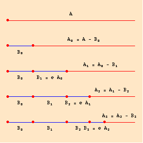
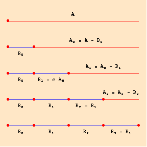

# aristotle-mathematics — supplement3（supplement）

> （《aristotle-mathematics》词条补充材料，源：plato.stanford.edu/entries/aristotle-mathematics/supplement3.html）

#### Supplement to Aristotle and Mathematics

## The Infinite

This supplement places Aristotle's treatment of the infinite in the context of Greek mathematical thought. It is not intended to be exhaustive, however.

### Preliminary Survey of Infinite Series

As a preliminary, it is useful to distinguish 3 types of series. Since we are dealing mostly with magnitudes, we shall think of a number, in context, as a number of units of measure. I shall mean by a convergent series, one that converges on a finite, positive value, and by a non-convergent series, one that increases ad infinitum. If the series is *A*_{*0*}, *A*_{*1*}, …, *A*_{*n*}, …, and a unit measure *B*, then for every number *m*, there is an *n* such that *A*_{*n*} > *mB*.

Note that Euclid, *Elements* x.1 treats convergence as: Given a series *A*_{*0*}, *A*_{*1*}, …, *A*_{*n*}, …, and a magnitude *A*, its limit, for any magnitude *B*, no matter how small, there is a member of the series, *A*_{*n*} < & *a* : *b* with *a* < *b*, representing *e*, such that *eX* = *Y* means that *a* : *b* = *Y* : *X*. Clearly, if *a* < *b*, then *Y* < *X* and *Y* exists. For convenience, think of *e* > *p* as meaning some appropriate translation of real numbers into the Greek language of ratios.

Note that unless *A* = *B*, *A* − *B* is a part of *A*. If *B* > *A*, then *A* − *B* is undefined.

> **Division/Addition series** (keep in mind that this way of defining a series is very modern):
>
> >  *e* < 1 (in the diagram, *e* = 1/3)
> >
> > *B*_{*0*} < *A*
> >
> > *A*_{*0*} = *A* − *B*_{*0*}
> >
> > *B*_{*n+1*} = *e* *A*_{*n*}
> >
> > *A*_{*n+1*} = *A*_{*n*} − *B*_{*n+1*}
> >
> > *C*_{*n*} = *B*_{*0*} + … + *B*_{*n*}
>
> Clearly,
>
> > *A*, *A*_{*0*}, …, *A*_{*n*}, … and *B*_{*0*}, …, *B*_{*n*}, … converge on either a point or a magnitude of less dimension than *A*. *C*_{*0*}, …, *C*_{*n*}, … converges on *A*.

Simple modern proof:

> For *n* > 0,
>
> > | *A*_{*n*} | = | *A*_{*n-1*} − *B*_{*n*} |
> > | --- | --- | --- |
> > |   | = | *A*_{*n−1*} − *e* *A*_{*n-1*} |
> > |   | = | *A*_{*n−1*} (1−*e*) |
> > |   | = | *A*_{*0*} (1-*e*)^{*n*} |
>
> Hence,
>
> > | *B*_{*n*} | = | *e* *A*_{*n−1*} |
> > | --- | --- | --- |
> > |   | = | *e* (1−*e*)^{*n−1*} |
>
> And,
>
> > | *B*_{*0*} + … + *B*_{*n*} + … | = | *B*_{*0*} + *e* *A*_{*0*} (1-*e*)⁰ + … + *e* *A*_{*0*} (1-*e*)^{*n-1*} + … |
> > | --- | --- | --- |
> > |   | = | *B*_{*0*} + *e* *A*_{*0*} [(1−*e*)^{*0*} + … + (1−*e*)^{*n*−1} + … ] |
>
> Since 0 < *e* < 1, it follows that 0 < 1 − *e* < 1, while for 0 < *q* < 1,
>
> > 1 + *q* + … + *q*^{*n*} + … = 1/(1−*q*).
>
> Hence,
>
> > | *B*_{*0*} + … + *B*_{*n*} + … | = | *B*_{*0*} + *e* *A*_{*0*} (1/(1-(1-*e*)) |
> > | --- | --- | --- |
> > |   | = | *B*_{*0*} + *e* *A*_{*0*} (1/*e*) |
> > |   | = | *B*_{*0*} + *A*_{*0*} |
> > |   | = | *A* |

Note that this series is different from the fundamental series used in Euclid, *Elements* x.1 as well as its applications in *Elements* x 12, where it allowed that the value of *e* can change. We can describe the series as follows: let *e*_{*0*}, …, *e*_{*n*}, … be a series of portion-operator (see above), such that for all *n*, 0 < *e*_{*n*} < 1. Let *A*_{*0*} be a magnitude.

> | *A*_{*0*} | = | *A* − *e*_{*0*} *A*_{*n*} |
> | --- | --- | --- |
> | *A*_{*n+1*} | = | *A*_{*n*} − *e*_{*n*} *A*_{*n*} |

Euclid needs the series *A*, *A*_{*0*}, …, *A*_{*n*}, … to become arbitrarily small, but he must not require that *e*_{*0*} = …= *e*_{*n*} = … He is aware that if this series decreases fast enough, *A*, *A*_{*0*}, …, *A*_{*n*}, … might converge on a finite magnitude. Hence, he arbitrarily fixes *e*_{*n*} > 1/2, a value which does not endanger his proofs.

### Aristotle's classification of infinite series

Hence, we can have Aristotle's series described in two ways:

1. **Convergent series by division**: We may start with *A* and take portions of *A*. Note that Aristotle uses ‘division’ instead of ‘subtraction’ because he conceives of the magnitude as being divided. The word does not mean ‘division’ in the sense of the arithmetic operation. The series *A*, *A*_{*0*}, …, *A*_{*n*}, … , approaches a point or a magnitude of less dimension than *A*
2. **Convergent series by addition**: We may start with *B*_{*0*} and add on the magnitudes *B*_{*n+1*} that we take away from each *A*_{*n*}. In other words, *C*_{*0*}, … , *C*_{*n*}, … converges on *A*, but never exceeds it.

It is also obvious, as Aristotle claims, that every convergent series by addition is identical with some convergent series by division.

Hence we also have a **series by addition**, which is not also a series by division:

1. **Non-convergent series by addition**: Let *B*_{*0*} be a part of *A*  *B*_{*n+1*} = *e* *A* *C*_{*0*} = *B*_{*0*} *C*_{*n+1*} = *B*_{*0*} + … + *B*_{*n+1*}

(Obviously, this could be generalized within the context of ancient Greek mathematics, but it would not be important to Aristotle's argument or theory.)

Aristotle recognizes, but does not treat separately a corresponding **non-convergent series by division**, where one starts with an infinite magnitude, such that even with an infinite division, one ends up with an infinite magnitude.

Aristotle distinguishes two further ways of looking at an infinite series.

1. **The infinite series in potentiality**: The series is not actually ever completed. What make the series infinite is simply the fact that a next step in the series is always possible.
2. **The infinite series in actuality**: We conceive of the series as completed.

When we combine the two notion of an infinite series by addition or by division with the notions of a potential or actual series to construct four notions of the infinite.

- **The infinite in potentiality by division**: It is always possible to continue a process of division. Aristotle accepts this as central to his notion of continuous magnitudes.
- **The infinite in potentiality by addition**: There are three possible situations.
- The infinite series in potentiality by addition is identical with some series of the infinite in potential by division. Aristotle accepts this notion as well.
- The infinite series in potentiality by addition leads to a magnitude greater than the magnitude of the universe. Since the universe is finite in size and weight, Aristotle rejects this for these. However, since the universe is eternal, Aristotle does not reject this notion for time. Time is infinite in that there is always another day
- It follows from (b) that Aristotle rejects a non-convergent series in potentiality by addition for size and weight, but not for time.
- **The infinite in actuality by division**: No infinite series of divisions can ever be completed. However, if a line is composed of an infinite number of points, it will follow that an infinite number of infinite series will be complete. Thus, a line is not composed of an infinite number of points either, nor a plane of lines, nor a solid of planes.
- **The infinite in actuality by addition**: With the exception of time, since the only notion of infinite series in potentiality by addition which Aristotle accepts corresponds to a infinite series in potentiality by division, it follows that the only acceptable infinite series in actuality by addition would have to satisfy the same finitistic constraints. However, any such infinite series in actuality will be identical with some infinite series in actuality by division. Hence, there is no infinite acutality by addition for sizes or weights, etc. Aristotle's views on infinite time are less clear, but he is committed to some sense of an actual infinite by addition in the case of time (going into the past), but only in a weak sense, since past changes no longer exist.

Many readers of Aristotle have wondered what this view does to Greek mathematics. Does a finite mathematical space violate the principle of non-revisionism (Section 6). Aristotle claims that it does not, that in any proof one can reduce the figure proportionally. One might well think that this requires an axiom of proportionality which makes clear what it is to preserve proportionality in a figure and which the properties of any figure are preserved. For one cannot extend the base of a triangle whose vertices are at the limit of the universe. In fact, Proclus, in his commentary on Euclid, *Elements* i, preserves many examples of attempts to prove theorems for a finite universe. Many readers of Aristotle also adopt a stronger principle, that Greek mathematics was finitistic, not in the strong Aristotelian sense that the universe is finite, but in the sense that only the infinite in potential (by division and by addition) are used. It is very difficult (perhaps impossible), however, to substantiate a claim that Greek mathematicians worried deeply about this issue in much of their normal work. In the *Method*, Archimedes treats solids as composed of infinite planes, and Pappus treats a solid in *Collectio* v as the aggregate of an infinite number of infinitely small solids, as we would expect in that type of work. These are sophisticated treatises, but even in *Elements* i, Euclid constructs an infinite line to avoid having to find where a circle will intersect a finite line.
