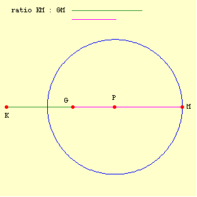
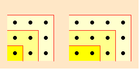

# aristotle-mathematics — supplement4（supplement）

> （《aristotle-mathematics》词条补充材料，源：plato.stanford.edu/entries/aristotle-mathematics/supplement4.html）

#### Supplement to Aristotle and Mathematics

## Aristotle and Greek Mathematics

This supplement provides some general indications of Aristotle's awareness and participation in mathematical activities of his time.

### Greek mathematics in Aristotle's Works

Here are twenty-five of his favorite propositions (the list is not exhaustive). Where a proposition occurs in Euclid's *Elements*, the number is given, * indicates that we can reconstruct from what Aristotle says a proof different from that found in Euclid). Where the attribution is in doubt, I cite the scholar who endorses it. In many cases, the theorem is inferred from the context.

1. In a given circle equal chords form equal angles with the circumference of the circle (*Prior Analytics* i.24; not at all Euclidean in conception)
2. The angles at the base of an isosceles triangle are equal (*Prior Analytics* i.24; Eucl. i.5*).
3. The angles about a point are two right angles (*Metaphysics* ix 9; Eucl. follows from i def. 10).
4. If two straight-lines are parallel and a straight-line intersects them, the interior angle is equal to the exterior angle (*Prior Analytics* ii.17; Eucl. i 29, cf. 28).
5. If two straight-lines are parallel and a straight-line intersects them, the alternate angles are equal (possibly, but not likely *Prior Analytics* ii.17 (Heiberg), although the theorem is about parallel lines and uses (7); Eucl. i 29*).
6. If a straight-line intersects two straight-lines and makes interior or exterior angles equal to two right angles on the same side with each, then the lines are parallel (possibly *Posterior Analytics* i.5 (Blancanus, Heath), but it is possibly the weaker theorem that each angle formed by the intersecting line is right, rather than their sum equals two right angles); Eucl. i 28*)
7. The internal angles of a triangle are equal to two right angles (frequent, but cf. *Prior Analytics* i.35, *Metaphysics* ix.9; Eucl. corollary to i.32*)
8. The angle in a semicircle is a right angle (*Posterior Analytics* i.1, ii.11, *Metaphysics* ix.9; Eucl. iii.31*)
9. In a right triangle the squares on the legs are equal to the square on the hypotenuse (*De incessu animalium* 9 (Heath); Eucl. i.47).
10. To find the mean proportion of two lines (De anima ii.2, Metaphysics iii.2; Eucl. vi.13, cf. ii.14)
11. The external angles of a polygon equal 4 right angles *Posterior Analytics* ii.17).
12. If from two points equal lines are drawn to meet and form angles, the locus of points at the angles forms a circle (*Meteorologica* iii.3; this effectively constructs a cone).
13. The locus of points formed by taking lines in a given ratio (not 1 : 1) from two given points (KM₁ : GM₁ = KM₂ : GM₂ = ...) constitute a circle (*Meteorologica* iii.5) 
14. The equal sides of an isosceles triangle are each greater than the altitude of the triangle drawn from the angle formed by the equal sides (*De incessu animalium* 9, a trivial corollary of (9)).
15. The circle encompasses the greatest area for a given circumference, (possibly *Posterior Analytics* i.10, possibly *De caelo* ii.4; proved by Zenodorus, 2nd century BCE).
16. To square a lunule, a figure shaped like a crescent formed by the intersection of two circular arcs (*Prior Analytics* ii 25, *Sophistici Elenchi* 11, *Physics* i.2; this is a problem of Hippocrates of Chios, whom Aristotle claims thought that he could thus square a circle).
17. A spiral (which sort?) is non-uniform, i.e., no part coincides with any other (*Physics* v.4).
18. The shape of a square is unaltered when a gnomon is added, but a rectangle's shape is altered, where a gnomon has the shape of a carpenter's square; about a unit you add three units to get a 2 by 2 square, and about two units you add four units to get a 3 by 2 square (Categories 14, Physics iii.3, this pertains to Pythagorean pebble arithmetic and to ‘quadratic’ problems represented in Euclid, *Elements* ii). 
19. Two spheres rotating in different directions (presumably about axes which do not coincide), with one carrying the other, produce a non-uniform motion (*De gen. et corr*. ii.10. cf. *Metaphysics* iii.2, possibly with (17) above).
20. In a parallelogram, a line drawn parallel to a side through two sides cuts the area and the side in the same ratio (*Topics* viii.3; Eucl. vi.1*)
21. The multiple of two cube numbers is a cube number (controversial, but cf. *Posterior Analytics* i.7; Eucl. ix.4)
22. The apparent size of objects is proportional to their distance from the observer — the precise sense of the claim is uncertain (*De memoria* 2; perhaps Euclid, *Optics* def. 4, prop. 5)
23. A rainbow is never greater than a semicircle (incidentally, this is true in Kansas, but false on Mt. Olympus, and for reasons evident in the proof, which is otherwise based on a false theory of reflection) (*Meteorologica* iii.5).

(1) and (3) might be basic principles for Aristotle. Of greater interest, (3) and (4), (5), (7), (8), and possibly (13) form a natural deductive sequence. (7) is Aristotle's favorite example. In proportion theory, he uses many principles, but two are clear favorites:

1. Proportions alternate (*a* : *b* = *c* : *d* => *a* : *c* = *b* : *d*) (*Posterior Analytics* i.5, ii.17, cf. *De anima* iii.7, *Nicomachean Ethics* v.3; Eucl. v.16).
2. The side and diagonal of a square are incommensurable (from showing that odd numbers would otherwise be equal to even numbers) (ver frequent, but cf. *Prior Analytics* i.24, 44; Eucl. x Appendix 27 (2 versions) * (perhaps)).

Additionally, one of Aristotle's favorite examples is the problem of squaring a circle (finding a square equal to a given circle). The problem must be as old as Greek mathematics, given that the problem marks a transition from Egyptian to Greek style mathematics. Some have held that there was at least one solution, using a curve called the quadratrix, in the time of Aristotle, a very controversial claim. Aristotle shows no awareness of a solution to the problem, which may well count as evidence that the quadratrix was either not yet discovered or was not used for this purpose.

It is difficult to know what would have counted as advanced mathematics in Aristotle's time, but certainly (13) is very elegant and sophisticated.

Aristotle discusses the definitions of numerous mathematical entities and properties, such as point, line, plane, solid, circle, commensurate, number, even and odd, three, etc., and uses others in interesting ways, such as prime and additively prime (not the sum of two numbers, i.e., 2 and 3, since 2 is the first number) in a definition of ‘three’. In this regard, he is the most important source for the development of introductory texts in the 4th. century BCE.

He is also a witness to some important developments. Many scholars have held that the method of proof used for (20) above, which Aristotle calls ‘antanairesis’ is Euclid's method of reciprocal subtraction (anthuphairesis) represents an early proportion theory (two ratios are the same if they have the same reciprocal subtraction), although there is much disagreement as to when an how it was used in a ‘definition’ of ‘same ratio.’ It is commonly held that the general proof of (22), which Aristotle announces in the *Posterior Analytics* announces a replacement of this earlier theory by Eudoxus.

His mention of convergence constructions (neusis), which one makes by wiggling a line into having the required properties, and his use of angles formed by straight lines and circles, neither of which is admitted in Euclid's *Elements*, is important evidence that Greek mathematicians were not inhibited in these matters.

It is common to think that Aristotle's mention of a problem whether a construction of parallel lines involves a *petitio principii* refers to debates over whether a parallel postulate is required (*Prior Analytics* ii.16, Euclid i Post. 5).

Additionally, Aristotle shows an awareness of the astronomical models of Eudoxus and Callippus and lets their models form the basis of his astronomical model. These models use concentric, uniformly rotating spheres, with the earth as the center of every sphere. Complexity of motion results from the combination of motion, where an outer sphere carries the axis of rotation of the next sphere below it. In these systems, each planetary body has an independent system of spheres. Aristotle unifies the systems by introducing ‘unwinders’ which lie between each system and undo the motions of the previous system.

### Interesting Omissions

Although Aristotle is aware of curves generated by multiple motions and divides lines into straight, circular, and mixed, he only mentions only spirals, by which he may mean spherical sprials or any heavenly ‘twistings’. (Some commentators have held that Aristotle means by mixed lines, lines that have straight and curved segments.) He does not mention, parabolas, ellipses, nor hyperboles, although these were a contemporary discovery. Nor does he mention two of the three major problems in contemporary mathematics, trisecting an angle and doubling the cube. Most today think that Aristotle's remark in *Posterior Analytics* i.7 about whether two cubes is a cube refers to their multiplication of two cube numbers (see above, 21), or less likely to the question of whether their sum is ever a cube, although it would be as natural a question in the 4th century BCE as it was to Fermat. As noted above, the third problem, squaring the circle, is a favorite example.

### Peculiar Claims

Not every claim in Aristotle's corpus would we regard as felicitous. This is also true of mathematics. Some have held that these show that Aristotle did not know contemporary mathematics. Another possibility is that these advances in mathematics were made after Aristotle.

Of these, the most striking is a claim made in *Physics* vii.4, that a circular circumference and a straight line cannot be compared. Hence, rectification of a circumference would be impossible. At least since Archimedes, we know that the problem of rectifying a circumference is equivalent to the problem of squaring a circle. Yet, Aristotle allows that the problem of squaring a circle may have a solution. It seems likely, then, that this equivalence was unknown in the 4th cent. BCE.

As arguments against infinitely long linear motion, infinite weight, infinite bodies, etc., the arguments using proportion are not always very successful, since they make certain simplifying assumptions which undermine the arguments. Typically, Aristotle will assume uniform motion or weight, and will argue along these lines: Let *AB* be a finite distance covered by *X* in an infinite time *CD*. Then take a finite part *CE* of *CD*. *X* will move a finite part of *AB* in time *CE*. Let this be *AF*. Then *AF* : *AB* = *CE* : *CD*, which is impossible. These arguments are perfectly respectable mathematically. However, they will not provide the conclusions which Aristotle needs. Aristotle even recognizes that if we allow that *X* can vary in its motions, the argument will not show the impossibility; yet he only twice takes this into account.

On these two occasions (*Physics* vi.7 and *De caelo* i.6) where Aristotle considers non-uniform magnitudes, he attempts to speak generally without a concrete example, so that his argument fails. However, one should also note that no one until the late Middle Ages seems to have noticed this. Greek mathematicians wisely avoided non-uniform magnitudes which could not be reduced to uniform magnitudes. The reason for this has partly to do with the difficulty of representing non-uniformity abstractly. Hence, Aristotle needs to consider non-uniform magnitudes for his proofs, but lacks the mathematics to deal with them.

A similar remark may be made about Aristotle's arguments against an infinite ray rotating (*De caelo* i.5). The difficulty for Aristotle is conceptualizing a rotation where every distance is finite, so that while the points on the ray move faster as they are further from the center they are still always finite. Aristotle does raise an interesting paradox, if there is an infinite line not going through the center of rotation, there will be no first point where the rotating line and the fixed line meet.

The law of reflection used by Aristotle in *Meteorologica* iii.5 is incorrect. Since the correct rule appears in pseudo-Aristotle, *Problems* xiv.4, 13 and in pseudo-Euclid, *Catoptics*, which may date from 3rd cent. BCE, it is reasonable to suppose that the correct law was unknown in Aristotle's time. Aristotle's rule is: Let *M* be the location of the mirror, *G* the object seen, and *K* the observer, then *MG* : *GK* is constant.

#### Original Mathematics

Few today would credit Plato with original mathematics. More can be said for Aristotle. While it may be unlikely that Aristotle is the author of the locus theorem (13) from *Meteorologica* iii.5, it is interesting that in his commentary on Apollonius' *Conics*, the Byzantine mathematician Eutocius attributes the theorem to Apollonius, 150 years Aristotle's junior.

With the possible exception of this theorem, all of Aristotle's original mathematics may be found in his arguments against infinity and on motion in the Physics iii-vii and De caelo i, many of which use proportion theory. In his attempt to work out theorems about ratios and infinite magnitudes, Aristotle makes important mathematical observations about infinite magnitudes and may have been the first to attempt them.
