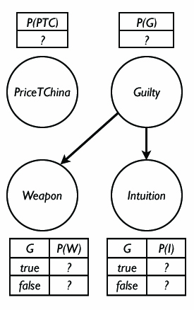
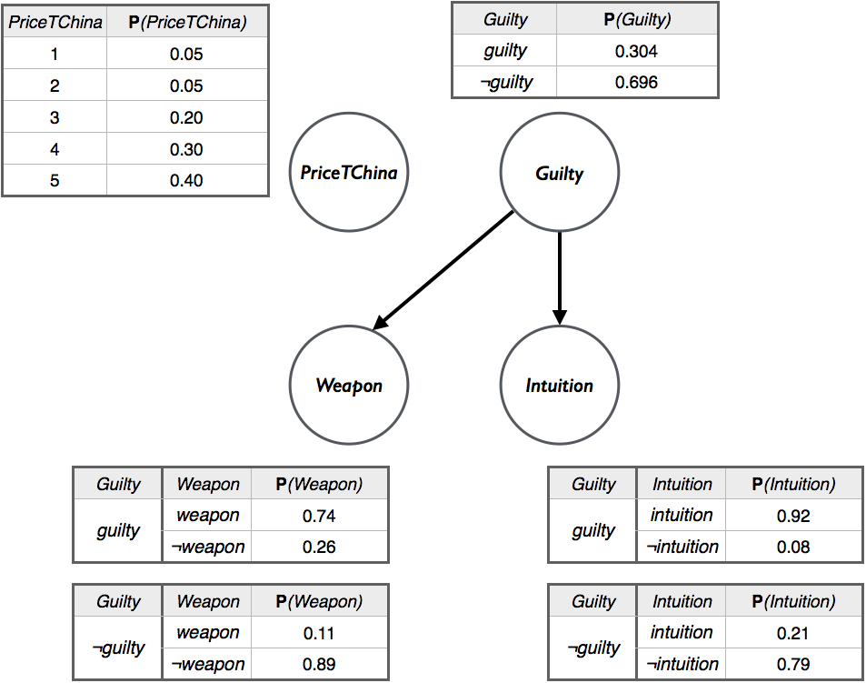

# artificial-intelligence — bayesian-nets（supplement）

> （《artificial-intelligence》词条补充材料，源：plato.stanford.edu/entries/artificial-intelligence/bayesian-nets.html）

#### Supplement to Artificial Intelligence

## Bayesian Nets

To explain Bayesian networks, and to provide a contrast between Bayesian probabilistic inference, and argument-based approaches that are likely to be attractive to classically trained philosophers, let us build upon the example of Barolo introduced above. Suppose that we want to compute the posterior probability of the guilt of our murder suspect, Mr. Barolo, from observed evidence. We have three Boolean variables in play: *Guilty*, *Weapon*, and *Intuition*. *Weapon* is true or false based on whether or not a murder weapon (the knife, recall) belonging to Barolo is found at the scene of the bloody crime. The variable *Intuition* is true provided that the very experienced detective in charge of the case, Holmes, has an intuition, without examining any physical evidence in the case, that Barolo is guilty; $\lnot$*intuition* holds just in case Holmes has no intuition either way. Here is a table that holds all the (eight) atomic events in the scenario so far:

|   | *weapon* | $\lnot$*weapon* |   |   |
| --- | --- | --- | --- | --- |
|   | *intuition* | $\lnot$*intuition* | *intuition* | $\lnot$*intuition* |
| *guilty* | 0.208 | 0.016 | 0.072 | 0.008 |
| $\lnot$*guilty* | 0.013 | 0.063 | 0.134 | 0.486 |

*Joint Distribution for $\mathbf{P}(\Guilty,\Weapon,\Intuition)$*

Were we to add the aforeintroduced discrete random variable $\PriceTChina$, we would of course have 40 events, corresponding in tabular form to the preceding table associated with each of the five possible values of $\PriceTChina$. That is, there are 40 events in

$$ \P(\Guilty, \Weapon, \Intuition, \PriceTChina) $$

Bayesian networks provide a economical way to represent the situation. Such networks are directed, acyclic graphs in which nodes correspond to random variables. When there is a directed link from node $N_i$ to node $N_j$, we say that $N_i$ is the parent of $N_j$. With each node $N_i$ there is a corresponding conditional probability distribution $$ P\left(N_i \ggiven Parents\left(N_i\right)\right) $$

where, of course, $Parents(N_i)$ denotes the parents of $N_i$. The following figure shows such a network for the case we have been considering. The specific probability information is omitted; readers should at this point be able to readily calculate it using the machinery provided above.

*A Simple Bayesian Net*

Notice the economy of the network, in striking contrast to the prospect, visited above, of listing all 40 possibilities. The price of tea in China is presumed to have no connection to the murder, and hence the relevant node is isolated. In addition, only some probability information is included, corresponding to the relevant tables shown in the figure (typically termed a conditional probability table). And yet from a Bayesian network, every entry in the full joint distribution can be easily calculated, as follows. First, for each node/variable $N_i$ we write $N_i = n_i$ to indicate an assignment to that node/variable. The conjunction of the specific assignments to every variable in the full joint probability distribution can then be written as

$$ P\left(N_1=n_1 \land \ldots \land N_n=n_n\right) $$

and abbreviated as $P(n_1, \ldots, n_n)$. Where $parents(N_i)$ denotes the specific assignments to the variables in the set of all parents of $N_i$, we can use a Bayesian net to produce the value of any entry via this equation:

$$ \prod_{i=1}^{n} P\left(n_i \ggiven parents(N_i)\right) $$

In our murder example above, assume we want to compute $P\left(guilty, \lnot weapon, \lnot intuition, PriceTChina =5\right)$. We would use the following equation to do so.

$$\begin{align*} P\Big(guilty, &\lnot weapon, \lnot intuition, PriceTChina =5\Big) = \\ &P\left(guilty\right) P\left(\lnot weapon \ggiven guilty \right) \times \\ &P\left(\lnot intuition \ggiven guilty \right) \times \\ &P\left(PriceTChina =5\right) \end{align*}$$

The Bayes net for the problem is shown fleshed out below. The values in the Bayes net below were computed using the table for the joint distribution of $\mathbf{P}(\Guilty,\Weapon,\Intuition)$ given above.^{[[^note-b1]]}

*Bayesian Net for the Murder Example*

Plugging in the values from the Bayes net into the equation gives us:

$$\begin{aligned} &P\Big(guilty, \lnot weapon, \lnot intuition, PriceTChina =5\Big) \\ &\qquad\qquad= 0.304 \times 0.26 \times 0.08 \times 0.40\\ &\qquad\qquad= 0.0025 \end{aligned}$$

Earlier, we observed that the full joint distribution can be used to infer an answer to queries about the domain. Given this, it follows immediately that Bayesian networks have the same power. But in addition, there are much more efficient methods over such networks for answering queries. These methods, and increasing the expressivity of networks toward the first-order case, are outside the scope of the present entry. Readers are directed to *AIMA*, or any of the other textbooks affirmed in this entry.^{[[^note-b2]]}

## Notes（原文脚注，引自主文）

[^note-b1]: B1. For readers familiar with Excel, an Excel and Apple Numbers file for computing the graph can be downloaded from [GitHub](https://github.com/naveensundarg/SEP.AI.BayesNetExample). Also see the [Google Docs sheet](https://goo.gl/cSh4lm).

[^note-b2]: B2. Obviously, there are other excellent textbooks that serve to introduce and, at least to some degree, canvass, AI. For example, there is the commendable trio: (Ginsberg 1993), (Nilsson 1987), and (Winston 1992). (Winston’s book is the third edition. In Nilsson’s case, this is his second intro book; the first was (Nilsson 1987).) The reader should rest assured that in each case, whether from this trio or whether *AIMA*, the coverage is basically the same; the core topics don’t vary. In fact, Nilsson’s (1998) book, as he states in his preface, is explicitly an “agent-based” approach, and in fact the book, like *AIMA*, is written as a progression from the simplest agent through the most capable. (We say a bit about this in the main text, later.) Clearly, then, our reliance on *AIMA* in no way makes the present *SEP* entry idiosyncratic. Finally, arguably the attribute most important to an entry such as the present one is “encyclopedic” coverage of AI – and *AIMA* delivers in this regard like no other extant text. This situation may change in the future, and if it does, the present entry would of course be updated.