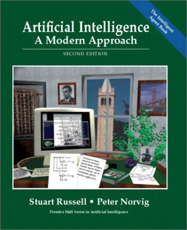
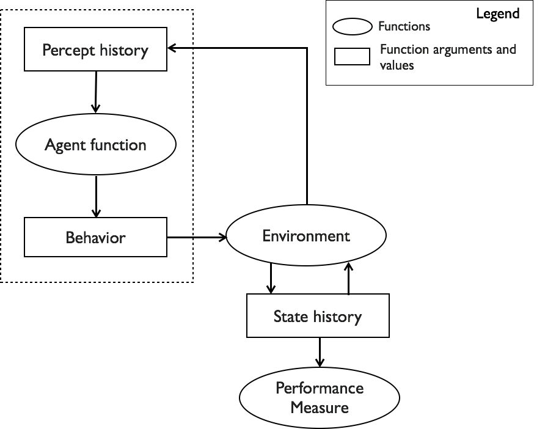
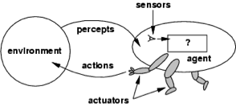
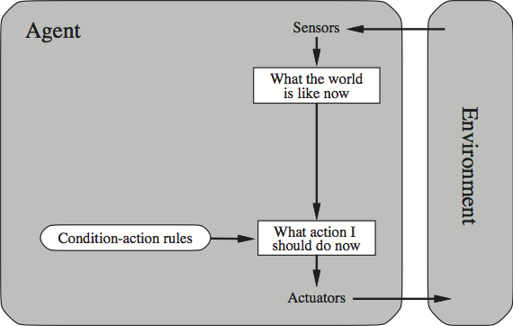
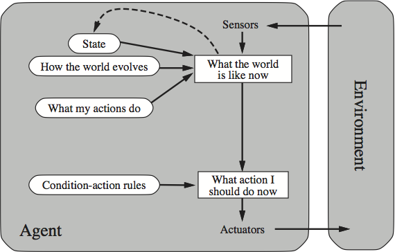
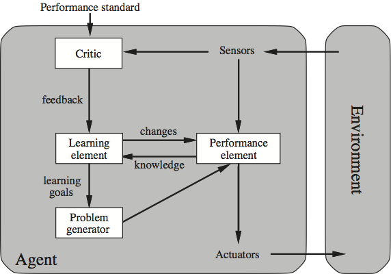
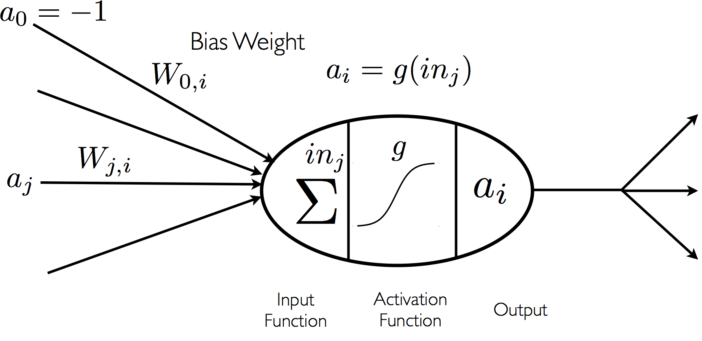
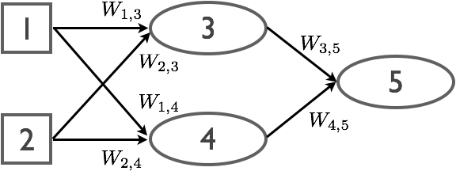

# Artificial Intelligence
**First published Thu Jul 12, 2018**

*Bringsjord, Selmer, Govindarajulu, Naveen Sundar*

Artificial intelligence (AI) is the field devoted to building artificial animals (or at least artificial creatures that – in suitable contexts – *appear* to be animals) and, for many, artificial persons (or at least artificial creatures that – in suitable contexts – *appear* to be persons).[^note-1] Such goals immediately ensure that AI is a discipline of considerable interest to many philosophers, and this has been confirmed (e.g.) by the energetic attempt, on the part of numerous philosophers, to show that these goals are in fact un/attainable. On the constructive side, many of the core formalisms and techniques used in AI come out of, and are indeed still much used and refined in, philosophy: first-order logic and its extensions; intensional logics suitable for the modeling of doxastic attitudes and deontic reasoning; inductive logic, probability theory, and probabilistic reasoning; practical reasoning and planning, and so on. In light of this, some philosophers conduct AI research and development *as* philosophy.

In the present entry, the history of AI is briefly recounted, proposed definitions of the field are discussed, and an overview of the field is provided. In addition, both philosophical AI (AI pursued as and out of philosophy) and philosophy *of* AI are discussed, via examples of both. The entry ends with some *de rigueur* speculative commentary regarding the future of AI.

## 1. The History of AI

The field of artificial intelligence (AI) officially started in 1956, launched by a small but now-famous summer conference at Dartmouth College, in Hanover, New Hampshire. (The 50-year celebration of this conference, [AI@50](https://web.archive.org/web/20200315115548/http://www.dartmouth.edu/~ai50/homepage.html), was held in July 2006 at Dartmouth, with five of the original participants making it back.[^note-2] What happened at this historic conference figures in the final section of this entry.) Ten thinkers attended, including John McCarthy (who was working at Dartmouth in 1956), Claude Shannon, Marvin Minsky, Arthur Samuel, Trenchard Moore (apparently the lone note-taker at the original conference), Ray Solomonoff, Oliver Selfridge, Allen Newell, and Herbert Simon. From where we stand now, into the start of the new millennium, the Dartmouth conference is memorable for many reasons, including this pair: one, the term ‘artificial intelligence’ was coined there (and has long been firmly entrenched, despite being disliked by some of the attendees, e.g., Moore); two, Newell and Simon revealed a program – Logic Theorist (LT) – agreed by the attendees (and, indeed, by nearly all those who learned of and about it soon after the conference) to be a remarkable achievement. LT was capable of proving elementary theorems in the propositional calculus.[^note-3][^note-4]

Though the *term* ‘artificial intelligence’ made its advent at the 1956 conference, certainly the *field* of AI, operationally defined (defined, i.e., as a field constituted by practitioners who think and act in certain ways), was in operation before 1956. For example, in a famous *Mind* paper of 1950, Alan Turing argues that the question “Can a machine think?” (and here Turing is talking about standard computing machines: machines capable of computing functions from the natural numbers (or pairs, triples, … thereof) to the natural numbers that a Turing machine or equivalent can handle) should be replaced with the question “Can a machine be linguistically indistinguishable from a human?.” Specifically, he proposes a test, the “Turing Test” (TT) as it’s now known. In the TT, a woman and a computer are sequestered in sealed rooms, and a human judge, in the dark as to which of the two rooms contains which contestant, asks questions by email (actually, by *teletype*, to use the original term) of the two. If, on the strength of returned answers, the judge can do no better than 50/50 when delivering a verdict as to which room houses which player, we say that the computer in question has **passed** the TT. Passing in this sense operationalizes linguistic indistinguishability. Later, we shall discuss the role that TT has played, and indeed continues to play, in attempts to define AI. At the moment, though, the point is that in his paper, Turing explicitly lays down the call for building machines that would provide an existence proof of an affirmative answer to his question. The call even includes a suggestion for how such construction should proceed. (He suggests that “child machines” be built, and that these machines could then gradually grow up on their own to learn to communicate in natural language at the level of adult humans. This suggestion has arguably been followed by Rodney Brooks and the philosopher Daniel Dennett (1994) in the Cog Project. In addition, the Spielberg/Kubrick movie *A.I.* is at least in part a cinematic exploration of Turing’s suggestion.[^note-5]) The TT continues to be at the heart of AI and discussions of its foundations, as confirmed by the appearance of Moor 2003. In fact, the TT continues to be used to *define* the field, as in Nilsson’s (1998) position, expressed in his textbook for the field, that AI simply is the field devoted to building an artifact able to negotiate this test. Energy supplied by the dream of engineering a computer that can pass TT, or by controversy surrounding claims that it has *already* been passed, is if anything stronger than ever, and the reader has only to do an internet search via the string

turing test passed

to find up-to-the-minute attempts at reaching this dream, and attempts (sometimes made by philosophers) to debunk claims that some such attempt has succeeded.

Returning to the issue of the historical record, even if one bolsters the claim that AI started at the 1956 conference by adding the proviso that ‘artificial intelligence’ refers to a nuts-and-bolts *engineering* pursuit (in which case Turing’s philosophical discussion, despite calls for a child machine, wouldn’t exactly count as AI per se), one must confront the fact that Turing, and indeed many predecessors, did attempt to build intelligent artifacts. In Turing’s case, such building was surprisingly well-understood before the advent of programmable computers: Turing wrote a program for playing chess before there were computers to run such programs on, by slavishly following the code himself. He did this well before 1950, and long before Newell (1973) gave thought in print to the possibility of a sustained, serious attempt at building a good chess-playing computer.[^note-6]

From the perspective of philosophy, which views the systematic investigation of mechanical intelligence as meaningful and productive separate from the specific logicist formalisms (e.g., first-order logic) and problems (e.g., the *Entscheidungsproblem*) that gave birth to computer science, neither the 1956 conference, nor Turing’s *Mind* paper, come close to marking the start of AI. This is easy enough to see. For example, Descartes proposed TT (not the TT by name, of course) long before Turing was born.[^note-7] Here’s the relevant passage:

> If there were machines which bore a resemblance to our body and imitated our actions as far as it was morally possible to do so, we should always have two very certain tests by which to recognise that, for all that, they were not real men. The first is, that they could never use speech or other signs as we do when placing our thoughts on record for the benefit of others. For we can easily understand a machine’s being constituted so that it can utter words, and even emit some responses to action on it of a corporeal kind, which brings about a change in its organs; for instance, if it is touched in a particular part it may ask what we wish to say to it; if in another part it may exclaim that it is being hurt, and so on. But it never happens that it arranges its speech in various ways, in order to reply appropriately to everything that may be said in its presence, as even the lowest type of man can do. And the second difference is, that although machines can perform certain things as well as or perhaps better than any of us can do, they infallibly fall short in others, by which means we may discover that they did not act from knowledge, but only for the disposition of their organs. For while reason is a universal instrument which can serve for all contingencies, these organs have need of some special adaptation for every particular action. From this it follows that it is morally impossible that there should be sufficient diversity in any machine to allow it to act in all the events of life in the same way as our reason causes us to act. (Descartes 1637, p. 116)[^descartes-1637]

At the moment, Descartes is certainly carrying the day.[^note-8] Turing predicted that his test would be passed by 2000, but the fireworks across the globe at the start of the new millennium have long since died down, and the most articulate of computers still can’t meaningfully debate a sharp toddler. Moreover, while in certain focussed areas machines out-perform minds (IBM’s famous Deep Blue prevailed in chess over Gary Kasparov, e.g.; and more recently, AI systems have prevailed in other games, e.g. *Jeopardy!* and Go, about which more will momentarily be said), minds have a (Cartesian) capacity for cultivating their expertise in virtually *any* sphere. (If it were announced to Deep Blue, or any current successor, that chess was no longer to be the game of choice, but rather a heretofore unplayed variant of chess, the machine would be trounced by human children of average intelligence having no chess expertise.) AI simply hasn’t managed to create *general* intelligence; it hasn’t even managed to produce an artifact indicating that *eventually* it will create such a thing.

But what about IBM Watson’s famous nail-biting victory in the *Jeopardy!* game-show contest?[^note-9] That certainly seems to be a machine triumph over humans on their “home field,” since *Jeopardy!* delivers a human-level linguistic challenge ranging across many domains. Indeed, among many AI cognoscenti, Watson’s success is considered to be much more impressive than Deep Blue’s, for numerous reasons. One reason is that while chess is generally considered to be well-understood from the formal-computational perspective (after all, it’s well-known that there exists a perfect strategy for playing chess), in open-domain **question-answering** (QA), as in any significant natural-language processing task, there is no consensus as to what problem, formally speaking, one is trying to solve. Briefly, question-answering (QA) is what the reader would think it is: one asks a question of a machine, and gets an answer, where the answer has to be produced via some “significant” computational process. (See Strzalkowski & Harabagiu (2006) for an overview of what QA, historically, has been as a field.) A bit more precisely, there is no agreement as to what underlying function, formally speaking, question-answering capability computes. This lack of agreement stems quite naturally from the fact that there is of course no consensus as to what natural languages *are*, formally speaking.[^note-10] Despite this murkiness, and in the face of an almost universal belief that open-domain question-answering would remain unsolved for a decade or more, Watson decisively beat the two top human *Jeopardy!* champions on the planet. During the contest, Watson had to answer questions that required not only command of simple factoids (**Question**₁), but also of some amount of rudimentary reasoning (in the form of temporal reasoning) and commonsense (**Question**₂):

**Question**₁: The only two consecutive U.S. presidents with the same first name.

**Question**₂: In May 1898, Portugal celebrated the 400th anniversary of this explorer’s arrival in India.

While Watson is demonstrably better than humans in *Jeopardy!*-style quizzing (a new human *Jeopardy!* master could arrive on the scene, but as for chess, AI now assumes that a second round of IBM-level investment would vanquish the new human opponent), this approach does not work for the kind of NLP challenge that Descartes described; that is, Watson can’t converse on the fly. After all, some questions don’t hinge on sophisticated information retrieval and machine learning over pre-existing data, but rather on intricate reasoning right on the spot. Such questions may for instance involve anaphora resolution, which require even deeper degrees of commonsensical understanding of time, space, history, folk psychology, and so on. Levesque (2013) has catalogued some alarmingly simple questions which fall in this category. (Marcus, 2013, gives an account of Levesque’s challenges that is accessible to a wider audience.) The other class of question-answering tasks on which Watson fails can be characterized as *dynamic* question-answering. These are questions for which answers may not be recorded in textual form anywhere at the time of questioning, or for which answers are dependent on factors that change with time. Two questions that fall in this category are given below (Govindarajulu et al. 2013)[^govindarajulu-2013]:

**Question**₃: If I have 4 foos and 5 bars, and if foos are not the same as bars, how many foos will I have if I get 3 bazes which just happen to be foos?

**Question**₄: What was IBM’s Sharpe ratio in the last 60 days of trading?

Closely following Watson’s victory, in March 2016, [Google DeepMind’s AlphaGo](https://www.deepmind.com/research/highlighted-research/alphago) defeated one of Go’s top-ranked players, Lee Seedol, in four out of five matches. This was considered a landmark achievement within AI, as it was widely believed in the AI community that computer victory in Go was at least a few decades away, partly due to the enormous number of valid sequences of moves in Go compared to that in Chess.[^note-11] While this is a remarkable achievement, it should be noted that, despite breathless coverage in the popular press,[^note-12] AlphaGo, while indisputably a great Go player, is just that. For example, neither AlphaGo nor Watson can understand the rules of Go written in plain-and-simple English and produce a computer program that can play the game. It’s interesting that there is one endeavor in AI that tackles a narrow version of this very problem: In **general game playing**, a machine is given a description of a brand new game just before it has to play the game (Genesereth et al. 2005)[^genesereth-2005]. However, the description in question is expressed in a formal language, and the machine has to manage to play the game from this description. Note that this is still far from understanding even a simple description of a game in English well enough to play it.

But what if we consider the history of AI not from the perspective of philosophy, but rather from the perspective of the field with which, today, it is most closely connected? The reference here is to computer science. From this perspective, does AI run back to well before Turing? Interestingly enough, the results are the same: we find that AI runs deep into the past, and has always had philosophy in its veins. This is true for the simple reason that computer science grew out of logic and probability theory,[^note-13] which in turn grew out of (and is still intertwined with) philosophy. Computer science, today, is shot through and through with logic; the two fields cannot be separated. This phenomenon has become an object of study unto itself (Halpern et al. 2001)[^halpern-2001]. The situation is no different when we are talking not about traditional logic, but rather about probabilistic formalisms, also a significant component of modern-day AI: These formalisms also grew out of philosophy, as nicely chronicled, in part, by Glymour (1992). For example, in the one mind of Pascal was born a method of rigorously calculating probabilities, conditional probability (which plays a particularly large role in AI, currently), and such fertile philosophico-probabilistic arguments as Pascal’s wager, according to which it is irrational not to become a Christian.

That modern-day AI has its roots in philosophy, and in fact that these historical roots are temporally deeper than even Descartes’ distant day, can be seen by looking to the clever, revealing cover of the second edition (the third edition is the current one) of the comprehensive textbook [*Artificial Intelligence: A Modern Approach*](http://aima.cs.berkeley.edu/2nd-ed/cover.htm) (known in the AI community as simply *AIMA2e* for Russell & Norvig, 2002).

*Cover of* AIMA2e *(Russell & Norvig 2002)[^russell-2002]*

What you see there is an eclectic collection of memorabilia that might be on and around the desk of some imaginary AI researcher. For example, if you look carefully, you will specifically see: a picture of Turing, a view of Big Ben through a window (perhaps R&N are aware of the fact that Turing famously held at one point that a physical machine with the power of a universal Turing machine is physically impossible: he quipped that it would have to be the size of Big Ben), a planning algorithm described in Aristotle’s *De Motu Animalium*, Frege’s fascinating notation for first-order logic, a glimpse of Lewis Carroll’s (1958) pictorial representation of syllogistic reasoning, Ramon Lull’s concept-generating wheel from his 13ᵗʰ-century *Ars Magna*, and a number of other pregnant items (including, in a clever, recursive, and bordering-on-self-congratulatory touch, a copy of *AIMA* itself). Though there is insufficient space here to make all the historical connections, we can safely infer from the appearance of these items (and here we of course refer to the ancient ones: Aristotle conceived of planning as information-processing over two-and-a-half millennia back; and in addition, as Glymour (1992) notes, Artistotle can also be credited with devising the first knowledge-bases and ontologies, two types of representation schemes that have long been central to AI) that AI is indeed very, very old. Even those who insist that AI is at least in part an artifact-building enterprise must concede that, in light of these objects, AI is ancient, for it isn’t just theorizing from the perspective that intelligence is at bottom computational that runs back into the remote past of human history: Lull’s wheel, for example, marks an attempt to capture intelligence not only in computation, but in a physical artifact that *embodies* that computation.[^note-14]

AIMA has now reached its the third edition, and those interested in the history of AI, and for that matter the history of philosophy of mind, will not be disappointed by examination of the cover of the third installment (the cover of the second edition is almost exactly like the first edition). (All the elements of the cover, separately listed and annotated, can be found [online](http://aima.cs.berkeley.edu/cover.html).) One significant addition to the cover of the third edition is a drawing of Thomas Bayes; his appearance reflects the recent rise in the popularity of probabilistic techniques in AI, which we discuss later.

One final point about the history of AI seems worth making.

It is generally assumed that the birth of modern-day AI in the 1950s came in large part because of and through the advent of the modern high-speed digital computer. This assumption accords with common-sense. After all, AI (and, for that matter, to some degree its cousin, cognitive science, particularly computational cognitive modeling, the sub-field of cognitive science devoted to producing computational simulations of human cognition) is aimed at implementing intelligence in a computer, and it stands to reason that such a goal would be inseparably linked with the advent of such devices. However, this is only part of the story: the part that reaches back but to Turing and others (e.g., von Neuman) responsible for the first electronic computers. The other part is that, as already mentioned, AI has a particularly strong tie, historically speaking, to reasoning (logic-based and, in the need to deal with uncertainty, inductive/probabilistic reasoning). In this story, nicely told by Glymour (1992), a search for an answer to the question “What is a proof?” eventually led to an answer based on Frege’s version of first-order logic (FOL): a (finitary) mathematical proof consists in a series of step-by-step inferences from one formula of first-order logic to the next. The obvious extension of this answer (and it isn’t a complete answer, given that lots of classical mathematics, despite conventional wisdom, clearly can’t be expressed in FOL; even the Peano Axioms, to be expressed as a finite set of formulae, require *S*OL) is to say that not only mathematical thinking, but thinking, period, can be expressed in FOL. (This extension was entertained by many logicians long before the start of information-processing psychology and cognitive science – a fact some cognitive psychologists and cognitive scientists often seem to forget.) Today, logic-based AI is only *part* of AI, but the point is that this part still lives (with help from logics much more powerful, but much more complicated, than FOL), and it can be traced all the way back to Aristotle’s theory of the syllogism.[^note-15] In the case of uncertain reasoning, the question isn’t “What is a proof?”, but rather questions such as “What is it rational to believe, in light of certain observations and probabilities?” This is a question posed and tackled long before the arrival of digital computers.

## 2. What Exactly *is* AI?

So far we have been proceeding as if we have a firm and precise grasp of the nature of AI. But what exactly *is* AI? Philosophers arguably know better than anyone that precisely defining a particular discipline to the satisfaction of all relevant parties (including those working in the discipline itself) can be acutely challenging. Philosophers of science certainly have proposed credible accounts of what constitutes at least the general shape and texture of a given field of science and/or engineering, but what exactly is the agreed-upon definition of physics? What about biology? What, for that matter, is philosophy, exactly? These are remarkably difficult, maybe even eternally unanswerable, questions, especially if the target is a *consensus* definition. Perhaps the most prudent course we can manage here under obvious space constraints is to present in encapsulated form some *proposed* definitions of AI. We do include a glimpse of recent attempts to define AI in detailed, rigorous fashion (and we suspect that such attempts will be of interest to philosophers of science, and those interested in this sub-area of philosophy).

Russell and Norvig (1995, 2002, 2009), in their aforementioned *AIMA* text, provide a set of possible answers to the “What is AI?” question that has considerable currency in the field itself. These answers all assume that AI should be defined in terms of its goals: a candidate definition thus has the form “AI is the field that aims at building …” The answers all fall under a quartet of types placed along two dimensions. One dimension is whether the goal is to match human performance, or, instead, ideal rationality. The other dimension is whether the goal is to build systems that reason/think, or rather systems that act. The situation is summed up in this table:

|   | **Human-Based** | **Ideal Rationality** |
| --- | --- | --- |
| **Reasoning-Based:** | Systems that think like humans. | Systems that think rationally. |
| **Behavior-Based:** | Systems that act like humans. | Systems that act rationally. |

*Four Possible Goals for AI According to* AIMA

Please note that this quartet of possibilities does reflect (at least a significant portion of) the relevant literature. For example, philosopher John Haugeland (1985) falls into the Human/Reasoning quadrant when he says that AI is “The exciting new effort to make computers think … *machines with minds*, in the full and literal sense.” (By far, this is the quadrant that most popular narratives affirm and explore. The recent [Westworld](http://www.hbo.com/westworld) TV series is a powerful case in point.) Luger and Stubblefield (1993) seem to fall into the Ideal/Act quadrant when they write: “The branch of computer science that is concerned with the automation of intelligent behavior.” The Human/Act position is occupied most prominently by Turing, whose test is passed only by those systems able to act sufficiently like a human. The “thinking rationally” position is defended (e.g.) by Winston (1992). While it might not be entirely uncontroversial to assert that the four bins given here are exhaustive, such an assertion appears to be quite plausible, even when the literature up to the present moment is canvassed.

It’s important to know that the contrast between the focus on systems that think/reason versus systems that act, while found, as we have seen, at the heart of the *AIMA* texts, and at the heart of AI itself, should not be interpreted as implying that AI researchers view their work as falling all and only within one of these two compartments. Researchers who focus more or less exclusively on knowledge representation and reasoning, are also quite prepared to acknowledge that they are working on (what they take to be) a central component or capability within any one of a family of larger systems spanning the reason/act distinction. The clearest case may come from the work on planning – an AI area traditionally making central use of representation and reasoning. For good or ill, much of this research is done in abstraction (in vitro, as opposed to in vivo), but the researchers involved certainly intend or at least hope that the results of their work can be embedded into systems that actually do things, such as, for example, execute the plans.

What about Russell and Norvig themselves? What is their answer to the What is AI? question? They are firmly in the “acting rationally” camp. In fact, it’s safe to say both that they are the chief proponents of this answer, and that they have been remarkably successful evangelists. Their extremely influential *AIMA* series can be viewed as a book-length defense and specification of the Ideal/Act category. We will look a bit later at how Russell and Norvig lay out all of AI in terms of **intelligent agents**, which are systems that act in accordance with various ideal standards for rationality. But first let’s look a bit closer at the view of intelligence underlying the *AIMA* text. We can do so by turning to Russell (1997). Here Russell recasts the “What is AI?” question as the question “What is intelligence?” (presumably under the assumption that we have a good grasp of what an artifact is), and then he identifies intelligence with **rationality**. More specifically, Russell sees AI as the field devoted to building **intelligent agents**, which are functions taking as input tuples of percepts from the external environment, and producing behavior (actions) on the basis of these percepts. Russell’s overall picture is this one:

*The Basic Picture Underlying Russell’s Account of Intelligence/Rationality*

Let’s unpack this diagram a bit, and take a look, first, at the account of **perfect rationality** that can be derived from it. The behavior of the agent in the environment $E$ (from a class $\bE$ of environments) produces a sequence of states or snapshots of that environment. A performance measure $U$ evaluates this sequence; notice the box labeled “Performance Measure” in the above figure. We let $V(f,\bE,U)$ denote the *expected* utility according to $U$ of the agent function $f$ operating on $\bE$.[^note-16] Now we identify a perfectly rational agent with the agent function:

$$\tag{1}\label{eq1} f_{\opt} = \argmax_f V(f,\bE,U) $$

According to the above equation, a perfectly rational agent can be taken to be the function $f_{opt}$ which produces the maximum expected utility in the environment under consideration. Of course, as Russell points out, it’s usually not possible to actually build perfectly rational agents. For example, though it’s easy enough to specify an algorithm for playing invincible chess, it’s not feasible to implement this algorithm. What traditionally happens in AI is that programs that are – to use Russell’s apt terminology – **calculatively rational** are constructed instead: these are programs that, *if executed infinitely fast*, would result in perfectly rational behavior. In the case of chess, this would mean that we strive to write a program that runs an algorithm capable, in principle, of finding a flawless move, but we add features that truncate the search for this move in order to play within intervals of digestible duration.

Russell himself champions a new brand of intelligence/rationality for AI; he calls this brand **bounded optimality**. To understand Russell’s view, first we follow him in introducing a distinction: We say that agents have two components: a program, and a machine upon which the program runs. We write $Agent(P, M)$ to denote the agent function implemented by program $P$ running on machine $M$. Now, let $\mathcal{P}(M)$ denote the set of all programs $P$ that can run on machine $M$. The **bounded optimal** program $P_{\opt,M}$ then is:

$$ P_{\opt,M}=\argmax_{P\in\mathcal{P}(M)}V(\mathit{Agent}(P,M),\bE,U) $$

You can understand this equation in terms of any of the mathematical idealizations for standard computation. For example, machines can be identified with Turing machines minus instructions (i.e., TMs are here viewed architecturally only: as having tapes divided into squares upon which symbols can be written, read/write heads capable of moving up and down the tape to write and erase, and control units which are in one of a finite number of states at any time), and programs can be identified with instructions in the Turing-machine model (telling the machine to write and erase symbols, depending upon what state the machine is in). So, if you are told that you must “program” within the constraints of a 22-state Turing machine, you could search for the “best” program given those constraints. In other words, you could strive to find the optimal program within the bounds of the 22-state architecture. Russell’s (1997) view is thus that AI is the field devoted to creating optimal programs for intelligent agents, under time and space constraints on the machines implementing these programs.[^note-17]

The reader must have noticed that in the equation for $P_{\opt,M}$ we have not elaborated on $\bE$ and $U$ and how equation \eqref{eq1} might be used to construct an agent if the class of environments $\bE$ is quite general, or if the true environment $E$ is simply unknown. Depending on the task for which one is constructing an artificial agent, $E$ and $U$ would vary. The mathematical form of the environment $E$ and the utility function $U$ would vary wildly from, say, chess to *Jeopardy!*. Of course, if we were to design a globally intelligent agent, and not just a chess-playing agent, we could get away with having just one pair of $E$ and $U$. What would $E$ look like if we were building a generally intelligent agent and not just an agent that is good at a single task? $E$ would be a model of not just a single game or a task, but the entire physical-social-virtual universe consisting of many games, tasks, situations, problems, etc. This project is (at least currently) hopelessly difficult as, obviously, we are nowhere near to having such a comprehensive theory-of-everything model. For further discussion of a theoretical architecture put forward for this problem, see the [Supplement on the AIXI architecture](artificial-intelligence.aixi.md).

It should be mentioned that there is a different, much more straightforward answer to the “What is AI?” question. This answer, which goes back to the days of the original Dartmouth conference, was expressed by, among others, Newell (1973), one of the grandfathers of modern-day AI (recall that he attended the 1956 conference); it is:

> AI is the field devoted to building artifacts that are intelligent, where ‘intelligent’ is operationalized through intelligence tests (such as the Wechsler Adult Intelligence Scale), and other tests of mental ability (including, e.g., tests of mechanical ability, creativity, and so on).

The above definition can be seen as fully specifying a concrete version of Russell and Norvig’s four possible goals. Though few are aware of this now, this answer was taken quite seriously for a while, and in fact underlied one of the most famous programs in the history of AI: the ANALOGY program of Evans (1968), which solved geometric analogy problems of a type seen in many intelligence tests. An attempt to rigorously define this forgotten form of AI (as what they dub **Psychometric AI**), and to resurrect it from the days of Newell and Evans, is provided by Bringsjord and Schimanski (2003) [see also e.g. (Bringsjord 2011)[^bringsjord-2011]]. A sizable private investment has been made in the ongoing attempt, now known as [Project Aristo](https://aristo-demo.allenai.org), to build a “digital Aristotle”, in the form of a machine able to excel on standardized tests such at the AP exams tackled by US high school students (Friedland et al. 2004)[^friedland-2004]. (Vibrant work in this direction continues today at the [Allen Institute for Artificial Intelligence](http://allenai.org/).)[^note-18] In addition, researchers at Northwestern have forged a connection between AI and tests of mechanical ability (Klenk et al. 2005)[^klenk-2005].

In the end, as is the case with any discipline, to really know precisely what that discipline is requires you to, at least to some degree, dive in and do, or at least dive in and read. Two decades ago such a dive was quite manageable. Today, because the content that has come to constitute AI has mushroomed, the dive (or at least the swim after it) is a bit more demanding.

## 3. Approaches to AI

There are a number of ways of “carving up” AI. By far the most prudent and productive way to summarize the field is to turn yet again to the *AIMA* text given its comprehensive overview of the field.

### 3.1 The Intelligent Agent Continuum

As Russell and Norvig (2009) tell us in the Preface of *AIMA*:

> The main unifying theme is the idea of an intelligent agent. We define AI as the study of agents that receive percepts from the environment and perform actions. Each such agent implements a function that maps percept sequences to actions, and we cover different ways to represent these functions… (Russell & Norvig 2009, vii)[^russell-2009]

The basic picture is thus summed up in this figure:

*Impressionistic Overview of an Intelligent Agent*

The content of *AIMA* derives, essentially, from fleshing out this picture; that is, the above figure corresponds to the different ways of representing the overall function that intelligent agents implement. And there is a progression from the least powerful agents up to the more powerful ones. The following figure gives a high-level view of a simple kind of agent discussed early in the book. (Though simple, this sort of agent corresponds to the architecture of representation-free agents designed and implemented by Rodney Brooks, 1991.)

*A Simple Reflex Agent*

As the book progresses, agents get increasingly sophisticated, and the implementation of the function they represent thus draws from more and more of what AI can currently muster. The following figure gives an overview of an agent that is a bit smarter than the simple reflex agent. This smarter agent has the ability to internally model the outside world, and is therefore not simply at the mercy of what can at the moment be directly sensed.

*A More Sophisticated Reflex Agent*

There are seven parts to *AIMA*. As the reader passes through these parts, she is introduced to agents that take on the powers discussed in each part. Part I is an introduction to the agent-based view. Part II is concerned with giving an intelligent agent the capacity to think ahead a few steps in clearly defined environments. Examples here include agents able to successfully play games of perfect information, such as chess. Part III deals with agents that have declarative knowledge and can reason in ways that will be quite familiar to most philosophers and logicians (e.g., knowledge-based agents deduce what actions should be taken to secure their goals). Part IV of the book outfits agents with the power to handle uncertainty by reasoning in probabilistic fashion.[^note-19] In Part V, agents are given a capacity to learn. The following figure shows the overall structure of a learning agent.

*A Learning Agent*

The final set of powers agents are given allow them to communicate. These powers are covered in Part VI.

Philosophers who patiently travel the entire progression of increasingly smart agents will no doubt ask, when reaching the end of Part VII, if anything is missing. Are we given enough, in general, to build an artificial person, or is there enough only to build a mere animal? This question is implicit in the following from Charniak and McDermott (1985):

> The ultimate goal of AI (which we are very far from achieving) is to build a person, or, more humbly, an animal. (Charniak & McDermott 1985, 7)[^charniak-1985]

To their credit, Russell & Norvig, in *AIMA*’s Chapter 27, “AI: Present and Future,” consider this question, at least to some degree.[^note-20] They do so by considering some challenges to AI that have hitherto not been met. One of these challenges is described by R&N as follows:

> [M]achine learning has made very little progress on the important problem of constructing new representations at levels of abstraction higher than the input vocabulary. In computer vision, for example, learning complex concepts such as Classroom and Cafeteria would be made unnecessarily difficult if the agent were forced to work from pixels as the input representation; instead, the agent needs to be able to form intermediate concepts first, such as Desk and Tray, without explicit human supervision. Similar concepts apply to learning behavior: *HavingACupOfTea* is a very important high-level step in many plans, but how does it get into an action library that initially contains much simpler actions such as RaiseArm and Swallow? Perhaps this will incorporate **deep belief networks** – Bayesian networks that have multiple layers of hidden variables, as in the work of Hinton *et al.* (2006), Hawkins and Blakeslee (2004), and Bengio and LeCun (2007). … Unless we understand such issues, we are faced with the daunting task of constructing large commonsense knowledge bases by hand, and approach that has not fared well to date. (Russell & Norvig 2009, Ch. 27.1)[^russell-2009]

While there has seen some advances in addressing this challenge (in the form of *deep learning* or *representation learning*), this specific challenge is actually merely a foothill before a range of dizzyingly high mountains that AI must eventually somehow manage to climb. One of those mountains, put simply, is *reading*.[^note-21] Despite the fact that, as noted, Part V of *AIMA* is devoted to machine learning, AI, as it stands, offers next to nothing in the way of a mechanization of learning by reading. Yet when you think about it, reading is probably the dominant way you learn at this stage in your life. Consider what you’re doing at this very moment. It’s a good bet that you are reading this sentence because, earlier, you set yourself the goal of learning about the field of AI. Yet the formal models of learning provided in *AIMA*’s Part IV (which are all and only the models at play in AI) cannot be applied to learning by reading.[^note-22] These models all start with a *function-based* view of learning. According to this view, to learn is almost invariably to produce an underlying function $\ff$ on the basis of a restricted set of pairs

$$ \left\{\left\langle x_1, \ff(x_1)\right\rangle,\left\langle x_2, \ff(x_2)\right\rangle, \ldots, \left\langle x_n, \ff(x_n)\right\rangle\right\}. $$

For example, consider receiving inputs consisting of 1, 2, 3, 4, and 5, and corresponding range values of 1, 4, 9, 16, and 25; the goal is to “learn” the underlying mapping from natural numbers to natural numbers. In this case, assume that the underlying function is $n^2$, and that you do “learn” it. While this narrow model of learning can be productively applied to a number of processes, the process of reading isn’t one of them. Learning by reading cannot (at least for the foreseeable future) be modeled as divining a function that produces argument-value pairs. Instead, your reading about AI can pay dividends only if your knowledge has increased in the right way, *and* if that knowledge leaves you poised to be able to produce behavior taken to confirm sufficient mastery of the subject area in question. This behavior can range from correctly answering and justifying test questions regarding AI, to producing a robust, compelling presentation or paper that signals your achievement.

Two points deserve to be made about machine reading. First, it may not be clear to all readers that reading is an ability that is central to intelligence. The centrality derives from the fact that intelligence requires vast knowledge. We have no other means of getting systematic knowledge into a system than to get it in from text, whether text on the web, text in libraries, newspapers, and so on. You might even say that the big problem with AI has been that machines really don’t know much compared to humans. That can only be because of the fact that humans read (or hear: illiterate people can listen to text being uttered and learn that way). Either machines gain knowledge by humans manually encoding and inserting knowledge, or by reading and listening. These are brute facts. (We leave aside supernatural techniques, of course. Oddly enough, Turing didn’t: he seemed to think ESP should be discussed in connection with the powers of minds and machines. See Turing, 1950.)[^note-23]

Now for the second point. Humans able to read have invariably also learned a language, and learning languages has been modeled in conformity to the function-based approach adumbrated just above (Osherson et al. 1986)[^osherson-1986]. However, this doesn’t entail that an artificial agent able to read, at least to a significant degree, must have really and truly learned a natural language. AI is first and foremost concerned with engineering computational artifacts that measure up to some test (where, yes, sometimes that test is from the human sphere), not with whether these artifacts process information in ways that match those present in the human case. It may or may not be necessary, when engineering a machine that can read, to imbue that machine with human-level linguistic competence. The issue is empirical, and as time unfolds, and the engineering is pursued, we shall no doubt see the issue settled.

Two additional high mountains facing AI are subjective consciousness and creativity, yet it would seem that these great challenges are ones the field apparently hasn’t even come to grips with. Mental phenomena of paramount importance to many philosophers of mind and neuroscience are simply missing from *AIMA*. For example, consciousness is only mentioned in passing in *AIMA*, but subjective consciousness is the most important thing in our lives – indeed we only desire to go on living because we wish to go on enjoying subjective states of certain types. Moreover, if human minds are the product of evolution, then presumably phenomenal consciousness has great survival value, and would be of tremendous help to a robot intended to have at least the behavioral repertoire of the first creatures with brains that match our own (hunter-gatherers; see Pinker 1997)[^pinker-1997]. Of course, subjective consciousness is largely missing from the sister fields of cognitive psychology and computational cognitive modeling as well. We discuss some of these challenges in the Philosophy of Artificial Intelligence section below. For a list of similar challenges to cognitive science, see the relevant section of the entry on cognitive science.[^note-24]

To some readers, it might seem in the very least tendentious to point to subjective consciousness as a major challenge to AI that it has yet to address. These readers might be of the view that pointing to this problem is to look at AI through a distinctively philosophical prism, and indeed a controversial philosophical standpoint.

But as its literature makes clear, AI measures itself by looking to animals and humans and picking out in them remarkable mental powers, and by then seeing if these powers can be mechanized. Arguably the power most important to humans (the capacity to experience) is nowhere to be found on the target list of most AI researchers. There may be a good reason for this (no formalism is at hand, perhaps), but there is no denying the state of affairs in question obtains, and that, in light of how AI measures itself, that it’s worrisome.

As to creativity, it’s quite remarkable that the power we most praise in human minds is nowhere to be found in *AIMA*. Just as in (Charniak & McDermott 1985)[^charniak-1985] one cannot find ‘neural’ in the index, ‘creativity’ can’t be found in the index of *AIMA*. This is particularly odd because many AI researchers have in fact worked on creativity (especially those coming out of philosophy; e.g., Boden 1994, Bringsjord & Ferrucci 2000)[^boden-1994][^bringsjord-2000][^bringsjord-2000-2][^bringsjord-2000-3].

Although the focus has been on *AIMA*, any of its counterparts could have been used. As an example, consider *Artificial Intelligence: A New Synthesis*, by Nils Nilsson. As in the case of *AIMA*, everything here revolves around a gradual progression from the simplest of agents (in Nilsson’s case, *reactive agents*), to ones having more and more of those powers that distinguish persons. Energetic readers can verify that there is a striking parallel between the main sections of Nilsson’s book and *AIMA*. In addition, Nilsson, like Russell and Norvig, ignores phenomenal consciousness, reading, and creativity. None of the three are even mentioned. Likewise, a recent comprehensive AI textbook by Luger (2008) follows the same pattern.

A final point to wrap up this section. It seems quite plausible to hold that there is a certain inevitability to the structure of an AI textbook, and the apparent reason is perhaps rather interesting. In personal conversation, Jim Hendler, a well-known AI researcher who is one of the main innovators behind Semantic Web (Berners-Lee, Hendler, Lassila 2001), an under-development “AI-ready” version of the World Wide Web, has said that this inevitability can be rather easily displayed when teaching Introduction to AI; here’s how. Begin by asking students what they think AI is. Invariably, many students will volunteer that AI is the field devoted to building artificial creatures that are intelligent. Next, ask for examples of intelligent creatures. Students always respond by giving examples across a continuum: simple multi-cellular organisms, insects, rodents, lower mammals, higher mammals (culminating in the great apes), and finally human persons. When students are asked to describe the differences between the creatures they have cited, they end up essentially describing the progression from simple agents to ones having our (e.g.) communicative powers. This progression gives the skeleton of every comprehensive AI textbook. Why does this happen? The answer seems clear: it happens because we can’t resist conceiving of AI in terms of the powers of extant creatures with which we are familiar. At least at present, persons, and the creatures who enjoy only bits and pieces of personhood, are – to repeat – the measure of AI.[^note-25]

### 3.2 Logic-Based AI: Some Surgical Points

Reasoning based on classical deductive logic is monotonic; if a conclusion $\phi $ deductively follows from a set of premises $\Gamma$, then no matter how many additional premises you add to the premise set, $\phi$ deductively follows from the set consisting of $\Gamma$ and the new premises. In symbols: if $\Gamma\vdash\phi$, then for all $\psi$, $\Gamma \cup \{\psi\}\vdash\phi$. Commonsense reasoning is not monotonic. The addition of new information causes previous inferences to fail. You may currently believe, on the basis of certain premises, that your house is still standing, but if you are at work and you see on your computer screen that a vast tornado has moved through your neighborhood and flattened everything in its path, you will drop the belief that your house is still standing, even though the original premises on which you based your belief are still true. In a simpler example that has become an AI staple, from the premises that Tweety is a bird and that birds fly, it follows that Tweety flies, but if one then adds the premise that Tweety is a penguin, the inference is no longer valid. Nonmonotonic (or defeasible) logic includes formalisms designed to capture the mechanisms underlying these kinds of examples. See the separate entry on logic and artificial intelligence, which is focused on nonmonotonic reasoning, and reasoning about time and change. It also provides a history of the early days of logic-based AI, making clear the contributions of those who founded the tradition (e.g., John McCarthy and Pat Hayes; see their seminal 1969 paper).

The formalisms and techniques of logic-based AI have reached a level of impressive maturity – so much so that in various academic and corporate laboratories, implementations of these formalisms and techniques can be used to engineer robust, real-world software. It is strongly recommend that readers who have an interest to learn where AI stands in these areas consult (Mueller 2006)[^mueller-2006], which provides, in one volume, integrated coverage of nonmonotonic reasoning (in the form, specifically, of circumscription), and reasoning about time and change in the situation and event calculi. (The former calculus is also introduced by Thomason. In the second, timepoints are included, among other things.) The other nice thing about (Mueller 2006)[^mueller-2006] is that the logic used is multi-sorted first-order logic (MSL), which has unificatory power that will be known to and appreciated by many technical philosophers and logicians (Manzano 1996)[^manzano-1996].

We now turn to three further topics of importance in AI. They are:

1. The overarching scheme of logicist AI, in the context of the attempt to build intelligent artificial agents.
2. Common Logic and the intensifying quest for interoperability.
3. A technique that can be called **encoding down**, which can allow machines to reason efficiently over knowledge that, were it not encoded down, would, when reasoned over, lead to paralyzing inefficiency.

This trio is covered in order, beginning with the first.

Detailed accounts of logicist AI that fall under the agent-based scheme can be found in (Lenat 1983, Lenat & Guha 1990, Nilsson 1991, Bringsjord & Ferrucci 1998)[^bringsjord-1998][^bringsjord-1998-2][^lenat-1983][^lenat-1990][^nilsson-1991].[^note-26]. The core idea is that an intelligent agent receives percepts from the external world in the form of formulae in some logical system (e.g., first-order logic), and infers, on the basis of these percepts and its knowledge base, what actions should be performed to secure the agent’s goals. (This is of course a barbaric simplification. Information from the external world is *encoded* in formulae, and transducers to accomplish this feat may be components of the agent.)

To clarify things a bit, we consider, briefly, the logicist view in connection with arbitrary **logical systems** $\mathcal{L}_{X}$.[^note-27] We obtain a particular logical system by setting $X$ in the appropriate way. Some examples: If $X=I$, then we have a system at the level of FOL [following the standard notation from model theory; see e.g. (Ebbinghaus et al. 1984)[^ebbinghaus-1984]]. $\mathcal{L}_{II}$ is second-order logic, and $\mathcal{L}_{\omega_I\omega}$ is a “small system” of infinitary logic (countably infinite conjunctions and disjunctions are permitted). These logical systems are all **extensional**, but there are **intensional** ones as well. For example, we can have logical systems corresponding to those seen in standard propositional modal logic (Chellas 1980)[^chellas-1980]. One possibility, familiar to many philosophers, would be propositional KT45, or $\mathcal{L}_{KT45}$.[^note-28] In each case, the system in question includes a relevant alphabet from which well-formed formulae are constructed by way of a formal grammar, a reasoning (or proof) theory, a formal semantics, and at least some meta-theoretical results (soundness, completeness, etc.). Taking off from standard notation, we can thus say that a set of formulas in some particular logical system $\mathcal{L}_X$, $\Phi_{\mathcal{L}_X}$, can be used, in conjunction with some reasoning theory, to infer some particular formula $\phi_{\mathcal{L}_X}$. (The reasoning may be deductive, inductive, abductive, and so on. Logicist AI isn’t in the least restricted to any particular mode of reasoning.) To say that such a situation holds, we write $$ \Phi_{\mathcal{L}_X} \vdash_{\mathcal{L}_X} \phi_{\mathcal{L}_X} $$

When the logical system referred to is clear from context, or when we don’t care about which logical system is involved, we can simply write $$ \Phi \vdash \phi $$

Each logical system, in its formal semantics, will include objects designed to represent ways the world pointed to by formulae in this system can be. Let these ways be denoted by $W^i_{{\mathcal{L}_X}}$. When we aren’t concerned with which logical system is involved, we can simply write $W^i$. To say that such a way models a formula $\phi$ we write $$ W_i \models \phi $$

We extend this to a set of formulas in the natural way: $W^i\models\Phi$ means that all the elements of $\Phi$ are true on $W^i$. Now, using the simple machinery we’ve established, we can describe, in broad strokes, the life of an intelligent agent that conforms to the logicist point of view. This life conforms to the basic cycle that undergirds intelligent agents in the *AIMA* sense.

To begin, we assume that the human designer, after studying the world, uses the language of a particular logical system to give to our agent an initial set of beliefs $\Delta_0$ about what this world is like. In doing so, the designer works with a formal model of this world, $W$, and ensures that $W\models\Delta_0$. Following tradition, we refer to $\Delta_0$ as the agent’s (starting) **knowledge base**. (This terminology, given that we are talking about the agent’s *beliefs*, is known to be peculiar, but it persists.) Next, the agent **ADJUSTS** its knowlege base to produce a new one, $\Delta_1$. We say that adjustment is carried out by way of an operation $\mathcal{A}$; so $\mathcal{A}[\Delta_0]=\Delta_1$. How does the adjustment process, $\mathcal{A}$, work? There are many possibilities. Unfortunately, many believe that the simplest possibility (viz., $\mathcal{A}[\Delta_i]$ equals the set of all formulas that can be deduced in some elementary manner from $\Delta_i$) exhausts *all* the possibilities. The reality is that adjustment, as indicated above, can come by way of *any* mode of reasoning – induction, abduction, and yes, various forms of deduction corresponding to the logical system in play. For present purposes, it’s not important that we carefully enumerate all the options.

The cycle continues when the agent **ACTS** on the environment, in an attempt to secure its goals. Acting, of course, can cause changes to the environment. At this point, the agent **SENSES** the environment, and this new information $\Gamma_1$ factors into the process of adjustment, so that $\mathcal{A}[\Delta_1\cup\Gamma_1]=\Delta_2$. The cycle of **SENSES $\Rightarrow$ ADJUSTS $\Rightarrow$ ACTS** continues to produce the life $\Delta_0,\Delta_1,\Delta_2,\Delta_3,\ldots,$ … of our agent.

It may strike you as preposterous that logicist AI be touted as an approach taken to replicate *all* of cognition. Reasoning over formulae in some logical system might be appropriate for computationally capturing high-level tasks like trying to solve a math problem (or devising an outline for an entry in the Stanford Encyclopedia of Philosophy), but how could such reasoning apply to tasks like those a hawk tackles when swooping down to capture scurrying prey? In the human sphere, the task successfully negotiated by athletes would seem to be in the same category. Surely, some will declare, an outfielder chasing down a fly ball doesn’t prove theorems to figure out how to pull off a diving catch to save the game! Two brutally reductionistic arguments can be given in support of this “logicist theory of everything” approach towards cognition. The first stems from the fact that a complete proof calculus for just first-order logic can simulate all of Turing-level computation (Chapter 11, Boolos et al. 2007)[^boolos-2007]. The second justification comes from the role logic plays in foundational theories of mathematics and mathematical reasoning. Not only are foundational theories of mathematics cast in logic (Potter 2004)[^potter-2004], but there have been successful projects resulting in machine verification of ordinary non-trivial theorems, e.g., in the [Mizar project](http://mizar.org/) alone around 50,000 theorems have been verified (Naumowicz and Kornilowicz 2009)[^naumowicz-2009]. The argument goes that if any approach to AI can be cast mathematically, then it can be cast in a logicist form.

Needless to say, such a declaration has been carefully considered by logicists beyond the reductionistic argument given above. For example, Rosenschein and Kaelbling (1986) describe a method in which logic is used to specify finite state machines. These machines are used at “run time” for rapid, reactive processing. In this approach, though the finite state machines contain no logic in the traditional sense, they are produced by logic and inference. Real robot control via first-order theorem proving has been demonstrated by Amir and Maynard-Reid (1999, 2000, 2001). In fact, you can [download](http://www-formal.stanford.edu/eyal/lsa/) version 2.0 of the software that makes this approach real for a Nomad 200 mobile robot in an office environment. Of course, negotiating an office environment is a far cry from the rapid adjustments an outfielder for the Yankees routinely puts on display, but certainly it’s an open question as to whether future machines will be able to mimic such feats through rapid reasoning. The question is open if for no other reason than that all must concede that the constant increase in reasoning speed of first-order theorem provers is breathtaking. (For up-to-date news on this increase, visit and monitor the [TPTP site](http://www.cs.miami.edu/%7Etptp).) There is no known reason why the software engineering in question cannot continue to produce speed gains that would eventually allow an artificial creature to catch a fly ball by processing information in purely logicist fashion.

Now we come to the second topic related to logicist AI that warrants mention herein: common logic and the intensifying quest for interoperability between logic-based systems using different logics. Only a few brief comments are offered.[^note-29] Readers wanting more can explore the links provided in the course of the summary.

One standardization is through what is known as Common Logic (CL), and variants thereof. (CL is published as an [ISO standard](https://www.iso.org/standard/39175.html) – ISO is the International Standards Organization.) Philosophers interested in logic, and of course logicians, will find CL to be quite fascinating. From an historical perspective, the advent of CL is interesting in no small part because the person spearheading it is none other than Pat Hayes, the same Hayes who, as we have seen, worked with McCarthy to establish logicist AI in the 1960s. Though Hayes was not at the original 1956 Dartmouth conference, he certainly must be regarded as one of the founders of contemporary AI.) One of the interesting things about CL, at least as we see it, is that it signifies a trend toward the marriage of logics, and programming languages and environments. Another system that is a logic/programming hybrid is [Athena](http://www.proofcentral.org/athena/), which can be used as a programming language, and is at the same time a form of MSL. Athena is based on formal systems known as **denotational proof languages** (Arkoudas 2000)[^arkoudas-2000].

How is interoperability between two systems to be enabled by CL? Suppose one of these systems is based on logic $L$, and the other on $L'$. (To ease exposition, assume that both logics are first-order.) The idea is that a theory $\Phi_L$, that is, a set of formulae in $L$, can be translated into CL, producing $\Phi_{CL}$, and then this theory can be translated into $\Phi_L'$. CL thus becomes an *inter lingua*. Note that what counts as a well-formed formula in $L$ can be different than what counts as one in $L'$. The two logics might also have different proof theories. For example, inference in $L$ might be based on resolution, while inference in $L'$ is of the natural deduction variety. Finally, the symbol sets will be different. Despite these differences, courtesy of the translations, desired behavior can be produced across the translation. That, at any rate, is the hope. The technical challenges here are immense, but federal monies are increasingly available for attacks on the problem of interoperability.

Now for the third topic in this section: what can be called **encoding down**. The technique is easy to understand. Suppose that we have on hand a set $\Phi$ of first-order axioms. As is well-known, the problem of deciding, for arbitrary formula $\phi$, whether or not it’s deducible from $\Phi$ is Turing-undecidable: there is no Turing machine or equivalent that can correctly return “Yes” or “No” in the general case. However, if the domain in question is finite, we can encode this problem down to the propositional calculus. An assertion that all things have $F$ is of course equivalent to the assertion that $Fa$, $Fb$, $Fc$, as long as the domain contains only these three objects. So here a first-order quantified formula becomes a conjunction in the propositional calculus. Determining whether such conjunctions are provable from axioms themselves expressed in the propositional calculus is Turing-decidable, and in addition, in certain clusters of cases, the check can be done very quickly in the propositional case; *very quickly*. Readers interested in encoding down to the propositional calculus should consult recent [DARPA-sponsored work by Bart Selman](http://www.cs.cornell.edu/selman/papers/index.html). Please note that the target of encoding down doesn’t need to be the propositional calculus. Because it’s generally harder for machines to find proofs in an intensional logic than in straight first-order logic, it is often expedient to encode down the former to the latter. For example, propositional modal logic can be encoded in multi-sorted logic (a variant of FOL); see (Arkoudas & Bringsjord 2005)[^arkoudas-2005][^arkoudas-2005-2]. Prominent usage of such an encoding down can be found in a set of systems known as *Description Logics*, which are a set of logics less expressive than first-order logic but more expressive than propositional logic (Baader et al. 2003)[^baader-2003]. Description logics are used to reason about ontologies in a given domain and have been successfully used, for example, in the biomedical domain (Smith et al. 2007)[^smith-2007].

### 3.3 Non-Logicist AI: A Summary

It’s tempting to define non-logicist AI by negation: an approach to building intelligent agents that rejects the distinguishing features of logicist AI. Such a shortcut would imply that the agents engineered by non-logicist AI researchers and developers, whatever the virtues of such agents might be, cannot be said to know that $\phi$; – for the simple reason that, by negation, the non-logicist paradigm would have not even a single declarative proposition that is a candidate for $\phi$;. However, this isn’t a particularly enlightening way to define non-symbolic AI. A more productive approach is to say that non-symbolic AI is AI carried out on the basis of particular formalisms other than logical systems, and to then enumerate those formalisms. It will turn out, of course, that these formalisms fail to include knowledge in the normal sense. (In philosophy, as is well-known, the normal sense is one according to which if $p$ is known, $p$ is a declarative statement.)

From the standpoint of formalisms other than logical systems, non-logicist AI can be partitioned into symbolic but non-logicist approaches, and connectionist/neurocomputational approaches. (AI carried out on the basis of symbolic, declarative structures that, for readability and ease of use, are not treated directly by researchers as elements of formal logics, does not count. In this category fall traditional semantic networks, Schank’s (1972) conceptual dependency scheme, frame-based schemes, and other such schemes.) The former approaches, today, are probabilistic, and are based on the formalisms (Bayesian networks) covered below. The latter approaches are based, as we have noted, on formalisms that can be broadly termed “neurocomputational.” Given our space constraints, only one of the formalisms in this category is described here (and briefly at that): the aforementioned **artificial neural networks**.[^note-30]. Though artificial neural networks, with an appropriate architecture, could be used for arbitrary computation, they are almost exclusively used for building learning systems.

Neural nets are composed of **units** or **nodes** designed to represent neurons, which are connected by **links** designed to represent dendrites, each of which has a numeric **weight**.

*A “Neuron” Within an Artificial Neural Network (from AIMA3e)*

It is usually assumed that some of the units work in symbiosis with the external environment; these units form the sets of **input** and **output** units. Each unit has a current **activation level**, which is its output, and can compute, based on its inputs and weights on those inputs, its activation level at the next moment in time. This computation is entirely local: a unit takes account of but its neighbors in the net. This local computation is calculated in two stages. First, the **input function**, $in_i$, gives the weighted sum of the unit’s input values, that is, the sum of the input activations multiplied by their weights:

$$ in_i = \displaystyle\sum_j W_{ji} a_j $$

In the second stage, the **activation function**, $g$, takes the input from the first stage as argument and generates the output, or activation level, $a_i$:

$$ a_i = g(in_i) = g \left(\displaystyle\sum_j W_{ji}a_j\right) $$

One common (and confessedly elementary) choice for the activation function (which usually governs all units in a given net) is the step function, which usually has a threshold $t$ that sees to it that a 1 is output when the input is greater than $t$, and that 0 is output otherwise. This is supposed to be “brain-like” to some degree, given that 1 represents the firing of a pulse from a neuron through an axon, and 0 represents no firing. A simple three-layer neural net is shown in the following picture.

*A Simple Three-Layer Artificial Neural Network (from AIMA3e)*

As you might imagine, there are many different kinds of neural networks. The main distinction is between **feed-forward** and **recurrent** networks. In feed-forward networks like the one pictured immediately above, as their name suggests, links move information in one direction, and there are no cycles; recurrent networks allow for cycling back, and can become rather complicated. For a more detailed presentation, see the

[Supplement on Neural Nets](artificial-intelligence.neural-nets.md).

Neural networks were fundamentally plagued by the fact that while they are simple and have theoretically efficient learning algorithms, when they are multi-layered and thus sufficiently expressive to represent non-linear functions, they were very hard to train in practice. This changed in the mid 2000s with the advent of methods that exploit state-of-the-art hardware better (Rajat et al. 2009)[^rajat-2009]. The backpropagation method for training multi-layered neural networks can be translated into a sequence of repeated simple arithmetic operations on a large set of numbers. The general trend in computing hardware has favored algorithms that are able to do a large of number of simple operations that are not that dependent on each other, versus a small of number of complex and intricate operations.

Another key recent observation is that deep neural networks can be pre-trained first in an unsupervised phase where they are just fed data without any labels for the data. Each hidden layer is forced to represent the outputs of the layer below. The outcome of this training is a series of layers which represent the input domain with increasing levels of abstraction. For example, if we pre-train the network with images of faces, we would get a first layer which is good at detecting edges in images, a second layer which can combine edges to form facial features such as eyes, noses etc., a third layer which responds to groups of features, and so on (LeCun et al. 2015)[^lecun-2015].

Perhaps the best technique for teaching students about neural networks in the context of other statistical learning formalisms and methods is to focus on a specific problem, preferably one that seems unnatural to tackle using logicist techniques. The task is then to seek to engineer a solution to the problem, *using any and all techniques available*. One nice problem is handwriting recognition (which also happens to have a rich philosophical dimension; see e.g. Hofstadter & McGraw 1995)[^hofstadter-1995]. For example, consider the problem of assigning, given as input a handwritten digit $d$, the correct digit, 0 through 9. Because there is a database of 60,000 labeled digits available to researchers (from the National Institute of Science and Technology), this problem has evolved into a benchmark problem for comparing learning algorithms. It turns out that neural networks currently reign as the best approach to the problem according to a recent ranking by Benenson (2016).

Readers interested in AI (and computational cognitive science) pursued from an overtly brain-based orientation are encouraged to explore the work of Rick Granger (2004a, 2004b) and researchers in his [Brain Engineering Laboratory](https://www.brainengineering.org/) and [W. H. Neukom Institute for Computational Sciences](https://neukom.dartmouth.edu/). The contrast between the “dry”, logicist AI started at the original 1956 conference, and the approach taken here by Granger and associates (in which brain circuitry is directly modeled) is remarkable. For those interested in computational properties of neural networks, Hornik et al. (1989) address the general representation capability of neural networks independent of learning.

### 3.4 AI Beyond the Clash of Paradigms

At this point the reader has been exposed to the chief formalisms in AI, and may wonder about heterogeneous approaches that bridge them. Is there such research and development in AI? Yes. From an *engineering* standpoint, such work makes irresistibly good sense. There is now an understanding that, in order to build applications that get the job done, one should choose from a toolbox that includes logicist, probabilistic/Bayesian, and neurocomputational techniques. Given that the original top-down logicist paradigm is alive and thriving (e.g., see Brachman & Levesque 2004, Mueller 2006)[^brachman-2004][^mueller-2006], and that, as noted, a resurgence of Bayesian and neurocomputational approaches has placed these two paradigms on solid, fertile footing as well, AI now moves forward, armed with this fundamental triad, and it is a virtual certainty that applications (e.g., robots) will be engineered by drawing from elements of all three. Watson’s DeepQA architecture is one recent example of an engineering system that leverages multiple paradigms. For a detailed discussion, see the

[Supplement on Watson’s DeepQA Architecture](artificial-intelligence.watson.md).

Google DeepMind’s AlphaGo is another example of a multi-paradigm system, although in a much narrower form than Watson. The central algorithmic problem in games such as Go or Chess is to search through a vast sequence of valid moves. For most non-trivial games, this is not feasible to do so exhaustively. The Monte Carlo tree search (MCTS) algorithm gets around this obstacle by searching through an enormous space of valid moves in a statistical fashion (Browne et al. 2012)[^browne-2012]. While MCTS is the central algorithm in AlpaGo, there are two neural networks which help evaluate states in the game and help model how expert opponents play (Silver et al. 2016)[^silver-2016]. It should be noted that MCTS is behind almost all the winning submissions in general game playing (Finnsson 2012)[^finnsson-2012].

What, though, about deep, theoretical integration of the main paradigms in AI? Such integration is at present only a possibility for the future, but readers are directed to the research of some striving for such integration. For example: Sun (1994, 2002) has been working to demonstrate that human cognition that is on its face symbolic in nature (e.g., professional philosophizing in the analytic tradition, which deals explicitly with arguments and definitions carefully symbolized) can arise from cognition that is neurocomputational in nature. Koller (1997) has investigated the marriage between probability theory and logic. And, in general, the very recent arrival of so-called *human-level* AI is being led by theorists seeking to genuinely integrate the three paradigms set out above (e.g., Cassimatis 2006)[^cassimatis-2006].

Finally, we note that **cognitive architectures** such as Soar (Laird 2012)[^laird-2012] and PolyScheme (Cassimatis 2006)[^cassimatis-2006] are another area where integration of different fields of AI can be found. For example, one such endeavor striving to build human-level AI is the Companions project (Forbus and Hinrichs 2006)[^forbus-2006]. Companions are long-lived systems that strive to be human-level AI systems that function as collaborators with humans. The Companions architecture tries to solve multiple AI problems such as reasoning and learning, interactivity, and longevity in one unifying system.

## 4. The Explosive Growth of AI

As we noted above, work on AI has mushroomed over the past couple of decades. Now that we have looked a bit at the content that composes AI, we take a quick look at the explosive growth of AI.

First, a point of clarification. The growth of which we speak is not a shallow sort correlated with amount of funding provided for a given sub-field of AI. That kind of thing happens all the time in all fields, and can be triggered by entirely political and financial changes designed to grow certain areas, and diminish others. Along the same line, the growth of which we speak is not correlated with the amount of industrial activity revolving around AI (or a sub-field thereof); for this sort of growth too can be driven by forces quite outside an expansion in the scientific breadth of AI.[^note-31] Rather, we are speaking of an explosion of deep *content*: new material which someone intending to be conversant with the field needs to know. Relative to other fields, the size of the explosion may or may not be unprecedented. (Though it should perhaps be noted that an analogous increase in philosophy would be marked by the development of entirely new formalisms for reasoning, reflected in the fact that, say, longstanding philosophy textbooks like Copi’s (2004) *Introduction to Logic* are dramatically rewritten and enlarged to include these formalisms, rather than remaining anchored to essentially immutable core formalisms, with incremental refinement around the edges through the years.) But it certainly appears to be quite remarkable, and is worth taking note of here, if for no other reason than that AI’s near-future will revolve in significant part around whether or not the new content in question forms a foundation for new long-lived research and development that would not otherwise obtain.[^note-32]

AI has also witnessed an explosion in its usage in various artifacts and applications. While we are nowhere near building a machine with capabilities of a human or one that acts rationally in all scenarios according to the Russell/Hutter definition above, algorithms that have their origins in AI research are now widely deployed for many tasks in a variety of domains.

### 4.1 Bloom in Machine Learning

A huge part of AI’s growth in applications has been made possible through invention of new algorithms in the subfield of **machine learning**. Machine learning is concerned with building systems that improve their performance on a task when given examples of ideal performance on the task, or improve their performance with repeated experience on the task. Algorithms from machine learning have been used in speech recognition systems, spam filters, online fraud-detection systems, product-recommendation systems, etc. The current state-of-the-art in machine learning can be divided into three areas (Murphy 2013, Alpaydin 2014)[^alpaydin-2014]:

1. **Supervised Learning**: A form of learning in which a computer tries to learn a function $\ff$ given examples, the training data $T$, of its values at various points in its domain $$ T=\left\{\left\langle x_1, \ff(x_1)\right\rangle,\left\langle x_2, \ff(x_2)\right\rangle, \ldots, \left\langle x_n, \ff(x_n)\right\rangle\right\}. $$ A sample task would be trying to label images of faces with a person’s name. The supervision in supervised learning comes in the form of the value of the function $\ff(x)$ at various points $x$ in some part of the domain of the function. This is usually given in the form of a fixed set of input and output pairs for the function. Let $\hh$ be the “learned function.” The goal of supervised learning is have ${\hh}$ match as closely as possible the true function ${\ff}$ over the same domain. The **error** is usually defined in terms of an error function, for instance, $error = \sum_{x\in T} \delta(\ff(x) - \hh(x))$, over the training data $T$. Other forms of supervision and goals for learning are possible. For example, in **active learning** the learning algorithm can request the value of the function for arbitrary inputs. Supervised learning dominates the field of machine learning and has been used in almost all practical applications mentioned just above.
2. **Unsupervised Learning**: Here the machine tries to find useful knowledge or information when given some raw data $\left\{ x_1,x_2, \ldots, x_n \right\}$. There is no function associated with the input that has to be learned. The idea is that the machine helps uncover interesting patterns or information that could be hidden in the data. One use of unsupervised learning is **data mining**, where large volumes of data are searched for interesting information. *PageRank*, one of the earliest algorithms used by the Google search engine, can be considered to be an unsupervised learning system that ranks pages without any human supervision (Chapter 14.10, Hastie et al. 2009)[^hastie-2009].
3. **Reinforcement Learning**: Here a machine is set loose in an environment where it constantly acts and perceives (similar to the Russell/Hutter view above) and only *occasionally* receives feedback on its behavior in the form of rewards or punishments. The machine has to learn to behave rationally from this feedback. One use of reinforcement learning has been in building agents to play computer games. The objective here is to build agents that map sensory data from the game at every time instant to an action that would help win in the game or maximize a human player’s enjoyment of the game. In most games, we know how well we are playing only at the end of the game or only at infrequent intervals throughout the game (e.g., a chess game that we feel we are winning could quickly turn against us at the end). In supervised learning, the training data has ideal input-output pairs. This form of learning is not suitable for building agents that have to operate across a length of time and are judged not on one action but a series of actions and their effects on the environment. The field of Reinforcement Learning tries to tackle this problem through a variety of methods. Though a bit dated, Sutton and Barto (1998) provide a comprehensive introduction to the field.

In addition to being used in domains that are traditionally the ken of AI, machine-learning algorithms have also been used in all stages of the scientific process. For example, machine-learning techniques are now routinely applied to analyze large volumes of data generated from particle accelerators. CERN, for instance, generates a petabyte ($10^{15}$ bytes) per second, and statistical algorithms that have their origins in AI are used to filter and analyze this data. Particle accelerators are used in fundamental experimental research in physics to probe the structure of our physical universe. They work by colliding larger particles together to create much finer particles. Not all such events are fruitful. Machine-learning methods have been used to select events which are then analyzed further (Whiteson & Whiteson 2009 and Baldi et al. 2014)[^baldi-2014][^whiteson-2009]. More recently, researchers at CERN launched a machine learning [ competition](http://home.web.cern.ch/about/updates/2014/05/higgs-boson-machine-learning-challenge) to aid in the analysis of the Higgs Boson. The goal of this challenge was to develop algorithms that separate meaningful events from background noise given data from the Large Hadron Collider, a particle accelerator at CERN.

In the past few decades, there has been an explosion in data that does not have any explicit semantics attached to it. This data is generated by both humans and machines. Most of this data is not easily machine-processable; for example, images, text, video (as opposed to carefully curated data in a knowledge- or data-base). This has given rise to a huge industry that applies AI techniques to get usable information from such enormous data. This field of applying techniques derived from AI to large volumes of data goes by names such as “data mining,” “big data,” “analytics,” etc. This field is too vast to even moderately cover in the present article, but we note that there is no full agreement on what constitutes such a “big-data” problem. One definition, from Madden (2012), is that big data differs from traditional machine-processable data in that it is too big (for most of the existing state-of-the-art hardware), too quick (generated at a fast rate, e.g. online email transactions), or too hard. It is in the too-hard part that AI techniques work quite well. While this universe is quite varied, we use the Watson’s system later in this article as an AI-relevant exemplar. As we will see later, while most of this new explosion is powered by learning, it isn’t entirely limited to just learning. This bloom in learning algorithms has been supported by both a resurgence in neurocomputational techniques and probabilistic techniques.

### 4.2 The Resurgence of Neurocomputational Techniques

One of the remarkable aspects of (Charniak & McDermott 1985)[^charniak-1985] is this: The authors say the central dogma of AI is that “What the brain does may be thought of at some level as a kind of computation” (p. 6). And yet nowhere in the book is brain-like computation discussed. In fact, you will search the index in vain for the term ‘neural’ and its variants. Please note that the authors are not to blame for this. A large part of AI’s growth has come from formalisms, tools, and techniques that are, in some sense, brain-based, not logic-based. A paper that conveys the importance and maturity of neurocomputation is (Litt et al. 2006)[^litt-2006]. (Growth has also come from a return of probabilistic techniques that had withered by the mid-70s and 80s. More about that momentarily, in the next “resurgence” section.)

One very prominent class of non-logicist formalism does make an explicit nod in the direction of the brain: viz., **artificial neural networks** (or as they are often simply called, **neural networks**, or even just **neural nets**). (The structure of neural networks and more recent developments are discussed above). Because Minsky and Pappert’s (1969) *Perceptrons* led many (including, specifically, many sponsors of AI research and development) to conclude that neural networks didn’t have sufficient information-processing power to model human cognition, the formalism was pretty much universally dropped from AI. However, Minsky and Pappert had only considered very limited neural networks. **Connectionism**, the view that intelligence consists not in symbolic processing, but rather *non*-symbolic processing at least somewhat like what we find in the brain (at least at the cellular level), approximated specifically by artificial neural networks, came roaring back in the early 1980s on the strength of more sophisticated forms of such networks, and soon the situation was (to use a metaphor introduced by John McCarthy) that of two horses in a race toward building truly intelligent agents.

If one had to pick a year at which connectionism was resurrected, it would certainly be 1986, the year *Parallel Distributed Processing* (Rumelhart & McClelland 1986)[^rumelhart-1986] appeared in print. The rebirth of connectionism was specifically fueled by the back-propagation (backpropagation) algorithm over neural networks, nicely covered in Chapter 20 of *AIMA*. The symbolicist/connectionist race led to a spate of lively debate in the literature (e.g., Smolensky 1988, Bringsjord 1991)[^bringsjord-1991][^smolensky-1988], and some AI engineers have explicitly championed a methodology marked by a rejection of knowledge representation and reasoning. For example, Rodney Brooks was such an engineer; he wrote the well-known “Intelligence Without Representation” (1991), and his Cog Project, to which we referred above, is arguably an incarnation of the premeditatedly non-logicist approach. Increasingly, however, those in the business of building sophisticated systems find that *both* logicist and more neurocomputational techniques are required (Wermter & Sun 2001)[^wermter-2001].[^note-33] In addition, the neurocomputational paradigm today includes connectionism only as a proper part, in light of the fact that some of those working on building intelligent systems strive to do so by engineering brain-based computation outside the neural network-based approach (e.g., Granger 2004a, 2004b)[^granger-2004a].

Another recent resurgence in neurocomputational techniques has occurred in machine learning. The modus operandi in machine learning is that given a problem, say recognizing handwritten digits $\{0,1,\ldots,9\}$ or faces, from a 2D matrix representing an image of the digits or faces, a machine learning or a domain expert would construct a **feature vector representation** function for the task. This function is a transformation of the input into a format that tries to throw away irrelevant information in the input and keep only information useful for the task. Inputs transformed by $\rr$ are termed **features**. For recognizing faces, irrelevant information could be the amount of lighting in the scene and relevant information could be information about facial features. The machine is then fed a sequence of inputs represented by the features and the ideal or ground truth output values for those inputs. This converts the learning challenge from that of having to learn the function $\ff$ from the examples: $\left\{\left\langle x_1, \ff(x_1)\right\rangle,\left\langle x_2, \ff(x_2)\right\rangle, \ldots, \left\langle x_n, \ff(x_n)\right\rangle \right\}$ to having to learn from possibly easier data: $\left\{\left\langle \rr(x_1), \ff(x_1)\right\rangle,\left\langle \rr(x_2), \ff(x_2)\right\rangle, \ldots, \left\langle \rr(x_n), \ff(x_n)\right\rangle \right\}$. Here the function $\rr$ is the function that computes the feature vector representation of the input. Formally, $\ff$ is assumed to be a composition of the functions $\gg$ and $\rr$. That is, for any input $x$, $f(x) = \gg\left(\rr\left(x\right)\right)$. This is denoted by $\ff=\gg\circ \rr$. For any input, the features are first computed, and then the function $\gg$ is applied. If the feature representation $\rr$ is provided by the domain expert, the learning problem becomes simpler to the extent the feature representation takes on the difficulty of the task. At one extreme, the feature vector could hide an easily extractable form of the answer in the input and in the other extreme the feature representation could be just the plain input.

For non-trivial problems, choosing the right representation is vital. For instance, one of the drastic changes in the AI landscape was due to Minsky and Papert’s (1969) demonstration that the perceptron cannot learn even the binary **XOR** function, but this function can be learnt by the perceptron if we have the right representation. Feature engineering has grown to be one of the most labor intensive tasks of machine learning, so much so that it is considered to be one of the *“black arts”* of machine learning. The other significant black art of learning methods is choosing the right parameters. These black arts require significant human expertise and experience, which can be quite difficult to obtain without significant apprenticeship (Domingos 2012)[^domingos-2012]. Another bigger issue is that the task of feature engineering is just knowledge representation in a new skin.

Given this state of affairs, there has been a recent resurgence in methods for automatically learning a feature representation function $\rr$; such methods potentially bypass a large part of human labor that is traditionally required. Such methods are based mostly on what are now termed **deep neural networks**. Such networks are simply neural networks with two or more hidden layers. These networks allow us to learn a feature function $\rr$ by using one or more of the hidden layers to learn $\rr$. The general form of learning in which one learns from the raw sensory data without much hand-based feature engineering has now its own term: **deep learning**. A general and yet concise definition (Bengio et al. 2015) is:

> Deep learning can safely be regarded as the study of models that either involve a greater amount of composition of learned functions or learned concepts than traditional machine learning does. (Bengio et al. 2015, Chapter 1)

Though the idea has been around for decades, recent innovations leading to more efficient learning techniques have made the approach more feasible (Bengio et al. 2013)[^bengio-2013]. Deep-learning methods have recently produced state-of-the-art results in image recognition (given an image containing various objects, label the objects from a given set of labels), speech recognition (from audio input, generate a textual representation), and the analysis of data from particle accelerators (LeCun et al. 2015)[^lecun-2015]. Despite impressive results in tasks such as these, minor and major issues remain unresolved. A minor issue is that significant human expertise is still needed to choose an architecture and set up the right parameters for the architecture; a major issue is the existence of so-called **adversarial inputs**, which are indistinguishable from normal inputs to humans but are computed in a special manner that makes a neural network regard them as different than similar inputs in the training data. The existence of such adversarial inputs, which remain stable across training data, has raised doubts about how well performance on benchmarks can translate into performance in real-world systems with sensory noise (Szegedy et al. 2014)[^szegedy-2014].

### 4.3 The Resurgence of Probabilistic Techniques

There is a second dimension to the explosive growth of AI: the explosion in popularity of probabilistic methods that aren’t neurocomputational in nature, in order to formalize and mechanize a form of non-logicist reasoning in the face of uncertainty. Interestingly enough, it is Eugene Charniak himself who can be safely considered one of the leading proponents of an explicit, premeditated turn away from logic to statistical techniques. His area of specialization is natural language processing, and whereas his introductory textbook of 1985 gave an accurate sense of his approach to parsing at the time (as we have seen, write computer programs that, given English text as input, ultimately infer meaning expressed in FOL), this approach was abandoned in favor of purely statistical approaches (Charniak 1993)[^charniak-1993]. At the [AI@50](https://web.archive.org/web/20200315115548/http://www.dartmouth.edu/~ai50/homepage.html) conference, Charniak boldly proclaimed, in a talk tellingly entitled “Why Natural Language Processing is Now Statistical Natural Language Processing,” that logicist AI is moribund, and that the statistical approach is the only promising game in town – for the next 50 years.[^note-34]

The chief source of energy and debate at the conference flowed from the clash between Charniak’s probabilistic orientation, and the original logicist orientation, upheld at the conference in question by John McCarthy and others.

AI’s use of probability theory grows out of the standard form of this theory, which grew directly out of technical philosophy and logic. This form will be familiar to many philosophers, but let’s review it quickly now, in order to set a firm stage for making points about the new probabilistic techniques that have energized AI.

Just as in the case of FOL, in probability theory we are concerned with declarative statements, or **propositions**, to which degrees of belief are applied; we can thus say that both logicist and probabilistic approaches are symbolic in nature. Both approaches also agree that statements can either be true or false in the world. In building agents, a simplistic logic-based approach requires agents to know the truth-value of all possible statements. This is not realistic, as an agent may not know the truth-value of some proposition $p$ due to either ignorance, non-determinism in the physical world, or just plain vagueness in the meaning of the statement. More specifically, the fundamental proposition in probability theory is a **random variable**, which can be conceived of as an aspect of the world whose status is initially unknown to the agent. We usually capitalize the names of random variables, though we reserve $p,q,r, \ldots$ as such names as well. For example, in a particular murder investigation centered on whether or not Mr. Barolo committed the crime, the random variable $Guilty$ might be of concern. The detective may be interested as well in whether or not the murder weapon – a particular knife, let us assume – belongs to Barolo. In light of this, we might say that $\Weapon = \true$ if it does, and $\Weapon = \false$ if it doesn’t. As a notational convenience, we can write $weapon$ and $\lnot weapon$ and for these two cases, respectively; and we can use this convention for other variables of this type.

The kind of variables we have described so far are $\mathbf{Boolean}$, because their $\mathbf{domain}$ is simply $\{true,false\}.$ But we can generalize and allow $\mathbf{discrete}$ random variables, whose values are from any countable domain. For example, $\PriceTChina$ might be a variable for the price of (a particular, presumably) tea in China, and its domain might be $\{1,2,3,4,5\}$, where each number here is in US dollars. A third type of variable is $\mathbf{continous}$; its domain is either the reals, or some subset thereof.

We say that an **atomic event** is an assignment of particular values from the appropriate domains to all the variables composing the (idealized) world. For example, in the simple murder investigation world introduced just above, we have two Boolean variables, $\Guilty$ and $\Weapon$, and there are just four atomic events. Note that atomic events have some obvious properties. For example, they are mutually exclusive, exhaustive, and logically entail the truth or falsity of every proposition. Usually not obvious to beginning students is a fourth property, namely, any proposition is logically equivalent to the disjunction of all atomic events that entail that proposition.

Prior probabilities correspond to a degree of belief accorded to a proposition in the complete absence of any other information. For example, if the prior probability of Barolo’s guilt is $0.2$, we write $$ P\left(\Guilty=true\right)=0.2 $$

or simply $\P(guilty)=0.2$. It is often convenient to have a notation allowing one to refer economically to the probabilities of *all* the possible values for a random variable. For example, we can write $$ \P\left(\PriceTChina\right) $$

as an abbreviation for the five equations listing all the possible prices for tea in China. We can also write $$ \P\left(\PriceTChina\right)=\langle 1,2,3,4,5\rangle $$

In addition, as further convenient notation, we can write $ \mathbf{P}\left(\Guilty, \Weapon\right)$ to denote the probabilities of all combinations of values of the relevant set of random variables. This is referred to as the **joint probability distribution** of $\Guilty$ and $\Weapon$. The **full** joint probability distribution covers the distribution for all the random variables used to describe a world. Given our simple murder world, we have 20 atomic events summed up in the equation $$ \mathbf{P}\left(\Guilty, \Weapon, \PriceTChina\right) $$

The final piece of the basic language of probability theory corresponds to **conditional** probabilities. Where $p$ and $q$ are any propositions, the relevant expression is $P\!\left(p\given q\right)$, which can be interpreted as “the probability of $p$, given that all we know is $q$.” For example, $$ P\left(guilty\ggiven weapon\right)=0.7 $$

says that if the murder weapon belongs to Barolo, and no other information is available, the probability that Barolo is guilty is $0.7.$

Andrei Kolmogorov showed how to construct probability theory from three axioms that make use of the machinery now introduced, viz.,

1. All probabilities fall between $0$ and $1.$ I.e., $\forall p. 0 \leq P(p) \leq 1$.
2. Valid (in the traditional logicist sense) propositions have a probability of $1$; unsatisfiable (in the traditional logicist sense) propositions have a probability of $0$.
3. $P(p\lor q) = P(p) +P(q) - P(p\land q)$

These axioms are clearly at bottom logicist. The remainder of probability theory can be erected from this foundation (conditional probabilities are easily defined in terms of prior probabilities). We can thus say that logic is in some fundamental sense still being used to characterize the set of beliefs that a rational agent can have. But where does probabilistic *inference* enter the picture on this account, since traditional deduction is not used for inference in probability theory?

Probabilistic inference consists in computing, from observed evidence expressed in terms of probability theory, posterior probabilities of propositions of interest. For a good long while, there have been algorithms for carrying out such computation. These algorithms precede the resurgence of probabilistic techniques in the 1990s. (Chapter 13 of *AIMA* presents a number of them.) For example, given the Kolmogorov axioms, here is a straightforward way of computing the probability of any proposition, using the full joint distribution giving the probabilities of all atomic events: Where $p$ is some proposition, let $\alpha(p)$ be the disjunction of all atomic events in which $p$ holds. Since the probability of a proposition (i.e., $P(p)$) is equal to the sum of the probabilities of the atomic events in which it holds, we have an equation that provides a method for computing the probability of any proposition $p$, viz.,

$$ P(p) = \sum_{e_i\in\alpha(p)} P(e_i) $$

Unfortunately, there were two serious problems infecting this original probabilistic approach: One, the processing in question needed to take place over paralyzingly large amounts of information (enumeration over the entire distribution is required). And two, the expressivity of the approach was merely propositional. (It was by the way the philosopher Hilary Putnam (1963) who pointed out that there was a price to pay in moving to the first-order level. The issue is not discussed herein.) Everything changed with the advent of a new formalism that marks the marriage of probabilism and graph theory: **Bayesian networks** (also called **belief nets**). The pivotal text was (Pearl 1988)[^pearl-1988]. For a more detailed discussion, see the

[Supplement on Bayesian Networks](artificial-intelligence.bayesian-nets.md).

Before concluding this section, it is probably worth noting that, from the standpoint of philosophy, a situation such as the murder investigation we have exploited above would often be analyzed into *arguments*, and strength factors, not into numbers to be crunched by purely arithmetical procedures. For example, in the epistemology of Roderick Chisholm, as presented his *Theory of Knowledge* (1966, 1977), Detective Holmes might classify a proposition like *Barolo committed the murder.* as **counterbalanced** if he was unable to find a compelling argument either way, or perhaps **probable** if the murder weapon turned out to belong to Barolo. Such categories cannot be found on a continuum from 0 to 1, and they are used in articulating arguments for or against Barolo’s guilt. Argument-based approaches to uncertain and defeasible reasoning are virtually non-existent in AI. One exception is Pollock’s approach, covered below. This approach is Chisholmian in nature.

It should also be noted that there have been well-established formalisms for dealing with probabilistic reasoning as an instance of logic-based reasoning. E.g., the activity a researcher in probabilistic reasoning undertakes when she proves a theorem $\phi$ about their domain (e.g. any theorem in (Pearl 1988)[^pearl-1988]) is purely within the realm of traditional logic. Readers interested in logic-flavored approaches to probabilistic reasoning can consult (Adams 1996, Hailperin 1996 & 2010, Halpern 1998)[^adams-1996][^hailperin-1996][^hailperin-2010]. Formalisms marrying probability theory, induction and deductive reasoning, placing them on an equal footing, have been on the rise, with Markov logic (Richardson and Domingos 2006)[^richardson-2006] being salient among these approaches.

**Probabilistic Machine Learning**

Machine learning, in the sense given above, has been associated with probabilistic techniques. Probabilistic techniques have been associated with both the learning of functions (e.g. Naive Bayes classification) and the modeling of theoretical properties of learning algorithms. For example, a standard reformulation of supervised learning casts it as a **Bayesian problem**. Assume that we are looking at recognizing digits $[0{-}9]$ from a given image. One way to cast this problem is to ask what the probability that the hypothesis $H_x$: “*the digit is $x$*” is true given the image $d$ from a sensor. Bayes theorem gives us:

$$ P\left(H_x\ggiven d\right) = \frac{P\left(d\ggiven H_x\right)*P\left(H_x\right)}{P\left(d\right)} $$

$P(d\given H_x)$ and $P(H_x)$ can be estimated from the given training dataset. Then the hypothesis with the highest posterior probability is then given as the answer and is given by: $\argmax_{x}P\left(d\ggiven H_x\right)*P\left(H_x\right) $ In addition to probabilistic methods being used to build algorithms, probability theory has also been used to analyze algorithms which might not have an overt probabilistic or logical formulation. For example, one of the central classes of meta-theorems in learning, **probably approximately correct (PAC)** theorems, are cast in terms of lower bounds of the probability that the mismatch between the induced/learnt **f_{L}** function and the true function **f_{T}** being less than a certain amount, given that the learnt function **f_{L}** works well for a certain number of cases (see Chapter 18, AIMA).

## 5. AI in the Wild

From at least its modern inception, AI has always been connected to gadgets, often ones produced by corporations, and it would be remiss of us not to say a few words about this phenomenon. While there have been a large number of commercial in-the-wild success stories for AI and its sister fields, such as optimization and decision-making, some applications are more visible and have been thoroughly battle-tested in the wild. In 2014, one of the most visible such domains (one in which AI has been strikingly successful) is information retrieval, incarnated as web search. Another recent success story is pattern recognition. The state-of-the-art in applied pattern recognition (e.g., fingerprint/face verification, speech recognition, and handwriting recognition) is robust enough to allow “high-stakes” deployment outside the laboratory. As of mid 2018, several corporations and research laboratories have begun testing autonomous vehicles on public roads, with even a handful of jurisdictions making self-driving cars legal to operate. For example, Google’s autonomous cars have navigated hundreds of thousands of miles in California with minimal human help under non-trivial conditions (Guizzo 2011)[^guizzo-2011].

Computer games provide a robust test bed for AI techniques as they can capture important parts that might be necessary to test an AI technique while abstracting or removing details that might beyond the scope of core AI research, for example, designing better hardware or dealing with legal issues (Laird and VanLent 2001)[^laird-2001]. One subclass of games that has seen quite fruitful for commercial deployment of AI is real-time strategy games. Real-time strategy games are games in which players manage an army given limited resources. One objective is to constantly battle other players and reduce an opponent’s forces. Real-time strategy games differ from strategy games in that players plan their actions simultaneously in real-time and do not have to take turns playing. Such games have a number of challenges that are tantalizing within the grasp of the state-of-the-art. This makes such games an attractive venue in which to deploy simple AI agents. An overview of AI used in real-time strategy games can be found in (Robertson and Watson 2015)[^robertson-2015].

Some other ventures in AI, despite significant success, have been only chugging slowly and humbly along, quietly. For instance, AI-related methods have achieved triumphs in solving open problems in mathematics that have resisted any solution for decades. The most noteworthy instance of such a problem is perhaps a proof of the statement that “*All Robbins algebras are Boolean algebras.*” This was conjectured in the 1930s, and the proof was finally discovered by the Otter automatic theorem-prover in 1996 after just a few months of effort (Kolata 1996, Wos 2013)[^kolata-1996][^wos-2013]. Sister fields like formal verification have also bloomed to the extent that it is now not too difficult to semi-automatically verify vital hardware/software components (Kaufmann et al. 2000 and Chajed et al. 2017)[^chajed-2017][^kaufmann-2000].

Other related areas, such as (natural) language translation, still have a long way to go, but are good enough to let us use them under restricted conditions. The jury is out on tasks such as machine translation, which seems to require both statistical methods (Lopez 2008)[^lopez-2008] *and* symbolic methods (España-Bonet 2011)[^españa-bonet-2011]. Both methods now have comparable but limited success in the wild. A deployed translation system at Ford that was initially developed for translating manufacturing process instructions from English to other languages initially started out as rule-based system with Ford and domain-specific vocabulary and language. This system then evolved to incorporate statistical techniques along with rule-based techniques as it gained new uses beyond translating manuals, for example, lay users within Ford translating their own documents (Rychtyckyj and Plesco 2012)[^rychtyckyj-2012].

AI’s great achievements mentioned above so far have all been in limited, narrow domains. This lack of any success in the unrestricted general case has caused a small set of researchers to break away into what is now called [ artificial general intelligence](https://sites.google.com/site/narswang/home/agi-introduction) (Goertzel and Pennachin 2007)[^goertzel-2007]. The stated goals of this movement include shifting the focus again to building artifacts that are generally intelligent and not just capable in one narrow domain.

## 6. Moral AI

*Computer Ethics* has been around for a long time. In this sub-field, typically one would consider how one ought to act in a certain class of situations involving computer technology, where the “one” here refers to a human being (Moor 1985)[^moor-1985]. So-called “robot ethics” is different. In this sub-field (which goes by names such as “moral AI,” “ethical AI,” “machine ethics,” “moral robots,” etc.) one is confronted with such prospects as robots being able to make autonomous and weighty decisions – decisions that might or might not be morally permissible (Wallach & Allen 2010)[^wallach-2010]. If one were to attempt to engineer a robot with a capacity for sophisticated ethical reasoning and decision-making, one would also be doing Philosophical AI, as that concept is characterized elsewhere in the present entry. There can be many different flavors of approaches toward Moral AI. Wallach and Allen (2010) provide a high-level overview of the different approaches. Moral reasoning is obviously needed in robots that have the capability for lethal action. Arkin (2009) provides an introduction to how we can control and regulate machines that have the capacity for lethal behavior. Moral AI goes beyond obviously lethal situations, and we can have a spectrum of moral machines. Moor (2006) provides one such spectrum of possible moral agents. An example of a non-lethal but ethically-charged machine would be a lying machine. Clark (2010) uses a **computational theory of the mind**, the ability to represent and reason about other agents, to build a lying machine that successfully persuades people into believing falsehoods. Bello & Bringsjord (2013) give a general overview of what might be required to build a moral machine, one of the ingredients being a theory of mind.

The most general framework for building machines that can reason ethically consists in endowing the machines with a **moral code**. This requires that the formal framework used for reasoning by the machine be expressive enough to receive such codes. The field of Moral AI, for now, is not concerned with the source or provenance of such codes. The source could be humans, and the machine could receive the code directly (via explicit encoding) or indirectly (reading). Another possibility is that the code is inferred by the machine from a more basic set of laws. We assume that the robot has access to some such code, and we then try to engineer the robot to follow that code under all circumstances while making sure that the moral code and its representation do not lead to unintended consequences. **Deontic logics** are a class of formal logics that have been studied the most for this purpose. Abstractly, such logics are concerned mainly with what follows from a given moral code. Engineering then studies the match of a given deontic logic to a moral code (i.e., is the logic expressive enough) which has to be balanced with the ease of automation. Bringsjord et al. (2006) provide a blueprint for using deontic logics to build systems that can perform actions in accordance with a moral code. The role deontic logics play in the framework offered by Bringsjord et al (which can be considered to be representative of the field of deontic logic for moral AI) can be best understood as striving towards Leibniz’s dream of a universal moral calculus:

> When controversies arise, there will be no more need for a disputation between two philosophers than there would be between two accountants [computistas]. It would be enough for them to pick up their pens and sit at their abacuses, and say to each other (perhaps having summoned a mutual friend): ‘Let us calculate.’

Deontic logic-based frameworks can also be used in a fashion that is analogous to moral self-reflection. In this mode, logic-based verification of the robot’s internal modules can done before the robot ventures out into the real world. Govindarajulu and Bringsjord (2015) present an approach, drawing from **formal-program verification**, in which a deontic-logic based system could be used to verify that a robot acts in a certain ethically-sanctioned manner under certain conditions. Since formal-verification approaches can be used to assert statements about an infinite number of situations and conditions, such approaches might be preferred to having the robot roam around in an ethically-charged test environment and make a finite set of decisions that are then judged for their ethical correctness. More recently, Govindarajulu and Bringsjord (2017) use a deontic logic to present a computational model of the Doctrine of Double Effect, an ethical principle for moral dilemmas that has been studied empirically and analyzed extensively by philosophers.[^note-35] The principle is usually presented and motivated via dilemmas using trolleys and was first presented in this fashion by Foot (1967).

While there has been substantial theoretical and philosophical work, the field of machine ethics is still in its infancy. There has been some embryonic work in building ethical machines. One recent such example would be Pereira and Saptawijaya (2016) who use logic programming and base their work in machine ethics on the ethical theory known as **contractualism**, set out by Scanlon (1982). And what about the future? Since artificial agents are bound to get smarter and smarter, and to have more and more autonomy and responsibility, robot ethics is almost certainly going to grow in importance. This endeavor might not be a straightforward application of classical ethics. For example, experimental results suggest that humans hold robots to different ethical standards than they expect from humans under similar conditions (Malle et al. 2015)[^malle-2015].[^note-36]

## 7. Philosophical AI

Notice that the heading for this section isn’t Philosophy *of* AI. We’ll get to that category momentarily. (For now it can be identified with the attempt to answer such questions as whether artificial agents created in AI can ever reach the full heights of human intelligence.) Philosophical AI is AI, not philosophy; but it’s AI rooted in and flowing from, philosophy. For example, one could engage, using the tools and techniques of philosophy, a paradox, work out a proposed solution, and then proceed to a step that is surely optional for philosophers: expressing the solution in terms that can be translated into a computer program that, when executed, allows an artificial agent to surmount concrete instances of the original paradox.[^note-37] Before we ostensively characterize Philosophical AI of this sort courtesy of a particular research program, let us consider first the view that AI is in fact simply philosophy, or a part thereof.

Daniel Dennett (1979) has famously claimed not just that there are parts of AI intimately bound up with philosophy, but that AI *is* philosophy (and psychology, at least of the cognitive sort). (He has made a parallel claim about Artificial Life (Dennett 1998)[^dennett-1998]). This view will turn out to be incorrect, but the reasons why it’s wrong will prove illuminating, and our discussion will pave the way for a discussion of Philosophical AI.

What does Dennett say, exactly? This:

> I want to claim that AI is better viewed as sharing with traditional epistemology the status of being a most general, most abstract asking of the top-down question: how is knowledge possible? (Dennett 1979, 60)[^dennett-1979]

Elsewhere he says his view is that AI should be viewed “as a most abstract inquiry into the possibility of intelligence or knowledge” (Dennett 1979, 64)[^dennett-1979].

In short, Dennett holds that AI is the attempt to explain intelligence, not by studying the brain in the hopes of identifying components to which cognition can be reduced, and not by engineering small information-processing units from which one can build in bottom-up fashion to high-level cognitive processes, but rather by – and this is why he says the approach is *top-down* – designing and implementing abstract algorithms that capture cognition. Leaving aside the fact that, at least starting in the early 1980s, AI includes an approach that is in some sense bottom-up (see the neurocomputational paradigm discussed above, in Non-Logicist AI: A Summary; and see, specifically, Granger’s (2004a, 2004b) work, hyperlinked in text immediately above, a specific counterexample), a fatal flaw infects Dennett’s view. Dennett sees the potential flaw, as reflected in:

> It has seemed to some philosophers that AI cannot plausibly be so construed because it takes on an additional burden: it restricts itself to *mechanistic* solutions, and hence its domain is not the Kantian domain of all possible modes of intelligence, but just all possible mechanistically realizable modes of intelligence. This, it is claimed, would beg the question against vitalists, dualists, and other anti-mechanists. (Dennett 1979, 61)[^dennett-1979]

Dennett has a ready answer to this objection. He writes:

> But … the mechanism requirement of AI is not an additional constraint of any moment, for if psychology is possible at all, and if Church’s thesis is true, the constraint of mechanism is no more severe than the constraint against begging the question in psychology, and who would wish to evade that? (Dennett 1979, 61)[^dennett-1979]

Unfortunately, this is acutely problematic; and examination of the problems throws light on the nature of AI.

First, insofar as philosophy and psychology are concerned with the nature of mind, they aren’t in the least trammeled by the presupposition that mentation consists in computation. AI, at least of the “Strong” variety (we’ll discuss “Strong” versus “Weak” AI below) is indeed an attempt to substantiate, through engineering certain impressive artifacts, the thesis that intelligence is at bottom computational (at the level of Turing machines and their equivalents, e.g., Register machines). So there is a philosophical claim, for sure. But this doesn’t make AI philosophy, any more than some of the deeper, more aggressive claims of some physicists (e.g., that the universe is ultimately digital in nature) make their field philosophy. Philosophy of physics certainly *entertains* the proposition that the physical universe can be perfectly modeled in digital terms (in a series of cellular automata, e.g.), but of course philosophy of physics can’t be *identified* with this doctrine.

Second, we now know well (and those familiar with the relevant formal terrain knew at the time of Dennett’s writing) that information processing can exceed standard computation, that is, can exceed computation at and below the level of what a Turing machine can muster (**Turing-computation**, we shall say). (Such information processing is known as *hypercomputation*, a term coined by philosopher Jack Copeland, who has himself defined such machines (e.g., Copeland 1998)[^copeland-1998]. The first machines capable of hypercomputation were *trial-and-error machines*, introduced in the same famous issue of the *Journal of Symbolic Logic* (Gold 1965; Putnam 1965)[^gold-1965][^putnam-1965]. A new hypercomputer is the infinite time Turing machine (Hamkins & Lewis 2000)[^hamkins-2000].) Dennett’s appeal to Church’s thesis thus flies in the face of the mathematical facts: some varieties of information processing exceed standard computation (or Turing-computation). Church’s thesis, or more precisely, the Church-Turing thesis, is the view that a function $f$ is effectively computable if and only if $f$ is Turing-computable (i.e., some Turing machine can compute $f$). Thus, this thesis has nothing to say about information processing that is more demanding than what a Turing machine can achieve. (Put another way, there is no counter-example to CTT to be automatically found in an information-processing device capable of feats beyond the reach of TMs.) For all philosophy and psychology know, intelligence, even if tied to information processing, exceeds what is Turing-computational or Turing-mechanical.[^note-38] This is especially true because philosophy and psychology, unlike AI, are in no way fundamentally charged with engineering artifacts, which makes the physical realizability of hypercomputation irrelevant from their perspectives. Therefore, *contra* Dennett, to consider AI as psychology or philosophy is to commit a serious error, precisely because so doing would box these fields into only a speck of the entire space of functions from the natural numbers (including tuples therefrom) to the natural numbers. (Only a tiny portion of the functions in this space are Turing-computable.) AI is without question much, much narrower than this pair of fields. Of course, it’s possible that AI could be replaced by a field devoted not to building computational artifacts by writing computer programs and running them on embodied Turing machines. But this new field, by definition, would not be AI. Our exploration of *AIMA* and other textbooks provide direct empirical confirmation of this.

Third, most AI researchers and developers, in point of fact, are simply concerned with building useful, profitable artifacts, and don’t spend much time reflecting upon the kinds of abstract definitions of intelligence explored in this entry (e.g., What Exactly *is* AI?).

Though AI isn’t philosophy, there are certainly ways of doing real implementation-focussed AI of the highest caliber that are intimately bound up with philosophy. The best way to demonstrate this is to simply present such research and development, or at least a representative example thereof. While there have been many examples of such work, the most prominent example in AI is John Pollock’s OSCAR project, which stretched over a considerable portion of his lifetime. For a detailed presentation and further discussion, see the

[Supplement on the OSCAR Project.](artificial-intelligence.oscar.md)

It’s important to note at this juncture that the OSCAR project, and the information processing that underlies it, are without question at once philosophy *and* technical AI. Given that the work in question has appeared in the pages of *Artificial Intelligence*, a first-rank journal devoted to that field, and not to philosophy, this is undeniable (see, e.g., Pollock 2001, 1992)[^pollock-2001]. This point is important because while it’s certainly appropriate, in the present venue, to emphasize connections between AI and philosophy, some readers may suspect that this emphasis is contrived: they may suspect that the truth of the matter is that page after page of AI journals are filled with narrow, technical content far from philosophy. Many such papers do exist. But we must distinguish between writings designed to present the nature of AI, and its core methods and goals, versus writings designed to present progress on specific technical issues.

Writings in the latter category are more often than not quite narrow, but, as the example of Pollock shows, sometimes these specific issues are inextricably linked to philosophy. And of course Pollock’s work is a representative example (albeit the most substantive one). One could just as easily have selected work by folks who don’t happen to also produce straight philosophy. For example, for an entire book written within the confines of AI and computer science, but which is epistemic logic in action in many ways, suitable for use in seminars on that topic, see (Fagin et al. 2004)[^fagin-2004]. (It is hard to find technical work that isn’t bound up with philosophy in some direct way. E.g., AI research on learning is all intimately bound up with philosophical treatments of induction, of how genuinely new concepts not simply defined in terms of prior ones can be learned. One possible partial answer offered by AI is **inductive logic programming**, discussed in Chapter 19 of *AIMA*.)

What of writings in the former category? Writings in this category, while by definition in AI venues, not philosophy ones, are nonetheless philosophical. Most textbooks include plenty of material that falls into this latter category, and hence they include discussion of the philosophical nature of AI (e.g., that AI is aimed at building artificial intelligences, and that’s why, after all, it’s called ‘AI’).

## 8. Philosophy of Artificial Intelligence

### 8.1 “Strong” versus “Weak” AI

Recall that we earlier discussed proposed definitions of AI, and recall specifically that these proposals were couched in terms of the *goals* of the field. We can follow this pattern here: We can distinguish between “Strong” and “Weak” AI by taking note of the different goals that these two versions of AI strive to reach. “Strong” AI seeks to create artificial persons: machines that have all the mental powers we have, including phenomenal consciousness. “Weak” AI, on the other hand, seeks to build information-processing machines that *appear* to have the full mental repertoire of human persons (Searle 1997)[^searle-1997]. “Weak” AI can also be defined as the form of AI that aims at a system able to pass not just the Turing Test (again, abbreviated as TT), but the *Total* Turing Test (Harnad 1991)[^harnad-1991]. In TTT, a machine must muster more than linguistic indistinguishability: it must pass for a human in all behaviors – throwing a baseball, eating, teaching a class, etc.

It would certainly seem to be exceedingly difficult for philosophers to overthrow “Weak” AI (Bringsjord and Xiao 2000)[^bringsjord-2000][^bringsjord-2000-2][^bringsjord-2000-3]. After all, what *philosophical* reason stands in the way of AI producing artifacts that *appear* to be animals or even humans? However, some philosophers have aimed to do in “Strong” AI, and we turn now to the most prominent case in point.

### 8.2 The Chinese Room Argument Against “Strong AI”

Without question, the most famous argument in the philosophy of AI is John Searle’s (1980) Chinese Room Argument (CRA), designed to overthrow “Strong” AI. We present a quick summary here and a “report from the trenches” as to how AI practitioners regard the argument. Readers wanting to further study CRA will find an excellent next step in the entry on the Chinese Room Argument and (Bishop & Preston 2002)[^bishop-2002][^preston-2002].

CRA is based on a thought-experiment in which Searle himself stars. He is inside a room; outside the room are native Chinese speakers who don’t know that Searle is inside it. Searle-in-the-box, like Searle-in-real-life, doesn’t know any Chinese, but is fluent in English. The Chinese speakers send cards into the room through a slot; on these cards are written questions in Chinese. The box, courtesy of Searle’s secret work therein, returns cards to the native Chinese speakers as output. Searle’s output is produced by consulting a rulebook: this book is a lookup table that tells him what Chinese to produce based on what is sent in. To Searle, the Chinese is all just a bunch of – to use Searle’s language – squiggle-squoggles. The following schematic picture sums up the situation. The labels should be obvious. $O$ denotes the outside observers, in this case the Chinese speakers. Input is denoted by $i$ and output by $o$. As you can see, there is an icon for the rulebook, and Searle himself is denoted by $P$.

*The Chinese Room, Schematic View*

Now, what is the argument based on this thought-experiment? Even if you’ve never heard of CRA before, you doubtless can see the basic idea: that Searle (in the box) is supposed to be everything a computer can be, and because he doesn’t understand Chinese, no computer could have such understanding. Searle is mindlessly moving squiggle-squoggles around, and (according to the argument) that’s all computers do, fundamentally.[^note-39]

Where does CRA stand today? As we’ve already indicated, the argument would still seem to be alive and well; witness (Bishop & Preston 2002)[^bishop-2002][^preston-2002]. However, there is little doubt that at least among AI *practitioners*, CRA is generally rejected. (This is of course thoroughly unsurprising.) Among these practitioners, the philosopher who has offered the most formidable response out of AI itself is Rapaport (1988), who argues that while AI systems are indeed syntactic, the right syntax can constitute semantics. It should be said that a common attitude among proponents of “Strong” AI is that CRA is not only unsound, but silly, based as it is on a fanciful story (CR) far removed from the *practice* of AI – practice which is year by year moving ineluctably toward sophisticated robots that will once and for all silence CRA and its proponents. For example, John Pollock (as we’ve noted, philosopher *and* practitioner of AI) writes:

> Once [my intelligent system] OSCAR is fully functional, the argument from analogy will lead us inexorably to attribute thoughts and feelings to OSCAR with precisely the same credentials with which we attribute them to human beings. Philosophical arguments to the contrary will be passé. (Pollock 1995, p. 6)[^pollock-1995]

To wrap up discussion of CRA, we make two quick points, to wit:

1. Despite the confidence of the likes of Pollock about the eventual irrelevance of CRA in the face of the eventual human-level prowess of OSCAR (and, by extension, any number of other still-improving AI systems), the brute fact is that deeply semantic natural-language processing (NLP) is rarely even pursued these days, so proponents of CRA are certainly not the ones feeling some discomfort in light of the current state of AI. In short, Searle would rightly point to any of the success stories of AI, including the Watson system we have discussed, and still proclaim that understanding is nowhere to be found – and he would be well within his philosophical rights in saying this.
2. It would appear that the CRA is bubbling back to a level of engagement not seen for a number of years, in light of the empirical fact that certain thinkers are now issuing explicit warnings to the effect that future conscious, malevolent machines may well wish to do in our species. In reply, Searle (2014) points out that since CRA is sound, there can’t be conscious machines; and if there can’t be conscious machines, there can’t be malevolent machines that wish anything. We return to this at the end of our entry; the chief point here is that CRA continues to be quite relevant, and indeed we suspect that Searle’s basis for have-no-fear will be taken up energetically by not only philosophers, but AI experts, futurists, lawyers, and policy-makers.

Readers may wonder if there are philosophical debates that AI researchers engage in, in the course of working in their field (as opposed to when they might attend a philosophy conference). Surely, AI researchers have philosophical discussions amongst themselves, right?

Generally, one finds that AI researchers do discuss among themselves topics in philosophy of AI, and these topics are usually the very same ones that occupy philosophers of AI. However, the attitude reflected in the quote from Pollock immediately above is by far the dominant one. That is, in general, the attitude of AI researchers is that philosophizing is sometimes fun, but the upward march of AI engineering cannot be stopped, will not fail, and will eventually render such philosophizing otiose.

We will return to the issue of the future of AI in the final section of this entry.

### 8.3 The Gödelian Argument Against “Strong AI”

Four decades ago, J.R. Lucas (1964) argued that Gödel’s first incompleteness theorem entails that no machine can ever reach human-level intelligence. His argument has not proved to be compelling, but Lucas initiated a debate that has produced more formidable arguments. One of Lucas’ indefatigable defenders is the physicist Roger Penrose, whose first attempt to vindicate Lucas was a Gödelian attack on “Strong” AI articulated in his *The Emperor’s New Mind* (1989). This first attempt fell short, and Penrose published a more elaborate and more fastidious Gödelian case, expressed in Chapters 2 and 3 of his *Shadows of the Mind* (1994).

In light of the fact that readers can turn to the entry on the Gödel’s Incompleteness Theorems, a full review here is not needed. Instead, readers will be given a decent sense of the argument by turning to an online paper in which Penrose, writing in response to critics (e.g., the philosopher David Chalmers, the logician Solomon Feferman, and the computer scientist Drew McDermott) of his *Shadows of the Mind*, distills the argument to a couple of paragraphs.[^note-40] Indeed, in this paper Penrose gives what he takes to be the perfected version of the core Gödelian case given in *SOTM*. Here is this version, verbatim:

> We try to suppose that the totality of methods of (unassailable) mathematical reasoning that are in principle humanly accessible can be encapsulated in some (not necessarily computational) sound formal system $F$. A human mathematician, if presented with $F$, could argue as follows (bearing in mind that the phrase “I am $F$” is merely a shorthand for “$F$ encapsulates all the humanly accessible methods of mathematical proof”):
>
> > (A) “Though I don’t know that I necessarily am $F$, I conclude that if I were, then the system $F$ would have to be sound and, more to the point, $F'$ would have to be sound, where $F'$ is $F$ supplemented by the further assertion “I am $F$.” I perceive that it follows from the assumption that I am $F$ that the Gödel statement $G(F')$ would have to be true and, furthermore, that it would not be a consequence of $F'$. But I have just perceived that “If I happened to be $F$, then $G(F')$ would have to be true,” and perceptions of this nature would be precisely what $F'$ is supposed to achieve. Since I am therefore capable of perceiving something beyond the powers of $F'$, I deduce that I cannot be $F$ after all. Moreover, this applies to any other (Gödelizable) system, in place of $F$.” (Penrose 1996, 3.2)[^penrose-1996]

Does this argument succeed? A firm answer to this question is not appropriate to seek in the present entry. Interested readers are encouraged to consult four full-scale treatments of the argument (LaForte et. al 1998; Bringsjord and Xiao 2000; Shapiro 2003; Bowie 1982)[^bowie-1982][^bringsjord-2000][^bringsjord-2000-2][^bringsjord-2000-3][^laforte-1998][^shapiro-2003].

### 8.4 Additional Topics and Readings in Philosophy of AI

In addition to the Gödelian and Searlean arguments covered briefly above, a third attack on “Strong” AI (of the symbolic variety) has been widely discussed (though with the rise of statistical machine learning has come a corresponding decrease in the attention paid to it), namely, one given by the philosopher Hubert Dreyfus (1972, 1992), some incarnations of which have been co-articulated with his brother, Stuart Dreyfus (1987), a computer scientist. Put crudely, the core idea in this attack is that human expertise is not based on the explicit, disembodied, mechanical manipulation of symbolic information (such as formulae in some logic, or probabilities in some Bayesian network), and that AI’s efforts to build machines with such expertise are doomed if based on the symbolic paradigm. The genesis of the Dreyfusian attack was a belief that the critique of (if you will) symbol-based philosophy (e.g., philosophy in the logic-based, rationalist tradition, as opposed to what is called the Continental tradition) from such thinkers as Heidegger and Merleau-Ponty could be made against the rationalist tradition in AI. After further reading and study of Dreyfus’ writings, readers may judge whether this critique is compelling, in an information-driven world increasingly managed by intelligent agents that carry out symbolic reasoning (albeit not even close to the human level).

For readers interested in exploring philosophy of AI beyond what Jim Moor (in a recent address – “The Next Fifty Years of AI: Future Scientific Research vs. Past Philosophical Criticisms” – as the 2006 Barwise Award winner at the annual eastern American Philosophical Association meeting) has called “the big three” criticisms of AI, there is no shortage of additional material, much of it available on the Web. The last chapter of *AIMA* provides a compressed overview of some additional arguments against “Strong” AI, and is in general not a bad next step. Needless to say, Philosophy of AI today involves much more than the three well-known arguments discussed above, and, inevitably, Philosophy of AI tomorrow will include new debates and problems we can’t see now. Because machines, inevitably, will get smarter and smarter (regardless of just *how* smart they get), Philosophy of AI, pure and simple, is a growth industry. With every human activity that machines match, the “big” questions will only attract more attention.

## 9. The Future

If past predictions are any indication, the only thing we know today about tomorrow’s science and technology is that it will be radically different than whatever we predict it will be like. Arguably, in the case of AI, we may also specifically know today that progress will be much slower than what most expect. After all, at the 1956 kickoff conference (discussed at the start of this entry), Herb Simon predicted that thinking machines able to match the human mind were “just around the corner” (for the relevant quotes and informative discussion, see the first chapter of *AIMA*). As it turned out, the new century would arrive without a single machine able to converse at even the toddler level. (Recall that when it comes to the building of machines capable of displaying human-level intelligence, Descartes, not Turing, seems today to be the better prophet.) Nonetheless, astonishing though it may be, serious thinkers in the late 20th century have continued to issue incredibly optimistic predictions regarding the progress of AI. For example, Hans Moravec (1999), in his *Robot: Mere Machine to Transcendent Mind*, informs us that because the speed of computer hardware doubles every 18 months (in accordance with Moore’s Law, which has apparently held in the past), “fourth generation” robots will soon enough exceed humans in all respects, from running companies to writing novels. These robots, so the story goes, will evolve to such lofty cognitive heights that we will stand to them as single-cell organisms stand to us today.[^note-41]

Moravec is by no means singularly Pollyannaish: Many others in AI predict the same sensational future unfolding on about the same rapid schedule. In fact, at the aforementioned AI@50 conference, Jim Moor posed the question “Will human-level AI be achieved within the next 50 years?” to five thinkers who attended the original 1956 conference: John McCarthy, Marvin Minsky, Oliver Selfridge, Ray Solomonoff, and Trenchard Moore. McCarthy and Minsky gave firm, unhesitating affirmatives, and Solomonoff seemed to suggest that AI provided the one ray of hope in the face of fact that our species seems bent on destroying itself. (Selfridge’s reply was a bit cryptic. Moore returned a firm, unambiguous negative, and declared that once his computer is smart enough to interact with him conversationally about mathematical problems, he might take this whole enterprise more seriously.) It is left to the reader to judge the accuracy of such risky predictions as have been given by Moravec, McCarthy, and Minsky.[^note-42]

The judgment of the reader in this regard ought to factor in the stunning resurgence, very recently, of serious reflection on what is known as “The Singularity,” (denoted by us simply as **S**) the future point at which artificial intelligence exceeds human intelligence, whereupon immediately thereafter (as the story goes) the machines make themselves rapidly smarter and smarter and smarter, reaching a superhuman level of intelligence that, stuck as we are in the mud of our limited mentation, we can’t fathom. For extensive, balanced analysis of **S**, see Eden et al. (2013).

Readers unfamiliar with the literature on **S** may be quite surprised to learn the degree to which, among learned folks, this hypothetical event is not only taken seriously, but has in fact become a target for extensive and frequent philosophizing [for a mordant tour of the recent thought in question, see Floridi (2015)]. What *arguments* support the belief that **S** is in our future? There are two main arguments at this point: the familiar hardware-based one [championed by Moravec, as noted above, and again more recently by Kurzweil (2006)]; and the – as far as we know – original argument given by mathematician I. J. Good (1965). In addition, there is a recent and related doomsayer argument advanced by Bostrom (2014), which seems to presuppose that **S** will occur. Good’s argument, nicely amplified and adjusted by Chalmers (2010), who affirms the tidied-up version of the argument, runs as follows:

- **Premise 1**: There will be AI (created by HI and such that AI = HI).
- **Premise 2**: If there is AI, there will be AI$^+$ (created by AI).
- **Premise 3**: If there is AI$^+$, there will be AI$^{++}$ (created by AI$^+$).
- **Conclusion**: There will be AI$^{++}$ (= **S** will occur).

In this argument, ‘AI’ is artificial intelligence at the level of, and created by, human persons, ‘AI$^+$’ artificial intelligence above the level of human persons, and ‘AI$^{++}$’ super-intelligence constitutive of **S**. The key process is presumably the *creation* of one class of machine by another. We have added for convenience ‘HI’ for human intelligence; the central idea is then: HI will create AI, the latter at the same level of intelligence as the former; AI will create AI$^+$; AI$^+$ will create AI$^{++}$; with the ascension proceeding perhaps forever, but at any rate proceeding long enough for us to be as ants outstripped by gods.

The argument certainly appears to be formally valid. Are its three premises true? Taking up such a question would fling us far beyond the scope of this entry. We point out only that the concept of one class of machines creating another, more powerful class of machines is not a transparent one, and neither Good nor Chalmers provides a rigorous account of the concept, which is ripe for philosophical analysis. (As to mathematical analysis, some exists, of course. It is for example well-known that a computing machine at level $L$ cannot possibly create another machine at a higher level $L'$. For instance, a linear-bounded automaton can’t create a Turing machine.)

The Good-Chalmers argument has a rather clinical air about it; the argument doesn’t say anything regarding whether machines in the AI$^{++}$ category will be benign, malicious, or munificent. Many others gladly fill this gap with dark, dark pessimism. The *locus classicus* here is without question a widely read paper by Bill Joy (2000): “Why The Future Doesn’t Need Us.” Joy believes that the human race is doomed, in no small part because it’s busy building smart machines. He writes:

> The 21st-century technologies – genetics, nanotechnology, and robotics (GNR) – are so powerful that they can spawn whole new classes of accidents and abuses. Most dangerously, for the first time, these accidents and abuses are widely within the reach of individuals or small groups. They will not require large facilities or rare raw materials. Knowledge alone will enable the use of them.
>
> Thus we have the possibility not just of weapons of mass destruction but of knowledge-enabled mass destruction (KMD), this destructiveness hugely amplified by the power of self-replication.
>
> I think it is no exaggeration to say we are on the cusp of the further perfection of extreme evil, an evil whose possibility spreads well beyond that which weapons of mass destruction bequeathed to the nation-states, on to a surprising and terrible empowerment of extreme individuals.[^note-43]

Philosophers would be most interested in *arguments* for this view. What are Joy’s? Well, no small reason for the attention lavished on his paper is that, like Raymond Kurzweil (2000), Joy relies heavily on an argument given by none other than the Unabomber (Theodore Kaczynski). The idea is that, assuming we succeed in building intelligent machines, we will have them do most (if not all) work for us. If we further allow the machines to make decisions for us – even if we retain oversight over the machines –, we will eventually depend on them to the point where we must simply accept their decisions. But even if we don’t allow the machines to make decisions, the control of such machines is likely to be held by a small elite who will view the rest of humanity as unnecessary – since the machines can do any needed work (Joy 2000)[^joy-2000].

This isn’t the place to assess this argument. (Having said that, the pattern pushed by the Unabomber and his supporters certainly *appears* to be flatly invalid.[^note-44]) In fact, many readers will doubtless feel that no such place exists or will exist, because the reasoning here is amateurish. So then, what about the reasoning of professional philosophers on the matter?

Bostrom has recently painted an exceedingly dark picture of a possible future. He points out that the “first superintelligence” could have the capability

> to shape the future of Earth-originating life, could easily have non-anthropomorphic final goals, and would likely have instrumental reasons to pursue open-ended resource acquisition. If we now reflect that human beings consist of useful resources (such as conveniently located atoms) and that we depend on many more local resources, we can see that the outcome could easily be one in which humanity quickly becomes extinct. (Bostrom 2014, p. 416)[^bostrom-2014]

Clearly, the most vulnerable premise in this sort of argument is that the “first superintelligence” will arrive indeed arrive. Here perhaps the Good-Chalmers argument provides a basis.

Searle (2014) thinks Bostrom’s book is misguided and fundamentally mistaken, and that we needn’t worry. His rationale is dirt-simple: Machines aren’t conscious; Bostrom is alarmed at the prospect of malicious machines who do us in; a malicious machine is by definition a conscious machine; ergo, Bostrom’s argument doesn’t work. Searle writes:

> If the computer can fly airplanes, drive cars, and win at chess, who cares if it is totally nonconscious? But if we are worried about a maliciously motivated superintelligence destroying us, then it is important that the malicious motivation should be real. Without consciousness, there is no possibiity of its being real.

The positively remarkable thing here, it seems to us, is that Searle appears to be unaware of the brute fact that most AI engineers are perfectly content to build machines on the basis of the *AIMA* view of AI we presented and explained above: the view according to which machines simply map percepts to actions. On this view, it doesn’t matter whether the machine *really* has desires; what matters is whether it acts suitably on the basis of how AI scientists engineer formal *correlates* to desire. An autonomous machine with overwhelming destructive power that non-consciously “decides” to kill doesn’t become just a nuisance because genuine, human-level, subjective desire is absent from the machine. If an AI can play the game of chess, and the game of *Jeopardy!*, it can certainly play the game of war. Just as it does little good for a human loser to point out that the victorious machine in a game of chess isn’t conscious, it will do little good for humans being killed by machines to point out that these machines aren’t conscious. (It is interesting to note that the genesis of Joy’s paper was an informal conversation with John Searle and Raymond Kurzweil. According to Joy, Searle didn’t think there was much to worry about, since he was (and is) quite confident that tomorrow’s robots can’t be conscious.[^note-45])

There are some things we can *safely* say about tomorrow. Certainly, barring some cataclysmic events (nuclear or biological warfare, global economic depression, a meteorite smashing into Earth, etc.), we now know that AI will succeed in producing artificial *animals*. Since even some natural animals (mules, e.g.) can be easily trained to work for humans, it stands to reason that artificial animals, designed from scratch with our purposes in mind, will be deployed to work for us. In fact, many jobs currently done by humans will certainly be done by appropriately programmed artificial animals. To pick an arbitrary example, it is difficult to believe that commercial drivers won’t be artificial in the future. (Indeed, Daimler is already running commercials in which they tout the ability of their automobiles to drive “autonomously,” allowing human occupants of these vehicles to ignore the road and read.) Other examples would include: cleaners, mail carriers, clerical workers, military scouts, surgeons, and pilots. (As to cleaners, probably a significant number of readers, at this very moment, have robots from iRobot cleaning the carpets in their homes.) It is hard to see how such jobs are inseparably bound up with the attributes often taken to be at the core of personhood – attributes that would be the most difficult for AI to replicate.[^note-46]

Andy Clark (2003) has another prediction: Humans will gradually become, at least to an appreciable degree, cyborgs, courtesy of artificial limbs and sense organs, and implants. The main driver of this trend will be that while standalone AIs are often desirable, they are hard to engineer when the desired level of intelligence is high. But to let humans “pilot” less intelligent machines is a good deal easier, and still very attractive for concrete reasons. Another related prediction is that AI would play the role of a cognitive prosthesis for humans (Ford et al. 1997; Hoffman et al. 2001)[^ford-1997][^hoffman-2001]. The prosthesis view sees AI as a “great equalizer” that would lead to less stratification in society, perhaps similar to how the Hindu-Arabic numeral system made arithmetic available to the masses, and to how the Guttenberg press contributed to literacy becoming more universal.

Even if the argument is formally invalid, it leaves us with a question – the cornerstone question about AI and the future: Will AI produce artificial creatures that replicate and exceed human cognition (as Kurzweil and Joy believe)? Or is this merely an interesting supposition?

This is a question not just for scientists and engineers; it is also a question for philosophers. This is so for two reasons. One, research and development designed to validate an affirmative answer must include philosophy – for reasons rooted in earlier parts of the present entry. (E.g., philosophy is the place to turn to for robust formalisms to model human propositional attitudes in machine terms.) Two, philosophers might well be able to provide arguments that answer the cornerstone question now, definitively. If a version of either of the three arguments against “Strong” AI alluded to above (Searle’s CRA; the Gödelian attack; the Dreyfus argument) are sound, then of course AI will not manage to produce machines having the mental powers of persons. No doubt the future holds not only ever-smarter machines, but new arguments pro and con on the question of whether this progress can reach the human level that Descartes declared to be unreachable.

## References（引用注释）

> 原文参考文献已转为脚注引用：文内“作者-年份”引用组后附 [^key] 标记，完整条目见本文末脚注定义。

## Academic Tools

> |   | [How to cite this entry](https://plato.stanford.edu/cgi-bin/encyclopedia/archinfo.cgi?entry=artificial-intelligence). |
> | --- | --- |
> |   | [Preview the PDF version of this entry](https://leibniz.stanford.edu/friends/preview/artificial-intelligence/) at the [Friends of the SEP Society](https://leibniz.stanford.edu/friends/). |
> |   | [Look up topics and thinkers related to this entry](https://www.inphoproject.org/entity?sep=artificial-intelligence&redirect=True) at the Internet Philosophy Ontology Project (InPhO). |
> |   | [Enhanced bibliography for this entry](https://philpapers.org/sep/artificial-intelligence/) at [PhilPapers](https://philpapers.org/), with links to its database. |

## Other Internet Resources

- [Artificial Intelligence Positioned to be a Game-changer](http://www.cbsnews.com/news/60-minutes-artificial-intelligence-charlie-rose-robot-sophia/), an excellent segment on AI from CBS’s esteemed *60 Minutes* program, this gives a popular science level overview of the current state of AI (as of Ocotober, 2016). The videos in the segment covers applications of AI, Watson’s evolution from winning *Jeopardy!* to fighting cancer and advances in robotics.
- *AIMA* textbook:
- [web site for first edition (1995)](http://www.cs.berkeley.edu/%7Erussell/aima1e.html)
- [web site for second edition (2002)](http://aima.cs.berkeley.edu/2nd-ed/)
- [web site for the third edition (2009)](http://aima.cs.berkeley.edu/)
- [Association for the Advancement of Artificial Intelligence](http://www.aaai.org/)
- [Cognitive Science Society](http://www.cognitivesciencesociety.org/)
- [International Joint Conference on Artificial Intelligence](http://ijcai.org/)
- [Artificial General Intelligence (AGI) Conference](http://www.agi-conference.org/)
- [ An introduction and a collection of resources on Artificial General Intelligence](https://sites.google.com/site/narswang/home/agi-introduction)
- [ AGI 2010 Workshop Call for a Serious Computational Science of Intelligence ](http://agi-conf.org/2010/workshops/#SCSI)

### Cited Resources

- Baydin A.G., Pearlmutter, B. A., Radul, A. A. & Siskind J. M., 2015, “Automatic Differentiation in Machine Learning: A Survey,” arXiv:1502.05767 [cs.SC]. URL: [http://arxiv.org/abs/1502.05767](http://arxiv.org/abs/1502.05767)
- Benenson, 2016, “[Classification Datasets Results,](http://rodrigob.github.io/are_we_there_yet/build/classification_datasets_results.html)” URL = [ http://rodrigob.github.io/are_we_there_yet/build/classification_datasets_results.html ](http://rodrigob.github.io/are_we_there_yet/build/classification_datasets_results.html) (Last accessed in July 2018).
- LeCun, Y., Cortes, C. and Burges, C. J.C, 2017, “THE MNIST DATABASE of handwritten digits,” URL = [http://yann.lecun.com/exdb/mnist/](http://yann.lecun.com/exdb/mnist/) (Last accessed in July 2018).
- Levesque, J. H., 2013, “[On Our Best Behaviour](http://www.cs.toronto.edu/%7Ehector/Papers/ijcai-13-paper.pdf),” *Speech for the IJCAI 2013 Award for Research Excellence*, Beijing.

### Online Courses on AI

1. [Artificial Intelligence: Principles and Techniques](http://web.stanford.edu/class/cs221/) (Stanford University)
2. [Artifical Intelligence](https://www.udacity.com/course/intro-to-artificial-intelligence--cs271) (online course from Udacity).
3. [Artificial Intelligence](https://www.edx.org/course/artificial-intelligence-ai) (Columbia University).
4. [Artificial Intelligence](http://ocw.mit.edu/courses/electrical-engineering-and-computer-science/6-034-artificial-intelligence-fall-2010/) MIT (Fall 2010).

## Related Entries

artificial intelligence: logic-based | causation: probabilistic | Chinese room argument | cognitive science | computability and complexity | computing: modern history of | connectionism | epistemology: Bayesian | frame problem | information technology: and moral values | language of thought hypothesis | learning theory, formal | linguistics: computational | mind: computational theory of | reasoning: automated | reasoning: defeasible | statistics, philosophy of | Turing test

### Acknowledgments

Thanks are due to Peter Norvig and Prentice-Hall for allowing figures from *AIMA* to be used in this entry. Thanks are due as well to the many first-rate (human) minds who have read earlier drafts of this entry, and provided helpful feedback. Without the support of our AI research and development from both ONR and AFOSR, our knowledge of AI and ML would confessedly be acutely narrow, and we are grateful for the support. We are also very grateful to the anonymous referees who provided us with meticulous reviews in our reviewing round in late 2015 to early 2016. Special acknowledgements are due to the SEP editors and, in particular, Uri Nodelman for patiently working with us throughout and for providing technical and insightful editorial help.

## Notes（原文脚注）

## Notes to Artificial Intelligence

[^note-1]: The pair of parentheticals here are indispensable, and worth noting, since some AI researchers and/or engineers will surely not see themselves as striving to build animals and/or persons. Nonetheless, if they are operating under any of the orthodox accounts (some of which are explored below) of what artifacts AI research and engineering is to produce, the bottom line is that the artifacts that are intended to be built are accurately said to be artificial correlates of the only non-artificial intelligent beings the human race has been able to locate so far: viz., animals of the non-human variety, and us. It’s true, however, that some aspire to build artificial creatures that greatly exceed the cognitive powers of what nature has supplied; we discuss this issue separately, below.

[^note-2]: Alas, none of the original attendees are still with us.

[^note-3]: LT was specifically designed so as to be able to prove theorems from Russell and Whitehead’s *Principia Mathematica*. Upon learning of LT’s accomplishments, Russell was apparently delighted. Viewed from today, the theorems in question seem stunningly simple. For example, LT proved the law of contraposition in the propositional calculus (from $p \rightarrow q$ one can infer $\lnot q \rightarrow \lnot p$). Contemporary counterparts to LT include powerful theorem provers like [Vampire](http://www.vprover.org/) (Voronkov 1995)[^voronkov-1995]. The combination of the unprecedented LT, combined with the logicist leanings of attendee McCarthy (which would never wane), serve to mark the dawn of modern AI as one dominated by logic, which makes the current state of AI, dominated as it is by non-logicist formalisms and techniques (as we discuss below) quite interesting historically.

[^note-4]: Many, many automated theorem provers (ATPs) are available to study, and in many cases obtain for experimentation. When it comes to sheer performance, Vampire is revered, but those with a background and/or interest in philosophy, and some background in logic, are perhaps best served by study of and experimentation with philosopher John Pollock’s Oscar system, discussed below. In addition, the wonderfully readable proofs generated by the ATP Prover9 make it in our estimation worthy of study and experimentation; it’s available, along with the model finder Mace4, [here](https://www.cs.unm.edu/%7Emccune/mace4/). But however powerful these ATPs may be when compared to LT, and to each other in the [CADE ATP System Competition](http://www.cs.miami.edu/%7Etptp/CASC) , one of the remarkable things about the state of automated theorem proving at present is that many logic problems that are routinely solved by the best undergraduates in logic courses [e.g., in elementary axiomatic set theory; witness the machine-resistant problems in the venerable (Suppes 1972)[^suppes-1972]] can’t be solved by these ATPs. This can be verified by simply inspecting some of the problems on which ATPs, today, falter. It’s perhaps not uninteresting that today, nobelist-in-economics Herb Simon is known in economics for establishing the foundation for behavioral economics (roughly, a form of economics sensitive to the limitations of human reasoning and decision-making), but the stunning work of his that inaugurated automated theorem-proving is generally completely unknown to economists.

[^note-5]: Sci-fi cinema, in point of fact, is *filled* with variation and shades of TT. E.g., the very recent *Ex Machina* is a narrative that rotates around a version of TT. And if we turn back the clock to before *A.I.*, we can take note of *Blade Runner*, the “Voight-Kampff” test (taken from Dick’s (1968) seminal *Do Androids Dream of Electric Sheep?*) in which is none other than a version of TT. Of course, given that (as we soon point out) Turing echoed Descartes, perhaps it’s more accurate to say that such films carry the shadow of the latter, not the former.

[^note-6]: It’s interesting to note that in playing chess by operating as a computer himself, Turing behaved in a fashion that accords perfectly with how he conceived, and mathematized, a computer: see (Turing 1936)[^turing-1936], wherein **Turing machines** are introduced as a formalization of the concept of a **computist**, a human carrying out simple calculation. By the way, despite speaking, as we have noted just above in the main text, of so-called child machines, Turing’s own work appears to have involved nothing of the sort. In some remarkable work that perhaps all students of logic and AI/computer science should study, Turing spent time, very early on (von Neumann alone seems to have preceded Turing in this regard, in stunningly original work of his own: Goldstine & von Neumann 1947)[^goldstine-1947], systematically considering how one could go about formally verifying a computer program – but the program (which computes the factorial function) is entirely classical, and Turing apparently never spent any time investigating the nature and verification of so-called learning machines. See (Morris & Jones 1984). (We are indebted to Jack Copeland for information conveyed by personal communication.) This may be as good a place as any to report that it would not be at all unreasonable (or perhaps, put with maximum circumspection, not all that unreasonable) to maintain that Leibniz unto himself at the very least brought AI extremely close to reality, from even the engineering point of view. There is in fact precious little that Leibniz was not in command of in this regard, since e.g. he invented the binary number system, came quite close to building a computing device with universal (= any Turing-computable function within its reach) capability, and had by any metric a clear conception of at least modern-day *logicist* AI. There is also the now-confirmed (see Lenzen 2004)[^lenzen-2004] fact that Leibniz had Boolean logic 1.5 centuries before Boole, and in addition had a large part of modern modal logic.

[^note-7]: One of the interesting things about Descartes’ position is that he seems to anticipate a distinct mode of reasoning identified by contemporary psychologists and cognitive scientists: so-called **System 2** reasoning. The hallmark of System 2 reasoning is that it is efficaciously applicable to diverse domains, presumably by understanding underlying structure at a very deep level. System 1 cognition, on the other hand, is chained inflexibly to concrete situations. Stanovich and West (2000) provide an excellent treatment of System 1 and 2 cognition, and related matters (such as that the symbol-driven marketplace of the modern civilized world appears to place a premium on System 2 cognition.) It’s by the way accurate to say that today’s *behavioral economics* is based on the attempt to systematize System-2 cognition in humans, and then employ that systematization in economic modeling, explanation, forecasting, and so on. For a readable, engaging introduction to behavioral economics, see Nobelist Kahneman’s (2013).

[^note-8]: Actually, Descartes proposed a test that is much more demanding than TT, but we don’t explain and defend this herein. In a nutshell, if you read the passage very carefully, you’ll see that Descartes’ test is passed only if the computer has the *capacity* to answer arbitrary questions. A machine which has a set of stored chunks of text that happen to perfectly fit the queries given it during a Turing test would not pass Descartes’ test – even though it would pass Turing’s.

[^note-9]: Those who either watched the landmark competition, or read about what happened, may be a bit surprised to see that we use the adjective ‘nail-biting,’ since in the end Watson won handily. The key phrase is ‘in the end.’ For during the competition, when it was very close between man and machine, Watson managed to quite by luck draw what is called in *Jeopardy* a ‘Daily Double.’ This allowed Watson to secure, on this one question, a decisive amount of money. Unlike chess, *Jeopardy!* has an element of chance built into the game.

[^note-10]: Which isn’t to say that there are no proposals for what natural languages fundamentally are, formally speaking: Montague, e.g., famously proposed that natural language is at its heart formal language of a sort with which logicians are comfortable; see e.g. (Montague 1974), in which he declares that it is “possible to comprehend the syntax and semantics of [natural and artificial languages] within a single natural and mathematically precise theory” (p. 222).

[^note-11]: Actually, the computational complexity of both Chess and Go is EXPTIME within the Polynomial Hierarchy. This implies two things, immediately: that in a clear (and formal) sense Go is no harder than Chess, and that both are Turing-solvable games. It’s obvious that humans routinely tackle and succeed on problems that are in the space of Turing-*un*solvable problems (a first course in axiomatic set theory provides examples), and on such problems no AI system excels. *Jeopardy!* presents the logician with a different “assessment” challenge, because e.g. the level of bets made in this game by Player A may well be dictated in part by A’s beliefs about the states of mind of Players B and C (e.g. how nervous they are). On the other hand, the straight QA side of *Jeopardy! is rather easily proved to be NP-complete; Bringsjord can be emailed for the proof.*

[^note-12]: For reactions from members of the AI community working in techniques close to that used by AlphaGo, see Yann Le Cunn’s reaction [here](https://www.facebook.com/yann.lecun/posts/10153426023477143) and Langford’s reaction [here](http://hunch.net/?p=3692542). For a more detailed commentary on what this AlphaGo’s victory means for AI, see Brundage’s [commentary](http://www.milesbrundage.com/blog-posts/alphago-and-ai-progress).

[^note-13]: It would probably be more accurate to say here ‘inductive logic’ rather than ‘probability theory’. Those working in AI will almost invariably be familiar with the latter, and yet (even if they are intimately familiar with logicist AI) not be familiar with the former. The received view of inductive logic is that it subsumes probability theory (Fitelson 2005)[^fitelson-2005]. As of yet, we have no explanation for why even in quarters of AI dominated by logic, the logic is almost not inductive logic.

[^note-14]: The [cover](http://aima.cs.berkeley.edu/cover.html) of the most recent edition references Bayes and Aristotle.

[^note-15]: This theory is by the way another yet another indicator of the ancient roots of AI, as suggested pictorially by AIMA covers, discussed above: AIMA1e’s cover, as we noted in passing earlier, offers a glimpse of Lewis Carroll’s notation for Aristotle’s theory.

[^note-16]: What do we mean by the “expected” utility of an agent? For readers unfamiliar with probability theory, a quick intuitive explanation follows. Given an agent represented by $f$ working in an environment $E$, the performance measure $U$ will assign a concrete value $u_k$ over one specific lifetime $l_k$ of the agent. This value might not be representative of how good the agent is: The environment or the agent or both could be nondeterministic, and different runs or lifetimes could produce different values. One can think of the expected utility as nothing but the average of the utility over a large number of lifetimes of the agent $\left\{l_1, l_2, \ldots, l_m\right\}$.

$$ V(f,\bE,U) = \frac{\left(u_1 + u_2 + \ldots + u_m \right)}{m} $$

[^note-17]: There are some obvious objections that come to mind once Russell’s position is understood. For example, bounded optimality seems to be at odds with carrying out research now that lays a foundation for future work – work that will inevitably be based on machines that are much, much more powerful than the ones we have today. This is an objection Russell anticipates; it leads him to present an account of *asymptotic* bounded optimality. Informally put, this account says that a program is “along the right lines” iff with speedup (or more space) its worst-case performance is as good as any other program in all environments. Details are available in (Russell 1997)[^russell-1997].

[^note-18]: In late 2015 and early 2016, the Allen Institute for Artificial Intelligence ran a competition titled “[Is your model smarter than an 8th grader](https://www.kaggle.com/c/the-allen-ai-science-challenge)” soliciting submissions that could beat the state-of-the-art system in answering a standardized grade 8 science exam.

[^note-19]: Of interest to some may be the fact that uncertainty cashed out non-probabilistically is nowhere to found in Part IV. Rigorous approaches to reasoning with, about, and over uncertainty in the absence of probability theory include that of (Chisholm 1966, 1977)[^chisholm-1966].

[^note-20]: Some alert readers will note that there is an apparent clash of conceptualizations between Russell & Norvig on the one hand, and Charniak & McDermott on the other. In terms of the four-bin classification of approaches to AI discussed above (and provided, as noted, by R&N themselves), C&M seem to be endorsing the think/human and act/human views of AI, while R&N, whose progression of increasingly smart agents we’ve just presented, strongly endorse the ideal/act view. Actually, the animal-and person-centric language of C&M can be viewed as a very convenient shortcut, because the creatures they have in mind as targets for AI have powers that vault them high up the intelligent-agent progression laid down by R&N. This gives rise to the question: What would the difference be, if any, between a person, and a human-like rational agent? Certainly a cardinal difference, at least for philosophers, would be that persons by definition are presumably *conscious* (and indeed *self-conscious*), yet we don’t find such properties to be entailed by rationality, nor by any of the behaviors central to the R&N intelligent-agent continuum.

[^note-21]: We assume that any perceived narrowness in the phrase ‘learning by reading’ evaporates once one considers that e.g. learning by being told something via an utterance is reducible to the former.

[^note-22]: Of all the agencies within the United States, the Information Processing Technology Office (IPTO) at the Defense Advanced Research Projects Agency (DARPA) occupies a unique position. IPTO has supported AI since its inception, and at present, it continues to guide AI forward through visionary programs. It is therefore interesting to note that, at a 2003 celebration of IPTO and its (at that time) 40 years of steadfast sponsorship of research and development in the area of intelligent systems, a number of scientists and engineers whose careers go back to the dawn of AI in the 1950s complained that contemporary machine learning has come to be identified with *function-based* learning. They pointed out that most clever adults predominantly learn by reading, and called for an attack on this problem in the future. In a sign that the concerns voiced here have gained some traction, there was a Spring 2007 [American Association for Artificial Intelligence Spring Symposium on Machine Reading](http://www.aaai.org/Press/Reports/Symposia/Spring/ss-07-06.php).

[^note-23]: A practical manifestation of the above discussed deficiency in machines can be seen in how difficult it is for non-practitioners of AI to teach machines to do a certain task or improve already built systems. For example, consider [GloVe](http://nlp.stanford.edu/projects/glove/) (Pennington et al. 2014)[^pennington-2014], a function learning framework that maps words in a natural language such as English to vectors in $\mathcal{R}^n$. Mappings like this have a variety of uses in building natural language processing systems. Let $W$ be the set of all English (or any other natural language) words we are interested in. Then, given just a large volume of natural text $t\in W^k$ (e.g. the English Wikipedia), the system derives a function $\mathbf{g}: W \rightarrow \mathcal{R}^n$. Among other uses, one quite astonishing task that can be performed using such vector representations is analogical reasoning. An analogical pair such as $man$:$woman$::$king$:$queen$ is said to hold when $\big(\mathbf{g}(man)-\mathbf{g}(woman)\big) \approx\big(\mathbf{g}(king)-\mathbf{g}(queen)\big)$. The system can by just looking at the text from Wikipedia (or other similar sources) derive a function $\mathbf{g}$ such that following relations hold:

$man$:$woman$ :: $king$:$queen$ $man$:$woman$ :: $uncle$:$aunt$ $Anaheim$:92804 :: $Honolulu$:$96817$ (the relationship here is city:zip code) $strong$:$stronger$ :: $dark$:$darker$

While GloVe can derive such insightful representations, it is nowhere near complete or accurate; we do not expect it to be. For instance, the reader can easily find a pair of words that ought to be similar but the system thinks otherwise. Using the largest out-of-the-box models shipped with the GloVe system, the reader can find one such pair to be: $\langle paris, Paris\rangle$, for which the system assigns quite disimilar vectors (the exact pair is not important here). If a human commits such a mistake, it is easy to fix the mistake: we just inform the person of the error. Right now, fixing the above system for such mis-learnt pairs of words involves a lengthy retraining period over a much larger volume of text that hopefully captures the relationship we need. While a learning system can incorporate a single example and improve upon it, the example presented has to be in a rigid format. This is usually done by the system’s builders and not by end lay users. The relatively new subdiscipline of **machine teaching** aims to rectify this by building machines that can be taught in a more human-like fashion by lay people. See also this [blog post from Microsoft Research](http://blogs.microsoft.com/next/2015/07/10/the-next-evolution-of-machine-learning-machine-teaching/). (For an overview of how systems like GloVe work, see this [course on neural networks in natural language processing](http://cs224d.stanford.edu/syllabus.html).)

[^note-24]: For confirmation in the case of cognitive psychology, see (Ashcraft 1994)[^ashcraft-1994]. The field of computational cognitive modeling seeks to uncover the nature of human cognition by capturing that cognition in standard computation, and is therefore obviously intimately related to AI. For an excellent overview of computational cognitive modeling that nonetheless reveals the field’s failure to confront subjective consciousness, see (Anderson & Lebiere 2003)[^anderson-2003]. Ron Sun (1994, 2002) is perhaps unique among computational cognitive modelers in that he considers topics of traditional interest to philosophers.

[^note-25]: Of course, once something at least fairly narrow that was formerly the province of humans is sufficiently “AI-ified,” the machine may be better at it than any human. Exhibit A: chess.

[^note-26]: Sometimes AI that puts an emphasis on declarative knowledge and reasoning over that knowledge is referred to not as logic-based or logicist AI, but instead as **knowledge-based AI**. For example, see (Brachman and Levesque 2004)[^brachman-2004]. However, any and all formalisms and techniques constitutive of knowledge-based AI are fundamentally logic-based, but their underlying formal structure may be concealed in the interests of making it easier for practitioners without extensive training in mathematical and philosophical logic to grasp these formalisms and deploy these techniques.

[^note-27]: I point out for cognoscenti that I here expand the traditional concept of a **logical system** as deployed, e.g., in Lindström’s Theorems, which are elegantly presented in (Ebbinghaus et al. 1984)[^ebbinghaus-1984].

[^note-28]: There is a confession to be made about work that has been carried out so far in AI. Though there has been work in multi-modal logics (for example logics with necessity, possibility, knowledge, belief etc), there has not been much bonafide work in formally addressing some of the thorniest of philosophical issues. For instance, how does one distinguish between abstract and fictional entities such as the square circle, a golden mountain, colorless green ideas etc. In standard extensional logics, all these objects would be the same as they have the same empty extension. Intensional logics are needed to model such concepts with fidelity. For a formal and seminal discussion of such issues in intensional logic and intentionality, see (Zalta 1988)[^zalta-1988]. Here, Zalta has a theory of *abstract* objects that he uses to interpret, for example, fictional characters, stories etc. There does exist one AI system which tries to deal with such issues. The SNePS system described in (Rapaport & Shapiro 1999)[^rapaport-1999] can read stories in natural language and distinguish between fictional objects and real objects, and between facts and fictions about real entities.

[^note-29]: Please understand that AI has always been very much at the mercy of the vicissitudes of funding provided to researchers in the field by the United States Department of Defense (DoD). (The inaugural 1956 workshop was funded by DARPA, and many representatives from this organization attended [AI@50](https://web.archive.org/web/20200315115548/http://www.dartmouth.edu/~ai50/homepage.html).) It’s this fundamental fact that causally contributed to the temporary hibernation of AI carried out on the basis of artificial neural networks: When Minsky and Pappert (1959) bemoaned the limitations of neural networks, it was the funding agencies that held back money for research based upon them. Since the late 1950s it’s safe to say that the DoD has sponsored the development of many logics intended to advance AI and lead to helpful applications. It has occurred to many in the DoD that this sponsorship has led to a plethora of logics between which no translation can occur. In short, the situation is a mess, and now real money is being spent to try to fix it, through standardization and machine translation (between *logical*, not natural, languages). It may be worth noting here, as well, that the 1956 conference was sponsored by DARPA in response to a proposal claiming that “a large part of human thought” is based on declarative knowlege, and logic-based reasoning over that knowledge. See Ron Brachman’s “A Large Part of Human Thought,” July 13, 2006, Dartmouth College, at [AI@50](https://web.archive.org/web/20200315115548/http://www.dartmouth.edu/~ai50/homepage.html).

[^note-30]: The broader category, of which neural nets may soon enough be just a small part, is that of statistical learning algorithms. Chapter 20 of *AIMA2/3e* provides a very nice discussion of this category. It’s important to realize that that artificial neural networks are just that: *artificial*. They don’t correspond to what happens in real human brains (Reeke & Edelman 1988)[^reeke-1988].

[^note-31]: In point of fact, the global economy, and in particular and especially that of the U.S., *has* exploded in the area of AI. There can e.g. be little question that Google is fundamentally an AI company. And Apple Inc, measured by market capitalization that largest company on Earth, has not only Siri, but an extensive patent portfolio that includes many AI agents on systems.

[^note-32]: Were you to have begun formal coursework in AI in 1985, your textbook would likely have been Eugene Charniak’s comprehensive-at-the-time *Introduction to Artificial Intelligence* (Charniak & McDermott 1985)[^charniak-1985]. This book gives a strikingly unified presentation of AI – as of the early 1980s. This unification is achieved via first-order logic (FOL), which runs throughout the book and binds things together. For example: In the chapter on computer vision (3), everyday objects like bowling balls are represented in FOL. In the chapter on parsing language (4), the meaning of words, phrases, and sentences are identified with corresponding formulae in FOL (e.g., they reduce “the red block” to FOL on page 229). In Chapter 6, “Logic and Deduction”, everything revolves around FOL and proofs therein (with an advanced section on nonmonotonic reasoning couched in FOL as well). And Chapter 8 is devoted to abduction and uncertainty, where once again FOL, not probability theory, is the foundation. It’s clear that FOL renders (Charniak & McDermott 1985)[^charniak-1985] esemplastic. Today, due to the explosion of content in AI, this kind of unification is no longer possible.

Though there is no need to get carried away in trying to quantify the explosion of AI content, it isn’t hard to begin to do so for any skeptics. (Charniak & McDermott 1985)[^charniak-1985] has 710 pages. The first edition of *AIMA*, published ten years later in 1995, has 932 pages, each with about 20% more words per page than C&M’s book. The second edition of *AIMA* weighs in at a backpack-straining 1023 pages, with new chapters on probabilistic language processing, and uncertain temporal reasoning. The third edition has 1109 pages with the authors estimating that 20% of the content is new.

The explosion of AI content can also be seen topically. C&M cover nine highest-level topics, each in some way tied firmly to FOL implemented in (a dialect of) the programming language Lisp, and each (with the exception of Deduction, whose additional space testifies further to the centrality of FOL) covered in one chapter:

1. FOL for Internal Representation
2. Vision
3. Language Parsing
4. Language Understanding
5. Search Techniques
6. Deduction (two chapters)
7. Abduction and Expert Systems
8. Planning
9. Learning

In *AIMA* the expansion is obvious. For example, Search is given three full chapters, and Learning is given four chapters. *AIMA* also includes coverage of topics not present in C&M’s book; one example is robotics, which is given its own chapter in *AIMA*. In the second and third editions, as mentioned, there are two new chapters: one on constraint satisfaction that constitutes a lead-in to logic, and one on uncertain temporal reasoning that covers hidden Markov models, Kalman filters, and dynamic Bayesian networks. A lot of other additional material appears in new sections introduced into chapters seen in the first edition. For example, the second edition includes coverage of propositional logic as a *bona fide* framework for building significant intelligent agents. In the first edition, such logic is introduced mainly to facilitate the reader’s understanding of full FOL.

[^note-33]: In no way do we mean to suggest that AI research is now exclusively hybrid. A recent treatment of the symbolic approach makes this clear: (Brachman & Levesque 2004)[^brachman-2004]. B&L explain that their book is based on what they say is a “daring” hypothesis, viz., that a top-down approach which ignores neurological details in favor of abstract models of cognition pays great dividends. In addition, a recent argument against a connectionist approach to simulating human literary creativity can be found in (Bringsjord & Ferrucci 2000)[^bringsjord-2000][^bringsjord-2000-2][^bringsjord-2000-3].

[^note-34]: Sometimes casual students of AI, logic, and philosophy come to believe that *uncertainty* has been the phenomenon causing a departure from logicist/symbolic approaches. It’s important, especially given the nature of the present venue, to realize that the topic of uncertainty has long been a staple in logic, logicist AI, and epistemology. In fact, alert readers will have noted that (Charniak and McDermott 1985)[^charniak-1985] contains a chapter devoted to the topic.

The uncertainty challenge can be expressed by considering difficulties that arise when an attempt is made to capture what philosophers often call *practical* reasoning: Suppose that we would like to take a bit of a break from working on this entry for *SEP*, and would specifically like to fetch today’s mail from my mailbox. What does it take for us to accomplish this goal? Well, in order to get the mail, and here we zero in on Bringsjord’s point of view to ease exposition, I will need to exit the house in which I live, walk approximately half way down my driveway, cut across grass under my three Chinese elms, reach my mailbox, open it, reach in, and so on; you get the idea; I omit the remainder. Suppose that this plan consists in the successive execution of actions, starting from some initial state $s_1$ (my being in my study, before deciding to take the postal break), a constant in FOL. Suppose that a function *does* can be applied to a constant $a_i$ (which denotes some action) in a situation $s_j$ to produce a new situation $does(a_i, s_j)$. Given this scheme, we can think of what I plan to do as performing a sequence of actions that will result in a situation in which I have today’s mail:

$$ HaveMail(does(a_n, does(a_{n-1}, \ldots does(a_1, s_1 \ldots)))) $$

Given this, if I were a robot idling in my study, how would I retrive a plan that would allow me to reach the goal of having mail? To ease exposition, let’s say that I would simply attempt to prove the following formula. If provable, the witnesses are the actions I need to successively perform.

$$ \exists x_1, \ldots, x_n (HaveMail(does(x_n, does(x_{n-1}, \ldots does(x_1, s_1 \ldots))))) $$

Unfortunately, this approach will not work in many, if not most, cases: Yesterday I went to retrieve my mail, and found to my surprise that my usual route to my mailbox, which runs beneath my beloved elms, was cordoned off, because one of these massive trees was being cut down by a crew – without prior authorization from me. My plan was shot; I needed a new one – one with a rather elaborate detour, given the topography of my land. (I of course also needed, on the spot, a plan to deal with the fact that this tree, *my* tree, was unaccountably targeted for death.) I had made it to the point just before passing beneath the elms, so I now needed a sequence of actions that, if performed from this situation, would eventuate in my having my mail. But this complication is one from among an infinite class: lots of other things could have derailed my original plan. The bottom line is that the world is uncertain, and using “straight” logic to deduce plans in advance will therefore work at best in only a few cases.

Notice that we say *straight* logic. The postal example we have given is a counter-example to only one approach (situation calculus and Green’s Method) within one logical system (FOL). It hardly follows that, *in general*, a logicist approach can’t deal with the uncertainty challenge.

We would be remiss if we did not point out that the uncertainty challenge is a core problem in epistemology. It has long been realized that an adequate theory of knowledge must take account of the fact that, while some of what we know may be self-evident, and while some of what we know may be derived deductively from the self-evident, most of what we know is far from certain. Moreover, there are well-known arguments in the philosophical literature purporting to show that much of what we know cannot be based on the result of inductive reasoning over that which is certain. (A classic treatment of these issues can be found in Roderick Chisholm’s (1977) *Theory of Knowledge*.) The connection between this literature, and the uncertainty challenge in AI, is easy to see: The AI researcher is concerned with modeling and computationally simulating (if not outright replicating) intelligent behavior in the face of uncertainty, and the epistemologist seeks a theory of how *our* intelligent behavior in the face of uncertainty can be analyzed.

[^note-35]: Malle et al. (2015) have found out that humans judge robot and humans actors differently when they participate in hypothetical moral dilemmas.

[^note-36]: We express deep gratitude to the Office of Naval Research for grant support that enabled and enables us to analyze the landscape of work in robot/machine ethics, from both a philosophical and a technical perspective.

[^note-37]: A deeper understanding of the distinction can be obtained by elaborating upon the route we suggest, in connection with a specific paradox. Take The Liar Paradox, for instance. An economical presentation of this paradox, given in each cycle of introductory philosophy and logic classes at colleges and universities around the globe, is often given by writing down or displaying some such sentence as ‘This sentence is false.’ (L), whereupon the instructor deduces a contradiction (e.g., L is true iff L is not true). One then passes immediately to Philosophical AI if one configures the following challenge: Write a computer program $P_1$ that maps one or two English sentences to their underlying meaning, expressed in a rigorous representation scheme that allows deduction. In addition, write a computer program $P_2$ that, given formulae (composing set $\Phi$) that represent information conveyed in English, searches for a proof of contradiction (= searches for a proof confirming $\Phi \vdash \phi \wedge \neg \phi$). Show by a working demonstration on simple examples that both $P_1$ and $P_2$ work, and then show that running first $P_1$ on the pair ‘The sentence S2 is false’ (S1) and ‘The sentence S1 is true’ (S2) does not result in a proof of a contradiction.

[^note-38]: The literature on hypercomputation has exploded recently. As I have mentioned, one of the earliest sort of hypercomputational device is a so-called **trial-and-error machine** (Putnam 1965; Gold 1965)[^gold-1965][^putnam-1965], but much has happened since then. Volume 317 2004 of *Theoretical Computer Science* is devoted entirely to hypercomputation. Before this special issue, *TCS* also featured an interesting kind of hypercomputational machine: so-called **analog chaotic neural networks**: (Siegelmann and Sontag 1994)[^siegelmann-1994]. These machines, and others, are discussed in (Siegelmann 1999)[^siegelmann-1999]. For more on hypercomputation, with hooks to philosophy, see: (Copeland 1998; Bringsjord 1998, 2002)[^bringsjord-1998][^bringsjord-1998-2][^copeland-1998].

[^note-39]: Searle has given various more general forms of the argument. For example, he summarizes the argument on page 39 of (Searle 1984)[^searle-1984] as one in which from

> 2. *Syntax is not sufficient for semantics.*
>
> 3. *Computer programs are entirely defined by their formal, or syntactical, structure.*
>
> 4. *Minds have mental contents; specifically, they have semantic contents.*

it’s supposed to follow that

> *No computer program by itself is sufficient to give a system a mind. Programs, in short, are not minds, and they are not by themselves sufficient for having minds.*

[^note-40]: The dialectic appeared in 1996, volume **2** of *Psyche*, [available online](http://journalpsyche.org/archive/volume-2-1995-1996/).

[^note-41]: An analogous version of this argument, employing Metcalfe’s law, for the Semantic Web has been given by Hendler and Golbeck (2008).

[^note-42]: It seems reasonable to say, about at least most of these predictions, that they presuppose a direct connection between the storage capacity and processing speed of computers, and human-level intelligence. Specifically, the assumption seems to be that if computers process information at a certain speed, and can store it in sufficiently large quantities, human-level mentation will be enabled. This is actually a remarkable assumption, when you think about it. Standard Turing machines as defined in the textbooks (e.g., as they are defined in Lewis and Papadimitriou, 1981) have arbitrarily large storage capacity, and perform at arbitrarily fast speeds (each step can be assumed to take any finite amount of time). And yet programming these Turing machines to accomplish particular tasks can be fiendishly difficult. The truly challenging part of building a computer to perform at the level of a human is devising the representations and algorithms to enable it to do.

[^note-43]: Joy’s paper is [available online](https://www.wired.com/2000/04/joy-2/). Also, rest assured that you can type “Why The Future Doesn’t Need Us Bill Joy” into any passable search engine.

[^note-44]: The pattern runs as follows: If science policy allows science and engineering in area $X$ to continue, then it’s possible that state of affairs $P$ will result; if $P$ results, then disastrous state of affairs $Q$ will possibly ensue; therefore we ought not to allow $X$. Of course, this is a deductively invalid inference schema. If the schema were accepted, with a modicum of imagination you could prohibit any science and engineering effort whatsoever. You would simply begin by enlisting the help of a creative writer to dream up an imaginative but dangerous state of affairs $P$ that is possible given $X$. You would then have the writer continue the story so that disastrous consequences of $P$ arrive in the narrative, and lo and behold you have “established” that $X$ must be banned.

[^note-45]: Here’s the relevant quote from Joy’s paper: “I had missed Ray’s talk and the subsequent panel that Ray and John had been on, and they now picked right up where they’d left off, with Ray saying that the rate of improvement of technology was going to accelerate and that we were going to become robots or fuse with robots or something like that, and John countering that this couldn’t happen, because the robots couldn’t be conscious.”

[^note-46]: A sustained discussion of the nature of AI in connection specifically with distinction between mere animals and persons can be found in (Bringsjord 2000)[^bringsjord-2000][^bringsjord-2000-2][^bringsjord-2000-3].

## Notes to Supplements

[^note-a1]: A1. The study of this process goes by various names such as *computational learning theory*, *language learning* or *formal models of science* (Osherson et al. 1986)[^osherson-1986]. One crucial component missing in such models is **justification**. Scientists are much more than hypothesis generating machines. Each hypothesis needs to have some justification or argument that builds upon accepted knowledge or experimental evidence and proceeds via correct rules of inference. This requires a much more expressive formalism than agents divining the contents of a black box computer, some ingredients of such a formalism are discussed in our (Bringsjord et al. 2010).

[^note-a2]: A2. Though there has been some work in what the authors of this entry term as a *[Serious Computational Science of Intelligence](http://kryten.mm.rpi.edu/WORKSHOPS/AGI10/SB_NSG_AGI10wshop.pdf)*, very few approaches fall under this umbrella. The [ Universal Artificial Intelligence](http://hutter1.net/ai/uaibook.htm) (UAI) model from Hutter (2005), of which AIXI is a part, comes closest. See [the workshop paper](http://kryten.mm.rpi.edu/WORKSHOPS/AGI10/SB_NSG_AGI10wshop.pdf) for a scorecard of different related formalisms.

[^note-b1]: B1. For readers familiar with Excel, an Excel and Apple Numbers file for computing the graph can be downloaded from [GitHub](https://github.com/naveensundarg/SEP.AI.BayesNetExample). Also see the [Google Docs sheet](https://goo.gl/cSh4lm).

[^note-b2]: B2. Obviously, there are other excellent textbooks that serve to introduce and, at least to some degree, canvass, AI. For example, there is the commendable trio: (Ginsberg 1993)[^ginsberg-1993], (Nilsson 1987)[^nilsson-1987], and (Winston 1992)[^winston-1992]. (Winston’s book is the third edition. In Nilsson’s case, this is his second intro book; the first was (Nilsson 1987)[^nilsson-1987].) The reader should rest assured that in each case, whether from this trio or whether *AIMA*, the coverage is basically the same; the core topics don’t vary. In fact, Nilsson’s (1998) book, as he states in his preface, is explicitly an “agent-based” approach, and in fact the book, like *AIMA*, is written as a progression from the simplest agent through the most capable. (We say a bit about this in the main text, later.) Clearly, then, our reliance on *AIMA* in no way makes the present *SEP* entry idiosyncratic. Finally, arguably the attribute most important to an entry such as the present one is “encyclopedic” coverage of AI – and *AIMA* delivers in this regard like no other extant text. This situation may change in the future, and if it does, the present entry would of course be updated.

[^note-o1]: O1. It must be said here that, for a while at least, OSCAR was also distinguished by being quite a fast automated theorem prover (ATP). I say ‘was’ because there has of late been a new wave of faster and faster first-order provers. Speed in machine reasoning is an exceedingly relative concept. What’s fast today is inevitably slow tomorrow; it all hinges on what the competition is doing. In OSCAR’s case, the competition now includes not just the likes of Otter (see e.g. Wos et al. 1992; and go to the [Automated Deduction at Argonne](http://www-unix.mcs.anl.gov/AR/) page for a wonderful set of resources related to Otter), but also Vampire (Vronkov 1995). (Vampire’s core algorithm coincides with Otter’s, but increased speed can come from many sources, including how propositions are indexed and organized.) It seems to me that some of OSCAR’s speed derives from the fact that in searching for proofs OSCAR approximates some form of goal analysis as a technique for finding proofs in a natural deduction format. Goal analysis will be familiar to those philosophers who have taught natural deduction. The performance of OSCAR and other systems can be found at the [TPTP](http://www.cs.miami.edu/%7Etptp) site.

[^note-o2]: O2. Why is this a problem? First-order logic has issues with representing statements of the form *“Person X knows that ‘Roses are red’.”* or *“Person Y does not believe that ‘Roses are red’.”* Such statements are known as *intensional statements*. Statements such as *“Roses are red.”* or “$3^2 + 4^2 = 5^2$” are known as extensional statements. When we try to model intensional statements in first-order logic, we quickly run into problems (Anderson 1983; Bringsjord & Govindarajulu 2012)[^anderson-1983][^bringsjord-2012][^bringsjord-2012-2].

[^adams-1996]: Adams, E. W., 1996, *A Primer of Probability Logic*, Stanford, CA: CSLI.

[^almeida-2011]: Almeida, J., Frade, M., Pinto, J. & de Sousa, S., 2011, *Rigorous Software Development: An Introduction to Program Verification*, New York, NY: Spinger.

[^alpaydin-2014]: Alpaydin, E., 2014, *Introduction to Machine Learning*, Cambridge, MA: MIT Press.

[^amir-1999]: Amir, E. & Maynard-Reid, P., 1999, “Logic-Based Subsumption Architecture,” in *Proceedings of the 16ᵗʰ International Joint Conference on Artificial Intelligence (IJCAI-1999)*, (San Francisco, CA: MIT Morgan Kaufmann), pp. 147–152.

[^amir-2000]: Amir, E. & Maynard-Reid, P., 2000, “Logic-Based Subsumption Architecture: Empirical Evaluation,” in *Proceedings of the AAAI Fall Symposium on Parallel Architectures for Cognition*.

[^amir-2001]: Amir, E. & Maynard-Reid, P., 2001, “LiSA: A Robot Driven by Logical Subsumption,” in *Proceedings of the Fifth Symposium on the Logical Formalization of Commonsense Reasoning*, (New York, NY).

[^anderson-1983]: Anderson, C. A., 1983, “The Paradox of the Knower,” *The Journal of Philosophy*, 80.6: 338–355.

[^anderson-2003]: Anderson, J. & Lebiere, C., 2003, “The Newell Test for a Theory of Cognition,” *Behavioral and Brain Sciences*, 26: 587–640.

[^ashcraft-1994]: Ashcraft, M., 1994, *Human Memory and Cognition*, New York, NY: HarperCollins.

[^arkin-2009]: Arkin, R., 2009, *Governing Lethal Behavior in Autonomous Robots*, London: Chapman and Hall/CRC Imprint, Taylor and Francis Group.

[^arkoudas-2005]: Arkoudas, K. & Bringsjord, S., 2005, “Vivid: A Framework for Heterogeneous Problem Solving,” *Artificial Intelligence*, 173.15: 1367–1405.

[^arkoudas-2005-2]: Arkoudas, K. & Bringsjord, S., 2005, “Metareasoning for Multi-agent Epistemic Logics,” in *Fifth International Conference on Computational Logic In Multi-Agent Systems (CLIMA 2004)*, in the series *Lecture Notes in Artificial Intelligence (LNAI)*, volume 3487, New York, NY: Springer-Verlag, pp. 111–125.

[^arkoudas-2000]: Arkoudas, K., 2000, *Denotational Proof Languages*, PhD dissertation, Massachusetts Institute of Technology (Computer Science).

[^baader-2003]: Baader, F., Calvanese, D., McGuinness, D. L., Nardi, D., & Patel-Schneider, P. F., eds., 2003, *The Description Logic Handbook: Theory, Implementation, and Applications*, New York, NY: Cambridge University Press.

[^smith-2007]: Smith, B., Ashburner, M., Rosse, C., Bard, J., Bug, W., Ceusters, W., Goldberg, L. J., Eilbeck, K., Ireland, A., Mungall, C. J., The OBI Consortium, Leontis, N., Rocca-Serra, P., Ruttenberg, A., Sansone, S., Scheuermann, R. H., Shah, N., Whetzel, P. L. & Lewis, S., 2007, “The OBO Foundry: Coordinated Evolution of Ontologies to Support Biomedical Data Integration,” *Nature Biotechnology* 25, 1251–1255.

[^barwise-1999]: Barwise, J. & Etchemendy, J., 1999, *Language, Proof, and Logic*, New York, NY: Seven Bridges Press.

[^barwise-1995]: Barwise, J. & Etchemendy, J., 1995, “Heterogeneous Logic,” in *Diagrammatic Reasoning: Cognitive and Computational Perspectives*, J. Glasgow, N.H. Narayanan, & B. Chandrasekaran, eds., Cambridge, MA: MIT Press, pp. 211–234.

[^baldi-2014]: Baldi, P., Sadowski P. & Whiteson D., 2014, “Searching for Exotic Particles in High-energy Physics with Deep Learning,” *Nature Communications*. [[Available online](http://www.nature.com/ncomms/2014/140702/ncomms5308/full/ncomms5308.html)]

[^barwise-1994]: Barwise, J. & Etchemendy, J., 1994, *Hyperproof*, Stanford, CA: CSLI.

[^barwise-1990]: Barwise, J. & Etchemendy, J., 1990, “Infons and Inference,” in *Situation Theory and its Applications, (Vol 1)*, Cooper, Mukai, and Perry (eds), CSLI Lecture Notes #22, CSLI Press, pp. 33–78.

[^bello-2013]: Bello, P. & Bringsjord S., 2013, “On How to Build a Moral Machine,” *Topoi*, 32.2: 251–266.

[^bengio-2016]: Bengio, Y., Goodfellow, I., & Courville, A., 2016, *Deep Learning*, Cambridge: MIT Press. [[Available online](http://www.deeplearningbook.org)]

[^bengio-2013]: Bengio, Y., Courville, A. & Vincent, P., 2013, “Representation Learning: A Review and New Perspectives,” *Pattern Analysis and Machine Intelligence, IEEE Transactions*, 35.8: 1798–1828.

[^berners-lee-2001]: Berners-Lee, T., Hendler, J. & Lassila, O., 2001, “The Semantic Web,” *Scientific American*, 284: 34–43.

[^bishop-2002]: Bishop, M. & Preston, J., 2002, *Views into the Chinese Room: New Essays on Searle and Artificial Intelligence*, Oxford, UK: Oxford University Press.

[^boden-1994]: Boden, M., 1994, “Creativity and Computers,” in *Artificial Intelligence and Computers*, T. Dartnall, ed., Dordrecht, The Netherlands: Kluwer, pp. 3–26.

[^boolos-2007]: Boolos, G. S., Burgess, J.P., & Jeffrey., R.C., 2007, *Computability and Logic 5th edition*, Cambridge: Cambridge University Press.

[^bostrom-2014]: Bostrom, N., 2014, *Superintelligence: Paths, Dangers, Strategies*, Oxford, UK: Oxford University Press.

[^bowie-1982]: Bowie, G.L., 1982, “Lucas’ Number is Finally Up,” *Journal of Philosophical Logic*, 11: 279–285.

[^brachman-2004]: Brachman, R. & Levesque, H., 2004, *Knowledge Representation and Reasoning*, San Francisco, CA: Morgan Kaufmann/Elsevier.

[^bringsjord-2006]: Bringsjord, S., Arkoudas K. & Bello P., 2006, “Toward a General Logicist Methodology for Engineering Ethically Correct Robots,” IEEE Intelligent Systems, 21.4: 38–44.

[^bringsjord-1998]: Bringsjord, S. & Ferrucci, D., 1998, “Logic and Artificial Intelligence: Divorced, Still Married, Separated…?” *Minds and Machines*, 8: 273–308.

[^bringsjord-2003]: Bringsjord, S. & Schimanski, B., 2003, “What is Artificial Intelligence? Psychometric AI as an Answer,” *Proceedings of the 18ᵗʰ International Joint Conference on Artificial Intelligence (IJCAI-2003)*, (San Francisco, CA: MIT Morgan Kaufmann), pp. 887–893.

[^bringsjord-2000]: Bringsjord, S. & Ferrucci, D., 2000, *Artificial Intelligence and Literary Creativity: Inside the Mind of Brutus, a Storytelling Machine*, Mahwah, NJ: Lawrence Erlbaum.

[^bringsjord-2003-2]: Bringsjord, S. & van Heuveln, B., 2003, “The Mental Eye Defense of an Infinitized Version of Yablo’s Paradox,” *Analysis* 63.1: 61–70.

[^bringsjord-2000-2]: Bringsjord S. & Xiao, H., 2000, “A Refutation of Penrose’s Gödelian Case Against Artificial Intelligence,” *Journal of Experimental and Theoretical Artificial Intelligence*, 12: 307–329.

[^bringsjord-2002]: Bringsjord, S. & Zenzen, M., 2002, “Toward a Formal Philosophy of Hypercomputation,” *Minds and Machines*, 12: 241–258.

[^bringsjord-2000-3]: Bringsjord, S., 2000, “Animals, Zombanimals, and the Total Turing Test: The Essence of Artificial Intelligence,” *Journal of Logic, Language, and Information*, 9: 397–418.

[^bringsjord-1998-2]: Bringsjord, S., 1998, “Philosophy and ‘Super’ Computation,” *The Digital Phoenix: How Computers are Changing Philosophy*, J. Moor and T. Bynam, eds., Oxford, UK: Oxford University Press, pp. 231–252.

[^bringsjord-1991]: Bringsjord, S., 1991, “Is the Connectionist-Logicist Clash one of AI’s Wonderful Red Herrings?” *Journal of Experimental & Theoretical AI*, 3.4: 319–349.

[^bringsjord-2012]: Bringsjord, S., Govindarajulu N. S., Eberbach, E. & Yang, Y., 2012, “Perhaps the Rigorous Modeling of Economic Phenomena Requires Hypercomputation,” *International Journal of Unconventional Computing*, 8.1: 3–32. [[Preprint available online](http://kryten.mm.rpi.edu/SB_NSG_EE_YY_28-9-2010.pdf)]

[^bringsjord-2011]: Bringsjord, S., 2011, “Psychometric Artificial Intelligence,” *Journal of Experimental and Theoretical Artificial Intelligence*, 23.3: 271–277.

[^bringsjord-2012-2]: Bringsjord, S. & Govindarajulu N. S., 2012, “Given the Web, What is Intelligence, Really?” *Metaphilosophy* 43.12: 464–479.

[^brooks-1991]: Brooks, R. A., 1991, “Intelligence Without Representation,” *Artificial Intelligence*, 47: 139–159.

[^browne-2012]: Browne, C. B., Powley, E. & Whitehouse, D., 2012, “A Survey of Monte Carlo Tree Search Methods,” *A Survey of Monte Carlo Tree Search Methods*, 4.1: 1–43.

[^buchanan-2005]: Buchanan, B. G., 2005, “A (Very) Brief History of Artificial Intelligence,” *AI Magazine*, 26.4: 53–60.

[^carroll-1958]: Carroll, L., 1958, *Symbolic Logic; Game of Logic*, New York, NY: Dover.

[^cassimatis-2006]: Cassimatis, N., 2006, “Cognitive Substrate for Human-Level Intelligence,” *AI Magazine*, 27.2: 71–82.

[^chajed-2017]: Chajed, T., Chen, H., Chlipala, A., Kaashoek, F., Zeldovich, N., & Ziegler, D., 2017, “Research Highlight: Certifying a File System using Crash Hoare Logic: Correctness in the Presence of Crashes,” *Communications of the ACM (CACM)*, 60.4: 75–84.

[^chalmers-2010]: Chalmers, D., 2010, “The Singularity: A Philosophical Analysis,” *Journal of Consciousness Studies*, 17: 7–65.

[^charniak-1993]: Charniak, E., 1993, *Statistical Language Learning*, Cambridge: MIT Press.

[^charniak-1985]: Charniak, E. & McDermott, D., 1985, *Introduction to Artificial Intelligence*, Reading, MA: Addison Wesley.

[^chellas-1980]: Chellas, B., 1980, *Modal Logic: An Introduction*, Cambridge, UK: Cambridge University Press.

[^chisholm-1957]: Chisholm, R., 1957, *Perceiving*, Ithaca, NY: Cornell University Press.

[^chisholm-1966]: Chisholm, R., 1966, *Theory of Knowledge*, Englewood Cliffs, NJ: Prentice-Hall.

[^chisholm-1977]: Chisholm, R., 1977, *Theory of Knowledge 2nd ed*, Englewood Cliffs, NJ: Prentice-Hall.

[^clark-2003]: Clark, A., 2003, *Natural-Born Cyborgs*, Oxford, UK: Oxford University Press.

[^clark-2010]: Clark, M. H., 2010, *Cognitive Illusions and the Lying Machine: A Blueprint for Sophistic Mendacity*, PhD dissertation, Rensselaer Polytechnic Institute (Cognitive Science).

[^copeland-1998]: Copeland, B. J., 1998, “Super Turing Machines,” *Complexity*, 4: 30–32.

[^copi-2004]: Copi, I. & Cohen, C., 2004, *Introduction to Logic*, Saddle River, NJ: Prentice-Hall.

[^dennett-1998]: Dennett, D., 1998, “Artificial Life as Philosophy,” in his *Brainchildren: Essays on Designing Minds*, Cambridge, MA: MIT Press, pp. 261–263.

[^dennett-1994]: Dennett, D., 1994, “The Practical Requirements for Making a Conscious Robot,” *Philosophical Transactions of the Royal Society of London*, 349: 133–146.

[^dennett-1979]: Dennett, D., 1979, “Artificial Intelligence as Philosophy and as Psychology,” *Philosophical Perspectives in Artificial Intelligence*, M. Ringle, ed., Atlantic Highlands, NJ: Humanities Press, pp. 57–80.

[^descartes-1637]: Descartes, 1637, R., in Haldane, E. and Ross, G.R.T., translators, 1911, *The Philosophical Works of Descartes, Volume 1*, Cambridge, UK: Cambridge University Press.

[^dick-1968]: Dick, P. K., 1968, *Do Androids Dream of Electric Sheep?*, New York, NY: Doubleday.

[^domingos-2012]: Domingos, P., 2012, “A Few Useful Things to Know about Machine Learning,” *Communications of the ACM*, 55.10: 78–87.

[^dreyfus-1972]: Dreyfus, H., 1972, *What Computers Can’t Do*, Cambridge, MA: MIT Press.

[^dreyfus-1992]: Dreyfus, H., 1992, *What Computers Still Can’t Do*, Cambridge, MA: MIT Press.

[^dreyfus-1987]: Dreyfus, H. & Dreyfus, S., 1987, *Mind Over Machine: The Power of Human Intuition and Expertise in the Era of the Computer*, New York, NY: Free Press.

[^ebbinghaus-1984]: Ebbinghaus, H., Flum, J. & Thomas, W., 1984, *Mathematical Logic*, New York, NY: Springer-Verlag.

[^eden-2013]: Eden, A., Moor, J., Soraker, J. & Steinhart, E., 2013, *Singularity Hypotheses: A Scientific and Philosophical Assessment*, New York, NY: Springer.

[^españa-bonet-2011]: España-Bonet, C., Enache, R., Slaski, A., Ranta, A., Màrquez L. & Gonzàlez, M., 2011, “Patent Translation within the MOLTO project,” in *Proceedings of the 4th Workshop on Patent Translation, MT Summit XIII*, pp. 70–78.

[^evans-1968]: Evans, G., 1968, “A Program for the Solution of a Class of Geometric-Analogy Intelligence-Test Questions,” in M. Minsky, ed., *Semantic Information Processing*, Cambridge, MA: MIT Press, pp. 271–353.

[^fagin-2004]: Fagin, R., Halpern, J. Y., Moses, Y. & Vardi, M., 2004, *Reasoning About Knowledge*, Cambridge, MA: MIT Press.

[^ferrucci-2004]: Ferrucci, D. & Lally, A., 2004, “UIMA: An Architectural Approach to Unstructured Information Processing in the Corporate Research Environment,” *Natural Language Engineering*, 10.3–4: 327–348. Cambridge, UK: Cambridge University Press.

[^ferrucci-2010]: Ferrucci, D., Brown, E., Chu-Carroll, J., Fan, J., Gondek, D., Kalyanpur, A., Lally, A., Murdock, J., Nyberg, E., Prager, J., Schlaefer, N. & Welty, C., 2010, “Building Watson: An Overview of the DeepQA Project,” *AI Magazine*, 31.3: 59–79.

[^finnsson-2012]: Finnsson, H., 2012, “Generalized Monte-Carlo Tree Search Extensions for General Game Playing,” in *Proceedings of the Twenty-Sixth AAAI Conference on Artificial Intelligence (AAAI-2012)*, Toronto, Canda, pp. 1550–1556.

[^fitelson-2005]: Fitelson, B., 2005, “Inductive Logic,” in Pfeifer, J. and Sarkar, S., eds., *Philosophy of Science: An Encyclopedia*, London, UK: Routledge, pp. 384–394.

[^floridi-2015]: Floridi, L., 2015, “Singularitarians, AItheists, and Why the Problem with Artificial Intelligence is H.A.L. (Humanity At Large), not HAL,” *APA Newsletter: Philosophy and Computers*, 14.2: 8–11.

[^foot-1967]: Foot, P., 1967, “The Problem of Abortion and the Doctrine of the Double Effect,” *Oxford Review*, 5: 5–15.

[^forbus-2006]: Forbus, K. D. & Hinrichs, T. R., 2006, “Companion Cognitive Systems: A Step toward Human-Level AI,” *AI Magazine*, 27.2: 83.

[^ford-1997]: Ford, K. M., Glymour C. & Hayes P., 1997, “On the Other Hand … Cognitive Prostheses,” *AI Magazine*, 18.3: 104.

[^friedland-2004]: Friedland, N., Allen, P., Matthews, G., Witbrock, M., Baxter, D., Curtis, J., Shepard, B., Miraglia, P., Angele, J., Staab, S., Moench, E., Oppermann, H., Wenke, D., Israel, D., Chaudhri, V., Porter, B., Barker, K., Fan, J., Yi Chaw, S., Yeh, P., Tecuci, D. & Clark, P., 2004, “Project Halo: Towards a Digital Aristotle,” *AI Magazine*, 25.4: 29–47.

[^genesereth-2005]: Genesereth, M., Love, N. & Pell B., 2005, “General Game Playing: Overview of the AAAI Competition,” *AI Magazine*, 26.2: 62–72. [[Available online](https://www.aaai.org/ocs/index.php/IJCAI/IJCAI-09/paper/viewFile/566/775)]

[^ginsberg-1993]: Ginsberg, M., 1993, *Essentials of Artificial Intelligence*, New York, NY: Morgan Kaufmann.

[^glymour-1992]: Glymour, G., 1992, *Thinking Things Through*, Cambridge, MA: MIT Press.

[^goertzel-2007]: Goertzel, B. & Pennachin, C., eds., 2007, *Artificial General Intelligence*, Berlin, Heidelberg: Springer-Verlag.

[^gold-1965]: Gold, M., 1965, “Limiting Recursion,” *Journal of Symbolic Logic*, 30.1: 28–47.

[^goldstine-1947]: Goldstine, H. & von Neumann, J., 1947, “Planning and Coding of Problems for an Electronic Computing Instrument,” *IAS Reports* Institute for Advanced Study, Princeton, NJ. [This remarkable work is [available online](https://library.ias.edu/files/pdfs/ecp/planningcodingof0103inst.pdf) from the Institute for Advanced Study. Please note that this paper is Part II of a three-volume set. The first volume was devoted to a preliminary discussion, and the first author on it was Arthur Burks, joining Goldstine and von Neumann.]

[^good-1965]: Good, I., 1965, “Speculations Concerning the First Ultraintelligent Machines,” in *Advances in Computing* (vol. 6), F. Alt and M. Rubinoff, eds., New York, NY: Academic Press, pp. 31–38.

[^govindarajulu-2013]: Govindarajulu, N. S., Bringsjord, S. & Licato J., 2013, “On Deep Computational Formalization of Natural Language,” in *Proceedings of the Workshop “Formalizing Mechanisms for Artificial General Intelligence and Cognition (Formal MAGiC),”* Osnabrück, Germany: PICS.

[^govindarajulu-2015]: Govindarajulu, N. S., & Bringsjord, S., 2015, “Ethical Regulation of Robots Must Be Embedded in Their Operating Systems” in Trappl, R., ed., *A Construction Manual for Robot’s Ethical Systems: Requirements, Methods, Implementations*, Berlin, DE: Springer.

[^govindarajulu-2017]: Govindarajulu, N. S., & Bringsjord, S., 2017, “On Automating the Doctrine of Double Effect,” in *Proceedings of the Twenty-Sixth International Joint Conference on Artificial Intelligence (IJCAI-17)*, pp. 4722–4730. doi:10.24963/ijcai.2017/658

[^granger-2004a]: Granger, R., 2004a, “Derivation and Analysis of Basic Computational Operations of Thalamocortical Circuits,” *Journal of Cognitive Neuroscience* 16: 856–877.

[^granger-2004b]: Granger, R., 2004b, “Brain Circuit Implementation: High-precision Computation from Low-Precision Components,” in *Toward Replacement Parts for the Brain*, T. Berger and D. Glanzman, eds., Cambridge, MA: MIT Press, pp. 277–294.

[^griewank-2000]: Griewank, A., 2000, *Evaluating Derivatives: Principles and Techniques of Algorithmic Differentiation*, Philadlphia, PA: Society for Industrial and Applied Mathematics (SIAM).

[^guizzo-2011]: Guizzo, E., 2011, “How Google’s Self-driving Car Works,” *IEEE Spectrum Online*. [[Available online]](https://spectrum.ieee.org/automaton/robotics/artificial-intelligence/how-google-self-driving-car-works)

[^hailperin-1996]: Hailperin, T., 1996, *Sentential Probability Logic: Origins, Development, Current Status, and Technical Applications*, Bethlehem, United States: Lehigh University Press.

[^hailperin-2010]: Hailperin, T., 2010, *Logic with a Probability Semantics*, Bethlehem, United States: Lehigh University Press.

[^halpern-1990]: Halpern, J. Y., 1990, “An Analysis of First-order Logics of Probability,” *Artificial Intelligence*, 46: 311–350.

[^halpern-2001]: Halpern, J., Harper, R., Immerman, N., Kolaitis, P. G., Vardi, M. & Vianu, V., 2001, “On the Unusual Effectiveness of Logic in Computer Science,” *The Bulletin of Symbolic Logic*, 7.2: 213–236.

[^hamkins-2000]: Hamkins, J. & Lewis, A., 2000, “Infinite Time Turing Machines,” *Journal of Symbolic Logic*, 65.2: 567–604.

[^harnad-1991]: Harnad, S., 1991, “Other Bodies, Other Minds: A Machine Incarnation of an Old Philosophical Problem,” *Minds and Machines*, 1.1: 43–54.

[^haugeland-1985]: Haugeland, J., 1985, *Artificial Intelligence: The Very Idea*, Cambridge, MA: MIT Press.

[^hendler-2008]: Hendler, J. & Jennifer G., 2008, “Metcalfe’s Law, Web 2.0, and the Semantic Web,” *Web Semantics: Science, Services and Agents on the World Wide Web*, 6.1: 14–20.

[^hinton-2012]: Hinton, G., Deng, L., Yu, D., Dahl, G.E., Mohamed, A. R., Jaitly, N., Senior, A., Vanhoucke, V., Nguyen, P., Sainath, T. & Kingsbury, B., 2012, “Deep Neural Networks for Acoustic Modeling in Speech Recognition: The Shared Views of Four Research Groups,” *IEEE Signal Processing Magazine*, 29.6: 82–97.

[^hoffman-2001]: Hoffman, R. R., Hayes, P. J. & Ford, K. M., 2001, “Human-Centered Computing: Thinking In and Out of the Box,” *IEEE Intelligent Systems*, 16.5: 76–78.

[^hoffman-2003]: Hoffman, R. R., Bradshaw J. M., Hayes P. J. & Ford K. M., 2003, “ The Borg Hypothesis,” *IEEE Intelligent Systems*, 18.5: 73–75.

[^hofstadter-1995]: Hofstadter, D. & McGraw, G., 1995, “Letter Spirit: Esthetic Perception and Creative Play in the Rich Microcosm of the Roman Alphabet,” in Hofstadter’s *Fluid Concepts and Creative Analogies: Computer Models of the Fundamental Mechanisms of Thought*, New York, NY: Basic Books, pp. 407–488.

[^hornik-1989]: Hornik, K., Stinchcombe, M. & White, H., 1989, “Multilayer Feedforward Networks are Universal Approximators,” *Neural Networks*, 2.5: 359–366.

[^hutter-2005]: Hutter, M., 2005, *Universal Artificial Intelligence*, Berlin: Springer.

[^joy-2000]: Joy, W., 2000, “Why the Future Doesn’t Need Us,” *Wired* 8.4. [[Available online](https://www.wired.com/2000/04/joy-2/)]

[^kahneman-2013]: Kahneman, D., 2013. *Thinking, Fast and Slow*, New York, NY: Farrar, Straus, and Giroux.

[^kaufmann-2000]: Kaufmann, M., Manolios, P. & Moore, J. S., 2000, *Computer-Aided Reasoning: ACL2 Case Studies*, Dordrecht, The Netherlands: Kluwer Academic Publishers.

[^klenk-2005]: Klenk, M., Forbus, K., Tomai, E., Kim,H. & Kyckelhahn, B., 2005, “Solving Everyday Physical Reasoning Problems by Analogy using Sketches,” in *Proceedings of 20th National Conference on Artificial Intelligence* (AAAI-05), Pittsburgh, PA.

[^kolata-1996]: Kolata, G., 1996, “Computer Math Proof Shows Reasoning Power,” in *New York Times*. [[Availabe online](http://www.nytimes.com/library/cyber/week/1210math.html)]

[^koller-1997]: Koller, D., Levy, A. & Pfeffer, A., 1997, “P-CLASSIC: A Tractable Probablistic Description Logic,” in *Proceedings of the AAAI 1997 Meeting*, 390–397.

[^kurzweil-2006]: Kurzweil, R., 2006, *The Singularity Is Near: When Humans Transcend Biology*, New York, NY: Penguin USA.

[^kurzweil-2000]: Kurzweil, R., 2000, *The Age of Spiritual Machines: When Computers Exceed Human Intelligence*, New York, NY: Penguin USA.

[^laforte-1998]: LaForte, G., Hayes P. & Ford, K., 1998, “Why Gödel’s Theorem Cannot Refute Computationslism,” *Artificial Intelligence*, 104: 265–286.

[^laird-2012]: Laird, J. E., 2012, *The Soar Cognitive Architecture*, Cambridge, MA: MIT Press.

[^laird-2001]: Laird, J. & VanLent M., 2001, “Human-level AI’s Killer Application: Interactive Computer Games,” *AI Magazine* 22.2:15–26.

[^lecun-2015]: LeCun, Y., Bengio, Y. & Hinton G., 2015, “Deep Learning,” *Nature*, 521: 436–444.

[^lenat-1983]: Lenat, D., 1983, “EURISKO: A Program that Learns New Heuristics and Domain Concepts,” *Artificial Intelligence*, 21(1-2): 61–98. doi:10.1016/s0004-3702(83)80005-8

[^lenat-1990]: Lenat, D., & Guha, R. V., 1990, *Building Large Knowledge-Based Systems: Representation and Inference in the Cyc Project*, Reading, MA: Addison Wesley.

[^lenzen-2004]: Lenzen, W., 2004, “Leibniz’s Logic,” in Gabbay, D., Woods, J. and Kanamori, A., eds., *Handbook of the History of Logic*, Elsevier, Amsterdam, The Netherlands, pp. 1–83.

[^lewis-1981]: Lewis, H. & Papadimitriou, C., 1981, *Elements of the Theory of Computation*, Prentice Hall, Englewood Cliffs, NJ: Prentice Hall.

[^litt-2006]: Litt, A., Eliasmith, C., Kroon, F., Weinstein, S. & Thagard, P., 2006, “Is the Brain a Quantum Computer?” *Cognitive Science* 30: 593–603.

[^lucas-1964]: Lucas, J. R., 1964, “Minds, Machines, and Gödel,” in *Minds and Machines*, A. R. Anderson, ed., Prentice-Hall, NJ: Prentice-Hall, pp. 43–59.

[^luger-2008]: Luger, G., 2008, *Artificial Intelligence: Structures and Strategies for Complex Problem Solving*, New York, NY: Pearson.

[^luger-1993]: Luger, G. & Stubblefield, W., 1993, *Artificial Intelligence: Structures and Strategies for Complex Problem Solving*, Redwood, CA: Benjamin Cummings.

[^lopez-2008]: Lopez, A., 2008, “Statistical Machine Translation,” *ACM Computing Surveys*, 40.3: 1–49.

[^malle-2015]: Malle, B. F., Scheutz, M., Arnold, T., Voiklis, J. & Cusimano, C., 2015, “Sacrifice One For the Good of Many?: People Apply Different Moral Norms to Human and Robot Agents,” in *Proceedings of the Tenth Annual ACM/IEEE International Conference on Human-Robot Interaction (HRI ’15)* (New York, NY: ACM), pp. 117–124.

[^manzano-1996]: Manzano, M., 1996, *Extensions of First Order Logic*, Cambridge, UK: Cambridge University Press.

[^marcus-2013]: Marcus, G., 2013, “Why Can’t My Computer Understand Me?,” in *The New Yorker*, August 2013. [[Available online](http://www.newyorker.com/online/blogs/elements/2013/08/why-cant-my-computer-understand-me.html)]

[^mccarthy-1969]: McCarthy, J. & Hayes, P., 1969, “Some Philosophical Problems from the Standpoint of Artificial Intelligence,” in *Machine Intelligence 4*, B. Meltzer and D. Michie, eds., Edinburgh: Edinburgh University Press, 463–502.

[^mueller-2006]: Mueller, E., 2006, *Commonsense Reasoning*, San Francisco, CA: Morgan Kaufmann.

[^murphy-2012]: Murphy, K. P., 2012, *Machine Learning: A Probabilistic Perspective*, Cambridge, MA: MIT Press.

[^minsky-1969]: Minsky, M. & Pappert, S., 1969, *Perceptrons: An Introduction to Computational Geometry*, Cambridge, MA: MIT Press.

[^montague-1970]: Montague, R., 1970, “Universal Grammar,” *Theoria*, 36, 373–398.

[^moor-2006]: Moor, J., 2006, “The Nature, Importance, and Difficulty of Machine Ethics”, *IEEE Intelligent Systems* 21.4: 18–21.

[^moor-1985]: Moor, J., 1985, “What is Computer Ethics?” *Metaphilosophy* 16.4: 266–274.

[^moor-2003]: Moor, J., ed., 2003, *The Turing Test: The Elusive Standard of Artificial Intelligence*, Dordrecht, The Netherlands: Kluwer Academic Publishers.

[^moravec-1999]: Moravec, H., 1999, *Robot: Mere Machine to Transcendant Mind*, Oxford, UK: Oxford University Press,

[^naumowicz-2009]: Naumowicz, A. & Kornilowicz., A., 2009, “A Brief Overview of Mizar,” in *Theorem Proving in Higher Order Logics*, S. Berghofer, T. Nipkow, C. Urban & M. Wenzel, eds., Berlin: Springer, pp. 67–72.

[^newell-1973]: Newell, N., 1973, “You Can’t Play 20 Questions with Nature and Win: Projective Comments on the Papers of this Symposium”, in *Visual Information Processing*, W. Chase, ed., New York, NY: Academic Press, pp. 283–308.

[^nilsson-1998]: Nilsson, N., 1998, *Artificial Intelligence: A New Synthesis*, San Francisco, CA: Morgan Kaufmann.

[^nilsson-1987]: Nilsson, N., 1987, *Principles of Artificial Intelligence*, New York, NY: Springer-Verlag.

[^nilsson-1991]: Nilsson, N., 1991, “Logic and Artificial Intelligence,” *Artificial Intelligence*, 47: 31–56.

[^nozick-1970]: Nozick, R., 1970, “Newcomb’s Problem and Two Principles of Choice,” in *Essays in Honor of Carl G. Hempel*, N. Rescher, ed., Highlands, NJ: Humanities Press, pp. 114–146. This appears to be the very first published treatment of NP – though the paradox goes back to its creator: William Newcomb, a physicist.

[^osherson-1986]: Osherson, D., Stob, M. & Weinstein, S., 1986, *Systems That Learn*, Cambridge, MA: MIT Press.

[^pearl-1988]: Pearl, J., 1988, *Probabilistic Reasoning in Intelligent Systems*, San Mateo, CA: Morgan Kaufmann.

[^pennington-2014]: Pennington, J., Socher R., & Manning C. D., 2014, “GloVe: Global Vectors for Word Representation,” in *Proceedings of the 2014 Conference on Empirical Methods in Natural Language Processing (EMNLP 2014)*, pp. 1532–1543. [[Available online](http://www.aclweb.org/anthology/D14-1162)]

[^penrose-1989]: Penrose, R., 1989, *The Emperor’s New Mind*, Oxford, UK: Oxford University Press.

[^penrose-1994]: Penrose, R., 1994, *Shadows of the Mind*, Oxford, UK: Oxford University Press.

[^penrose-1996]: Penrose, R., 1996, “Beyond the Doubting of a Shadow: A Reply to Commentaries on *Shadows of the Mind*,” *Psyche*, 2.3. This paper is available [ online.](http://www.calculemus.org/MathUniversalis/NS/10/01penrose.html)

[^pereira-2016]: Pereira, L., & Saptawijaya A., 2016, *Programming Machine Ethics*, Berlin, Germany: Springer

[^pinker-1997]: Pinker, S., 1997, *How the Mind Works*, New York, NY: Norton.

[^pollock-2006]: Pollock, J., 2006, *Thinking about Acting: Logical Foundations for Rational Decision Making*, Oxford, UK: Oxford University Press.

[^pollock-2001]: Pollock, J., 2001, “Defeasible Reasoning with Variable Degrees of Justification,” *Artificial Intelligence*, 133, 233–282.

[^pollock-1995]: Pollock, J., 1995, *Cognitive Carpentry: A Blueprint for How to Build a Person*, Cambridge, MA: MIT Press.

[^pollock-1992]: Pollock, J., 1992, “How to Reason Defeasibly,” *Artificial Intelligence*, 57, 1–42.

[^pollock-1989]: Pollock, J., 1989, *How to Build a Person: A Prolegomenon*, Cambridge, MA: MIT Press.

[^pollock-1974]: Pollock, J., 1974, *Knowledge and Justification*, Princeton, NJ: Princeton University Press.

[^pollock-1967]: Pollock, J., 1967, “Criteria and our Knowledge of the Material World,” *Philosophical Review*, 76, 28–60.

[^pollock-1965]: Pollock, J., 1965, *Analyticity and Implication*, PhD dissertation, University of California at Berkeley (Philosophy).

[^potter-2004]: Potter, M.D., 2004, *Set Theory and its Philosophy*, Oxford, UK: Oxford University Press

[^preston-2002]: Preston, J. & Bishop, M., 2002, *Views into the Chinese Room: New Essays on Searle and Artificial Intelligence*, Oxford, UK: Oxford University Press.

[^putnam-1965]: Putnam, H., 1965, “Trial and Error Predicates and a Solution to a Problem of Mostowski,” *Journal of Symbolic Logic*, 30.1, 49–57.

[^putnam-1963]: Putnam, H., 1963, “Degree of Confirmation and Inductive Logic,” in *The Philosophy of Rudolf Carnap*, Schilipp, P., ed., Open Court, pp. 270–292.

[^rajat-2009]: Rajat, R., Anand, M. & Ng, A. Y., 2009, “Large-scale Deep Unsupervised Learning Using Graphics Processors,” in *Proceedings of the 26th Annual International Conference on Machine Learning*, ACM, pp. 873–880.

[^rapaport-1988]: Rapaport, W., 1988, “Syntactic Semantics: Foundations of Computational Natural-Language Understanding,” in *Aspects of Artificial Intelligence*, J. H. Fetzer ed., Dordrecht, The Netherlands: Kluwer Academic Publishers, 81–131.

[^rapaport-1999]: Rapaport, W. & Shapiro, S., 1999, “Cognition and Fiction: An Introduction,” *Understanding Language Understanding: Computational Models of Reading*, A. Ram & K. Moorman, eds., Cambridge, MA: MIT Press, 11–25. [[Available online](https://cse.buffalo.edu/~rapaport/Papers/fiction.ashwin.pdf)]

[^reeke-1988]: Reeke, G. & Edelman, G., 1988, “Real Brains and Artificial Intelligence,” in *The Artificial Intelligence Debate: False Starts, Real Foundations*, Cambridge, MA: MIT Press, pp. 143–173.

[^richardson-2006]: Richardson, M. & Domingos, P., 2006, “Markov Logic Networks,” *Machine Learning*, 62.1–2:107–136.

[^robertson-2015]: Robertson, G. & Watson, I., 2015, “A Review of Real-Time Strategy Game AI,” *AI Magazine*, 35.4: 75–104.

[^rosenschein-1986]: Rosenschein, S. & Kaelbling, L., 1986, “The Synthesis of Machines with Provable Epistemic Properties,” in *Proceedings of the 1986 Conference on Theoretical Aspects of Reasoning About Knowledge*, San Mateo, CA: Morgan Kaufmann, pp. 83–98.

[^rumelhart-1986]: Rumelhart, D. & McClelland, J., 1986, eds., *Parallel Distributed Processing*, Cambridge, MA: MIT Press.

[^russell-1997]: Russell, S., 1997, “Rationality and Intelligence,” *Artificial Intelligence*, 94: 57–77. [[Version available online from author](https://people.eecs.berkeley.edu/~russell/papers/aij-cnt.pdf)]

[^russell-1995]: Russell, S. & Norvig, P., 1995, *Artificial Intelligence: A Modern Approach*, Saddle River, NJ: Prentice Hall.

[^russell-2002]: Russell, S. & Norvig, P., 2002, *Artificial Intelligence: A Modern Approach 2nd edition*, Saddle River, NJ: Prentice Hall.

[^russell-2009]: Russell, S. & Norvig, P., 2009, *Artificial Intelligence: A Modern Approach 3rd edition*, Saddle River, NJ: Prentice Hall.

[^rychtyckyj-2012]: Rychtyckyj, N. & Plesco, C., 2012, “Applying Automated Language Translation at a Global Enterprise Level,” *AI Magazine*, 34.1: 43–54.

[^scanlon-1982]: Scanlon, T. M., 1982, “Contractualism and Utilitarianism,” in A. Sen and B. Williams, eds., *Utilitarianism and Beyond*, Cambridge: Cambridge University Press, pp. 103–128.

[^schank-1972]: Schank, R., 1972, “Conceptual Dependency: A Theory of Natural Language Understanding,” *Cognitive Psychology*, 3.4: 532–631.

[^schaul-2010]: Schaul, T. & Schmidhüber, J., 2010, “Metalearning,” *Scholarpedia* 5(6): 4650. URL: [http://www.scholarpedia.org/article/Metalearning](http://www.scholarpedia.org/article/Metalearning)

[^schmidhüber-2009]: Schmidhüber, J., 2009, “Ultimate Cognition à la Gödel,” *Cognitive Computation* 1.2: 177–193.

[^searle-1997]: Searle, J., 1997, *The Mystery of Consciousness*, New York, NY: New York Review of Books.

[^searle-1980]: Searle, J., 1980, “Minds, Brains and Programs,” *Behavioral and Brain Sciences*, 3: 417–424.

[^searle-1984]: Searle, J., 1984, *Minds, Brains and Science*, Cambridge, MA: Harvard University Press. The Chinese Room Argument is covered in Chapter Two, “Can Computers Think?”.

[^searle-2014]: Searle, J., 2014, “What Your Computer Can’t Know,” *New York Review of Books*, October 9.

[^shapiro-2000]: Shapiro, S., 2000, “An Introduction to SNePS 3,” in *Conceptual Structures: Logical, Linguistic, and Computational Issues. Lecture Notes in Artificial Intelligence 1867*, B. Ganter & G. W. Mineau, eds., Springer-Verlag, 510–524.

[^shapiro-2003]: Shapiro, S., 2003, “Mechanism, Truth, and Penrose’s New Argument,” *Journal of Philosophical Logic*, 32.1: 19–42.

[^siegelmann-1999]: Siegelmann, H., 1999, *Neural Networks and Analog Computation: Beyond the Turing Limit*, Boston, MA: Birkhauser.

[^siegelmann-1994]: Siegelmann, H. & and Sontag, E., 1994, “Analog Computation Via Neural Nets,” *Theoretical Computer Science*, 131: 331–360.

[^silver-2016]: Silver, D., Huang, A., Maddison, C. J., Guez, A., Sifre, L., van den Driessche, G., Schrittwieser, J., Antonoglou, I., Panneershelvam, V., Lanctot, M., Dieleman, S., Grewe, D., Nham, J., Kalchbrenner, N., Sutskever, I., Lillicrap, T., Leach, M., Kavukcuoglu, K., Graepel T. & Hassabis D., 2016, “Mastering the Game of Go with Deep Neural Networks and Tree Search,” *Nature*, 529: 484–489.

[^shin-2002]: Shin, S-J, 2002, *The Iconic Logic of Peirce’s Graphs*, Cambridge, MA: MIT Press.

[^smolensky-1988]: Smolensky, P., 1988, “On the Proper Treatment of Connectionism,” *Behavioral & Brain Sciences*, 11: 1–22.

[^somers-2013]: Somers, J., 2013, “The Man Who Would Teach Machines to Think,” in *The Atlantic*. [[Available online](http://theatlantic.com/magazine/archive/2013/11/the-man-who-would-teach-machines-to-think/309529/)]

[^stanovich-2000]: Stanovich, K. & West, R., 2000, “Individual Differences in Reasoning: Implications for the Rationality Debate,” *Behavioral and Brain Sciences*, 23.5: 645–665.

[^strzalkowski-2006]: Strzalkowski, T. & Harabagiu, M. S., 2006, eds., *Advances in Open Domain Question Answering*; in the series Text, Speech and Language Technology, volume 32, Dordrecht, The Netherlands: Springer-Verlag.

[^sun-2002]: Sun, R., 2002, *Duality of the Mind: A Bottom Up Approach Toward Cognition*, Mahwah, NJ: Lawrence Erlbaum.

[^sun-1994]: Sun, R., 1994, *Integrating Rules and Connectionism for Robust Commonsense Reasoning*, New York, NY: John Wiley and Sons.

[^sutton-1998]: Sutton R. S. & Barto A. G., 1998, *Reinforcement Learning: An Introduction*, Cambridge, MA: MIT Press.

[^szegedy-2014]: Szegedy, C., Zaremba, W., Sutskever, I., Bruna, J., Erhan, D., Goodfellow, I. & Fergus, R., 2014, “Intriguing Properties of Neural Networks,” in *Second International Conference on Learning Representations*, Banff, Canada. [[Available online](https://arxiv.org/pdf/1312.6199.pdf)]

[^hastie-2009]: Hastie, T., Tibshirani, R., & Jerome, F., 2009, *The Elements of Statistical Learning*, in the series *Springer Series in Statistics*, New York: Springer.

[^turing-1950]: Turing, A., 1950, “Computing Machinery and Intelligence,” *Mind*, LIX: 433–460.

[^turing-1936]: Turing, A., 1936, “On Computable Numbers with Applications to the Entscheidung-Problem,” *Proceedings of the London Mathematical Society*, 42: 230–265.

[^vilalta-2002]: Vilalta, R. & Drissi, Y., 2002, “A Perspective View and Survey of Meta-learning,” *Artificial Intelligence Review*, 18.2:77–95.

[^voronkov-1995]: Voronkov, A., 1995, “The Anatomy of Vampire: Implementing Bottom-Up Procedures with Code Trees,” *Journal of Automated Reasoning*, 15.2.

[^wallach-2010]: Wallach, W. & Allen, C., 2010, *Moral Machines: Teaching Robots Right from Wrong*, Oxford, UK: Oxford University Press.

[^wermter-2001]: Wermter, S. & Sun, R., 2001 (Spring), “The Present and the Future of Hybrid Neural Symbolic Systems: Some Reflections from the Neural Information Processing Systems Workshop,” *AI Magazine*, 22.1: 123–125.

[^suppes-1972]: Suppes, P., 1972, *Axiomatic Set Theory*, New York, NY: Dover.

[^whiteson-2009]: Whiteson, S. & Whiteson, D., 2009, “Machine Learning for Event Selection in High Energy Physics,” *Engineering Applications of Artificial Intelligence* 22.8: 1203–1217.

[^williams-1986]: Williams, D. E., Hinton G. E., & Williams R. J., 1986 “Learning Representations by Back-propagating Errors,” *Nature*, 323.10: 533–536.

[^winston-1992]: Winston, P., 1992, *Artificial Intelligence*, Reading, MA: Addison-Wesley.

[^wos-1992]: Wos, L., Overbeek, R., Lusk R. & Boyle, J., 1992, *Automated Reasoning: Introduction and Applications (2nd edition)*, New York, NY: McGraw-Hill.

[^wos-2013]: Wos, L., 2013, “The Legacy of a Great Researcher,” in *Automated Reasoning and Mathematics: Essays in Memory of William McCune*, Bonacina, M.P. & Stickel, M.E., eds., 1–14. Berlin: Springer.

[^zalta-1988]: Zalta, E., 1988, *Intensional Logic and the Metaphysics of Intentionality*, Cambridge, MA: Bradford Books.
