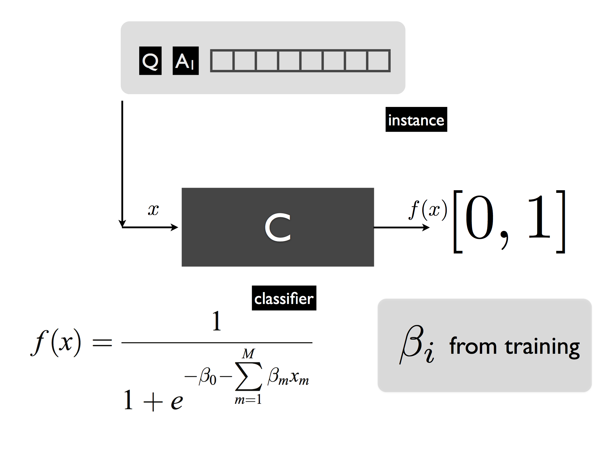
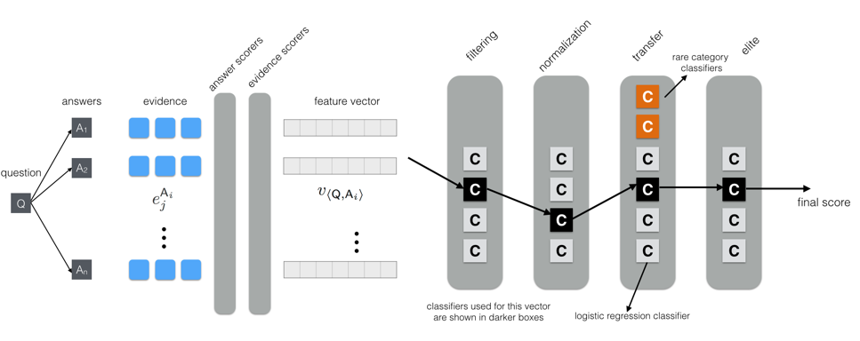

# artificial-intelligence — watson（supplement）

> （《artificial-intelligence》词条补充材料，源：plato.stanford.edu/entries/artificial-intelligence/watson.html）

#### Supplement to Artificial Intelligence

## Watson’s DeepQA Architecture

We go through a simplified and abstract treatment of Watson’s DeepQA architecture. The DeepQA architecture makes use of a large number of diverse modules that generate multiple answers $\mathsf{A}_i$ for any question $\mathsf{Q}$ posed to the system. Multiple pieces of evidence $\langle e_1^{\mathsf{A}_i},e_2^{\mathsf{A}_i},\ldots, e_m^{\mathsf{A}_i} \rangle$ are then generated for each question-answer pair. Each tuple $\langle \mathsf{Q}, \mathsf{A_i}; e_1^{\mathsf{A}_i},e_2^{\mathsf{A}_i},\ldots, e_m^{\mathsf{A}_i} \rangle$ is then fed through modules that assign multiple scores to the answer and the evidence. The score are then represented by a feature vector $\watsonfeatvec$. The set of all such vectors is then winnowed down by passing it through multiple stages of logistic regression. If the function learnt in supervised learning is continuous, the task is termed regression as opposed to classification when the inputs are discrete, but the functions learnt are generally termed classifiers whether the task is regression or classification. All classifiers in different stages perform logistic regression on the input, as sketched in the figure below, mapping a feature vector $x$ into a confidence score $f(x)\in [0,1]$. Each logistic regression classifier is parametrized by a vector $\beta_i$ that is obtained during a prior training phase in which the answers for questions are known.

*From feature vectors to confidence scores in DeepQA*

Each feature vector is passed through multiple phases of classification as shown in the overarching diagram below. Within each phase, there are classifiers for different broad categories of questions (e.g., Date, Number, Multiple Choice etc). For any question $\mathsf{Q}$, all the $\watsonfeatvec$ are fed into one classifier in an initial filtering phase. This reduces the set of answers from $n$ to a much smaller $n'$, the top $n'$ based on the top scores from the classifier. Then in a normalization phase, the feature values are first normalized with respect to the $n'$ instances. The answers are then re-ranked by the one classifier that is applicable in this phase. The third transfer phase has specialized classifiers to account for rare categories (e.g. Etymology). The final elite phase then outputs a final ranking of a smaller set of answers from the previous phase. The final answer produced by DeepQA is the answer $\mathsf{A}$ whose feature vector $\watsonfeatvec$ receives the highest score.

*From feature vectors to confidence scores in DeepQA*

As mentioned earlier Watson is an example of what can be a called a big data problem. For instance, for any question, Watson can generate around 100 answers, and for each answer it can generate around 100 points of evidence. Each answer-evidence pair can be scored by up-to 100 scorers, resulting in a feature vector with around 10000 values for each answer and around a million numerical values for a single question. Watson’s framework reduces the feature vector for each answer to a single confidence score.

Watson is an example of a learning system over algorithms. One might be tempted to call Watson a meta-learning system (Vilalta and Drissi 2002, Schaul and Schmidhüber 2010), which is different from base-learning. In base-learning (of the function learning form discussed so far), we have an algorithm $\mathcal{L}_{\theta}$ parameterized by $\theta$ which given some data, $D=\{\langle x_i,\ff(x_i)\rangle\}$, outputs a function $\ff'_\mu$ parametrized by $\mu$. In base-learning, based on $D$, $\mathcal{L}_{\theta}$ simply selects a good set of parameters $\mu$. In meta-learning, based on one more such learning experiences, we also “learn” the parameters $\theta$.

While the DeepQA architecture learns over the outputs of many different algorithms, the architecture does not have any assumptions over the individual components used to generate answers and evidence. Those components could be hand-engineered, learning-based, probabilistic etc., and need not be just machine learning components, as required in meta-learning. Instead of building a learning system to handle the question-answering task head on (as in base-learning), what the authors of Watson did was build a machine learning system that learned what individual modules work best for a given question-answer pair and associated pieces of evidence. In (Gondek et al. 2012), Watson’s builders go into more details of the learning system.
