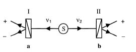

# Bell’s Theorem
**First published Wed Jul 21, 2004; substantive revision Thu Jan 25, 2024**

*Myrvold, Wayne, Genovese, Marco, Shimony, Abner*

*Bell’s Theorem* is the collective name for a family of results, all of which involve the derivation, from a condition on probability distributions inspired by considerations of local causality, together with auxiliary assumptions usually thought of as mild side-assumptions, of probabilistic predictions about the results of spatially separated experiments that conflict, for appropriate choices of quantum states and experiments, with quantum mechanical predictions. These probabilistic predictions take the form of inequalities that must be satisfied by correlations derived from any theory satisfying the conditions of the proof, but which are violated, under certain circumstances, by correlations calculated from quantum mechanics. Inequalities of this type are known as *Bell inequalities*, or sometimes, *Bell-type inequalities*. Bell’s theorem shows that no theory that satisfies the conditions imposed can reproduce the probabilistic predictions of quantum mechanics under all circumstances.

The principal condition used to derive Bell inequalities is a condition that may be called *Bell locality*, or *factorizability*. It is, roughly, the condition that any correlations between distant events be explicable in local terms, as due to states of affairs at the common source of the particles upon which the experiments are performed. See section 3.1 for a more careful statement.

The incompatibility of theories satisfying the conditions that entail Bell inequalities with the predictions of quantum mechanics permits an experimental adjudication between the class of theories satisfying those conditions and the class, which includes quantum mechanics, of theories that violate those conditions. At the time that Bell formulated his theorem, it was an open question whether, under the circumstances considered, the Bell inequality-violating correlations predicted by quantum mechanics were realized in nature. Beginning in the 1970s, there has been a series of experiments of increasing sophistication to test whether the Bell inequalities are satisfied. With few exceptions, the results of these experiments have confirmed the quantum mechanical predictions, violating the relevant Bell Inequalities. Prior to 2015, however, each of these experiments was vulnerable to at least one of two loopholes, referred to as the *communication*, or *locality loophole*, and the *detection loophole* (see section 5). In 2015, experiments were performed that demonstrated violation of Bell inequalities with these loopholes blocked. Experimental demonstration of violation of the Bell inequalities has consequences for our physical worldview, as the conditions that entail Bell inequalities are, arguably, an integral part of the physical worldview that was accepted prior to the advent of quantum mechanics. If one accepts the lessons of the experimental results, then some one or other of these conditions must be rejected.

For much of the interval between the original publication of Bell’s theorem and the experiments of Aspect and his collaborators, interest in Bell’s theorem was confined to a handful of physicists and philosophers. During that period, much of the discussions on the foundations of physics occurred in a mimeographed publication entitled *Epistemological Letters*. In the wake of the Aspect experiments (Aspect, Grangier, and Roger, 1982; Aspect, Dalibard, and Roger 1982), there was considerable philosophical discussion of the implications of Bell’s theorem; see Cushing and McMullin, eds. (1989), for a snapshot of the philosophical discussions of the time. Interest was also stimulated by the publication of a collection of Bell’s papers on the foundations of quantum mechanics (Bell 1987b)[^bell-1987b]. The rise of quantum information theory, which, among other things, explores the ways in which quantum entanglement can be used to perform tasks that would not be feasible classically, also contributed to raising awareness of the significance of Bell’s theorem, which throws into sharp relief the difference between quantum entanglement-based correlations and classical correlations. The year 2014 was the 50th anniversary of the original publication of Bell’s theorem, and was marked by a special issue of *Journal of Physics A* (**47**, number 42, 24 October 2014), a collection of essays (Bell and Gao, eds., 2016), and a large conference comprising over 400 attendees (see Bertlmann and Zeilinger, eds., 2017). The interested reader is urged to consult these collections for an overview of current discussions on topics surrounding Bell’s theorem.

The shift in attitude of the physics community towards the importance of Bell’s theorem was dramatically illustrated by the awarding of the Nobel Prize in Physics for 2022 to Alain Aspect, John Clauser, and Anton Zeilinger “for experiments with entangled photons, establishing the violation of Bell inequalities and pioneering quantum information science.”

## 1. Introduction

In 1964 John S. Bell, a native of Northern Ireland and a staff member of CERN (European Organisation for Nuclear Research) whose primary research concerned theoretical high energy physics, published a paper (Bell 1964)[^bell-1964] in the short-lived journal *Physics*, which eventually transformed the study of the foundation of quantum mechanics.

The paper showed, under conditions that were relaxed in later work by Bell (1971, 1976) himself and by his followers (Clauser, Horne, Shimony, and Holt 1969, Clauser and Horne 1974, Aspect 1983, Mermin 1986)[^aspect-1983][^clauser-1974][^mermin-1986], that, on the assumption of certain auxiliary conditions, no physical theory that satisfies a certain locality condition, which may be called *Bell locality*, can fully reproduce the quantum probabilities for outcomes of experiments. Since that time, variants on the theorem, with family resemblances, have been formulated. “Bell’s Theorem” is the collective name for the entire family.

The theorem has roots in Bell’s investigations into the status of the hidden-variables program, and in earlier work concerning quantum entanglement.

Bell presented several formulations of the theorem over the years (Bell 1964, 1971, 1976, 1990)[^bell-1964], and variants of it have been presented by others. The original derivation (1964) relied on a set-up involving perfect anticorrelation of the results of spin experiments on pairs of spin-1/2 particles prepared in the singlet state. Under this condition, the Bell locality condition entails that outcomes of experiments are predetermined by the complete specification of state, a condition which we will call *outcome determinism* (OD). Clauser, Horne, Shimony and Holt (1969) derived an inequality, the CHSH inequality, that does not require this assumption. Though in their proof they employed the condition OD, this condition is unnecessary for the derivation of the inequality, as shown by Bell (1971), who provided a proof of the CHSH inequality that relies on neither the assumption of perfect anticorrelation nor an assumption of outcome determinism.

One line of investigation in the prehistory of Bell’s Theorem is Bell’s examination of the hidden-variables program. This program involves supplementation of the quantum mechanical state of a system by further “elements of reality”, or “hidden variables”, the incompleteness of the quantum state being the explanation for the statistical character of quantum mechanical predictions concerning the system. A pioneering version of a hidden variables theory was proposed by Louis de Broglie in 1926–7 (de Broglie 1927, 1928)[^broglie-1927], and revived by David Bohm in 1952 (Bohm 1952; see also the entry on Bohmian mechanics)[^bohm-1952].

In a paper (Bell 1966)[^bell-1966] that was written before the one in which Bell’s theorem first appeared, but, due to an editorial mishap, was published later, Bell raises the question of the viability of a hidden-variables theory that reproduces the statistical predictions of quantum mechanics via averaging over better defined states that uniquely determine the result of any experiment that could be performed. In this paper he examines several theorems that had been presented as no-go theorems for theories of this sort, and supplements them with one of his own, a theorem that was independently formulated by Specker (1960), and published by Kochen and Specker (1967), and has come to be known as the *Kochen-Specker Theorem* or *Bell-Kochen Specker Theorem* (see entry on the Kochen-Specker Theorem for more details). In each case Bell argues that the proof contains premises that are physically unwarranted.

The Bell-Kochen-Specker theorem is a corollary of Gleason’s theorem (Gleason 1957)[^gleason-1957], though Bell and Kochen-Specker obtain it directly, and not via Gleason’s theorem, whose proof is considerably more intricate. The question addressed by Gleason has to do with assignments of probabilities to closed subspaces of a Hilbert space (or, equivalently, to projection operators onto such subspaces), such that the probabilities assigned to orthogonal projections are additive. Gleason proved that, in a Hilbert space of dimension 3 or greater, any such assignment of probabilities can be represented by a density operator. The BKS theorem deals with the special case in which the assignments are confined to the values 1 or 0.

The assumption that a definite value (1 or 0) is to be assigned to each projector on the system’s Hilbert space, with the condition that values assigned to commuting projectors be additive, is a weakening of the assumption of the von Neumann no-go theorem (von Neumann 1932)[^neumann-1932], which assumes that the quantum mechanical additivity of expectation values of all observables, whether represented by commuting operators or not, extends to the hypothetical dispersion-free states (see section 2 of entry on the Kochen-Specker Theorem). Despite the *prima facie* plausibility of this assumption, Bell regards it, too, as physically unmotivated, and therefore, unlike Kochen and Specker, does not regard the Bell-Kochen-Specker theorem as a no-go theorem for hidden-variables theories. The reason for this is that the assumption embodies a condition that was later to be known as *noncontextuality*.[^note-1] In a Hilbert space of dimension greater than two, any projection operator will be a member of more than one complete set of commuting projections. For each of these complete sets, there will be an experiment whose outcomes correspond to the projections in the set. The assumption of noncontextuality amounts to the assumption that a value can be assigned to a projection operator that is independent of which of these experiments is to be performed, or as Bell puts it, that “measurement of an observable must yield the same value independently of what other measurements may be made simultaneously.” The assumption need not hold; “[t]he result of an observation may reasonably depend not only on the state of the system (including hidden variables) but also on the complete disposition of the apparatus” (Bell 1966, 451; 1987b and 2004, 9 )[^bell-1966].

Noncontextual hidden-variables theories that reproduce the predictions of quantum mechanics are ruled out by the Bell-Kochen-Specker theorem. A natural question arises as to the possibility of a contextual hidden-variables theory on which the unavoidable contextuality is restricted to *local* dependencies. Is it possible to have a theory on which the outcome of an experiment performed in some spatial region $A$ is determined by the complete state of a system in a way that does not depend on the disposition of experimental apparatus at a distance from $A$?

Bell’s article ends with a brief exposition of the de Broglie-Bohm theory, noting in particular the feature that “in this theory an explicit causal mechanism exists whereby the disposition of one piece of apparatus affects the results obtained with a distant piece” (Bell 1966, 452; 1987b and 2004, 11)[^bell-1966]. The article ends with the remark:

> Bohm of course was well aware of these features of his scheme, and has given them much attention. However, it must be stressed that, to the present writer’s knowledge, there is no *proof* that *any* hidden variable account of quantum mechanics *must* have this extraordinary character. It would therefore be interesting, perhaps, to pursue some further ‘impossibility proofs,’ replacing the arbitrary axioms objected to above by some condition of locality, or of separability of distant systems.

To the second of the above-quoted sentences is attached a note: “Since the completion of this paper such a proof has been found.” The potential drama of the announcement was spoiled by the fact that the follow-up paper containing the proof (Bell 1964)[^bell-1964] had already been published (see Jammer 1974, 303, for an account of the circumstances that led to the publication delay)[^jammer-1974].

The fact that Bell’s theorem has roots into investigations on hidden-variables theories has led to a misconception that the theorem is a no-go theorem for hidden-variables theories *tout court*. There could be no such theorem, since, as Bell himself repeatedly emphasized, there is a functioning hidden-variables theory, the de Broglie-Bohm theory.

Another line of investigation leading to Bell’s Theorem was the investigation of quantum mechanical entangled states, that is, quantum states of a composite system that cannot be expressed either as products of quantum states of the individual components, or as mixtures of product states. That quantum mechanics admits of such entangled states was discovered by Erwin Schrödinger (1926) in one of his pioneering papers, but the significance of this discovery was not emphasized until the paper of Einstein, Podolsky, and Rosen (1935). They examined correlations between the positions and the linear momenta of two well separated spinless particles and concluded that in order to avoid an appeal to nonlocality these correlations could only be explained by “elements of physical reality” in each particle — specifically, both definite position and definite momentum — and since this description is richer than permitted by the uncertainty principle of quantum mechanics their conclusion is effectively an argument for a hidden variables interpretation. [^note-2] See also the entry on the Einstein-Podolsky-Rosen paradox.

## 2. Proof of a Theorem of Bell’s Type

In the present section the pattern of Bell’s 1964 paper will be followed: formulation of a framework, derivation of an inequality, demonstration of a discrepancy between certain quantum mechanical expectation values and this inequality. As already mentioned, Bell’s 1964 derivation assumed an experiment involving perfect anticorrelation of the results of aligned Stern-Gerlach experiments on a pair of entangled spin-$\frac{1}{2}$ particles. Experimental tests, in which perfect anticorrelation (or correlation) may be approximated but cannot be assumed to hold exactly, require this assumption to be relaxed. Papers which took the steps from Bell’s 1964 demonstration to the one given here are Clauser, Horne, Shimony and Holt (1969), Bell (1971), Clauser and Horne (1974), Aspect (1983) and Mermin (1986).[^note-3] Other strategies for deriving Bell-type theorems will be mentioned in Section 6.

This conceptual framework first of all postulates an ensemble of pairs of systems, the individual systems in each pair being labeled as 1 and 2. Each pair of systems is characterized by a “complete state” $\lambda$ which contains the entirety of the properties of the pair at the moment of generation. No assumption whatsoever is made about the nature of the state $\lambda$. The state space $\Lambda$, which is the totality of all possible complete states $\lambda$, could be a set of quantum states and nothing more, or a set whose elements are quantum states supplemented by additional variables, or something more exotic, perhaps some state space as yet unthought of.

We make the assumption, which remains tacit in most expositions, that we have an appropriate choice of subsets of $\Lambda$ to be regarded as the measurable subsets, forming a measurable space to which probabilistic considerations may be applied. It is assumed that the mode of generation of the pairs establishes a probability distribution $\rho$ that is independent of the adventures of each of the two systems after they separate. This does not preclude temporal evolution of the properties of the two systems after separation. What is assumed is that the state $\lambda$ prescribes probabilities for subsequent events (including any temporal evolution), and thereby probabilities for outcomes of experiments to be performed on the systems.

Different experiments may be performed on each system. We will use $a, a'$ as variables ranging over possible experiments on 1, and $b, b'$ as variables that range over experiments on 2. It is not assumed that these parameters capture the complete state of the experimental apparatus, which might have a range of microstates corresponding to each experimental setting. It is assumed that the preparation probability distribution $\rho$ is independent of the processes by which a choice of experiments to be performed is made. This assumption we call the *Measurement Independence Assumption*.

The result of an experiment with setting $a$ on system 1 is labeled by a real parameter $s$, which can take on values from a discrete set $S_a$ of real numbers in the interval [$-1, 1$]. Likewise, the result of an experiment on 2 is labeled by a parameter $t$, which can take on any of a discrete set of real numbers $T_b$ in $[-1, 1]$. As suggested by the subscripts, the sets of potential outcomes may depend on the experimental settings. The restriction of the values of the outcome labels to lie in the interval $[-1, 1]$ is of no physical significance, and is a choice made only for convenience. Indeed, the use of numbers to label outcomes is merely a matter of convenience. The inequality to be obtained places a condition on the probabilities involved in it; if desired, the use of numbers as labels on outcomes may be dispensed with, and the inequalities can expressed solely in terms of the relevant probabilities, as in the CH inequality, inequality (25), below. Bell’s own version of his theorem assumed experiments with two possible outcomes, labelled $\pm 1$. Other variants of the theorem involve larger sets of potential outcomes.

We assume that, for each pair of settings $a, b$, and every $\lambda$ in $\Lambda$, there is a probability function $p_{a,b}(s,t \mid \lambda)$, which takes on values in the interval [0, 1] and sums to unity when summed over all $s$ in $S_a$ and $t$ in $T_b$. These response functions may include implicit averaging over possible states of the experimental apparatus.[^note-4] Bell’s own version of his theorem assumed experiments with two possible outcomes, labelled $\pm 1$. Other variants of the theorem involve larger sets of potential outcomes. We can use these probability functions — which we will call *response probabilities* — to define marginal probabilities:

$$\begin{align} \tag{1a} p^1_{a,b}(s \mid \lambda) &\equiv \Sigma_t p_{a,b}(s,t \mid \lambda), \\ \tag{1b} p^2_{a,b}(t\mid\lambda) &\equiv \Sigma_s p_{a,b}(s,t\mid\lambda). \end{align}$$

Here, and in what follows, it is to be understood that the sums be taken over all $s \in S_a$ and $t \in T_b$. Define $A_{\lambda}(a, b)$, $B_{\lambda}(a, b)$ as the expectation values, for complete state $\lambda$, of the outcomes of experiments on system 1 and system 2, respectively, when the settings are $a, b$.

$$\begin{align} \tag{2a} A_{\lambda}(a,b) &\equiv \Sigma_s s \: p^1_{a,b}(s\mid\lambda), \\ \tag{2b} B_{\lambda}(a,b) &\equiv \Sigma_t t \: p^2_{a,b}(t\mid\lambda). \end{align}$$

Now define the expectation value of the product $st$ of outcomes:

$$\tag{3} E_{\lambda}(a, b) \equiv \Sigma_{s,t} s \: t \: p_{a,b}(s,t\mid\lambda). $$

Bell-type inequalities follow from a condition, inspired by considerations of locality and causality, which has been called *Factorizability*, or *Bell locality*.

**(F)**

For any $a, b, \lambda$, there exist probability functions $p^1_a(s\mid\lambda), \; p^2_b(t\mid\lambda)$, such that $p_{a,b}(s,t\mid\lambda) = p^1_a (s\mid\lambda) \: p^2_b(t\mid\lambda).$

This is the condition formulated explicitly by Bell in his later expositions of Bell’s theorem (Bell 1976, 1990)[^bell-1976]. Bell refers to the factorizability condition (F) as the condition that the correlations be *locally explicable* (Bell 1981, C2–55; 1987b and 2004, 152; see also 1990, 109; 2004, 243)[^bell-1981]. This has two components: that the correlations be explained, and not taken as primitive, and that the explanation be local. This will be discussed further in section 3.1. It should be noted that Bell regarded this condition “not as the *formulation* of ‘local causality’, but as a consequence thereof” (Bell 1990, 109; 2004, 243)[^bell-1990].

As we have seen, Bell’s investigations were stimulated, in part, by the question of the prospects for theories in which the complete state uniquely determines the outcome of any experiment, and quantum uncertainty relations reflect incompleteness of the usual specification of state. For such a theory, the response probabilities $p_{ab}(s,t|\lambda)$ take on the extremal values 0 or 1. Let us call this condition OD, for *outcome determinism*. It is also sometimes referred to, misleadingly, as *realism* (see discussion in section 3.3, below).

**(OD)**

For all $\lambda$, $a, b$, and all $s \in S_a$ and $t \in T_b , p_{ab}(s,t\mid\lambda) \in \{0, 1\}$.

Suppes and Zanotti (1976) showed that, for the special case of perfect correlations between outcomes of the two experiments, in which an outcome of an experiment on one system makes possible prediction with probability one of the outcome of an experiment on the other, OD must be satisfied if the factorizability condition (F) is. This applies to the case considered by Bell 1964. In Bell 1971 and subsequent expositions Bell provided a generalization that does not presume perfect correlation and does not require OD, either as a supposition or as a consequence of other suppositions.[^note-5]

If the factorizability condition (F) is satisfied, then

$$\tag{4} E_{\lambda} (a, b) = A_{\lambda}(a) B_{\lambda}(b). $$

The above definitions are valid for experiments with any number of discrete outcomes. An important special case is that in which each experiment has only two distinct outcomes, which we may label by $\pm 1$. For the case of bivalent experiments, (4) is equivalent to condition (F).

Now consider the quantities

$$\tag{5} S_{\lambda}(a, a', b, b') = \lvert E_{\lambda} (a, b) + E_{\lambda} (a, b') \rvert + \lvert E_{\lambda}( a', b) - E_{\lambda} (a',b')\rvert. $$

Let *S$_{\varrho}$* denote the corresponding relation between the expectation values of the $E_{\lambda}s$, with respect to the preparation distribution $\rho$.

$$ \begin{align} \tag{6} S_{\varrho}(a, a', b, b') =\ &\lvert\langle E_{\lambda}(a, b) \rangle_{\varrho} + \langle E_{\lambda}(a, b') \rangle_{\varrho}\rvert \\ &+ \lvert\langle E_{\lambda}(a', b) \rangle_{\varrho} - \langle E_{\lambda}( a', b')\rangle_{\varrho}\rvert. \end{align} $$

Note that, in taking the expectation values of the quantities appearing on the right-hand side of this definition with respect to the same distribution $\rho$, we are invoking the Measurement Independence Assumption.

Since the absolute value of the average of any random variable cannot be greater than the average of its absolute value, is clear that

$$\tag{7} S_{\varrho}(a, a', b, b') \leq \langle S_{\lambda}(a, a', b, b') \rangle_{\varrho}. $$

We now have the materials in hand required to state and prove a Bell-type theorem. The first step consists of showing that, if the factorizability condition (F) is satisfied, then

$$\tag{8} S_{\varrho}(a, a', b, b') \leq 2. $$

The second step consists of showing that there are quantum states and experimental set-ups that are such that the quantum-mechanical expectation values violate the inequality (8). This shows that no theory satisfying the factorizability condition can reproduce the statistical predictions of quantum mechanics in all situations. Moreover, the inequality furnishes a bound on how close the predictions of such a theory can come to reproducing quantum mechanical predictions. The inequality (8), due to Clauser, Horne, Shimony, and Holt (1969), is known as the *CHSH inequality*.

We now prove the first part of the theorem, namely, that the CHSH inequality follows from the factorizability condition (F). If F is satisfied, then, using (4), and the fact that $A_{\lambda}(a)$ and $A_{\lambda}(a')$ lie in the interval $[-1,1]$,

$$\begin{align}\tag{9} &S_{\lambda}(a, a', b, b') \\ &\ = \lvert A_{\lambda}(a)(B_{\lambda}(b) + B_{\lambda}(b'))\rvert + \lvert A_{\lambda}(a')(B_{\lambda}(b) - B_{\lambda}(b'))\rvert \\ &\ \leq \lvert B_{\lambda}(b) + B_{\lambda}(b') \rvert + \lvert B_{\lambda}(b) - B_{\lambda}(b')\rvert . \end{align}$$

It is easy to check that

$$\tag{10} \lvert B_{\lambda}(b) + B_{\lambda}(b') \rvert + \lvert B_{\lambda}(b) - B_{\lambda}(b') \rvert\, = 2 \max( \lvert B_{\lambda}(b) \rvert , \lvert B_{\lambda}(b')\rvert). $$

Since $B_{\lambda}(b)$ and $B_{\lambda}(b')$ also lie in the interval $[-1,1]$, from (9) and (10) we conclude that, for every $\lambda$,

$$\tag{11} S_{\lambda}(a, a', b, b') \leq 2. $$

Since this bound holds for every value of $\lambda$, it must also hold for the expectation value of $S_{\lambda}$.

$$\tag{12} \langle S_{\lambda}(a, a', b, b')\rangle_{\varrho} \leq 2. $$

This, together with (7), yields the CHSH inequality (8).

The final step of the proof of our Bell-type theorem is to exhibit a system, a quantum mechanical state, and a set of quantities for which the statistical predictions violate inequality (8). The example used by Bell stems from Bohm’s variant of the EPR thought-experiment (Bohm 1951, Bohm and Aharonov 1957)[^bohm-1951][^bohm-1957]. A pair of spin-$\frac{1}{2}$ particles is produced in the singlet state,

$$\tag{13} \ket{\Psi^-} = \frac{1}{\sqrt{2}} \left(\ket{\mathbf{n}+}_1 \ket{\mathbf{n}-}_2 - \ket{\mathbf{n}-}_1 \ket{\mathbf{n}+}_2\right), $$

where $\mathbf{n}$ is an arbitrarily chosen direction, and $|\mathbf{n}+\rangle , |\mathbf{n}-\rangle$ are spin-up and spin-down eigenstates of spin in the $\mathbf{n}$ direction. The state is rotationally invariant, and hence the expression (13) represents the state for any direction $\mathbf{n}$. If Stern-Gerlach experiments are performed on the two particles, then, regardless of the direction of the axes of the devices, for each side of the experiment the two possible results have the same probability, one-half. If experiments are done with the axes of the two devices aligned, the results are guaranteed to be opposite; spin-up on one will be obtained in one experiment if and only if spin-down is obtained on the other. If the axes are at right angles, the results are probabilistically independent. In the general case, with device axes in directions given by unit vectors $\mathbf{a}, \mathbf{b}$, respectively, with results labelled $\pm 1$, then the expectation value of the product of the outcomes is given by

$$\tag{14} \begin{align} E_{\Psi^-}(\mathbf{a}, \mathbf{b}) &= \langle \Psi^- \mid \sigma^1_{\mathbf{a}} \otimes \sigma^2_{\mathbf{b}} \mid \Psi^- \rangle \\ &= - \cos(\theta_{\mathbf{a}\mathbf{b}}), \end{align}$$

where $\theta_{\mathbf{a}\mathbf{b}} = \theta_{\mathbf{a}} - \theta_{\mathbf{b}}$ is the angle between the vectors $\mathbf{a},\mathbf{b}$.

Though the example of spin-$\frac{1}{2}$ particles in the singlet state is ubiquitous in the literature as an illustrative example, polarization-entangled photons have been more significant for experimental tests of Bell inequalities. Consider a pair of photons 1 and 2 propagating in the $z$-direction. Let $|x\rangle_j$ and $|y\rangle_j$ represent states in which photon $j \; (j =1, 2)$ is linearly polarized in the $x$- and $y$- directions, respectively. Consider the following state vector,

$$\tag{15} \ket{\Phi} = \frac{1}{\sqrt{2}}\left(\ket{x}_1 \ket{x}_2 + \ket{y}_1 \ket{y}_2 \right), $$

which is invariant under rotation of the $x$ and $y$ axes in the plane perpendicular to $z$. The total quantum state of the pair of photons 1 and 2 is invariant under the exchange of the two photons, as required by the fact that photons are integral spin particles. Suppose now that photons 1 and 2 impinge respectively on the faces of birefringent crystal polarization analyzers I and II, with the entrance face of each analyzer perpendicular to $z$. Each analyzer has the property of separating light incident upon its face into two outgoing non-parallel rays, the *ordinary ray* and the *extraordinary ray*. The transmission axis of the analyzer is a direction with the property that a photon polarized along it will emerge in the ordinary ray (with certainty if the crystals are assumed to be ideal), while a photon polarized in a direction perpendicular to $z$ and to the transmission axis will emerge in the extraordinary ray. See Figure 1:

*Figure 1*

(*reprinted with permission*)

Photon pairs are emitted from the source, each pair quantum mechanically described by $\ket{\Phi}$ of Eq. (15). I and II are polarization analyzers, with outcomes $s=1$ and $t=1$ designating emergence in the ordinary ray, while $s = -1$ and $t = -1$ designate emergence in the extraordinary ray. The crystals are also idealized by assuming that no incident photon is absorbed, but each emerges in either the ordinary or the extraordinary ray.

The expectation value, in state $\ket{\Phi}$, of the product of $s$ and $t$, is

$$\tag{16} \begin{align} E_{\Phi}(\mathbf{a}, \mathbf{b}) &= \cos^2 (\theta_{\mathbf{a} \mathbf{b}}) - \sin^2 (\theta_{\mathbf{a} \mathbf{b}}) \\ &= \cos(2\theta_{\mathbf{a} \mathbf{b}}). \end{align}$$

Note that this displays the same sort of sinusoidal dependence on angle exhibited by (14), with $2\theta$ replacing $\theta$.

Often, in popular writings, the case of aligned devices is the only one mentioned, and the perfect anticorrelation (for spin-$\frac{1}{2}$ particles in the singlet state) or correlation (for photons in state $\ket{\Phi}$) of results in this case is offered as evidence of “spooky action at a distance.” In fact, as Bell (1964, 1966) demonstrated by means of simple toy models, this behaviour can be reproduced by entirely local means. An important insight of Bell’s was that it is important to consider the less-than perfect correlations obtained when the device axes are not aligned. In Bell’s toy models, correlations fall off linearly with the angle between the device axes, whereas the quantum correlations (14, 16) fall off sinusoidally; the decrease in correlations away from the case of perfect alignments is less steep than in the toy models. Bell’s theorem shows that this sort of behaviour is not a peculiarity of his models; no model satisfying the condition F can reproduce the quantum correlations for all angles. This can be seen by considering the quantum predictions (14, 16) and plugging them into the expression for $S$. For a pair of spin-$\frac{1}{2}$ particles in the singlet state, we have,

$$\tag{17} S_{\Psi^-} = \lvert \cos(\theta_{\mathbf{a}\mathbf{b}}) + \cos(\theta_{\mathbf{a}\mathbf{b}'})\rvert + \lvert \cos(\theta_{\mathbf{a}'\boldsymbol{b}}) - \cos(\theta_{\mathbf{a}'\mathbf{b}'})\rvert . $$

Choose coplanar unit vectors $\mathbf{a},$ $\mathbf{a}',$ $\mathbf{b},$ $\mathbf{b}'$ such that $\theta_{\mathbf{b}'} - \theta_{\mathbf{a}}\, =$ $\theta_{\mathbf{a}} - \theta_{\mathbf{b}}\, =$ $\theta_{\mathbf{b}} - \theta_{\mathbf{a}'} = \phi$, and therefore, $\theta_{\mathbf{b}'} - \theta_{\mathbf{a}'} = 3\phi$. This choice yields

$$\tag{18} S_{\Psi^-}(\phi) = \lvert 2 \cos(\phi)\rvert + \lvert \cos(\phi) - \cos(3\phi)\rvert . $$

This exceeds the CHSH bound (8) when $0 \lt |\phi | \lt$ $\arccos\left((\sqrt{3} - 1)/2 \right) \approx 1.95$ radians, or 68°, with maximum violation at $\phi = \pm {\pi}/{4}$, or 45°. For these angles, we have

$$\tag{19} S_{\Psi^-}(\pi /4) = 2\sqrt{2} \approx 2.828. $$

For the case of polarization-entangled photons, we have,

$$\tag{20} S_{\Phi}(\phi) = \lvert 2 \cos(2\phi)\rvert + \lvert \cos(2\phi) - \cos(6\phi) \rvert. $$

This takes on its maximum at $\phi = {\pi}/{8}$, or 22.5°.

$$\tag{21} S_{\Phi}({\pi}/{8}) = 2\sqrt{2} \approx 2.828. $$

This value $2\sqrt{2}$ appearing in equations (19) and (21) is the maximum violation of the CHSH inequality for any quantum state, as shown by Tsirelson (Cirel’son 1980)[^cirel’son-1980]. This bound on quantum violations of the CHSH inequality is called the *Tsirelson bound*. As Gisin (1991) and Popescu and Rohrlich (1992) independently demonstrated, for any pure entangled quantum state of a pair of systems, observables can be found yielding a violation of the CHSH inequality. Popescu and Rohrlich (1992) also show that the maximum amount of violation is achieved with a quantum state of maximum degree of entanglement. Incidentally, this is not true for mixed states; there are entangled mixed states not violating any Bell inequality (Werner 1989)[^werner-1989].

## 3. The Assumptions of the Proof

The distinctive condition giving rise to the Bell Inequality assumption is the factorizability condition (F). This condition is motivated by considerations concerning locality and causality. Considerations of this sort have been the focus of the discussion of the implications of Bell’s theorem. However, in order to a derive a conflict between the predictions for theories that satisfy this assumption, other assumptions—some of which are the sort usually accepted without question in scientific experimentation—are needed. The analysis of Bell’s theorem has provoked careful scrutiny of the reasoning required to reach the conclusion that F is to be rejected. As a result, some assumptions that in another context would have been left implicit have been made explicit, and each has been challenged by some authors. In this section we outline a set of assumptions sufficient to ensure satisfaction of Bell inequalities, which, therefore, constitute a set of assumptions that cannot all be satisfied by any theory that yields, in agreement with experiment, violations of Bell inequalities. There are other paths to Bell inequalities; see, in particular, Wiseman and Cavalcanti (2017), who offer an analysis similar to that found here, as well as other analyses.

### 3.1 Locality and causality assumptions

#### 3.1.1 Bell’s Principle of Local Causality

As mentioned above, the article (Bell 1964)[^bell-1964] in which Bell’s theorem first appeared is a follow-up to Bell (1966), which explores the prospects for hidden-variables theories in which the outcome of an experiment performed is predetermined by the complete state of the system. The introduction to Bell (1964) begins with mention of theories with additional variables that are to restore causality and locality, and says that “In this note that idea will be formulated mathematically and shown to be incompatible with the statistical predictions of quantum mechanics.” The locality assumption is glossed as the requirement “that the result of a measurement on one system be unaffected by operations on a distant system with which it has interacted in the past.” Applied to the case at hand, of Stern-Gerlach experiments performed on an entangled pair of spin-1/2 particles, this is “the hypothesis ... that if the two measurements are made at places remote from one another the orientation of one magnet does not influence the result obtained with the other.” Bell follows this with,

> Since we can predict in advance the result of measuring any chosen component of $\boldsymbol{\sigma}_2$, by previously measuring the same component of $\boldsymbol{\sigma}_1$, it follows that the result of any such measurement must actually be predetermined (Bell 1964, 195; 1987b and 2004, 15)[^bell-1964].

This suggests that OD is not being assumed, but, rather, derived, via an EPR-type argument, from a locality assumption and the perfect anticorrelations predicted by the considered quantum state. This is how Bell explained the reasoning in later publications (see Bell 1981, fn 10)[^bell-1981].[^note-6]

In Bell (1976) and (1990), Bell derives the factorizability condition from a condition he calls the *Principle of Local Causality* (see Norsen 2011 for discussion)[^norsen-2011]. In (1990) he begins his analysis with a rehearsal of the reason that relativity should be taken to prohibit superluminal causation. On the usual notion of causation, the cause-effect relation is taken to be temporally asymmetric, with causes temporally preceding their effects. In a relativistic spacetime, events at spacelike separation are taken to have no temporal order. Any system of coordinates will assign time coordinates to each of any pair of events, but, if the events are spacelike separated, the time coordinates assigned to a pair of events at spacelike separation will differ in their ordering, depending on which reference frame is being employed. If we take all of these reference frames to be physically on a par, it must be concluded that there is no temporal order between the events, as relations that are not relativistically invariant have no physical significance.

On the basis of these considerations, that is, Lorentz invariance and the assumption that causes temporally precede their effects, Bell introduces what he calls the *principle of local causality*.

**(PLC-1)**

The direct causes (and effects) of events are near by, and even the indirect causes (and effects) are no further away than permitted by the velocity of light.

This, says Bell, is “not yet sufficiently sharp and clean for mathematics.” For this reason, he introduces what he presents as a sharpened version of the principle (refer to Figure 2).

**(PLC-2)**

A theory will be said to be locally causal if the probabilities attached to values of local beables in a space-time region 1 are unaltered by specification of values of local beables in a space-like separated region 2, when what happens in the backward light cone of 1 is already sufficiently specified, for example by a full specification of local beables in a spacetime region 3.

*Figure 2*

In Bell’s terminology, a *beable* is any element of a physical theory that is taken to correspond to something physically real, and *local beables* pertaining to a space-time region are those contained within that region.

The transition from what we have called PLC-1 to PLC-2 should, according to Bell, “be viewed with the utmost suspicion” as “it is precisely in cleaning up intuitive ideas for mathematics that one is likely to throw the baby out with the bathwater” (1990, 106; 2004, 239). The relation between them is not further discussed in that article, but remarks in other papers shed light on the transition between them.

In (1976), Bell motivates the formulation of the local causality condition with the remark,

> Now my intuitive notion of local causality is that events in [space-time region] 2 should not be “causes” of events in [spacelike separated region] 1, and vice versa. But this does not mean that the two sets of events should be uncorrelated, for they could have common causes in the overlap of their backward light cones (Bell 1976, 14; 1985a, 88; 1987b and 2004, 54)[^bell-1976].

He then precedes to formulate the condition of local causality, which is that a full specification of beables in the overlap of the backward light cones of the spacetime regions 1 and 2 should screen off correlations between them. Implicit in this is that correlations between two variables be susceptible to causal explanation, either via a causal connection between the variables, or via a common cause. This assumption was stated explicitly in a later article (Bell 1981)[^bell-1981], in which he says that “the scientific attitude is that correlations cry out for explanation” (Bell 1981, C2–55; 1987b and 2004, 152)[^bell-1981].

The assumption that correlations between two variables that are not in a cause-effect relation to each other can be explained by some common cause was named the *principle of the common cause* by Reichenbach (1956, § 19), and for this reason is often referred to as *Reichenbach’s Common Cause Principle*, though Reichenbach made no pretense of originating the principle, and regarded it as a codification of a mode of inference common in both science and everyday life. See the entry on Reichenbach’s common cause principle for more details. A variable $C$ is a Reichenbachian common cause of a correlation between two variables $A$ and $B$ if the variables $A$ and $B$ are uncorrelated, conditional on specification of the value of $C$. Reichenbach’s Common Cause Principle says that, if two correlated variables are not in a cause-effect relation with each other, there is a Reichenbachian common cause of their correlations. The condition we have called PLC-1 does not, by itself, entail PLC-2, but it does follow from the conjunction of PLC-1 and Reichenbach’s Common Cause Principle.

PLC-1 does not, by itself, entail that correlations be causally explicable, and, indeed, does not commit to any sort of causal relations in the world; it merely says that whatever causal relations there are respect relativistic locality. For this reason, we will refer to it as a *causal locality* principle. This is in contradistinction to PLC-2, which requires there to be causal relations of some sort wherever correlations are found. What Bell calls the Principle of Local Causality, PLC-2, can be thought of as a conjunction of (1) a causal locality condition along the lines of PLC-1, restricting causes of an event to that event’s past light cone, and (2) Reichenbach’s Common Cause Principle, which requires that correlations be causally explicable. The former condition can, itself, be regarded as following from relativistic invariance and the principle that the cause of an event lie in its temporal past. Bell’s Principle of Local Causality thus follows from the conjunction of three assumptions, all of which, in various writings, were explicitly formulated by Bell:

- (Temporal Asymmetry of Causality) Any cause of an event lies in its temporal past, and not in its temporal future.
- (Lorentz Invariance) The relation of temporal precedence is invariant under Lorentz boosts.
- Reichenbach’s Common Cause Principle.

#### 3.1.2 Parameter independence and outcome independence

The condition F of factorizability is the application, to the particular set-up of Bell-type experiments, of Bell’s Principle of Local Causality. As we have seen, it can be thought of as the conjunction of the condition of causal locality, and the common cause principle. In this section we apply those conditions to the set-up of Bell-type experiments.

On the assumption that the experimental settings can be treated as free variables, whose values are determined exogenously, if the choice of setting on one wing is made at spacelike separation from the experiment on the other, a dependence of the probability of the outcome of one experiment on the setting of the other would seem straightforwardly to be an instance of a nonlocal causal influence. The condition that this not occur can be formulated as follows.

**(PI)**

For all parameter settings $a$, $a'$, $b$, $b'$, all $\lambda$, and all $s \in S_a$ and $t \in T_b$,

$$\begin{align} \tag{22a} p^1_{a,b}(s\mid \lambda) &= p^1_{a,b'}(s\mid \lambda); \\ \tag{22b} p^2_{a,b}(t\mid \lambda) &= p^2_{a',b}(t\mid \lambda). \end{align}$$

This is the condition that has come to be known as *parameter independence*, following Shimony (1986, 1990).

For fixed values of the experimental settings, Bell’s Principle of Local Causality entails that the outcomes of the experiments on the two systems be independent, conditional on the specification $\lambda$ of the complete state of the system at the source. This is the condition

**(OI)**

For each pair of parameter settings $a, b$, and all $\lambda$, and all $s$ in $S_a$ and $t$ in $T_b$,

$$\tag{23} p_{a,b}(s,t\mid \lambda) = p^1_{a,b}(s\mid \lambda)\; p^2_{a,b}(t\mid \lambda). $$

This is the condition that has come to be known as *outcome independence*, following Shimony (1986, 1990). As demonstrated by Jarrett (1983, 1984), the factorizability condition (F) is the conjunction of parameter independence and outcome independence. The two conditions bear different relations to the locality and causality conditions discussed in the previous subsection. PI is a consequence of the causal locality condition PLC-1 alone, whereas OI requires in addition the assumption of the common cause principle.

The parsing of the Bell locality condition as a conjunction of PI and OI is due to Clauser and Horne (1974), though they did not propose distinct names for the conjuncts. Jarrett (1983, 1984) referred to the conditions as *locality* and *completeness*. Jarrett (1983, 1984, 1989) argued that a violation of PI would inevitably permit superluminal signalling. The conclusion requires an additional assumption, that the state of the system be controllable.[^note-7] It would not hold for a theory on which there are principled limitations on the ability of would-be signallers to control the states of the systems they are dealing with; an example of a theory of this sort is the de Broglie-Bohm theory, which violates PI but does not permit superluminal signalling. Nonetheless, in some of the literature PI has been treated as equivalent to no-signalling. For some (see *e.g.* Ballentine and Jarrett 1987, fn. 6; Jarrett 1989, 70; Shimony 1993, 139)[^ballentine-1987][^jarrett-1989], this stems from the thought that any limitations on control that might prevent a violation of PI from being exploited for signalling would involve only practical limitations irrelevant to foundational concerns, which should have to do with what is possible in principle.

### 3.2 Supplementary assumptions

#### 3.2.1 Unique experimental outcomes

Though it might seem that this goes without saying, the entire analysis is predicated on the assumption that, of the potential outcomes of a given experiment, one and only one occurs, and hence that it makes sense to speak of *the* outcome of an experiment. The reason that this assumption is worth mentioning is that there is a family of approaches to the interpretation of quantum mechanics, namely, Everettian, or “many-worlds” approaches, and some variants of the relational approach, according to which all potential outcomes actually occur, in what are effectively distinct worlds. See entries on many-worlds interpretation of quantum mechanics, Everett’s relative-state formulation of quantum mechanics.

#### 3.2.2 Experimental settings as free parameters

Bell’s original analyses (1964, 1971) tacitly assumed that the complete state $\lambda$ is sampled from the same probability distribution $\rho$, no matter what choice of experiment is made, and that, for this reason, the subset of experiments corresponding to any given choice of settings is a fair sample of the distribution of $\lambda$. Clauser and Horne (1974, fn. 13) made this assumption explicit, as did Bell, in his publications subsequent to an exchange with Shimony, Clauser, and Horne (1976).

The assumption that experimental settings may treated as statistically independent of the variable $\lambda$ has variously been called the *Free Will assumption*, the *Freedom of Choice Assumption*, the *No-conspiracies Assumption*, and, in some of the recent literature, the *Statistical Independence Assumption*. In this article it is called the *Measurement Independence Assumption*. It will be discussed in more detail in section 8.1, below.

#### 3.2.3 When experiments end

In experimental tests of Bell locality, care is taken that the experiments on the two systems, from choice of experimental setting to registration of results, take place at spacelike separation. It is assumed that experiments have unique results. The question arises as to *when* the unique result emerges. It is typically assumed that the result is definite once a detector has been triggered or the result is recorded in a computer memory. However, as Kent (2005) has pointed out, proposals have been made according to which the quantum state of the apparatus would remain in a superposition of terms corresponding to distinct outcomes for a greater length of time. One such proposal is the suggestion that state reduction takes place only when the uncollapsed state involves a superposition of sufficiently distinct gravitational fields (Diósi 1987, Penrose 1989, 1996)[^diósi-1987][^penrose-1989]. Another is Wigner’s suggestion that conscious awareness of the result is required to induce collapse (Wigner 1961)[^wigner-1961]. This gives rise to what Kent calls the *collapse locality loophole*. One can consider theories—Kent calls the family of such theories *causal quantum theories*—on which collapses are localized events, and the probability of a collapse is independent of events, including other collapses, at spacelike separation from it. A theory of that sort would differ in its predictions from standard quantum theory, but a test to discriminate between such a theory and standard quantum mechanics would require a set-up in which the entire experiment on one system, from arrival to satisfaction of the collapse condition, takes place at spacelike separation from the experiment on the other. If the experiments are taken to end, not when the detector is triggered, but when the difference between outcomes amounts to differences in mass configurations large enough to correspond to significantly distinct gravitational fields, then, as Kent argued, experiments extant at the time of writing (2005) were subject to this loophole. The experiment of Salart *et al*. (2008) closed the loophole for the particular proposals of Penrose and Diósi, though, as Kent (2018) points out, altering the Penrose-Diósi threshold by a few orders of magnitude would render them compatible with the results of this experiment. No experiment to date has addressed the collapse locality loophole if the collapse condition is taken to be awareness of the result by a conscious observer. See Kent (2018) for proposals of ways in which causal quantum theory could be subjected to more stringent tests.

### 3.3 On “local realism”

It has become commonplace to say that (provided that the supplementary assumptions are accepted), the class of theories ruled out by experimental violations of Bell inequalities is the class of *local realistic theories*, and that the worldview to be abandoned is *local realism*. The ubiquity of the use of this terminology tends to obscure the fact that not all who use it use it in the same sense; further, it is not always clear what is meant when the phrase is used.

The terminology of “local realistic theories” as the targets of experimental tests of Bell inequalities was introduced by Clauser and Shimony (1978), intended as a synonym for what Clauser and Horne (1974) called “objective local theories.” These are theories that satisfy the factorizability assumption (F). The terminology was adopted by d’Espagnat (1979) and Mermin (1980). For Clauser and Shimony realism is “a philosophical view according to which external reality is assumed to exist and have definite properties, whether or not they are observed by someone” (1978, 1883). In a similar vein, d’Espagnat (1979) says that realism is “the doctrine that regularities in observed phenomena are caused by some physical reality whose existence is independent of human observers” (158). Mermin, on the other hand, takes realism to involve the condition that we have called *outcome determinism* (OD): “As I shall use the term here, local realism holds that one can assign a definite value to the result of an impending measurement of any component of the spin of either of the two correlated particles, whether or not that measurement is actually performed” (Mermin 1980, 356)[^mermin-1980]. This is not a commitment of realism in the sense of Clauser and Shimony, who explicitly consider stochastic local realistic theories.

It is Mermin’s sense that seems to be most widely used in the current literature. In this sense, *local realism*, applied to the set-up of the Bell experiments, amounts to the conjunction of Parameter Independence (PI) and outcome determinism (OD). Now, it is true that, if PI and OD hold, so does factorizability (F), and hence the Bell inequalities. But the condition OD is stronger than what is required, as the conjunction of PI and the strictly weaker condition OI also suffice. Thus, to say that violations of Bell inequalities rule out *local realistic theories*, with “realism” identified as outcome determinism, is true but misleading, as it may suggest that one can retain locality by rejecting “realism” in the sense of outcome determinism. However, if one accepts the supplementary assumptions, one is obliged to reject not merely the conjunction of OD and PI, but the weaker condition of factorizability, which contains no assumption regarding predetermined outcomes of experiments.

Further confusion arises if the two senses are conflated. This can lead to the notion that the condition OD is equivalent to the metaphysical thesis that physical reality exists and possesses properties independent of their cognizance by human or other agents. This would be an error, as stochastic theories, on which the outcome of an experiment is not uniquely determined by the physical state of the world prior to the experiment, but is a matter of chance, are perfectly compatible with the metaphysical thesis. One occasionally finds traces of a conflation of this sort in the literature; see, *e.g.*, d’Espagnat (1979) and Mermin (1981).

For other authors, rejection of realism seems to amount primarily to an avowal of operationalism. If all one asks of a theory is that it produce the correct probabilities for outcomes of experiments, eschewing all questions about what sort of physical reality gives rise to these outcomes, then this undercuts the motivation of the analysis that leads to Bell’s theorem. In this sense of “realism”, it is not an assumption of the theorem but a motivation for formulating it.

Several authors (see, in particular, Norsen 2007; Maudlin 2014)[^maudlin-2014][^norsen-2007] have argued that no clear sense of “realism” has been identified such that realism, in that sense, is a particular presupposition of the derivation of Bell inequalities (as distinguished from a presupposition of all physics). These authors urge rejection of the currently prevalent practice of saying that “local realist” theories are the targets of experimental tests of Bell inequalities. Nonetheless, other authors maintain that there is, indeed, a sense of “realism” on which realism is an assumption of the derivation of Bell inequalities, though they differ on what it is that realism involves; see Żukowski and Brukner (2014), Werner (2014), Żukowski (2017), and Clauser (2017).

## 4. Early Experimental Tests of Bell’s Inequalities

The path toward a conclusive experimental test of Bell inequalities was long and with several intermediate steps.

A first proposal to test a Bell inequality was made by Clauser, Horne, Shimony, and Holt (1969), henceforth CHSH, who suggested that the pairs 1 and 2 be photons produced in an atomic cascade from an initial atomic state with total angular momentum $J = 0$ to an intermediate atomic state with $J = 1$ to a final atomic state $J = 0$, as in an experiment performed with calcium vapor for other purposes by Kocher and Commins (1967). The proposed test was first performed by Freedman and Clauser (1972). The result obtained by Freedman and Clauser was 6.5 standard deviations from the limit allowed by the CHSH inequality and in good agreement with the quantum mechanical prediction. This was a difficult experiment, requiring 200 hours of running time, much longer than in most later tests of Bell’s Inequality, which were able to use lasers for exciting the sources of photon pairs.

Since then, several dozen experiments have been performed to test Bell’s Inequalities. References will now be given to some of the most noteworthy of these, along with references to survey articles which provide information about others. A discussion of more recent experiments addressed to close two serious loopholes in the early Bell experiments, the “detection loophole” and the “communication loophole”, will be reserved for Section 5.

Holt and Pipkin completed in 1973 (Holt 1973)[^holt-1973] an experiment very much like that of Freedman and Clauser, but examining photon pairs produced in the $9^1 P_1 \rightarrow 7^3 S_1\rightarrow 6^3 P_0$ cascade in the zero nuclear-spin isotope of mercury-198 after using electron bombardment to pump the atoms to the first state in this cascade. The result of Holt and Pipkin was in fairly good agreement with the CHSH Inequality, and in disagreement with the quantum mechanical prediction by nearly 4 standard deviations—contrary to the results of Freedman and Clauser. Because of the discrepancy between these two early experiments, Clauser (1976) repeated the Holt-Pipkin experiment, using the same cascade and excitation method but a different spin-0 isotope of mercury, and his results agreed well with the quantum mechanical predictions but violated Bell’s Inequality. Clauser also suggested a possible explanation for the anomalous result of Holt-Pipkin: that the glass of the Pyrex bulb containing the mercury vapor was under stress and hence was optically active, thereby giving rise to erroneous determinations of the polarizations of the cascade photons.

Fry and Thompson (1976) also performed a variant of the Holt-Pipkin experiment, using a different isotope of mercury and a different cascade and exciting the atoms by radiation from a narrow-bandwidth tunable dye laser. Their results also agreed well with the quantum mechanical predictions and disagreed sharply with Bell’s Inequality. They gathered data in only 80 minutes, as a result of the high excitation rate achieved by the laser.

Four experiments in the 1970s — by Kasday-Ullman-Wu, Faraci-Gutkowski-Notarigo-Pennisi, Wilson-Lowe-Butt, and Bruno-d’Agostino-Maroni — used photon pairs produced in positronium annihilation instead of cascade photons. Of these, all but that of Faraci *et al*. gave results in good agreement with the quantum mechanical predictions and in disagreement with Bell’s Inequalities. A discussion of these experiments is given in the review article by Clauser and Shimony (1978), who regard them as less convincing than those using cascade photons, because they rely upon stronger auxiliary assumptions.

The first experiment using polarization analyzers with two exit channels, thus realizing the theoretical scheme envisaged in Section 2, was performed in the early 1980s with cascade photons from laser-excited calcium atoms by Aspect, Grangier, and Roger (1982). The outcome confirmed the predictions of quantum mechanics over those satisfying the Bell inequalities more dramatically than any of its predecessors, with the experimental result deviating from the upper limit in a Bell’s Inequality by 40 standard deviations. An experiment soon afterwards by Aspect, Dalibard, and Roger (1982), which aimed at closing the communication loophole, will be discussed in Section 5. The historical article by Aspect (1992) reviews these experiments and also surveys experiments performed by Shih and Alley, by Ou and Mandel, by Rarity and Tapster, and by others, using photon pairs with correlated linear momenta produced by down-conversion in non-linear crystals. Discussion of more recent Bell tests can be found in review papers (Zeilinger 1999, Genovese 2005, 2016)[^genovese-2005][^zeilinger-1999].

Pairs of photons have been the most common physical systems in Bell tests because they are relatively easy to produce and analyze, but there have been experiments using other systems. Lamehi-Rachti and Mittig (1976) measured spin correlations in proton pairs prepared by low-energy scattering. Their results agreed well with the quantum mechanical prediction and violated Bell’s Inequality, but, as in the positronium experiments, strong auxiliary assumptions had to be made.

The outcomes of the Bell tests provide dramatic confirmations of the *prima facie* entanglement of many quantum states of systems consisting of 2 or more constituents. Actually, the first confirmation of entanglement antedated Bell’s work, since Bohm and Aharonov (1957) demonstrated that the results of Wu and Shaknov (1950), Compton scattering of the photon pairs produced in positronium annihilation, already showed the entanglement of the photon pairs.

## 5. The Communication and Detection Loopholes, and their Remedies

### 5.1 The Communication Loophole, and its remedy

The derivations of all the variants of Bell’s Inequality depend upon independence conditions inspired by relativistic causality. In the early tests of Bell’s Inequalities it was plausible that these conditions were satisfied just because the 1 and the 2 arms of the experiment were spatially well separated in the laboratory frame of reference. This satisfaction, however, is a mere contingency not guaranteed by any law of physics, and hence it is physically possible that the setting of the analyzer of 1 and its detection or non-detection could influence the outcome of analysis and the detection or non-detection of 2, and conversely. This is the *communication loophole*, to which the early Bell tests were susceptible. It is addressed by ensuring that the experiments on the two systems take place at spacelike separation.

Aspect, Dalibard, and Roger (1982) published the results of an experiment in which the choices of the orientations of the analyzers of photons 1 and 2 were performed so rapidly that they were events with space-like separation. No physical modification was made of the analyzers themselves. Instead, switches consisting of vials of water in which standing waves were excited ultrasonically were placed in the paths of the photons 1 and 2. When the wave is switched off, the photon propagates in the zeroth order of diffraction to polarization analyzers respectively oriented at angles $a$ and $b$, and when it is switched on the photons propagate in the first order of diffraction to polarization analyzers respectively oriented at angles $a'$ and $b'$. The complete choices of orientation require time intervals 6.7 ns and 13.37 ns respectively, much smaller than the 43 ns required for a signal to travel between the switches in obedience to special relativity theory. *Prima facie* it is reasonable that the independence conditions are satisfied, and therefore that the coincidence counting rates agreeing with the quantum mechanical predictions constitute a refutation of the Bell inequality and hence of the family of theories that entail it. There are, however, several imperfections in the experiment. First of all, the choices of orientations of the analyzers are not random, but are governed by quasiperiodic establishment and removal of the standing acoustical waves in each switch. A scenario can be invented according to which clever hidden variables of each analyzer can inductively infer the choice made by the switch controlling the other analyzer and adjust accordingly its decision to transmit or to block an incident photon. Also, coincident count technology is employed for detecting joint transmission of 1 and 2 through their respective analyzers, and this technology establishes an electronic link which could influence detection rates. And because of the finite size of the apertures of the switches there is a spread of the angles of incidence about the Bragg angles, resulting in a loss of control of the directions of a non-negligible percentage of the outgoing photons.

The experiment of Tittel, Brendel, Zbinden, and Gisin (1998) did not directly address the communication loophole but threw some light indirectly on this question and also provided dramatic evidence concerning the maintenance of entanglement between particles of a pair that are well separated. Pairs of photons were generated in Geneva and transmitted via cables, with very small probability per unit length of losing the photons, to two analyzing stations in suburbs of Geneva, located 10.9 kilometers apart on a great circle. The counting rates agreed well with the predictions of quantum mechanics and violated the CHSH inequality. No precautions were taken to ensure that the choices of orientations of the two analyzers were events with space-like separation. The great distance between the two analyzing stations makes it difficult to conceive a plausible scenario for a conspiracy that would violate Bell’s independence conditions. Furthermore — and this is the feature which seems most to have captured the imagination of physicists — this experiment achieved much greater separation of the analyzers than ever before, thereby providing a test of a conjecture by Schrödinger (1935) that entanglement is a property that may dwindle with spatial separation. More recently, Bell inequality violation was demonstrated even at 144 km distance (Scheidl *et al*., 2010) and, in 2017, from satellite transmission with a 1200 km distance (Yin *et al*., 2017).

An experiment that came closer to closing the communication loophole is that of Weihs, Jennewein, Simon, Weinfurter, and Zeilinger (1998). The pairs of systems used to test a Bell’s Inequality are photon pairs in the entangled polarization state

$$\tag{24} \ket{\Psi} = \frac{1}{\sqrt{2}} \left(\ket{H}_1 \ket{V}_2 - \ket{V}_1 \ket{H}_2 \right), $$

where the ket $\ket{H}$ represents horizontal polarization and $\ket{V}$ represents vertical polarization. Each photon pair is produced from a photon of a laser beam by the down-conversion process in a nonlinear crystal. The momenta, and therefore the directions, of the daughter photons are strictly correlated, which ensures that a non-negligible proportion of the pairs jointly enter the apertures (very small) of two optical fibers, as was also achieved in the experiment of Tittel *et al*.. The two stations to which the photon pairs are delivered are 400 m apart, a distance which light in vacuo traverses in $1.3 \mu$s. Each photon emerging from an optical fiber enters a fixed two-channel polarizer (*i.e.*, its exit channels are the ordinary ray and the extraordinary ray). Upstream from each polarizer is an electro-optic modulator, which causes a rotation of the polarization of a traversing photon by an angle proportional to the voltage applied to the modulator. Each modulator is controlled by amplification from a very rapid generator, which randomly causes one of two rotations of the polarization of the traversing photon. An essential feature of the experimental arrangement is that the generators applied to photons 1 and 2 are electronically independent. The rotations of the polarizations of 1 and 2 are effectively the same as randomly and rapidly rotating the polarizer entered by 1 between two possible orientations $a$ and $a'$ and the polarizer entered by 2 between two possible orientations $b$ and $b'$. The output from each of the two exit channels of each polarizer goes to a separate detector, and a “time tag” is attached to each detected photon by means of an atomic clock. Coincidence counting is done after all the detections are collected by comparing the time tags and retaining for the experimental statistics only those pairs whose tags are sufficiently close to each other to indicate a common origin in a single down-conversion process. Accidental coincidences will also enter, but these are calculated to be relatively infrequent. This procedure of coincidence counting eliminates the electronic connection between the detector of 1 and the detector of 2 while detection is taking place, which conceivably could cause an error-generating transfer of information between the two stations. The total time for all the electronic and optical processes in the path of each photon, including the random generator, the electro-optic modulator, and the detector, is conservatively calculated to be smaller than 100 ns, which is much less than the $1.3 \mu$s required for a light signal between the two stations.

The experimental result in the experiment of Weihs *et al*. is $2.73 \pm 0.02,$ in good agreement with the quantum mechanical prediction, and it is 30 standard deviations away from the upper limit of the CHSH inequality inequality (8). Aspect, who designed the first experimental test of a Bell Inequality with rapidly switched analyzers (Aspect, Dalibard, Roger 1982) appreciatively summarized the import of this result:

> I suggest we take the point of view of an external observer, who collects the data from the two distant stations at the end of the experiment, and compares the two series of results. This is what the Innsbruck team has done. Looking at the data a posteriori, they found that the correlation immediately changed as soon as one of the polarizers was switched, without any delay allowing for signal propagation: this reflects quantum non-separability. (Aspect 1999, 190)[^aspect-1999]

Even if some small imperfection prevented the experiment of Weihs *et al*. from completely blocking the detection loophole, these problems were overcome in subsequent experiments.

### 5.2 The Detection Loophole and its remedy

The CHSH inequality (8) is a relation between expectation values. An experimental test, therefore, requires empirical estimation of the probabilities of the outcomes of experiments. This estimation involves computing a ratio of event-counts: the number of pair-production events with a certain outcome to the total number of pair-production events. Typically, in experiments involving photons, most of the pairs produced fail to enter the analyzers. Furthermore, some photons that enter the analyzers will fail to be detected; in addition, the detector will occasionally register a detection even when no photon is detected (the rate of occurrence of this is known as the “dark-count”).

Three strategies for addressing this issue have been pursued.

One is to employ an auxiliary assumption to yield an estimate of the normalization factor required to infer relative frequencies from event-counts, as required by a test of the CHSH inequality. CHSH (1969) proposed the assumption that, if a photon passes through an analyser, its probability of detection is independent of the analyser’s orientation. Though physically plausible, this is not a condition required by local causality.

The fact that an assumption of this sort is needed for the analysis of experiments of this type was made clear by toy models constructed by Pearle (1970) and Clauser and Horne (1974). In these models, the rates at which the photon pairs pass through the polarization analyzers with various orientations are consistent with an inequality of Bell’s type, but the hidden variables provide instructions to the photons and the apparatus not only regarding passage through the analyzers but also regarding detection, thereby violating the fair sampling assumption. Detection or non-detection is selective in the model in such a way that the detection rates violate the Bell-type inequality and agree with the quantum mechanical predictions. Other models were constructed later by Fine (1982a) and corrected by Maudlin (1994) (the “Prism Model”) and by C.H. Thompson (1996) (the “Chaotic Ball model”). Although all these models are *ad hoc* and lack physical plausibility, they constitute existence proofs that theories satisfying the local causality condition can be consistent with the quantum mechanical predictions provided that the detectors are properly selective.

A second strategy involves construction of an experimental set-up in which the production of each particle-pair may be registered. Clauser and Shimony (1978) referred to apparatus achieving this as “event-ready” detectors; some recent literature has referred to a process of this sort as “heralding.”

A third strategy involves employment of an inequality that can be shown to be violated without knowledge of the absolute value of the probabilities involved. This eliminates the need for untestable auxiliary assumptions. An inequality suitable for this purpose was first derived by Clauser and Horne (1974) (henceforth CH). The set-up is as before, with the exception that each analyzer will have only one output channel, and the eventualities to be considered are detection and non-detection. We want an inequality expressed in terms of probabilities of detection alone. The same sort of reasoning that leads to the CHSH inequality yields the *CH Inequality*:

$$\tag{25} \ - 1 \le p_{a,b}(+, +) + p_{a,b'}(+, +) + p_{a',b}(+, +) - p_{a',b'}(+, +) - p^1_a(+) - p^2_b(+) \le 0. $$

The probabilities appearing in (25) can be estimated by dividing event-counts registered in a run of an experiment by the total number of pairs produced. If we assume that the production rate at the source is independent of the analyzer settings, we can take the normalization factor to be the same for each term, and hence the magnitude of this factor need not be known in order to demonstrate a violation of the upper bound of (25). Another useful observation was made by Eberhard (1993), who demonstrated that the minimal detection efficiency for a detection loophole free experiment can be reduced (from 82% to 67%) for non-maximally entangled states (*i.e.* a bipartite entangled state with different weight for the two components). This involves starting with a specified efficiency level, and then choosing a state and a set of observables that maximize violation of the CH inequality at that efficiency level.

For the maximally entangled states we have been considering, in the idealized case of perfect detection efficiency, inequality (25) is maximally violated by the quantum predictions for the same settings considered above for violation of the CHSH inequality. However, for non-ideal experiments, the quantum predictions satisfy the inequality unless detector efficiency is high, considerably higher than that of any experiment that had been performed up until the time that CH were writing. For that reason, CH introduced a new auxiliary assumption, called the *no-enhancement assumption*: for any value of $\lambda$, and any setting of an analyzer, the probability of detection with the analyzer present is no higher than the probability of detection with the analyzer removed. Let $p^1_{\infty}$ and $p^2_{\infty}$ be the probabilities of detection of particles 1 and 2 when their respective analyzers have been removed. This assumption gives rise to what may be called the *second CH inequality*:

$$\tag{26} - 1 \le p_{a,b}(+, +) + p_{a,b'}(+, +) + p_{a',b}(+, +) - p_{a',b'}(+, +) \le p^1_{\infty} + p^2_{\infty}. $$

As CH note, this is violated by the results of the Freedman and Clauser experiment, and hence that experiment rules out theories satisfying the factorizability condition (F) and the no-enhancement assumption, though it does not rule out the toy model constructed by CH.

Historically, the efforts toward a detection loophole-free experiment followed two main paths, though a few other possibilities were also explored. One of these other possibilities involved K or B mesons (Selleri 1983, Go 2004)[^selleri-1983], where the detection loophole reappears in another form (Genovese, Novero, and Predazzi 2001). Another involved solid state systems (Ansmann *et al*. 2009)[^ansmann-2009].

One of the main avenues of approach employed entangled ions. The use of ions looked very promising, since for such experiments detection efficiency is very high. The experiment of Rowe *et al*. (2001) employed beryllium ions, observing a CHSH inequality violation $S = 2.25 \pm 0.03$ with a total detection efficiency of about 98%. Nevertheless, in this set-up the measurements on two ions not only were not space-like separated; there was a common measurement on the two ions. More recently, the distance between ions was increased. For instance, Matsukevich *et al*. (2008) entangled two ytterbium ions via interference and joint detection of two emitted photons, with the distance between the ions set to 1 meter. However, a conclusive experiment of this sort that eliminated also the communication loophole would require a separation of kilometers.

The other main avenue of approach, which paved the way to a conclusive test of Bell inequalities, involved innovations in tests using photons. First, efficient sources of photon entangled states were realized by exploiting Parametric Down Conversion, a non-linear optical phenomenon in which a photon of higher energy converts into two lower frequency photons inside a non-linear medium in such a way that energy and momentum are conserved. This allows a high collection efficiency due to wave vector correlation of the emitted photons. Next, high efficiency single photon Transition Edge Sensors were produced. These advances led to detection loophole-free experiments with photons (Giustina *et al*. 2013, Christensen *et al*. 2013)[^christensen-2013][^giustina-2013] and finally to the conclusive tests discussed in the next section.

### 5.3 Loophole-free tests

In 2015 three papers appeared claiming a conclusive test of Bell inequalities. The first (Hensen *et al*., 2015) achieved a violation of the CHSH inequality via an event-ready scheme. This experiment is based on using electronic spin associated with the nitrogen-vacancy (NV) defect in two diamond chips located in distant laboratories. In the experiment, each of these two spins is entangled with the emission time of a single photon. Then the two, indistinguishable, photons are transmitted to a remote beam splitter. A measurement is made on the photons after the beam splitter. An appropriate result of the measurement of the photons projects the spins in the two diamond chips onto a maximally entangled state, on which a Bell inequality test is realized. The high efficiency in spin measurement and the distance between the laboratories allows closure of the detection and communication loophole at the same time. However, the experiment utilized only a small number, 245, of trials, and thus the statistical significance (2 standard deviations) of the result $S = 2.42 \pm 0.20$ is limited.

The other two experiments, published in the same issue of *Physical Review Letters* (Giustina *et al*. 2015, Shalm *et al.* 2015)[^giustina-2015][^shalm-2015], are based on transmitting two polarization-entangled photons, produced by Parametric Down Conversion, to two remote laboratories, where they are measured by high detection efficiency Transition Edge Sensors. These experiments use states that are not maximally entangled, but are optimized, in accordance with the analysis of Eberhard (1993), to produce a maximal violation of the CH inequality, given the detection efficiency of the experiments. In both of these experiments a violation of the CH inequality was obtained, at a high degree of statistical significance. Shalm *et al*. report a $p$-value of $2.3 \times 10^{-7}$, whereas Giustina *et al*. report a $p$-value of $3.4 \times 10^{-31}$, corresponding to an 11.5 standard deviation effect. A very careful analysis of data (including spacelike separation of detection events), of statistical significance, and of all possible loopholes leaves really no space for doubts about their conclusiveness. Besides the detection and communication loophole, these two experiments address also the following issues:

- The number of emitted particles must be independent of measurement settings (production rate loophole). This was excluded by an absolutely random choice of settings.
- The presence of a coincidence window must not allow in a hidden variable scheme a situation where the local setting may change the time at which the local event happens (coincidence loophole). This was excluded by using a pulsed source.
- An eventual memory of previous measurements must be considered in the statistical analysis since the data might not be independently and identically distributed (memory loophole). This is excluded by a careful analysis of data.

Furthermore, independent random number generators based on laser phase diffusion guarantee the elimination of the freedom-of-choice loophole (except in the presence of superdeterminism or other hypotheses that, by definition, do not allow a test through Bell inequalities).

In summary, these experiments, having satisfied carefully all the conditions required for a conclusive test, unequivocally tested Bell inequalities without any additional hypothesis.

More recently, loophole-free experiments were realized with atoms (Rosenfeld et al., 2017) and superconductors (Storz et al. 2023)[^storz-2023] too.

## 6. Variants of Bell’s Theorem and of Bell inequalities experiments

We start by discussing two variants of Bell’s Theorem that depart in some respect from the conceptual framework presented in Section 2. Both are less general than the version in Section 2, because they rely on perfect correlations, which, together with the factorizability condition (F), entail outcome determinism (OD). Then, two other variants will be mentioned briefly but not summarized in detail.

The first variant is due independently to Kochen,[^note-8] Stairs (1978, 1983), and Heywood and Redhead (1983). Its ensemble of interest consists of pairs of spin-1 particles in the entangled state

$$\tag{27} \ket{\Phi} = \frac{1}{\sqrt{3}} \left[ \ket{z,1}_1 \ket{z,-1}_2 - \ket{z,0}_1 \ket{z,0}_2 + \ket{z,-1}_1 \ket{z,1}_2 \right], $$

where $\ket{z,i}_1$, with $i = -1$ or 0 or 1 is the spin state of particle 1 with a component of spin $i$ along the axis $z$, and $\ket{z,i}_2$ has an analogous meaning for particle 2. If $x,y,z$ is a triple of orthogonal axes in 3-space then the components $s_x, s_y, s_z$ of the spin operator along these axes do not pairwise commute. However, the squares of these operators — $s_x^2, s_y^2, s_z^2$ — do commute, and therefore, in view of the considerations of Section 1, any two of them can constitute a context in the measurement of the third. If the operator of interest is $s_z^2$, the axes $x$ and $y$ can be any pair of orthogonal axes in the plane perpendicular to $z$, thus offering an infinite family of contexts for the measurement of $s_{z}^2$. As noted in Section 1 Bell exhibited the possibility of a *contextual* hidden variables theory for a quantum system whose Hilbert space has dimension 3 or greater even though the Bell-Kochen-Specker theorem showed the impossibility of a *non-contextual* hidden variables theory for such a system. The strategy of the argument is to use the entangled state of Eq. (27) to predict the outcome of measuring $s_{z}^2$ for particle 2 (for any choice of $z)$ by measuring its counterpart on particle 1. A specific complete state $\lambda$ would determine whether $s_{z}^2$ of 1, measured together with a context in 1, is 0 or 1. Agreement with the quantum mechanical prediction of the entangled state of Eq. (27) implies that $s_z^2$ of 2 has the same value 0 or 1. But if the factorizability condition (F) is assumed, then the result of measuring $s_{z}^2$ on 2 must be independent of the remote context, that is, independent of the choice of $s_{x}^2$ and $s_y^2$ of 1, hence of 2 because of correlation, for any pair of orthogonal directions $x$ and $y$ in the plane perpendicular to $z$. It follows that the hypothetical theory which supplies the complete state $\lambda$ is not contextual after all, but maps the set of operators $s_z^2$ of 2, for any direction $z$, *noncontextually* into the pair of values (0, 1). But that is impossible in view of the Bell-Kochen-Specker theorem. The conclusion is that no theory satisfying the factorizability condition (F) is consistent with the quantum mechanical predictions of the entangled state (29).

A simpler proof of Bell’s Theorem, also relying upon counterfactual reasoning and based upon a deterministic local theory, is that of Hardy (1993), here presented in Laloë’s (2001) formulation. Consider an ensemble of pairs 1 and 2 of spin$-\frac{1}{2}$ particles, the spin of 1 measured along directions in the $xz$-plane making angles $a=\theta /2$ and $a'=0$ with the $z$-axis, and angles $b$ and $b'$ having analogous significance for 2. The quantum states for particle 1 with spins $+\frac{1}{2}$ and $-\frac{1}{2}$ relative to direction $a'$ are respectively $\ket{a',+}_1$ and $\ket{a',-}_1$, and relative to direction $a$ are respectively

$$\begin{align} \tag{28a} \ket{a,+}_1 &= \cos\theta \ket{a',+}_1 + \sin\theta \ket{a',-}_1 \\ \tag{28b} \ket{a,-}_1 &= -\sin\theta \ket{a',+}_1 + \cos\theta \ket{a',-}_1; \end{align}$$

the spin states for 2 are analogous. The ensemble of interest is prepared in the entangled quantum state

$$\begin{align}\tag{29} \ket{\Psi} &= {-\cos \theta \ket{a',+}_1 \ket{b',-}_2} -{\cos\theta \ket{a',-}_1 \ket{b',+}_2}\\ &\qquad + {\sin\theta \ket{a',+}_1 \ket{b',+}_2} \end{align}$$

(unnormalized, because normalization is not needed for the following argument). Then for the specified $a, a', b$, and $b'$ the following quantum mechanical predictions hold:

$$\begin{align} \tag{30} \langle \Psi \mid a,+\rangle_1 \ket{b',+}_2 = 0; \\ \tag{31} \langle \Psi \mid a',+\rangle_1 \ket{b,+}_2 = 0; \\ \tag{32} \langle \Psi \mid a',-\rangle_1 \ket{b',-}_2 = 0; \end{align}$$

and for almost all values of the $\theta$ of Eq. (31)

$$\tag{33} \langle \Psi \mid a,+\rangle_1 \ket{b,+}_2 \ne 0, $$

with the maximum occurring around $\theta = 9\degr$. Inequality (33) asserts that for the specified angles there is a non-empty subensemble $E'$ of pairs for which the results for a spin measurement along $a$ for 1 and along $b$ for 2 are both +. Eq. (30) implies the counterfactual proposition that if the spin of a 2 in $E'$ had been measured along $b'$ then with certainty the result would have been $-$; and likewise Eq. (31) implies the counterfactual proposition that if the spin of a 1 in $E'$ had been measured along $a'$ then with certainty the result would have been –. It is in this step that counterfactual reasoning is used in the argument. Since the subensemble $E'$ is non-empty, we have reached a contradiction with Eq. (32), which asserts that if the spin of 1 is measured along $a'$ and that of 2 is measured along $b'$ then it is impossible that both results are –. The incompatibility of a deterministic local theory with quantum mechanics is thereby demonstrated.

An attempt was made by Stapp (1997) to demonstrate a strengthened version of Bell’s theorem which dispenses with the conceptual framework outlined above, and to use instead the logic of counterfactual conditionals. His intricate argument has been the subject of a criticism by Shimony and Stein (2001, 2003), who are critical of certain counterfactual conditionals that are asserted by Stapp by means of a “possible worlds” analysis without a grounding on a local deterministic theory, and a response by Stapp (2001) himself, who defends his argument with some modifications.

The three variants of Bell’s Theorem considered so far in this section concern ensembles of pairs of particles. An entirely new domain of variants is opened by studying ensembles of $n$-tuples of particles with $n \ge 3$. The prototype of this kind of theorem was demonstrated by Greenberger, Horne, and Zeilinger (1989) (GHZ) for $n=4$ and modified to $n=3$ by Mermin (1990) and by Greenberger, Horne, Shimony, and Zeilinger (1990) (GHSZ). In the theorem of GHZ an entangled quantum state was written for four spin-$\frac{1}{2}$ particles and the expectation value of the product of certain binary measurements performed on the individual particles was calculated. They then showed that the attempt to duplicate this expectation value subject to the factorizability constraint (F) produces a contradiction. A similar result was obtained by Mermin for a state of 3 spin-$\frac{1}{2}$ particles and by GHSZ for a state of 3 photons entangled with respect to their direction of propagation. Because of the length limitations, the details will not be summarized here, it is however worth mentioning that experimental tests were realized (Pan *et al*. 2000, Genovese 2005)[^genovese-2005][^pan-2000] (also in this case with additional hypotheses).

Finally, it is worth mentioning that, usually, in a Bell inequality test the expectation values in (8) must be evaluated on different pairs of entangled photons. This could eventually be overcome by exploiting weak measurements (Aharonov 1988)[^aharonov-1988], i.e. measurements where the measuring apparatus is weakly coupled to the measured quantum state: this allows for avoiding the collapse of the wave function, obtaining partial information on the observable. In the case of Bell measurement an estimate of S, eq(8), can be obtained in a single measurement. By exploiting sequential weak measurements (Piacentini 2016)[^piacentini-2016], after a few first experimental results involving either weak measurements on a single arm only (Foletto 2020)[^foletto-2020] or one weak plus one strong measurement (White 2016, Calder 2020)[^white-2016], then a full Bell inequality test based on weak measurements only, which only partially decoheres the entangled state, was recently achieved (Virzì et al. 2023, Other Internet Resources).

## 7. Significance for Quantum Information Theory

The set-up envisaged in the proof of Bell’s theorem highlights a striking prediction of quantum theory, namely, long-distance entanglement, and experimental tests of the Bell inequalities provide convincing evidence that it is a feature of reality (recent satellite experiments having reached a 1200 km distance, Yin 2017 and Yin 2020)[^yin-2017][^yin-2020]. Moreover, Bell’s theorem reveals that the entanglement-based correlations predicted by quantum mechanics are strikingly different from the sort of locally explicable correlations familiar in a classical context.

Investigations into entanglement and the ways in which it can be exploited to perform tasks that would not be feasible with only classical resources forms a key part of the discipline of quantum information theory (see Benatti, *et al*. eds. (2010), and the entries on quantum computing and quantum entanglement and information). In drawing attention to the import of entanglement and the ways in which it is different from anything in classical physics, Bell’s theorem and the experimental work derived from it provided, at least indirectly, some of the impetus to the development of quantum information theory.

Bell’s theorem has played a direct role in the development of device independent quantum cryptography. One can exploit quantum correlations to devise a quantum key distribution protocol that is provably secure on the assumption that, whatever the underlying physics is, it does not permit superluminal signalling. The basic idea is that, if one has Bell inequality-violating correlations at spacelike separation, any predictability of the results beyond that afforded by the quantum probabilities could be exploited for superluminal signalling; the contrapositive of this is that impossibility of signalling entails “absolute randomness” — absolute in the sense of being independent of the details of the underlying physics beyond the prohibition on superluminal signalling.[^note-9]

A further interesting application is to exploit the phenomenon of quantum non-locality with a loophole-free Bell test to build a random-number generator that can produce output that is unpredictable to any adversary that is limited only by general physical principles, such as special relativity (Bierhorst 2018)[^bierhorst-2018].

Furthermore, cryptography, by its very nature must take into account the possibility of a conspiracy aimed at deceiving the users of a cryptographic key, and so, in this context, it is essential to demonstrate security in the presence of such a conspiracy.

A result due to Colbeck and Renner (2011, 2016), building on work of Branciard *et al*. (2008), shows that this cannot be done if PI is satisfied. This result has significance both at the operational and the fundamental level. It can be applied at the fundamental level to conclude that any theory with sharper probabilities than the quantum predictions must violate PI. In addition, even if some deterministic theory (such as the de Broglie-Bohm theory) applies at the fundamental level, the Colbeck-Renner theorem can be applied at the operational level, where the probabilities involved may indicate limitations on accessible information about the physical state. A violation of PI at the operational level would permit signalling. Thus, the theorem shows that, as long as the no-signalling condition is satisfied, a would-be eavesdropper attempting to subvert the privacy of a key distribution scheme by intercepting the particle pairs and substituting ones that will yield results that she has some information about, cannot do so without disrupting the correlations between the particle pairs. See Leegwater (2016) for a clear exposition of the theorem.

## 8. Philosophical/metaphysical implications

Bell inequalities follow from a number of assumptions that have intuitive plausibility and which, arguably, are rooted in the sort of world-view that results from reflection on classical physics and relativity theory. If one accepts that the experimental evidence gives us strong reason to believe that Bell inequality-violating correlations are features of physical reality, then one or more of these assumptions must be given up. Some of these assumptions are of the sort that have traditionally been regarded as metaphysical assumptions. The fact that a conjunction of theses of the sort usually regarded as metaphysical has consequences that can be subjected to experimental test has led Shimony to speak of the enterprise of experimental testing for violations of Bell inequalities as “experimental metaphysics” (Shimony 1984a, 35; 1993, 115)[^shimony-1984a]. As may be expected, the conclusions of experimental metaphysics are not unambiguous. Some *prima facie* plausible options are excluded, leaving a number of options open. In this section these are briefly outlined, with no attempt made to adjudicate between them.

Suppose that one accepts that the experimental evidence indicates that Bell-inequality violating correlations are a real feature of the world, even when the experiments are conducted at spacelike separation, on the most stringent of conditions that advocates of a collapse locality loophole might wish to impose (see section 3.2.3). Acceptance of the reality of such correlations requires rejection of the conjunction of any set of assumptions sufficient to entail a Bell inequality. The analysis of the assumptions of the proof outlined in section 3 affords a taxonomy of positions that one might adopt in light of their experimental violation, as at least one of the assumptions must be rejected. The distinctive assumption is the Principle of Local Causality, which, when applied to the setup of Bell-type experiments, is embodied in the factorizability condition. This condition can be maintained only if one of the supplementary assumptions is rejected. We begin with options rejecting supplementary assumptions, then proceed to considering options for accepting the auxiliary assumptions and rejecting local causality

### 8.1 Rejecting the supplementary assumptions

As we are considering implications of accepting Bell inequality violations as a feature of reality, even when the experiments are performed at spacelike separation, we set aside the collapse locality loophole. This leaves us with two options.

- *Reject unique outcomes*. This is the option taken by Everettian, or Many-Worlds theories, and related interpretations of quantum mechanics. The question arises whether locality can be maintained on this option. Posing the question of whether Bell’s theorem has implications for locality on Everettian or relative-state interpretations requires that one first consider how to formulate locality conditions in such a context, as the conditions formulated in section 3.1, presuppose unique experimental outcomes. See Vaidman (1994), Bacciagaluppi (2002), Chapter 8 of Wallace (2012), Tipler (2014), Vaidman (2016), Brown and Timpson (2016), and Myrvold (2016) for discussions of locality in Everettian interpretations, and Smerlak and Rovelli (2007) for a discussion in the context of relational interpretations.
- *Reject the measurement independence assumption.* There are essentially two ways to do this. One is to suppose a common cause in the past that determines both experimental settings and experimental outcomes. In an interview, Bell refer to an account of this sort as “super-deterministic,” (Davies and Brown, 47), and the approach has come to be called *superdeterminism*. Another is to reject the usual assumption that causes must temporally precede their effects. If causal influence from future to past is admitted, then, even if the settings are regarded as free variables, they might influence the state of the system at the moment of preparation, contravening the assumption that the preparation probability distribution be independent of experimental settings. This approach is often referred to as *retrocausality*. Both of these approaches have gained advocates in recent years.

#### 8.1.1 Retrocausality

On a retrocausal approach, experimental settings on each wing of the experiment retroactively effect the state of the pair of particles at the source, which in turns has an effect on the outcome on the other wing. We thus have violations of both Measurement Independence and Parameter Independence. This avenue was suggested by Costa de Beauregard (1977), in a comment on the interchange between Bell and Shimony, Holt, and Clauser. Costa de Beauregard objected that the discussants were disregarding the possibility of retrocausality, a possibility that he had advanced earlier (1976). In recent years it has been advocated by Price and Wharton (Price 1994, 1996; Price and Wharton 2015)[^price-1994][^price-2015]. It forms part of the Transactional Interpretation of quantum mechanics (Cramer 1986, 1988, 2016; Kastner 2013)[^cramer-1986][^kastner-2013]. For more on retrocausal approaches, see the entry, [Retrocausality in Quantum Mechanics](https://plato.stanford.edu/entries/qm-retrocausality/), and Wharton and Argaman (2020).

#### 8.1.2 Superdeterminism

At the end of Bell (1976), in which Bell provides an exposition of a Bell-type theorem, we find a remark regarding the independence of $\lambda$ and the experimental settings.

> It has been assumed that the settings of instruments are in some sense free variables — say at the whim of the experimenters — or in any case not determined in the overlap of the backward lightcones. Indeed without such freedom I would not know how to formulate *any* idea of local causality, even the modest human one (Bell 1976, 8; 1985a, 95; 1987b and 2004, 61)[^bell-1976].

This assumption was not, however, *explicitly* invoked in the derivation, and the role this assumption is meant to play was not made sufficiently clear in that article.

That an assumption of this sort is required was emphasized by Shimony, Horne and Clauser (1976), who illustrated the point via a fanciful story of a conspiracy involving manufacturers of experimental apparatus and physicists’ assistants. The director of the conspiracy concocts a set of correlation experiment data, consisting of a sequence of pairs of experimental settings and results obtained. The director instructs the manufacturer to preprogram the apparatus to produce the desired outcomes, and the assistants of the physicists performing the experiment to orchestrate the apparatus settings to match those specified by the predetermined list. Clearly, the conspirators may utilize any set of correlation data for their nefarious schemes; hence, *any* set of correlation data can be obtained as the outcomes of this sort of process, without any violation of any sort of locality condition. Correlations obtained by this means could include, not only correlations of the sort predicted by quantum mechanics, but also correlations forbidden by quantum mechanics, such as correlations violating the Tsirelson bound, or correlations on which the result at one wing of the experiment is informative about the setting on the other, giving the illusion of superluminal signalling.

Shimony, Horne, and Clauser’s aim was not to reject Bell’s conclusion, but rather to motivate an explicit invocation of an assumption that had been implicit in Bell’s reasoning. For the sorts of experiments envisaged in tests of Bell inequalities, Shimony, Horne, and Clauser consider the assumption of independence of settings and the state of the particle pairs to be justified, even though relativistic causality does not mandate this independence.

> After all, the backward light cones of those two acts do eventually overlap, and one can imagine one region which controls the decision of the two experimenters who chose $a$ and $b$. We cannot deny such a possibility. But we feel that it is wrong on methodological grounds to worry seriously about it if no specific causal linkage is proposed. In any scientific experiment in which two or more variables are supposed to be randomly selected, one can always conjecture that some factor in the overlap of the backwards light cones has controlled the presumably random choices. But, we maintain, skepticism of this sort will essentially dismiss all results of scientific experimentation. Unless we proceed under the assumption that hidden conspiracies of this sort do not occur, we have abandoned in advance the whole enterprise of discovering the laws of nature by experimentation (Shimony, Horne and Clauser 1976, 6; 1985, 101; Shimony 1993b, 168)[^clauser-1976][^shimony-1993b].

Appended to the last quoted sentence is an endnote referencing Shimony’s “Scientific Inference,” in which an approach to scientific methodology is advocated that is guided by the idea that, although there can be no guarantee, whatever scientific methodology we adopt, that it will lead us towards the truth, we can and should guide our methodological choices so that they will, whenever possible, be sensitive to the truth, in accord with C. S. Peirce’s maxim, “Do not block the way of inquiry” (Peirce 1931). As the authors note, randomization posits are pervasive in experimental science. A methodology that countenanced rejection of a posit of this sort whenever its employment would lead to an undesired conclusion would amount to an abandonment of the enterprise of testing hypotheses by experimentation, in contravention of Peirce’s maxim.

In response, Bell (1977) acknowledged that his formulation in (1976) had been inadequate, and explained his reasoning as “primarily an analysis of certain kinds of physical theory.”

> A respectable class of theories, including contemporary quantum theory as it is practised, have ‘free’ ‘external’ variables in addition to those internal to and conditioned by the theory. These variables are typically external fields or sources. They are invoked to represent experimental conditions. They also provide a point of leverage for ‘free willed experimenters’, if reference to such hypothetical metaphysical entities is permitted. I am inclined to pay particular attention to theories of this kind, which seem to me most simply related to our everyday way of looking at the world. (1977, 80; 1985b, 104; 1987b and 2004, 101)

He makes it clear, however, that no metaphysical hypothesis of experimenters exempt from the laws of physics need be invoked. Bell’s preliminary statement of what it means for variables to be ‘free’ is,

> For me this means that the values of such variables have implications only in their future light cones. They are in no sense a record of, and do not give information about, what has gone before. In particular they have no implications for the hidden variables ν in the overlap of the backward light cones ... .(1977, 79; 1985b, 103; 1987b and 2004, 100)

As stated, this is too strong; if the dynamics are invertible, it is not possible that the values of these variables have implications *only* in the future light-cones of the setting events. What is needed is something considerably weaker than the condition that the variables not be determined in the overlap of the backward light cones of the experiments; what is needed is that they be “*at least effectively free for the purpose at hand*.” Bell argues that a deterministic randomizer that is extraordinarily sensitive to initial conditions would suffice to provide the requisite independence, and that variables of this type may be treated as if they have implications only for events in their future light cones.

> Suppose that the instruments are set at the whim, not of experimental physicists, but of mechanical random number generators. Indeed it seems less impractical to envisage experiments of this kind, with space-like separation between the outputs of two such devices, than to hope to realize such a situation with human operators. Could the outputs of such mechanical devices reasonably be regarded as sufficiently free for the purpose at hand? I think so.
>
> Consider the extreme case of a ‘random’ generator which is in fact perfectly deterministic in nature — and, for simplicity, perfectly isolated. In such a device the complete final state perfectly determines the complete initial state — nothing is forgotten. And yet for many purposes, such a device is precisely a “forgetting machine”. A particular output is the result of combining so many factors, of such a lengthy and complicated dynamical chain, that it is quite extraordinarily sensitive to minute variations of many initial conditions. It is the familiar paradox of classical statistical mechanics that such exquisite sensitivity to initial conditions is practically equivalent to complete forgetfulness of them. To illustrate the point, suppose that the choice between two possible outputs, corresponding to *a* and *a′*, depended on the oddness or evenness of the digit in the millionth decimal place of some input variable. Then fixing *a* or *a′* indeed fixes something about the input — i.e., whether the millionth digit is odd or even. But this peculiar piece of information is unlikely to be the vital piece for any distinctively different purpose, i.e., it is otherwise rather useless. With a physical shuffling machine, we are unable to perform the analysis to the point of saying just what peculiar input is remembered in the output. But we can quite reasonably assume it is not relevant for other purposes. In this sense the output of such a device is indeed a sufficiently free variable for the purpose at hand. (1977, 82–83; 1985b, 105–106; 1987b and 2004, 102–103)

Bell concluded with the remark,

> Of course it might be that these reasonable ideas about physical randomizers are just wrong — for the purpose at hand. A theory may appear in which such conspiracies inevitably occur, and these conspiracies may then seem more digestible than the non-localities of other theories. When that theory is announced I will not refuse to listen, either on methodological or other grounds. But I will not myself try to make such a theory. (1977, 83; 1985b, 106; 1987b and 2004, 103)

The upshot of the exchange was substantial agreement between Bell and Shimony, Horne, and Clauser.

In actual experiments, a variety of randomizing strategies have been employed that, on the basis of plausible physical assumptions, would be expected to ensure the requisite independence of experimental setting and conditions at the source of the pair of particles. The experiment of Scheidl *et al*. (2010) was the first to employ random-number generators operating at spacelike separation from the generation of the particle pairs at the source. Following a suggestion of Clauser, other tests have employed measurements on photons from Milky Way stars (Handsteiner *et al*. 2017)[^handsteiner-2017] and from distant quasars (Rauch *et al*. 2018)[^rauch-2018]. In addition, the “Big Bell Test” ran experiments utilizing inputs provided by approximately 100,000 volunteers (Abellán *et al*. 2018)[^abellán-2018]. In the experiment of Shalm *et al*. (2015), the measurement decisions were determined by applying an XOR (exclusive or) operation to three bits from three independent sources, one of which was a pseudorandom sequence constructed from digits of $\pi$ and binary strings derived from various popular culture sources, including episodes of the movies *Monty Python and the Holy Grail*, the *Back to the Future* trilogy, and episodes of *Doctor Who*, *Saved by the Bell*, and *Star Trek*.

Nonetheless, the project of constructing a theory with purely local dynamics, on which the observed correlations are due to a failure of these and other purported randomization procedures to eliminate correlations of just the right sort needed to produce statistics closely matching the quantum-mechanical predictions, has gained some support in recent years. It is a feature of ’t Hooft’s Cellular Automaton Interpretation of quantum mechanics (’t Hooft 2016; see also Scardagli *et al*. 2019 )[^hooft-2016], and has been advocated by Hossenfelder and Palmer (2020) and Hance, Hossenfelder and Palmer (2022). These authors rely on the possibility that systems thought to have dynamics that play the randomizing role of which Bell speaks might, in fact, have dynamics of a different sort, and what appears to be extraordinary sensitivity to minute variations in initial conditions might not be.

Hossenfelder and Palmer (2020) take the charges that superdeterministic theories are “conspiratorial” or require “fine-tuning” to mean: the set of initial conditions that lead to the requisite correlations between parameter settings and the initial states is small, according to some physically salient measure. The strategy of their response is to consider the possibility of a theory with a state space whose possibilities are more restricted than one might ordinarily think, and argue that, on such a space, a physically salient measure might be one on which the set of initial conditions that lead to the requisite correlations is large. That is, a theory is imagined in which initial conditions lacking the requisite correlations are excluded as physical possibilities.

For further considerations regarding superdeterminism, see Chen (2022), Andreoletti and Vervoort (2022), Baas and Le Bihan (2023), and Ciepielewski, Okon and Sudarsky (2023).

#### 8.1.3 Rejecting Local Causality

If the auxiliary assumptions are accepted, then the lesson to be drawn from the experimental violation of Bell inequalities is that the condition that Bell called the *Principle of Local Causality* must be rejected. As we have seen, this condition is a conjunction of two conditions: a causal locality condition (PLC-1, above), and the Principle of the Common Cause. The causal locality condition itself can be regarded as stemming from the assumption that causes temporally precede their effects and Lorentz invariance of the relation of temporal precedence. If the relation of temporal precedence is to be Lorentz invariant, then either it is the trivial relation that holds between any two spacetime points, or else the past of a spacetime point is its past light cone (Stein 1991, 2009)[^stein-1991].

In this context, it is useful to recall that the factorizability condition can be thought of as a conjunction of outcome independence (OI) and parameter independence (PI). PI is a consequence of causal locality (PLC-1), applied to the set-up of the Bell experiments, whereas OI is a consequence of causal locality and the common cause principle. This leaves us with a dilemma. A rejection of factorizability involves a rejection of PI or OI. A rejection of PI involves a rejection of causal locality. If causal locality is to be maintained, then OI, and hence the Common Cause Principle, must be rejected.

Any deterministic theory must satisfy OI, and hence, a deterministic theory that rejects factorizability must reject causal locality.

These considerations yield a taxonomy of options for accepting the supplementary assumptions while also accepting Bell-inequality violating correlations.

- *Reject PLC-1*. One option is to reject the assumption PLC-1 of causal locality, and accept that there are causal relations between events that are outside of each others’ light-cones. There are two ways to do this.
- *Introduce non-relativistic spatiotemporal structure*. One option, and perhaps the most straightforward one, is to reject the assumption of Lorentz invariant spatiotemporal structure. This is the position that is involved in acceptance of the de Broglie-Bohm theory or any similar theory. On the de Broglie-Bohm theory, the velocity of a particle is a function not only of its own location but also of the location of any other particles it is entangled with. This means that the dynamics of the theory requires a privileged relation of distant simultaneity. The non-relativistic spatiotemporal structure could be introduced dynamically, as in the family of models outlined by Dürr *et al*. (1999).
- *Retrocausality*. Another option is to maintain the assumption that the past of an event is its past light cone, and thereby maintain Lorentz invariance of the spatiotemporal structure, but to deny that causes must temporally precede their effects. Typically, those who take this option accept retrocausality, maintaining that causal processes can propagated within light cones in either temporal direction; thus, every event is at least potentially in the causal domain of the other. For this reason, an approach of this sort involves a rejection of causal locality, even though it may respect the idea that a causal influence must be mediated by a continuous process along a timelike worldline.

- *Reject the Principle of Common Cause*. A stochastic theory, such as a dynamical collapse theory, that reproduces quantum probabilities for Bell experiments, will involve correlated events at spacelike separation. It need not, however, involve any events in the common past of these events that screen off the correlations; these correlations will be built-in to the laws of the theory yielding probabilities of events. Whether one is willing to extend talk of cause-effect relations to refer to the relation between such events is merely a matter of terminology; it should be noted, however, that there is nothing of the usual asymmetry between cause and effect in the relation between these events. To accept this relation as a new sort of symmetric cause-effect relation removes any reason there is to think that cause-effect relations between spacelike separated events are incompatible with relativistic spacetime structure. A more common view is that the lesson of Bell’s theorem is that there may be correlations that are not explicable in terms of cause-effect relations. This involves rejection of the Common Cause Principle (see, *e.g.*, van Fraassen 1982, Fine 1989, Butterfield 1992, Elby 1992)[^butterfield-1992][^elby-1992][^fine-1989][^fraassen-1982]. Others have maintained that, though the Common Cause Principle as formulated by Reichenbach is to be rejected, the principle has been formulated too narrowly, and needs to be reformulated in light of quantum phenomena. Some have suggested that despite not satisfying Reichenbach’s principle, correlations violating Bell inequalities are due to a common cause in their past, namely, the process that created entanglement (Unruh 2002, 136)[^unruh-2002]. Hofer-Szabo, Rédei, and Szabo (1999, 2002) have suggested a modification of the common cause principle, as have Leifer and Spekkens (Leifer 2006, Leifer and Spekkens 2011)[^leifer-2006][^leifer-2011]. See Cavalcanti and Lal (2014) for discussion and a critique of these proposals.

In all of this it is assumed that the spacetime topology matches that of Minkowski spacetime. One might also reject this assumption; it is possible that events thought to be spacelike separated are, in fact, causally connectable, because of a spacetime topology different from that usually assumed. On this approach, locality is restored either by considering wormholes, the so-called ER = EPR (namely, Einstein-Rosen wormhole is related to EPR paradox) conjecture (Maldacena and Susskind 2013)[^maldacena-2013] or more wrapped dimensions (Genovese and Gramegna 2019)[^genovese-2019].

### 8.2 Quantum mechanics and relativity

Does Bell’s theorem show that quantum theory is incompatible with relativity?

The answer, of course, depends on what one takes relativity theory to require. It can be shown (Eberhard 1978, Ghirardi, Rimini & Weber 1980, Page 1982)[^eberhard-1978][^page-1982] that, in the absence of nonlocal interaction terms in the Hamiltonian, quantum correlations cannot be exploited to send signals superluminally. There has been a tendency in some of the literature to take this by itself to indicate compatibility with relativity. That this is insufficient can be seen from the fact that there can be theories, such as the de Broglie-Bohm theory, that require nonrelativistic spacetime structure for the formulation of their dynamical laws, while not permitting signalling (at least, as long as the usual distribution postulate for particle positions is satisfied).

Take a *relativistic spacetime structure* to be a structure that includes a relation of temporal precedence on which the past of a spacetime point is the set of points on or within its past lightcone, and its future, the set of points on or within its future lightcone, and other points are temporally unrelated to it, neither past nor future. One can ask whether a given account of the goings-on in the world is compatible with a relativistic spacetime structure. If a theory requires events outside of its lightcone to be partitioned into those that are past, future, and simultaneous with a point, as does the de-Broglie Bohm theory, it is not compatible with a relativistic spacetime structure. Compatibility of a theory with relativistic spacetime structure, in this sense, is a distinct issue from Lorentz covariance of the equations expressing the theory’s dynamical laws. One can construct theories on which nonrelativistic spacetime structure is introduced dynamically, as is done by Dürr, Goldstein, Münch-Berndl and Zanghì (1999), who formulate a Bohmian theory against a background of Minkowski spacetime by introducing an auxiliary field that picks out a distinguished foliation that is then used to formulate the dynamics of the theory (see Dürr *et al*. 2014 for discussion)[^dürr-2014]. Berndl, Dürr, Goldstein, and Zanghì (1996) consider the class of trajectory theories—that is, theories that, like the de Broglie-Bohm theory, assign definite trajectories to particles—and prove that such theories could not satisfy the Born-rule distribution postulate along arbitrary spacelike hyperplanes. The argument generalizes to any theories, such as modal interpretations, that assign definite values to variables other than position (Dickson and Clifton 1998, Arntzenius 1998, Myrvold 2002)[^arntzenius-1998][^dickson-1998][^myrvold-2002]. Theories of this sort, therefore, must invoke a distinguished foliation.

A deterministic theory must satisfy the condition of outcome independence, and hence if one accepts $(a)$ that a violation of PI, that is, a situation in which the choice of an experiment on one side changes the probability of an outcome on the other, is an instance of causation, and $(b)$ that a cause must temporally precede its effect, and then it follows that a deterministic theory that satisfies the supplementary conditions and reproduces the quantum correlations is incompatible with relativistic spacetime structure. Such a theory may, however, be Lorentz invariant at the phenomenal level, if (as in the de Broglie-Bohm theory) the distinguished foliation is unobservable.

A stochastic theory, such as a dynamical collapse theory, must involve correlations between spacelike separated events. A relation like that, however, is symmetric, and does not require that one of the events be in the past of the other. There is no *prima facie* need for nonrelativistic spacetime structure. Indeed, it is possible to formulate a fully relativistic dynamical collapse theory. A relativistic generalization of the Ghirardi-Rimini-Weber (GRW) theory was constructed by Dove (1996) and, independently, by Tumulka (2006). Relativistic versions of the Continuous Spontaneous Localization (CSL) theory have been constructed by Bedingham (2011) and Pearle (2015). For discussions of ontology for such theories, required to extract from them a sensible account of a world that includes macroscopic objects, see Pearle (1997), Bedingham *et al*. (2014), and Myrvold (2019). For more on the bearing of relativity on various approaches to the interpretation of quantum theory, see Myrvold (2022).

Shimony, in several of his writings (Shimony 1978, 1983, 1984a,b, 1986, 1988, 1989, 1990, 1991)[^shimony-1978] spoke of “peaceful coexistence” between special relativity and quantum theory. The meaning of this varied. In its initial formulation (1978), “peaceful coexistence” had to do with regarding experimental outcomes as transitions from potentiality to actuality, something that, Shimony says, requires further investigation to be understood. In later writings, peaceful coexistence is “suggested” by the fact that quantum correlations cannot be exploited for superluminal signalling (Shimony 1983)[^shimony-1983], though still associated with the notion that quantum mechanics motivates a change in our conception of an event (Shimony 1984a)[^shimony-1984a], and involves the requirement of a coherent meshing of events as described with respect to different reference frames (1986). In other works peaceful coexistence seems to be simply identified with the impossibility of exploiting quantum correlations for signalling (Shimony 1984b, 1990, 1991)[^shimony-1984b]. Convinced by Bell (1990) that anthropocentric considerations such as manipulability have no place in considerations of fundamental physics, Shimony became dissatisfied with this avenue of approach to reconciling relativity and quantum theory (Shimony 2009, 489)[^shimony-2009].

Bell’s own attitude towards the question of whether Bell’s theorem indicates a fundamental incompatibility between quantum theory and relativity seems to have varied with time. At the end of the 1964 article, he wrote

> In a theory in which parameters are added to quantum mechanics to determine the results of individual measurements, without changing the statistical predictions, there must be a mechanism whereby the setting of one measuring device can influence the reading of another instrument, however remote. Moreover, the signal involved must propagate instantaneously, so that such a theory could not be Lorentz invariant (Bell 1964, 199; 1987b and 2004, 20)[^bell-1964].

At this point he is claiming incompatibility with relativity only for deterministic hidden-variables theories. Later, however, he spoke of “the apparently essential conflict between any sharp formulation [of quantum theory] and fundamental relativity. That is to say, we have an apparent incompatibility, at the deepest level, between the two fundamental pillars of contemporary theory…” (Bell 1987b and 2004, 172; these are remarks from a meeting held in 1984)[^bell-1987b][^bell-2004]. Note that this is hedged, and he speaks of “apparently essential” conflict only. In the same year, he wrote, “I am unable to prove, or even formulate clearly, the proposition that a sharp formulation of quantum field theory, such as that set out here, must disrespect serious Lorentz invariance. But it seems to me that this is probably so” (1984, 7; 1987b and 2004, 180).

A shift in attitude was occasioned by the publication of the GRW dynamical collapse theory (Ghirardi, Rimini, and Weber, 1986). In a commentary on this theory, Bell wrote,

> I am particularly struck by the fact that the model is as Lorentz invariant as it could be in the nonrelativistic version. It takes away the ground of my fear that any exact formulation of quantum mechanics must conflict with fundamental Lorentz invariance (1987a, 14; 1987b and 2004, 209).

In a lecture delivered in Trieste in the last year of his life, Bell discussed the prospects for a genuinely relativistic version of a dynamical collapse theory, and concluded that the difficulties encountered by Ghirardi, Grassi, and Pearle in producing a genuinely relativistic version of the Continuous Spontaneous Localization theory (CSL), a theory that would be “Lorentz invariant, not just for all practical purposes but deeply, in the sense of Einstein, eliminating entirely any privileged reference system from the theory” (2007, 2931), were “Second-Class Difficulties,” technical difficulties, and not deep conceptual ones. This seems to have been borne out by the construction of the fully relativistic collapse theories already mentioned.

## References（引用注释）

> 原文参考文献已转为脚注引用：文内“作者-年份”引用组后附 [^key] 标记，完整条目见本文末脚注定义。

## Academic Tools

> |   | [How to cite this entry](https://plato.stanford.edu/cgi-bin/encyclopedia/archinfo.cgi?entry=bell-theorem). |
> | --- | --- |
> |   | [Preview the PDF version of this entry](https://leibniz.stanford.edu/friends/preview/bell-theorem/) at the [Friends of the SEP Society](https://leibniz.stanford.edu/friends/). |
> |   | [Look up topics and thinkers related to this entry](https://www.inphoproject.org/entity?sep=bell-theorem&redirect=True) at the Internet Philosophy Ontology Project (InPhO). |
> |   | [Enhanced bibliography for this entry](https://philpapers.org/sep/bell-theorem/) at [PhilPapers](https://philpapers.org/), with links to its database. |

## Other Internet Resources

- Goldstein, S., T. Norsen, D. V. Tausk, D. and N. Zanghì, “[Bell’s Theorem](http://www.scholarpedia.org/article/Bell%27s_theorem),” *Scholarpedia* entry.
- Nobel, 2022, “[The Nobel Prize in Physics 2022,” at nobelprize.org.](https://www.nobelprize.org/prizes/physics/2022/summary/)
- [Virzì S., et al., 2023, “](https://www.nobelprize.org/prizes/physics/2022/summary/)[Single-pair measurement of the Bell parameter](https://arxiv.org/abs/2303.04787),” manuscript at arxiv.org.

## Related Entries

quantum mechanics | quantum mechanics: Bohmian mechanics | quantum mechanics: Kochen-Specker theorem | quantum theory: philosophical issues in | quantum theory: the Einstein-Podolsky-Rosen argument in

### Acknowledgments

A.S. acknowledges valuable conversations with John Clauser and Edward Fry. W.M. acknowledges valuable correspondence with Travis Norsen and Howard Wiseman, and is grateful to Sebastian Murgueitio Ramírez for providing digitized copies of the cited issues of *Epistemological Letters*. Springer Verlag and Alain Aspect have kindly given permission to reproduce Figure 9.1 on p. 121 of Aspect’s article, “Bell’s Theorem: the Naïve View of an Experimentalist,” pp. 119–153 in *Quantum [Un]speakables*, R.A. Bertlmann and A. Zeilinger (eds.), Berlin-Heidelberg-New York: Springer Verlag, 2002; this Figure was used as Figure 1 in the present article.

## Notes（原文脚注）

## Notes to Bell’s Theorem

[^note-ref-1]: The terminology of “contextualistic” hidden-variables theories was introduced by Shimony (1971). This was shortened to “contextual” and “noncontextual” in the doctoral dissertation of Stuart J. Freedman (1972), and in Clauser and Shimony (1978).

[^note-ref-2]: It should be emphasized that their argument does not depend upon counter-factual reasoning, that is, reasoning about what would be observed if a quantity were measured other than the one that was in fact measured. For two papers which argue that EPR did not depend upon counterfactual reasoning but only upon ordinary induction, see d’Espagnat (1984) and Shimony (2001).

[^note-ref-3]: Clauser, Horne, Shimony, and Holt (1969) assume a deterministic hidden variables theory but use no quantum mechanical information for the purpose of deriving an inequality. Bell (1971) proves an inequality in the framework of a stochastic hidden variables theory and makes no use of quantum mechanical information for this purpose. Clauser and Horne (1974) prove a mathematical lemma in order to simplify the derivation of the CH inequality, and Aspect (appendix of 1983) adapts the lemma for the purpose of simplifying the proof of the CHSH Inequality (12). Aspect’s proof of the inequality remains valid when there are more than two exit channels from each analyzer, as does that of Mermin (1986).

[^note-ref-4]: Note that we are not assuming that the settings themselves are to be treated as variables to which probabilities can be attached. What is being assumed is that, for each pair of settings $a, b$, and every $\lambda$, there is a probability distribution over outcome pairs in $S_a\times T_b$.

[^note-ref-5]: Although OD is not being assumed, a theorem of Fine (1982b,c) shows that it would do no harm to assume it. Fine showed that the following are equivalent: (1) There is a deterministic hidden-variables model for the experiment. (2) There is a factorizable, stochastic model. (3) There is one joint distribution for all observables of the experiment, returning the experimental probabilities. (4) There are well-defined, compatible joint distributions for all pairs and triples of commuting and noncommuting observables. (5) The Bell inequalities hold.

[^note-ref-6]: Whether outcome determinism is being assumed as a premise of the 1964 argument or derived has been a matter of some controversy; see Wiseman (2014), Norsen (2015), Wiseman and Rieffel (2015), Wiseman and Cavalcanti (2017).

[^note-ref-7]: Shimony (1993, 139), who had previously endorsed Jarrett’s argument, reports that the need for assumption of the controllability of the complete state $\lambda$ was pointed out to him by David Albert and Sheldon Goldstein. See also Maudlin (1994, 96; 2002, 96; 2011; 88).

[^note-ref-8]: The independent development of this result by Kochen is reported, as a private communication, by Redhead (Redhead and Brown 1991, 126)[^redhead-1991].

[^note-ref-9]: Don’t be misled: “absolute randomness” in this sense is compatible with determinism of the underlying physics. Applied to a theory such as the de Broglie-Bohm theory, on which there is determinism and superluminal causation at the fundamental level, the claim is that, if agents are unable to exploit the underlying physics for superluminal signalling, this implies limitations on the information available to them of the underlying physical states of things, in such a way that they cannot predict the results of experiments with a higher degree of certainty than that yielded by the quantum mechanical probabilities for the outcomes of those experiments.

[^abellán-2018]: Abellán, C., *et al*., 2018, “Challenging local realism with human choices,” *Nature*, 577: 212–216.

[^aharonov-1988]: Aharonov, Y., Albert, D. Z., Vaidman, L., 1988, “How the result of a measurement of a component of the spin of a spin-1/2 particle can turn out to be 100,” *Physical Review*, 60: 1351–1354.

[^andreoletti-2022]: Andreoletti, G., and L. Vervoort, 2022, “Superdeterminism: a reappraisal,” *Synthese*, 200: art. no. 361.

[^ansmann-2009]: Ansmann, M., *et al*., 2009, “Violation of Bell’s inequality in Josephson phase qubits,” *Nature*, 461: 504–506.

[^arntzenius-1998]: Arntzenius, F., 1998, “Curiouser and curiouser: A personal evaluation of modal interpretations,” in Dieks, D. and Vermass, P. (eds). *The Modal Interpretation of Quantum Mechanics*, Dordrecht: Kluwer Academic: 337–377.

[^aspect-1983]: Aspect, A., 1983, *Trois tests expérimentaux des inégalité de Bell par mesure de corrélation de polarization de photons*, Orsay: Thèse d’Etat.

[^aspect-1992]: –––, 1992, “Bell’s theorem: the naïve view of an experimentalist,” in *Quantum [Un]speakables*, R.A. Bertlmann and A. Zeilinger (eds.), Berlin-Heidelberg-New York: Springer, 119–153.

[^aspect-1999]: –––, 1999, “Bell’s inequality test: more ideal than ever,” *Nature*, 398: 189–190.

[^aspect-1982]: Aspect, A., Dalibard, J., and Roger, G., 1982, “Experimental test of Bell’s inequalities using time-varying analyzers,” *Physical Review Letters*, 49: 1804–1807.

[^aspect-1982-2]: Aspect, A., Grangier, P., and Roger, G., 1982, “Experimental realization of Einstein-Podolsky-Rosen-Bohm *Gedankenexperiment*: a new violation of Bell’s inequalities,” *Physical Review Letters*, 49: 91–94.

[^bacciagaluppi-2002]: Bacciagaluppi, G., 2002, “Remarks on space-time and locality in Everett’s interpretation,” in Placzek, T.. and Butterfield, J. (eds.), *Non-locality and Modality*, Berlin: Springer, 105–124.

[^ballentine-1987]: Ballentine, L. E, and Jarrett, J., 1987, “Bell’s theorem: Does quantum mechanics contradict relativity?” *American Journal of Physics*, 55: 696–701.

[^baas-2023]: Baas, A., and B. Le Bihan, 2023, “What Does the World Look Like according to Superdeterminism?” *The British Journal for the Philosophy of Science*, 74: 555–572.

[^bedingham-2011]: Bedingham, D., 2011, “Relativistic state reduction dynamics,” *Foundations of Physics*, 41: 686–704.

[^bedingham-2014]: Bedingham, D., Dürr, D., Ghirardi, G.C., Goldstein, S., Tumulka, R., and Zanghì, N., 2014, “Matter density and relativistic models of wave function collapse,” *Journal of Statistical Physics*, 154: 623–631.

[^bell-1964]: Bell, J.S., 1964, “On the Einstein-Podolsky-Rosen paradox,” *Physics*, 1: 195–200; reprinted in Bell 1987b [2004], 14–21.

[^bell-1966]: –––, 1966, “On the problem of hidden variables in quantum mechanics,” *Reviews of Modern Physics*, 38: 447–452; reprinted in Bell 1987b [2004], 1–13.

[^bell-1971]: –––, 1971, “Introduction to the hidden-variable question,” in *Foundations of quantum mechanics* (Proceedings of the International School of Physics ‘Enrico Fermi’, course IL), B. d’Espagnat (ed.), New York: Academic, 171–181; reprinted in Bell 1987b [2004], 29–39.

[^bell-1976]: –––, 1976, “The theory of local beables,” *Epistemological Letters*, 9: 11–24; reprinted in Bell 1985a, and in Bell 1987b [2004], 52–62.

[^bell-1977]: –––, 1977, “Free variables and local causality,” *Epistemological Letters*, 15: 79–84; reprinted in Bell 1985b, and in Bell 1987b [2004], 100–104.

[^bell-1981]: –––, 1981, “Bertlmann’s socks and the nature of reality,” *Journal de Physique Colloque C2, supplément au n^{o} 3, Tome 42*: C2-41–46. Reprinted in Bell 1987b [2004], 139–158.

[^bell-1984]: –––, 1984, “Beables for quantum field theory,” CERN-4035/84.

[^bell-1985a]: –––, 1985a, “The theory of local beables,” *Dialectica*, 39: 86–96; reprinted in Bell 1987b [2004], 52–62.

[^bell-1985b]: –––, 1985b, “Free variables and local causality,” *Dialectica*, 39: 103–106; reprinted in Bell 1987b [2004], 100–104.

[^bell-1987a]: –––, 1987a, “Are there quantum jumps?” in *Schrödinger: Centenary celebration of a polymath*, C. Kilmister (ed.), 41–52. Cambridge: Cambridge University Press; reprinted in Bell 1987b [2004], 201–212.

[^bell-1987b]: –––, 1987b, *Speakable and unspeakable in quantum mechanics*. Cambridge: Cambridge University Press.

[^bell-1990]: –––, 1990, “La nouvelle cuisine,” in *Between Science and Technology*, A. Sarlemijn and P. Kroes (eds.), 97–115. Amsterdam: Elsevier; reprinted in Bell 2004, 232–248.

[^bell-2004]: –––, 2004, *Speakable and Unspeakable in Quantum Mechanics*, 2nd edition, Cambridge: Cambridge University Press.

[^bell-2007]: –––, 2007, “The Trieste lecture of John Stewart Bell,” *Journal of Physics A: Mathematical and Theoretical*, 40: 2919–2933.

[^bell-2016]: Bell, M. and S. Gao (eds.), 2016, *Quantum Nonlocality and Reality: 50 years of Bell’s theorem*, Cambridge: Cambridge University Press.

[^benatti-2010]: Benatti, F., et al. (eds.), 2010, *Quantum Information, Computation and Cryptography*, Singapore: Springer Verlag.

[^berndl-1996]: Berndl, K., Dürr, D., Goldstein, S., and Zanghì, N., 1996, “Nonlocality, Lorentz invariance, and Bohmian quantum theory,” *Physical Review A*, 53: 2062–2073.

[^bertlmann-2017]: Bertlmann, R., and Zeilinger, A. (eds.), 2017, *Quantum [Un]Speakables II: Half a Century of Bell’s Theorem*, Berlin: Springer-Verlag.

[^bierhorst-2018]: Bierhorst, P., *et al*., 2018, “Experimentally generated randomness certified by the impossibility of superluminal signals,” *Nature*, 556: 223–226

[^bohm-1951]: Bohm, D., 1951, *Quantum Theory*, Englewood Cliffs, NJ: Prentice-Hall.

[^bohm-1952]: –––, 1952, “A suggested interpretation of the quantum theory in terms of ‘hidden’ variables,” I. *Physical Review*, 85: 166–179; II. *Physical Review*, 85: 180–193.

[^bohm-1957]: Bohm, D., and Aharonov, Y., 1957, “Discussion of experimental proof for the paradox of Einstein, Podolsky, and Rosen,” *Physical Review*, 108: 1070–1076.

[^branciard-2008]: Branciard, C., Brunner, N., Gisin, N., Kurtsiefer, C., Lamas-Linares, A., Ling, A., and Scarani, V., 2008, “Testing quantum correlations versus single-particle properties within Leggett’s model and beyond,” *Nature Physics*, 4: 681–685.

[^brown-2016]: Brown, H. R., and Christopher G. Timpson, C.G., 2016, “Bell on Bell’s theorem: the changing face of nonlocality,” in Bell and Gao (eds.) 2016: 91–123.

[^butterfield-1992]: Butterfield, J., 1992, “Bell’s theorem: what it takes,” *The British Journal for the Philosophy of Science*, 43: 41–83.

[^calderón-losada-2020]: Calderón-Losada, O., *et al*., 2020, “A weak values approach for testing simultaneous Einstein-Podolsky-Rosen elements of reality for non-commuting observables”, *Communications Physics*, 3: 117.

[^cavalcanti-2014]: Cavalcanti, E., and Lal, R., 2014, “On modifications of Reichenbach’s principle of common cause in light of Bell’s theorem,” *Journal of Physics A: Mathematical and Theoretical*, 47: 424018.

[^chen-2022]: Chen, E.K., 2022, “Bell’s Theorem, Quantum Probabilities, and Superdeterminism,” in *The Routledge Companion to the Philosophy of Physics*, E. Knox and A. Wilson (eds.), London: Routledge, 184–199.

[^christensen-2013]: Christensen, B.G., *et al*., 2013, “Detection-loophole-free test of quantum nonlocality, and applications,” *Physical Review Letters*, 111: 130406

[^ciepoelewski-2023]: Ciepoelewski, G.S., E. Okon, and D. Sudarsky, 2023, “On Superdeterministic Rejections of Settings Independence,” *The British Journal for the Philosophy of Science*, 74: 435–467.

[^cirel’son-1980]: Cirel’son, B.S., 1980, “Quantum generalizations of Bell’s inequality,” *Letters in Mathematical Physics*, 4: 93–100.

[^clauser-1976]: Clauser, J.F., 1976, “Experimental investigation of a polarization correlation anomaly,” *Physical Review Letters*, 36: 1223–1226.

[^clauser-2017]: –––, 2017, “Bell’s theorem, Bell inequalities, and the ‘probability normalization loophole’,” in Bertlmann and Zeilinger (eds.), 451–484.

[^clauser-1974]: Clauser, J.F. and Horne, M.A., 1974, “Experimental consequences of objective local theories,” *Physical Review D*, 10: 526–535.

[^clauser-1969]: Clauser, J.F., Horne, M.A., Shimony, A., and Holt, R.A., 1969, “Proposed experiment to test local hidden-variable theories,” *Physical Review Letters*, 23: 880–884.

[^clauser-1978]: Clauser, J.F. and Shimony, A., 1978, “Bell’s theorem: experimental tests and implications,” *Reports on Progress in Physics*, 41: 1881–1927.

[^colbeck-2011]: Colbeck, R., and Renner, R., 2011, “No extension of quantum theory can have improved predictive power,” *Nature Communications*, 2: 411.

[^colbeck-2016]: –––, 2016, “The completeness of quantum theory for predicting measurement outcomes,” in Chiribella G. and Spekkens, R. (eds.) *Quantum Theory: Informational Foundations and Foils*, Dordrecht: Springer, 497–528.

[^costa-1976]: Costa de Beauregard, O., 1976, “Time symmetry and interpretation of quantum mechanics,” *Foundation of Physics*, 6: 539–559.

[^costa-1977]: –––, 1977, “Les duel1istes Bell et Clauser-Horne-Shimony (‘C.H.S.’) s’aveuglent en refusant la ‘causalité retrograde’ inscrite en clair dans le formalisme,” *Epistemological Letters*, 16: 1–8.

[^cramer-1986]: Cramer, J., 1986, “The transactional interpretation of quantum mechanics,” *Reviews of Modern Physics*, 58: 647–687.

[^cramer-1988]: –––, 1988, “An overview of the transactional interpretation of quantum mechanics,” *International Journal of Theoretical Physics*, 27: 227–236.

[^cramer-2016]: –––, 2016, *The Quantum Handshake: Entanglement, Nonlocality and Transactions*, Berlin, Springer.

[^cushing-1989]: Cushing, J.T., and McMullin, E. (eds.), 1989, *Philosophical Consequences of Quantum Theory: Reflections on Bell’s Theorem*, Notre Dame, IN: University of Notre Dame Press.

[^davies-1986]: Davies, P.C.W., and Brown, J.R. (eds.), 1986, *The Ghost in the Atom*, Cambridge: Cambridge University Press.

[^broglie-1927]: de Broglie, L., 1927, “La mécanique ondulatoire et la structure atomique de la matière et du rayonnement,” *Journal de Physique et du Radium*, 8: 225–241.

[^broglie-1928]: –––, 1928, “La nouvelle dynamique des quanta,” in H. Lorentz (ed.), *Rapports et Discussions du Cinquième Conseil de Physique Solvay*, Paris: Gauthier-Villars, 105-141.

[^espagnat-1979]: d’Espagnat, B., 1979, “The quantum theory and reality,” *Scientific American*, 241: 158–181.

[^espagnat-1984]: –––, 1984, “Nonseparability and the tentative descriptions of reality,” *Physics Reports*, 110: 201–264.

[^dickson-1998]: Dickson, M., and Clifton, R., 1998, “Lorentz-invariance in modal interpretations,” in Dieks, D. and Vermass, P. (eds). *The Modal Interpretation of Quantum Mechanics*, Dordrecht: Kluwer Academic. 9–47.

[^diósi-1987]: Diósi , L., 1987, “A universal master equation for the gravitational violation of quantum mechanics,” *Physics Letters A*, 120: 377–381.

[^dove-1996]: Dove, C., 1996, *Explicit Wavefunction Collapse and Quantum Measurement*, Ph.D. thesis, Department of Mathematical Sciences, University of Durham.

[^dürr-1999]: Dürr, D., Goldstein, S., Münch-Berndl, K., and Zanghì, N., 1999, “Hypersurface Bohm-Dirac models,” *Physical Review A*, 60: 2729–2736.

[^dürr-2014]: Dürr, D., Goldstein, S., Norsen, T., Struyve, W., and Zanghì, N., 2014, “Can Bohmian mechanics be made relativistic?” *Proceedings of the Royal Society A*, 470: 20130699

[^eberhard-1978]: Eberhard, P., 1978, “Bell’s theorem and the different concepts of locality,” *Nuovo Cimento*, 46B: 392–419.

[^eberhard-1993]: –––, 1993, “Background level and counter efficiencies required for a loophole-free Einstein-Podolsky-Rosen experiment,” *Physical Review A*, 47: R747–R750.

[^einstein-1935]: Einstein, A., Podolsky, B., and Rosen, N., 1935, “Can quantum-mechanical description of physical reality be considered complete?” *Physical Review*, 47: 770–780.

[^elby-1992]: Elby, A., 1992, “Should we explain the EPR correlations causally?” *Philosophy of Science*, 59: 16–25.

[^fine-1982a]: Fine, A., 1982a, “Some local models for correlation experiments,” *Synthese*, 50: 279–294.

[^fine-1982b]: –––, 1982b, “Hidden variables, joint probability, and the Bell inequalities,” *Physical Review Letters*, 48: 291–295.

[^fine-1982c]: –––, 1982c, “Joint distributions, quantum correlations, and commuting observables,” *Journal of Mathematical Physics*, 23: 1306–1310.

[^fine-1989]: –––, 1989, “Do correlations need to be explained?” in Cushing and McMullin (eds.), 175–194.

[^foletto-2020]: Foletto, G., *et al*., 2020, “Experimental Certification of Sustained Entanglement and Nonlocality after Sequential Measurements”, *Physical Review Applied*, 13: 044008.

[^freedman-1972]: Freedman, Stuart J., 1972, *Experimental Test of Local Hidden-variable Theories*, Doctoral dissertation, University of California at Berkeley. ProQuest Dissertations Publishing.

[^freedman-1972-2]: Freedman, S.J. and Clauser, J.F., 1972, “Experimental test of local hidden-variable theories,” *Physical Review Letters*, 28: 938–941.

[^fry-1976]: Fry, E.S. and Thompson, R.C., 1976, “Experimental test of local hidden-variable theories,” *Physical Review Letters*, 37: 465–468.

[^genovese-2005]: Genovese, M., 2005, “Research on hidden variables theory: a review of recent progresses,” *Physics Reports*, 413: 319–396.

[^genovese-2016]: –––, 2016, “Experimental tests of Bell’s inequalities,” in Bell and Gao (eds.), 124–140.

[^genovese-2019]: Genovese, M., Gramegna, M., 2019, “Quantum Correlations and Quantum Non-Locality: A Review and a Few New Ideas,” *Applied Science*, 9: 5406.

[^genovese-2001]: Genovese, M., Novero, C., Predazzi, E., 2001, “Can experimental tests of Bell inequalities performed with pseudoscalar mesons be definitive?” *Physics Letters B*, 513: 401–405.

[^ghirardi-1980]: Ghirardi, G.C., Rimini, A., and Weber, T., 1980, “A general argument against superluminal transmission through the quantum mechanical measurement process,” *Lettere al Nuovo Cimento*, 27: 293–298.

[^ghirardi-1986]: –––, 1986, “Unified dynamics for microscopic and macroscopic systems,” *Physical Review D* 34: 470–491.

[^gisin-1991]: Gisin, N., 1991, “Bell’s inequality holds for all non-product states,” *Physics Letters A*, 154(5,6): 201–202. [Note: this paper was published with an erroneous title and ought to have been published under the title “Bell’s inequality is violated by all non-product states.”]

[^giustina-2013]: Giustina, M., *et al*., 2013, “Bell violation using entangled photons without the fair-sampling assumption,” *Nature*, 497: 227–230

[^giustina-2015]: Giustina, M., *et al*., 2015, “Significant loophole-free test of Bell’s theorem with entangled photons,” *Physical Review Letters*, 115: 250401.

[^gleason-1957]: Gleason, A.M., 1957, “Measures on the closed subspaces of a Hilbert space,” *Journal of Mathematics and Mechanics*, 6: 885–893.

[^go-2004]: Go, A., 2004, “Observation of Bell inequality violation in B mesons,” *Journal of Modern Optics*, 51: 991–998.

[^greenberger-1989]: Greenberger, D.M., Horne, M.A., and Zeilinger, A., 1989, “Going beyond Bell’s theorem,” in *Bell’s Theorem, Quantum Theory and Conceptions of the Universe*, Kafatos, M. (ed.), Dordrecht-Boston-London: Kluwer, 69–72.

[^greenberger-1990]: Greenberger, D.M., Horne, M.A., Shimony, A., Zeilinger, A., 1990, “Bell’s theorem without inequalities,” *American Journal of Physics*, 58: 1131–1143.

[^hance-2022]: Hance, J. R., S. Hossenfelder, and T. N. Palmer, 2022, “Supermeasured: Violating Bell-Statistical Independence Without Violating Physical Statistical Independence”, *Foundations of Physics*, 52: 81.

[^handsteiner-2017]: Handsteiner, J. *et al*., 2017, “Cosmic Bell Test: measurement settings from Milky Way stars,” *Physical Review Letters*, 118: 060401.

[^hardy-1993]: Hardy, L., 1993, “Nonlocality for two particles without inequalities for almost all entangled states,” *Foundations of Physics*, 13: 1665–1668.

[^hensen-2015]: Hensen, B., *et al*., 2015, “Loophole-free Bell inequality violation using electron spins separated by 1.3 kilometres,” *Nature*, 526: 682–686.

[^heywood-1983]: Heywood, P. and Redhead, M.L.G., 1983, “Nonlocality and the Kochen-Specker paradox,” *Foundations of Physics*, 13: 481–499.

[^hofer-szabó-1999]: Hofer-Szabó, G., Rédei, M., and Szabó, L.E., 1999, “On Reichenbach’s common cause principle, and Reichenbach’s notion of common cause,” *The British Journal for the Philosophy of Science*, 50: 377–399.

[^hofer-szabó-2002]: –––, 2002, “Common-causes are not common common-causes,” *Philosophy of Science*, 69: 623–636.

[^holt-1973]: Holt, R.A., 1973, *Atomic Cascade Experiments*, Ph.D. Dissertation, Harvard University, ProQuest Dissertations Publishing.

[^hossenfelder-2020]: Hossenfelder, S., and T. Palmer, 2020, “Rethinking Superdeterminism”, *Frontiers in Physics*, 8. doi:10.3389/fphy.2020.00139

[^jammer-1974]: Jammer, M., 1974, *The Philosophy of Quantum Mechanics: The Interpretations of Quantum Mechanics in Historical Perspective*, New York: John Wiley & Sons.

[^jarrett-1983]: Jarrett, J.P., 1983, *Bell’s Theorem, Quantum Mechanics, and Local Realism*, Ph.D. Dissertation, University of Chicago, ProQuest Dissertations Publishing.

[^jarrett-1984]: –––, 1984, “On the physical significance of the locality conditions in the Bell arguments,” *Noûs*, 18: 569–589.

[^jarrett-1989]: –––, 1989, “Bell’s theorem: a guide to the implications,” in Cushing and McMullin (eds.), 60–79.

[^kastner-2013]: Kastner, R., 2013, *The Transactional Interpretation of Quantum Mechanics: The Reality of Possibility*, Cambridge: Cambridge University Press.

[^kent-2005]: Kent, A., 2005, “Causal quantum theory and the collapse locality loophole,” *Physical Review A*, 72: 012107.

[^kent-2018]: –––, 2018, “Testing causal quantum theory,”*Proceedings of the Royal Society A*, 474: 20180501.

[^kochen-1967]: Kochen, S. and Specker, E.P., 1967, “The problem of hidden variables in quantum mechanics,” *Journal of Mathematics and Mechanics*, 17: 59–87.

[^kocher-1967]: Kocher, C.A. and Commins, E., 1967, “Polarization correlation of photons emitted in an atomic cascade,” *Physical Review Letters*, 18: 575–577.

[^laloë-2001]: Laloë, F., 2001, “Do we really understand quantum mechanics? Strange correlations, paradoxes, and theorems,” *American Journal of Physics*, 69: 655–701.

[^lamehi-rachti-1976]: Lamehi-Rachti, M. and Mittig, W., 1976, “Quantum mechanics and hidden variables: a test of Bell’s inequality by the measurement of spin correlation in low-energy proton-proton scattering,” *Physical Review D*, 14: 2543–2555.

[^leegwater-2016]: Leegwater, G., 2016, “An impossibility theorem for parameter independent hidden variable theories,” *Studies in History and Philosophy of Modern Physics*, 54: 18–34.

[^leifer-2006]: Leifer, M.S., 2006, “Quantum dynamics as an analog of conditional probability,” *Physical Review A*, 74: 042310.

[^leifer-2011]: Leifer, M.S., and Spekkens, R., 2011, “Towards a formulation of quantum theory as a causally neutral theory of Bayesian inference,” *Physical Review A*, 88: 052130.

[^maldacena-2013]: Maldacena, J. & Susskind, L., 2013, “Cool horizons for entangled black holes,” *Fortschritte der Physik*, 61: 781–811. doi:10.1002/prop.201300020

[^matsukevich-2008]: Matsukevich, D.N., Maunz, P., Moehring, D.L., Olmschenk, S., and Monroe, C., 2008, “Bell inequality violation with two remote atomic qubits,” *Physical Review Letters*, 100: 150404.

[^maudlin-1994]: Maudlin, T., 1994, *Quantum Non-Locality and Relativity*, Oxford: Blackwell. 2nd ed., 2002; 3rd ed., 2011.

[^maudlin-2014]: –––, 2014, “What Bell did,” *Journal of Physics A: Mathematical and Theoretical*, 47: 424010.

[^mermin-1980]: Mermin, N.D., 1980, “Quantum mechanics vs local realism near the classical limit: A Bell inequality for spin $s$,” *Physical Review D*, 22: 356–361.

[^mermin-1981]: –––, 1981, “Quantum mysteries for anyone,” *Philosophical Review*, 78: 397–408.

[^mermin-1986]: –––, 1986, “Generalizations of Bell’s theorem to higher spins and higher correlations,” in *Fundamental Questions in Quantum Mechanics*, L.M. Roth and A. Inomato (eds.), New York: Gordon and Breach, 7–20.

[^mermin-1990]: –––, 1990, “Quantum mysteries revisited,” *American Journal of Physics*, 58: 731–733.

[^myrvold-2002]: Myrvold, W.C., 2002, “Modal interpretations and relativity,” *Foundations of Physics*, 32: 1774–1784.

[^myrvold-2016]: –––, 2016, “Lessons of Bell’s theorem: nonlocality, yes; action at a distance, not necessarily,” in Bell and Gao (eds.) 2016: 237–260.

[^myrvold-2019]: –––, 2019, “Ontology for relativistic collapse theories,” in Lombardi, O., Fortin, S., López, C., and Holik, F. (eds.), *Quantum Worlds: Perspectives on the Ontology of Quantum Mechanics*, Cambridge, Cambridge University Press: 9–31.

[^myrvold-2022]: –––, 2022, “Relativistic Constraints on Interpretations of Quantum Mechanics,“ in *The Routledge Companion to the Philosophy of Physics*, E. Knox and A. Wilson (eds.), London: Routledge, 99–121.

[^norsen-2007]: Norsen, T., 2007, “Against ‘Realism’,” *Foundations of Physics*, 37: 311–340.

[^norsen-2011]: –––, 2011, “Bell’s concept of local causality,” *American Journal of Physics*, 79: 1261–1275.

[^norsen-2015]: –––, 2015, “Are there really two different Bell’s theorems?” *International Journal of Quantum Foundations*, 1: 65–84.

[^page-1982]: Page, D., 1982, “The Einstein-Podolsky-Rosen physical reality is completely described by quantum mechanics,” *Physics Letters A*, 91: 57–60.

[^pan-2000]: Pan, J., *et al*., 2000, “Experimental test of quantum non-locality in three-photon Greenberg-Horne-Zeilinger entanglement,” *Nature*, 403: 515–519.

[^pearle-1970]: Pearle, P., 1970, “Hidden-variable example based upon data rejection,” *Physical Review D*, 2: 1418–1425.

[^pearle-1997]: –––, 1997, “Tales and tails and stuff and nonsense,” in Cohen, R.S., Horne, M., and Stachel, J. (eds.), *Experimental Metaphysics: Quantum Mechanical Studies for Abner Shimony, Volume One*, Dordrecht, Kluwer Academic Publishers, 143–156.

[^pearle-2015]: –––, 2015, “Relativistic dynamical collapse model,” *Physical Review D*, 91: 105012.

[^penrose-1989]: Penrose, R., 1989, *The Emperor’s New Mind*, Oxford: Oxford University Press.

[^penrose-1996]: –––, 1996, “On gravity’s role in quantum state reduction,” *General Relativity and Gravitation*, 28: 581–600.

[^piacentini-2016]: Piacentini, F., *et al*., 2016, “Measuring Incompatible Observables by Exploiting Sequential Weak Values,” *Physical Review Letters*, 117: 170402.

[^popescu-2014]: Popescu, S., 2014, “Nonlocality beyond quantum mechanics,” *Nature Physics*, 10: 264–270.

[^popescu-1992]: Popescu, S. and Rohrlich, D., 1992, “Generic quantum nonlocality,” *Physics Letters A*, 166: 293–297.

[^price-1994]: Price, H., 1994, “A neglected route to realism about quantum mechanics,” *Mind*, 103: 303–336.

[^price-1996]: –––, 1996, *Time’s Arrow and Archimedes’ Point*, Oxford: Oxford University Press.

[^price-2015]: Price, H., and Wharton, K., 2015 , “Disentangling the quantum world,” *Entropy*, 17: 7752–7767.

[^rauch-2018]: Rauch, D., 2018, “Cosmic Bell test using random measurement settings from high-redshift quasars,” *Physical Review Letters*, 121: 080403.

[^redhead-1991]: Redhead, M., and Brown, H.R., 1991, “Nonlocality in quantum mechanics,” *Proceedings of the Aristotelian Society, Supplementary Volumes*, 65: 119–159.

[^reichenbach-1956]: Reichenbach, H., 1956, *The Direction of Time*, Berkeley and Los Angeles: University of California Press.

[^rosenfeld-2017]: Rosenfeld, W., *et al*., 2017, “Event-ready Bell test using entangled atoms simultaneously closing detection and locality loopholes,” *Physical Review of Letters*, 119: 010402.

[^rowe-2001]: Rowe M.A., *et al*., 2001, “Experimental violation of a Bell’s inequality with efficient detection,” *Nature*, 409: 791–794.

[^salart-2008]: Salart, D., Baas, A., van Houwelingen, J. A. W., Gisin, N., and Zbinden, H., 2008, “Spacelike separation in a Bell test assuming gravitationally induced collapses,” *Physical Review Letters*, 100: 220404.

[^scardigli-2019]: Scardigli, F., ’t Hooft, G., Severino, E., and Coda, P., 2019, *Determinism and Free Will: New Insights from Physics, Philosophy, and Theology*, Cham: Springer

[^scheidl-2010]: Scheidl, T., *et al*., 2010. “Violation of local realism with freedom of choice,” *Proceedings of the National Academy of Sciences*, 107: 19708–19713.

[^schrödinger-1926]: Schrödinger, E., 1926, “Quantisierung als Eigenwertproblem,” (4^{th} communication), *Annalen der Physik*, 81: 109–139.

[^schrödinger-1935]: –––, 1935, “Discussion of probability relations between separated systems,” *Proceedings of the Cambridge Philosophical Society*, 31: 555–563.

[^selleri-1983]: Selleri, F., 1983, “ Einstein locality and the $\mathrm{K}^0$ $\bar{\mathrm{K}}{}^0$ system,” *Lettere al Nuovo Cimento*, 36: 521–530.

[^shalm-2015]: Shalm, L.K., *et al*., 2015, “Strong loophole-free test of local realism,” *Physical Review Letters*, 115: 250402

[^shimony-1970]: Shimony, A., 1970, “Scientific Inference,” in *The Nature and Function of Scientific Theories*, R. Colodny (ed.), Pittsburgh: University of Pittsburgh Press, 79–172; reprinted in Shimony (1993a), 183–273.

[^shimony-1971]: –––, 1971, “Experimental test of local hidden-variable theories,” in *Foundations of quantum mechanics: Proceedings of the International School of Physics ‘Enrico Fermi’, course IL*, B. d’Espagnat (ed.), Academic Press, 182–194

[^shimony-1978]: –––, 1978, “Metaphysical problems in the foundations of quantum mechanics,” *International Philosophical Quarterly*, 8: 2–17.

[^shimony-1983]: –––, 1983, “Reflections on the philosophy of Bohr, Heisenberg, and Schrödinger,” in *Physics, Philosophy, and Psychoanalysis*, R. Cohen and L. Laudan (eds.), Dordrecht: D. Reidel, 209–222; reprinted in Shimony (1993b), 310–322.

[^shimony-1984a]: –––, 1984a, “Contextual hidden variables theories and Bell’s inequalities,” *The British Journal for the Philosophy of Science*, 35: 25–45.

[^shimony-1984b]: –––, 1984b, “Controllable and uncontrollable non-locality,” in *Foundations of Quantum Mechanics in the Light of New Technology*, S. Kamefuchi (ed.), Tokyo, The Physical Society of Japan, 225–230. Reprinted in Shimony (1993b), 130–139.

[^shimony-1986]: –––, 1986, “Events and processes in the quantum world,” in *Quantum Concepts in Space and Time*, R. Penrose and C.J. Isham (eds.), Oxford: Oxford University Press, 182–203. Reprinted in Shimony (1993b), 140–162.

[^shimony-1988]: –––, 1988, “Physical and philosophical issues in the Bohr-Einstein debate,” in *Niels Bohr: Physics and the World*, H. Feschbach (ed.), Chur: Harwood, 285–304; reprinted in Shimony (1993b), 171–187.

[^shimony-1989]: –––, 1989, “Search for a worldview which can accommodate our knowledge of microphysics,” in Cushing and McMullin (eds.), (1989), 25–37.

[^shimony-1990]: –––, 1990, “An exposition of Bell’s theorem,” in *Sixty-Two Years of Uncertainty*, A. Miller (ed.), New York: Plenum, 33–43; reprinted in Shimony (1993b), 90–103.

[^shimony-1991]: –––, 1991, “Desiderata for a modified quantum dynamics,” in *PSA 1990*, A. Fine, M. Forbes, and L. Wessels (eds.), East Lansing, MI: Philosophy of Science Association, 49–59; reprinted in Shimony (1993b), 55–67.

[^shimony-1993a]: –––, 1993a, *Search for a Naturalistic World View, Volume 1: Scientific Method and Epistemology*, Cambridge: Cambridge University Press.

[^shimony-1993b]: –––, 1993b, *Search for a Naturalistic World View, Volume 2: Natural Science and Metaphysics*, Cambridge: Cambridge University Press.

[^shimony-2001]: –––, 2001, “The logic of EPR,” *Annales de la Fondation Louis de Broglie*, 26: 399–410.

[^shimony-2009]: –––, 2009, “Unfinished work: a bequest,”, in *Quantum Reality, Relativistic Causality, and Closing the Epistemic Circle*, W. C. Myrvold and J. Christian (eds.). Berlin, Springer, 479–492.

[^shimony-1976]: Shimony, A., Horne, M.A., and Clauser, J., 1976, “Comment on ‘The theory of local beables’,” *Epistemological Letters*, 13: 1–8. Reprinted in Shimony, Horne, and Clauser (1985), and in Shimony (1993), 163–167.

[^shimony-1985]: –––, 1985, “Comment on ‘The theory of local beables’,” *Dialectica*, 39: 97–102. Reprinted in Shimony (1993), 163–167.

[^shimony-2001-2]: Shimony, A. and Stein, H., 2001, “Comment on ‘Nonlocal character of quantum theory’,” *American Journal of Physics*, 69: 848–853.

[^shimony-2003]: –––, 2003, “On quantum non-locality, special relativity, and counterfactual reasoning,” in *Revisiting the Foundations of Relativistic Physics: Festschrift in Honor of John Stachel*, A. Ashtekar, R.S. Cohen, D. Howard, J. Renn, S. Sarkar, and A. Shimony (eds.), Dordrecht-Boston-London: Kluwer, 499–521.

[^smerlak-2007]: Smerlak, M., and Rovelli, C., 2007, “Relational EPR,” *Foundations of Physics*, 37: 427–445.

[^specker-1960]: Specker, E., 1960, “Die Logik nicht gleichzeitig enstscheidbarer Aussagen,” *Dialectica*, 14: 239–246. See Specker (1975) for English translation.

[^specker-1975]: –––, 1975, “The logic of propositions which are not simultaneously decidable,” in *The Logico-Algebraic Approach to Quantum Mechanics, Volume I: Historical Evolution*, C.A. Hooker, (ed.), Dordrecht-Boston: D. Reidel, 135–140. Translation of Specker (1960).

[^stairs-1978]: Stairs, A., 1978, *Quantum Mechanics, Logic, and Reality*, Doctoral Dissertation, The University of Western Ontario, ProQuest Dissertations Publishing.

[^stairs-1983]: –––, 1983, “Quantum logic, realism, and value-definiteness,” *Philosophy of Science*, 50: 578–602.

[^stapp-1997]: Stapp, H.P., 1997, “Nonlocal character of quantum theory,” *American Journal of Physics*, 65: 300–304.

[^stapp-2001]: –––, 2001, “Response to ‘Comment on ‘Nonlocal character of quantum theory’ by Abner Shimony and Howard Stein’,” *American Journal of Physics*, 69: 854–859.

[^stein-1991]: Stein, H., 1991, “On relativity theory and the openness of the future,” *Philosophy of Science*, 58: 147–167.

[^stein-2009]: –––, 2009, “‘Definability,’‘conventionality,’ and simultaneity in Einstein-Minkowski space-time,”, in *Quantum Reality, Relativistic Causality, and Closing the Epistemic Circle*, W. C. Myrvold and J. Christian (eds.). Berlin, Springer, 403–422.

[^storz-2023]: Storz, S., *et al*., 2023, “Loophole-free Bell inequality violation with superconducting circuits,” *Nature*, 617: 265–270

[^suppes-1976]: Suppes, P., and Zanotti, M., 1976, “On the determinism of hidden variable theories with strict correlation and conditional statistical independence of observables,” in Suppes, P. (ed.). *Logic and Probability in Quantum Mechanics*, Dordecht: D. Reidel Publishing Company, 445–455.

[^hooft-2016]: ’t Hooft, G., 2016, *The Cellular Automaton Interpretation of Quantum Mechanics*, Berlin, Springer.

[^thompson-1996]: Thompson, C.H., 1996, “The Chaotic Ball: an intuitive analogy for EPR experiments,” *Foundations of Physics Letters*, 9: 357.

[^tipler-2014]: Tipler, F.J., 2014, “Quantum nonlocality does not exist,” *Proceedings of the National Academy of Sciences*, 111: 11281–6.

[^tittel-1998]: Tittel, W., Brendel, J., Zbinden, H., and Gisin N., 1998, “Violation of Bell’s inequalities by photons more than 10 km apart,” *Physical Review Letters*, 81: 3563–3566.

[^tumulka-2006]: Tumulka, R., 2006, “A relativistic version of the Ghirardi-Rimini-Weber model,” *Journal of Statistical Physics*, 125: 825–844.

[^unruh-2002]: Unruh, W.G., 2002, “Is quantum mechanics non-local?” in *Non-Locality and Modality*, T. Placek and J. Butterfield (eds.), Berlin: Springer: 125–136.

[^vaidman-1994]: Vaidman, L., 1994, “On the paradoxical aspects of new quantum experiments,” in D. Hull, M. Forbes and R.M. Burian (eds.), *PSA 1994*, Volume 1, Philosophy of Science Association, 211–17.

[^vaidman-2016]: –––, 2016, “The Bell inequality and the many-worlds interpretation,” in Bell and Gao (eds.) 2016: 195–203.

[^fraassen-1982]: van Fraassen, B., 1982, “The Charybdis of realism: epistemological implications of Bell’s inequality,” *Synthese*, 52: 25–38.

[^neumann-1932]: von Neumann, J., 1932, *Mathematische Grundlagen der Quantenmechanik*, Berlin, Springer Verlag; English translation in von Neumann 1955.

[^neumann-1955]: –––, 1955, *Mathematical Foundations of Quantum Mechanics*, Robert T. Beyer (trans.), Princeton: Princeton University Press; translation of von Neumann 1932.

[^wallace-2012]: Wallace, D., 2012, *The Emergent Multiverse: Quantum Theory according to the Everett interpretation*, Oxford: Oxford University Press.

[^weihs-1998]: Weihs, G., Jennewein, T., Simon, C., Weinfurter, H., and Zeilinger, A., 1998, “Violation of Bell’s inequality under strict Einstein locality conditions,” *Physical Review Letters*, 81: 5039–5043.

[^werner-1989]: Werner, R., 1989, “Quantum states with Einstein-Podolsky-Rosen correlations admitting a hidden-variable model,” *Physical Review A*, 40: 4277–4281.

[^werner-2014]: –––, 2014, “Comment on ‘What Bell did’,” *Journal of Physics A: Mathematical and Theoretical*, 47: 424011.

[^wharton-2020]: Wharton, K. B., and N. Argaman, 2020, “*Colloquium*: Bell’s theorem and locally mediated reformulation of quantum mechanics,” *Reviews of Modern Physics*, 92: 021002.

[^white-2016]: White T.C., *et al*., 2016, “Preserving entanglement during weak measurement demonstrated with a violation of the Bell–Leggett–Garg inequality,” *npj Quantum Information*, 2: 15022.

[^wigner-1961]: Wigner, E., 1961, “Remarks on the mind-body question,” in Good, I.J., (ed.) *The Scientist Speculates*, London: Heinemann: 284–302.

[^wiseman-2014]: Wiseman, H., 2014, “The two Bell’s theorems of John Bell,” *Journal of Physics A: Mathematical and Theoretical*, 47: 424001.

[^wiseman-2017]: Wiseman, H., and Cavalcanti, E., 2017, “*Causarum investigatio* and the two Bell’s theorems,” in Bertlmann and Zeilinger (eds.), 119–142.

[^wiseman-2015]: Wiseman, H., and Rieffel, 2015, “Reply to Norsen’s paper ‘Are there really two different Bell’s theorems?’” *International Journal of Quantum Foundations*, 1: 85–99.

[^wu-1950]: Wu, C.S., and Shaknov, I., 1950, “The angular correlation of scattered annihilation radiation,” *Physical Review*, 77: 136.

[^yin-2017]: Yin, J., *et al*., 2017, “Satellite-based entanglement distribution over 1200 kilometers,” *Science*, 356: 1140–1144.

[^yin-2020]: Yin, J., *et al*., 2020, “Entanglement-based secure quantum cryptography over 1,120 kilometres,” *Nature*, 582: 501–505.

[^zeilinger-1999]: Zeilinger, A., 1999, “Experiment and the foundations of quantum physics,” *Reviews of Modern Physics*, 71: S288-S297.

[^zeilinger-2017]: Żukowski, M., 2017, “Bell’s theorem tells us *not* what quantum mechanics *is*, but what quantum mechanics *is not*,” in Bertlmann and Zelinger (eds.), 175–185.

[^brukner-2014]: Żukowski, M., and Brukner, Č., 2014, “Quantum non-locality—it ain’t necessarily so…,” *Journal of Physics A: Mathematical and Theoretical*, 47: 424009.
