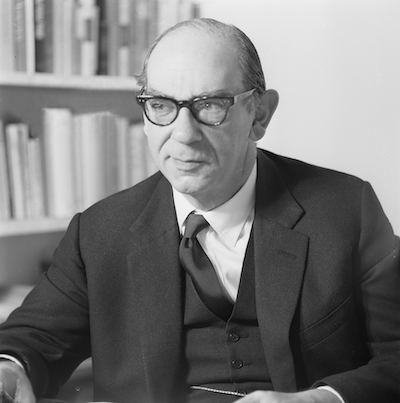

# Isaiah Berlin

*Cherniss, Joshua L., Hardy, Henry*

*Isaiah Berlin, 18 July 1968 Photo by Helen Muspratt, Ramsey and Muspratt © The Trustees of the Isaiah Berlin Literary Trust*
**First published Tue Oct 26, 2004; substantive revision Sun Nov 8, 2026**

Isaiah Berlin (1909–97) was a naturalised British philosopher, historian of ideas, political theorist, educator, public intellectual and moralist, and essayist. He was renowned for his conversational brilliance, his defence of liberalism and pluralism, his opposition to political extremism and ideological fanaticism, and his accessible, coruscating writings on people and ideas. His essay *Two Concepts of Liberty* (1958) contributed to a revival of interest in political theory in the English-speaking world, and remains one of the most influential and widely discussed texts in that field: admirers and critics agree that Berlin’s distinction between positive and negative liberty remains, for better or worse, a basic starting point for discussions of the meaning and value of political freedom. Later in his life, the greater availability of his numerous essays began to provoke increasing interest in his work, particularly in the idea of value pluralism; that Berlin’s articulation of value pluralism contains many ambiguities and even obscurities has only encouraged further work on this rich and important topic by other philosophers.

## 1. Life

Isaiah Berlin was born in 1909 in Riga (then capital of the Russian Govenorate of Livonia, now capital of Latvia), the only surviving child (after a stillborn daughter) of Mendel Berlin, a prosperous Russian Jewish timber merchant, and his wife Marie, née Volshonok. In 1915 the family moved to the forestry town of Andreapol (then in Russia’s Pskov Govenorate), and in 1916 to Petrograd (now St Petersburg), where they remained through both Russian Revolutions of 1917, which Isaiah would remember witnessing. Despite early harassment by the Bolsheviks, the family was permitted to return to Riga with Latvian citizenship in 1920; from there they emigrated, in 1921, to Britain. They lived first in suburban and then in central London; Isaiah attended St Paul’s School and Corpus Christi College, Oxford, where he studied Greats (classical languages, ancient history, and philosophy) and PPE (philosophy, politics and economics), taking Firsts in both. In 1932 he was appointed to a lectureship at New College, and shortly afterwards became the first Jew to be elected to a Prize Fellowship at All Souls, considered one of the highest accolades in British academic life.

Throughout the 1930s Berlin was deeply involved in the development of what became known as Oxford philosophy, or ordinary language philosophy; his friends and colleagues included J. L. Austin, A. J. Ayer and Stuart Hampshire, who all met regularly (with others) in Berlin’s rooms to discuss philosophy. However, he also evinced an early interest in a more historical approach to philosophy, and in social and political theory, reflected in his lectures and reviews of the 1930s (1930, 1935, 1936a, 1936b), as well as in his intellectual biography of Karl Marx (KM), first published in 1939, and still in print, in its fifth edition (2013), over eighty-five years later.

During the Second World War Berlin served in British Information Services in New York City (1940–2) and at the British Embassy in Washington, DC (1942–6), where he was responsible for drafting weekly reports on the American political scene. For four months in 1945–6 he visited the Soviet Union: his meetings there with surviving but persecuted members of the Russian intelligentsia, particularly the poets Anna Akhmatova and Boris Pasternak, reinforced his staunch opposition to Communism, and had a formative influence on his future thought. After the war he returned to Oxford. Although he continued to teach and write on philosophy throughout the later 1940s and into the early 1950s, his interests had shifted to the history of ideas, particularly Russian ideas, Marxist and other socialist theories, and the Enlightenment and its critics. He also began to publish widely-read articles on contemporary political and cultural trends, political ideology, and the internal workings of the Soviet Union. In 1950, election to a research fellowship at All Souls allowed him to devote himself more fully to his historical, political and literary interests, which lay well outside the mainstream of philosophy as it was then practised and taught at Oxford. He was, however, one of the first of the founding generation of Oxford philosophers to make regular visits to American universities, and played an important part in spreading ‘Oxford philosophy’ to the USA.

In 1957, a year after he had married Aline Halban (née de Gunzbourg), Berlin was elected Chichele Professor of Social and Political Theory at Oxford (his inaugural lecture, delivered in 1958, was entitled *Two Concepts of Liberty*). Later in 1957 he was knighted. He resigned his chair in 1967, the year after becoming founding President of Wolfson College, Oxford (which he essentially created), a post from which he retired in 1975. In his later years he hoped to write a major work on the history of European Romanticism, but this hope was unfulfilled. From 1966 to 1971 he was also a visiting Professor of Humanities at the City University of New York, and he served as President of the British Academy from 1974 to 1978. Collections and new editions of his writings, edited by Henry Hardy (sometimes with a co-editor), began appearing in 1978. There are, to date, nineteen such volumes (1978–2026), thirteen of which also appeared in new editions in 2013, 2014 and 2019, as well as a previously unpublished book on J. G. Hamann (in two editions), and a substantial four-volume edition of his letters. Berlin received the Agnelli, Erasmus and Lippincott Prizes for his work on the history of ideas, and the Jerusalem Prize for his lifelong defence of civil liberties, as well as numerous honorary degrees. He died in 1997.

### 1.1 Intellectual Development

An early influence on Berlin was a waning British Idealism, as expounded by T. H. Green, Bernard Bosanquet and F. H. Bradley. While an undergraduate, Berlin was converted to the Realism of G. E. Moore and John Cook Wilson. By the time he began teaching philosophy he had joined a new generation of rebellious empiricists, some of whom (most notably A. J. Ayer) embraced the logical positivist doctrines of the Vienna Circle and Wittgenstein’s *Tractatus*. Although Berlin was always sceptical about logical positivism, its suspicion of metaphysical claims and its preoccupation with the nature and authority of knowledge strongly influenced his early philosophical enquiries. These, combined with his historical bent, led him back to the study of earlier British empiricists, particularly Berkeley and Hume, on whom he lectured in the 1930s and late 1940s, and about whom he contemplated writing books (which never materialised).

Berlin was also influenced by Kant and his successors. His first philosophical mentor was an obscure Russian Jewish Menshevik émigré named Solomon Rachmilevich, who had studied philosophy at several German universities, and who introduced Berlin to the great ideological quarrels of Russian history, as well as to the history of German philosophy since Kant. Later, at Oxford, R. G. Collingwood fostered Berlin’s interest in the history of ideas, introducing him to such founders of historicism as Giambattista Vico and J. G. Herder. Collingwood also reinforced Berlin’s belief – heavily influenced by Kant – in the importance to human life of the basic concepts and categories in terms of which human beings organise and analyse their experience (see further §2.1 and [^note-2]).

While working on his biography of Marx in the mid 1930s, Berlin encountered two Russian thinkers who would be important influences on his political and historical outlook. One of these was Alexander Herzen, who became a hero, and to whom Berlin would sometimes attribute many of his own beliefs about history, politics and ethics. The other was the Marxist Russian publicist and historian of philosophy Georgy Valentinovich Plekhanov. Despite his opposition to Marxism, Berlin admired and praised Plekhanov both as a man and as a historian of ideas. It was as a result of reading Plekhanov’s writings that Berlin first became interested in the naturalistic, empiricist and materialist thinkers of the Enlightenment, as well as their Idealist and historicist critics. Both Herzen and Plekhanov fuelled Berlin’s absorption in the political debates of nineteenth- and early twentieth-century Russian liberals and radicals of various stripes, which in turn informed his concern with both the philosophy of history and the ethics of political action.

During the Second World War, separated from his Oxford philosophical colleagues, and exposed to political action, Berlin began to drift away from his early philosophical concerns. His doubts were encouraged by a meeting with the Harvard logician Henry M. Sheffer, who asserted that genuine increase in knowledge was possible only in such hybrid sub-fields of philosophy as logic and psychology. His meeting with Sheffer led Berlin to realise that he lacked the passion and the belief in his own ability to continue pursuing pure philosophy. He concluded that as a professional philosopher (as he then understood that role) he would make no original contributions, and would end his life knowing no more than he did when he began. He therefore determined to switch to the history of ideas, in which (he believed) originality was less essential, and which would allow him to learn more than he already knew. Berlin’s approach to the history of ideas would, however, remain deeply informed by his philosophical persona, as well as by his political beliefs. His historical work was, in effect, the practice of philosophy in a historical key.

By the early 1950s Berlin’s central beliefs had crystallised from the confluence of his philosophical preoccupations, historical studies, and political and moral commitments and anxieties; and his major ideas were either already fully formed, or developing. Such essays of the late 1950s as *Two Concepts of Liberty* served as the occasion for a synthesis and solidification of his thoughts. Berlin had always been a liberal; but from the early 1950s the defence of liberalism became central to his intellectual concerns. This defence was, characteristically, closely related to his moral beliefs and to his preoccupation with the nature and role of values in human life. In the early 1960s Berlin’s focus moved from the more political concerns that occupied him in the 1950s to an examination of the nature of the humanities. Throughout the 1950s and 1960s he was working on the history of ideas, and from the mid 1960s nearly all his writings took the form of essays in this field, particularly on the Romantic and reactionary critics of the Enlightenment. In the final decades of his life Berlin continued to refine and re-articulate his ideas, and particularly his formulation of pluralism; but his course was set, and he appears to have been little affected by later intellectual developments.

## 2. Philosophy of Knowledge and the Humanities

### 2.1 Conception of Philosophy

Berlin’s conception of philosophy was shaped by his early exposure to, and rejection of, both Idealism and logical positivism. With the former he associated an excessively exalted view of philosophy as the ‘queen of the sciences’, capable of establishing fundamental, necessary, absolute, universal truths. With the latter he associated the reductionist and deflationary view of philosophy as, at best, ‘secretary to science and obituarist of metaphysics’ (Williams 1978, xxxii)[^williams-1978], and at worst a sign of intellectual immaturity bred of scientistic confusion and credulity.

Berlin’s approach combined a sceptical empiricism with neo-Kantianism to offer a defence of philosophy. Like Vico and Wilhelm Dilthey, as well as neo-Kantians such as Heinrich Rickert and Wilhelm Windelband, Berlin insisted on the fundamental difference between the sciences and the humanities. He classed philosophy among the humanities, but even there its status was unique. Those working in other fields aimed to discover authoritative methods for acquiring knowledge of the subjects to which they were devoted. Philosophy, however, was for Berlin concerned with questions which not only could not at present be answered, but for which no clearly proper method of discovering an answer was known – see, e.g., ‘The Purpose of Philosophy’ (1962a [CC, POI]).

In the case of non-philosophical questions, even if the answer is unknown, the means for discovering it is understood and accepted by most people. Thus questions of empirical fact can be answered by observation. Other questions can be answered deductively, by referring to established rules: this is the case, for example, with mathematics, grammar, formal logic and other man-made systems such as chess or heraldry. For example, even if we do not know the solution to a difficult mathematical problem, we or others do know the rules and techniques that should lead us to the answer.

According to Berlin, philosophy concerns itself with questions of a special, distinctive character. To such questions not only are the answers not known, but neither are the means for arriving at answers, or the standards of judgement by which to evaluate a suggested answer. Thus the questions ‘How long does it take to drive from *x* to *y*?’ or ‘What is the cube root of 729?’ are not philosophical; while ‘What is time?’ or ‘What is a number?’ are. ‘What is the purpose of human life?’ or ‘Are all men brothers?’ are philosophical questions, while ‘Do most of such-and-such a group of men think of one another as brothers?’ or ‘What did Luther believe was the purpose of life?’ are not.

Berlin related this view to Kant’s distinction between matters of fact and those conceptual structures and categories that we use to make sense of facts. Philosophy, being concerned with questions that arise from our attempts to make sense of our experiences, involves consideration of the concepts and categories through which experience is perceived, organised and explained.

While Kant saw these organising categories as fixed and universal, Berlin believed that they are, to different degrees, varying, transient or malleable. ‘All our categories are, in theory, subject to change’ (1954a [L 144, note 1]). No categories are wholly prior to, or independent of, experience, even though in practice some of them are pragmatically fixed, whether by the world or by our minds or both. Rather, the ideas in terms of which we make sense of the world are closely tied up with our experiences: they shape those experiences, and are shaped by them, and as experience varies from one time and place to another, so do basic concepts.[^note-1] Recognition of the basic concepts and categories of human experience differs both from the acquisition of empirical information and from deductive reasoning, for the categories are logically prior to, presupposed by, both.

Philosophy, then, is the study of the ‘category-spectacles’ (1962a [CC 10]) through which we view the world; and since at least some of these change over time, at least some philosophy is necessarily historical. Because these categories are so important to every aspect of our experience, philosophy is a crucially important activity, which responds to the vital, ineradicable human need to describe and explain the many kinds of experience to which we are exposed.

Berlin insisted on philosophy’s social usefulness, however indirect and unobtrusive.[^note-2] By bringing to light often subconscious presuppositions and models, and scrutinising their validity, philosophy identifies errors and confusions that lead to misunderstanding, distort experience, and thus do real harm. Because philosophy calls commonly accepted assumptions into question, it is inherently subversive, opposed to all orthodoxy, and often troubling; but this is inseparable from what makes philosophy valuable, and indeed indispensable, as well as liberating. Philosophy’s goal, Berlin concluded, was ‘to assist men to understand themselves and thus operate in the open, and not wildly, in the dark’ (1962a [CC 14]).

### 2.2 Basic Propositions: Epistemology, Metaphysics, Logic

Perhaps the most important work Berlin did in pure philosophy, in the light of his later ideas, concerned ‘logical translation.’[^note-3] In his essay of that title (1950a [CC]), Berlin criticised the assumption that all statements, to be genuine and meaningful, or to claim correctness, must be capable of being translated into a single, ‘good’ type of proposition, and asserted that the ideal of a single proper type of proposition was illusory and misleading. He identified two different, opposed approaches based on this erroneous assumption. One was the ‘deflationary’ approach, which sought to assimilate all propositions to one true type. Thus, phenomenalism sought to translate all statements into assertions about immediately perceived sense data. The other was the ‘inflationary’ approach, which posited entities corresponding to all statements, thus ‘creating’ or asserting the existence of things that didn’t exist at all. Both of these errors stemmed from a demand for a ‘forcible assimilation’ of all propositions to a single type. Berlin suggested that such a demand was based, not on a true perception of reality, but rather on a psychological need for certainty, uniformity and simplicity, as well as on what he termed the ‘Ionian fallacy’, the assumption that everything is made out of, or can be reduced to or understood in terms of, a single substance or type.[^note-4]

Berlin insisted that there is no single criterion of meaningfulness, no absolutely incorrigible type of knowledge. The quest for certainty was self-defeating: to restrict oneself to saying only that which could be said without any doubt or fear of being mistaken was to sentence oneself to silence. To say anything about the world requires bringing in something other than immediate experience:

> The vast majority of the types of reasoning on which our beliefs rest, or by which we should seek to justify them if they were challenged, are not reducible to formal deductive or inductive schemata, or combinations of them. […] The web is too complex, the elements too many and not, to say the least, easily isolated and tested one by one; […] we accept the total texture, compounded as it is out of literally countless strands – […] without the possibility, even in principle, of any test for it in its totality. For the total texture is what we begin and end with. There is no Archimedean point outside it whence we can survey the whole and pronounce upon it. […] It is the sense of the general texture of experience […] that constitutes the foundation of knowledge, that is itself not open to inductive or deductive reasoning: for both these methods rest upon it. (1960 [CC 149–50])

At the heart of Berlin’s philosophy was an awareness of the enormous variety and complexity of reality, which we can only begin to comprehend: the many strands that make up human experience are

> too many, too minute, too fleeting, too blurred at the edges [to be integrated into a total picture of experience]. They criss-cross and penetrate each other at many levels simultaneously, and the attempt to prise them apart […] and pin them down, and classify them, and fit them into their specific compartments, turns out to be impracticable. (1960 [CC 156])

These two closely related propositions – that absolute certainty is an impossible ideal (Berlin once wrote that, if his work displayed any ‘single tendency’, it was ‘distrust of all claims to the possession of incorrigible knowledge about issues of fact or principle in any sphere of human behaviour’: RT x), and that not everything can or should be reduced or related to a single ideal, model, theory or standard – might be considered the centrepieces of Berlin’s philosophy. They are central to his view of language and knowledge; they are equally important to his ethics and his philosophy of the humanities. Also central to these different facets of his thought was Berlin’s emphasis on the importance, and indeed priority, of particular things as objects of knowledge and of individual persons as moral subjects.

### 2.3 The Distinction between the Sciences and the Humanities

Berlin’s individualism, the influence on him of neo-Kantianism, and what one scholar (Allen 1998)[^allen-1998] has called his ‘anti-Procrusteanism’ – his opposition to attempts dogmatically and inappropriately to impose standards or models on aspects of human experience which they don’t fit – shaped his view of what he usually referred to as the ‘humanities’ (sometimes as ‘humane studies’) and their relationship to the (natural) sciences. By ‘humanities’ he meant all disciplines concerned with the study of human conduct and experience – thus encompassing many so-called ‘social sciences’ as well as the fields of study traditionally classed as ‘humanities’.[^note-5]

Berlin criticised the positivist view of the sciences as the paradigmatic form of knowledge, which the humanities should measure themselves by and seek to emulate. He argued that the humanities differed fundamentally from the sciences both in the nature of their subject matter (as Vico and Dilthey had maintained), and in the sort of knowledge that they sought (as Rickert and Windelband insisted). As a result, different methods, standards and goals were appropriate to each.

Most obviously, the humanities study the world that human beings create for themselves and inhabit, while the sciences study the physical world of nature. Why should this make a difference to the way they are studied? One answer is that the two worlds are fundamentally different in themselves. But Berlin preferred the argument that the human and natural worlds must be studied differently because of the differing relationship between the observer or thinker and the object of study, as well as the kind of knowledge being sought. We study nature from without, culture from within. In the humanities, scholars’ own ways of thinking, the fabric of their lives, and every other facet of their experience are part of the object of study. The sort of knowledge sought in the humanities (and by some practitioners of the ‘social sciences’) is, furthermore, ‘knowledge from within’, knowledge of the motives and perceptions of the actors being studied. The sciences, on the other hand, aim to understand nature objectively and dispassionately. The scientist must take as little for granted as possible, preferring hard evidence to ‘common sense’ when they diverge. But in the humanities one cannot act in this manner: to study human life, it is necessary to begin from our understanding of other human beings, of what it is to have motives and feelings. Such understanding is based on our own experience, which in turn necessarily involves certain ‘common-sense’ assumptions, which we use to fit our experience into patterns that make it explicable and comprehensible. These patterns may be more or less accurate; and we can judge their accuracy by seeing how well they fit experience as we know it. But we cannot divest ourselves entirely of the assumptions that underlie them. (The human world can also itself be a legitimate subject of scientific study, of course, but only incompletely, by bracketing off what makes it distinctive. Cf. [^note-7].)

Berlin asserted that the humanities also differed from the sciences in that the former were concerned with understanding the particularities of human life in and of themselves, while the sciences sought to establish general laws which could explain whole classes of phenomena. The sciences are concerned with types, the humanities with individuals. Scientists concentrate on similarities and look for regularities; at least some practitioners of the humanities – historians in particular – are interested in differences. To be a good historian requires a ‘concentrated interest in particular events or persons or situations as such, and not as instances of a generalisation’ (1960 [CC 180]). The humanities should not aim to emulate the sciences by seeking laws to explain or predict human actions, but should concern themselves with understanding every particular human phenomenon in its uniqueness. In the case of a science we think it more rational to put our trust in general laws than in specific phenomena; in the case of the humanities, the opposite is true. If someone claims to have witnessed a phenomenon that contradicts well-established laws of science, we seek an explanation that will reconcile that perception with science; if none is possible, we may conclude that the witness is deceived. In the case of history we do not usually do this: we look at particular phenomena and seek to explain them in themselves.[^note-6] There are, Berlin claimed, ‘more ways than one to defy reality’. It is unscientific to ‘defy, for no good logical or empirical reason, established hypotheses and laws’. But it is unhistorical, on the other hand, to ‘ignore or twist one’s view of particular events, persons, predicaments in the name of laws, theories, principles derived from other fields, logical, ethical, metaphysical, scientific, which the nature of the medium renders inapplicable’ (1960 [CC 185]).

Berlin emphasised the importance to a sense of history of the idea of its ‘one-directional’ flow (1960 [CC 144]). This sense of historical reality makes it seem not merely inaccurate, but implausible, and indeed ridiculous, to suggest, for example, that *Hamlet* was written in the court of Genghis Khan (1960 [CC 142, 175]). The historical sense involves, not knowledge of what happened – this is acquired by empirical means – but a sense of what is plausible and implausible, coherent and incoherent, in accounting for human action (1960 [CC 183]). There is no a priori shortcut to such knowledge. Historical thinking is much more like the operation of common sense, involving the weaving together of various logically independent concepts and propositions, and bringing them to bear on a particular situation as best we can, than like the application of laws or formulae. The ability to do this is a knack – judgement, or a ‘sense of reality’ (1960 [CC 152; 167 etc.]).

Understanding of history is based on knowledge of humanity, which is derived from direct experience, consisting not merely of introspection, but of interaction with others. This is the basis for *Verstehen*, or imaginative understanding: the

> recognition of a given piece of behaviour as being part and parcel of a pattern of activity which we can follow, […] and which we describe in terms of the general laws which cannot possibly all be rendered explicit (still less organised into a system), but without which the texture of normal human life – social or personal – is not conceivable. (1960 [CC 168]).

The challenge of history is the need for individuals to go beyond their own experience, which is the basis of their ability to understand human behaviour. We must reconstruct the past not only in terms of our own concepts and categories, but in terms of how past events must have looked to those who participated in them. The practice of history thus requires gaining knowledge of what consciousness was like for other persons, in situations other than our own, through an ‘imaginative projection of ourselves into the past’, in order to

> capture concepts and categories that differ from those of the investigator by means of concepts and categories that cannot but be his own. […] Without a capacity for empathy and imagination beyond any required by a physicist, there is no vision of either past or present, neither of others nor of ourselves. (1960 [CC 177–8])

Historical reconstruction and explanation requires us to ‘enter into’ the motives, principles, thoughts and feelings of others; it is based on a capacity for knowing like that of knowing someone’s character or face (1960 [CC 173–5]).

This sort of historical understanding did *not* amount to a ‘moral sense’; its relationship to moral judgement was not always clear, but Berlin *was* explicit in insisting that understanding did not entail approval. Nevertheless, such historical understanding *was* ‘related to moral and aesthetic analysis’, in so far as it conceives of human beings not merely as organisms in space, but ‘as active beings, pursuing ends, shaping their own and others’ lives, feeling, reflecting, imagining, creating, in constant interaction and intercommunication with other human beings; in short, engaged in all the forms of experience that we understand because we share in them, and do not view them purely as external observers’ (1960 [CC 173–4]).

### 2.4 Free Will and Determinism

For Berlin, then, the philosophy of history was tied not only to epistemology, but to ethics. The best-known and most controversial facet of his writings on the relationship of history to the sciences was his discussion of the problem of free will and determinism, which in his hands took on a distinctly moral cast.[^note-7] In *Historical Inevitability* Berlin radically questioned determinism (the view that human beings do not possess free will, that their actions and indeed thoughts are predetermined by impersonal forces beyond their control) and historical inevitability (the view that all that occurs in the course of history does so because it must, that history pursues a particular course which cannot be altered, and which can be discovered, understood, predicted and described through laws of historical development).

Berlin did not assert that determinism was untrue, but rather that to accept it required a radical transformation in how we think about human life – especially a rejection of the idea of individual moral responsibility. To praise or blame individuals, to hold them responsible, is to assume that they have some control over their actions, and could have chosen differently. If individuals are wholly determined by unalterable forces, it makes no more sense to praise or blame them for their actions than it would to blame someone for being ill, or praise someone for obeying the laws of gravity. Indeed, Berlin further suggested that acceptance of determinism – that is, the complete abandonment of the concept of human free will – would lead to the collapse of all meaningful rational activity as we know it.

Berlin’s argument here reflects the influence of Kant’s recognition of the inescapable contribution made by our minds to grasping the non-human world. Berlin mirrors this move in claiming that there are equally inescapable ways in which we cannot but think of human behaviour and experience:

> The basic categories (with their corresponding concepts) in terms of which we define men – such notions as society, freedom, sense of time and change, suffering, happiness, productivity, good and bad, right and wrong, choice, effort, truth, illusion (to take them wholly at random) – are not matters of induction and hypothesis. To think of someone as a human being is *ipso facto* to bring all these notions into play; so that to say of someone that he is a man, but that choice, or the notion of truth, mean nothing to him, would be eccentric: it would clash with what we mean by ‘man’ not as a matter of verbal definition (which is alterable at will), but as intrinsic to the way in which we think, and (as a matter of ‘brute’ fact) evidently cannot but think. (1961a [CC 217])

Here ‘freedom’ means the centrally important concept of free will. We cannot help experiencing human behaviour as causally undetermined and freely chosen. That we have free will is not a scientific hypothesis, but a precondition of our experience of humanity, to abandon which would leave our world-view in ruins. (Whether this entails that determinism is false is a further question, which Berlin does not fully confront; nor do we pursue it here.)

Berlin also insisted that belief in historical inevitability was inspired by psychological needs, and not required by known facts; and that it had dangerous moral and political consequences, justifying suffering and undermining respect for the ‘losers’ of history. A belief in historical inevitability served as an ‘alibi’ for evading responsibility and blame, and for committing enormities in the name of necessity or reason. It provided an excuse both for acting badly and for not acting at all.[^note-8]

Berlin’s insistence on the importance of the idea of free will, and the incompatibility of consistent and thoroughgoing determinism with our basic sense of ourselves and our experience as human beings, was closely tied to his liberalism and pluralism, with their emphasis on the importance, necessity and dignity of individual choice. This insistence involved him in a number of debates with other philosophers and historians in the 1950s and early 1960s, and helped to provoke a spate of writing in the English-speaking world on the philosophy of history, which might otherwise have languished.

Also controversial was Berlin’s claim that the writing and contemplation of history necessarily involves moral evaluation. He did not, as some of his critics charged (e.g. Carr 1961)[^carr-1961], mean this as a call for moralising on the part of historians. Berlin’s argument was that, first, our normal way of regarding human beings as agents who make choices necessarily involves moral evaluation; to eliminate moral evaluation from our thinking completely would be to alter radically the way that we view the world. Nor would such an alteration truly move beyond moral evaluation; for strenuous attempts to be morally neutral are themselves motivated by a moral commitment to the ideal of impartiality. Furthermore, given the place of moral evaluation in ordinary human thought and speech, an account couched in morally neutral terms will fail accurately to reflect the experience or self-perception of the historical actors in question. This last argument was particularly important to Berlin, who believed that historical writing should reflect and convey past actors’ understanding of their situation, so as to provide explanations of why, thinking as they did, they acted as they did. He therefore insisted that the historian must attend to the moral claims and perceptions underlying historical events.

## 3. The History of Ideas

Berlin’s emphasis on the subversive, liberating nature of philosophy was accompanied by a particular interest in moments of radical change in the history of ideas, and in original, heterodox and often marginal thinkers; while his emphasis on the practical consequences of ideas led him to focus on those transformations and challenges which, in his view, had wrought particularly decisive changes in people’s moral and political consciousness and behaviour. Finally, his concern with the conflicts of his own day led him to concentrate mainly on modern intellectual history, and to trace the emergence of certain ideas that he regarded as particularly important, for good or ill, in the contemporary world.[^note-9]

Many of Berlin’s writings on the history of ideas were connected to his philosophical work, and to one another, in their examination of certain overarching themes. These included the relationship between the sciences and the humanities; the philosophy of history; the origins of nationalism and socialism; the revolt against what Berlin called ‘monism’ in general, and scientism in particular, in the early nineteenth century and thereafter; and the vicissitudes of ideas of liberty.

The narrative of the history of ideas that Berlin developed and refined over the course of his works began with the Enlightenment, and focused on the initial rebellion against what he regarded as that epoch’s dominant assumptions.[^note-10] In Berlin’s account, the thinkers of the Enlightenment believed human beings to be naturally either benevolent or malleable. This created a tension within Enlightenment thought between the view that nature dictates human ends, and the view that nature provides more or less neutral material, which can be moulded rationally and benevolently (ultimately the same thing) by conscious human interventions – education, legislation, rewards and punishment, the whole apparatus of society.[^note-11] Berlin also attributed to the Enlightenment the beliefs that all human problems, both of knowledge and ethics, can be resolved through the discovery and application of the proper method (generally reason, the conception of which was based on the methods of the sciences, particularly Newtonian physics); and that genuine human goods and interests were ultimately compatible. Conflict, like wickedness, was the result of ignorance, misunderstanding, or deception and oppression practiced by corrupt authorities (particularly the Church).[^note-12]

Berlin saw the school (or schools) of thought that began to emerge shortly before the French Revolution, and became ascendant during and after it, as profoundly antagonistic towards the Enlightenment. He was most interested in German Romanticism, but also looked at other members of the larger tendency he referred to as the ‘Counter-Enlightenment’.[^note-13] Berlin’s account sometimes focused on attacks on the Enlightenment’s benevolent and optimistic liberalism by nationalists and reactionaries; sometimes on the rejection of moral and cultural universalism by champions of cultural particularism and pluralism; and sometimes on the critique of naturalism and scientism by thinkers who advocated a historicist view of society as essentially dynamic, shaped not by the laws of nature, but by the unlawlike, purposeless contingencies of history.

Berlin has been viewed both as an adherent of the Enlightenment who showed a fascination, whether eccentric or admirable, with its critics; and as a critic and even opponent of the Enlightenment, who frankly admired its enemies. There is some truth in both of these pictures, neither of which does justice to the complexity of Berlin’s views. Berlin admired many of the thinkers of the Enlightenment, and explicitly regarded himself as ‘on their side’ (Jahanbegloo 1992, 70)[^jahanbegloo-1992]; he believed that much of what they had accomplished had been for the good; and, as an empiricist, he recognised them as part of the same philosophical tradition to which he belonged. But he also believed that they were wrong, sometimes dangerously so, about some of the most important questions of society, morality and politics. He regarded their psychological and historical vision as shallow, excessively uniform, and naive; and he traced to the Enlightenment a technocratic, managerial view of human beings and political problems to which he was profoundly opposed, and which, in the late 1940s and early 1950s, he regarded as one of the gravest dangers facing the world.

Criticism of Berlin’s understanding of ‘the Enlightenment’ rests in part on differences of opinion as to whether those he regarded as exponents of the ‘Counter-Enlightenment’ – Vico, Hamann, Herder, Hegel – should rather be considered as part of, or heirs to, the Enlightenment itself. In any case, Berlin regarded those he identified as the Enlightenment’s critics as in many ways dangerous and deluded. He attacked or dismissed their metaphysical beliefs, particularly the philosophies of history of Hegel and his successors. He was also wary of the aesthetic approach to politics that many Romantics had practised and fostered. And, while appreciative of some elements in the Romantic conception of liberty, he saw Romanticism’s influence on the development of the idea of liberty as largely perverting. But at the same time he thought the Enlightenment’s opponents had pointed to many important truths that the Enlightenment had neglected or denied, both negative (the power of unreason, and particularly the darker passions, in human affairs) and positive (the inherent value of variety and of personal virtues such as integrity, authenticity and sincerity, and the centrality to human nature and dignity of the capacity for choice). Romanticism rebelled in particular against the constricting order imposed by reason, and championed the human will. Berlin was sympathetic to this stance, but also believed that the Romantics had gone too far both in their protests and in their celebrations. He remained committed to the goal of understanding the world so as to be able to ‘act rationally in it and on it’ (1988 [CTH 2]). His interest in critics of the Enlightenment reflected both curiosity about the views of those with whom he often disagreed, and a desire to learn from the most acute challenges to a progressive, ‘liberal rationalist’[^note-14] (Jahanbegloo 1992, 70)[^jahanbegloo-1992] or ‘rational liberal’ (letter to Beata Polanowska-Sygulska, 17 July 1997 [UD 104]) position, so as to appreciate, and repair, its shortcomings and vulnerabilities. Berlin’s own articulation of liberalism and pluralism attempted to integrate a defence of the Enlightenment’s legacy with the insights of its critics.

## 4. Ethical Thought and Value Pluralism

The republication of Berlin’s numerous essays in thematic collections, beginning with *Four Essays on Liberty* in 1969 and *Vico and Herder* in 1976, and continuing at an increased pace from 1978 under the general (and mostly specific) editorship of Henry Hardy, served to highlight as a central dimension of Berlin’s thought his advocacy of the doctrine of value pluralism (which he himself called simply ‘pluralism’). Increasingly from the early 1990s, in the wake of the publication of *The Crooked Timber of Humanity* (1990 [CTH]), reinforced by John Gray’s book on Berlin (Gray 1995)[^gray-1995], value pluralism has come to be seen by many as Berlin’s ‘master idea’, and has become the most discussed, most admired and most controversial of all his ideas.

Value pluralism was indeed at the centre of Berlin’s ethical thought; but there is more to that thought than value pluralism alone. Berlin defined ethical thought as ‘the systematic examination of the relations of human beings to one another, the conceptions, interests and ideals from which human ways of treating one another spring, and the systems of value on which such ends of life are based’. These systems of value are ‘beliefs about how life should be lived, what men and women should be and do’ (1988 [CTH 1–2]). Just as Berlin’s conception of philosophy was based on a belief about the important role of concepts and categories in people’s lives, his conception of ethics was founded on his belief in the importance of normative or ethical concepts and categories – especially values.[^note-15]

Berlin did not set out a systematic theory about the nature of values, and so his view must be gleaned from his writings on the history of ideas. His remarks on the status and origins of values are ambiguous, though not necessarily irreconcilable with one another. He seems, first, to endorse the Romantic view – which he traces to Kant (although he also sometimes attributes it to Hume) – that values are not discovered ‘out there’, as ‘ingredients’ in the universe, deduced or derived from nature. Rather, they are human creations, and derive their authority from this fact. From this followed a theory of ethics according to which individual human beings are the most morally valuable things, so that the worth of ideals and actions should be judged in relation to the meanings and impact they have for and on such individuals. This view underlay Berlin’s passionate conviction of the error of looking to theories rather than human realities, of the evil of sacrificing living human beings to abstractions (an evil which he found emphasised in Herzen); it also related to Berlin’s theory of liberty, and his belief in liberty’s special importance.

At other times Berlin seems to advance what amounts almost to a theory of natural law, albeit in minimalist, empirical dress. In such cases he suggests that there are certain unvarying features of human beings, as they have been constituted throughout recorded history, that make certain values important, or even necessary, to them. Values, then, would be beliefs about what it is good to be and do – about what sort of life, what sort of character, what sort of actions, what state of being it is desirable, given human nature, for us to aspire to (cf. Hart 1955)[^hart-1955]. This view of the origin of values also comes into play in Berlin’s defence of the value of liberty, when he suggests that the freedom to think, to enquire, to imagine, and above all to choose, without constraint or fear, is valuable because human beings need such mental freedom; to deny it to them is a denial of their nature, imposes an intolerable burden, and at the extreme entirely dehumanises them.

In an attempt to reconcile these two strands, one might say that, for Berlin, the values that humans create are rooted in the nature of the beings who pursue them. But this is simply to move the question back a step, for the question then immediately arises: Is this human nature natural and fixed, or created and altered over time through conscious or unconscious human action? Berlin’s answer (see e.g. letter to Beata Polanowska-Sygulska, 24 February 1986, CTH 319–23, UD 39–44) comes in two parts. He rejects the idea of a fixed, fully specified human nature, regarding natural essences with suspicion. Yet he does believe (however under-theorised, unsystematic and undogmatic this belief may be) in boundaries to, and requirements made by, human nature as we know it. This common human nature may not be completely specifiable in terms of a list of unvarying characteristics; but, while many characteristics may vary from individual to individual or culture to culture, there is a limit on the variation – just as the human face may vary greatly from person to person in many of its properties, while remaining recognisably human, but at the same time it is possible to distinguish between a human and a non-human face, even if the difference between them cannot be reduced to a formula. Indeed, at the core of Berlin’s thought was his insistence on the importance of humanity, or the distinctively human, both as a quasi-Kantian category and as a moral reality, which does not need to be reduced to an unvarying essence in order to have descriptive and normative force.

There is a related ambiguity about whether values are objective or subjective. One might conclude from Berlin’s view of values as human inventions that he would regard them as subjective. Yet he insisted, on the contrary, that values are objective, even going so far as to label his position ‘objective pluralism’ (letter to Hendrik Hoetink, 15 June 1983, A 210; cf. PSM 390/TCE 245, note 1, 1996). Yet it is unclear what exactly he meant by this, or how this belief relates to his view of values as human creations. There are at least two accounts of the objectivity of values that can be plausibly attributed to Berlin. The first is that values are ‘objective’ in that they are simply facts about the people who hold them – so that, for instance, liberty is an ‘objective’ value because I value it, and would feel frustrated and miserable without at any rate a minimal amount of it. The second is that the belief in or pursuit of certain values is the result of objective realities of human nature – so that, for instance, liberty is an ‘objective’ value because certain facts about human nature make liberty good and desirable for human beings. These views are not incompatible with one another, but they are distinct; and the latter provides a firmer basis for the minimal moral universalism that Berlin espoused.

Finally, Berlin insisted that each value is binding on human beings by virtue of its own claims, in its own terms, and not in terms of some other value or goal, let alone the same value in all cases. This view was one of the central tenets of Berlin’s pluralism.

### 4.1 Berlin’s Definition of Value Pluralism

Berlin’s development and definition of pluralism both began negatively, with the identification of the opposing position, which he usually referred to as ‘monism’, and sometimes as ‘the Ionian fallacy’ or ‘the Platonic ideal’. His definition of monism may be summarised as follows:

1. All genuine questions must have one true answer, and one only; all other responses are errors.
2. There must be a dependable path to discovering the true answer to a question, which is in principle knowable, even if currently unknown.
3. The true answers, when found, will be compatible with one another, forming a single whole; for one truth cannot be incompatible with another.

We have seen that Berlin denied that the first two of these assumptions are true. In his ethical pluralism he pushed these denials further, and added a forceful denial of the third assumption. According to Berlin’s pluralism, genuine values are many. They may – and often do – come into conflict with one another. When two or more values clash, it is not because one or another has been misunderstood; nor can it be said, a priori, that any one value is always more important than another. Liberty can conflict with equality or with public order; mercy with justice; love with impartiality and fairness; social and moral commitment with the disinterested pursuit of truth or beauty (the latter two values, contra Keats, may themselves be incompatible); knowledge with happiness; spontaneity and free-spiritedness with dependability and responsibility. Conflicts of values are ‘an intrinsic, irremovable element in human life’; ‘the notion of total human fulfilment is a […] chimera’. ‘These collisions of values are of the essence of what they are and what we are’; a world in which such conflicts are resolved is not the world we know or understand (1958 [L 213]; 1988 [CTH 13]).

Berlin further asserted that values may be not only incompatible, but incommensurable. There has been considerable controversy over what he meant by this, and whether his understanding of incommensurability was either correct or coherent. In speaking of the incommensurability of values, Berlin seems to have meant that there is no common measure, no ‘common currency’ (1994a [CC 325–6]) in terms of which the relative importance of any two values can be established in the abstract. Thus one basic implication of pluralism for ethics is the view that a quantitative approach to ethical questions (such as that envisaged by Utilitarianism) is impossible. In addition to denying the existence of a common currency for comparison, or a governing principle (such as the utility principle), value incommensurability holds that there is no general procedure for resolving value conflicts – there is not, for example, a lexical priority rule (that is, no value always has priority over any other).

Berlin based these assertions on empirical grounds – on ‘the world that we encounter in ordinary experience’, in which ‘we are faced with choices between ends equally ultimate, and claims equally absolute,[^note-16] the realisation of some of which must inevitably involve the sacrifice of others’ (1958 [L 213–14]). Yet he also held that the doctrine of pluralism reflected logically necessary rather than contingent truths about the nature of human moral life and the values that are its ingredients. The idea of a perfect whole or ultimate solution is not only unattainable in practice, but also conceptually incoherent. To avert or overcome conflicts between values once and for all would require the transformation, which amounted to the abandonment, of those values themselves.

Berlin’s pluralism was not free-standing: it was modified and guided by other beliefs and commitments. One of these, discussed below, was liberalism. Another was humanism the view that human beings are of primary importance, and that avoiding harm to human beings is the first moral priority (Aarsbergen-Ligtvoet 2006; Cherniss and Hardy 2018)[^aarsbergen-ligtvoet-2006][^cherniss-2018][^hardy-2018][^cherniss-2018-2]. Berlin therefore held that, in navigating between conflicting values, ‘The first public obligation is to avoid extremes of suffering.’ He insisted that moral collisions, even if unavoidable, can be softened, claims balanced, compromises reached. The goal should be the maintenance of a ‘precarious equilibrium’ that avoids, as far as possible, ‘desperate situations’ and ‘intolerable choices’. Philosophy itself cannot tell us how to do this, though it can help by bringing to light the problem of moral conflict and all its implications, and by weeding out false solutions. But in dealing with conflicts of values, ‘The concrete situation is almost everything’ (1988 [CTH 18–19]).

One of the main features of Berlin’s account of pluralism is the emphasis placed on the act of choosing between values. Pluralism holds that, in many cases, there is no single right answer. Berlin used this as an argument for the importance of liberty (see [^note-25]) – or, perhaps more precisely, an argument against the restriction of liberty in order to impose the ‘right’ solution by force. Berlin also made a larger argument about making choices. Pluralism involves conflicts, and thus choices, not only between particular values in individual cases, but between whole ways of life. While Berlin seems to suggest that individuals have certain inherent traits – an individual nature, or character, which cannot be wholly altered or obscured – he also insisted that they make decisions about who they will be and what they will do. Choice is thus both an expression of an individual personality, and part of what makes that personality; it is essential to the human self.

The possibility of choices between not only specific actions or individual values, but ways of life, arises from what Berlin calls *cultural pluralism*, which might perhaps be regarded as value pluralism writ large. Various questions arise about cultural pluralism, both in general and as concerns its relationship to value pluralism and cultural relativism. We cannot explore these questions fully here, but it may be worth indicating some of the issues that arise.

- Is cultural pluralism clearly distinct from value pluralism, or is the first a special case of the second? There seems to be no clear point of logical transition between an individual value such as freedom and the value of a cultural gestalt such as Germanness.
- Relatedly, is it better to regard a culture as a holistic value-system with a separate value of its own rather than as an unordered aggregate of individual values? On the holistic view, all subsidiary parts of a culture can be seen as imbued with the distinct overall quality of the culture as a whole, so that it is misleading to analyse it in terms of discrete standalone values. Berlin attributes such a view to Vico and Herder (1983a [CTH 62–8]; 1965 [TCE, esp. 286–95]), sometimes in an exaggerated form which is hard to accept: The way in which the Portuguese eat and drink and dance, the way in which they produce their laws, the way in which they study their history, the way they look, the way they get up and sit down, the kind of moral and political beliefs which they hold, the way in which they do their hair are more like the way in which they speak or the way in which they move or think or feel than they are like the corresponding behaviour on the part of the Germans. (\*1965–75 [2026]) At times Berlin seems to share a view of this kind: as so often, it can be hard to know whether he is ventriloquising or speaking in his own voice.
- Does this holistic view collapse into relativism? Berlin’s friend the eminent classicist Arnaldo Momigliano thought so (1976); in response, Berlin in his later works characterised and endorsed Vico’s and Herder’s views in more qualified form. Cultures do differ in their unique ‘lifestyles’, but there is some universal ‘basic sense of good and evil’ common to all human beings, and there are also many more specific values that are shared by different cultures, or, if not fully shared, at least *intelligible* to all, as alternative versions of values that a particular culture pursues in its own particular way, and universally human in that sense (1988 [CTH 10–13, 15]). This is a sufficient basis for subjecting cultures to critical evaluation, and even comparison, which in turn is enough to rebut the charge of relativism as Berlin understood it.[^note-17]

Whatever its other implications, the rejection of cultural monism fatally undermines the claims of both political and religious systems to possess a monopoly of truth, and the unique authority that would flow from such a monopoly. One of us has pressed the point about religious monism (Hardy 1995; 2018, ch. 3)[^hardy-1995], apparently without convincing Berlin (who was unengaged and equivocal on the topic). It is striking that the role of religious monism in fomenting political monism, hatred, violence, war and terror is scarcely mentioned, at any rate explicitly, in much of contemporary political commentary. But, as Berlin wrote to a Japanese scholar of international relations three years before his death:

> Cultural pluralism is totally incompatible with religious or social or political fanaticism. Fanaticism should always be resisted. One culture cannot be allowed to crush another. One of my heroes, the German philosopher J. G. Herder, condemned Rome for extinguishing all kinds of cultures in Asia Minor – he complained that we know nothing about Cappadocians, or Medians, whom the Romans crushed and assimilated: they might, after all, have contributed something valuable. He objected to all conquerors for that reason. I sympathise. (1994b)

### 4.2 Value Pluralism before Berlin

Berlin provided his own (inconsistent and somewhat peculiar) genealogies of pluralism. He found the first rebellion against monism either in Machiavelli (1988 [CTH 7–9]) or in Vico and Herder (1998 [POI 8–11]), who were also decisive figures in the first account. Yet he acknowledged that Machiavelli wasn’t really a pluralist, but a dualist; and other scholars have questioned his identification of Vico and Herder as pluralists, when both (dutifully or sincerely?) avowed belief in a higher, divine or mystical, unity behind variety. Other scholars have credited other figures in the history of philosophy, such as Aristotle, with pluralism (Nussbaum 1986, Evans 1996)[^evans-1996][^nussbaum-1986]. James Fitzjames Stephen advanced something that looks very much like Berlin’s pluralism (Stephen 1873)[^stephen-1873], though he allied it to a conservative critique of Mill’s liberalism.

In Germany, Dilthey came close to pluralism, and Max Weber presented a dramatic, forceful picture of the tragic conflict between incommensurable values, belief systems and ways of life (Weber 1919 [1946, esp. 117, 126] and Weber \*1917 [1919; 1946, esp. 147–8, 151–3]; cf. Weber 1904 [1949, esp. 17–18])[^weber-1904][^weber-1917][^weber-1919].

Ethical pluralism first emerged under that name, however, in America, inspired by William James’s pluralistic view of the universe, as well as his occasional gestures towards value pluralism (James 1891)[^james-1891]. John Dewey and the British theologian Hastings Rashdall both approximated pluralism in certain writings (Dewey 1908, Rashdall 1907)[^dewey-1908][^rashdall-1907]. But pluralism was apparently first proposed under that name, and as a specifically ethical doctrine, by Sterling Lamprecht (1890–1973), a naturalist philosopher and scholar of Hobbes and Locke, in two linked articles (1920, 1921). Berlin’s account of pluralism, and the terminology in which it is couched, is strikingly similar to Lamprecht’s. Pluralism was also proposed at about the same time by A. P. Brogan in a paper not published till a decade later (\*1921 [1931]). Brogan defended what he called ‘objective pluralism’, the term Berlin eventually used to characterise his own pluralism, against subjectivism. The dramatic similarities between not only Berlin’s and Lamprecht’s ideas, but also their language, make it difficult to believe that Lamprecht was not an influence on Berlin. The same might be said of Berlin and Brogan.[^note-18]

Versions of pluralism were also advocated by Berlin’s contemporaries Raymond Aron, Stuart Hampshire, Reinhold Niebuhr and Michael Oakeshott (although Oakeshott seems to have attributed conflicts of values to a mistakenly reflective approach to ethical issues, and suggested that they could be overcome by relying on a more habitual, less self-conscious, ethical approach: see Oakeshott 1962, 1–36)[^oakeshott-1962].

### 4.3 The Emergence of Value Pluralism in Berlin’s Work

Some of the elements of value pluralism are detectable in Berlin’s early essay ‘Some Procrustations’ (1930), published while he was still an undergraduate at Oxford. This essay, drawing on Aristotle, and focusing on literary and cultural criticism rather than philosophy proper, made the case for epistemological and methodological, rather than ethical, pluralism. Berlin criticised the belief in, and search for, a single method or theory, which could serve as a master key for understanding all experience. He insisted that, on the contrary, different standards, values and methods of enquiry are appropriate for different activities, disciplines and facets of life. In this can be seen the seeds of his later work on the differences between the sciences and the humanities, of his attacks on systematic explanatory schemes, and of his value pluralism; but all these ideas had yet to be developed or applied.

Berlin was further nudged towards pluralism by discovering what he saw as a suggestion by Nicolas Malebranche that simplicity and goodness are incompatible (1680 [1992, e.g. 116–17, 128–30]); this struck him at the time as an ‘odd interesting view!’, but it stuck, and he became convinced of its central and pregnant truth (letter to Elizabeth Bowen, 30 November 1933, F 72).[^note-19] Berlin set out his basic account of what he would later label ‘monism’ in his biography of Marx (KM 37), but did not explicitly criticise it or set out a pluralistic alternative to it, although his lecture ‘Utilitarianism, Measurement and Verification’ (1936b), does include an argument that anticipates his later claim that values are incommensurable. The basic crux of pluralism, and Berlin’s connection of it to liberalism, is apparent in rough, telegraphic form in Berlin’s notes for his lecture ‘Democracy, Communism and the Individual’ (\*1949 [POI]), and pluralism is also advanced in an aside, though not under that name, in ‘Historical Inevitability’ (1954a [L 151]). Berlin referred to pluralism and monism as basic, conflicting attitudes to life in 1955 (1955b, 504). But his use of the term and his explication of the concept did not fully come together, it appears, until *Two Concepts of Liberty* (1958; even then, his articulation of pluralism is incomplete in the first draft of the essay).

Thereafter, variations on Berlin’s account of pluralism appear throughout his writings on Romanticism. Late in his life, taking stock of his career, and trying to communicate what he felt to be his most important philosophical insights, Berlin increasingly devoted himself to the explicit articulation and refinement of pluralism as an ethical theory. He had referred in a private letter of 1968 (Ignatieff 1998 [2023], 301)[^ignatieff-1998] to ‘the unavoidability of conflicting ends’ as his one genuine discovery. He devoted the lecture he gave in accepting the Agnelli Prize in 1988, ‘On the Pursuit of the Ideal’, to explaining what pluralism meant, and this remains his most eloquent and concentrated summary of pluralism. Berlin also discussed pluralism in many interviews and exchanges with other scholars (published and unpublished) from the 1970s onwards, in an attempt to work through the conflicts, controversies and confusions to which his ideas gave rise; but many of these resisted Berlin’s attempts at resolution, and continue to figure in, and sometimes dominate, discussions of his work.

### 4.4 Value Pluralism after Berlin: Some Controversies

Since the 1990s, pluralism has become the most widely and hotly debated of Berlin’s ideas. This is due in part to Berlin’s work, and in part to that of later philosophers who, as followers or allies of Berlin or independently, have also articulated and advanced value pluralism or similar positions.[^note-20] Although pluralism achieved its current prominence in interpretations of Berlin’s work later in his life, it was identified earlier as a key component in his thought by a few prescient readers. Two of these readers advanced what remains one of the most common criticisms of Berlin’s pluralism: that it is indistinguishable from relativism (Strauss 1961; Momigliano 1976; see MacCallum 1967a and Kocis 1989 for other critiques)[^kocis-1989][^maccallum-1967a][^momigliano-1976][^strauss-1961].[^note-21]

One problem that has bedevilled the debate is a persistent failure to define the terms at issue with adequate clarity and precision. Pluralism, of course, has been the subject of repeated definition by Berlin and others (the repetition not always serving a clarifying purpose). However, the term ‘relativism’ often remains underanalysed in these discussions. Whether pluralism can be distinguished from relativism depends largely on how relativism is defined, as well as on how certain obscure or controversial components of pluralism are treated. It should also be noted that the question of whether values are plural is logically distinct from the question of whether they are objective, despite the frequent elision of the two topics in the literature on this subject.

One way of defining relativism is as a form of subjectivism or moral irrationalism. This is how Berlin defined it in his attempts to refute the charge of relativism brought against his pluralism. For Berlin, the model of a relativist statement is ‘I like my coffee white, you like yours black; that is simply the way it is; there is nothing to choose between us; I don’t understand how you can prefer black coffee, and you cannot understand how I can prefer white; we cannot agree.’ Applied to ethics, this same relativist attitude might lead its holder to say: ‘I like human sacrifice, and you do not; our tastes, and traditions, simply differ.’ Pluralism, on the other hand, as Berlin defines it, holds that understanding of moral views is possible among all people (unless they are so alienated from normal human perceptions, sentiments and beliefs as to be considered cognitively disabled, or really deranged). Relativism, in Berlin’s definition, would make such moral understanding impossible; while pluralism explains the possibility of (and acceptance of pluralism may facilitate) moral communication. It is not, however, clear why moral subjectivism makes comprehension impossible. To return to Berlin’s example: to note that I simply like my coffee white and you like yours black, and there is no reason for preferring one or the other, in no way seems to prevent me from comprehending your preference, even if there are no reasons that I can recognise as reasons *for me* to share that preference. So Berlin must either be characterising relativism not simply as a recognition that some differences reflect subjective tastes, but also as the (more radical) claim that these subjective differences defy imaginative comprehension. Or, alternatively, he must have a more demanding sense of ‘comprehension’ of others’ moral views, according to which the term implies not just understanding what these views are and why others may hold them, but recognising the moral values involved as applying to and having some purchase on *us* as well. This sort of comprehension is compatible with retaining differences of moral judgement and conduct: I can ‘comprehend’ Gaugin’s pursuit of his artistic vocation, or an ascetic’s renunciation of the world, as representing single-minded commitments to, or at least prioritisation of, values that also exercise a pull on me, but which I choose to subordinate to other values (e.g., familial duty, or service to my community) which also have claims on me.[^note-22]

Another (related) way of differentiating pluralism and relativism, employed by Berlin and others, holds that pluralism accepts a basic core of human values (e.g. 1995 [UD 221]), and that these and other values adopted alongside them in a particular context fall within a common ‘human horizon’ (1988 [CTH 12]). Though Berlin’s usage is not entirely consistent, this horizon is best thought of as a boundary enclosing any form of human conduct that is comprehensible to other human beings in virtue of their shared humanity, whether or not the conduct is deemed acceptable by these others. (Again, it is important to distinguish comprehension of how and why others act in certain ways from acceptance of the actions, and approval of the reasons for them. Actions may be comprehensible but unacceptable for various reasons, including mistaken empirical beliefs on the part of the actors and – jointly or separately – what is known in religious terminology as ‘original sin’, the innate human propensity to behave immorally, especially *libido dominandi*, the desire to dominate others.) Beyond the horizon lies behaviour we cannot make sense of, and therefore regard as insane or irrational, such as the worship of wood simply because it is wood, or sticking pins into the flesh of living people just because it is pleasurable to pierce resilient surfaces, without regard to or even enjoyment of the pain this causes. The shared or universal values account for our agreement on at least some moral issues, for example, the immorality of ‘slavery or ritual murder or Nazi gas chambers’ (1988 [CTH 19]). This view rests on a belief in a basic, minimum, universal human nature beneath the widely diverse forms that human life and belief have taken across time and place. It may also involve a belief in the existence of a specifically ‘moral sense’ inherent in human beings. Berlin seems to have believed in such a faculty (which he refers to under this name), and linked it to empathy, but did not develop this view in his writings.

Yet another way of defining relativism is to view it as holding that (some) things have value only *relative* to particular situations or outlooks; they are not intrinsically good – that is, valuable in and for themselves. A slightly different way of putting this would be to maintain that there are no such things as values that are always valid; values are valid to different degrees in different circumstances. For instance, liberty may be a leading value in one place at one time, but has a much lower status as a value at another, either because it is simply valued less by the people there and then, or because it produces fewer of the (tangible, recognised) goods that they desire. Here again Berlin’s pluralism seems opposed to relativism, since it is committed to the belief that, for human beings, at least some values are intrinsically rather than instrumentally good, and that at least some values are universally valid, even if others aren’t, and even if this universal validity isn’t recognised. Berlin admitted that liberty, for instance, had historically been upheld as a pre-eminent ideal only by a minority of human beings; yet he still held it to be a genuine value for all human beings, everywhere, because of the way that human beings are constituted, and, so far as we know, will continue to be constituted. Similarly, Steven Lukes has suggested that relativism seeks to avoid or dismiss moral conflict, to explain it away by holding that different values hold for different people (‘Liberalism for the liberals, cannibalism for the cannibals’: Lukes 2001b; cf. Hollis 1999, 36)[^hollis-1999][^lukes-2001b], and by denying that the competing values may be, and often are, binding on all people. Pluralism, on the other hand, sees conflicts of values as occurring both within, and between, cultures, and (at least in Lukes’s formulation) maintains that custom or relatively valid belief-systems or ways of life cannot be appealed to as ways of overcoming value-conflict (Lukes 1989)[^lukes-1989]. This is not a position that Berlin explicitly advances; but his later writings suggest a sympathy for it.

Berlin’s own position seems to lie somewhere between the view that Lukes identifies as collapsing into relativism, and Lukes’s proposed formulation of pluralism. He acknowledged that cultures are not monolithic or morally ‘rational’ (that is, conflicts of values are endemic within cultures), and denies that cultural traditions or norms can be invoked to dissipate or authoritatively resolve conflicts between values (as Michael Oakeshott suggested when he appealed to the ‘intimations’ of tradition as a way of resolving apparent conflicts generated by attempts at ‘rational’ action: see Oakeshott 1962, 125–34; Oakeshott 1965)[^oakeshott-1962][^oakeshott-1965]. But Berlin did hold that, as an empirical matter, most individuals do make decisions about how to balance, reconcile or choose between competing values in light of their existing general commitments and visions of life, which are shaped (though not completely determined) by cultural tradition and context. Liberty may be a genuine, and important, good for human beings in general; but how human beings decide to promote or actualise liberty in relation to a whole web of other values will differ between different societies.

Yet the charge that Berlin’s pluralism is equivalent to relativism is not so easily refuted, given certain ambiguities in Berlin’s account. These centre on the nature and origins of values, the related question of the role of cultural norms, and the meaning of ‘incommensurability’.

As stated above, Berlin held both that values are human creations, and that they are ‘objective’. The basis for this latter claim is unclear in Berlin’s work. The claim that values are objective in being founded on (or expressions of) and limited by certain realities of human nature would seem to provide a defence against relativism, in holding that there is an underlying shared human nature which makes at least some values non-relative. The argument that values are objective simply because they are pursued by human beings may seem to allow for relativism, if it makes the validity of values dependent on nothing but human preferences, and allows any values actually pursued by human beings (and, therefore, any practices adopted in pursuing those values) to claim validity.[^note-23] But this is a *reductio ad absurdum*, to be deflected by adding two further considerations: how widespread aspirant universal values are; and whether they can be justified in terms of some rationally defensible conception of human welfare.

One of the knottiest dimensions of Berlin’s pluralism is the idea of incommensurability, which has led to diverging interpretations. One can make a three-way distinction, between weak incommensurability, moderate incommensurability and radical incommensurability. Weak incommensurability is the view that values cannot be ranked quantitatively, but can be arranged in a qualitative hierarchy that applies consistently in all cases. Berlin goes further than this, but it is not clear whether he presents a moderate or a radical version of incommensurability. The former holds that there is no single, ultimate scale or principle with which to measure values – no moral ‘slide-rule’ (1958 [L 216]) or universal unit of normative measurement. This view is certainly consistent with all that Berlin wrote from the 1930s onwards. Such a view does not necessarily rule out making judgements between values on a case-by-case basis: just because values can’t be compared or ranked in terms of one master-value or formula, it does not follow that it is impossible to compare or deliberate between them at all, as we indeed do in actual cases.

Berlin does sometimes offer more starkly dramatic accounts of incommensurability, which make it hard to rule out the more radical interpretation of the concept, according to which incommensurability is more or less synonymous with incomparability. This interpretation states that values cannot be compared at all, since there is no common currency in terms of which to compare them: each value, being *sui generis*, cannot be judged in relation to any other value, because there is nothing in relation to which both can be judged or measured. As a result, choices among values cannot be based on (objectively valid or rational) evaluative comparisons, but only on personal preference, or on an act of radical, arbitrary choice, which Berlin sometimes calls ‘plumping’. But plumping need not be a disembodied, inexplicable act: it can draw, albeit subconsciously, on a hinterland of moral understanding rooted in the moral experience and cultural tradition of the plumper.

A related question concerns the role of reason in moral deliberation. If values are incommensurable, must all choices between conflicting values be ultimately subjective or irrational? If so, how does pluralism differ from radical relativism and subjectivism? If not, how, exactly, does moral reasoning work? How can we rationally make choices between values when there is no system or unit of measurement that can be used in such deliberations? One possible answer to the last question is to offer an account of practical, situational reasoning that is not quantitative or rule-based, but appeals to the moral sense mentioned above. This is what Berlin suggests; but, once again, he does not offer an explanation of the workings of non-systematic reason. (On incommensurability see Chang 1997 and Crowder 2002.)[^chang-1997][^crowder-2002]

In political philosophy, the most widespread controversy about pluralism concerns its relationship to liberalism. This debate overlaps with that regarding pluralism’s relationship to relativism, to the extent that liberalism is regarded as resting on a belief in certain universal values and fundamental human rights, a belief which relativism undermines. However, there are some who maintain that, while pluralism is distinct from, and preferable to, relativism, it is nevertheless too radical, contested and subversive to be depended on for a justification of liberalism (or, conversely, that liberalism is too universalistic or absolutist to be linked to pluralism). The main proponent of this view, more responsible than any other thinker for the emergence and wide discussion of this issue, is John Gray (see especially Gray 1995)[^gray-1995]. Gray asserts that pluralism is true, that pluralism undermines liberalism, and that therefore liberalism should be abandoned, at least in its traditional role of a political philosophy claiming universal status.[^note-24]

Gray’s case has spawned a vast literature, concerning both Berlin’s own treatment of the relationship between pluralism and liberalism in particular, and this issue in general. Some theorists have agreed with Gray (Kekes 1993, 1997)[^kekes-1993][^kekes-1997]; others have sought to show that pluralism and liberalism are reconcilable, although this reconciliation may require modifications to both liberalism and pluralism – modifications that are, however, justifiable, and indeed inherently desirable. The most extensive discussions to date are those by George Crowder and William Galston (Crowder 2002, 2004, 2019, 2025; Galston 2002, 2004)[^crowder-2004][^crowder-2019][^crowder-2025][^crowder-2002][^galston-2002][^galston-2004].[^note-25]

Berlin himself was devoted both to pluralism and to liberalism, which he saw not as related by logical entailment (though he sometimes comes close to positing this: e.g. 1958 [L 216]; Jahanbegloo 1992, 44)[^jahanbegloo-1992], but by a natural affinity. The version of pluralism he advanced was distinctly liberal in its assumptions, aims and conclusions, just as his liberalism was distinctly pluralist. As Michael Walzer has remarked, Berlin’s pluralism is characterised by ‘receptivity, generosity, and scepticism’, which are, ‘if not liberal values, then qualities of mind that make it […] likely that liberal values will be accepted’ (Galston 2002, 60–1; Walzer 1995, 31)[^galston-2002][^walzer-1995].

## 5. Political Thought

### 5.1 The Concept of Liberty

Berlin’s best-known contribution to political theory is his essay on the distinction between positive and negative liberty. This distinction is explained, and the vast literature on it summarised, elsewhere in this encyclopedia; the following therefore focuses only on Berlin’s argument, which has often been misunderstood, in part because of his own ambiguities. It should be stressed that the essay in question is principally concerned with *political* liberty, not with what, late in life, he dubbed ‘basic liberty’, which is freedom of choice (or free will), without which any other kinds of liberty would be impossible: indeed, ‘which men cannot be without and remain men’ (A 518; cf. 1995 [UD 218], 1983b [CTH 309] and §2.4 above).

In *Two Concepts of Liberty* Berlin sought to explain the difference between two different ways of thinking about political liberty – out of more than two hundred, he claimed, referencing (but not explicitly citing) Lord Acton’s own Inaugural Lecture, on the study of history, where he refers to ‘two hundred definitions’ of the idea of liberty (Acton 1895, 32)[^acton-1895]. These, he said, had been recurrent features of modern thought, and were central to the ideological struggles of his own day. Berlin called these two conceptions of liberty negative and positive.[^note-26] His treatment of them was less than fully even-handed from the start: while he defined negative liberty fairly clearly and simply, he gave positive liberty two different basic definitions, from which further distinct conceptions would branch out. Negative liberty Berlin initially defined as *freedom from*, that is, the absence of constraints on the agent imposed by other agents. Positive liberty he defined both as *freedom to*, that is, the ability (not just the opportunity) to pursue and achieve willed goals; and also as autonomy or self-rule, as opposed to dependence on others.[^note-27] These are not the same.

Berlin’s account was further complicated by combining conceptual analysis with history. He associated negative liberty with the liberal tradition as it had emerged and developed in Britain and France from the seventeenth century to the early nineteenth. He later regretted that he had not made more of the evils that negative liberty had been used to justify, such as exploitation under laissez-faire capitalism; in *Two Concepts*, however, negative liberty is portrayed favourably, and briefly. It is on positive liberty that Berlin focused, since it was, he claimed, both a more ambiguous concept, and one which had been subject to greater and more sinister transformation, and ultimately perversion.

Berlin traced positive liberty back to theories that focus on the autonomy, or capacity for self-rule, of the agent.[^note-28] Of these, he found Rousseau’s theory of liberty particularly dangerous. For, in Berlin’s account, Rousseau had equated freedom with self-rule, and self-rule with obedience to the so-called ‘general will’. By this, Berlin alleged, Rousseau meant, essentially, the common or public interest – that is, what was best for all citizens qua citizens. The general will was quite independent of, and would often be at odds with, the particular wills of individuals, who, Rousseau charged, were often deluded as to their own genuine interests.

The view that Berlin attributed to Rousseau clashed with Berlin’s political and moral outlook in two ways. First, it posited the existence of a unique, ‘true’ public interest, a single set of arrangements that was best for all citizens, and was thus opposed to the main thrust of pluralism. Second, it rested on a bogus transformation of the concept of the self. In his doctrine of the general will Rousseau moved from the conventional and, Berlin insisted, correct view of the self as individual to the self as citizen – which for Rousseau meant the individual as member of a larger community, an individual whose identity and well-being were exactly the same as those of the larger community. Rousseau transformed the concept of the self’s will from what the empirical individual actually desires to what the individual as citizen *ought* to desire, that is, what is in individuals’ real best interest, whether they realise it or not.

According to Berlin’s account, this transformation became more sinister still in the hands of Kant’s German disciples. Kant himself had identified ‘positive’ freedom with autonomy, or self-determination, by the rational personality – the self freed from all that renders it ‘heteronomous’ and irrational. Later German philosophers influenced by Kant went further in identifying the ‘self’ whose self-determination constitutes freedom with entities other than the individual. Freedom becomes a matter of overcoming the poor, flawed, false, empirical self – what one appears to be and want – in order to realise one’s ‘true’, ‘real’, ‘noumenal’ self. This ‘true’ self may be identified with one’s best or true interests, either as an individual or as a member of a larger group or institution. Thus Fichte (who began as a radically individualist liberal, only to become, later, an ardent, even hysterical, nationalist – an intellectual forefather of Fascism and even Nazism) came to equate freedom with the rule of the ‘true’ self understood as the nation or *Volk*. On this view, the individual achieves freedom only through renunciation of his or her desires and beliefs as an individual and submersion in a larger group. The ‘true’ self might also be identified with a cause, an idea or the dictates of rationality, as in the case of Hegel’s definition of liberty, which equated it with recognition of, and obedience to, the laws of history as revealed by reason. Such theoretical shifts set the stage for the ideologies of the totalitarian movements of the twentieth century, both Communist and Fascist–Nazi, which claimed to liberate people by subjecting – and often sacrificing – them to larger entities. To do this was the greatest of political evils; and to do it in the name of freedom, a political principle that Berlin, as a genuine liberal, especially cherished, struck him as a ‘strange […] reversal’ or ‘monstrous impersonation’ (1958 [L 198, 180]). Against this, Berlin championed, as ‘truer and more humane’, negative liberty and an empirical view of the self.

This account is subject to serious and plausible objections, on both historical and conceptual grounds. But beyond the considerable debates concerning the conceptual validity and historical accuracy of Berlin’s account (extensively documented in Harris 2002 and Crowder 2026 [Other Internet Resources])[^harris-2002], there is considerable misunderstanding of Berlin’s own attitudes to the concepts he discussed, and of the goals of his lecture. Berlin has often been interpreted, not entirely unreasonably, as a staunch enemy of the concept of positive liberty. This perception, however, elides opposition to the *distortions* of positive liberty with opposition to positive liberty itself. Berlin regarded the core conceptions of both positive and negative liberty as centring on valid claims about what is necessary and good for human beings; both negative and positive liberty were for him genuine values, which might in some cases clash, but in other cases could be combined and might even be mutually interdependent. Indeed, Berlin’s own earlier articulations of his political values included a notable component of positive liberty alongside negative liberty (see e.g. 1951a [L 336–44]). What he attacked were the many ways in which positive liberty had been used to justify the denial, betrayal or abandonment of both negative liberty and the undistorted forms of positive liberty itself. Berlin’s main targets were not positive liberty as such, but the metaphysical or psychological assumptions which, combined with the concept of positive liberty, had led to its perversion: monism, and a metaphysical or collective conception of the self. *Two Concepts of Liberty*, and Berlin’s liberalism, are therefore based not on championing negative liberty against positive liberty, but on advocating individualism, empiricism and pluralism against collectivism, holism, metaphysical rationalism (cf. [^note-14]) and monism.

### 5.2 Liberty and Pluralism

In Berlin’s account, the main connection between pluralism and liberalism is the centrality of choice to both. His argument goes as follows. The conflicts between values and ways of life that are the subject matter of pluralism require people to make choices. These choices are of the utmost importance, because they involve the most basic and essential questions of human life – what one is to be and do. Those who have to make such choices are therefore likely to care about them, and to want to be the ones to make them. Furthermore, the freedom and ability to make one’s own choices between conflicting values and possible lives is the crux of one’s identity as a moral agent. (This step of the argument, it should be noticed, does not strictly follow from pluralism itself; but it is an assumption central to Berlin’s moral individualism, which he imports into his pluralism.)

Why might one deny individuals the opportunity to make choices for themselves? One possible answer (though not the only one) is that individuals may make the wrong choices, so that it is necessary to coerce or manipulate them into choosing correctly. But pluralism holds that, where there are conflicts between genuine values, there may be no single right choice – more than one choice may equally serve genuine human values and interests, even if they also involve the sacrifice or violation of other values or interests that are neither more nor less true and important. Similarly, there is no single ideal life, no single model of how to think or behave or be, to which people should attempt, or be brought, to conform. There are indeed chooseable options that are beyond the pale from any humane viewpoint, because they conflict with the core of universally shared moral principles (see §4.4), and these may reasonably be blocked off. But the limits of humanity should not be confused with the limits of a particular perspective as against other reasonable possibilities that satisfy the joint conditions of lying within the ‘human horizon’ and not offending against the moral core [see Hardy 2018, ch. 11][^hardy-2018].

Pluralism, then, for Berlin, both undermines one of the main rationales for violating freedom of choice, and corroborates the importance and value of being able to make choices freely.[^note-29] Some interpreters have argued that the high value that Berlin accords to the freedom to choose, while it rests in part on his pluralism, also requires the addition of moral principles, ideals and assumptions external to pluralism (though this need not, contra John Gray, mean that pluralism is incompatible with, or necessarily undermines, liberalism). Others (such as George Crowder) have argued that Berlin’s liberalism can be deduced from his pluralism alone, though more recently Crowder has modified his view, now holding that pluralism justifies liberalism only under the historical conditions of modernity (2019, 105–12, 135–8, 221–2; 2025, 56–9).

At the same time, while pluralism is a key ingredient in Berlin’s argument for the importance of liberty, it also modifies and moderates his liberalism, and prevents Berlin from being (as many proponents of negative liberty in the twentieth century and after have been) a dogmatic, unqualified classical liberal or libertarian. Negative and positive liberty are both genuine values which must be balanced against each other; and political liberty of any sort is one value among many, with which it may conflict, and against which it needs to be weighed. Berlin was more sensitive than many classical liberal or libertarian thinkers to the fact that genuine liberty may conflict with genuine equality, or justice, or public order, or security, or efficiency, or happiness, and therefore must be balanced against, and sometimes sacrificed in favour of, other values. His liberalism includes both a conservative or pragmatic appreciation of the importance of maintaining a balance between different values, and a social-democratic appreciation of the need to restrict liberty in some cases so as to promote equality and justice, and to protect the weak against victimisation by the strong (see 1958 [L 214–15]). Nevertheless Berlin remains a liberal in maintaining that the preservation of a certain minimum of individual liberty is a political priority. He justifies this view by an appeal to an empiricist version of a natural law argument, writing of the existence of ‘natural rights’ based on the way that human beings are constituted, mentally or physically; to attempt to alter or limit human life in certain ways is to block the desires, goals, aspirations inherent in being human as we know it (\*1953 [SR 90–2]). To deprive human beings of certain basic rights is to dehumanise them. While liberty should not be the only good pursued by society, and while it should not always trump other values, ethical pluralism lends it a special importance: for people must be free in order to allow for the recognition and pursuit of all genuine human values. Society should therefore make it a priority to provide the liberty necessary for Millian ‘experiments of living’ (Mill 1859, 101 [ch. 3])[^mill-1859] and for the perpetuation of social and personal variety (see Berlin 1959 [L 218–51]).

### 5.3 Nationalism

Section VI of *Two Concepts of Liberty* is an ambivalent discussion of the ideals of national self-rule and ‘national liberation’, suggesting that these should not be identified with liberty, strictly speaking, but that they nevertheless reflect deep human needs for belonging and recognition as members of a self-ruling group (see also \*1952 [FIB 229]). Berlin used the term ‘nationalism’ somewhat confusingly, to refer to two quite distinct, and morally very different, phenomena. The first of these was what he also called ‘national consciousness’, the sense of belonging, of collective identity, of which Herder had written. The second was the ‘inflamed’ form of this sentiment, which, feeding off resentment, frustration and humiliation, became ‘pathological’. Berlin was sympathetic to the former, critical of the latter, but he recognised the relationship between the two, and was thus aware of the power and allure even of pathological nationalism (1991).

Although Berlin traced to Herder the insight that belonging, and the sense of self-expression that communal membership bestows, are basic human needs, it seems unlikely that he would have had to learn this lesson from him. It is more probable that it was his own appreciation of these needs that attracted him to Herder in the first place. He was sharply aware of the pain of humiliation and dependency, the hatefulness and hurtfulness of paternalistic rule. His individualism and emphasis on liberty were qualified not only by his awareness of the extent to which we are social beings whose identities are partly determined by the way we are regarded by others (1958 [L 201]), but also by his understanding of the human need for a sense of belonging to a community – an awareness sharpened, if not generated, by his own experience of exile, as well as by the influence of his mother’s passionate Zionism.[^note-30]

### 5.4 Political Judgement and Leadership

Apart from his better-known writings on liberty and pluralism, Berlin’s political thought centred on two interrelated topics: the nature of political judgement, and the ethics of political action. Berlin addressed the former subject both directly and through his writings on individual statesmen who exemplified different sorts of successful political judgement (see the portraits collected in PI, and Hanley 2004)[^hanley-2004].

Berlin disputed the idea that political judgement was a body of knowledge which could be reduced to rules. Political action should be based on a ‘sense of reality’ founded on experience, empathetic understanding of others, sensitivity to the social and political environment, and personal judgement about what is true or untrue, significant or trivial, alterable or unalterable, effective or useless, etc. Such judgement necessarily involves personal instinct and flair, ‘strokes of unanalysable genius’. In the realm of political action, laws are few and skill is all (\*1957 [SR 53]).

Like the study of history, political judgement involves reaching an understanding of the unique set of characteristics that constitute a particular individual, atmosphere, state of affairs or event (\*1957 [SR 56]). This requires a capacity for integrating ‘a vast amalgam of constantly changing, multicoloured, evanescent, perpetually overlapping data’, a ‘direct, almost sensuous contact with the relevant data’, and ‘an acute sense of what fits with what, what springs from what, what leads to what; […] what the result is likely to be in a concrete situation of the interplay of human beings and impersonal forces’ (\*1957 [SR 57–8]). Such a sense is qualitative rather than quantitative, specific rather than general, for all that it may be built on past experience.

The faculty that allows for such judgement is, Berlin insists, not metaphysical, but ‘ordinary, empirical, and quasi-aesthetic in the way that it works’ (\*1957 [SR 57]). This sense is distinct from any sort of ethical sense; it can be possessed or lacked by both virtuous and villainous politicians. Recognition of the importance of this sense of political reality should not discourage the spirit of scientific enquiry or serve as an excuse for obscurantism. But it should discourage the attempt to transform political action into the application of scientific principles, and government into technocratic administration.[^note-31]

Berlin intended his writings on political judgement to be a warning to political theorists not to overreach themselves. Political theory can do much good in helping us to make sense of politics. But political action is a practical matter, which should not, and cannot, be founded on, or dictated by, general principles established through abstract theorising.

Berlin’s writings on political judgement, activity and leadership are of a piece with his larger epistemological project: to bring to light the tension between abstract or a priori theory and direct perception; and to warn against the dangers of the former and assert the importance of the latter. While he acknowledged that it was impossible to think without the use of analogies and metaphors, and that thought necessarily involves generalisation and comparison, he warned that it was important to be cautious, self-conscious and critical in the use of general models and analogies (see 1961a [CC 207–8]). These writings also reassert the message of the youthful essay ‘Some Procrustations’ (1930, discussed in §4.3 above): that the same rules should not be automatically applied to every facet of human life. Rationality consists of the application, not of a single technique or set of rules, but of those methods that have proven to work best in each particular field or situation. This view of political judgement also relates to Berlin’s attempt to vindicate the importance of individual agency and personality, by insisting that political judgement is a personal quality, and effective political activity a matter of personal consideration, decision and action rather than (or at least in addition to) impersonal administration or the deployment of institutional machinery.

### 5.5 Political Ethics: Ends, Means, Violence

While Berlin emphasised the place of questions about the proper ends of political action in the subject matter of political theory, he also recognised the importance of discussions of the proper means to employ, and the relationship between means and the ends at which they aim. Berlin did not treat this question – the question of political ethics – directly in his work; nor did he offer simple or confident answers to the perennial questions of the morality of political action. Nevertheless, he did advance some theses about this branch of morality; and these were among his most heartfelt pronouncements.

Berlin’s primary mouthpiece for these messages was Alexander Herzen, the nineteenth-century Russian radical publicist.[^note-32] The words of Herzen that Berlin repeated most insistently were those condemning the sacrifice of human beings on the altar of abstractions, the subordination of the realities of individual happiness or unhappiness in the present to glorious but fantastical dreams of the future (1988 [CTH 16–17]; 1955a [RT 93–129] and 1956c [RT 212–39] *passim*). He also quoted similar sentiments from Benjamin Constant (1950b [L 3]). The first principle of Berlin’s political ethics was to oppose such subordination, which Berlin viewed as the essence of fanaticism, and a recipe for inhumanity that was as futile as it was horrible.

Berlin, like Herzen, believed that ‘the goal of life is life’ (1956c [RT 221]; Herzen 1842)[^herzen-1842], and that each life and each age should be regarded as its own end and not as a means to some future goal. To this he added a caution (evocative as much of Max Weber as of Herzen) about the unpredictability of the future. Berlin’s belief in the power of human agency was qualified by an awareness of how the consequences of any course of action are unknowable, and likely to be quite different from what was intended. This led him, on the one hand, to stress the need for caution and moderation; and, on the other, to insist that uncertainty is inescapable, so that all action, however carefully undertaken, involves the risk of error, and of disastrous, or at least unexpected and troubling, consequences. The result was an ethic of political humility, similar to Weber’s ethic of responsibility, but lacking its tone of grim, stoic grandeur.

Berlin often noted the dangers of utopianism, and stressed the need for a measure of political pragmatism. He may therefore appear to have been staunchly in the tradition of ‘political realism’, typically seen as running from Machiavelli (or Thucydides) through to recent scholars, and practitioners, of realpolitik such as E. H. Carr, George Kennan or Henry Kissinger.[^note-33] Yet this was not quite so. Berlin did indeed seek to warn against the dangers of idealism, and to chasten it, in order to save it from itself and better defend it against cynicism. But in writing of ‘realism in politics’ he distinguished between a correct perception of reality, free of emotional distortions, and another, ‘more sinister’ sense of the term, deployed by people who admitted to being ‘realists’, ‘usually to explain away some unusually mean or brutal decision’ (1954b [POI 163]). In this sense, ‘realistic’ had come to mean ‘harsh and brutal, not shrinking from what is usually considered immoral, not swayed by soft sentimental moral considerations’ (\*1952 [FIB 104]); it was also linked to the ‘identification of what is good and what is successful’ (\*1952 [FIB 105]), and a tendency to celebrate ‘the big battalions, marching down a broad avenue, with all the unfulfilled possibilities, all the martyrs and visionaries, wiped out’ (\*1952 [FIB 106]). While he insisted on the importance of a ‘sense of reality’, Berlin was highly critical of the second form of ‘political realism’, which scornfully disregarded moral ideals or scruples, and embraced dubious means to achieve desired ends. He also saw this sort of cynical, brutal realism as a powerful political force in the world (1951a [L 343–4]; see also Cherniss 2013, 67–87, 112–21, and Cherniss 2018a and 2018b)[^cherniss-2013][^cherniss-2018a][^cherniss-2018b].

‘Realism’ understood as a justification for cynical and brutal conduct was, according to Berlin, not only morally repulsive, but unrealistic, in so far as it rested on an assumption that one could achieve truly desirable ends through the use of morally wicked means; against this, Berlin asserted that ‘evil means destroy good ends’ (1972a [RT 345]). Indeed, the problem of the relationship between ends and means runs through his writings. Characteristically, he warned against both an insistence on total political purity – when values conflict and consequences are often unexpected, purity is an impossible ideal – and a disregard for the ethical niceties of political means. He regarded the latter attitude as not only morally ugly, but foolish, given the tendency for good ends to be corrupted and undermined by unscrupulous means. Furthermore, since the consequences of actions are so uncertain, political actors often don’t achieve their goals, or they achieve them imperfectly; so it is best not to make too many sacrifices in the course of accomplishing one’s political goals, since that accomplishment is uncertain. To the realist argument that ‘You cannot make an omelette without breaking eggs’, Berlin responded: ‘The one thing that we may be sure of is the reality of the sacrifice, the dying and the dead. But the ideal for the sake of which they die remains unrealised. The eggs are broken, and the habit of breaking them grows, but the omelette remains invisible’ (1988 [CTH 17]).

Berlin was thoroughly anti-absolutist; but he did insist that there were certain actions that were, except in the most drastic of situations, unacceptable. Foremost among these were the manipulation and humiliation of individuals by others, to the extent that those who are ‘got at’ or ‘tampered with’ by others are deprived of their humanity (see 1958 [L 184], 1951a [L 337, 339, 341–2]). Berlin also warned particularly against the use of violence. He acknowledged that the use of force was sometimes necessary and justified; but he also reminded his readers that violence has particularly volatile and unpredictable consequences, and tends to spiral out of control, leading to terrible destruction and suffering, and undermining the noble goals it seeks to achieve. He also stressed the dangers of paternalistic, or otherwise humiliating and disempowering, attempts to institute reform or achieve improvement, which had a tendency to inspire a backlash of hatred and resistance.

Berlin’s political ethics are best summarised in his own words:

> Let us at least have the courage of our admitted ignorance, of our doubts and uncertainties. At least we can try to discover what others […] require, by […] making it possible for ourselves to know men as they truly are, by listening to them carefully and sympathetically, and understanding them and their lives and their needs, one by one individually. Let us at least try to provide them with what they ask for, and leave them as free as possible. (1961b [RT 296])

## 6. Conclusion

Berlin’s life and work continue to be the subject of considerable attention. This attention has yet to yield a settled consensus about the merits or the meaning of Berlin’s work – and not only because Berlin evokes strong personal reactions, attracting admiration and affection, if not outright veneration as a liberal saint (see e.g. Annan 1980, 1990, 1999; Hausheer 1979 and 2004)[^annan-1980][^annan-1990][^annan-1999][^hausheer-1979][^hausheer-2004], and inspiring hostility from critics on both the right and the left, who have detected in his stance complacency, hypocrisy, a want of courage and an excess of tolerance (see e.g. Scruton 1989, Hitchens 1998)[^hitchens-1998][^scruton-1989]. This is to be expected, given Berlin’s fierce opposition to Communism, combined with his refusal to ally himself to extreme anti-Communism, and his ambivalence or reticence on many divisive political issues of his own day.

However, even as the ideological battles of the Cold War recede into the past (not everywhere: in post-Communist Europe, in China and Russia and elsewhere they are still very much alive), Berlin remains the object of varying interpretations and evaluations. This may appear odd in a thinker who wrote clearly, without obfuscating jargon. But it is unsurprising, given the complexity of Berlin’s vision, his aversion to systematic exposition or theorising, the multifaceted nature of his work, and the uniqueness of his position in the intellectual life of his times. These qualities make it difficult not only to evaluate Berlin, but also to situate him in the history of ideas; for he appears at once typical and atypical of the period in which he lived, and also both ahead of his time and somewhat old-fashioned.

In his youth, Berlin’s intellectual development followed that of English-language philosophy; yet he drifted away from the analytic philosophy in which he had once been deeply involved, and his later writings are a world away from most Anglo-American philosophy of their time. On the other hand, despite his range of historical and cultural reference, his concern with moral and aesthetic questions, and the influence of Kant and Kant’s successors on his thought, Berlin seems out of place in the world of Continental philosophy. Yet it would be a mistake to accept his own judgement that he had departed from the realm of philosophy altogether. For both the views he had formed while working as a professional philosopher, and his tendency to connect political, historical and cultural issues to deeper moral and epistemological questions, set his work apart from that of other historians and ‘public intellectuals’ of his day.

Berlin was, for much of his life, an intellectually lonely figure, pursuing the history of ideas in an academic setting that was unreceptive to it, and advocating a moderate liberalism in a time dominated by ideological extremism. And yet this plea for moderation and advocacy of liberalism was shared and taken up by many others at the time.[^note-34] His interest in political philosophy and his dedication to the defence of liberalism anticipated the work of John Rawls (who had been influenced by Berlin during a stay in Oxford while a young academic); yet the resurgence of normative political theory initiated by Rawls’s work coincided with a period of eclipse in Berlin’s reputation. Berlin’s concern with the nature of culture anticipated the centrality in political theory of questions of identity and membership that began in the 1990s; his sympathy for the sentiments and needs underlying nationalism, which set him apart from many liberal theorists of his own time, presaged the revival of ‘liberal nationalism’ in the works of younger thinkers such as Michael Walzer, David Miller, Yael Tamir and Michael Ignatieff. His attack on monism, on the quest for certainty and on the project of systematic knowledge` has led him to be embraced by some critics of foundationalism such as Richard Rorty and John Gray. Yet Berlin’s work remains difficult to assimilate to intellectual movements or projects such as postmodernism or multiculturalism, the excesses and obscurities of which provoked quizzical scepticism in him towards the end of his life.

Nor is Berlin easy to identify seamlessly with those intellectual positions that he explicitly propounded – liberalism and pluralism. Although he appears as an important, and indeed emblematic, exponent of liberalism – along with Rawls, one of the most important liberal theorists of his century – his ideas may nevertheless in the end help to undermine, or at least challenge, conventional, often monistic, liberalism. This question has come to preoccupy many readers of Berlin’s work, and predominate in discussions of his legacy, to the extent of threatening to overshadow other aspects of his thought.

The debate over pluralism and liberalism raises important conceptual issues; yet it becomes somewhat misleading, both in itself and particularly as a guide to Berlin’s thought, if pluralism and liberalism are taken to be systematic doctrines, or if they are reified into independently existing, systematic entities. ‘Pluralism’ and ‘liberalism’ as general terms are abstractions which can help to group, analyse and compare the positions of different thinkers, or to characterise different facets of the thought of a single thinker. Neither, however, is likely to capture the whole of an individual position; and neither in itself encompasses or sums up Berlin’s own outlook.

Berlin himself insisted that political and ethical theories arise from a thinker’s basic conception of human nature, which in turn is founded on an entire philosophical outlook, a conception of the nature of the universe, reality, knowledge etc. The vision underlying Berlin’s political and ethical theory, while it may have been coherent (this is itself arguable), was not systematic, and, again, it cannot be accurately characterised simply as pluralistic or liberal. ‘Pluralism’ can be used, more narrowly, to describe Berlin’s theory of values. It can also be employed more broadly, to capture something of his vision of reality, the universe and human nature – that is, the view that all these things are complexes made up of separate and conflicting parts, that the self is protean and open-ended, that the universe is not a harmonious cosmos, that reality presents many separate aspects, which can and should be viewed from different perspectives. But ‘pluralism’, as explicitly defined by Berlin and others, does not cover Berlin’s empiricism, or his historicism, or his awareness of the fallibility of human knowledge, or his belief in the primary importance of individual human beings as opposed to abstract values and collectivities, and specific phenomena as opposed to generalisations, or his emphasis on the importance of free choice (which, while he sought to found it on pluralism, in fact appears to be partly independent of it). Nor does pluralism, with its emphasis on the place of tragic conflict and loss in human life, capture the affirmative zest for life and delighted enthusiasm for human beings so central to Berlin’s persona as a man and a thinker. Berlin’s thought, like his writing, is made up both of swathes of sharp colour and of minutely variegated and subtle shades of light and darkness; it thus resists summary and simple conclusions, and repays persistent and open-ended study.

## References（引用注释）

> 原文参考文献已转为脚注引用：文内“作者-年份”引用组后附 [^key] 标记，完整条目见本文末脚注定义。

Citations in the text start with the year of first publication or (when when the item was initially unpublished) creation, followed (when applicable) within [ ] by the acronym of the collection in which the item has subsequently been published, and the relevant page(s). For the meaning of the acronyms and the asterisk, see below.

Dates preceded by an asterisk indicate the date when the work was first written or presented. They are followed by the date of first publication (which is sometimes online) in square brackets.

The many works published in languages other than English are mostly excluded.

### A. Works by Berlin

Page references in this article are to the latest editions of Berlin’s books. Links to concordances listing corresponding pages in earlier editions are provided on the [Published Works](https://berlin.wolf.ox.ac.uk/published_works/) page of the Isaiah Berlin Virtual Library, except in the case of PSM, whose pagination was not changed in the second edition.

#### A.1 Collections

#### A.2 Letters

#### A.3 Individual Works

Abbreviations in square brackets indicate that the item appears in the relevant collection/internet resource.

### B. Books about Berlin

### C. Other Works Cited

## Academic Tools

> |   | [How to cite this entry](https://plato.stanford.edu/cgi-bin/encyclopedia/archinfo.cgi?entry=berlin). |
> | --- | --- |
> |   | [Preview the PDF version of this entry](https://leibniz.stanford.edu/friends/preview/berlin/) at the [Friends of the SEP Society](https://leibniz.stanford.edu/friends/). |
> |   | [Look up topics and thinkers related to this entry](https://www.inphoproject.org/entity?sep=berlin&redirect=True) at the Internet Philosophy Ontology Project (InPhO). |
> |   | [Enhanced bibliography for this entry](https://philpapers.org/sep/berlin/) at [PhilPapers](https://philpapers.org/), with links to its database. |

## Other Internet Resources

- [British Library Sound Archive holdings](https://sami.bl.uk/uhtbin/cgisirsi/?ps=nVEk79N8nF/WORKS-FILE/X/60/502/X) (refresh the page if necessary; search for ‘Isaiah Berlin’ or, for more selective results, ‘Berlin, Isaiah, 1909–1997’; to search for everything in a collection, identified by ‘C’, e.g., C1226, add a dollar sign to the collection number – e.g., C1226\$ – and use that as your search term).
- Chappel, James, 2005, [‘Dignity is Everything: Isaiah Berlin and His Jewish Identity’](https://scholarship.tricolib.brynmawr.edu/server/api/core/bitstreams/00b051c4-e7c8-417a-8383-772b7aa6a418/content), Senior Thesis, Department of History, Haverford College.
- Cherniss, Joshua L., 2017, ‘[Liberal Understanding for Troubled Times: Isaiah Berlin’s Insights and Our Moment of Populist Revolt](https://web.archive.org/web/20170420102843/http://www.thecritique.com/articles/liberal-understanding-for-troubled-times/)’, *Critique*, 15 January 2017.
- Cherniss, Joshua L. and Sarah Collins (eds.), 2025, ‘[Isaiah Berlin and the Aesthetics of Liberalism](https://www.cambridge.org/core/journals/modern-intellectual-history/issue/537DD69FC58D7A6E24FDE4CB7A9AE300)’, special section of *Modern Intellectual History*, 22(1–2): 264–371.
- Cohen, G. A., \*1998 [2001], based on the first (Haifa) Isaiah Berlin Memorial Lecture, May 1998; first published in 2001 as ‘[Freedom and Money](https://revistajuridica.utdt.edu/ojs/index.php/ratj/article/view/265/224)’, *Revista Argentina de Teoria Juridica*, 2(2): 1–27; reprinted in *On the Currency of Egalitarian Justice, and Other Essays in Political Philosophy* (dedicated to Isaiah Berlin), Michael Otsuka (ed.), Princeton: Princeton University Press, 2011, 166–92 (ch. 8).
- Crowder, George, 2026, ‘[After Berlin: The Literature 2002–2026](https://berlin.wolf.ox.ac.uk/lists/onib/after-berlin.pdf)’, online critical bibliography.
- Dubnov, Arie, 2012, ‘[What is Jewish (If Anything) about Isaiah Berlin’s Philosophy?](https://www.mdpi.com/2077-1444/3/2/289)’, *Religions*, 3(2): 289–319. doi:10.3390/rel3020289
- Hardy, Henry, 1997, [Obituary of Isaiah Berlin](https://www.independent.co.uk/news/obituaries/obituary-sir-isaiah-berlin-1292530.html), *The Independent*, 7 November 1997, 18; reprinted as ‘A Personal Impression of Isaiah Berlin’ in F, xxxvii–xliv.
- [Isaiah Berlin Online](https://isaiah-berlin.wolf.ox.ac.uk/), Mark Pottle (ed.) (Wolfson College, Oxford).
- [The Isaiah Berlin Virtual Library](https://berlin.wolf.ox.ac.uk/), Henry Hardy (ed.) (Wolfson College, Oxford).
- [New York Review of Books](https://www.nybooks.com/contributors/isaiah-berlin/): articles by Isaiah Berlin.
- [Photos/portraits of Berlin](https://www.npg.org.uk/collections/search/person/mp05079/) in the National Portrait Gallery (London).
- Other internet resources are listed at:
- [Isaiah Berlin Online](https://isaiah-berlin.wolf.ox.ac.uk)
- [The Isaiah Berlin Virtual Library](https://berlin.wolf.ox.ac.uk/lists/onib/other.html).

## Related Entries

Ayer, Alfred Jules | Berkeley, George | Bosanquet, Bernard | Bradley, Francis Herbert | Carnap, Rudolf | categories | causation: the metaphysics of | Collingwood, Robin George | determinism: causal | Dilthey, Wilhelm | Enlightenment | equality | Fichte, Johann Gottlieb | free will | Green, Thomas Hill | Hamann, Johann Georg | Hegel, Georg Wilhelm Friedrich | Herder, Johann Gottfried von | history and historiography, philosophy of | Hume, David | idealism | Kant, Immanuel | liberalism | libertarianism | liberty: positive and negative | logical positivism | Machiavelli, Niccolò | Marx, Karl | Mill, John Stuart | Montesquieu, Charles-Louis de Secondat, Baron de | Moore, George Edward | nationalism | neo-Kantianism | nominalism: in metaphysics | ordinary language | Rickert, Heinrich | universals: the medieval problem of | value: pluralism | Vico, Giambattista | Vienna Circle | Weber, Max | Williams, Bernard | Windelband, Wilhelm | Wittgenstein, Ludwig

### Acknowledgments

The authors would like to thank George Crowder, Johnny Lyons, Beata Polanowska-Sygulska and I. Alp Yilmaz, who read drafts of this entry, and whose comments were most helpful.

## Notes（原文脚注）

[^note-1]: Berlin remained vague about the nature and origin of these concepts and categories. Given his overall outlook, and hints scattered through his writings, it seems likely that he believed they come mainly from culture, education, ordinary experience and common social practices, as well as philosophical theories. Some might be ‘inbuilt’ to the extent that they are influenced by certain basic needs or tendencies intrinsic to human beings, or (like Kant’s examples of space and time) are required to make sense of the world and human existence in ways comprehensible to our minds, given the manner in which these are able to function. But Berlin believed that only a few of the concepts and categories that we use are like this; many are cultural or theoretical artefacts, subject to deliberate alteration or change in response to experience or need. Examples of basic concepts that have been transient include a teleological conception of nature – that is, the view that everything that exists in the world exists for a purpose, and is defined by the purpose that it pursues – and a conception of human beings as wholly different from animals, as opposed to a view that sees them as a (particularly well developed) kind of animal.

As for the difference between concepts and categories, the passage in *Historical Inevitability* quoted from in the text (1954a [L 144, note 1]), Berlin’s only fully explicit account of the distinction between these two types of element in the structure of our thought, appears to show that categories (Berlin’s examples here are ‘the three dimensions and infinite extent of ordinary perceptual space, the irreversibility of temporal processes, the multiplicity and countability of material objects’) are more capacious, unspecific and abstract than concepts. However, the boundary between the two is left open, and it is unclear at what point it is crossed in the sequence of increasingly specific and varied examples Berlin gives: colours, shapes, (gustatory) tastes, ‘the uniformities on which the sciences are based’, ‘the categories of value’, ‘moral standards’, ‘rules of etiquette’, subjective preferences of taste. Concepts are thus perhaps related to categories somewhat as species to genus, though Berlin does not put it in these terms, and the evidence for his view does not point to any precise, or consistent, position. For other, suggestive but less discriminatory, passages about categories and/or concepts see e.g. 1951b, 6–7; 1962a [CC 9–11]; 1961a [CC 205–6, 217–20]; 1978 [CC 324]; 1956a [POI 57–60]; 1974 [AC 130].

Berlin did not offer a definitive statement or theory about concepts and categories, not only because to do so involved doing the sort of philosophical work from which he shrank, but also because he thought that different concepts and categories differed in their origins, function, necessity, plasticity etc. For him, such concepts and categories were simply facts about the way we think, which were philosophically significant, but best approached in historical or psychological terms, rather than as fixed Kantian transcendental ideas (that is, ideas which are wholly prior to experience, and necessary conditions for any kind of knowledge).

[^note-2]: Berlin believed that philosophers make two kinds of contribution to the consideration of philosophical questions. The first is to reformulate these questions by suggesting a new outlook on the world that liberates the intellect from the ‘mental cramp’ (Wittgenstein’s metaphor, adopted by Berlin) that has caused the problem. The second, critical rather than creative, contribution is to provide a violent shock to dogmatic assumptions about the solutions to philosophical questions, thus creating new problems and inspiring further thought (\*1953 [SR 73]). For a philosopher to do either of these things required considerable force of character, and a certain amount of exaggeration and simplification, as well as self-confidence and persistence. Later in life Berlin described himself as a historian of ideas rather than as a philosopher, despite the fact that his account of the nature of philosophy emphasised philosophy’s historical dimension. This reflected his (high) standards – which he did not believe that he himself met – for considering someone a genuine or significant philosopher.

[^note-3]: The topics that dominated Berlin’s early work on philosophy were the doctrines of verification and phenomenalism, derived from the Vienna Circle by way of A. J. Ayer. In the 1930s Berlin and his philosophical peers at Oxford were occupied primarily with the philosophy of knowledge, especially perception: How do, or can, we know things, and what does it mean when we say we know something? They argued that these questions were tied up with the use of language, and the evaluation of the *meaning* of statements with questions such as ‘How do we know what a statement means, or if it has any meaning at all?’ Verificationism held that the meaning of a statement was to be found in the way in which it could be verified; if like moral, religious or metaphysical statements it couldn’t be verified – that is, shown to be true or false – it had no meaning as a statement of fact, but was merely an expression of personal taste, or meaningless. Phenomenalism held that all our knowledge comes from our sense impressions: we can know only sense data, i.e. the deliverances of perceptual experience. Anything not founded on sensory experience is nonsense.

Berlin regarded these doctrines as beneficial in clearing away confusions and exposing errors. But, while he believed that the world of human experience is all that we can know, he rejected verifiability as the only, or the most plausible, criterion for judging beliefs or hypotheses, as well as the linked phenomenalist view that statements about the world were only meaningful if they referred to actual or possible sensory experience. Against these views, he maintained throughout his life that many statements that could not be directly verified by empirical observation, or reduced to the description of direct sensory experience, were nevertheless clearly meaningful. Examples were statements about ‘the past and the future, and absent objects, and other persons, and unrealised possibilities, and general and hypothetical judgements’ (1950a [CC 102]). He also argued that there are certain quasi-conceptual universal truths that are not empirical in the normal sense, because we cannot ‘think them away’, i.e. imagine them to be false; nor are they analytic, because they do not follow straightforwardly from the meanings of the terms they contain. Several examples are given in his paper on ‘Synthetic A Priori Propositions’, for instance ‘Nothing can look to an observer yellow and blue all over in the same place at the same time’ and ‘You cannot be in two places [at the same time]’ (1951b, 1, 4, 5). Of another example drawn from the properties of colours, ‘This pink [shade] is more like this vermilion than it is like this black’ (1937, 76), he observed: ‘I was convinced that my proposition was, if not strictly a priori, self-evidently true, and that its contradictory was not intelligible’ (1998 [POI 3–4]). Armed with such examples, he warned his colleagues that the principle of verification would lead to untenable consequences, and would, if not abandoned or considerably revised, breed new fallacies in the place of those it had dispelled (1939 [CC 15]).

Berlin’s approach in these early years was shaped by the emphasis on the analysis of the meaning of words then being championed by his friend J. L. Austin. As Berlin explained at the time:

> Words are examined by philosophers for the purpose of discovering whether, as they are used in successful communication, they tend to exhibit or obscure some characteristic by which one type of fact differs from another, or alternatively suggest falsely the existence of distinctions which direct inspection of experience fails to reveal. This is done because inattention to either [possibility] tends to lead to systematic confusion and error, not necessarily in the use of words, which, being conventional and intended for common practice and not the convenience of philosophers, is rightly not altered by their criticisms, but in the accurate discrimination and description of irreducible types of experience. (1937, 102)

[^note-4]: The term derives from the Ionian philosophers, the founders of Western philosophy, such as Thales, who offered different theories about the composition of the universe; a hallmark of these theories was the attempt to discover a single substance out of which everything else is composed.

[^note-5]: The distinction between the human or cultural ‘sciences’ (as Berlin rarely called them in his own voice) – history, philosophy, law and the various social ‘sciences’, such as sociology, economics, anthropology etc. – had become a major issue in nineteenth-century German philosophy. It continued to play an important part in Germany in the earlier twentieth century, and also became a significant issue in the English-speaking world, as a result both of the influence of the Vienna Circle and of the emergence of the social sciences as an increasingly self-confident and respected field of study. Berlin’s work, even though it invoked earlier figures such as Giambattista Vico and J. G. Herder, closely resembled, and was influenced by, attempts by such thinkers as Heinrich Rickert, Wilhelm Dilthey and Max Weber to explain the nature of the ‘Geisteswissenschaften’, the German word for the humanities, usually translated as ‘human sciences’ (on which see Beiser 2011, 2014)[^beiser-2011][^beiser-2014].

Berlin’s use of the terms ‘humanities’ and ‘human(e) studies’ is motivated by his insistence that their aims and methods differ radically – a position that would be masked by using the term ‘human(e) sciences’, which is the normal rendering of ‘Geisteswissenschaften’, as opposed to ‘Naturwissenschaften’, the ‘natural sciences’. The *locus classicus* for his distinction is ‘The Divorce between the Sciences and the Humanities’ (1974 [AC]). ‘Humanities’ is by far his most frequent term, and the one we usually adopt here. See also note 6.

[^note-6]: Berlin acknowledged that there were certain ‘human sciences’ that sought to emulate the aims of the natural sciences, by trying to discover regularities in human behaviour, and refining them into explanatory laws. He was very sceptical about such disciplines – economics, sociology, psychology among them – but acknowledged that such scientific studies of human behaviour had some value. He maintained, though, that history remained fundamentally different from the natural sciences in its aims and techniques. Other approaches to the study of human beings may seek to abstract from a large number of stable similarities and recurrences in human behaviour across many different cases, in order to construct useful ideal models which may help us better understand such behaviour. But history is irreducibly different: it is concerned with exploring and understanding individual cases as individual, that is, unique and non-recurrent. It is richer in description and less rigorous in explanation. Other human sciences necessarily abstract: their descriptive power is thinner. The subject matter of history, on the other hand, ‘involves a “thick” texture of criss-crossing, constantly changing and melting conscious and unconscious beliefs and assumptions’ (1960 [CC 182]). History is an ‘amalgam, a rich brew composed of apparently disparate ingredients’. In looking for satisfactory and satisfying historical accounts, we look for ‘something full enough and concrete enough to meet our conception of public life […], seen from as many points of view and at as many levels as possible, including as many components, factors, aspects as the widest and deepest knowledge, the greatest analytical power, insight, imagination can present’. ‘Historical explanation is […] arrangement of the discovered facts in patterns which satisfy us because they accord with life – the variety of human experience and activity – as we know it and can imagine it’ (1960 [CC 171–3]). The historian’s purpose ‘is to paint a portrait […] which […] seeks to capture the unique patterns and peculiar characteristics of its particular subject’: to paint a portrait, rather than capture an X-ray image (1960 [CC 164]).

[^note-7]: Berlin took up the problem of free will and determinism, and the related topic of the role of individual choice and agency in history, both indirectly, through an examination of Leo Tolstoy’s philosophy of history (originally published 1951; republished in 1953 with additions as *The Hedgehog and the Fox*, which is also included in RT and PSM), and in *Historical Inevitability* (1954a; republished in FEL and L). These questions had, however, no doubt preoccupied him since his work on Marx in the mid 1930s, when he would have encountered them in the form of Plekhanov’s defence of historical determinism. Plekhanov’s work served as a challenge to Berlin’s belief in the historical importance of individuals, and his conception of morality, based as it was on the human capacity for choice.

[^note-8]: The influence on Berlin of Soviet Communism is obvious here; but while this was the main target for his attack, his critique could also be, and was, applied to Nazism, and even to the complacent and inhumane ‘managerial’ policies of capitalist Western democracies. See Berlin 1950b [L 92–3]; 1951a [L5 337–44]; Cherniss 2013, 58–9, 88–111, 118–20.

[^note-9]: Apart from one 1962 essay on ancient Greek individualism (1962b [L5]), he devoted scant attention to the history of the ideas of the ancient world. As for the Middle Ages, while Berlin could admit that the period might have been superior to what followed in some respects – greater public order, intellectual security, social cohesion etc. – he regarded it as by and large an intellectually blank period, because of the very stability and conservatism of its intellectual life. Berlin’s interest in Renaissance thought was greater, though it yielded only one essay – a suitably original and influential examination of ‘The Originality of Machiavelli’ (1972b; republished in AC and PSM).

[^note-10]: Berlin’s writings on the history of ideas can be classified in several different ways. One is geographical, yielding as a first category works on Russian intellectual and cultural history, particularly of the nineteenth century; here belong his several essays on Herzen, his two studies of Tolstoy, his pieces on Turgenev, Belinsky and Plekhanov, as well as those on Russian populism and the theme of artistic commitment in Russian thought (most of them included in RT; see also SR and POI). The other geographical category covers the history of ideas in Western Europe, primarily focusing on Germany, but also encompassing France and Italy (with glances at England and Switzerland). (A third category comprises Berlin’s essays on modern, secular Jewish thinkers.) It is also natural to divide his historical essays into portraits of individuals (in addition to those already named in this note, Fichte, Hamann, Hegel, Herder, Moses Hess, Kant, Maistre, Marx, Meinecke, Mill, Rousseau, Saint-Simon, Sorel, Verdi, Vico and others) and examinations of larger epochs, movements and themes – most notably the Enlightenment and the Counter-Enlightenment, the Romantic movement and nineteenth-century socialism.

[^note-11]: Berlin derived this interpretation of the Enlightenment’s assumptions and inconsistencies largely from Plekhanov’s works on the history of materialism.

[^note-12]: Berlin focused, in his accounts of the Enlightenment, on the radical, materialist, naturalist, proto-Utilitarian tendency among the *philosophes* – Holbach, Helvétius, La Mettrie and Condorcet – though he acknowledged, and sought to encompass, other figures from the movement – Montesquieu, Voltaire, Hume, Kant (the last two seen, however, as forerunners of the Enlightenment’s critics, however unintentionally on their part), and sometimes Rousseau.

[^note-13]: These included the ultramontane Catholic reactionary Joseph de Maistre (whom he portrayed as a precursor of Fascism and the author of a disturbingly compelling, dark and savage vision of human life as essentially characterised by violence and terror); the Italian philosopher and critic of scientism Giambattista Vico; and pre-Romantic German opponents of Enlightenment rationalism and universalism such as J. G. Hamann and J. G. Herder.

[^note-14]: The term ‘rationalism’ (and its cognate ‘rationalist’) is used by Berlin – as by many others – in multiple, not clearly or consistently distinguished, ways. The ambiguity is not incidental, but is very much woven into – and perhaps constitutes a serious problem in – Berlin’s account of the history of ideas. He consistently identifies the Enlightenment with ‘rationalism’ without acknowledging that many Enlightenment thinkers, as empiricists, rejected a central tenet of rationalism understood as a philosophical doctrine precisely set against empiricism (let us call this *anti-empiricist rationalism*), holding that the world can be made sense of correctly only through the use of pure reason, because reality perfectly conforms to the dictates of reason (see Berlin 1962b [L 317]). Berlin does sometimes use the term in this way (see e.g. Berlin 1950a [CC 74, 89–90]; 1956b [CC 116]; Berlin 1988 [CTH 5]; Berlin 1959 [L 238]). But he also sometimes uses it interchangeably with what we might more accurately call materialism (so that many ‘rationalists’ might also be empiricists; see Berlin 1962a [CC 10]).

More broadly (or sweepingly), ‘rationalism’ for Berlin is often the larger anti-empiricist metaphysical view just identified. It is also the related ethical view that identifies freedom, or goodness, or flourishing with the acceptance of and conformity to what is rational, that is, the rational laws or principles governing reality (see Berlin 1988 [CTH 4]; Berlin 1958 [L 188–90, 197–9], 1964 [L 258–9, 265, 277–8]; it should be stressed that in these passages Berlin does not distinguish epistemological, metaphysical and ethical dimensions of ‘rationalism’, but treats these as identical – so that what we identify as ‘ethical’ rationalism here is said by Berlin to be ‘the metaphysical heart of rationalism’). He further identified such rationalism closely with monism, writing that monism lay ‘at the heart of much metaphysical rationalism’ (1958 [L 213]; see also 1969a [L 42], 1964 [L 278]). He also sometimes uses ‘rationalism’ to refer to a psychological doctrine, a view (which he regards as unrealistically optimistic and shallow) of human beings as actually or potentially motivated primarily by rational considerations (see e.g. Berlin 1969b [2018, 274–5]); or to what we here term ‘scientism’ – the belief that all experience could be grasped through the methods of the (natural) sciences, and (related to this) that all problems could be solved through the application of scientific knowledge or expertise (see e.g. Berlin 1954a [L 111, 130], 1958 [L 195]).

Berlin rejected all these forms of rationalism. But he was also anxious to distance himself from what he called ‘anti-rationalism’. In this context, he seems to have been referring to a radical rejection of any attempts to make rational sense of the world – to render experience rationally intelligible, predictable and consistent (see e.g. 1969a [L 27]; 1950b [L 66–8]). Berlin may have classed himself among those he called ‘troubled rationalists’ (1961a [CC 201]): he retained an attachment to – even if he also entertained doubts about – the larger tendency of ‘critical rationalism’, which continued to hold on to ‘a cautious and highly qualified optimism about the moral and intellectual future of the human race’ (1950b [L 88]), and rested hope for the future on belief in the capacity of human intelligence both to achieve greater self-understanding, and to alleviate social and material problems of human life. His attacks on various forms of ‘rationalism’ were themselves motivated by a desire to understand the world, so as (in part) to be able to act rationally; this was very much within the tradition of the larger, looser, more encompassing ‘rationalism’ of which he sometimes wrote.

Berlin’s multiply ambiguous use of this key term is an object lesson in the dangers of falling in with an established pattern of misleading terminology, the kind of danger traded on, according to Berlin, by enemies of freedom who exploit ambiguities in the term ‘liberty’ (or ‘freedom’) to commit the ‘monstrous impersonation’ of freedom by its opposite (1958 [L 180]).

For further discussion of Berlin’s views on rationalism, see Gray 2013, 43–5, 57–9, 153–5, 158–60, 172–4, 190–1 (Gray reproduces Berlin’s varying use of the term); Gustavsson 2018; Smith 2018.

[^note-15]: Berlin used the terms ‘values’, ‘ideals’, ‘ends’, ‘principles’, ‘goods’, ‘demands’ and ‘goals’ more or less – but not quite – interchangeably.

[^note-16]: Why ‘absolute’? Since Berlin’s solution to the problem of conflicting values is to establish compromises, trade-offs, between them, it cannot be said that the claims they make are absolute in the sense that they must be met in full, without concessions to other values. So what is he getting at here? ‘Absolute’ is a polysemous term that deserves to be used with care. Characteristically, he offers no formal definition(s), using the term in different senses in different contexts, from which we have to do our best to tease out his implicit meanings.

It seems most consistent with his most frequent usage to say that he regards (at least some) human values as ‘absolute’ in the sense that they are irreducibly distinct ends-in-themselves, valuable each in its own right, and not just in terms of some other value (or super-value). Thus he holds, for example (and against utilitarianism), that justice, liberty, enlightenment and so on are each *sui generis*, valuable intrinsically rather than instrumentally, i.e. not just because and in so far as they conduce to the super-value of happiness (though they may do this too). From this it follows that these values are, by virtue of this ‘absoluteness’, or distinctness of intrinsic value, *incommensurable*: that is, they cannot be weighed or measured against one another on a single scale, in terms of a single metric.

Berlin also frequently suggests that these values are ‘absolute’ in another, related, sense, close to that of ‘universal’: their claims on us are non-relative, not only to other values (liberty does not derive its value solely from its contribution to happiness), but also to circumstances (liberty does not derive its value from being part of or contributing to a certain way of life, or allowing for success in a particular situation; the same condition or ideal of liberty is valuable for all human beings, as such).

Yet Berlin does also use ‘absolute’ in a number of places to indicate inviolablity or un-cancellability: in this sense, for a value to be ‘absolute’ means that it cannot be overruled (see e.g. Berlin 1958 [L 211], where he speaks of ‘an absolute right to refuse to behave inhumanly’). This understanding of the absoluteness of values is harder to square with the idea of balances or compromises between values. Instead Berlin acknowledges, or insists, that when such balancing or compromising occurs, there is a genuine loss or sacrifice: we may, for instance, sacrifice a certain degree of liberty for the sake of equality or security, but we should acknowledge that, in doing so, we are sacrificing something that remains valuable, and that therefore this sacrifice is to be regretted (this view is developed in Walzer 1973, Williams 1965, and the contributions by Thomas Nagel, Charles Taylor and Bernard Williams in Lilla, Dworkin and Silvers 2001)[^lilla-2001][^taylor-2001][^walzer-1973][^williams-1965][^williams-2001].

[^note-17]: Nevertheless, the holistic conception of cultures that Berlin often expressed suggests that it is artificial to extract individual values from their host cultures, like Lego bricks that can be freely reassembled in different combinations without affecting the properties of individual bricks. Values do not exist in isolation, but are situated and embedded in the cultures that espouse them, displaying the varying flavours of those cultures, and are to that extent inseparable from them, even though we can and do appraise and analyse them in generalised form, abstracted from their cultural contexts. This is what Berlin does when he examines key values such as liberty, equality or belonging.

George Crowder, one of the most assiduous and prolific students of Berlin’s pluralism, argues in a series of publications that cultural pluralism, i.e. the incommensurability of whole cultures, is an impossibility, and must in fact boil down to relativism. If he is right, one of the central notions of Berlin’s pluralism would be undermined. Here is Crowder’s most recent formulation (2025, 34–5):

> If at least some fundamental values are universal, then it cannot be true that whole cultures are incommensurable[,] because they must overlap on those universal values. To the extent that cultures and world-views overlap in this way, they have values in common. They are to that extent commensurable. […] It is undeniable that [Berlin] sometimes strays into the realm of cultural pluralism, implying or stating outright the incommensurability of cultures or world-views. But that is a mistake on his own terms. It denies all universality and reduces pluralism to cultural relativism. If there are universal values, then value pluralism makes sense but cultural pluralism (i.e., cultural relativism) does not.

However, the fact that cultures share values does not in itself make them commensurable, at least if by ‘commensurability’ is meant the ability to weigh or rank whole cultures by some common standard. Because cultures share values, they may be commensurate in terms of how many or how wide an array of values they recognise and allow members to pursue; how well they secure individual values; how they order and deploy them, or balance them against one another. But Berlin’s pluralism entails that cultures cannot be definitively ranked or weighed *overall* on the basis of their realisation of one single value, such as liberty (or, for that matter, variety). And it is hard to see how cultures, as complexes of values which are ordered and expressed in qualitatively different ways, could be rank-ordered. Berlin certainly often suggests that there is no standpoint outside all cultures from which different orderings of values can be judged: ‘the purposes we seek to realise should be seen as elements in a total form of life’, and choices about how to order values are ‘dictated by the forms of life of the society to which one belongs’ (1988 [CTH 19]). Furthermore, the ‘lifestyles’ of cultures involve more than the realisation and ordering of universal (moral) values; they are also defined by a variety of practices and products – language, food, art, styles of dress and deportment – which may again be compared without being amenable to ranking. It is not better overall to be a Portuguese or a German, even if one may argue about the extent to which, or the manner in which, those cultures respect values that all or most cultures recognise. So cultures, like values, are pluralistically related in the sense that they cannot always, or ever, be ranked in a fixed order of priority. There is no single right (or best) way to live.

[^note-18]: It would not be practicable to list verbal parallels between Berlin and his anticipators, not because there aren’t any such parallels, but because there are so many that it would be hard to choose representative examples. Instead, the webpage [Pluralism](https://berlin.wolf.ox.ac.uk/lists/pluralism/index.html) in the Isaiah Berlin Virtual Library quotes several passages in Lamprecht and Brogan which cannot be read by anyone familiar with Berlin’s work without a strong sense of déjà lu. To cite just one instance, Lamprecht’s observation (1921, 225) that ‘the goods available to us in this world in which we find ourselves are widely various, often incompatible, and in many cases incommensurable’ is echoed by many passages in Berlin’s works; examples include:

> The world that we encounter in ordinary experience is one in which we are faced with choices between ends equally ultimate, and claims equally absolute, the realisation of some of which must inevitably involve the sacrifice of others. (1958 [L 213–14])

and

> These collisions of values are of the essence of what they are and what we are. If we are told that these contradictions will be solved in some perfect world in which all good things can be harmonised in principle, then we must answer, to those who say this, that the meanings they attach to the names which for us denote the conflicting values are not ours. We must say that the world in which what we see as incompatible values are not in conflict is a world altogether beyond our ken; that principles which are harmonised in this other world are not the principles with which, in our daily lives, we are acquainted; if they are transformed, it is into conceptions not known to us on earth. But it is on earth that we live, and it is here that we must believe and act. (1988 [CTH 13–14])

[^note-19]: Berlin writes:

> I am reading the philosopher Malebranche who says that a better world than ours might exist but it would be far more complicated, & God being good, & desiring to give us a world not wholly unintelligible produced this compromise between simplicity & goodness, which are he thinks (odd interesting view!) incompatible. Hence our miserable makeshift universe. Indeed if our universe is the best of all possible worlds what must the others be like? (letter to Elizabeth Bowen, 30 November 1933, F 72)

This seems to go somewhat beyond the passages in Malebranche 1680 cited in the text, so there may be other relevant passages that we have yet to locate.

[^note-20]: Most prominent among these other pluralist thinkers have been George Crowder, William Galston, John Gray, Stuart Hampshire, John Kekes, Steven Lukes, Thomas Nagel, Joseph Raz, Michael Walzer and Bernard Williams; positions advanced at times by Robert Nozick, John Rawls, Richard Rorty, Judith Shklar and Charles Taylor in some ways resemble pluralism, but are difficult to categorise in relation to it.

[^note-21]: Berlin did not respond to Leo Strauss’s direct and powerful attack except in a private letter to Harry Jaffa in 1992 (24 May, A 194–7); he did respond (1980 [CTH 73–94]) to Arnaldo Momigliano’s criticism, which made the pluralism = relativism accusation through an examination of Berlin’s interpretations of Vico and Herder; and he was anxious to draw a sharp distinction between relativism and pluralism in his later work. Nevertheless, the charge continues to be made by critics, and rejected by supporters, of Berlin’s pluralism. See further Barry 2001, Connolly 2005, Ferrell 2008, Moore 2009, Crowder 2002, Lyons 2020.

[^note-22]: Berlin’s awareness of the problem of how we can understand others while also continuing to think and judge differently from them was apparent as early as his lectures on Hume in the 1930s, where he drew upon Scheler’s critique of (Scheler’s own, dubious, understanding of) Adam Smith’s account of sympathy. While the lectures are surveys of the views of others, Berlin seems sympathetic to Scheler’s insistence, as Berlin presents it, that sympathetic understanding of another is understanding that recognises the other’s views and values as theirs and not one’s own. For a more recent exploration of Scheler vs Smith on sympathy see Alfaro Altamirano 2021.

[^note-23]: One of the best-known forms of relativism is cultural relativism – the view that all values emerge from particular cultures, and are valid within and for those cultures, but not necessarily for others. Berlin sometimes appears to say this; he also seems sometimes to endorse, and sometimes to disavow, a major assumption underlying most versions of cultural relativism, namely, a holistic conception of culture (also discussed in §4.1 in relation to cultural pluralism). But cultural holism may be understood in different ways. A strong version regards cultures as unified and wholly separate entities, webs in which each belief is bound together with every other belief, and within which members cannot disentangle their beliefs one from another, rejecting some, retaining others, judging each critically and separately (cf. Berlin’s description of Herder’s holistic view of culture, quoted in §4.1). Some scholars sympathetic to Berlin’s pluralism, including George Crowder and Steven Lukes, have maintained that pluralism can be rescued from the shoals of relativism only if the pluralist rejects such a strongly holistic conception of culture, which, Lukes maintains, is fundamentally mistaken (Crowder 2019, 18, 25–6; 2025, 34–5; Lukes 1994, 1995, 1998, 2001a)[^crowder-2019][^lukes-1994][^lukes-1995][^lukes-1998][^lukes-2001a]. The rejection of strong cultural holism would indeed remove what some see as a major obstacle to a belief that certain values transcend cultural differences, by suggesting that cultures aren’t wholly self-contained, closed off and unconnected. If we add the wide recurrence of certain beliefs in different cultures, some at least of them justifiable in terms of human welfare, belief in a universal human nature and universal values is one step closer. But if our reconstruction of Berlin’s view of cultural pluralism in §4.1 is accepted, one might endorse at least more moderate versions of cultural holism – as well as the view that cultures are incommensurable as wholes – without undermining the possibility of comparisons between cultures.

[^note-24]: Gray has sometimes presented his critique of liberalism as a critique only of a certain sort or strain of liberalism within the liberal tradition, and has opposed to this another, better, more pluralistic liberalism (see Gray 2002)[^gray-2002]; at other times, he has presented his critique as a more wholesale indictment of liberalism as such (see e.g. Gray 1993, 1995, 1998)[^gray-1995][^gray-1993][^gray-1998].

Gray’s arguments can be summarised in vastly simplified form as three main propositions about liberalism. The first of these is that liberalism is absolutist and monistic: it is based on assigning an absolute moral/political priority to liberty as the paramount political value. If values really are incommensurable, then this is unallowable. The second is that liberalism is one value-system or way of life among many. If pluralism is conceived of in terms of ways of life, value-systems, cultures etc. rather than in terms of individual values, then the conclusion would be that liberalism is just one of these many valid but conflicting ways of life, with no claim to a privileged status. Therefore, liberals living in liberal societies are free to be liberal and pursue liberal values; but they have no right to impose their views on others, or regard themselves as superior or their way of doing things as preferable. Finally, Gray charges that liberalism by its nature has historically been a universalist doctrine – that is, it has denied this last proposition, and indeed claimed to be superior to other forms of life, for all people, everywhere, at all times. Therefore, if pluralism is accepted, and liberals accept liberalism as just one form of life among many, then one of the central goals of traditional liberalism must be abandoned. (All these propositions can be challenged from within Berlin’s *oeuvre*.)

[^note-25]: Galston has argued that pluralism and liberalism are compatible if neither is seen as a fully comprehensive or encompassing doctrine, and has sought to suggest what a politics that is both truly pluralist and truly liberal would look like. Crowder, in probably the most systematic and careful discussion of the topic to date, has sought to show that Gray’s account of value pluralism incorporates a number of assumptions and conclusions that make his position closer to relativism than to a truly objective value pluralism; that genuine value pluralism is wholly consistent with a belief in a core or minimum of universal human values, as well as non-monistic and non-quantitative comparison of and choice between values based on practical reason; and that value pluralism’s recognition of both genuine moral variety and a basic, minimal standard of human decency supports liberalism. Crowder has further suggested that liberalism and value pluralism are mutually supporting, in so far as effective moral reasoning under conditions of value pluralism will require the exercise of certain virtues (such as generosity, broad-mindedness, flexibility, moderation and attentiveness to values, situations and persons) which for him are characteristically liberal or promoted by liberalism; and value pluralism gives us reason to prefer social orders in which there is a greater variety of realised or realisable values, and a greater opportunity for individuals to choose among those values – that is, characteristically, liberal societies (see Crowder 2002)[^crowder-2002]. Others who have contributed significantly to this debate include Hans Blokland (1999)[^blokland-1999], Jason Ferrell (2009)[^ferrell-2009], Jeffrey Friedman (1997)[^friedman-1997], Amy Gutmann (1999)[^gutmann-1999], Ira Katznelson (1994)[^katznelson-1994], Charles Larmore (1994)[^larmore-1994], Steven Lukes (1989, 1994, 2025)[^lukes-1989][^lukes-1994][^lukes-2025], Pratap B. Mehta (1997)[^mehta-1997], Matthew Moore (2009)[^moore-2009], Ella Myers (2010)[^myers-2010], Jonathan Riley (2001, 2002, 2019)[^riley-2001][^riley-2002][^riley-2019], Robert Talisse (2010, 2012)[^talisse-2010][^talisse-2012], Michael Walzer (1995)[^walzer-1995], Daniel Weinstock (1997)[^weinstock-1997] and Alex Zakaras (2013)[^zakaras-2013]. There is a significant review of earlier literature on the topic by Albert Dzur (1998)[^dzur-1998], a collection of essays exploring the political implications of pluralism (Baghramian and Ingram 2000)[^baghramian-2000], and recent overviews and restatements by Crowder (2019, 2025)[^crowder-2019][^crowder-2025].

[^note-26]: The distinction goes back at least to Kant, and it (or something like it) had appeared in the works of T. H. Green, Bernard Bosanquet and Boris Chicherin, and had more recently been used by Guido de Ruggiero, R. G. Collingwood, John Plamenatz and Dorothy Fosdick, among others (see also [bit.ly/neg-pos-lib](https://bit.ly/neg-pos-lib)); Berlin himself acknowledged Benjamin Constant (who spoke of ‘the liberty of the ancients’ as against that of the ‘moderns’: see FIB 53–4, 230–3; 1958 [L 209–10, 279–80]) as the main influence on his thinking. His conception of positive and negative liberty may also owe something to Rousseau’s distinction between the liberty of the man and that of the citizen, and to the more general distinction among earlier theorists, of whom Rousseau was the most prominent, between natural and moral liberty.

[^note-27]: The definition of liberty as a state of not being dependent on, and thus in the power of and vulnerable to, another or others is central to the ‘neo-Roman’ account of liberty as ‘non-domination’ retrieved and developed by Quentin Skinner and Philip Pettit, among others. See e.g. Skinner 1998 and 2003, Pettit 1999, Laborde and Maynor 2008, Anderson 2015, List and Valentini 2016.

[^note-28]: Berlin cites Stoicism’s preaching of self-discipline and renunciation as a way of resisting, and remaining uncorrupted by, overwhelmingly powerful earthly authorities; Rousseau’s insistence that the only just society is one in which people retain their liberty by transmuting it from the individual self-governance of solitary selves in a state of nature to the collective self-rule of the people by the people, so that obedience to the civil authority is really obedience to oneself, and thus freedom rather than subjection; and finally Kant’s philosophy of moral autonomy, whereby the individual’s inalienable freedom and dignity lie in the fact that the individual acts in accordance with a self-given moral law, and is therefore recognised as a freely choice-making being, dependent on no one and nothing else. Berlin has considerable sympathy for this last, Kantian, outlook, though he believed that it had inspired profound errors. He acknowledged that the Stoic ideal was admirable, but charged that it rested on a misuse of words: to attain independence through a renunciation of those desires that make one prey to the domination of others might be sublime, and it might be the best that one can do in certain circumstances; but the fact remains that one is then less free than one would be otherwise, in that there are constraints preventing one from acting with true freedom.

[^note-29]: It has been argued that the former part of Berlin’s argument here is somewhat stronger than the latter, because although the conflict of values may mean that the making of choices is an inescapable and even significant part of life, this is not, in itself, a reason for embracing the making of choices as something intrinsically valuable and central to both dignity and fulfilment. Indeed, if making choices involves the tragic losses that Berlin claims it sometimes does, one may be inclined to try to escape the painful and difficult need to choose, rather than proudly embracing it. Some have made this point by claiming that Berlin turns an ‘is’ into an ‘ought’, in contravention of Hume’s law forbidding the derivation of values from facts. However, the value of choice is not derived from its inevitability, but from its role in forming our lives and identities. Berlin writes:

> The world that we encounter in ordinary experience is one in which we are faced with choices between ends equally ultimate […], the realisation of some of which must inevitably involve the sacrifice of others. Indeed, it is because this is their situation that men place such immense value upon the freedom to choose; for if they had an assurance that in some perfect state, realisable by men on earth, no ends pursued by them would ever be in conflict, the necessity and agony of choice would disappear, and with it the central importance of the freedom to choose. (1958 [L 213–14])

The grounds for valuing freedom of choice may not be fully spelt out here, but it is not hard to read between the lines. Our ultimate ends are of the greatest importance to our welfare, and are therefore imbued with value; the pluralist’s value choices are a vehicle of self-creation; they cannot be delegated to experts, because no single choice is uniquely right, and the judgement that is needed to make one choice rather than another has to be reached autonomously by the situated individual, who alone knows from inside the full context in which a choice has to be made, and is a position to take responsibility for that choice.

[^note-30]: Berlin’s Zionism has been the subject of controversy. Some critics have complained that it led him to turn a blind eye to injustice and tacitly approve of Israeli chauvinism. While it is true that Berlin sometimes remained silent on, or played down, Israeli crimes against the Arab population, he was also a liberal and humane Zionist who, while believing in the justice and necessity of a Jewish homeland, also opposed violence, nationalist aggression and chauvinism wherever they appeared. His aversion to political radicalism led him to support the moderate, pro-British Chaim Weizmann against more assertive Zionist leaders such as David Ben-Gurion in the 1940s, even when it became apparent that Ben-Gurion’s strategy was likely to be more effective than Weizmann’s in establishing a Jewish state. Later in life Berlin was a quiet but firm, and at times privately vehement, critic of the Likud bloc and of Israeli policy in the West Bank and Gaza, and a supporter of the Peace Now movement and a ‘two-state solution’ to the Israeli–Palestinian conflict (1997).

[^note-31]: The insensitive and authoritarian rule of managerial bureaucrats – those whom Stalin, in one of Berlin’s favourite quotations, called ‘engineers of human souls’ (see e.g. 1950b [L 82, note 1]) – particularly worried Berlin throughout the 1950s, when most of his work on political judgement was written (Cherniss 2013, 88–111)[^cherniss-2013].

[^note-32]: While Herzen’s combination of ironic wit, moral passion and vivacity naturally appealed to Berlin, it may seem strange that the apparently complaisant British academic should have identified himself with the wayward Russian aristocrat turned wandering revolutionary, or that the very embodiment of cautious, sceptical and moderate liberalism should have regarded a radical malcontent, the father of Russian agrarian socialism, as a political guide.

In fact, Herzen was a deeply ambivalent revolutionary, and Berlin, while certainly every inch the liberal, was a less impassive and more radical thinker than is sometimes recognised. The two men shared a passion for liberty, a suspicion of authority, an opposition to both injustice and intellectual complacency – though Herzen, as not merely a thinker but an activist, lived out, and suffered for, his commitment to these ideals in ways Berlin had no need to. However, what Berlin seized on in Herzen was the latter’s opposition to – and occasional passionate denunciation of – the doctrine of historical inevitability, and the political ethics to which this attack was joined.

[^note-33]: This paints with a broad – not to say distorting – brush. We may, while still simplifying wildly, distinguish two traditions or positions within political thought that are often associated with the term ‘political realism’. One is a tradition of realism in the theorising of international relations, a tradition defined by a shared conviction that (1) states in the international system are motivated primarily by a competitive quest for power – or for security from the predations of other states (which is understood to require the acquisition of power); (2) the rulers of states should take the interest or well-being of their state, understood as its relative power and security, as the primary objective of their policy; (3) states (or their rulers) will seek to secure their authority over the territories and subjects under their power, subordinating or eliminating any competitors; and (4) they are right to do (3). Politics and policy, on this view, are defined by the goal of securing and extending the power of the state; the state is the highest of values and most basic of political units, and thus has analytic and normative primacy in thinking about politics; (sometimes violent) competition is the basic mode, and power the central objective, of political action.

The second form of (doctrinal or theoretical) ‘realism’, which is commonly found in political theory, begins from a picture of human nature and social dynamics as dominated by competitiveness, vanity, fearfulness, aggression, selfishness and imperfect rationality. This view sees politics as naturally, inevitably, conflictual, and political authority or order as resting on some combination of force, fear and irrational belief, rather than on consent or moral conviction. (The preceding part of this note draws on Cherniss 2018a.)[^cherniss-2018a]

More recently, many ‘realist’ political theorists have come to focus on more methodological or conceptual questions about the (purportedly distinctive) type of ‘normativity’ that holds in politics, as opposed to other activities or realms of human life. On the history of realism, and the plurality of its meanings, see Meinecke 1924 [1957], Bew 2015, McQueen 2017. On ‘realism’ in recent political theory see Galston 2010, Sleat 2013, Hall and Sleat 2017, Sabl and Sagar 2017. On Berlin as a ‘realist’, or contributor to recent realist theory, see Hall 2020.

[^note-34]: These included Raymond Aron, Daniel Bell, Norberto Bobbio, Michael Oakeshott, Karl Popper and Arthur Schlesinger, Jr. For a synthetic study of these figures and of the ethic of moderation they championed see Craiutu 2017. For a survey of the liberalism of Berlin and some of his contemporaries see Müller 2019, Cherniss 2021, Moyn 2023. The last of these attributes to Berlin an influence on the subsequent embrace by Western polities of ‘neoliberalism’ which the book makes no effort to demonstrate, and which runs counter to Berlin’s own statements on politics (see e.g. 1992 [1998, 81, 97–9]). A more careful comparison of Berlin with a notable contemporary is offered in Hiruta 2021; Berlin’s role in the intellectual life of the Cold War is also the subject of chapter 10, ‘Concepts of Liberty’ (333–79), in Menand 2021.

[^berlin’s-2013]: The acronymic abbreviations used for Berlin’s collections are taken from [The Isaiah Berlin Virtual Library](https://berlin.wolf.ox.ac.uk/lists/abbrevs.html). The twelve new editions of Berlin’s works published by Princeton University Press in 2013 (AC, CC, CTH, HF, KM, POI, RR, TCE), 2014 (FIB, PI, PIRA) and 2019 (SR) all contain significant additional material and new forewords by experts in the relevant fields, and the Brookings Classics edition (2016) of *The Soviet Mind* was also expanded. A new foreword by Andrew Marr was added in the second edition (Vintage, 2014) of *The Proper Study of Mankind*. A complete list of Berlin’s works is available in [Isaiah Berlin Online](https://isaiah-berlin.wolf.ox.ac.uk/catalogues) and in the [The Isaiah Berlin Virtual Library](https://berlin.wolf.ox.ac.uk/lists/bibliography/index.html#list).

[^ac-1979]: AC: *Against the Current: Essays in the History of Ideas*, Henry Hardy (ed.), London: Hogarth Press, 1979; New York: Viking, 1980; 2nd ed., Princeton and Oxford: Princeton University Press, 2013. doi:10.1515/9781400843237

[^cc-1978]: CC: *Concepts and Categories: Philosophical Essays*, Henry Hardy (ed.), London: Hogarth Press, 1978; New York: Viking, 1979; 2nd ed., Princeton and Oxford: Princeton University Press, 2013. doi:10.1515/9781400848102

[^cth-1990]: CTH: *The Crooked Timber of Humanity: Chapters in the History of Ideas*, Henry Hardy (ed.), London: John Murray, 1990; New York: Knopf, 1991; 2nd ed., Princeton and Oxford: Princeton University Press, 2013; London, 2013: Pimlico. doi:10.1515/9781400847815

[^fel-1969]: FEL: *Four Essays on Liberty*, London and New York: Oxford University Press, 1969. Included in L, with an additional essay, as ‘Five Essays on Liberty’.

[^fib-1952]: FIB: \*1952 [2002], ‘Freedom and Its Betrayal’, six lectures broadcast on BBC in 1952; first published as *Freedom and Its Betrayal: Six Enemies of Human Liberty*, Henry Hardy (ed.), London: Chatto and Windus, and Princeton and Oxford: Princeton University Press, 2002; 2nd edition, Princeton and Oxford: Princeton University Press, 2014. The 2nd edition adds an appendix, ‘ “Two Concepts of Liberty”: Early Texts’, 169–268.

[^fl-1922]: FL: \*1922, \*1996 [1998] *The First and the Last* (New York, 1999: New York Review Books; London, 1999: Granta): ‘The Purpose Justifies the Ways’ and ‘My Intellectual Path’.

[^hce-1965]: HCE: \*1965–75 [2026], six lectures delivered between 1965 and 1975; first published as *How to Counter the Enlightenment: Six Public Lectures*, Henry Hardy (ed.), Oxford: The Isaiah Berlin Literary Trust, 2026. [[HCE available only online](https://berlin.wolf.ox.ac.uk/published_works/singles/bib303.pdf)]

[^hf-1951c]: [HF: *The Hedgehog and the Fox*: see A.3 1951c below.]

[^km-1939]: KM: *Karl Marx: His Life and Environment*, London: Thornton Butterworth, and Toronto: Nelson, 1939; 5th ed., *Karl Marx*, Henry Hardy (ed.), Princeton and Oxford: Princeton University Press, 2013.

[^liberty-2002]: L: *Liberty*, Henry Hardy (ed.), Oxford and New York: Oxford University Press, 2002. An expanded edition of FEL.

[^pi-1980]: PI: *Personal Impressions*, Henry Hardy (ed.), London: Hogarth Press, 1980; New York, 1981: Viking; 3rd (expanded) ed., Princeton and Oxford: Princeton University Press, 2014; *Personal Impressions: Twentieth-Century Portraits*, London: Pimlico, 2018.

[^pira-2006]: PIRA: *Political Ideas in the Romantic Age: Their Rise and Influence on Modern Thought*, Henry Hardy (ed.), London: Chatto and Windus, and Princeton and Oxford: Princeton University Press, 2006; 2nd ed., Princeton and Oxford: Princeton University Press, 2014.

[^poi-2000]: POI: *The Power of Ideas*, Henry Hardy (ed.), London: Chatto and Windus, and Princeton and Oxford: Princeton University Press, 2000; 2nd ed., Princeton and Oxford: Princeton University Press, 2013.

[^psm-1997]: PSM: *The Proper Study of Mankind: An Anthology of Essays*, Henry Hardy and Roger Hausheer (eds.), London: Chatto and Windus, 1997; New York: Farrar, Straus and Giroux, 1998; 2nd ed., London: Vintage, 2013.

[^rr-1965]: RR: \*1965 [1999] ‘Some Sources of Romanticism’, lectures delivered in Washington in 1965; first published as *The Roots of Romanticism*, Henry Hardy (ed.), London: Chatto and Windus, and Princeton and Oxford: Princeton University Press, 1999; 2nd edition, Princeton and Oxford: Princeton University Press, 2013.

[^rt-1978]: RT: *Russian Thinkers*, Henry Hardy and Aileen Kelly (eds.), London: Hogarth Press, 1978; New York: Viking, 1979; 2nd ed., revised by Henry Hardy, London etc.: Penguin Classics, 2008.

[^sm-2016]: SM: *The Soviet Mind: Russian Culture under Communism*, Henry Hardy (ed.), Washington: Brookings Institution Press; 2nd ed., Washington: Brookings Classics, Brookings Institution Press, 2016.

[^sr-1996]: SR: *The Sense of Reality: Studies in Ideas and their History*, Henry Hardy (ed.), London: Chatto and Windus, 1996; New York: Farrar, Straus and Giroux, 1997; 2nd ed., Princeton and Oxford: Princeton University Press, 2019.

[^tce-2000]: TCE: *Three Critics of the Enlightenment: Vico, Hamann, Herder*, Henry Hardy (ed.), London: Pimlico, and Princeton and Oxford: Princeton University Press, 2000; 2nd ed. 2013.

[^ud-2006]: UD: (with Beata Polanowska-Sygulska) *Unfinished Dialogue*, New York: Prometheus Books, 2006.

[^vh-1976]: VH: *Vico and Herder: Two Studies in the History of Ideas*, London: The Hogarth Press, 1976; reprinted in TCE.

[^flourishing-1928]: F: *Flourishing: Letters 1928–1946*, Henry Hardy (ed.), London: Chatto and Windus, 2004 (initially published in the USA as *Letters 1928–1946*, New York: Cambridge University Press).

[^more-1928]: F+: [‘More Flourishing: Supplementary Letters 1928–1946’](https://berlin.wolf.ox.ac.uk/published_works/f/l1supp.pdf), Oxford: Isaiah Berlin Literary Trust, 2005–25.

[^wad-1942]: WAD: [‘What about Daphne? Correspondence with H. G. Nicholas 1942–1945’](https://berlin.wolf.ox.ac.uk/published_works/f/lnicholas.pdf), Oxford: Isaiah Berlin Literary Trust, 2010–20.

[^enlightening-1946]: E: *Enlightening: Letters 1946–1960*, Henry Hardy and Jennifer Holmes (eds.), London: Chatto and Windus, 2009.

[^more-1946]: E+: [‘More Enlightening: Supplementary Letters 1946–1960’](https://berlin.wolf.ox.ac.uk/published_works/e/l2supp.pdf), Oxford: Isaiah Berlin Literary Trust, 2010–26.

[^building-1960]: B: *Building: Letters 1960–1975*, Henry Hardy and Mark Pottle (eds.), London: Chatto and Windus, 2013.

[^more-1960]: B+: [‘More Building: Supplementary Letters 1960–1975’](https://berlin.wolf.ox.ac.uk/published_works/b/l3supp.pdf), Oxford: Isaiah Berlin Literary Trust, 2016–25.

[^affirming-1975]: A: *Affirming: Letters 1975–1997*, Henry Hardy and Mark Pottle (eds.), London: Chatto and Windus, 2015.

[^more-1975]: A+: [‘More Affirming: Supplementary Letters 1975–1997’](https://berlin.wolf.ox.ac.uk/published_works/a/l4supp.pdf)], Oxford: Isaiah Berlin Literary Trust; 2016–26.

[^me-2014]: ME: [‘More Explaining: Isaiah Berlin on His Own Ideas’](https://berlin.wolf.ox.ac.uk/published_works/a/more-explaining.pdf), Oxford: Isaiah Berlin Literary Trust, 2014–21.

[^berlin-1930]: 1930, ‘Some Procrustations’, *Oxford Outlook*, 10(52): 491–502. [[Berlin 1930 available online](https://berlin.wolf.ox.ac.uk/published_works/singles/bib3.pdf)]

[^berlin-1935]: 1935, ‘Impressionist Philosophy’, review of Henri Bergson, *The Two Sources of Morality and Religion*, trans. R. A. Andra and C. Brereton, *London Mercury*, 32: 489–90. [[Berlin 1935 available online](https://berlin.wolf.ox.ac.uk/published_works/singles/bib16a.pdf)]

[^berlin-1936a]: 1936a, ‘Plato’, review of G. M. A. Grube, *Plato’s Thought*, and Vladimir Solovyev, *Plato*, trans. Richard Gill, with a note on Solovev by Janko Lavrin, *London Mercury*, 33: 452–3. [[Berlin 1936a available online](https://berlin.wolf.ox.ac.uk/published_works/singles/bib19a.pdf)]

[^berlin-1936b]: \*1936b [2002], ‘Utilitarianism, Measurement and Verification’. [[Berlin 1936b available only online](https://berlin.wolf.ox.ac.uk/lists/nachlass/u13/u13.pdf)]

[^berlin-1937]: 1937, ‘Induction and Hypothesis’, *Proceedings of the Aristotelian Society* (Supplementary Volume), 16: 63–102. [[Berlin 1937 available online](https://berlin.wolf.ox.ac.uk/published_works/singles/bib20.pdf)]

[^berlin-1939]: 1939 [CC], ‘Verification’, *Proceedings of the Aristotelian Society*, 39: 225–48; reprinted in CC, 15–40. doi:10.1093/aristotelian/39.1.225 doi:10.1515/9781400848102-006

[^berlin-1949]: \*1949 [POI], ‘Democracy, Communism and the Individual’, speech at the second annual session of the Mount Holyoke College Institute on the United Nations; reprinted in POI2, 273–84. [[Berlin 1949 available online](https://berlin.wolf.ox.ac.uk/lists/nachlass/demcomind.pdf)]

[^berlin-1950a]: 1950a [CC], ‘Logical Translation’, *Proceedings of the Aristotelian Society*, 50: 157–88; reprinted in CC, 72–105. doi:10.1093/aristotelian/50.1.157

[^berlin-1950b]: 1950b [L], ‘Political Ideas in the Twentieth Century’, *Foreign Affairs*, 28(3): 351–85; reprinted in FEL and in L, 55–93. doi:10.2307/20030256 doi:10.1093/019924989X.003.0002

[^berlin-1951a]: 1951a [L], ‘A Letter to George Kennan’, 13 February 1951, first published in L, 336–44.

[^berlin-1951b]: \*1951b [2002], ‘Synthetic *A Priori* Propositions’, American Philosophical Association, December 1951. [[Berlin 1951b available online](https://berlin.wolf.ox.ac.uk/lists/nachlass/synthetic.pdf)]

[^berlin-1951c]: 1951c [HF], ‘Lev Tolstoy’s Historical Scepticism’, *Oxford Slavonic Papers*, 1951, 2: 17–54; reprinted with additions as *The Hedgehog and the Fox: An Essay on Tolstoy’s View of History*, London: Weidenfeld and Nicolson, and New York: Simon and Schuster, 1953; HF reprinted in RT, 24–92, and PSM, 436–98; 2nd edition of HF, Henry Hardy (ed.), Princeton and Oxford: Princeton University Press, 2013; London: Phoenix, 2014. doi:10.2307/j.ctt24hqz8

[^berlin-1953]: \*1953 [SR], ‘Philosophy and Government Repression’, 1953; first published in SR, 67–95.

[^berlin-1954a]: 1954a [L], *Historical Inevitability*, London: Oxford University Press; reprinted in FEL and in L, 94–165.

[^berlin-1954b]: 1954b [POI], ‘Realism in Politics’, *The Spectator*, 17 December 1954, 193(6599): 774–6; reprinted in POI, 163–72. doi:10.1515/9781400848843-015

[^berlin-1955a]: 1955a [RT], ‘Herzen and Bakunin on Individual Liberty’, in *Continuity and Change in Russian and Soviet Thought*, Ernest J. Simmons (ed.), Cambridge, MA: Harvard University Press; reprinted in RT, 93–129.

[^berlin-1955b]: 1955b (with Stuart Hampshire, Iris Murdoch and Anthony Quinton), ‘Philosophy and Beliefs’, *Twentieth Century*, 157: 495–521. [[Berlin 1955b available online](https://berlin.wolf.ox.ac.uk/published_works/singles/bib59.pdf)]

[^berlin-1956a]: 1956a [2017; introduction in POI] (ed.), *The Age of Enlightenment: The Eighteenth-Century Philosophers*, Boston: Houghton Mifflin, New York: New American Library. 2nd edition, Henry Hardy (ed.), Oxford: The Isaiah Berlin Literary Trust, 2017. [[Berlin 1956 [2017] available only online](https://berlin.wolf.ox.ac.uk/published_works/ae/AE2.pdf)]

[^berlin-1956b]: 1956b [CC], ‘Equality’, *Proceedings of the Aristotelian Society*, 56: 301–26; reprinted in CC, 106–34. doi:10.1515/9781400848102-009

[^berlin-1956c]: 1956c [RT], ‘Herzen and the Grand Inquisitors’, *Encounter*, 6(5): 20–34; reprinted as ‘A Remarkable Decade 4: Alexander Herzen’ in RT, 212–39.

[^berlin-1957]: \*1957 [SR], ‘Political Judgement’, BBC Third Programme talk; first published in SR, 50–66.

[^berlin-1958]: 1958 [L], *Two Concepts of Liberty* (Inaugural Lecture as Chichele Professor of Social and Political Theory, Oxford), Oxford, Clarendon Press; reprinted in FEL and in L, 166–217.

[^berlin-1959]: 1959 [L], *John Stuart Mill and the Ends of Life* (Robert Waley Cohen Memorial Lecture), London: Council of Christians and Jews; reprinted in FEL and in L, 218–51.

[^berlin-1960]: 1960 [CC], ‘History and Theory: The Concept of Scientific History’, *History and Theory*, 1(1): 1–31; reprinted as ‘The Concept of Scientific History’ in CC, 135–86. doi:10.2307/2504255 doi:10.1515/9781400848102-010

[^berlin-1961a]: 1961a [CC], ‘La Théorie Politique Existe-t-elle?’, *Revue française de science politique*, 11(2): 309–37; reprinted as ‘Does Political Theory Still Exist?’ in CC, 187–225. doi:10.1515/9781400848102-011

[^berlin-1961b]: 1961b [RT], ‘Tolstoy and Enlightenment’, *Encounter*, 16(1): 29–40; reprinted in RT, 273–98.

[^berlin-1962a]: 1962a [CC, POI], ‘The Purpose of Philosophy’, *Insight* (Nigeria), 1(1): 12–15; reprinted in the *Sunday Times*, 4 November 1962, 7277: 23, 26; reprinted in CC, 1–14, and POI, 29–42.

[^berlin-1962b]: 1962b [L], ‘Three Turning-Points in Political Thought [1]: The Greeks’, the first of his three Storrs Lectures given at Yale University; first published in 1998 as ‘A Turning-Point in Political Thought’, *Common Knowledge*, 7(3): 186–214; reprinted as ‘The Birth of Greek Individualism: A Turning-Point in the History of Political Thought’, in L, 287–321. doi:10.1093/019924989X.003.0008

[^berlin-1964]: 1964 [L], ‘From Hope and Fear Set Free’, *Proceedings of the Aristotelian Society*, 64: 1–30; reprinted in L, 252–80. doi:10.1093/aristotelian/64.1.1 doi:10.1093/019924989X.003.0006

[^berlin-1965]: 1965 [TCE], ‘Herder and the Enlightenment’, in Earl R. Wasserman (ed.), *Aspects of the Eighteenth Century*, Baltimore: Johns Hopkins Press, 47–104; revised and reprinted in VH and TCE, 208–300.

[^berlin-1969a]: 1969a [FEL]: ‘Introduction’ to FEL, ix–lxiii; reprinted in L, 3–54.

[^berlin-1969b]: 1969b [2018], ‘The Hazards of Social Revolution’, in Aaron W. Warner, Dean Morse and Thomas E. Cooney (eds.), *The Environment of Change*, New York: Columbia University Press, 1–27; reprinted as ‘The Lessons of History’ in Cherniss and Smith 2018, 265–76 (ch.15).

[^berlin-1972a]: 1972a [RT], *Fathers and Children* (The Romanes Lecture, 1970), Oxford: Clarendon Press; reprinted in RT, 299–352.

[^berlin-1972b]: 1972b [AC], ‘The Originality of Machiavelli’, in *Studies on Machiavelli*, M. Gilmore (ed.), Florence: Sansoni; reprinted in AC, 33–100 and PSM, 269–325.

[^berlin-1974]: 1974 [AC], ‘The Divorce between the Sciences and the Humanities’ (The Second Tykociner Memorial Lecture), Illinois: University of Illinois; reprinted in AC, 101–39.

[^berlin-1978]: 1978 [CC], ‘Is a Philosophy of History Possible?’, part of a panel discussion in *Philosophy of History and Action: Papers Presented at the First Jerusalem Philosophical Encounter* (Philosophical Studies Series in Philosophy 11), Yirmiyahu Yovel (ed.), Dordrecht/Boston: D. Reidel, 219–25; reprinted in CC, 318–25. doi:10.1515/9781400848102-018

[^berlin-1980]: 1980 [CTH], ‘Note on Alleged Relativism in Eighteenth Century European Thought’, *Journal for Eighteenth-Century Studies*, 3(2): 89–106; reprinted with revisions as ‘Alleged Relativism in Eighteenth-Century European Thought’ in CTH, 73–94. doi:10.1111/j.1754-0208.1980.tb00445.x

[^berlin-1983a]: 1983a [CTH], ‘Giambattista Vico and Cultural History’, in Leigh S. Cauman and others (eds.), *How Many Questions? Essays in Honor of Sidney Morgenbesser*, Indianapolis: Hackett, 474–97; reprinted in CTH, 51–72.

[^berlin-1983b]: 1983b [CTH], ‘Reply to Robert Kocis’, *Political Studies*, 31(3): 388–93; reprinted in CTH, 303–13. doi:10.1111/j.1467-9248.1983.tb01770.x

[^berlin-1988]: 1988 [CTH], ‘On the Pursuit of the Ideal’, Turin: Giovanni Agnelli Foundation; reprinted as ‘The Pursuit of the Ideal’, CTH 1–20.

[^berlin-1991]: 1991, ‘Two Concepts of Nationalism’ (interview with Nathan Gardels), *New York Review of Books*, 21 November, 38(19): 19–23 (corrections 5 December 1991, 58). [[Berlin 1991 available online](https://berlin.wolf.ox.ac.uk/lists/interviews/gardels.pdf)]

[^berlin-1992]: 1992 [1998], ‘Isaiah Berlin in Conversation with Steven Lukes’, first published in Italian as ‘Isaiah Berlin: Tra la filosofia e la storia delle idee’ (‘Between Philosophy and the History of Ideas’), *Iride*, 8 (1992): 82–136; English original published in *Salmagundi*, 120 (Fall 1998): 52–134. [[English original of Berlin 1992 [1998] available online](https://stevenlukes.net/wp-content/uploads/2012/06/9-isaiah-berlin-in-conversation-with-steven-lukes.pdf)]

[^berlin-1993]: 1993 [TCE], *The Magus of the North: J.G. Hamann and the Origins of Modern Irrationalism*, Henry Hardy (ed.), London: John Murray; reprinted in TCE, 301–452.

[^berlin-1994a]: 1994a [CC] (with Bernard Williams), reply to Crowder 1994.

[^berlin-1994b]: 1994b, unpublished letter to Fumiko Sasaki, 6 April 1994.

[^berlin-1995]: 1995 [UD], interview with Beata Polanowska-Sygulska, 17 May.

[^berlin-1997]: 1997 [A], ‘Israel and the Palestinians’, published in A, 568. [[Berlin 1997 available online](https://berlin.wolf.ox.ac.uk/information/israelandthepalestinians.html)]

[^berlin-1998]: 1998 [POI], ‘My Intellectual Path’, part of ‘The First and the Last’, *New York Review of Books*, 45(8), 14 May; reprinted in *The First and the Last*, New York: New York Review Books; London: Granta, 1999; reprinted in POI, 1–28.

[^aarsbergen-ligtvoet-2006]: Aarsbergen-Ligtvoet, Connie, 2006, *Isaiah Berlin: A Value Pluralist and Humanist View of Human Nature and the Meaning of Life*, Amsterdam, New York: Rodopi.

[^baum-2013]: Baum, Bruce and Robert Nichols (eds.), 2013, *Isaiah Berlin and the Politics of Freedom: ‘Two Concepts of Liberty’ 50 Years Later*, New York and London: Routledge.

[^brockliss-2016]: Brockliss, Laurence and Ritchie Robertson (eds.), 2016, *Isaiah Berlin and the Enlightenment*, Oxford and New York: Oxford University Press.

[^caute-2013]: Caute, David, 2013, *Isaac and Isaiah: The Covert Punishment of a Cold War Heretic*, New Haven and London: Yale University Press.

[^cherniss-2013]: Cherniss, Joshua L., 2013, *A Mind and Its Time: The Development of Isaiah Berlin’s Political Thought*, Oxford: Oxford University Press. doi:10.1093/acprof:oso/9780199673261.001.0001

[^cherniss-2018]: Cherniss, Joshua L. and Steven B. Smith (eds.), 2018, *The Cambridge Companion to Isaiah Berlin*, Cambridge: Cambridge University Press. doi:10.1017/9781316481448

[^crowder-2004]: Crowder, George, 2004, *Isaiah Berlin: Liberty and Pluralism*, Cambridge: Polity.

[^crowder-2019]: –––, 2019, *The Problem of Value Pluralism: Isaiah Berlin and Beyond*, New York: Routledge. doi:10.4324/9781315192208

[^crowder-2025]: –––, 2025, *Isaiah Berlin in the Twenty-First Century: Liberal Pluralism for Troubled Times*, New York: Routledge. doi:10.4324/9781003167020

[^crowder-2007]: Crowder, George and Henry Hardy (eds.), 2007, *The One and the Many: Reading Isaiah Berlin*, Amherst, NY: Prometheus.

[^dubnov-2012]: Dubnov, Arie M., 2012, *Isaiah Berlin: The Journey of a Jewish Liberal*, London: Palgrave Macmillan.

[^espada-2001]: Espada, João Carlos, Marc F. Plattner, and Adam Wolfson (eds.), 2001, *Pluralism without Relativism: Remembering Isaiah Berlin*, Lanham, MD: Lexington Books.

[^galipeau-1994]: Galipeau, Claude J., 1994, *Isaiah Berlin’s Liberalism*, Oxford: Clarendon Press.

[^gray-1995]: Gray, John, 1995, *Isaiah Berlin*, London: HarperCollins; Princeton, 1996: Princeton University Press; retitled *Berlin* for the Modern Masters paperback edition, London: Fontana, 1995.

[^gray-2013]: –––, 2013, *Isaiah Berlin: An Interpretation of His Thought*, Princeton and Oxford: Princeton University Press [2nd ed. of Gray 1995].

[^hardy-2018]: Hardy, Henry, 2018, *In Search of Isaiah Berlin: A Literary Adventure*, London: I.B.Tauris; with new appendix, London: Tauris Parke, 2020.

[^hardy-2009]: ––– (ed.), 2009, *The Book of Isaiah: Personal Impressions of Isaiah Berlin*, Woodbridge: The Boydell Press in association with Wolfson College, Oxford; includes ‘Washington Tributes’ to Isaiah Berlin by James H. Billington, Katharine Graham, Arthur Schlesinger, Jr., Robert Silvers, Charles Taylor and Leon Wieseltier, delivered at ‘An American Remembrance’ held at the British Embassy in Washington, DC, on 28 January 1998. [[‘Washington Tributes’ available online](https://berlin.wolf.ox.ac.uk/writings_on_ib/washington_tributes/)]

[^hiruta-2021]: Hiruta, Kei, 2021, *Hannah Arendt and Isaiah Berlin: Freedom, Politics and Humanity*, Princeton and Oxford: Princeton University Press. doi:10.1515/9780691226132

[^ignatieff-1998]: Ignatieff, Michael, 1998 [2023], *Isaiah Berlin: A Life*, London: Chatto and Windus; New York: Metropolitan; 2nd ed., London, Pushkin Press, 2023. Page references are to the second edition.

[^jahanbegloo-1992]: Jahanbegloo, Ramin, 1992 [first published in French in 1991], *Conversations with Isaiah Berlin*, London: Peter Halban.

[^kocis-1989]: Kocis, Robert, 1989, *A Critical Appraisal of Sir Isaiah Berlin’s Political Philosophy*, Lewiston, NY: Edwin Mellen Press.

[^kocis-2022]: –––, 2022, *Isaiah Berlin: A Kantian and Post-Idealist Thinker*, Cardiff: University of Wales Press.

[^lilla-2001]: Lilla, Mark, Ronald Dworkin and Robert B. Silvers (eds.), 2001, *The Legacy of Isaiah Berlin*, New York: New York Review Books; London: Granta.

[^lyons-2020]: Lyons, Johnny, 2020, *The Philosophy of Isaiah Berlin*, London: Bloomsbury.

[^lyons-2021]: –––, 2021, *Isaiah Berlin and His Philosophical Contemporaries*, Cham: Palgrave Macmillan.

[^lyons-2026]: ––– (ed.), 2026, *Understanding Humanity with Isaiah Berlin*, Cambridge: Cambridge University Press.

[^mali-2003]: Mali, Joseph and Robert Wokler (eds.), 2003, *Isaiah Berlin’s Counter-Enlightenment*, special issue of *Transactions of the American Philosophical Society*, 93(5). doi:10.2307/20020351

[^margalit-1991]: Margalit, Edna and Avishai (eds.), 1991, *Isaiah Berlin: A Celebration*, London: Hogarth Press; Chicago: University of Chicago Press.

[^ryan-1979]: Ryan, Alan (ed.), 1979, *The Idea of Freedom: Essays in Honour of Isaiah Berlin*, Oxford: Oxford University Press.

[^walicki-2005]: Walicki, Andrzej (ed.), 2005, *Russia, Poland and Marxism: Isaiah Berlin to Andrzej Walicki 1962–1996* [*Dialogue and Universalism* 15 no. 9–10]; includes ‘Isaiah Berlin as I Knew Him’ (5–50), and transcripts of IB’s letters with explanatory footnotes (53–173); reprinted as *Encounters with Isaiah Berlin: Story of an Intellectual Friendship*, Frankfurt am Main: Peter Lang, 2011.

[^acton-1895]: Acton, Lord [John Emerich Edward Dalberg-Acton], 1895, *A Lecture on the Study of History Delivered at Cambridge, June 11, 1895*, London and New York: Macmillan.

[^alfaro-2021]: Alfaro Altamirano, Adriana, 2021, *The Belief in Intuition: Individuality and Authority in Henri Bergson and Max Scheler*, Philadelphia: University of Pennsylvania Press.

[^allen-1998]: Allen, Jonathan, 1998, review of SR, *South African Journal of Philosophy*, 17(2): 173–7.

[^anderson-2015]: Anderson, Elizabeth, 2015, ‘Equality and Freedom in the Workplace: Recovering Republican Insights’, *Social Philosophy and Policy*, 31/2: 48–69. doi:10.1017/s0265052514000259

[^annan-1980]: Annan, Noel, 1980, ‘Introduction’ to PI; repurposed as ‘Afterword’ in PI3, 441–64.

[^annan-1990]: –––, 1990, *Our Age: Portrait of a Generation*, London: Weidenfeld and Nicolson; New York: Random House.

[^annan-1999]: –––, 1999, ‘The Don as Magus: Isaiah Berlin’, in his *The Dons: Mentors, Eccentrics and Geniuses*, London: HarperCollins, 209–32 (ch. 11).

[^baghramian-2000]: Baghramian, Maria and Attracta Ingram (eds.), 2000, *Pluralism: The Philosophy and Politics of Diversity*, London and New York: Routledge.

[^barry-2001]: Barry, Brian, 2001, *Culture and Equality: An Egalitarian Critique of Multiculturalism*. Cambridge, MA: Harvard University Press.

[^beiser-2011]: Beiser, Frederick C., 2011, *The German Historicist Tradition*, Oxford: Oxford University Press. doi:10.1093/acprof:oso/9780199691555.001.0001

[^beiser-2014]: –––, 2014, *After Hegel: German Philosophy 1840–1900*, Princeton and Oxford: Princeton University Press. doi:10.1515/9781400852536

[^bew-2015]: Bew, John, 2015, *Realpolitik: A History*, Oxford: Oxford University Press.

[^blokland-1999]: Blokland, Hans, 1999, ‘Berlin on Pluralism and Liberalism: A Defence’, *European Legacy*, 4(4): 1–23. doi:10.1080/10848779908579978

[^brogan-1921]: Brogan, A. P., \*1921 [1931], ‘Objective Pluralism in the Theory of Value’, *International Journal of Ethics*, 41(3): 287–95. First read before the Western Division of the American Philosophical Association in March, 1921. doi:10.1086/intejethi.41.3.2377855

[^carr-1961]: Carr, E. H., 1961, *What is History?*, London: Macmillan.

[^chang-1997]: Chang, Ruth (ed.), 1997, *Incommensurability, Incomparability, and Practical Reason*, Cambridge, Mass., and London: Harvard University Press.

[^cherniss-2018a]: Cherniss, Joshua L., 2018a, ‘Isaiah Berlin’, in Robert Schuett and Miles Hollingworth (eds.), *The Edinburgh Companion to Political Realism*, Edinburgh: Edinburgh University Press, 380–92 (ch. 30).

[^cherniss-2018b]: –––, 2018b, ‘ “The Sense of Reality”: Berlin on Political Judgment, Political Ethics, and Leadership’, in Cherniss and Smith (eds.) 2018 (Chapter 4), 53–78.

[^cherniss-2021]: –––, 2021, *Liberalism in Dark Times: The Liberal Ethos in the Twentieth Century*, Princeton and Oxford: Princeton University Press.

[^cherniss-2018-2]: Cherniss, Joshua L. and Henry Hardy, 2018, ‘The Life and Opinions of Isaiah Berlin’, in Cherniss and Smith (eds.) 2018 (Chapter 2), 13–30.

[^connolly-2005]: Connolly, William E., 2005, *Pluralism*, Durham, NC: Duke University Press. doi:10.1215/9780822387084

[^craiutu-2017]: Craiutu, Aurelian, 2017, *Faces of Moderation: The Art of Balance in an Age of Extremes*, Philadelphia: University of Pennsylvania Press.

[^crowder-1994]: Crowder, George, 1994, ‘Pluralism and Liberalism’, *Political Studies*, 42(2): 293–305; reply by Berlin and Bernard Williams, ibid., 306–9.

[^crowder-2002]: –––, 2002, *Liberalism and Value Pluralism*, London and New York: Continuum.

[^dewey-1908]: Dewey, John, 1908, ‘The Virtues’, in John Dewey and James H. Tufts, *Ethics*, New York: Holt, 399–424 (ch. 19).

[^dzur-1998]: Dzur, Albert W., 1998, ‘Value Pluralism versus Political Liberalism?’, *Social Theory and Practice*, 24(3): 375–92. doi:10.5840/soctheorpract19982439

[^evans-1996]: Evans, J. D. G., 1996, ‘Cultural Realism: The Ancient Philosophical Background’, in *Philosophy and Pluralism*, D. Archard (ed.), Cambridge: Cambridge University Press.

[^ferrell-2008]: Ferrell, Jason, 2008, ‘The Alleged Relativism of Isaiah Berlin’, *Critical Review of International Social and Political Philosophy* 11(1), 41–56. doi:10.1080/13698230701880497

[^ferrell-2009]: –––, 2009, ‘Isaiah Berlin: Liberalism and Pluralism in Theory and Practice’, *Contemporary Political Theory*, 8(3): 295–316. doi:10.1057/cpt.2009.2

[^friedman-1997]: Friedman, Jeffrey, 1997, ‘Pluralism or Relativism?’, *Critical Review*, 11(4): 469–80. doi:10.1080/08913819708443471

[^galston-2002]: Galston, William, 2002, *Liberal Pluralism: The Implications of Value Pluralism for Political Theory and Practice*, Cambridge etc.: Cambridge University Press.

[^galston-2004]: –––, 2004, *Liberal Purposes: Goods, Virtues and Diversity in the Liberal State*, Cambridge and New York: Cambridge University Press.

[^galston-2010]: –––, 2010, ‘Realism in Political Theory’, *European Journal of Political Theory*, 9(4): 385–411. doi:10.1177/1474885110374001

[^gray-1993]: Gray, John, 1993, *Post-Liberalism: Studies in Political Thought*, New York and London: Routledge.

[^gray-1998]: –––, 1998, ‘Where Pluralists and Liberals Part Company’, *International Journal of Philosophical Studies*, 6(1): 17–36. doi:10.1080/096725598342172

[^gray-2002]: –––, 2002, *Two Faces of Liberalism*, Cambridge: Polity.

[^gustavsson-2018]: Gustavsson, Gina, 2018, ‘Berlin’s Romantics and their Ambiguous Legacy’, in Cherniss and Smith (eds.) 2018 (Chapter 9), 149–66.

[^gutmann-1999]: Gutmann, Amy, 1999, ‘Liberty and Pluralism in Pursuit of the Non-Ideal’, *Social Research*, 66(4): 1039–62.

[^hall-2020]: Hall, Edward, 2020, *Value, Conflict, and Order: Berlin, Hampshire, Williams, and the Realist Revival in Political Theory*, Chicago: University of Chicago Press.

[^hall-2017]: Hall, Edward, and Matt Sleat, 2017, ‘Ethics, Morality and the Case for Realist Political Theory’, *Critical Review of International Social and Political Philosophy*, 20(3): 278–95. doi:10.1080/13698230.2017.1293343

[^hanley-2004]: Hanley, Ryan Patrick, 2004, ‘Political Science and Political Understanding: Isaiah Berlin on the Nature of Political Inquiry’, *American Political Science Review*, 98(2): 327–39. doi:10.1017/S0003055404001170

[^hardy-1995]: Hardy, Henry, 1995, ‘Taking Pluralism Seriously’, first published in Dutch translation as ‘Het ware pluralisme’ (‘True Pluralism’), *Nexus* (Nexus Institute, Amsterdam), 13 (1995): 74–86; English original first published online in 2002 and in print in Crowder and Hardy (eds.) 2007, 279–92; shortened English version, ‘Pluralism and Radical Tolerance’, *Insights* (Austin Seminary Publications), 118(1) (Fall 2002): 21–3. [[original English version of Hardy 1995 available online](https://berlin.wolf.ox.ac.uk/writings_on_ib/hhonib/taking_pluralism_seriously.html)] [[shortened version of Hardy 1995available online](https://berlin.wolf.ox.ac.uk/writings_on_ib/hhonib/plurradtol.html)]

[^harris-2002]: Harris, Ian, 2002, ‘Berlin and his Critics’, in L, 349–64. doi:10.1093/019924989X.003.0014

[^hart-1955]: Hart, H. L. A., 1955, ‘Are There Any Natural Rights?’, *Philosophical Review*, 64(2): 175–91. doi:10.2307/2182586

[^hausheer-1979]: Hausheer, Roger, 1979, ‘Introduction’, to AC, xxxi–lxxxviii. doi:10.1515/9781400843237-005

[^hausheer-2004]: –––, 2004, ‘Enlightening the Enlightenment’, in Mali and Wokler 2003 (Chapter 3), 33–50.

[^herzen-1842]: Herzen, Alexander [Gertsen, A. I.], 1842, *Sobranie sochinenii v tridtsati tomakh*, Moscow: Academy of Sciences of the USSR, 1954–66; vol. 2, 217 (diary entry for 28 June).

[^hitchens-1998]: Hitchens, Christopher, 1998, ‘Moderation or Death’, *London Review of Books*, 20(23), 26 November, 3–11.

[^hollis-1999]: Hollis, Martin, 1999, ‘Is Universalism Ethnocentric?’, in Christian Joppke and Steven Lukes (eds.), *Multicultural Questions*, Oxford: Oxford University Press, 27–43 (ch. 2). doi:10.1093/019829610X.003.0002

[^james-1891]: James, William, 1891, ‘The Moral Philosopher and the Moral Life’, *International Journal of Ethics*, 1(3): 330–54.

[^katznelson-1994]: Katznelson, Ira, 1994, ‘A Properly Defended Liberalism: On John Gray and the Filling of Political Life’, *Social Research*, 61(3): 611–30.

[^kekes-1993]: Kekes, John, 1993, *The Morality of Pluralism*, Princeton and Oxford: Princeton University Press.

[^kekes-1997]: –––, 1997, *Against Liberalism*, Ithaca: Cornell University Press.

[^laborde-2008]: Laborde, C., and J. Maynor (eds.), 2008, *Republicanism and Political Theory*, Oxford: Blackwell.

[^lamprecht-1920]: Lamprecht, Sterling, 1920, ‘The Need for a Pluralistic Emphasis in Ethics’, *Journal of Philosophy, Psychology and Scientific Methods*, 17(21): 561–72. doi:10.2307/2940411

[^lamprecht-1921]: –––, 1921, ‘Some Political Implications of Ethical Pluralism’, *Journal of Philosophy*, 18(9): 225–44. doi:10.2307/2939640

[^larmore-1994]: Larmore, Charles, 1994, ‘Pluralism and Reasonable Disagreement’, *Social Philosophy and Policy*, 11(1): 61–79. doi:10.1017/S0265052500004295

[^list-2016]: List, C. and Valentini, L., 2016, ‘Freedom as Independence’, *Ethics*, 126: 1043–74. doi:10.1086/686006

[^lukes-1989]: Lukes, Steven, 1989, ‘Making Sense of Moral Conflict’, in *Liberalism and the Moral Life*, Nancy Rosenblum (ed.), Cambridge, Mass.: Harvard University Press, 127–42 (ch. 7).

[^lukes-1994]: –––, 1994, ‘The Singular and the Plural: On the Distinctive Liberalism of Isaiah Berlin’, *Social Research*, 61(3): 687–718.

[^lukes-1995]: –––, 1995, ‘Pluralism is not Enough’, review of John Gray, *Isaiah Berlin*, *The Times Literary Supplement*, 10 February, 4789: 4–5.

[^lukes-1998]: –––, 1998, ‘Berlin’s Dilemma: The Distinction between Relativism and Pluralism’, *The Times Literary Supplement*, 27 March, 8–10.

[^lukes-2001a]: –––, 2001a, ‘An Unfashionable Fox’, in Lilla, Dworkin, and Silvers (eds.) 2001, 43–58.

[^lukes-2001b]: –––, 2001b, ‘Liberalism for the Liberals, Cannibalism for the Cannibals’, *Critical Review of International Social and Political Philosophy* 4(4), 35–54. doi:10.1080/13698230108403363

[^lukes-2025]: –––, 2025, *The Diversity of Morals* (Princeton and Oxford: Princeton University Press). 10.2307/jj.28558251

[^lyons-2019]: Lyons, Johnny, 2019, ‘Philosopher of the Human’, *Aeon*, 10 December. [[Lyons 2019 available online](https://aeon.co/essays/what-can-isaiah-berlin-tell-us-about-political-freedom-today)]

[^lyons-2019-2]: Lyons, Johnny and Henry Hardy, 2019, ‘Discovering Isaiah Berlin: Johnny Lyons in Conversation with Henry Hardy, June 2019’, *Society*, 58(6) (November/December 2021), 463–77. [[Lyons and Hardy 2019 available online](https://berlin.wolf.ox.ac.uk/lists/onib/lyons-hardy-transcript.pdf)] [[video of Lyons and Hardy 2019 available online](https://johnnylyons.org/films)]

[^maccallum-1967a]: MacCallum, Gerald C., Jr, 1967a, ‘Berlin on the Compatibility of Values, Ideals, and “Ends” ’, *Ethics*, 77(2): 139–45. doi:10.1086/291625

[^maccallum-1967b]: –––, 1967b, ‘Negative and Positive Freedom’, *Philosophical Review*, 76(3): 312–34. doi:10.2307/2183622

[^mack-1999]: Mack, Arien (ed.), 1999, *Liberty and Pluralism*, special issue of *Social Research: An International Quarterly*, 66(4).

[^mcqueen-2017]: McQueen, Alison, 2017, ‘Political Realism and the Realist “Tradition” ’, *Critical Review of Social and Political Philosophy*, 20(3): 296–313. doi:10.1080/13698230.2017.1293914

[^malebranche-1680]: Malebranche, Nicolas, 1680 [1992], *Traité de la nature et de la grace*, Amsterdam: Elsevier; trans. as *Treatise on Nature and Grace*, Patrick Riley (trans. and ed.), Oxford: Clarendon Press, 1992. doi:

[^mehta-1997]: Mehta, Pratap Bhanu, 1997, review of John Gray, *Isaiah Berlin*, *American Political Science Review*, 91(3): 722–3. doi:10.2307/2952097

[^meinecke-1924]: Meinecke, Friedrich, 1924 [1957], *Die Idee der Staatsräson in der neueren Geschichte*, München, Berlin: R. Oldenbourg, trans. as *Machiavellism: The Doctrine of Raison d’état and Its Place in Modern History*, New Haven, CT: Yale University Press, 1957.

[^menand-2021]: Menand, Louis, 2021, *The Free World: Art and Thought in the Cold War*, New York: Farrar, Straus and Giroux.

[^mill-1859]: Mill, John Stuart, 1859, *On Liberty*, London: John W. Parker and Son.

[^momigliano-1976]: Momigliano, Arnaldo, 1976, ‘On the Pioneer Trail’, review of VH, *New York Review of Books*, 23(18), 11 November: 33–8.

[^moore-2009]: Moore, Matthew, 2009, ‘Pluralism, Relativism, and Liberalism’, *Political Research Quarterly*, 62(2): 244–56. doi:10.1177/1065912908320666

[^moyn-2023]: Moyn, Samuel, 2023, *Liberalism Against Itself: Cold War Intellectuals and the Making of Our Times*, New Haven: Yale University Press. doi:10.12987/9780300274943

[^müller-2019]: Müller, Jan-Werner (ed.), 2019, *Isaiah Berlin’s Cold War Liberalism*, London: Palgrave Pivot. doi:10.1007/978-981-13-2793-3

[^myers-2010]: Myers, Ella, 2010, ‘From Pluralism to Liberalism: Rereading Isaiah Berlin’, *Review of Politics*, 72(4): 599–625. doi:10.1017/S0034670510000550

[^nagel-2001]: Nagel, Thomas, 2001, ‘Pluralism and Coherence’, in Lilla, Dworkin, and Silvers (eds.) 2001, 105–12.

[^nussbaum-1986]: Nussbaum, Martha, 1986, *The Fragility of Goodness*, Cambridge: Cambridge University Press.

[^oakeshott-1962]: Oakeshott, Michael, 1962, *Rationalism in Politics and Other Essays*, London: Methuen.

[^oakeshott-1965]: –––, 1965, ‘*Rationalism in Politics*: A Reply to Professor Raphael’, *Political Studies*, 13(2): 89–92. doi:10.1111/j.1467-9248.1965.tb00353.x

[^pettit-1999]: Pettit, Philip, 1999, *Republicanism: A Theory of Freedom and Government*, Oxford: Oxford University Press. doi:10.1093/0198296428.001.0001

[^rashdall-1907]: Rashdall, Hastings, 1907, ‘The Commensurability of All Values’, ch. 2 of his *The Theory of Good and Evil*, vol. 2, London: Oxford University Press, 37–60.

[^riley-2001]: Riley, Jonathan, 2001, ‘Interpreting Berlin’s Liberalism’, *American Political Science Review*, 95(2): 283–95. doi:10.1017/S0003055401002039

[^riley-2002]: –––, 2002, ‘Defending Cultural Pluralism within Liberal Limits’, *Political Theory*, 30(1): 68–97. doi:10.1177/0090591702030001004

[^riley-2019]: –––, 2019, ‘Liberal Pluralism and Common Decency’, in Müller 2019, 57–91. doi:10.1007/978-981-13-2793-3_4

[^sabl-2017]: Sabl, Andrew and Rahul Sagar (eds.), 2017, *Realism*, special issue of *Critical Review of International Social and Political Philosophy*, 20(3): 269–402.

[^scruton-1989]: Scruton, Roger, 1989, ‘Freedom’s Cautious Defender’, *The Times*, 3 June, 10b–g.

[^skinner-1998]: Skinner, Quentin, 1998, *Liberty before Liberalism*, Cambridge: Cambridge University Press.

[^skinner-2003]: –––, 2003, ‘A Third Concept of Liberty’, *Proceedings of the British Academy*, 117(237): 237–68. doi:9780197262795.003.0007

[^sleat-2013]: Sleat, Matt, 2013, *Liberal Realism: A Realist Theory of Liberal Politics*, Manchester: Manchester University Press.

[^smith-2018]: Smith, Steven, 2018, ‘Isaiah Berlin on the Enlightenment and Counter-Enlightenment’, in Cherniss and Smith (eds.) 2018 (Chapter 8), 132–48.

[^stephen-1873]: Stephen, James Fitzjames, 1873, *Liberty, Equality, Fraternity*, London: Smith, Elder & Co.

[^strauss-1961]: Strauss, Leo, 1961, ‘Relativism’, in *Relativism and the Study of Man*, Helmut Schoeck and James W. Wiggins (eds.), Princeton and Oxford: Van Nostrand, 135–57.

[^talisse-2010]: Talisse, Robert B., 2010, ‘Does Value Pluralism Entail Liberalism?’, *Journal of Moral Philosophy*, 7(3): 303–20. doi:10.1163/174552410X511428

[^talisse-2012]: –––, 2012, *Pluralism and Liberal Politics*, New York and London: Routledge.

[^taylor-2001]: Taylor, Charles, 2001, ‘Plurality of Goods’, in Lilla, Dworkin, and Silvers (eds.) 2001, 113–20.

[^walzer-1973]: Walzer, Michael, 1973, ‘Political Action: The Problem of Dirty Hands’, *Philosophy and Public Affairs*, 2(2): 160–80.

[^walzer-1995]: –––, 1995, review of John Gray, *Are There Limits to Liberalism?*, *New York Review of Books*, 19 October, 42(16): 28–31.

[^weber-1904]: Weber, Max, 1904 [1949], ‘Der Sinn der “Wertfreiheit” der soziologischen und ökonomischen Wissenschaften’, *Archiv für Sozialwissenschaft und Sozialpolitik*, 19 (NS 1), 22–87; trans. as ‘The Meaning of “Ethical Neutrality” in Sociology and Economics’, in [Max Weber,] *Max Weber on the Methodology of the Social Sciences*, Edward A. Shils and Henry A. Finch (trans. and eds), Glencoe, Illinois, 1949: The Free Press, 1–49.

[^weber-1917]: –––, \*1917 [1919], *Geistige Arbeit als Beruf, Erster Vortrag* [Intellectual Work as a Vocation, First Lecture]*: Wissenschaft als Beruf*, München und Leipzig: Verlag von Duncker & Humblot; trans. as ‘Science as a Vocation’, in Weber 1946: 129–56 (ch. 5).

[^weber-1919]: –––, 1919, *Geistige Arbeit als Beruf, Zweiter Vortrag* [Second Lecture]*: Politik als Beruf*, München und Leipzig: Verlag von Duncker & Humblot; trans. as ‘Politics as a Vocation’, in Weber 1946: 77–128 (ch. 4).

[^weber-1946]: [–––,] 1946, *From Max Weber: Essays in Sociology*, Hans Gerth and C. Wright Mills (eds & trans.), New York: Oxford University Press.

[^weinstock-1997]: Weinstock, Daniel, 1997, ‘The Graying of Berlin’, *Critical Review*, 11(4): 481–501. doi:10.1080/08913819708443472

[^williams-1965]: Williams, Bernard A. O., 1965 [1973], ‘Ethical Consistency’, *Aristotelian Society Supplementary Volume*, 39: 103–24; reprinted in *Problems of the Self: Philosophical Papers 1956–1972*, Cambridge: Cambridge University Press, 1973, 166–86 (ch. 11). doi:10.1017/CBO9780511621253.013

[^williams-1978]: –––, 1978, ‘Introduction’ to CC: xxix–xl.

[^williams-2001]: –––, 2001, ‘Liberalism and Loss’, in in Lilla, Dworkin, and Silvers (eds.) 2001, 91–104.

[^zakaras-2013]: Zakaras, Alex, 2013, ‘A Liberal Pluralism: Isaiah Berlin and John Stuart Mill’, *Review of Politics*, 75(1): 69–96. doi:10.1017/S0034670512001325
