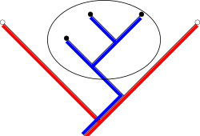

# Biodiversity
**First published Wed Jun 11, 2003; substantive revision Thu Feb 4, 2021**

*Faith, Daniel P.*

The term “biodiversity” is a contraction of “biological diversity” or “biotic diversity”. These terms all refer to the idea of living variation, from genes and traits, to species, and to ecosystems. The popular contraction “biodiversity” came about in the mid-1980s, heralded by a symposium in 1986 and an influential follow-up book, *Biodiversity* (Wilson 1988)[^wilson-1988]. These events often are interpreted as the beginning of the biodiversity story, but this mid-1980s activity actually was both a nod to important past work, and a launching of something quite new, in ways not fully anticipated.

The new term “biodiversity” energised some fundamental ideas developed over the previous decade (or longer). Precursor terms like “biotic diversity” had helped to communicate why we should be concerned about the loss of variety, arising from the species extinction crisis (later, the “biodiversity crisis”). This recognised the idea that living variation itself has current value, because it provides the opportunity for future benefits for humanity. The International Union for the Conservation of Nature (IUCN 1980)[^iucn-1980] summarised these early ideas about variety as providing both “insurance” and “investment” benefits. The focus on the variety of life was echoed later in the Convention on Biological Diversity’s (CBD) definition of “biodiversity”, and in the Intergovernmental Platform on Biodiversity and Ecosystem Services (IPBES). The IPBES conceptual framework, describing “nature’s contributions to people” (Díaz et al. 2018)[^díaz-2018], includes the maintenance of options for future generations that is provided by biodiversity as variety (see Faith forthcoming). This value of living variation complements recognised values of individual species, and it accords with the idea that “biodiversity” may refer both to the collection of individual species (or other units), and to amount-of-variation as a property of that collection.

The new term “biodiversity” also catalysed fresh new perspectives, with an explosion of academic and philosophical discussions, evidenced by the many post-1985 published papers having the key term “biodiversity”. Over this period, the term “biodiversity” often has reflected a range of different disciplinary perspectives (ecology, systematics, economics, social sciences, etc.). The range of conceptual issues addressed are reflected in recent books on the philosophy of biodiversity, including *What is Biodiversity?* (Maclaurin & Sterelny 2008)[^maclaurin-2008], *Biodiversity and Environmental Philosophy* (Sarkar 2005)[^sarkar-2005], *Routledge Handbook of Philosophy of Biodiversity* (Garson, Plutynski, & Sarkar eds. 2017)[^sarkar-2017], *Philosophy and Biodiversity* (Oksanen & Pietarinen eds. 2004)[^oksanen-2004][^oksanen-2004-2], and *From Assessing to Conserving Biodiversity* (Casetta, da Silva, & Vecchie eds. 2019) (see also the Related Entries section).

While the policy context for conservation of biodiversity has maintained a core focus on variety (as reflected in the CBD and IPBES definitions), the more academic discussions are harder to pin down. Philosophical discussions about “biodiversity” illustrate the current lack of academic consensus on fundamental issues, including biodiversity’s definition, its value, and even its history. Increased popularity of the term among academics has amounted to decreased clarity of the term. If we look under “Definition of biodiversity” in the *Encyclopedia of Biodiversity*, we find that “An unequivocal, precise, and generally accepted definition of biodiversity does not exist” (Swingland 2013)[^swingland-2013]. The recent book, *Defending Biodiversity* (Newman, Varner, & Linquist 2017) has the premise that it will be impossible to ever settle on a definition. This entry therefore will focus on these fundamental issues concerning biodiversity’s definitions and values. The particular focus is on the concept of variety (rather than the definition and value of individual elements such as species). Other biodiversity-related philosophical issues are covered in other SEP entries (see the supplementary document on biodiversity preservation in the entry on environmental ethics, and the entries on conservation biology and on ecology).

## 1. Pre-History of “Biodiversity”: Variety and Its Values

The term “biodiversity” was coined around 1985, but the conceptual, and political, foundations for the new term were developed over at least the previous decade. The link between biotic diversity and human well-being is clear in the “pre-history” of the term “biodiversity” (roughly, the history of the term before it was invented). Much of the early work recognising a species extinction crisis naturally focussed on the values of individual species to humanity, in addition to their intrinsic value (for reviews, see Farnham 2007; Mazur & Lee 1993)[^farnham-2007][^mazur-1993]. Discussions by Myers (1976) and others broadened this focus to include a concern about the consequent overall loss of variety, and why such a loss of variety itself matters to humanity. Haskins (1974: 646) summarised an important discussion meeting where participants called for

> an Ethic of Biotic Diversity in which such diversity is viewed as a value in itself and is tied in with the survival and fitness of the human race.

Haskins (1974: 646) argued, “Plants and animals that may now be regarded as dispensable may one day emerge as valuable resources” and that extinction “threatens to narrow down future choices for mankind” (see also Anonymous 1974)[^anonymous-1974]. Similarly, Roush (1977: 9) argued that “diversity increases the possibility of future benefits” (for review, see Farnham 2007)[^farnham-2007].

Myers (1976) arguments for a greater focus on the overall loss of variety appeared in his paper, “An Expanded Approach to the Problem of Disappearing Species”. He argued that

> …the spectrum of species can be reckoned a repository of some of society’s most valuable raw materials. Moreover, loss of species will affect generations into the indefinite future, whose options to utilize species in ways yet undetermined should be kept open. (see also Josephson 1982)[^josephson-1982]

Myers and Ayensu (1983) similarly argued that the possible discovery of benefits for humans is a primary justification for conservation of biological diversity (see also Myers’ 1979 book, *The Sinking Ark*)[^myers-1979].

This pre-history considered variety at more than the species level. Farnham (2017) provides a useful historical perspective, describing how the standard three levels of variation later recognised by the Convention on Biological Diversity (CBD)—genes, species, and ecosystems—became established early as parts of our broader concern about the loss of living variation. He describes this as a convergence of separate concerns about species loss, loss of genetic variety, and the disappearance of ecosystem types. Other support for this convergence is found in early work referring to the variety of biomes or ecosystems as capturing variety at the species level. For example, Ehrenfeld (1970) referred to the potential but unknown uses of species and suggested conserving the full variety of ecosystems to capture these future options (arguing that every ecosystem is likely to have some useful species). Back in 1972, the botanist, H. H. Iltis, argued that we must “preserve sufficient diversity of species and of ecosystems” because “we will never reach a point where we shall know which organisms are going to be of value to man and which are not” (Iltis 1972: 204)[^iltis-1972]. Ehrenfeld referred to the need globally to conserve a representative set of the different ecosystems (see also Roush 1977)[^roush-1977]. Echoing these concerns, Wilson (1984) later lamented the lack of representativeness of the variety of ecosystems in the current protected areas system.

Thus, while important early discussion (Lovejoy 1980)[^lovejoy-1980] linked “biological diversity” to species richness, the full spectrum of the early work reveals precedents for considering multiple levels—all with conceptual links to the species extinction crisis.

### 1.1 Multiple benefits of biotic diversity: insurance and investment

Those bits of pre-history clearly articulate the idea that variety itself is important because it maintains future options for humanity. However, this early work did not establish any consistent terminology to describe this. Later work (see below) uses terms like biodiversity “option value” (a term used in other ways in economics) and “maintenance of options” (a term that includes other contributions from nature, not just those from variety/biodiversity).

Back in 1980, the IUCN (International Union for Conservation of Nature) reflected on this earlier work, and offered some distinctions that are still useful in philosophical discussions about biodiversity definitions and values. IUCN’s (1980: section 3) arguments for the conservation of diversity (referring to “the range of genetic material found in the world’s organisms”) echoed earlier statements about variety and future options:

> we may learn that many species that seem dispensable are capable of providing important products, such as pharmaceuticals….

Importantly, IUCN also echoed other early work, in adding a critical second part to that sentence: “…or are vital parts of life-support systems on which we depend” (IUCN 1980: section 3)[^iucn-1980]. IUCN provided terms for these two ways in which variety itself benefits humanity:

> preservation of genetic diversity (their stand-in for the not-yet-defined “biodiversity”) is both a matter of insurance and investment to keep open future options. (IUCN 1980: section 3)[^iucn-1980]

It is informative to trace this insurance and investment duality in the pre-history of “biodiversity”. Roush (1977) listed four reasons for preserving “natural diversity”. In addition to the relational values concerning “human delight” and ethics, his reasons included not only the idea that “diversity increases the possibility of future benefits” but also that diversity supports stability of the “life support system”.

Holdren and Ehrlich (1974) argued that loss of a species or loss of genetic diversity can mean loss of potential uses (medicines, foods etc.), but also referred to the maintenance of the “public service” functions of natural ecosystems. Ehrenfeld (1970) similarly distinguished between the within ecosystem functioning/stability argument and the potential uses or option value argument. Ehrlich and Ehrlich (1981), in their book *Extinction* discussed the insurance value of the Earth’s “biological diversity” through the analogy of popping rivets off an airplane wing—we strive to keep all the rivets, because we do not know how many could be lost before the wing no longer functions.

This pre-history of “biodiversity” thus considered multiple values for humanity from living variation itself, building on the even-longer history of basic awareness that there lots of kinds of things (e.g., species; for review, see Oksanen 2004)[^oksanen-2004][^oksanen-2004-2]. This argumentation also added to discussions that had considered attribution of “intrinsic value” to variety of life (see the supplement on biodiversity preservation in the entry on environmental ethics, for discussion of intrinsic value.

## 2. Later Work on Variety, Its Value, and the Question of Normativity

The new term “biodiversity”, post-1985, marked fresh perspectives about what variety or “diversity” might mean, and what the benefits and values of biodiversity might be. There also was a continuation and further development of the core perspectives on value established during the pre-history. Wilson (1985) made the case for a “biological diversity crisis” by arguing that this means the loss of potential uses, yet to be discovered. Wilson also echoed Myers and Ayensu (1983) and others arguing for the importance of systematics and the need for discovery of species to address knowledge gaps. Later, Wilson (1988) brought these arguments together, arguing that the new term “biodiversity” reflects our lack of knowledge about the components of life’s variation and their importance to humankind.

The pre-history perspectives, in the writings of Myers and others, influenced the Brundtland Report, a landmark United Nations report on sustainable development (WCED 1987)[^wced-1987]. This report contains the much-quoted definition:

> Sustainable development is development that meets the needs of the present without compromising the ability of future generations to meet their own needs.

This is followed by a key requirement:

> The loss of plant and animal species can greatly limit the options of future generations; so sustainable development requires the conservation of plant and animal species.

The report’s call for governments to form a “species convention” helped catalyse the creation of the Convention on Biological Diversity (CBD; see below).

These perspectives foreshadow later discussion themes, including: further exploration of biodiversity option value (including the question of normativity); analysis of what we mean by “variety” and how we measure it; and further exploration of the “insurance” aspect of biodiversity value (setting the stage for a multitude of ecological interpretations of “biodiversity”).

### 2.1 Further exploration of biodiversity option value

Post 1985, the new term “biodiversity” was central to perspectives on the value of living variation. McNeely (1988) and Reid and Miller (1989) highlighted option values of biodiversity (see also Norton 1986)[^norton-1986]. Later, a landmark global report, the Millennium Ecosystem Assessment (2005: 32), summarised twenty-plus years of “biodiversity” conservation, concluding that

> the value individuals place on keeping biodiversity for future generations—the option value—can be significant.

Another decade later, Gascon et al. (2015) reviewed the many, often surprising, benefits of species to argue for the importance of biodiversity option value. Gascon et al. also echoed the earlier proposals that “phylogenetic diversity”, a measure of biodiversity based on the tree of life, is a natural way to measure this option value (see section below).

Around that time, the Papal Encyclical Letter “On Care for Our Common Home” (Francis 2015)[^francis-2015] addressed the loss of biodiversity, arguing for the importance of not only intrinsic values of species but also the option values of biodiversity:

> The loss of forests and woodlands entails the loss of species which may constitute extremely important resources in the future, not only for food but also for curing disease and other uses. Different species contain genes which could be key resources in years ahead for meeting human needs and regulating environmental problems. (2015: 32)

These arguments referring to surprising benefits from individual species sometimes have not make it clear whether such values are being considered for individual species (only), or for variety itself. The IPBES Conceptual Framework (Díaz et al. 2015: 14)[^díaz-2015] refers to

> the “option values of biodiversity”, that is, the value of maintaining living variation in order to provide possible future uses and benefits.

However, later IPBES discussions of “nature’s contributions to people” use related terms in a more general way. Here, Díaz et al. (2018: Table S1) describe “maintenance of options” as the “Capacity of ecosystems, habitats, species or genotypes to keep options open in order to support a good quality of life”. This broad statement seems to cover both individual elements and variety itself.

Bartkowski (2019) in his “Valuation of Biodiversity” review, notes that perspectives about economic values of “biodiversity” typically have focussed on individual elements, with the less-attention to the values of variety, including both option and insurance values. This concern echoes earlier debates that have examined whether option value applies to biodiversity-as-variety, and not just to specific elements. Consideration of the potential future benefits from individual species can be interpreted as implying a value for variety (Maclaurin & Sterelny 2008: 154)[^maclaurin-2008]:

> The crucial point about option value is that it makes diversity valuable. As we do not know in advance which species will prove to be important, we should try to conserve as rich and representative a sample as possible.

Maier (2012), in his book, *What’s So Good About Biodiversity?*, criticised Maclaurin and Sterelny’s arguments for biodiversity’s option value. However, this critique may reflect simply a focus on individual elements rather than variety itself. Maier interpreted “option value” as applying, in accord with economics usage, to a given element, resource, or ecosystem service. Any quantification of value, Maier argued, would require estimates of reliability of stock, risk aversion, and willingness to pay—all missing in Maclaurin and Sterelny’s arguments. These views are partly reconciled by recognising that reference to “option value of biodiversity” is a current value of variety itself, and does not have to be interpreted to mean that the actual value of the future benefits is determined. This difference in perspectives also has played a role in debates about whether biodiversity option value has normative standing.

### 2.2 Variety, value and normativity

Biodiversity as variety provides option/investment and insurance benefits to humanity, but this leaves open the question as to the nature of the value of such benefits. Haskins (1974) had called for “an Ethic of Biotic Diversity”, in which variety’s benefit has ethical import because we care about the well-being of future generations. Similarly, when IUCN (1980: Section 3) reviewed the arguments for the conservation of biotic diversity, they linked this to moral principles:

> The issue of moral principle relates particularly to species extinction, and may be stated as follows. Human beings have become a major evolutionary force. While lacking the knowledge to control the biosphere, we have the power to change it radically. We are morally obliged-to our descendants and to other creatures-to act prudently… We cannot predict what species may become useful to us. Indeed we may learn that many species that seem dispensable are capable of providing important products, such as pharmaceuticals, or are vital parts of life-support systems on which we depend. For reasons of ethics and self-interest, therefore, we should not knowingly cause the extinction of a species.

This early discussion, linking biodiversity’s option value to ethical/moral obligations to future generations, anticipated the rationale for the Convention on Biological Diversity (CBD). Schroeder and Pisupati (2010: 9) in “Ethics, Justice, and the Convention on Biological Diversity”, note that the CBD statements on conservation of biodiversity include consideration of intergenerational justice:

> The first CBD objective, the conservation of biodiversity, is an urgent act of attaining intergenerational justice; an act that requires sustained, engaged international collaboration. To deplete the planet of essential resources and leave to future generations a world which severely limits their options, is unjust.

In this context, biodiversity is valued (now) because we care about the welfare of future generations; thus, we see a current benefit, and a link to justice, in biodiversity’s maintenance of options for future generations. This is seen as a kind of relational value, relating the present generation to future generations (Faith 2017: 76)[^faith-2017]:

> the best argument for what we call the option value of biodiversity is that we see many currently beneficial units, and maintaining a large number of units (biodiversity) for the future will help maintain a steady flow of such beneficial units… Biodiversity option value therefore links “variation” and “value”: providing a fundamental relational value of biodiversity reflecting our degree of concern about benefits for future generations

Intergenerational justice or equity is linked to both investment/options and insurance (Bartkowski 2017: 53)[^bartkowski-2017]:

> …the two perspectives—insurance and options—are inherently interlinked; however, they depend on different types of uncertainty (supply vs. demand), which makes the differentiation sensible. The view of biodiversity as carrier of option value stems from the recognition that a biodiverse ecosystem, which contains many different species and genomes, can best accommodate unanticipated future desires (preferences). As in the case of insurance value, this can be coupled with considerations of intergenerational equity. In fact, in the case of option value, this notion is arguably more central: high levels of biodiversity now mean many different options for our descendants.

An important consideration in recognising an ethical/moral/justice imperative to conserve biodiversity is the recognition that biodiversity, as variety, has a current benefit/value because of that relational link between generations. However, other framings omit this idea of a current benefit from variety itself. For example, Binder and Polasky (2013), in the *Encyclopedia of Biodiversity*, list ways that biodiversity links to human well-being.

> Biodiversity contributes to human well-being directly through provision of foods, fuels, and fibers, and indirectly through its role in enhancing ecosystem functions that lead to the provision of ecosystem services.

This might seem to capture biodiversity option value in referring to foods and other goods, but in fact leaves out the idea that society sees biodiversity and the prospect for discoveries for future generations as a current contribution to well-being. The well-being is not just that realised when the new product is discovered.

Such a restricted interpretation can mean that the maintenance of options provided by biodiversity fails to enter into assessments. For example, Brauman et al. (2020) set out to assess the current global status of nature’s contributions to people, but explicitly chose not to assess maintenance of options—arguing that this is a contribution to well-being only through its support of the well-being obtained from other contributions of nature. In contrast, the IPBES global assessment (IPBES 2019)[^ipbes-2019] did assess global status of maintenance of options, noting that, even when considering other specific nature contributions, such as medicinal resources, biodiversity’s maintenance of options is a current benefit in promising possible future medicinal benefits (see also “Phylogenetic diversity and IPBES” in Other Internet Resources).

Absence of recognition of the current benefit of biodiversity’s maintenance of options has other implications. Maier’s (2018) arguments that biodiversity option value has no normative standing are based on an assessment of variety as a future, not current, benefit. An alternative argument, supporting normative standing, focuses on biodiversity-as-variety as a current benefit, because this variety is recognised as maintaining options for future generations. This current value links to normativity—we ought to act to conserve biodiversity and its maintenance of options because it is the right thing to do, given that we care about, and have some relational moral obligation to future generations (Faith 2018a)[^faith-2018a]. These discussions highlight the idea that both “current benefit” and “future benefit” are relevant to biodiversity option value. Biodiversity is a benefit currently because it offers unanticipated future benefits, and given the relational sense of obligation to future generations is a basis for normativity.

Another entry in the *Encyclopedia of Biodiversity*, Chan and Satterfield’s (2013) “Justice, Equity and Biodiversity”, supports this idea, in linking biodiversity conservation to justice for future generations. However, “biodiversity” is left undefined, and seen as something that exists within ecosystems that maintains ecosystems services for future generations. The focus on ecosystem services (where “biodiversity” often has ecological interpretations; see section below) means that the value of variety itself is left unstated by the authors.

Some perspectives give less emphasis to the idea of variety and its benefit/value, and in these, the arguments for a normative status for “biodiversity” appear to be weaker. For example, Koricheva and Siipi (2004: 46) see only intrinsic value as a pathway for moral obligation to (overall) biodiversity:

> If biodiversity is found to be intrinsically valuable, we have strong moral reasons to conserve all aspects of biodiversity, regardless of their potential utilitarian and instrumental values. If, conversely, biodiversity is found to be only instrumentally valuable, then on moral grounds we can demand conservation only of those parts which (directly or indirectly) enhance (or will in the future enhance) the well-being or quality of some other valuable entity or state of affairs.

Given this perspective, they conclude that: “conservationists are burdened with the need to find or create instrumental values for each biodiversity element”. Similarly, in “The Moral Value of Biodiversity”, Oksanen (1997) concludes that “It is not the thing ‘biodiversity’ that is of ultimate moral value, but its various constituents”. Thus, this argumentation seems to be disconnected from the idea that, collectively, all of the “elements” or “constituents”—the variety—delivers biodiversity option value and justice for future generations.

Significantly, the popular instrumental-versus-intrinsic argumentation has sometimes meant a neglect of biodiversity option value.[^note-1] Commonly, the instrumental value of biodiversity is characterised as all about supporting of functions/resilience within ecosystems, not global option values. Some literature suggests that relational values importantly move beyond the standard instrumental-versus-intrinsic framework (e.g., Himes & Muraca 2018)[^himes-2018]. In the context of biodiversity option value, greater appreciation of relational values in fact restores a link to biodiversity value that has been obscured by the popular instrumental-versus-intrinsic argumentation.

The link to variety, as compared to individual elements and/or other ecosystem/ecological aspects, is an issue in other discussions. Eser et al. (2014) acknowledge a normative content for biodiversity, and consider it as arising from the politics at that time (“the making of the term ‘biodiversity’ indicates that the concept is morally impregnated”, 2014: 38). They argue that

> the Convention on Biological Diversity, not only addresses issues of conservation, but also sustainable use and fair sharing of benefits. This triad of objectives reflects the three dimensions of sustainable development: ecology, economy and society. (2014: 38)

This equation may imply that the justice/normativity link is to be interpreted as depending on the “fair sharing of benefits”. This fair sharing of benefits often is played out locally, while the conservation of biodiversity is more a global CBD issue. Thus, there does not seem to be a tight fit between Eser et al.’s historical perspective, tied to the origins of the term “biodiversity”, and the deeper historical perspective of ethical arguments for the conservation of biotic diversity. Indeed, Eser et al. do not provide any explicit analysis of the benefits and value of biodiversity-as-variety. Instead, they see the wide range of notions of “biodiversity” as quite useful in providing a “boundary” object that can embrace lots of meanings and perspectives about value. A similar perspective is found in a proposed “weak deflationism” for biodiversity (see below), where what is regarded as “biodiversity” is the outcome of “normative discussion of what merits conservation”.

Eser et al.’s arguments nevertheless are compatible with the early ideas, going back to Haskins and others, of a normative reason to protect biodiversity-as-variety for future generations. Significantly, Eser et al. (2014: 94) argue that:

> consideration of the needs of future generations does not count as “nice to have” but is considered a “must”. Finding the appropriate balance between obligations to current and future generations is one of the main challenges of global change ethics.

Eser et al. conclude (2014: 95)

> the moral belief that our dealing with the needs of future generations is a matter of Justice is so widespread that it can almost count as a truism. To substantiate biodiversity strategies with the rights of future generations therefore is a promising strategy because it meets the intuitions of so many people.

### 2.3 What do we mean by “variety” or “diversity” and how do we measure it?

During the pre-history of “biodiversity”, the species extinction crisis provided motivation to consider the value of living variation, covering not only species richness but also genetic variation and the variety of ecosystems. The new term “biodiversity” introduced fresh considerations, particularly reflecting ecology and ecosystems perspectives. The CBD definition of “biodiversity” used two terms, “variability” and “diversity”, that have invited multiple interpretations:

> … the variability among living organisms from all sources including, inter alia, terrestrial, marine and other aquatic ecosystems and the ecological complexes of which they are part; this includes diversity within species, between species and of ecosystems.

The definition of “biodiversity” in the IPBES Glossary (see the link in Other Internet Resources) partly follows that of the CBD:

> The variability among living organisms from all sources including terrestrial, marine and other aquatic ecosystems and the ecological complexes of which they are a part. This includes variation in genetic, phenotypic, phylogenetic, and functional attributes, as well as changes in abundance and distribution over time and space within and among species, biological communities and ecosystems.

The vague open-ended term “diversity”, in the CBD definition, can be interpreted as any of a number of ecological diversity indices (see below). In contrast, IPBES reflects pre-history in shifting to the word, “variation”. Naturally, this word has provided its own interpretation challenges, including how to characterise it consistently across different levels of variation. Weitzman (1992) presented an influential general framework for biodiversity as variation, based on the idea of objects, and measures of difference between objects. Biodiversity (amount of variation) then depends not only on the number of objects, but also the degree of differences among them. In the book *Philosophy and Biodiversity*, the link between “biodiversity” and investment and insurance value is described as depending on: “The higher the number and the degree of difference between biological elements” (Koricheva & Siipi 2004: 39)[^koricheva-2004]. Weikard (2002) argued that any operational concept of biodiversity must have some measure of difference between objects (see also Maclaurin & Sterelny 2008; Morgan 2009)[^maclaurin-2008][^morgan-2009].

This strategy assumes that we can define meaningful differences among the initial objects, and also sort out the trade-off between having more objects versus bigger differences. One difficulty is that there are many ways to define “differences”. Morgan (2009) concluded that, even if one has some agreed natural measure of differences, we do not know how to trade off more objects for less differences (or vice versa) to assess biodiversity.

An alternative general framework, proposed by Faith (1994), avoids weaknesses of the objects-differences strategy. The framework side-steps the idea of differences and instead uses the inferred relative number of biodiversity “units” among any given set of “objects”. If “biodiversity” is variation or variety in the sense of units (such as species) that we ideally count-up, then what are those units or elements that make-up biodiversity? The units of interest logically cover more than just the species level (and even the core idea of “species” may consider alternative classifications, such as those in folk cultures; Oksanen 2004)[^oksanen-2004][^oksanen-2004-2]. Maclaurin and Sterelny’s argument (2008: 154) that option value “links variation and value” considered option value for units across all levels of biodiversity.

A common assessment of biodiversity-as-variety evaluates a set of protected areas and asks “how many different species are represented by that set of areas?” In the general framework, this converts to a more general biodiversity question: “how many different units are represented by that set of objects?” Thus, “species” corresponds to just one kind of “unit” of variation (with different species as different “units”), and areas are just one kind of “objects”. Biodiversity assessment considers a wide range of these possible objects for decision-making—not just areas, but also species, populations, and other entities. Biodiversity therefore can be quantified in general as a count of the number of different units represented by a given set of objects. Examples of other objects/units combinations include species/traits (or features) and species’ populations/genetic variants.

A strength of the framework is that it addresses the fact that many of the “units” are unknown, and so, cannot simply be counted-up. Many species are still unknown to science; many features of species are undescribed. We may directly observe some objects (say, species) and want to quantify the relative number of un-observed units (say, features) that are represented by those objects. The relative number of units for any object or set of objects therefore has to be estimated through the use of an inferential model or a surrogate of some kind.

A model that successfully reflects the underlying processes that determine the distribution of units among objects (a pattern—process model) may tell us enough about the relationships among the objects to enable inference of relative numbers of units represented by any set of those objects. This is the rationale for a general framework for using pattern to quantify diversity at a level below that of the original objects.

Thus, relationships among different objects ) informs us about what is of interest: the amount of biodiversity, expressed as the number of units represented by those objects. This “counting-up” of the lower-level units means that we can compare different sets of objects by the count of the number of different units represented, and look at useful information such as gains and losses as the set changes.

Suppose, for example, that the units of interest are features of species (a feature might be some morphological characteristic). These features in general have unknown future benefits; feature diversity provides another example of biodiversity option value. If we apply the rationale that all these features should be treated as units of equal value, then some species (those that are phylogenetically distinctive; see below) will make larger contributions to the overall feature diversity represented by a set of species. Thus, equal value at the fine scale among features leads to differential values at the coarse scale among species.

Feature diversity raises measurement challenges. Not only do we not know, in general, the future value of different features, but also we cannot even list the features for most species. Phylogenetic pattern provides one way to estimate and quantify variation at the feature level. The predicted total feature diversity of a set of species is referred to as its “phylogenetic diversity” (PD). The amount of PD, and the estimated relative feature diversity, of a set of species is calculated as the minimum total length of all the phylogenetic branches required to connect all the species in that set on the phylogenetic tree (Faith 1992)[^faith-1992]. This definition follows from an evolutionary model in which branch lengths reflect evolutionary changes (new features), and shared ancestry accounts for shared features among species. Note that a set of three species may have lower PD (lower feature diversity) than a set of two species (see figure below).

The phylogenetic diversity measure illustrates how the pattern—process framework differs from the objects and differences approach. For PD, the objects are species (or other taxa) and the units that we would like to count-up are features (or characters). The use of phylogeny (the “tree of life”) to make inferences about the relative feature diversity of different sets of species is a way to overcome our lack of knowledge about all the features of different species. Maclaurin and Sterelny (2008: 20) incorrectly interpreted PD as an application of the objects and differences approach, with species as objects and differences given by “genealogical depth”. Instead, a pattern (phylogeny) among the species is used. This pattern allows inferences about the biodiversity units of interest—here, features or characters of species.

*(a)*

(a)

(b)

Figure. A general biodiversity model linking relationships among objects to measures of biodiversity based on the indirect counting-up of units. In each case, relationships among the three objects represented by solid dots provides information about their representation, as a set, of underlying units. The ovals highlight the idea that their degree of similarity within the pattern indicates degree of shared units.

1. for phylogenetic diversity, the objects are species, the units are evolutionary features and the phylogenetic/feature diversity of the 3 (solid dots) species is indicated by the summed lengths of the blue branches on the phylogenetic tree. Note that this set of 3 species has greater phylogenetic diversity / feature diversity than the set of two hollow-dot species (red branches). [An extended description of figure (a) is in the supplement.]
2. another kind of pattern for species-as-objects is a Euclidean space representing key environmental gradients. The inferred biodiversity may be functional trait diversity. [An extended description of figure (b) is in the supplement.]

Sarkar’s (2014: 3) consideration of “units” other than species appears compatible with the general pattern–process framework. However, Sarkar’s proposal differs in integrating other additional calculations into the quantification of biodiversity. For example, Sarkar proposed that biodiversity must include a number of aspects beyond richness. At the species-level, Sarkar (2014: 3) argued that a measure of biodiversity should reflect complementarity, rarity, endemism and also “equitability” (reflecting relative abundances). Another aspect to be included was “disparity” reflecting taxonomic distance between species. Sarkar’s consideration of a taxonomic measure of difference between species as part of “biodiversity” echoes the popular objects and differences strategy.

Possible proposals to include aspects beyond richness (counting units) seem limitless. This problem highlights the advantages of a simpler framework where “biodiversity” focuses on the number of units, while recognising that the same units can be part of numerous other calculations that include standard ecological indices. Thus, complementarity, endemism, and dissimilarities and many traditional ecological “diversity” measures all can be calculated, but they are not measures of “biodiversity”.

### 2.4 How understanding variety helps us build a working calculus of biodiversity

The framework based on counting-up units contrasts with other proposals for general frameworks for biodiversity, including those proposals that have attempted to include a variety of calculations—endemism, dissimilarity, rarity, etc.—within the definition of biodiversity (see below). The framework based on counting-up units implies not only that biodiversity as variety is that total count, but also that we can carry out lots of other important, associated, calculations that will be useful for decision-making and policy—notably looking at gains and losses. This idea of a biodiversity “calculus” contrasts with the ecologically oriented perspective that there are many different indices called “biodiversity”.

One important companion calculation is called “complementarity” (Kirkpatrick 1983)[^kirkpatrick-1983]—the gains and losses in biodiversity as objects are gained or lost. While biodiversity is quantified by an inferred count of number of different units, decision-making about biodiversity uses various calculations based on those units. Complementarity usefully indicates marginal changes—the number of units lost, or the increase in the number represented by an added protected area. Faith (1994) focussed on complementarity as an example of useful calculations (referred to as “components of biodiversity”) based on inferred counts of units:

> The problem of prioritising areas illustrates how pattern (specifically environmental pattern) can be used as a surrogate for biodiversity, in predicting the same components of biodiversity that would be used at the species level directly, notably complementarity.

The approach using environmental pattern for such calculations can be generalised to cover other patterns to make inferences about underlying units. For PD, the pattern is phylogeny and a species’ complementarity reflects the relative number of additional features contributed by that species. PD decision-making sometimes uses calculations that are integrated with species’ estimated extinction probabilities—extending the idea of complementarity to “expected” loss. Priorities for conservation efforts for endangered species then can respond both to degree of threat and to amount of potential loss of PD. One such conservation program is the EDGE of Existence program (“evolutionarily distinct and globally endangered”; see the link in Other Internet Resources).

By recognising other calculations as useful, but not equated with “biodiversity”, and by side-stepping the weaknesses of the objects-differences framework, we can focus on counting-up different units, and focus on the value of having many different units. Thus, the idea of a useful calculus further reinforces the role of biodiversity-as-variety in providing option and insurance values.

This perspective is relevant to the second part of the IPBES definition of biodiversity (above), where “biodiversity” is to include various measures of “change” in distribution, abundance etc. This perhaps reflects the ecology perspectives in which “biodiversity” is equated with various ecological indices and calculations, such as dissimilarity or relative abundance. Sometimes it is not at all clear how the key idea of “biodiversity loss”—complementarity—applies in such cases. This issue is addressed further in the section below on ecology and ecosystems framings.

## 3. Beyond Variety—Post 1985 New “Biodiversity” Framings

The IPBES definition illustrates the trend to include many other biotic/ecological aspects in the definition. Popular encyclopedia entries on “biodiversity” and major reviews illustrate how this trend has contributed to definitional chaos. In the *Encyclopedia of Biodiversity*, Swingland argues “An unequivocal, precise, and generally accepted definition of biodiversity does not exist”. in the *Routledge Handbook of the Philosophy of Biodiversity*, nearly every chapter discusses the “biodiversity” definition problem. The SEP entry supplement biodiversity preservation under environmental ethics laments “A persistent complication is that there continues to be no single agreed measure of biodiversity”.

Koricheva and Siipi (2004) observe that

> biodiversity still lacks a universally agreed upon definition and is often redefined depending on the context and the author’s purpose.

They suggest that:

> Such great terminological variation is understandable, since concerns for biodiversity relate to several realms of human practice, including conservation, management, economics, and ethics, and thus give rise to different “discourses”. (2004: 28)

The common measure, species richness, illustrates the different perspectives. The pre-history of biodiversity, reflecting the species extinction crisis and the values of variety, provides a core rationale for a definition that includes counting-up species. In contrast, Koricheva and Siipi (2004) argue that popularity of species richness (as a measure) continues simply because it is understandable, measurable, and it uses available information (see also Sarkar 2019)[^sarkar-2019]. A section below (“the Conservation Biology framing”) returns to this issue, in considering a perspective that assumes that the “biodiversity” concept arose as part of the new discipline of conservation biology in the mid-1980s.

The pre-history of “biodiversity” also highlighted the idea that the value of variety itself should be considered along-side the recognised benefits (and dis-benefits) of individual species (“biospecifics”), and all these benefits/values can enter into trade-offs and synergies that support decision-making. Some current perspectives or framings about biodiversity and its value can be understood as again blurring that distinction between biodiversity and “biospecifics”. One such framing equates “biodiversity” with all of nature. A focus on “biodiversity” as the collection of individual units/elements suggests that “biodiversity” covers so many individual elements that it more or less can be equated with biotic “nature”. An ecological/ecosystem framing of biodiversity expands this further—“biodiversity” may be interpreted as including not only the many individual elements but also all their ecological interactions, and associated processes. These expanded perspectives, focused on elements and their interactions, create a risk that we may miss the opportunity to properly consider both values of nature/ecology and the values associated with biodiversity-as-variety.

Several factors may help to explain the current wide range of perspectives about biodiversity’s definition and values. One is the idea that the term “biodiversity” was intended to capture everything we wish to conserve within the discipline of conservation biology. Another is the idea that “biodiversity” only gains meaning and importance to humanity in supporting ecosystem functions and services. Both of these framings are supported by particular interpretations of the history of the concept. More recently, another emerging perspective is a call for a re-casting of the term “biodiversity” to make it more holistic in reflecting socio-ecological thinking. The themes outlined above roughly correspond to three kinds of re-framings of “biodiversity”, defining the next three sections below: §4 the ecology/ecosystem services framings, §5 the conservation biology framing, and §6 socio-ecological framings.

## 4. The Ecology/Ecosystem Services Framings

“Ecosystem services” are all the benefits that humanity derives from ecosystems (Daily 1997)[^daily-1997]. While that term is probably younger than the term, “biodiversity”, it not only has its own pre-history (as “natural services” from nature; see, e.g., Holdren & Ehrlich 1974)[^holdren-1974], but also shares a pre-history with “biodiversity”. This history reveals early ideas about how aspects of biotic diversity are important to maintaining the ecological functions that support ecosystem services. These discussions drew upon the long tradition in ecology to use various ecological indices—broadly referred to as “diversity” indices—and so inviting equation with the new term “biodiversity”. Exploring this connection between biotic diversity, ecological functions, and services has become a massive research venture over the past 25 years (for review, see, e.g., Gómez Baggethun et al. 2010). The name of the international platform for biodiversity, “Intergovernmental Platform on Biodiversity and Ecosystem Services” (IPBES), reflects this active, high-profile, connection.

The ecosystem services framing of “biodiversity” interprets the many aspects of “diversity” that link to functions and services as part of a “biodiversity” narrative. This narrative is interpreted as the basis for a rationale for conserving biodiversity, because it is claimed to link biodiversity, for the first time, to benefits for humanity.

### 4.1 Further exploration of biodiversity insurance value

The insurance and options benefits from living variation recognised in the pre-history, also appear in later work, using the new term “biodiversity” (e.g., Bartkowski 2017)[^bartkowski-2017]. Post 1985, such discussions continued to follow the pre-history in considering the value of variety itself for insurance. However, alternative perspectives focussed more on the early discussions pointing to a broader ecological/ecosystem interpretation of insurance and related ideas such as “ecological integrity”.

IUCN (1980) described “ecological integrity” as:

> Maintaining the diversity and quality of ecosystems and enhancing their capacity to adapt to change and provide for the needs of future generations.

Sometimes this more ecological rationale has been discussed as part of a new “biodiversity” framing, so setting the stage for ecological definitions of “biodiversity”.

For example, Ehrlich and Wilson (1991) listed three basic reasons why we should care about biodiversity. The first was most closely linked to intrinsic value: a “moral responsibility to protect what are our only known living companions in the universe”. Their second reason reflected the option value of biodiversity—the idea that

> humanity has already obtained foods, medicines, and industrial products and other benefits from biodiversity, and has the potential for many more.

Their third reason was an insurance type argument, based on the recognised ecosystem services provided by natural ecosystems. Here, they made a link to biodiversity in arguing that “diverse species are the key working parts” within such ecosystems.

“Working parts” could mean variety, or it could refer to the ecology of lots of parts in an ecosystem. In earlier work (Ehrlich & Ehrlich 1981)[^ehrlich-1981] “insurance” was linked to the loss of biological diversity and so linked to variety. Ehrlich and Ehrlich’s (1992: 219) later arguments for biodiversity conservation referred both to option value (from variety expressed as nature’s “genetic library”), and to insurance value—expressed less as variety and more as a consideration of ecological aspects. Thus, “insurance” sometimes joins “ecological integrity”, and similar terms as part of a storyline about many relevant aspects of ecosystems.

Similarly, the Millennium Ecosystem Assessment (2005) described the multiple values of biodiversity in a way that reinforced the duality of insurance and option values from variety, but also linked “biodiversity” to ecological aspects, including resilience and integrity.

### 4.2 The rationale for the ecosystems framing

The ecosystem services framing builds on the important idea that ecosystems provide many, often under-appreciated, benefits to people (clean water, useful resources, etc). It is natural to consider that these benefits provide a case for conservation of “biodiversity”. The ecosystems framing adopts the perspective that it is “biodiversity”—typically, interpreted broadly as ecological “diversity”—that is the basis for these important functions and services. This framing reduces the focus on variety of species or other elements (in the sense of counting-up). Perhaps because of the natural within-ecosystems focus, this also has amounted to lesser emphasis on global scale option value from such variety. The ecosystems framing reflects this perspective in the range of “biodiversity” definitions considered. The idea that “biodiversity” is important for ecosystem services is given support by defining “biodiversity” in terms of those ecological factors that are important for ecosystem services.

### 4.3 Definitions and values

Noss (1990) regarded biodiversity as including composition, structure, and function, reflecting the range of “diversity” measures in ecology (ecological diversity indices are reviewed in Koricheva & Siipi 2004)[^koricheva-2004]. The CBD’s use of the general term, “diversity” (see above) has provided a broad canvas for interpretation of “biodiversity” in a framing focussed on ecosystems. The now popular ecological definitions of “biodiversity” are exemplified in the *Routledge Handbook of Ecosystem Services*:

> Biodiversity broadly encompasses the number, abundances, functional variety, spatial distribution, and interactions of genotypes, species, populations, communities, and ecosystems. (Balvanera et al. 2016: 46)[^balvanera-2016]

Díaz et al. (2009: 55) describe “biodiversity” as

> the number, abundance, composition, spatial distribution, and interactions of genotypes, populations, species, functional types and traits, and landscape units in a given system.

Mace, Norris, and Fitter (2012) argued that the definition of “biodiversity” “embraces many alternative diversity measures” (see also Hillebrand et al. 2018)[^hillebrand-2018], and highlighted “biodiversity” as species composition: “the composition of biological communities in the soil” is an example of how “biodiversity is a factor controlling the ecosystem processes that underpin ecosystem services” (2012: 22).

This broad use of diversity measures recalls early work linking various ecological diversity indices to “stability” and other desirable aspects of ecosystems (for review, see the SEP ecology entry). In the ecosystems framing, “biodiversity services” are defined in terms of ecological processes:

> Biodiversity is structured by a range of ecological processes ….These processes—which can be termed “biodiversity services”—underpin and determine the stability, resilience, magnitude and efficiency of the functions and properties of ecosystems. (Seddon et al. 2016: 7)[^seddon-2016]

This characterisation neglects the previous use of this same term to refer to global biodiversity option value (see Faith 2018b)[^faith-2018b]. Similarly, Norton (2001) pointed to increased emphasis on processes that under-pin ecological “health” or “integrity”, and de-emphasis of a conventional elements-oriented perspective for biodiversity.

These ecological definitions of “biodiversity” have influenced some perspectives about biodiversity values. The *Encyclopedia of Biodiversity* chapter on “The Value of Biodiversity” (Dasgupta, Kinzig, & Perrings 2013: 168), reflects the ecosystems framing in claiming that:

> The value of biodiversity derives from the value of the final goods and services it produces. To estimate this value, one needs to understand the “production functions” that link biodiversity, ecosystem functions, ecosystem services, and the goods and services that enter into final demand.

“Option value” is mentioned in the chapter, but is linked to a “resource”, not to variety itself.

This framing is reflected also in the 2019 review, “The Economic Value of Biodiversity”, by Hanley and Perrings. It focuses on ecosystem services, and does not mention the investment value of biodiversity-as-variety. Similarly, in the *Encyclopedia of Biodiversity* chapter on “Sustainability and Biodiversity” (Cavender-Bares et al. 2013: 73)[^cavender-bares-2013], the value of biodiversity is based on its relationship to ecosystem functions, and their value of in terms of human well-being. Thus, the ecosystems framing tends to focus on within-ecosystem values and tends to ignore global values including option value.

A core perspective in this framing is that “biodiversity” is about critical ecological elements:

> A major criticism of the valuation approach to conserving biodiversity is that current understanding of the mechanistic links between species and the functioning and resilience of ecosystems is far from complete…. Without this, we may fail to protect those elements of diversity crucial for ecosystem integrity. (Seddon et al. 2016)[^seddon-2016]

### 4.4 History

A within-ecosystems focus, and typical neglect of global biodiversity option value, sometimes has been supported by an accounting in which “biodiversity” historically had been recognised as all about intrinsic value, until the ecosystem services framing forged links for the first time to anthropocentric values (for discussion, see Faith 2018b)[^faith-2018b].

The rationale for the ecosystem services framing presents two principal approaches to conservation:

> Caricaturing slightly, the first is focused on biodiversity conservation for its own sake, independent of human needs or desires. The second is focused on safeguarding ecosystem services for humanity’s sake: for the provision of goods, basic life-support services, and human enjoyment of nature. (Balvanera et al. 2001: 2047)[^balvanera-2001]

The ecosystems framing sees the ongoing loss of biodiversity as a values failure that calls for a shift to ecosystem services values:

> Despite appeals about the intrinsic value of nature and important gains in some areas, the dominant flow of human activity has continued moving in directions detrimental to biodiversity conservation … In response, some within the conservation community have attempted to broaden the base of support for biodiversity conservation by adopting the concept of ecosystem services and by arguing that the conservation of biodiversity matters not only because of its intrinsic value but because it is essential for human well-being. (Reyers et al. 2012: 503)[^reyers-2012]

Thus, in this historical accounting the ecosystems framing forged the first links from “biodiversity” to anthropocentric values.

A popular history of ecosystem services (Gómez Baggethun et al. 2010) similarly presents the original motivation for considering ecosystem services as helping biodiversity conservation:

> It starts with the utilitarian framing of beneficial ecosystem functions as services in order to increase public interest in biodiversity conservation (Westman 1977…)[^westman-1977]. (Gómez-Baggethun et al. 2010: 1209)[^gómez-baggethun-2010]

In reality, Westman did not refer to biodiversity (nor “biotic diversity”). Instead, Westman linked functions to various aspects of ecology, including “how components of the system interact” (1977: 961) and “the flow of materials and energy” (1977: 963).

Customised narratives in the ecosystem framing are apparent also in Peterson et al.’s (2018: 1) reference to:

> the notion of the “maintenance of options” type of nature’s contributions to people (NCP 18; Díaz et al. 2018)[^díaz-2018], enhancing “the capacity of ecosystems to keep options open in order to support a good quality of life” (Díaz et al. 2018: SM)[^díaz-2018].

This would seem to make a strong case for a focus on ecosystems, but Peterson et al. misquote this foundational paper on NCP. “Maintenance of options” in fact is described (Díaz et al. 2018: Table S1)[^díaz-2018] as the “Capacity of ecosystems, habitats, species or genotypes to keep options open in order to support a good quality of life”. The misrepresentation gives the impression that the maintenance of options is only about how ecosystems support human-well-being.

### 4.5 Concluding observations

The shift by IPBES away from an ecosystem services framing in favour of a broader “nature’s contributions to people” (NCP; for discussion, see Díaz et al. 2018, 2019; Faith 2018b)[^díaz-2018][^faith-2018b] reflected, in part, the need to better address global/regional biodiversity values:

It has to be recognized that the concept of “nature’s contributions to people” has evolved in a context where challenges related to the loss of biodiversity are addressed and assessed on global and regional levels. The implications of this widening from the ecosystem service framework … is largely an issue that remains to be explored. (IPBES 2018a)[^ipbes-2018a]

The IPBES regional and global assessments (IPBES 2018b,c, 2019)[^ipbes-2018b] advanced this wider conceptual framework through the use of a measure of biodiversity-as-variety, phylogenetic diversity, as an indicator of the global status of the maintenance of options (see link to “Phylogenetic diversity and IPBES” in Other Internet Resources).

## 5. The Conservation Biology Framing

### 5.1 Introduction

Sarkar (2017: 43) summarises the basis for what might be called the conservation biology framing of “biodiversity”:

> the term “biodiversity” and the associated concept(s) were introduced in the context of the institutional establishment of conservation biology as an academic discipline….

The SEP conservation biology entry describes the motivation for a biodiversity framing tied to this historical link: “in the 1980s, conservation biologists united and argued that biodiversity should be the focus of the discipline” which “rests on the value assumption that biodiversity is good and ought to be conserved”. This rationale, however, was not linked to any clear idea of what “biodiversity” means:

> conservation biology as a discipline has expended a great deal of intellectual effort in articulating exactly what is its object of study and has settled on biodiversity as the answer. However, there is a debate concerning what biodiversity is….

Here, the stated rationale is that “biodiversity” is normative and is the focus of the discipline, but there is no reference to the pre-history discussions of a normatively relevant definition of biodiversity as variety.

The review of the development of the conservation biology, by Meine, Soule, and Noss. (2006), does trace some historical foundations. It documents the idea of a shift in thinking from individual species losses to loss of the diversity of life. This shift is described nicely in comparing two editions (1959 and 1987) of the same book (Matthiessen 1987)—where the 1987 version introduces new emphasis on the loss of “the diversity of life”.[^note-2]

Sarkar (2017) notes that ecological diversity indices were largely ignored in the early history of conservation biology. In contrast, Meine, Soule, and Noss. (2006) frequently used the term “diversity”, This perhaps reflected co-author Noss’s (1990) much-cited paper characterising biodiversity as including composition, structure, and function, which echoes the range of “diversity” measures in ecology. The unlimited possibilities of such diversity measures may have contributed to the difficulty in finding agreement on a single definition of “biodiversity”. The conservation biology framing thus gains justification in embracing the prospect of “working-backwards”, with the challenge to define “biodiversity” to capture those aspects of biological/conservation normative value.

How then is “biodiversity” to be defined under these assumptions? The next two sections review the important discussions about the definition of biodiversity, and the later arguments that the definitional problems mean that the term “biodiversity” is counter-productive and should be abandoned.

### 5.2 Biodiversity deflationism

“Biodiversity deflationism” emphasises the role of the biodiversity concept in conservation practice. Deflationists consider biodiversity as “what is conserved by the practice of conservation biology” (Sarkar 2002: 132)[^sarkar-2002][^sarkar-2002-2]. Unlike other framings of biodiversity, biodiversity is operationally defined, there is no semantic definition, just an output from the practice of conservation.

The practice of conservation biology should, within this view, be systematic conservation planning (Sarkar & Margules 2002)[^sarkar-2002][^sarkar-2002-2]. What is being conceptualised as biodiversity is revealed by this activity. This decision procedure involves using algorithms to identify a conservation area network; a conservation area that best optimises the interests of local stakeholders. Local stakeholders, people with an interest in that land, decide what features they want to prioritise. While stakeholder can have a wide range of interests in this land, they must include “biodiversity constituents” or “true surrogates” (Sarkar 2005, 2012)[^sarkar-2005]. These describe the biotic features that the procedure maximises. “Biodiversity constituents” might appear to largely overlap with “biodiversity” in the sense of variety: a list of items, or measures of variety that describe biological items, which we aim to preserve. However, these items are not necessarily measuring biotic variety, as Sarkar includes sacred groves or the Monarch Butterfly Migration route as constituents of biodiversity. Sarkar stipulates that biodiversity constituents must satisfy the following conditions: they must be biological, variability of biotic features must be represented, taxonomic spread should be represented, these biotic features should not just be those of material use (Sarkar 2005; 2012)[^sarkar-2005]. As such, there are adequacy conditions which guide what the procedure optimises and, as a result, conserves.

For proponents of biodiversity deflationism, there is no fact of the matter about what biodiversity is. Biodiversity is irrevocable local and tied to local values and interests in the natural environment. We can only infer backwards from what is preserved in the act of conservation to what convention tends to be described as biodiversity (Sarkar 2019)[^sarkar-2019]. Therefore, biodiversity cannot play any role as a concept outside of the context of local conservation practice. This has an odd implication. Across biology biodiversity is used as concept within the science, both for conservation but for other sciences. Deflationists tend to dismiss biodiversity eliminativists, who want to ban the use of “biodiversity”, as too impractical as it is a common term in conservation (Sarkar 2019: 378)[^sarkar-2019]. They, however, limit “biodiversity” to only conservation practice, claiming that scientific concepts of biodiversity are irrelevant (Sarkar 2019: 381)[^sarkar-2019]. Biodiversity does not exist for the use of scientists in research. Thus, biodiversity conventionalists eliminate biodiversity from the context of scientific research and claim such research does not indicate what features we should preserve (see also the section on operationalizing biodiversity in the entry on conservation biology).

### 5.3 Biodiversity eliminativism

While biodiversity has been accepted as a core goal of modern conservation science, there is some scepticism in the philosophical literature toward the utility of this concept. A series of philosophers have argued that the biodiversity concept is detrimental to environmental efforts (Maier 2012; Santana 2014, 2018; Morar, Toadvine, & Bohannan 2015)[^maier-2012][^santana-2014]. These arguments tend to coalesce around several points: that the biodiversity concept not operationalizable, biodiversity is not desirable, and that the concept obscures many of the values people have towards nature. The argument is that, either the concept cannot be used, or it may be used, but with recognition that it does not represent our ethical interest in the environment.

The belief that biodiversity cannot be adequately operationalized has appeared numerous times through the literature. Some argue that operationalizing biodiversity requires a “diversity” measure, or set of measures, both represent the concept of biodiversity and not be contradictory in its recommendations about what to conserve. Bryan Norton early on suggested that

> strong arguments show that an index that captures all that is legitimately included as biodiversity is not possible. Biodiversity cannot be made a measurable quantity. (Norton 2008: 373)[^norton-2008]

This is because many of the different scientific measures for biodiversity are incommensurable, clashing with each other. For example: an area of possessing populations that are highly functionally distinct may be quite species poor. Some take the apparent incommensurability of biodiversity measures to show that measures should be used in context sensitive instances either relative to the development of conservation science or to the local interests of stakeholders (Koricheva & Siipi 2004; Sarkar 2005; Maclaurin & Sterelny 2008)[^koricheva-2004][^maclaurin-2008][^sarkar-2005]. An alternative considered is that we should narrow down the list of measures to that are most important according to some desiderata (Maclaurin & Sterelny 2008; Lean 2017; Meinard, Coq, & Schmid 2019)[^lean-2017][^maclaurin-2008].

Even if “biodiversity” was made to be tractable (in the sense used above), eliminativists are suspicious of biological diversity being regarded as valuable. Diversity across different biological arrangements is even argued to be undesirable. Maier points to diversity of parasites and diseases being undesirable (Maier 2012)[^maier-2012]. Diversity sometimes reduces the value of taxa as the rarity of a species tends to increase its value (Santana 2014)[^santana-2014]. Morar, Toadvine, and Bohannan (2015) explain this is because it is “not life’s variety but rather life itself” (2015: 24) that is valuable (without making reference to insurance and options values of variety). The perception of a mismatch between ethical interests in the environment and diversity is emphasised by all eliminativists.

Eliminativists believe “biodiversity” has mislead conservation, as the concept and term was designed to be exhaustive of human interests in the environment—and it cannot succeed in this task. The idea that biodiversity was designed to represent all human values of the environment appears in Maier’s work as “the biodiversity project”, Santana argues that biodiversity is just an intermediary for “ecological value”, and Morar, Toadvine, and Bohannan argue that biodiversity “does not exhaust what we value in the natural world” (2015: 24). Santana (2014) provides a clear presentation of this belief and uses it to argue that biodiversity is a misleading and unnecessary step in conservation planning. Biodiversity acts in conservation as an intermediary between all the ways we value the environment and the implementation of surrogate measures for these values, which are then used in conservation planning. Santana suggests we should remove the step of considering biodiversity and directly represent our values in the environment without considering diversity (see also SEP conservation biology entry)

This perspective differs from other frameworks for understanding biodiversity (including the focus on variety, originating in the pre-history of the term), which consider biodiversity as just one of several different conservation values which may trade off against each other (Faith 1995; Norton 2015; Lean 2017)[^faith-1995][^lean-2017][^norton-2015]. One may choose to prioritise wilderness, or ecosystem services, over biodiversity and decision theoretic measures will be used to weight such considerations.

It is argued by some that biodiversity not only doesn’t represent all the ways the public values nature, it may also hinder the public’s engagement in nature. As a scientific “proxy” for natures value it is viewed as a dangerous case of scientism (Morar, Toadvine, & Bohannan 2015; Sarkar 2019)[^sarkar-2019]. By having the “veneer of objectivity” it masks the normative dimension of conservation. The argument is that this can lead to an attitude of leave it to the scientists and shift the responsibility away from the policymakers and the public (Morar, Toadvine, & Bohannan 2015). This is interpreted as representing a dangerous impediment to the democratic dimension of conservation. This is regarded as an interesting question for the interface between conservation theory and public policy.

Eliminativism proposes that there are tensions in the use of the “biodiversity” concept, posing the idea that there is a mismatch between the scientific measures of biodiversity and the normative role it plays in conservation science. This perspective therefore contrasts strongly with the historical “variety” framing (above), where the scientific measure of biodiversity as variety, and its recognised value to humanity, is the source of normativity claims.[^note-3] Eliminativists argue that, while it would be hard to remove “biodiversity” from use in conservation, this is necessary to allow for a clearer connection between humanities interests in the environment and conservation practice (also see the section on eliminating biodiversity in the entry on conservation biology).

### 5.4 Concluding observations

Sarkar (2019: 375) claims that “the term ”biodiversity“ and the associated concept(s)” arose along with the discipline of conservation biology. This accords with the deflationist and eliminativist perspectives that the “biodiversity story” began around 1985, with conservation biology guiding the conceptual development of “biodiversity”, including its definition and values. This narrative does not address the earlier conceptual history that had articulated normative value of living variation, and so it raises the need for comparisons with that “variationist” framing.

The SEP entry conservation biology provides some basis for comparisons, in exploring the idea that conservation biology is all about a still-undefined concept of “biodiversity”. In the entry’s section what is biodiversity? there are no citations of the early discussions from the 1970s, and so there is perhaps an under-appreciation of the early ideas of variety as a possible guide to resolving questions of definition. This relates to the interesting issues raised in this section about how the concept/definition of “biodiversity” is supposed to cope with the dis-benefits of some individual species. The challenge remains to recognise the possible useful distinction between biodiversity/variety and biospecifics (individual elements).

Consideration of the pre-history of “biodiversity” suggests that the conservation biology framing has adopted a story-line that is a disservice to systematics/taxonomy. As noted above, Sarkar (2017, 2019) follows his claim that the “biodiversity” term (and concept) were introduced in the context of the establishment of conservation biology, with the claim that

> Subsequently, the term and the concept were embraced by other disciplines particularly by taxonomists…. as a conduit for funding that taxonomists wanted to exploit….

The pre-history, in contrast, reveals how the concept in fact arose through the work of systematists (e.g., Iltis 1972; Anonymous 1974)[^anonymous-1974][^iltis-1972], and was followed by calls by Wilson (1985) and others (see above) for more systematic efforts, in order to fill knowledge gaps (see also Lean, 2017).

The conservation biology framing highlights individual elements that are valuable, with less emphasis on variety. For example, Sarkar argues that conservation logically will focus on “those aspects of biotic variety that should be conserved. That does not necessarily include all of natural variety” (Sarkar 2019: 17)[^sarkar-2019]. Sarkar’s example is revealing:

> The human skin hosts thousands of microbial species though interpersonal variability is not as high as in the gut which hosts millions… Should we feel an imperative to conserve all the microbial diversity on the human skin or gut?

This sounds like a powerful example—who likes germs? The question in reality reveals an absence of consideration of the established benefits and values of variety itself. The gut microbial context is particularly revealing—over the past decade or so, reductions in an individuals’ variety of gut microbes (e.g., as measured using the PD biodiversity measure) is now associated with more than a dozen different human diseases. This biodiversity possibly provides a kind of insurance benefit in healthy individuals (see the link to “Phylogenetic Diversity and Human Health”, in Other Internet Resources; for other philosophical issues related to microbial biodiversity, see Malaterre 2017)[^malaterre-2017].

A related conceptual disconnect is apparent also in Sarkar’s (2017) claim,

> for a concept of biodiversity that can be used in practice for instance in the selection of conservation areas, richness was shown to be inadequate in the 1980s.

In contrast, variety or “richness” clearly is the desirable property of the set of conservation areas, and we use parts of the biodiversity “calculus” (see above), such as the complementarity of individual areas, in order to maximise this property of a nominated set. According to “variationists”, the concept of biodiversity as variety/richness is exactly what is needed to address the biodiversity crisis (Faith 2017)[^faith-2017].

Absence of recognition of the historical link between variety and normativity also suggests contrasts. The idea that “biodiversity” is the business of conservation biology, and that biodiversity is good, implies that,

> if there is no adequate normative basis for biodiversity conservation, conservation biology becomes a dubious enterprise because its explicit purpose is the conservation of biodiversity.

The storyline is that conservation biology is normatively oriented, and so we have to find a definition of “biodiversity” that matches that normativity. In contrast, variationists would suggest the opposite: that “biodiversity” is normatively oriented, and then we have to find a “conservation biology” that addresses that normativity. Sarkar concludes that

> how “biodiversity” is defined, that is, what the “constituents” of biodiversity are, depends on cultural choices about which natural values to endorse for conservation.

As noted above, the constituents of interest can include things like sacred groves, and processes like annual migration of Monarch butterflies (Sarkar 2019)[^sarkar-2019]. Thus, this framing does not recognise biodiversity-as-variety, and its current benefit and normativity; instead, it looks for the elements that may be conserved with some normativity, and calls that “biodiversity”.

There seems to have been a logical development of arguments in the conservation framing—conservation biology was regarded as normatively all about “biodiversity”—a term interpreted as having no clear definition, and so to be defined by whatever conservation might normatively focus on—then arguments asserted that conservation focuses in practice on lots of things, and that this was a burden too great for the term. Not yet considered, in the development of philosophical arguments for the conservation biology framing, is the possibility that a miss-step was made right at the beginning—ignoring the preceding long history of “biodiversity” interpreted as variety, with current benefit to humanity, and normative import.

Eliminativists want to get rid of the term “biodiversity”, with the claim that this would allow for a clearer connection between humanity’s interests in the environment and conservation practice. But this is just one of at least three proposed fates for the problematic term “biodiversity”. Those advocating core biodiversity definitions and values based on variety (call them “variationists”, see also Burch-Brown and Archer 2017)[^burch-brown-2017], might advocate adoption of this basic definition, with the claim that it not only accords best with the extinction crisis and core anthropocentric values (including insurance and investment), but also effectively allows trade-offs and synergies with humanity’s other interests.

A third pathway is discussed in the next section—where the fate of the problematic term “biodiversity” is not to be eliminativism, nor back-to-basics variationism, but is to be a kind of “holism”—“biodiversity” expanded in meaning to cover the whole range of “socio-ecological” or human-nature links.

## 6. Socio-Ecological Framing

The conservation biology framing interprets “biodiversity” as a term that is to capture everything we want to conserve. An emerging socio-ecological framing of biodiversity requires that the term take on a broader scope—it is to be made operational, not just for conservation, but more broadly for sustainability, encompassing the many ways that society and nature are inter-linked. While conservation biology has interpreted “biodiversity” as, from the start, all about society’s conservation values, the socio-ecological framing of biodiversity adopts a different narrative. Here, the claim is that, the term “biodiversity” started out with a too-narrow, strictly biological, interpretation, and now should be re-cast to better reflect, in different contexts, what society values about nature. The term “biodiversity” in fact appears to wear two different hats in the rationale for a socio-ecological framing: one of expectation and the other of disappointment. The expectation is that “biodiversity” is obliged to capture society’s various values and relationships with nature; the disappointment is based on the claim that in reality “biodiversity” has been too biotic and creates a human-nature dichotomy.

The roots of this framing are found in the idea that biodiversity must reflect society’s various environmental concerns. For example, the book, *Defending Biodiversity* (Newman, Varner, & Linquist 2017) focusses on philosophical issues about the value of “biodiversity”, because this is seen as the way to “throw a sufficiently large net over these many different flavours of environmentalism” (2017: 15). Similarly, Lele et al. (2018b) take as a starting point the idea that

> The concept of biodiversity currently captures the core of naturalists’ concerns for the environment, subsuming earlier formulations such as wilderness or wildlife. (2018b: 7)

Two recent books summarise these perspectives (*Seeds of Change: Provocations for a New Research Agenda*, Wyborn, Kalas, & Rust 2019 and *Rethinking Environmentalism: Linking Justice, Sustainability, and Diversity*, Lele et al. 2018a)[^lele-2018a]. In the first, Díaz (2019: 62) outlines an historical argument that “biodiversity” has been purely biological in focus, and therefore needs to be broadened to reflect human links:

> The notion of biological diversity existed as a purely biological concept well before the word “biodiversity” emerged“ and ”Faced with the new challenge and desire to be useful to society,…. It is now clear that whilst “biodiversity” is about the biological realm, its crisis and potential solutions pertain to the social, cultural, economic and political realm….Broadening the concept of biodiversity—from a property of measurable biological systems to a socio-ecological boundary object.

Here, “biodiversity” history is presented as involving a post-1985 new-found desire to be useful to society, where, in response,

> biological diversity scientists mustered the best tools they had: mathematical and statistical models and indices, which required a single and simple “currency”—the number of species…. (Díaz 2019; see also Sarkar 2019)[^díaz-2019][^sarkar-2019]

This claimed new awareness then sets up the call for a re-casting of “biodiversity”:

> It is now clear that whilst “biodiversity” is about the biological realm, its crisis and potential solutions pertain to the social, cultural, economic and political realms. Therefore, diverse perspectives are needed in reframing biodiversity more broadly. Very few would contest this general statement…. (Díaz 2019: 62)[^díaz-2019]

This claimed incontestability of the need for a biodiversity reframing is given support by an historical accounting that omits the rich history that had forged links to all those “realms” (see previous sections); anthropocentric insurance and investment values of biotic diversity (typically the number of species) were recognised in the context of the extinction crisis, and integrated in policy along with other needs of society. In contrast, the socio-ecological framing adopts a new historical accounting, where counting the number of species was simply a matter of mathematical and statistical models and indices, which then are found inadequate.

This new historical accounting omits the earlier history that justifies why biodiversity’s definition logically focusses on variety (or counting units). This omission props up the claim that even while “biodiversity” is largely biological, it is, at the same time, ill-defined and confusing. Redford and Mace (2018: 37) argue

> The lack of clarity over the term simply adds another layer of confusion to what is already a complicated and interacting set of issues.

Mace (2019: 105) concludes

> Looking back over the past 25 years—roughly the period that the Convention on Biological Diversity (CBD) has been in place and the term “biodiversity” has been in use—I conclude that it has become a confusing term…[^note-4]

In the book, *Rethinking Environmentalism: Linking Justice, Sustainability, and Diversity*, Redford and Mace (2018) reinforce this interpretation of “biodiversity” as having only a recent history, with confusing definitions, and with little link to human concerns. This is seen as calling for the alternative socio-ecological framing, in which biodiversity conservation is seen as “inextricably linked to a living political discourse” so that a re-cast “biodiversity” can be defined “as including human beings” (2018: 33). Similar arguments are found in Koricheva and Siipi’s (2004) discussion of biodiversity as “a social and political construct”, compared to a purely scientific concept (see also the advocacy, by Meinard, Coq, & Schmid 2019, of “biodiversity practices” rather than “biodiversity”).

Pascual (2019) describes this framing as an “integrated socio-ecological” perspective where “biodiversity” is variously socially constructed. In this framing,

> The ways we perceive and relate to biodiversity and make sense of it are influenced by collectively constructed and socially shared cognitive frameworks. (2019: 129)

Arguments for such a biodiversity re-casting have used the “people and nature” narrative (Díaz 2019)[^díaz-2019]. Mace (2014: 1559) describes the “people and nature” perspective as requiring

> metrics that link nature to human well-being, explicitly identifying benefits needed and received by people … the science has moved fully away from a focus on species and protected areas and into a shared human nature environment, where the form, function, adaptability, and resilience provided by nature are valued most highly.

The rationale for rejecting the idea of “biodiversity” as a counting up of species (or other units) employs an argument that

> biodiversity science can become quite reductionist and focussed on describing, defining, measuring and counting certain units of life. (Mace 2019: 105)[^mace-2019]

Mace concludes that

> This aspect of biodiversity science to do with metrics has been important and influential, but curiously often somewhat disconnected from the global change and sustainability agenda. Important as it is this is, surely it is too narrow a focus for a biodiversity science that will support sustainability. (2019: 106)

This claim again highlights how the narrative in this socio-ecological framing sees “biodiversity” not only as obliged to capture sustainability, but also, in its present biological form, a disappointment in not being connected to humans.

Martin, McGuire, and Sullivan (2013: 125) similarly characterises “biodiversity” as problematical in being “distinct from other environmental phenomena, as well as from human activity”. They argue that such separation

> may engender profoundly “unecological” thinking, by disassembling life’s entities both from each other and from the complex environmental contexts necessary for sustenance at all scales.

This dissatisfaction with counting-up units or items is echoed also in philosopher Elliot’s (2019) argument that “biodiversity” has failed to convince people to address environmental problems. He argues that that we need to “develop new conceptual schemes that link humans with their environments”, by

> focusing less on specific items in the natural world that we want to maintain and more on developing resilient and sustainable systems that facilitate the myriad relationships between humans and nature. (2019: 68)

These perspectives within the socio-ecological framing suggest overlaps with the ideas of the conservation biology framing (though there appears to be little cross-citation). Significantly, both portray “biodiversity” as in need of some kind of re-casting, and both see the different ways in which society values nature as providing guidance about how we should interpret “biodiversity” in any given context. At the same time, core differences in the two framings remain: in one, “biodiversity” has a working biological definition, but is not connected to society’s values; in the other, “biodiversity” is connected to society’s (conservation) values, but we have no working definition.

## 7. Concluding Observations

A survey of the different perspectives about biodiversity’s definition and its values suggests new challenges for a coherent philosophy of biodiversity. For example, there has been little work recognising and reconciling two contrasting perspectives. In the “variationist” perspective, biodiversity-as-variety, is justifiably “biological”, and is normatively relevant; it enters broader sustainability practice through trade-offs and synergies with other needs of society. In the “socio-ecological” perspective, “biodiversity” is too “biological”, with no normativity, and it fails us if it is not re-cast to capture as a term all of the things that concern society within the global change and sustainability agenda.

There has been little cross-fertilisation among the three framings (variationist, conservation biology, and socio-ecological). The challenge ahead is to reconcile some strikingly different perspectives:

1. “biodiversity” as biological (variation), and the benefit of variety as having normative importance,
2. what is conserved as having normative importance, and the meaning of “biodiversity” obliged to capture all that,
3. “biodiversity” as purely biological, and so needing a re-casting to gain normative status.

Challenges along the way will relate to the need to clarify distinctions between “biodiversity” as a property of a set, and “biodiversity” as a reference to that collection of units, where values of “biodiversity” then might refer to values of individual units or elements. For example, Pascual (2019: 129) used “nature” and “biodiversity” interchangeably, and this seems to have reflected a core interest in society’s values for “aspects” of biodiversity (not variety itself):

> Valuation should therefore be about recognising and learning how to bridge distinct values of different people for different aspects of biodiversity.

When we start listing valued “aspects”, it is not surprising that this can be considered to be all-of-nature. However, we must ask: does this miss the opportunity to consider both the (often global) value of variety itself, and the (often local) value of favourite “aspects”?

A sense of history (and pre-history) may provide an important lens for synthesis across different perspectives. The IPBES (2019) Global Assessment reported that one million species may be at risk of extinction. Compare that to a report 40 years earlier, headlined, “The Threat to One Million Species” (Norman 1981)[^norman-1981]. Significantly, both reports highlighted how the threat of extinctions is a potential loss of variety and future options for humanity. However, in the more recent reporting, this message is just one of many storylines in a complex, overwhelming, “biodiversity” narrative. This tangle of different storylines suggests that we now also face a “second biodiversity crisis” (Faith 2019)[^faith-2019], in which “biodiversity” has become a malleable term that is shaped and re-shaped to serve various scientific and policy agendas. The fate of “biodiversity” (the term) may have a lot to say about the fate of “biodiversity” (the variety of life).

A philosophy of “biodiversity” therefore still faces challenges at the most basic levels of definitions, values, and history. This calls out for synthesis of ideas, with equal attention to the fashionable new ideas and the (sometimes) unfashionable older ideas.

## References（引用注释）

> 原文参考文献已转为脚注引用：文内“作者-年份”引用组后附 [^key] 标记，完整条目见本文末脚注定义。

## Academic Tools

> |   | [How to cite this entry](https://plato.stanford.edu/cgi-bin/encyclopedia/archinfo.cgi?entry=biodiversity). |
> | --- | --- |
> |   | [Preview the PDF version of this entry](https://leibniz.stanford.edu/friends/preview/biodiversity/) at the [Friends of the SEP Society](https://leibniz.stanford.edu/friends/). |
> |   | [Look up topics and thinkers related to this entry](https://www.inphoproject.org/entity?sep=biodiversity&redirect=True) at the Internet Philosophy Ontology Project (InPhO). |
> |   | [Enhanced bibliography for this entry](https://philpapers.org/sep/biodiversity/) at [PhilPapers](https://philpapers.org/), with links to its database. |

## Other Internet Resources

- [Biodiversity](https://ipbes.net/glossary/biodiversity), definition in the Glossary at the U.N./IPBES (Intergovernmental Science-Policy Platform on Biodiversity and Ecosystem Services).
- [EDGE of Existence](https://www.edgeofexistence.org/), program at the Zoological Society of London.
- [Phylogenetic diversity and IPBES](https://danielpfaith.wordpress.com/phylogenetic-diversity/phylogenetic-diversity-and-ipbes/) by Dan Faith.
- [Phylogenetic Diversity and Human Health](https://danielpfaith.wordpress.com/phylogenetic-diversity-and-human-health/), by Dan Faith.

## Related Entries

conservation biology | ecology | ethics: environmental

### Acknowledgments

I thank Christopher Hunter Lean (Philosophy Department, University of Sydney) who provided discussions about key themes, draft text for the sections on deflationism and elimatativism, and a list of suggested references.

## Notes（原文脚注）

## Notes to Biodiversity

[^note-1]: Jetzkowitz et al. (2018: S42) argue

> biodiversity is not defined as a set of entities but rather as diversity among different entities, that is, as a disposition. Thus, epistemologically, one can ask in which form biodiversity exists as well as, ethically, why we should conserve a disposition (rather than entities). It is disputable whether it is appropriate to attribute “intrinsic value” to the concept of variability at all.

See also Justus et al. (2009), McShane (2017), and the SEP entry on biodiversity preservation (Brennan & Lo 2002 [2016])[^brennan-2002] for related discussion of intrinsic value and biodiversity.

[^note-2]: The pre-history section provides a different description of this transition from a typical focus on single species to a concern also about biotic diversity. Rather than jumping to a post 1985 appreciation of “diversity”, the pre-history documents much work in the 1970’s that announces a concern about loss of living variation.

[^note-3]: Burch-Brown and Archer (2017) refer to one case for eliminativism that draws on earlier history. They present an argument that “the concept of biodiversity is simply too inclusive and ambiguous to be useful” by referring to MacArthur (1972). However, that paper’s actual complaint was about the ambiguity of the multitude of ecological diversity measures. Burch-Brown and Archer go on to defend a definition in which biodiversity refers to “the variety of life” or “heterogeneity” and suggest this could be called “variationist”. This has some correspondence to the general variation framework, but adds in ecological aspects, such as heterogeneity of behaviour or ecosystem structure—so perhaps reflecting their implicit linking of ecological diversity measures to biodiversity.

[^note-4]: There is indeed a case for calling “biodiversity” a confusing term. For example, Mace, Norris, & Fitter. (2012) includes a multitude of aspects in possible definitions:

> the definition embraces many alternative diversity measures; (2012: 20)
>
> biodiversity is a factor controlling the ecosystem processes that underpin ecosystem services. For example, the dynamics of many soil nutrient cycles are determined by the composition of biological communities in the soil; (2012: 22)
>
> the definition can be interpreted broadly to make it operational for all ecosystem service assessments (2012: 20)
>
> … It also includes the variability that arises from species being part of ecological complexes (2012: 20)
>
> it excludes measures based solely on abundance or amount… (2012: 20);

Mace et al. (2018: 3) later go on to include abundance, in interpreting the goal of “halting the loss of biodiversity” to include halting

> the declines in abundance and distribution of species as well as the structure and functioning of biological communities.

[^anonymous-1974]: Anonymous, 1974, “Trends, Priorities, and Needs in Systematic and Evolutionary Biology”, *Systematic Biology*, 23(3): 416–39. doi:10.1093/sysbio/23.3.416

[^balvanera-2001]: Balvanera, Patricia, Gretchen C. Daily, Paul R. Ehrlich, Taylor H. Ricketts, Sallie-Anne Bailey, Salit Kark, Claire Kremen, and Henrique Pereira, 2001, “Conserving Biodiversity and Ecosystem Services”, *Science*, 291(5511): 2047. doi:10.1126/science.291.5511.2047

[^balvanera-2016]: Balvanera, Patricia, Sandra Quijas, Berta Martín-López, Edmundo Barrios, Laura Dee, Forest Isbell, Isabelle Durance, Piran White, Ryan Blanchard, and Rudolf de Groot, 2016, “The Links Between Biodiversity and Ecosystem Services”, in *Routledge Handbook of Ecosystem Services*, Marion Potschin, Roy Haines-Young, Robert Fish, and R. Kerry Turner (eds.), New York: Routledge, pp. 45–61. doi:10.4324/9781315775302-5

[^bartkowski-2017]: Bartkowski, Bartosz, 2017, “Are Diverse Ecosystems More Valuable? Economic Value of Biodiversity as Result of Uncertainty and Spatial Interactions in Ecosystem Service Provision”, *Ecosystem Services*, 24: 50–57. doi:10.1016/j.ecoser.2017.02.023

[^bartkowski-2019]: –––, 2019, “Valuation of Biodiversity”, in his *Oxford Research Encyclopedia of Environmental Science*, Oxford: Oxford University Press. doi:10.1093/acrefore/9780199389414.013.459

[^binder-2013]: Binder, Seth and Stephen Polasky, 2013, “Biodiversity, Human Well-Being, and Markets”, in Levin 2013, 1: 435–439. doi:10.1016/B978-0-12-384719-5.00360-9

[^brauman-2020]: Brauman, Kate A., Lucas A. Garibaldi, Stephen Polasky, Yildiz Aumeeruddy-Thomas, Pedro H. S. Brancalion, Fabrice DeClerck, Ute Jacob, Matias Enrique Mastrangelo, Nsalambi V. Nkongolo, Hannes Palang, Néstor Pérez-Méndez, Lynne J. Shannon, Uttam Babu Shrestha, Evelyn Strombome, and Madhu Vermar, 2020, “Global Trends in Nature’s Contributions to People”, *Proceedings of the National Academy of Sciences*, 117(51): 32799–32805. doi:10.1073/pnas.2010473117

[^brennan-2002]: Brennan, Andrew and Yeuk-Sze Lo, 2002 [2016], “Environmental Ethics”, *The Stanford Encyclopedia of Philosophy*, Edward N. Zalta (ed.), <[https://plato.stanford.edu/archives/win2016/entries/ethics-environmental/](https://plato.stanford.edu/archives/win2016/entries/ethics-environmental/)>.

[^burch-brown-2017]: Burch-Brown, Joanna and Alfred Archer, 2017, “In Defence of Biodiversity”, *Biology & Philosophy*, 32(6): 969–997. doi:10.1007/s10539-017-9587-x

[^casetta-2019]: Casetta, Elena, Jorge Marques da Silva, and Davide Vecchi (eds.), 2019, *From Assessing to Conserving Biodiversity: Conceptual and Practical Challenges*, (History, Philosophy and Theory of the Life Sciences 24), Cham: Springer International Publishing. doi:10.1007/978-3-030-10991-2

[^cavender-bares-2013]: Cavender-Bares, Jeannine, James Heffernan, Elizabeth King, Stephen Polasky, Patricia Balvanera, and William C. Clark, 2013, “Sustainability and Biodiversity”, in Levin 2013: vol. 7, pp. 71–84. doi:10.1016/B978-0-12-384719-5.00390-7

[^chan-2013]: Chan, Kai M.A. and Terre Satterfield, 2013, “Justice, Equity and Biodiversity”, in Levin 2013: vol. 4, pp. 434–441. doi:10.1016/B978-0-12-384719-5.00252-5

[^cbd-1992]: CBD, 1992, *Convention on biological diversity*, United Nations. [[CBD 1992 available available online](https://www.cbd.int/convention/text/)]

[^daily-1997]: Daily, Gretchen C. (ed.), 1997, *Nature’s Services: Societal Dependence on Natural Ecosystems*, Washington, DC: Island Press.

[^dasgupta-2013]: Dasgupta, Partha, Ann P. Kinzig, and Charles Perrings, 2013, “The Value of Biodiversity”, in Levin 2013: vol. 7, pp. 167–179. doi:10.1016/B978-0-12-384719-5.00372-5

[^díaz-2019]: Díaz, Sandra, 2019, “Why Care About Nature? a Pluralistic Agenda for Biodiversity”, in Wyborn, Kalas, and Rust 2019: 62–65.

[^díaz-2009]: Díaz, Sandra, Andy Hector, and David A Wardle, 2009, “Biodiversity in Forest Carbon Sequestration Initiatives: Not Just a Side Benefit”, *Current Opinion in Environmental Sustainability*, 1(1): 55–60. doi:10.1016/j.cosust.2009.08.001

[^díaz-2015]: Díaz, Sandra, Sebsebe Demissew, Julia Carabias, Carlos Joly, Mark Lonsdale, Neville Ash, Anne Larigauderie, Jay Ram Adhikari, Salvatore Arico, András Báldi, et al., 2015, “The IPBES Conceptual Framework: Connecting Nature and People”, *Current Opinion in Environmental Sustainability*, 14: 1–16. doi:10.1016/j.cosust.2014.11.002

[^díaz-2018]: Díaz, Sandra, Unai Pascual, Marie Stenseke, Berta Martín-López, Robert T. Watson, Zsolt Molnár, Rosemary Hill, Kai M. A. Chan, Ivar A. Baste, Kate A. Brauman, et al., 2018, “Assessing Nature’s Contributions to People”, *Science*, 359(6373): 270–272. doi:10.1126/science.aap8826

[^ehrenfeld-1970]: Ehrenfeld, David W., 1970, *Biological Conservation*, New York: Holt, Rinehart and Winston.

[^ehrenfeld-1988]: –––, 1988, “Why Put a Value on Biodiversity?”, in Wilson 1988: 212–216. [[Ehrenfeld 1988 available online](https://nap.nationalacademies.org/read/989/chapter/7#212)]

[^ehrlich-1981]: Ehrlich, Paul R. and Anne E. Ehrlich, 1981, *Extinction: The Causes and Consequences of the Disappearance of Species*, New York: Random House.

[^ehrlich-1992]: –––, 1992, “The Value of Biodiversity”, *Ambio*, 21(3): 219–226.

[^ehrlich-1991]: Ehrlich, Paul R. and Edward O. Wilson, 1991, “Biodiversity Studies: Science and Policy”, *Science*, 253(5021): 758–762. doi:10.1126/science.253.5021.758

[^elliot-2019]: Elliot, Kevin C., 2019, “The Values Embedded Within Scientific Language: How ‘Biodiversity’ Separates Humans and Nature”, in Wyborn, Kalas, and Rust 2019: 66–68

[^eser-2014]: Eser, Uta, Albrecht Müller, Ann-Kathrin Neureuther, and Hannah Seyfang 2014, *Prudence, Justice and the Good Life: A Typology of Ethical Reasoning in Selected European National Biodiversity Strategies*, Bonn: IUCN Publications.

[^faith-1992]: Faith, Daniel P., 1992, “Conservation Evaluation and Phylogenetic Diversity”, *Biological Conservation*, 61(1): 1–10. doi:10.1016/0006-3207(92)91201-3

[^faith-1994]: –––, 1994, “Phylogenetic Pattern and the Quantification of Organismal Biodiversity”, *Philosophical Transactions of the Royal Society of London. Series B: Biological Sciences*, 345(1311): 45–58. doi:10.1098/rstb.1994.0085

[^faith-1995]: –––, 1995, *Biodiversity and Regional Sustainability Analysis*, Canberra, Australia: CSIRO (Commonwealth Scientific and Industrial Research Organization) Division of Wildlife and Ecology.

[^faith-2017]: –––, 2017, “A General Model for Biodiversity and Its Value”, in Garson, Plutynski, and Sarkar 2017: 69–85.

[^faith-2018a]: –––, 2018a, “Biodiversity’s Option Value: A Comment on Maier (2018)”, *Ambio*, 47(6): 735–736. doi:10.1007/s13280-018-1069-0

[^faith-2018b]: –––, 2018b, “Avoiding Paradigm Drifts in IPBES: Reconciling ‘Nature’s Contributions to People,’ Biodiversity, and Ecosystem Services”, *Ecology and Society*, 23(2): art40. doi:10.5751/ES-10195-230240

[^faith-2019]: –––, 2019, “Defending Biodiversity: Environmental Science and Ethics Jonathan A.Newman, Gary Varner and Stefan Linquist, 2017 Cambridge and New York: Cambridge University Press, Xiv + 441 p.; £36.99 (Pb)”, *Journal of Applied Philosophy*, 36(4): 688–690. doi:10.1111/japp.12350

[^faith-nd]: –––, forthcoming, “Valuation and Appreciation of Biodiversity: The ‘Maintenance of Options’ Provided by the Variety of Life”, *Frontiers in Ecology and Evolution*.

[^farnham-2007]: Farnham, Timothy J., 2007, *Saving Nature’s Legacy: Origins of the Idea of Biological Diversity*, New Haven: Yale University Press.

[^farnham-2017]: –––, 2017, “A Confluence of Values: Historical Roots of Concern for Biological Diversity”, in Garson, Plutynski, and Sarkar 2017: ch. 1

[^francis-2015]: Francis, 2015, “Encyclical Letter *Laudato Si’* of the Holy Father Francis: On Care for Our Common Home”, 24 May 2015, The Vatican. [[Francis 2015 available online](http://www.vatican.va/content/francesco/en/encyclicals/documents/papa-francesco_20150524_enciclica-laudato-si.html)]

[^gascon-2015]: Gascon, Claude, Thomas M. Brooks, Topiltzin Contreras-MacBeath, Nicolas Heard, William Konstant, John Lamoreux, Frederic Launay, Michael Maunder, Russell A. Mittermeier, Sanjay Molur, et al., 2015, “The Importance and Benefits of Species”, *Current Biology*, 25(10): R431–R438. doi:10.1016/j.cub.2015.03.041

[^garson-2017]: Garson, Justin, Anya Plutynski, and Sahotra Sarkar (eds.), 2017, *The Routledge Handbook of Philosophy of Biodiversity*, London: Routledge. doi:10.4324/9781315530215

[^gómez-baggethun-2010]: Gómez-Baggethun, Erik, Rudolf de Groot, Pedro L. Lomas, and Carlos Montes, 2010, “The History of Ecosystem Services in Economic Theory and Practice: From Early Notions to Markets and Payment Schemes”, *Ecological Economics*, 69(6): 1209–1218. doi:10.1016/j.ecolecon.2009.11.007

[^hanley-2019]: Hanley, Nick and Charles Perrings, 2019, “The Economic Value of Biodiversity”, *Annual Review of Resource Economics*, 11: 355–375. doi:10.1146/annurev-resource-100518-093946

[^haskins-1974]: Haskins, C., 1974, “Scientists Talk of the Need for Conservation and an Ethic of Biotic Diversity to Slow Species Extinction”, *Science*, 184(4137): 646–647. doi:10.1126/science.184.4137.646

[^hillebrand-2018]: Hillebrand, Helmut, Bernd Blasius, Elizabeth T. Borer, Jonathan M. Chase, John A. Downing, Britas Klemens Eriksson, Christopher T. Filstrup, W. Stanley Harpole, Dorothee Hodapp, Stefano Larsen, et al., 2018, “Biodiversity Change Is Uncoupled from Species Richness Trends: Consequences for Conservation and Monitoring”, *Journal of Applied Ecology*, 55(1): 169–184. doi:10.1111/1365-2664.12959

[^himes-2018]: Himes, Austin and Barbara Muraca, 2018, “Relational Values: The Key to Pluralistic Valuation of Ecosystem Services”, *Current Opinion in Environmental Sustainability*, 35: 1–7. doi:10.1016/j.cosust.2018.09.005

[^holdren-1974]: Holdren, John P. and Paul R. Ehrlich, 1974, “Human Population and the Global Environment”, *American Scientist*, 62(3): 282–292.

[^ipbes-2018a]: IPBES, 2018a. *Background document: nature’s contributions to people*, IPBES consultation and capacity building workshop, 4–6 June 2018. Objective 2: Nature’s contribution to people, Bonn, Germany, 15 pages.

[^ipbes-2018b]: –––, 2018b, *The IPBES Regional Assessment Report on Biodiversity and Ecosystem Services for Asia and the Pacific*, Madhav Karki, Sonali Senaratna Sellamuttu, Sana Okayasu, Wataru Suzuki (eds.), Bonn, Germany: Secretariat of the Intergovernmental Science-Policy Platform on Biodiversity and Ecosystem Services, 612 pages. [[IPBES 2018b available online](https://ipbes.net/assessment-reports/asia-pacific)]

[^ipbes-2018c]: –––, 2018c, *The IPBES Regional Assessment Report on Biodiversity and Ecosystem Services for Europe and Central Asia*, Mark Rounsevell, Markus Fischer, Amor Torre-Marin Rando, and André Mader (eds.), Bonn, Germany: Secretariat of the Intergovernmental Science-Policy Platform on Biodiversity and Ecosystem Services, 892 pages. [[IPBES 2018c available online](https://ipbes.net/assessment-reports/eca)]

[^ipbes-2019]: –––, 2019, *Summary for Policymakers of the Global Assessment Report on Biodiversity and Ecosystem Services*, S. Díaz, J. Settele, E. S. Brondízio, H. T. Ngo, M. Guèze, J. Agard, A. Arneth, P. Balvanera, K. A. Brauman, S. H. M. Butchart, K. M. A. Chan, L. A. Garibaldi, K. Ichii J. Liu, S. M. Subramanian, G. F. Midgley, P. Miloslavich, Z. Molnár, D. Obura, A. Pfaff, S. Polasky, A. Purvis, J. Razzaque, B. Reyers, R. Roy Chowdhury, Y. J. Shin, I. J. Visseren-Hamakers, K. J. Willis, and C. N. Zayas (eds.), Bonn, Germany: IPBES Secretariat. doi:10.5281/zenodo.3553579

[^iltis-1972]: Iltis, Hugh H., 1972, “Shepherds Leading Sheep to Slaughter: The Extinction of Species and the Destruction of Ecosystems”, *The American Biology Teacher*, 34(4): 201–221. doi:10.2307/4443886

[^iucn-1980]: IUCN, 1980, *World Conservation Strategy: living resource conservation for sustainable development*, International Union for Conservation of Nature and Natural Resources (IUCN). [[IUCN 1980 available online (pdf)](https://portals.iucn.org/library/efiles/documents/wcs-004.pdf)]

[^jetzkowitz-2018]: Jetzkowitz, Jens, C.S.A. (Kris) van Koppen, Rolf Lidskog, Konrad Ott, Lieske Voget-Kleschin, and Catherine Mei Ling Wong, 2018, “The Significance of Meaning. Why IPBES Needs the Social Sciences and Humanities”, *Innovation: The European Journal of Social Science Research*, 31(sup1): S38–S60. doi:10.1080/13511610.2017.1348933

[^josephson-1982]: Josephson, Julian, 1982, “Why Maintain Biological Diversity?”, *Environmental Science & Technology*, 16(2): 94A-97A. doi:10.1021/es00096a717

[^justus-2009]: Justus, James, Mark Colyvan, Helen Regan, and Lynn Maguire, 2009, “Buying into Conservation: Intrinsic versus Instrumental Value”, *Trends in Ecology & Evolution*, 24(4): 187–191. doi:10.1016/j.tree.2008.11.011

[^kirkpatrick-1983]: Kirkpatrick, J.B., 1983, “An Iterative Method for Establishing Priorities for the Selection of Nature Reserves: An Example from Tasmania”, *Biological Conservation*, 25(2): 127–134. doi:10.1016/0006-3207(83)90056-3

[^koricheva-2004]: Koricheva, Julia and Helena Siipi, 2004, “The Phenomenon of Biodiversity”, in Oksanen and Pietarinen 2004: 27–53. doi:10.1017/CBO9780511498527.002

[^lean-2017]: Lean, Christopher Hunter, 2017, “Biodiversity Realism: Preserving the Tree of Life”, *Biology & Philosophy*, 32(6): 1083–1103. doi:10.1007/s10539-017-9592-0

[^lele-2018a]: Lele, Sharachchandra, Eduardo S. Brondizio, John Byrne, Georgina M. Mace, and Joan Martinez-Alier (eds.), 2018a, *Rethinking Environmentalism: Linking Justice, Sustainability, and Diversity* (Strüngmann Forum Reports, 23), Cambridge, MA: MIT Press.

[^lele-2018b]: –––, 2018b, “Framing the Environment”, in Lele et al. 2018a: 1–19.

[^levin-2013]: Levin, Simon A., 2013, *Encyclopedia of Biodiversity*, second edition, 7 volumes, Cambridge, MA: Academic Press.

[^lovejoy-1980]: Lovejoy, T. E., 1980, “Changes in Biological Diversity”, in *The Global 2000 Report to The President* (Volume 2: The Technical Report), Gerald O. Barney (ed.), Harmondsworth: Penguin Books, pp. 327–332.

[^macarthur-1972]: MacArthur, Roberrt H., 1972, “Coexistence of Species”, in *Challenging Biological Problems: Directions Toward Their Solution*, John A. Behnke (ed.), New York: Oxford University Press, pp. 253–259.

[^mace-2014]: Mace, Georgina M., 2014, “Whose Conservation?”, *Science*, 345(6204): 1558–1560. doi:10.1126/science.1254704

[^mace-2019]: –––, 2019, “Where to Next for Biodiversity Science?”, in Wyborn, Kalas, and Rust 2019: 105–108.

[^mace-2012]: Mace, Georgina M., Ken Norris, and Alastair H. Fitter, 2012, “Biodiversity and Ecosystem Services: A Multilayered Relationship”, *Trends in Ecology & Evolution*, 27(1): 19–26. doi:10.1016/j.tree.2011.08.006

[^mace-2018]: Mace, Georgina M., Mike Barrett, Neil D. Burgess, Sarah E. Cornell, Robin Freeman, Monique Grooten, and Andy Purvis, 2018, “Aiming Higher to Bend the Curve of Biodiversity Loss”, *Nature Sustainability*, 1(9): 448–451. doi:10.1038/s41893-018-0130-0

[^maclaurin-2008]: Maclaurin, James and Kim Sterelny, 2008, *What is Biodiversity?*, Chicago: University of Chicago Press.

[^maier-2012]: Maier, Donald S., 2012, *What’s So Good About Biodiversity?*, (The International Library of Environmental, Agricultural and Food Ethics, 19), Dordrecht: Springer Netherlands. doi:10.1007/978-94-007-3991-8

[^maier-2018]: –––, 2018, “Should Biodiversity and Nature Have to Earn Their Keep? What It Really Means to Bring Environmental Goods into the Marketplace”, *Ambio*, 47(4): 477–492. doi:10.1007/s13280-017-0996-5

[^malaterre-2017]: Malaterre, Christophe, 2017, “Going Small: The Challenges of Microbial Biodiversity”, in Garson, Plutynski, and Sarkar 2017: ch. 10.

[^martin-2013]: Martin, Adrian, Shawn McGuire, and Sian Sullivan, 2013, “Global Environmental Justice and Biodiversity Conservation: Global Environmental Justice and Biodiversity Conservation”, *The Geographical Journal*, 179(2): 122–131. doi:10.1111/geoj.12018

[^matthiessen-1959]: Matthiessen, Peter, 1959 [1987], *Wildlife in America*. New York: Viking. Updated edition, New York: Viking, 1987.

[^mazur-1993]: Mazur, Allan and Jinling Lee, 1993, “Sounding the Global Alarm: Environmental Issues in the US National News”, *Social Studies of Science*, 23(4): 681–720. doi:10.1177/030631293023004003

[^mcneely-1988]: McNeely, Jeffrey A., 1988, *Economics and Biological Diversity: Developing and Using Economic Incentives to Conserve Biological Resources*, Gland, Switzerland: IUCN.

[^mcshane-2017]: McShane, Katie, 2017, “Is Biodiversity Intrinsically Valuable? (And What Might that Mean?)”, in Garson, Plutynski, and Sarkar 2017: 410–443.

[^millennium-2005]: Millennium Ecosystem Assessment, 2005, *Ecosystems and Human Well-Being: Biodiversity Synthesis*, Washington, DC: World Resources Institute. Ecosystem Assessment, 2005. [[ (PDF)](https://www.millenniumassessment.org/documents/document.354.aspx.pdf)]

[^meinard-2019]: Meinard, Yves, Sylvain Coq, and Bernhard Schmid, 2019, “The Vagueness of ‘Biodiversity’ and Its Implications in Conservation Practice”, in Casetta, da Silva, and Vecchi 2019: 353–374. doi:10.1007/978-3-030-10991-2_17

[^meine-2006]: Meine, Curt, Michael Soule, and Reed F. Noss, 2006, “‘A Mission-Driven Discipline’: The Growth of Conservation Biology”, *Conservation Biology*, 20(3): 631–651. doi:10.1111/j.1523-1739.2006.00449.x

[^morar-2015]: Morar, Nicolae, Ted Toadvine, and Brendan J. M. Bohannan, 2015, “Biodiversity at Twenty-Five Years: Revolution Or Red Herring?”, *Ethics, Policy & Environment*, 18(1): 16–29. doi:10.1080/21550085.2015.1018380

[^morgan-2009]: Morgan, Gregory J., 2009, “The Many Dimensions of Biodiversity”, *Studies in History and Philosophy of Science Part C: Studies in History and Philosophy of Biological and Biomedical Sciences*, 40(3): 235–238. doi:10.1016/j.shpsc.2009.06.001

[^myers-1976]: Myers, Norman, 1976, “An Expanded Approach to the Problem of Disappearing Species”, *Science*, 193(4249): 198–202. doi:10.1126/science.193.4249.198

[^myers-1979]: –––, 1979, *The Sinking Ark: A New Look at the Problem of Disappearing Species*, New York: Pergamon Press.

[^myers-1983]: Myers, Norman and Edward S. Ayensu, 1983, “Reduction of Biological Diversity and Species Loss”, *Ambio*, 12(2): 72–74.

[^newman-2017]: Newman, Jonathan A., Gary Varner, and Stefan Linquist, 2017, *Defending Biodiversity: Environmental Science and Ethics*, Cambridge: Cambridge University Press. doi:10.1017/9781139024105

[^norman-1981]: Norman, Colin, 1981, “The Threat to One Million Species”, *Science*, 214(4525): 1105–1107. doi:10.1126/science.214.4525.1105

[^norton-1986]: Norton, Bryan G. (ed), 1986, *The Preservation of Species: The Value of Biological Diversity*, Princeton: Princeton University Press.

[^norton-2001]: –––, 2001, “Conservation Biology and Environmental Values: Can There be a Universal Earth Ethic?” in *Protecting Biological Diversity: Roles and Responsibilities*, Catherine Potvin, Margaret Kraenzel, and Gilles Seutin (eds.), Montreal: McGill-Queen’s University Press, pp. 71–102.

[^norton-2008]: –––, 2008, “Toward a Policy-Relevant Definition of Biodiversity”, in *Saving Biological Diversity: Balancing Protection of Endangered Species and Ecosystems*, Robert A. Askins, Glenn D. Dreyer, Gerald R. Visgilio, and Diana M. Whitelaw (eds.), Boston, MA: Springer, pp. 11–20. doi:10.1007/978-0-387-09565-3_2

[^norton-2015]: –––, 2015, *Sustainable Values, Sustainable Change: a Guide to Environmental Decision Making*, Chicago: University of Chicago Press.

[^noss-1990]: Noss, Reed F., 1990, “Indicators for Monitoring Biodiversity: A Hierarchical Approach”, *Conservation Biology*, 4(4): 355–364. doi:10.1111/j.1523-1739.1990.tb00309.x

[^odenbaugh-2016]: Odenbaugh, Jay, 2016 [2019], “Conservation Biology”, *The Stanford Encyclopedia of Philosophy* (Fall 2019 Edition), Edward N. Zalta (ed.), URL = <[https://plato.stanford.edu/archives/fall2019/entries/conservation-biology/](https://plato.stanford.edu/archives/fall2019/entries/conservation-biology/)>.

[^oksanen-1997]: Oksanen, Markku, 1997, “The Moral Value of Biodiversity”, *Ambio*, 26(8): 541–545.

[^oksanen-2004]: –––, 2004, “Biodiversity Considered Philosophically: An Introduction”, in Oksanen and Pietarinen 2004: 1–24. doi:10.1017/CBO9780511498527.001

[^oksanen-2004-2]: Oksanen, Markku and Juhani Pietarinen (eds.), 2004, *Philosophy and Biodiversity*, Cambridge: Cambridge University Press. doi:10.1017/CBO9780511498527

[^pascual-2019]: Pascual, Unai, 2019, “Why Do We Need a More Pluralistic Approach to Valuing Biodiversity?” in Wyborn, Kalas, and Rust 2019: 126–130

[^peterson-2018]: Peterson, Garry D., Zuzana V. Harmáčková, Megan Meacham, Cibele Queiroz, Amanda Jiménez-Aceituno, Jan J. Kuiper, Katja Malmborg, Nadia Sitas, and Elena M. Bennett, 2018, “Welcoming Different Perspectives in IPBES: ‘Nature’s Contributions to People’ and ‘Ecosystem Services’”, *Ecology and Society*, 23(1): art39. doi:10.5751/ES-10134-230139

[^reid-1989]: Reid, Walter V. and Kenton R. Miller, 1989, *Keeping Options Alive: The Scientific Basis for Conserving Biological Diversity*, Washington, DC: World Resources Institute. [[Reid and Miller 1989 available online](https://www.wri.org/publication/keeping-options-alive)]

[^redford-2018]: Redford, Kent H. and Georgina M. Mace, 2018, “Conserving and Contesting Biodiversity in the Homogocene”, in Lele et al. 2018a: 23–40.

[^reyers-2012]: Reyers, Belinda, Stephen Polasky, Heather Tallis, Harold A. Mooney, and Anne Larigauderie, 2012, “Finding Common Ground for Biodiversity and Ecosystem Services”, *BioScience*, 62(5): 503–507. doi:10.1525/bio.2012.62.5.12

[^roush-1977]: Roush, G. Jon, 1977, “Why Save Diversity?” *Nature Conservancy News*, 21(1): 9–12.

[^santana-2014]: Santana, Carlos, 2014, “Save the Planet: Eliminate Biodiversity”, *Biology & Philosophy*, 29(6): 761–780. doi:10.1007/s10539-014-9426-2

[^santana-2018]: –––, 2018, “Biodiversity Is a Chimera, and Chimeras Aren’t Real”, *Biology & Philosophy*, 33(1–2): art. 15. doi:10.1007/s10539-018-9626-2

[^sarkar-2002]: Sarkar, Sahotra, 2002, “Defining ‘Biodiversity’; Assessing Biodiversity”, *Monist*, 85(1): 131–155. doi:10.5840/monist20028515

[^sarkar-2005]: –––, 2005, *Biodiversity and Environmental Philosophy: An Introduction*, (Cambridge Studies in Philosophy and Biology), Cambridge: Cambridge University Press. doi:10.1017/CBO9780511498558

[^sarkar-2012]: –––, 2012, *Environmental Philosophy: from Theory to Practice*, Chichester, England: John Wiley & Sons.

[^sarkar-2014]: –––, 2014, “Biodiversity and Systematic Conservation Planning for the Twenty-First Century: A Philosophical Perspective”, *Conservation Science*, 2(1): 1–11. doi:10.3126/cs.v2i1.13765

[^sarkar-2006]: –––, 2006 [2016], “Ecology”, *The Stanford Encyclopedia of Philosophy* (Winter 2016 Edition), Edward N. Zalta (ed.), URL = <[https://plato.stanford.edu/archives/win2016/entries/ecology/](https://plato.stanford.edu/archives/win2016/entries/ecology/)>.

[^sarkar-2017]: –––, 2017, *Approaches to Biodiversity*, in Garson, Plutynski, and Sarkar 2017: ch. 3.

[^sarkar-2019]: –––, 2019, “What Should ‘Biodiversity’ Be?”, in Casetta, da Silva, and Vecchi 2019: 375–399. doi:10.1007/978-3-030-10991-2_18

[^sarkar-2002-2]: Sarkar, Sahotra and Chris Margules, 2002, “Operationalizing Biodiversity for Conservation Planning”, *Journal of Biosciences*, 27(4): 299–308. doi:10.1007/BF02704961

[^schroeder-2010]: Schroeder Doris and Balakrishna Pisupati, 2010, “Ethics, Justice and the Convention on Biological Diversity”, United Nations Environmental Program (UNEP). [[Schroeder and Pisupati 2010 available online](https://www.unep.org/resources/report/ethics-justice-and-convention-biological-diversity)]

[^seddon-2016]: Seddon, Nathalie, Georgina M. Mace, Shahid Naeem, Joseph A. Tobias, Alex L. Pigot, Rachel Cavanagh, David Mouillot, James Vause, and Matt Walpole, 2016, “Biodiversity in the Anthropocene: Prospects and Policy”, *Proceedings of the Royal Society B: Biological Sciences*, 283(1844): 20162094. doi:10.1098/rspb.2016.2094

[^swingland-2013]: Swingland, Ian R., 2013, “Biodiversity, Definition Of”, in Levin 2013: vol. 1, pp. 399–410. doi:10.1016/B978-0-12-384719-5.00009-5

[^wced-1987]: WCED (World Commission on Environment and Development), 1987, *Our Common Future*, Oxford: Oxford University Press.

[^weikard-2002]: Weikard, Hans-Peter, 2002, “Diversity Functions and the Value of Biodiversity”, *Land Economics*, 78(1): 20–27. doi:10.2307/3146920

[^weitzman-1992]: Weitzman, Martin L., 1992, “On Diversity”, *The Quarterly Journal of Economics*, 107(2): 363–405. doi:10.2307/2118476

[^westman-1977]: Westman, Walter E., 1977, “How Much Are Nature’s Services Worth?”, *Science*, 197(4307): 960–964. doi:10.1126/science.197.4307.960

[^wilson-1984]: Wilson, Edward O., 1984, “Million-Year Histories: Species Diversity as an Ethical Goal”, *Wilderness*, 47 (Summer): 12–17.

[^wilson-1985]: –––, 1985, “The Biological Diversity Crisis”, *BioScience*, 35(11): 700–706. doi:10.2307/1310051

[^wilson-1988]: ––– (ed.), 1988, *Biodiversity*, Washington, DC: National Academies Press. doi:10.17226/989

[^wyborn-2019]: Wyborn, Carina, Nicole Kalas, and Niki A. Rust, 2019, *Seeds of Change: Provocations for a New Research Agenda*, Biodiversity Revisited Symposium Conference Proceedings, 11–13 September 2019, Vienna, Austria. doi:10.13140/RG.2.2.22170.59848/3
