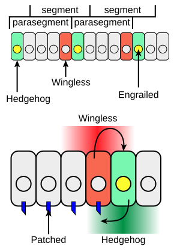

# Developmental Biology
**First published Mon Mar 23, 2015; substantive revision Fri Oct 31, 2025**

*Love, Alan, Yoshida, Yoshinari*

Developmental biology is the science that investigates how a variety of interacting processes generate an organism’s heterogeneous shapes, size, and structural features that arise on the trajectory from embryo to adult, or more generally throughout a life cycle. It represents a mature area of contemporary experimental biology that focuses on phenomena that have puzzled natural philosophers and scientists for more than two millennia. Philosophers of biology have shown interest in developmental biology due to its potential relevance for understanding evolutionary processes, the theme of reductionism in genetic explanations, and because developmental phenomena like stem cells illustrate dispositional properties. Developmental biology displays a rich array of material and conceptual practices that can be analyzed to better understand the scientific reasoning exhibited in experimental life science. This entry briefly reviews some central phenomena of ontogeny and then explores five domains that represent some of the import and promise of conceptual reflection on the epistemology of developmental biology.

## 1. Overview

### 1.1 Historical Considerations

Developmental biology is the science that investigates how a variety of interacting processes generate an organism’s heterogeneous shapes, size, and structural features that arise on the trajectory from embryo to adult, or more generally throughout a life cycle (Love 2008; Minelli 2011a; Weber 2022)[^love-2008][^minelli-2011a][^weber-2022]. It represents a mature area of contemporary experimental biology that focuses on phenomena that have puzzled natural philosophers and scientists for more than two millennia. How do the dynamic relations among seemingly homogeneous components in the early stages of an embryo produce a unified whole organism containing heterogeneous parts in the appropriate arrangement and with correct interconnections? More succinctly, how do we explain *ontogeny* (or, more archaically, *generation*)? In *Generation of Animals*, Aristotle provided the first systematic investigation of developmental phenomena and recognized key issues about the emergence of and relationships between hierarchically organized parts (e.g., bone and anatomical features containing bone), as well as the explanatory difficulty of determining how a morphological form is achieved reliably in offspring (e.g., the typical shape and structure of appendages in a particular species). Generation remained a poignant question throughout the early modern period (Roe 1981)[^roe-1981] and was explored by many key figures writing at the time, including William Harvey, René Descartes, Robert Boyle, Pierre Gassendi, Nicolas Malebranche, Gottfried Wilhelm Leibniz, Anne Conway, Immanuel Kant, and others (Smith 2006)[^smith-2006]. Observations of life cycle transitions, such as metamorphosis, fed into these endeavors and led to striking conclusions, such as Leibniz’s denial of generation *sensu stricto*.

> Animals and all other organized substances have no beginning … their apparent generation is only a development, a kind of augmentation … a transformation like any other, for instance like that of a caterpillar into a butterfly. (Smith 2011: 186–187)[^smith-2011]

A major theme that crystallized in this history of investigation is the distinction between epigenesis and preformation (see the entry on theories of biological development). Proponents of epigenesis claimed that heterogeneous, complex features of form emerge from homogeneous, less complex embryonic structures through interactive processes. Thus, an explanation of the ontogeny of these form features requires accounting for how the interactions occur and yield integrated outcomes. Proponents of preformation claimed that complex form preexists in the embryo and “unfolds” via ordinary growth processes. An adequate explanation involves detailing how growth occurs. Although preformation has a lighter explanatory burden in accounting for how form emerges during ontogeny (on the assumption that growth is easier to explain than interactions among processes), it also must address how the starting point of the next generation is formed with the requisite heterogeneous complex features. This was sometimes accomplished by embedding smaller and smaller miniatures *ad infinitum* inside the organism (Figure 1). Epigenetic perspectives were often dependent on forms of teleological reasoning (see the entry on teleological notions in biology) to account for why interactions among homogeneous components eventually result in a complex, integrated whole organism. Though nothing prevents mixing features of these two outlooks in explaining different aspects of development, polarization into dichotomous positions has occurred frequently (Rose 1981; Smith 2006)[^smith-2006].

![[three drawings, the first is like a balloon with a scrunched up human inside and a string hanging down, the second of a dangling human figure and the third of a somewhat larger dangling human figure.]](../assets/biology-developmental/Figure1.gif)

*Figure 1:* An early modern depiction of a tiny person inside of a sperm exemplifying preformationist views.

In the late 19ᵗʰ and early 20ᵗʰ century, the topic of development was salient in controversies surrounding vitalism, such as the disagreement between Wilhelm Roux and Hans Driesch over how to explain ontogeny (Maienschein 1991)[^maienschein-1991]. Roux thought that a fertilized egg contains inherited elements that represent different organismal characteristics. During the process of cellular division, these elements become unequally distributed among daughter cells leading to distinct cell fates. Driesch, in contrast, held that each cell retained its full potential through division even though differentiation occurred. Although this issue is often understood in terms of the metaphysics of life (vitalism *versus* materialism or mechanism), Driesch’s interpretation of development and the autonomy of an organism had epistemological dimensions (Maienschein 2000)[^maienschein-2000]. The explanatory disagreement involved different experimental approaches and divergent views on the nature of differentiation in early ontogeny (e.g., to what degree cells are pre-specified). Additionally, the landscape of possible perspectives is not best characterized as a dichotomy since vitalism admitted of many diverse interpretations (Donohue and Wolfe 2022)[^donohue-2022] and viewpoints that openly rejected vitalism or physico-chemical mechanism offered alternatives that emphasized the organizational nature of living systems as crucial to explaining their development and other properties (“organicism”: Esposito 2013; Nicholson and Gawne 2015; Peterson 2016)[^esposito-2013][^nicholson-2015][^peterson-2016].

A familiar philosophical theme running through these discussions, both epistemological and metaphysical, is the status of reductionism in biology. Through the middle of the 20ᵗʰ century, embryology—the scientific discipline studying development—slowly transformed into developmental biology (Berrill 1961)[^berrill-1961]. In conjunction with the issue of reductionism, a key aspect of this history is the molecularization of experimental (as opposed to comparative) embryology (Fraser and Harland 2000)[^fraser-2000], with a concomitant emphasis on the explanatory power of genes (see the entry on gene). This complex and fascinating history, including interrelations with medicine and reproductive technology, has been detailed elsewhere (see, e.g., Oppenheimer 1967; Horder et al. 1986; Hamburger 1988; Hopwood 2009, 2019; Maienschein 2014; Maienschein et al. 2005; Gilbert 1991; Embryo Project in Other Internet Resources)[^gilbert-1991][^hamburger-1988][^hopwood-2009][^hopwood-2019][^horder-1986][^maienschein-2014][^maienschein-2005][^oppenheimer-1967].

Developmental biology has increasingly become an area of exploration for philosophy of biology due to the potential relevance for understanding evolutionary processes (Love 2024; see the entry on evolution and development)[^love-2024], the theme of reductionism in biology and explanations from molecular genetics (Kaiser 2015; Robert 2004; Rosenberg 2006)[^kaiser-2015][^robert-2004][^rosenberg-2006], and because developmental phenomena like stem cells illustrate dispositional properties (Fagan 2013; Laplane 2016)[^fagan-2013][^laplane-2016]. However, it should not be forgotten that ontogeny was on the radar of philosophical scholars in the 20ᵗʰ century, as seen in Ernest Nagel’s treatment of hierarchical organization and reduction in the development of living systems (Nagel 1961: 432ff)[^nagel-1961]. For contemporary philosophy of science, developmental biology displays a rich array of material and conceptual practices that can be analyzed to better understand the scientific reasoning exhibited in experimental life science (see the entry on experiment in biology). After a brief review of some central phenomena of ontogeny, this entry explores five domains that represent some of the import and promise of conceptual reflection on the epistemology of developmental biology.

### 1.2 Developmental Phenomena

> Developmental biology is the science that seeks to explain how the structure of organisms changes with time. Structure, which may also be called morphology or anatomy, encompasses the arrangement of parts, the number of parts, and the different types of parts. (Slack 2006: 6)[^slack-2006]

Most of the properties that developmental biologists attempt to explain are structural rather than functional. For example, a developmental biologist typically concentrates more on how tissue layers fold or how shape is generated than on what the folded tissue layers do or how the shape functions. The ontogeny of function, at all levels of organization, is an element of developmental biology, but it is often bracketed because of the predominance (both past and present) of questions surrounding the ontogeny of form or structure (Love 2008)[^love-2008].

Textbooks (e.g., Gilbert 2010; Slack 2013; Wolpert et al. 2010)[^slack-2013][^wolpert-2010] typically describe a canonical set of events surrounding the changing structures displayed during animal development.[^note-1] The first of these is *fertilization* (in sexually reproducing species), where an already semi-organized egg merges with a sperm cell, followed by the fusion of their nuclei to achieve the appropriate complement of genetic material. Second, the fertilized egg undergoes several rounds of *cleavage*, which are mitotic divisions without cell growth that subdivide the zygote into many distinct cells (Figure 2). After many rounds of cleavage, this spherical conglomerate of cells (now called a *blastula*) begins to exhibit some specification of *germ layers* (endoderm, mesoderm, and ectoderm) and then proceeds to invaginate at one end, a complex process referred to as *gastrulation* that eventually yields a through-gut. All three germ layers, from which specific types of cells are derived (e.g., neural cells from ectoderm), become established during gastrulation or shortly after it completes.[^note-2] *Organogenesis* refers to the production of tissues and organs through the interaction and rearrangement of cell groups. Events confined to distinct taxonomic groups include *neurulation* in chordates, whereas other events correlate with mode of development (*metamorphosis* from a larval to adult stage) or individual trauma (*regeneration* of a limb).

![[6 columns by 2 rows. The second row is a sideways view of the item in the first row. The first column (A) has four orange colored cells labelled 'A', 'B', 'C', and 'D'. The second column (B) has 8 cells, the bigger lower orange ones labelled '1A', '1B', '1C', and '1D'; the smaller pink ones on top labelled '1a', '1b', '1c', and '1d'. The third column (C) has 12 cells with the bottom, orange, labelled '2A' through '2D', the middle, red, labelled '2a' through '2d' and the top, pink, labelled '1a' through '1d'. The fourth column (D) has 16 cells, bottom layer, orange, is '2A' through '2D', top, pink, is '1a1' through '1d1', the middle alternates between larger red cells labelled '2a' through '2d' and smaller beige cells labelled '1a2' through '1d2'. The fifth column (E) has at the bottom orange cells labelled '3A' through '3D', at the top a cross of four pink cells labelled '1a1' through '1d1' and between the branches of the cross four beige cells labelled '1a2' through '1d2'. In the middle are large red cells labelled '2a' through '2d' and squished between the orange, beige, and red cells are dark red cells labelled '3a' through '3d'. The last column (F) is different. On the top is a clump of cells colored blue, green, pink, and orange. On the bottom on the left side is an arrow pointed up labelled 'developmental time'. Next to it is a 6 rowed drawing. The first row on the bottom extends the full width of the column and contains the word 'zygote', the row above is split in two, on the left 'AB' and on the left 'CD'. The third row is split evenly in 4: green 'A', blue 'B', orange 'C', and red 'D'. The fourth row is split evenly into 8 each shaded the same color as the unit below (though with different intensities). The fifth row is split evenly into 16 and the sixth row into 32 following the same pattern as the fourth row.]](../assets/biology-developmental/Figure2.png)

*Figure 2:* An example of embryonic cleavage in marine snail embryos showing the fate of different cell lineages through developmental time.

Several key processes underlie these distinct developmental events and the resulting features of form that emerge (e.g., the through-gut formed subsequent to gastrulation or the heart formed during organogenesis). These are critical to the ontogeny of form and link directly to major research questions in developmental biology. First, cellular properties change during ontogeny. This is a function of *differentiation* whereby cells adopt specific fates that include shape changes and other transformations (Figure 3). Second, regions of cells in the embryo are designated through arrangement and composition alterations that correspond to different axes in different parts of the embryo (e.g., dorsal-ventral, anterior-posterior, left-right, and proximal-distal). The successive establishment of these regions is referred to as *pattern formation*. Third, cells translocate and aggregate into layers (e.g., endoderm and ectoderm, followed by the mesoderm in many lineages) and later tissues (aggregations of differentiated cell types). Fourth, cells and tissues migrate and interact to produce new arrangements and shapes composed of multiple tissue layers with novel functions (i.e., organs). These last two sets of processes are usually termed *morphogenesis* (Davies 2023)[^davies-2023] and occur via many distinct mechanisms. Fifth, there is *growth* in the size of different form features in the individual, remarkably obvious when comparing zygote to adult, although proportional change between different features (*allometry*) is also striking, such as differential growth in the front claws of fiddler crabs (Figure 4).

![[A tree graph of 5 levels. The top node 'Multipotential hematopoietic stem cell (Hemocytoblast)' points back to itself as well as pointing to the next level. On the left 'Common myeloid progenitor' which points to 'Megakarycocyte' (which in turn points to 'Thrombocytes'), 'Erythrocyte', 'Mast cell', and 'Myeloblast' (which in turn points to 'Basophil', 'Neutrophil', 'Eosinophil', 'Monocyte' (which in turn points to 'Macrophage')). On the right 'Common lymphoid progenitor' which points to 'Natural killer cell (Large granual lymphocyte)' and 'Small lymphocyte' (which in turn points to 'T lymphocyte' and 'B lymphocyte' (which in turn points to 'Plasma cell')).]](../assets/biology-developmental/Figure3.svg)

*Figure 3:* A simple illustration of the kinds of differentiation related to the cellular components found in blood.

*Figure 4:* Proportional differences in morphology (allometry) that arise from differential growth exhibited by the front claws of the fiddler crab.

None of these processes occur in isolation and explanations of particular form features usually draw on several of them simultaneously, presuming other features that originated earlier in ontogeny by different instantiations and combinations of the processes. This sets a broad agenda for investigation: how do various iterations and combinations of these processes generate form features during ontogeny? Consider the concrete example of vertebrate cardiogenesis. How does the vertebrate heart, with its internal and external shape and structure originate during ontogeny (Harvey 2002)[^harvey-2002]? How does the heart come to exhibit left/right asymmetry in the body cavity? What causes cells to adopt a muscle cell fate or certain tissues to interact in the prospective region of the heart? How do muscle cells migrate to, aggregate in, and differentiate at the correct location? How does the interior of the heart adopt a particular tubular structure with various chambers (that differs among vertebrate species)? How does the heart grow at a particular rate and achieve a specific size? Solutions relevant to explaining the ontogeny of form characterize causal factors that account for how different processes occur and yield various outcomes.

### 1.3 Developmental Mechanisms

A developmental *mechanism* is a mechanism or process that operates during ontogeny (see McManus 2012 and Özpolat et al. 2025 for discussion)[^mcmanus-2012][^özpolat-2025]. At least two different types of developmental mechanisms can be distinguished (Love 2017a)[^love-2017a]: molecular genetic mechanisms (signaling or gene regulatory networks) and cellular-physical mechanisms (cell migration or epithelial invagination). Philosophical explorations of mechanisms in science and mechanistic explanation have grown dramatically over the past two decades (Craver and Darden 2013; Glennan and Illari 2017; Illari and Williamson 2012; see the entry on mechanisms in science)[^glennan-2017][^illari-2012]. Among different accounts of scientific mechanisms, four shared elements are discernable: (1) what a mechanism is for, (2) its constituents, (3) its organization, and, (4) the spatiotemporal context of its operation. Developmental explanations seek to characterize these four elements through various experimental interventions. Together these elements provide a template for characterizing the two different types of developmental mechanisms.

A well-established molecular genetic mechanism is the initial formation of segments in *Drosophila* due to the segment polarity network of gene expression (Wolpert et al. 2010, 70–81; Damen 2007)[^damen-2007][^wolpert-2010]. By Stage 8 of development (~3 hours post-fertilization), *Drosophila* embryos have 14 parasegment units that were defined by pair-rule gene expression in earlier stages. The transcription factor Engrailed accumulates in the anterior portion of each parasegment. This initiates a cascade of gene activity that defines the boundaries of each compartment of cells that will eventually become a segment. One element of this activity is the expression of *hedgehog*, a secreted signaling protein, in cells anterior to the band of cells where Engrailed has accumulated, which marks the posterior boundary of each nascent segment. This, in turn, activates the expression of *wingless*, another secreted signaling protein, which maintains the expression of both *engrailed* and *hedgehog* in a feedback loop so that segment boundaries persist (Figure 5). The segment polarity network exhibits all four of the shared elements of a mechanism. It is constituted by a number of parts (e.g., Engrailed, Wingless, Hedgehog) and activities or component operations (e.g., signaling proteins bind receptors, transcription factors bind to DNA and initiate gene expression), which are organized into patterns of interacting relationships (feedback loops, signaling pathways) within a spatiotemporal context (in parasegments of the *Drosophila* embryo, ~3 hours post-fertilization) so as to produce a specific behavior or phenomenon (a set of distinct segments with well-defined boundaries).

*Figure 5:* Wingless and Hedgehog reciprocal signaling during segmentation of *Drosophila* embryos.

Next, consider the cellular-physical mechanism of branching morphogenesis, which refers to combinations of cellular proliferation and movement that yield branch-like structures in kidneys, lungs, glands, or blood vessels. There are many types of branching morphogenesis, but one primary mechanism is epithelial folding, which involves cells invaginating at different locations on a structure to yield branches (Davies 2023, ch. 20)[^davies-2023]. Different cellular-physical mechanisms can produce invaginations that lead to branching structures (Varner and Nelson 2014)[^varner-2014]: the constriction of one end of a subset of columnar cells in an epithelium (“apical constriction”); increased cell proliferation of one epithelial sheet in relation to another (“differential growth”); and compression of an epithelium leading to periodic invaginations (“mechanical buckling”). That different mechanisms can lead to the same morphological outcome means it can be difficult to discern which mechanism is operating in an embryonic context. Branching morphogenesis also exhibits all four of the shared elements of a mechanism. The parts are cells and tissues with activities or component operations (e.g., apical constriction, differential growth, mechanical buckling) being organized into patterns of interacting relationships, such as apical constriction leading to epithelial invagination, within a spatiotemporal context (e.g., in tracheal precursors within the *Drosophila* embryo around Stage 7 and 8). This organization produces a specific behavior or phenomenon (a set of branching structures—the trachea).

Once these types of developmental mechanisms have been distinguished, several conceptual issues become salient. The first pertains to how the two types of mechanisms are interrelated during ontogeny, and how different investigative approaches do or do not successfully provide integrated accounts of them. A second is their distinct patterns of generality. Molecular genetic mechanisms are widely conserved across phylogenetically disparate taxa as a consequence of evolutionary descent, whereas cellular-physical mechanisms are widely instantiated as a consequence of shared physical organization but not due to evolutionary descent (Love 2017a)[^love-2017a]. The divergence of these patterns has prompted explicit epistemological reflection by developmental biologists.[^note-3]

## 2. The Epistemological Organization of Developmental Biology

One recurring theme in the long history of investigations into development is that explaining the ontogeny of form consists of many interrelated questions about diverse phenomena. Sometimes philosophers have attempted to compress these questions into one broad problem.

> The real question concerning metazoan ontogeny is just how a single cell gives rise to the requisite number of differentiated cell lineages with all the right inductive developmental interactions required to reproduce the form of the mature organism (Moss 2002: 97)[^moss-2002].
>
> The central problem of developmental biology is to understand how a relatively simple and homogeneous cellular mass can differentiate into a relatively complex and heterogeneous organism closely resembling its progenitor(s) in relevant aspects (Robert 2004: 1)[^robert-2004].

This language is not necessarily incorrect but can lead to skewed interpretations. For example, Philip Kitcher has argued that:

> In contemporary developmental biology, there is … uncertainty about how to focus the big, vague question, How do organisms develop? (Kitcher 1993: 115)[^kitcher-1993]

This is simply false. While it is true that these questions have been manifested with differing frequency and vigor through history, and the ability to answer them (as well as the nature of the questions themselves) has been contingent on different research strategies and methods, the issue has not been an unwieldy central problem. But scrutinizing the structure of developmental biology’s questions is not merely an exercise in clarification. It is crucial for understanding how the science of developmental biology is organized.

### 2.1 No Theory of Development?

Although it is common in philosophy to associate sciences with theories, such that the individuation of a science is dependent on a constitutive theory or group of models, it is uncommon to find presentations of developmental biology that make reference to a *theory* of development (see discussion in Minelli and Pradeu 2014)[^minelli-2014]. Instead, we find references to families of approaches (developmental genetics, experimental embryology, cell biology, and molecular biology) or catalogues of “key molecular components” (transcription factor families, inducing factor families, cytoskeleton or cell adhesion molecules, and extracellular matrix components). No standard theory or group of models provides theoretical scaffolding in the major textbooks (e.g., Slack 2013; Wolpert et al. 2010; Gilbert 2010)[^slack-2013][^wolpert-2010]. The absence of any reference to a constitutive theory of development or some consensus set of core explanatory models is *prima facie* puzzling. Three interpretations of this situation are possible: (a) despite the lack of reference to theories, one can reconstruct a theory (or theories) of developmental biology out of the relevant discourse (e.g., multiple allied molecular models); (b) the lack of reference to theories indicates an immaturity in developmental biology, because mature sciences always have systematic theories; and, (c) the lack of reference to theories should be taken at face value.

Developmental biology is not an immature science, groping about for some way to explain its phenomena: “some of the basic processes and mechanisms of embryonic development are now quite well understood” (Slack 2013: 7)[^slack-2013]. The impetus for this type of interpretation arises out of commitments to a conception of mature science that presumes theories are abstract systems with a small set of laws or core principles (see the entry on the structure of scientific theories). On the other hand, holding that developmental biology already has a theory costumed in different guise—not referred to as such by developmental biologists—is a possible interpretation. It arises out of a view that sciences must have theories, which has been expanded to allow for different understandings of theory structure, such as constellations of models without laws, even though the assumption is that theory still plays a broadly similar organizing role in guiding research. However, this assumption should be challenged and rejected on methodological grounds in the case of developmental biology. An analysis of the reasoning in a science should exhibit epistemic transparency and not postulate “hidden” reasoning structure (Love 2012)[^love-2012]. This criterion is based on the premise that the basis of successes in scientific inquiry must be available to those engaged in its practice (i.e., scientists). If we postulate hidden structure not present in scientific discourse to account for inductive inference, explanation, or other forms of reasoning, then we risk obscuring how scientists themselves access this structure to evaluate it (Woodward 2003: ch. 4)[^woodward-2003]. The successes of developmental biology would become mysterious when viewed from the vantage point of its participants.

Epistemic transparency demands a descriptive correspondence between philosophical accounts of science and scientific practice. This does not mean that every claim made by any scientist should be taken with the same credence. A ruling concern is *pervasive* features of practice. The problem with assuming laws are required for explanation is their relative absence from a variety of successful sciences routinely offering explanations, not that no scientist ever appeals to laws as explanatory. Pervasive features of scientific practice should be prominent in philosophical accounts of sciences. Thus, it is not surprising that the desire for a theory can be found among some developmental biologists: “Developing a theory is of utmost importance for any discipline” (Sommer 2009: 417)[^sommer-2009]. But the fact that these calls are rare means we should not assume theories are actually needed to govern and organize inquiry within the domain.[^note-4]

It was once thought that each science must have laws in order to offer explanations (see the entry on 20th century theories of scientific explanations), but now this is seen as unnecessary (Giere 1999; Woodward 2003)[^giere-1999][^woodward-2003]. The expectation that a science must have a theory to accomplish the task of organizing and guiding inquiry is of similar vintage. It derives from an intuitive expectation of what counts as a mature science in the first place. (“Even if we find empirically successful and coherent traditions of research without a systematic theoretical framework providing guidance, then the science cannot be mature.”) One might shrug off these quasi-positivist appeals to maturity by invoking more flexible conceptions of theory and theory structure. But why retain the expectation that theories should accomplish the same epistemic tasks? This is a preconception about knowledge structure that is not plausible in light of the diversity of research practices found across the sciences. The few scientists who favor this philosophical response have different motivations. Instead of maturity, other reasons are salient, such as guidance in the face of a welter of biochemical detail or the need to forge a synthesis between evolution and development.[^note-5]

Developmental biologists recognize that the “curse of detail” is one of the costs of developmental biology’s meteoric success over the past three decades: “The principal challenge today is that of exponentially increasing detail” (Slack 2013: ix)[^slack-2013]. While something must provide organization and guidance to developmental biology, it need not be theories that accomplish the task. Regarding calls for a synthesis of evolution and development, these often assume that having a developmental theory is a precondition for synthesis (Sommer 2009)[^sommer-2009]: “Our troubles … derive from our standing lack of an explicit theory of development” (Minelli 2011a: 4)[^minelli-2011a]. However, this line of argument assumes evolutionary theory exhibits the supposed structure to which developmental biologists should aspire. The actual practice associated with evolutionary theory indicates a more flexible framework that is responsively adjusted to the diverse investigative aims of evolutionary researchers (Love 2013)[^love-2013][^love-2013-2]. Therefore, it is not clear that evolutionary theory supplies the preferred template. A productive way forward is to relinquish the prior expectation that sciences must have theories of a certain kind to govern and guide their activity. Instead, sciences that display empirical success and fecundity should be studied to discover what features are responsible, without assuming that those features will be the same for all sciences: “Science need not be understood in these terms and, indeed, may be better understood in other terms” (Giere 1999: 4)[^giere-1999].

### 2.2 Erotetic Organization

The criterion of epistemic transparency encourages an exploration of our third interpretive option—the lack of reference to theories should be taken at face value. Developmental biology is organized primarily by stable, broad domains of problems that correspond to abstract representations of major ontogenetic processes (differentiation, pattern formation, growth, and morphogenesis). Yet how do we interpret the “theoretical” aspects of developmental biology (e.g., positional information models of pattern formation) and the utilization of theories from other domains (e.g., biochemistry)? One way is to distinguish between theory-informed science—*using* theoretical knowledge—and theory-directed science—*having* a theory that directs inquiry and organizes knowledge (Waters 2007b)[^waters-2007b]; developmental biology is theory-informed but not theory-directed. Theories need not be wholly absent from developmental biology but—when present—they play roles very different from standard philosophical expectations. Developmental biology uses theoretical knowledge from biochemistry when appealing to morphogen gradients to explain how segments are established or chemical thermodynamics when invoking reaction–diffusion mechanisms to explain pigmentation patterns. It also uses theoretical knowledge derived from within developmental biology, such as positional information models. Different kinds of theory inform developmental biology, but these do not organize research—they are not necessary to structure the knowledge and direct investigative activities. Developmental biologists are not focused on confirming and extending the theory of reaction–diffusion mechanisms, nor are they typically organizing their research around positional information.[^note-6] This theoretical knowledge is used in building explanations but does not provide rails of guidance for how to proceed in a research program. All sciences may use theoretical knowledge, but this is not the same as all sciences having a theory providing direction and organization.

Why think that problems provide organizational architecture for the epistemology of developmental biology? They are a pervasive feature of its reasoning practices, illustrated in textbooks that capture substantial community consensus about standards of explanation, experimental methods, essential concepts, and empirical content. Unlike evolutionary biology textbooks that discuss the theory of natural selection or economics textbooks that talk about microeconomic theory, an examination of several editions of major textbooks indicate that developmental biology does not have similar kinds of theories.

Jonathan Slack’s *Essential Developmental Biology* (Slack 2006, 2013)[^slack-2006][^slack-2013] is organized around four main types of processes, also described as clustered groups of problems, which occur during embryonic development: regional specification (pattern formation), cell differentiation, morphogenesis, and growth. These broad clusters are then fleshed out along a standard timeline of early development, highlighting gametogenesis, fertilization, cleavage, gastrulation, and axis specification. Different experimental approaches (cell and molecular biology, developmental genetics, and experimental embryology) are utilized in a specific set of model organisms to dissect the workings of these developmental phenomena. Subsequent chapters cover later aspects of development (e.g., organogenesis), with different systems treated in depth by tissue layer, differentiation and growth, or in relation to evolutionary questions. Throughout this presentation, no specific theory, set of hypotheses, or dominant model is invoked to organize these different domains of investigation. Instead, broad clusters of questions that reflect generally delineated processes (differentiation, specification, morphogenesis, and growth) set the agenda of research.

Scott Gilbert’s *Developmental Biology* exhibits a similar pattern (Gilbert 2000 [2003, 2006, 2010])[^gilbert-2000]. Developmental biology is constituted by two broad questions (“How does the fertilized egg give rise to the adult body? And how does that adult body produce yet another body?”), which can then be subdivided into further categories, such as differentiation, morphogenesis, growth, reproduction, regeneration, evolution, and environmental regulation. These questions can be parsed more analytically in terms of five variables: abstraction, variety, connectivity, temporality, and spatial composition. The values given to these variables structure the constellation of research questions within the broad problem agendas corresponding to generally delineated processes. For example, research questions oriented around events in zebrafish gastrulation are structured in a way that differs from the research questions oriented around vertebrate neural crest cell migration because they involve different values for the five variables: abstraction (zebrafish vs. vertebrates), temporality (earlier vs. later), spatial composition (tissue layer interactions vs. a distinctive population of cells), variety (epiboly vs. epithelial to mesenchymal transition), and connectivity (gut formation and endoderm vs. organogenesis and ectoderm/mesoderm). These configurations can be adjusted readily in response to shifts in the values for different variables (Love 2014)[^love-2014].[^note-7]

This anatomy of problems, with explicit epistemological structure derived from different values for these variables, operates to organize the science of development. Investigators from different disciplines can be working on the same problem but asking different questions that require distinct but complementary methodological resources. Knowledge and inquiry in developmental biology are intricately organized, just not by a central theory or group of models, and this erotetic organization is epistemologically accessible to the participating scientists. While theoretical knowledge, especially that drawn from molecular biological mechanisms (see the entry on molecular biology) and mathematical models (e.g., reaction–diffusion models) is ubiquitous (*theory-informed*), the clusters of problems that reappear across the textbooks and correspond to different types of processes provide the governing architecture (*not theory-directed*), which can be characterized explicitly according to the variables described.

## 3. Explanatory Approaches to Development

Explanations in developmental biology are usually causal and described as “mechanistic.” However, unlike standard conceptions of mechanistic explanation, there is a constant acquisition of new causal capacities (in terms of constituent entities, activities, and their organization) through development (McManus 2012; Parkkinen 2014)[^mcmanus-2012][^parkkinen-2014]. Although much work remains in characterizing different aspects of explanation in developmental biology, there is no doubt that a difference making or manipulability conception of causation (see the entry on causation and manipulability) provides a core element of the reasoning (Woodward 2003; Strevens 2009; Waters 2007a)[^strevens-2009][^waters-2007a][^woodward-2003]. Genetic explanations of development, similar to what is seen in molecular genetics, work by identifying changes in the expression of genes and interactions among their RNA and protein products that lead to changes in the properties of morphological features during ontogeny (e.g., shape or size), while holding a variety of contextual variables fixed. More recently, there has been growing interest in physical explanations of development that involve appeals to mechanical forces due to geometrical arrangements of mesoscale materials, such as fluid flow (Forgacs and Newman 2005)[^forgacs-2005]. Researchers agree on the phenomena that need to be explained, but differ on whether physical or genetic factors are more or less explanatory (Keller 2002)[^keller-2002].[^note-8] The existence of two different types of causal explanations for developmental phenomena poses an additional question about how they might be combined into a more integrated explanatory framework.

### 3.1 Genetics

Many philosophers have turned to explanations of development over the past two decades in an effort to esteem or deflate claims about the causal power of genes (Keller 2002; Neumann-Held and Rehmann-Sutter 2006; Rosenberg 2006; Robert 2004; Waters 2007a)[^keller-2002][^neumann-held-2006][^robert-2004][^rosenberg-2006][^waters-2007a].[^note-9] Genetic explanations touch the philosophical theme of reductionism and appear to constitute the bulk of empirical success accruing to developmental biology over the past several decades.[^note-10] Statements from developmental biologists reinforce this perspective:

> Developmental biology … deals with the process by which the genes in the fertilized egg control cell behavior in the embryo and so determine its pattern, its form, and much of its behavior … differential gene activity controls development. (Wolpert et al. 1998: v, 15)[^wolpert-1998]

These types of statements are sometimes amplified in appeals to a genetic *program* for development.

> [Elements of the genome] contain the sequence-specific code for development; and they determine the particular outcome of developmental processes, and thus the form of the animal produced by every embryo. … Development is the execution of the genetic program for construction of a given species of organism (Davidson 2006: 2, 16)[^davidson-2006].[^note-11]

At other times, statements concentrate on genetics as the primary locus of causation in ontogeny: “Developmental complexity is the direct output of the spatially specific expression of particular gene sets and it is at this level that we can address causality in development” (Davidson and Peter 2015: 2)[^davidson-2015]. Whether or not these statements can be substantiated has been the subject of intense debate.[^note-12] The strongest claims about genetic programs or the genetic control of development have empirical and conceptual drawbacks that include an inattention to plasticity and the role of the environment (see below, Section 6), an ambiguity about the locus of causal agency, and a reliance on metaphors drawn from computer science (Gilbert and Epel 2009; Keller 2002; Moss 2002; Robert 2004)[^gilbert-2009][^keller-2002][^moss-2002][^robert-2004]. However, this leaves intact the difference-making principle of genetic explanation exhibited in molecular genetics (Waters 2007a)[^waters-2007a], which yields more narrow and precise causal claims under controlled experimental conditions, and is applicable to diverse molecular entities that play causal roles during development, such as regulatory RNAs, proteins, and environmental signals. We can observe this briefly by reconsidering the example of vertebrate cardiogenesis.

Are there problems with claiming that genes contain all of the information (see the entry on biological information) to form vertebrate hearts? Is there a genetic program in the DNA controlling heart development? Are genes the primary supplier and organizer of material resources for heart development, largely determining the phenotypic outcome? Existing studies of heart development have identified a role for fluid forces in specifying the internal form of the heart (Bassen et al. 2021; Hove et al. 2003)[^bassen-2021][^hove-2003] and its left/right asymmetry (Djenoune et al. 2023; Nonaka et al. 2002)[^djenoune-2023][^nonaka-2002]. Biochemical gradients of extracellular calcium are responsible for activating the asymmetric expression of the regulatory gene *Nodal* (Raya et al. 2004)[^raya-2004] and inhibition of voltage gradients scrambles normal asymmetry establishment (Levin et al. 2002)[^levin-2002]. Mechanical cues such as microenvironmental stiffness are crucial for key transitions from migratory cells into organized sheets during heart formation (Jackson et al. 2017)[^jackson-2017]. A number of genes are clearly difference makers in these processes (Asp et al. 2019; Srivastava 2006; Brand 2003; Olson 2006)[^asp-2019][^brand-2003][^olson-2006][^srivastava-2006], but the conclusion that genes alone carry all the information needed to generate form features of the heart seems unwarranted. Although it may be warranted empirically in some cases to privilege DNA sequence differences as causal factors in specific processes of ontogeny (Waters 2007a)[^waters-2007a], such as hierarchically organized networks of genetic difference makers explaining tissue specification (Peter and Davidson 2011)[^peter-2011], the diversity of entities appealed to in molecular genetics and the extent of their individual and joint roles in specifying developmental outcomes implies that debates about the meaning, scope, and power of genetic explanations will continue (Griffiths and Stotz 2013)[^griffiths-2013]. However, a shift away from genetic programs and genetic determinism to DNA, RNA, and proteins as difference makers that operate conjointly suggests that we conceptualize other causal factors in a similar way.

### 3.2 Physics

Fluid flow, as a physical force, is also a difference maker during the development of the heart, and ontogeny more generally, and developmental biologists appeal to physical difference makers, which are understood as factors relevant to producing the morphological properties of developmental phenomena (Bassen et al. 2021; Forgacs and Newman 2005)[^bassen-2021][^forgacs-2005]. A physical causation approach was on display in the late 19th century work of Wilhelm His (Hopwood 1999, 2000; Pearson 2018)[^hopwood-1999][^hopwood-2000][^pearson-2018] and especially visible in the early 20th century work of D’Arcy Thompson and others (Thompson 1992 [1942]; Briscoe and Kicheva 2017; Keller 2002: ch. 2; Olby 1986)[^briscoe-2017][^keller-2002][^olby-1986][^thompson-1992]. This occurred in the milieu of the chromosomal theory of inheritance and attempts to explore developmental phenomena via classical genetic methods (Morgan 1923, 1926, 1934)[^morgan-1923][^morgan-1926][^morgan-1934]. Thompson appealed to differential rates of growth (allometry) and the constraints of geometrical relationships to explain how organismal morphology originates. Visual representations of abiotic, mechanical analogues provided plausibility, such as the shape of liquid splashes or hanging drops for the cup and bell configurations of the free-swimming sexual stage of jellyfish. If physical forces generated specific morphologies in viscoelastic materials, then analogous morphologies in living species should be explained in terms of physical forces operating on the viscoelastic materials of the developing embryo. Yet morphogenetic processes that produce the shape and structure of morphology have been seen primarily, if not exclusively, in terms of genetics for the last several decades. Physical approaches moved into the background as molecular genetics approaches went from strength to strength (Fraser and Harland 2000)[^fraser-2000].

The molecularization of experimental embryology is one of the most striking success stories of contemporary biology as genes and genetic interactions (e.g., in transcriptional networks and signaling pathways) were discovered to underlie specific details of differentiation, morphogenesis, pattern formation, and growth when structure originates during development (Weber 2024)[^weber-2024]. Genetic approaches predominate in contemporary developmental biology and physical modes of causation are frequently neglected. The frustration among researchers interested in physical causation during embryogenesis has been palpable.

> To the molecular types, a cause is a molecule or a gene. To explain a phenomenon is to identify genes and characterize proteins without which the phenomenon will fail or be abnormal. A molecule is an explanation: a force is a description; to argue otherwise brings pity, at best (Albert Harris to John Trinkaus, 12 March 1996; Source: Marine Biological Laboratory Library Archives).

Despite this predominance of genetic explanatory approaches and the (sometimes) frustration among researchers utilizing other approaches, a groundswell of interest has been building around physical explanations of development, especially in terms of their integration with genetic explanations (Kasirer and Sprinzak 2024; Miller and Davidson 2013; Newman 2015; Piszker and Simunovic 2024)[^kasirer-2024][^miller-2013][^newman-2015][^piszker-2024]. Some philosophers and scientists have argued that the biomechanical modeling of physical causal factors constitutes a rejection of certain forms of reductive explanation in biology (Green and Batterman 2017; Palmquist et al. 2025)[^green-2017][^palmquist-2025].

### 3.3 Integrating Approaches

Thompson held that physical forces were explanatory but inadequate in isolation to account for the developmental origin of morphology; heredity (genetics) was also a necessary causal factor.[^note-13] Yet Thompson was quick to highlight that mechanical modes of causation might be neglected in the midst of growing attention to heredity (genetics):

> it is no less of an exaggeration if we tend to neglect these direct physical and mechanical modes of causation altogether, and to see in the characters of a bone merely the results of variation and of heredity. (Thompson 1992 [1942]: 1023)[^thompson-1992]

Despite this latter form of exaggeration manifesting itself through much of the 20ᵗʰ century, an agenda to combine or integrate the two approaches is now explicit.[^note-14]

There is no controversy about whether genetic and physical modes of causation are at work simultaneously:

> both the physics and biochemical signaling pathways of the embryo contribute to the form of the organism. (Von Dassow et al. 2010: 1)[^von-2010]

They are not competing causal explanations of the same phenomenon. Explanations should capture how their productive interactions yield developmental outcomes:

> an increasing number of examples point to the existence of a reciprocal interplay between expression of some developmental genes and the mechanical forces that are associated with morphogenetic movements. (Brouzés and Farge 2004: 372)[^brouzés-2004]
>
> mechanical processes can be actively involved in a synergistic interplay with biochemical processes in a dynamic self-organized manner that involves extensive feedback operating across scales. (Maroudas-Sacks and Keren 2021: 470-1)[^maroudas-sacks-2021]

Genetic causes can lead to physical causation and *vice versa*. Physical causation brings about genetic causation through mechanotransduction. Stretching, contraction, compression, fluid shear stress, and other physical dynamics are sensed by different molecular components inside and outside of cells that translate these environmental changes into biochemical signals (Hannezo and Heisenberg 2019; Hoffman et al. 2011; Wozniak and Chen 2009)[^hannezo-2019][^hoffman-2011][^wozniak-2009]. Genetic causation brings about physical causation by creating different physical properties of cells and tissues through the presence, absence, or change in frequency of particular proteins. For example, different patterns of expression for cell adhesion molecules (e.g., cadherins) can lead to differential adhesion across epithelial sheets of tissue and thereby generate phase separations or compartments via surface tension variation (Newman and Bhat 2008)[^newman-2008]. If these modes of causation are not competing, then how might one combine genetic and physical difference makers into an integrated causal explanation? How much explanatory unity can be achieved for this “reciprocal interplay”?

Finding philosophical models for the explanatory integration of genetics and physics remains an open question (Love 2017b)[^love-2017b]. Apportioning causal responsibility in the sense of determining relative contributions (e.g., the composition of causal magnitudes among different physical forces in Newtonian mechanics) is problematic because this requires commensurability with respect to how causes produce their effects (Sober 1988)[^sober-1988]. In the context of causation understood in terms of difference makers, the difficulty of integration is a variation on a problem in causal reasoning identified by John Stuart Mill and labeled the “intermixture of effects,” which involves multiple causes contributing in a blended fashion to yield an outcome.

> This difficulty is most of all conspicuous in the case of physiological phenomena; it being seldom possible to separate the different agencies which collectively compose an organized body, without destroying the very phenomena which it is our object to investigate. (Mill 1843 [1974]: 456 [book 3, chapter 11, section 1, paragraph 7])[^mill-1843]

Careful statistical methodology in experiments can answer whether one type of difference maker accounts for more of the variation in the effect variable for a particular population. But ranking causal factors with respect to how much of a difference they made is not the same as combining two modes of causation into an integrated account. Another response is to dissolve the integration problem by reducing all causal interactions to one of the two distinct modes, thereby achieving a kind of explanatory unity (Rosenberg 2006)[^rosenberg-2006]. However, this approach is eschewed by working biologists who take both genetic and physical modes of causation as significant and not reducible one to the other.

A different strategy is integrative pluralism (Mitchell 2002)[^mitchell-2002]. This involves a two-step procedure for explaining complex phenomena whose features are the result of multiple causes: (a) formulate idealized models where particular causal factors operate in isolation (“theoretical modeling”); and, (b) integrate idealized models to explain how particular, concrete phenomena originate from these causes in combination. This model is suggestive but also has drawbacks that include the fact that genetic causal reasoning in developmental biology does not typically involve theoretical modeling and the precise nature of the integration is underspecified. Integration of genetic and physical difference makers in a single mechanism offers a further possibility (Darden 2006; Craver 2007)[^craver-2007][^darden-2006]. Although this valuably highlights the productive continuity between difference makers through stages in a sequence (i.e., their reciprocal interplay), it also has handicaps. These include:

1. Divergent approaches to measuring time. Instead of time “in the mechanism,” time is measured with external standardized stages. Stages facilitate the study of different kinds of developmental mechanisms, with different characteristic rates and durations for their stages, within a common framework for a model organism (e.g., *Drosophila*), while also permitting conserved molecular mechanisms to be studied in different species because the corresponding mechanism description is not anchored to the temporal sequence of the model organism.
2. An expectation that mechanism descriptions “bottom-out” in lowest level activities of molecular entities (Darden 2006)[^darden-2006]. In the case of combining genetic and physical difference makers, the reciprocal interplay means that there is a studious avoidance of bottoming out in one or the other mode of causation.
3. The requirement of stable, compositional organization for mechanisms: Mechanistic explanations are constitutive or componential explanations: they explain the behavior of the mechanism as a whole in terms of the organized activities and interaction of its components. (Craver 2007: 128)[^craver-2007] But these mechanism descriptions are often embedded in different developmental contexts (at different times in ontogeny) with distinct compositional relations (within and between species). The reciprocal interplay between genetic and physical difference makers is not maintained precisely because these compositional differences alter relationships of physical causation (fluid flow, tension, etc.). Developmental biologists have been able to generalize relationships of genetic causation (in terms of genetic mechanisms) across species quite widely, but the attempt to combine these with physical causation has necessitated narrowing the scope of the causal claims.

Adequate philosophical models of the systematic dependence between genetic and physical difference makers in ontogeny need to account for how the temporal relations necessary for making causal claims are anchored in an external periodization used by developmental biologists. The imposition of different temporal scales can lead to distinct factors being significant or salient, which matters for ascertaining how different kinds of causes can be combined into integrated explanations. One possibility is to juxtapose these difference makers at distinct stages via experimental verification such that they exhibit productive continuity within the constraints of the external periodization (Love 2017b)[^love-2017b]. This facilitates representing symmetry between causal factors because genetic difference makers can be placed before or after physical difference makers (and *vice versa*). Although this does not provide a way to combine causal magnitudes (as in vector addition from Newtonian mechanics), it offers an explicit strategy for assigning responsibility among different kinds of causes through the vehicle of temporal organization that goes beyond ranking difference makers. The periodization serves as a template from the practices of developmental biologists for providing wholeness or unity to the different modes of causation to yield a kind of integrated explanation of the morphology that results from a sequence of developmental processes.

Not all types of causal explanation involve an external periodization and there are other ways to combine causes in order to produce more integrated explanatory frameworks. One area where combined explanations for developmental phenomena are being analyzed pertains to mechanism descriptions and mathematical modeling in systems biology (Brigandt 2013; Fagan 2013)[^brigandt-2013][^fagan-2013]. For example, Fagan (2013: ch. 9) shows how an integrated explanation emerges from a step-wise procedure that starts with a detailed description of a molecular mechanism followed by the formulation of an abstracted wiring diagram of component interactions, which is then translated into a system of equations that can account for changes in component interactions over time. Solutions to these systems of equations and a mapping of solutions for the interactions among components of the system onto the behavior of the overall system within a shared landscape representation more systematically explains cellular differentiation.

## 4. Model Organisms for the Study of Development

Model organisms are central to contemporary biology and studies of embryogenesis (Ankeny and Leonelli 2011, 2020; Steel 2008; Bier and McGinnis 2003; Davis 2004; Larraín 2024)[^ankeny-2011][^ankeny-2020][^bier-2003][^davis-2004][^larraín-2024][^steel-2008]. Biologists utilize only a small number of species to experimentally elucidate various properties of ontogeny (e.g., *C. elegans*, *Drosophila*, and *Brachydanio* [zebrafish]; see Figure 6). These experimental models permit researchers to investigate development in great depth and facilitate a precise dissection of causal relationships. Critics have questioned whether these models are good representatives of other species because of inherent biases involved in their selection, such as rapid development and short generation time (Bolker 1995)[^bolker-1995], and problematic presumptions about the conservation of gene functions and regulatory networks (Lynch 2009)[^lynch-2009]. For example, *C. elegans* embryogenesis is not representative of nematodes in terms of pattern formation and cell specification (Schulze and Schierenberg 2011)[^schulze-2011] and zebrafish appendage formation is a poor proxy for the development of appendages in tetrapods (Metscher and Ahlberg 1999)[^metscher-1999].

![[a color photo showing from the side a 0.1 x 0.03 inch (2.5 x 0.8 mm) small male Drosophila melanogaster fly with red eyes facing left.]](../assets/biology-developmental/Figure6.jpg)

*Figure 6:* *Drosophila melanogaster* (the common fruit fly) is one of the standard model organisms used in developmental biology.

One response to this criticism is to emphasize the conserved genetic mechanisms shared by all animals despite differences in developmental phenomena (Gerhart and Kirschner 2007; Ankeny and Leonelli 2011; Weber 2005)[^ankeny-2011][^gerhart-2007][^weber-2005]. Fruit flies may be unrepresentative in exhibiting syncytial development, but they use the collinear expression of *Hox* genes to specify their anterior-posterior body axis. This response indicates that whether an entire model organism is representative *per se* is too coarse-grained a criterion to capture the rationale behind their use. We have to ask about representation *with respect to what*, and some accounts have moved in this direction. For example, Jessica Bolker has distinguished exemplary and surrogate modes of representation (Bolker 2009)[^bolker-2009], where the former serve basic research by exemplifying a larger group and the latter correspond to models designed to provide indirect experimental access to otherwise inaccessible phenomena, such as mouse models of human psychological disorders (e.g., depression). Surrogate models are adopted in biomedical contexts where the phenomena of interest are manifested in humans. Most developmental biologists consider model organisms as exemplars, not surrogates.[^note-15] Thus, in order to respond to a criticism of non-representativeness, the criterion of representation must be explored in more detail.[^note-16]

A basic presumption about model organisms is that they bear appropriate similarity relationships to larger groups of animals. This presumption is an instantiation of what is discussed generally for models in science meant to represent phenomena. Model organisms represent developmental phenomena in species that are either studied little or never studied at all: “we study flies and frogs as examples for the development of animals in general” (Nüsslein-Volhard 2006: 87)[^nüsslein-volhard-2006]. One source of confidence in treating them as exemplars derives from an inductive inference over discovered patterns of evolutionary conservation with respect to developmental phenomena (e.g., gastrulation or somite formation). If all or most model organisms share a developmental feature, then all or most animals will share the feature. This inference can be circumscribed more or less narrowly (e.g., if all or most vertebrate model organisms share somite formation, then all or most vertebrates will share it).

As a consequence of this confidence, the model organism (“source”) can represent these other unstudied species (“targets”). This basic distinction between the model or source and the phenomena or target it is supposed to represent is ubiquitous in reasoning with model organisms (Ankeny and Leonelli 2011, 2020)[^ankeny-2011][^ankeny-2020]. Zebrafish is a model or representation of vertebrate development, the target phenomena, because we expect to learn about vertebrate development generally by studying ontogeny in zebrafish specifically. We do not invest time and resources into zebrafish as a model organism only because we are interested in zebrafish. Researchers plan to make claims about somite formation from observations in zebrafish that will apply to somite formation in other vertebrates that we will never have the time or money to investigate.

Developmental biologists often speak of investigating mechanisms that account for phenomena in ontogeny, and focus on conserved genetic and cellular mechanisms in model organisms (Gerhart and Kirschner 2007; Ankeny and Leonelli 2011; Weber 2005)[^ankeny-2011][^gerhart-2007][^weber-2005]. This suggests a distinction between representation with respect to developmental phenomena and representation with respect to genetic and cellular mechanisms operating in development. If we are interested in explaining how hearts (*phenomena*) develop, then we might investigate the molecular or cellular *mechanisms* occurring in the heart field during zebrafish ontogeny. Some of these mechanisms could be conserved even though the phenomena are not. *Drosophila* has only one cardiac cell type, no neural crest cells, and a heart with no atrial or ventricular chamber morphology (Kirby 1999)[^kirby-1999]. However, cardiogenesis in all invertebrates and vertebrates investigated thus far depends essentially on the expression of the homeobox gene *Nkx2-5*/*tinman* (Gajewski and Schulz 2002)[^gajewski-2002], as well as many others (Poelmann and Gittenberger-de Groot 2019)[^poelmann-2019]. The reverse situation also can hold: similar phenomena may be manifested but genetic and cellular mechanisms might differ. Amphibians form a neural tube (neurulation) through a process of invagination (the folding of an epithelial sheet), whereas teleost fishes form a neural tube via cavitation (the hollowing out of a block of tissue via cell death). The neural tube is homologous across vertebrates (i.e., a conserved phenomenon), but the cellular and genetic mechanisms involved in invagination versus cavitation are distinct (Davies 2023: ch. 4)[^davies-2023].

The distinction between phenomena and mechanisms assumes specificity; i.e., there are specific phenomena (somite formation in vertebrates) or mechanisms (collinear *Hox* gene expression) in view when judging the relationship between source (model) and target. But animal development consists of a multitude of different processes that involve a host of different mechanisms. Therefore, another distinction operating in the representational criterion pertains to questions of *specificity* versus *variety* when selecting and using model organisms. A model might represent one type of target phenomena (differentiation or growth) or mechanism (cell signaling or cell cycling) but not others—specificity—or may do so better or worse with respect to particular types of phenomena or mechanisms. A model might represent several types of target phenomena and mechanisms simultaneously—variety—with variability in how each type is represented. Trade-offs exist with respect to how well different phenomena or mechanisms are co-instantiated in a model organism. Note that experimental organisms may be selected with respect to variety and specificity simultaneously, such as when a biologist working on a specific phenomenon intends to work on others using the same model in the future. They also may be selected with one or the other of these two aspects predominant. A model might be desirable if it has representational variety in both mechanisms and phenomena even if it is not the best representative for every specific mechanism or phenomenon. Conversely, a model organism might be desirable if it is the best representative for a specific mechanism despite being a very poor model for other phenomena or mechanisms. Variety is indicative of the “whole organism” being the model.[^note-17] A further distinction can be introduced between “model organisms” and “experimental organisms” (Ankeny and Leonelli 2011)[^ankeny-2011] or “general model organisms” and “Krogh-principle model organisms” (Love 2010)[^love-2010]. General model organisms are selected and used with the variety aspect of the representational criterion preeminent; experimental or Krogh-principle model organisms are selected and used with specificity preeminent. When evolution and development are jointly in view, additional features are pertinent for the selection and use of model organisms (Love and Yoshida 2019)[^love-2019].

Besides model *organisms*, increasing attention has been paid to the potential of advanced *in vitro* models, such as organoids. Organoids are three-dimensional cell culture systems that recapitulate the morphology and physiology of specific types of organs. An important advantage of organoids is that they can be generated ethically from human cells. Thus, organoid technology is expected to provide more plausible models than are available from some animals in the context of human developmental biology and biomedical research. Other issues relevant to the representation criterion include how individual cells or cell types serve as developmental models (Fagan 2016)[^fagan-2016], how developmental mechanisms in different model organisms are compared and evaluated (Yoshida 2023)[^yoshida-2023], how generalizations about developmental processes are made and what properties those generalizations exhibit (Yoshida 2025; Yoshida and Love 2025)[^yoshida-2025][^yoshida-2025-2], how the use of model organisms constitutes an example of case-based reasoning (Ankeny 2012; Krause 2021)[^ankeny-2012][^krause-2021], and how model organisms involve idealizations or known departures from features present in the model’s target as the result of laboratory cultivation (Ankeny 2009)[^ankeny-2009]. Additionally, the question of representation is not the only one germane to understanding model organism use. Because model organisms are utilized for experimental intervention, questions of representation must be juxtaposed with questions of manipulation (see the supplement on [Model Organisms and Manipulation](biology-developmental.supplement.md)).

## 5. Stem Cells: Potentiality and Therapy

Stem cells are cells capable of self-renewing and giving rise to more differentiated cells (Fagan 2013)[^fagan-2013]. Research on stem cells has been an important source of knowledge, concepts, and technologies for investigating biological development. This section discusses two philosophical issues concerning stem cell biology: (a) the concept of potentiality, as exemplified by stem cells, and (b) the status of therapeutic goals in the characterization of stem cell biology, especially its relationship with developmental biology.

### 5.1 Dispositions and Potentiality

A fertilized egg or zygote has the potential to develop into an adult organism. Preformation and epigenesis can be seen as attempts to account for this potential, either as preformed structure that needs to grow or as homogeneous materials that become heterogeneous and specific structures through complex interactions. However, the concept of potentiality harbors its own distinctive philosophical issues. For example, potential is not directly observable or measurable; it must be inferred from other empirical information. How confident can we be of these inferences? Further, when potential becomes observable, it is no longer potential but actual. Finally, potentiality can itself develop, with the embryo having more potential at a later time compared to an earlier time.

A common approach to potentiality is through the idea of a disposition or dispositional property: a capacity, ability, or potential to exhibit some outcome. One can possess an ability without currently displaying it, such as a skilled guitarist shopping for food in a grocery store. Thus, it makes sense to attribute dispositions when we can distinguish between an object having a property and manifesting that property. For example, the fragility of a window is its disposition to break under certain conditions (e.g., upon impact from a rock). The window is fragile even if it never shatters, and we can assess its degree and kind of fragility despite its lack of manifestation. This contrasts with non-dispositional (“categorical”) properties of the window, such as size or shape, where a distinction between the property and its manifestation is irrelevant (see the entry on dispositions).

Dispositional properties are common across biology (Hüttemann and Kaiser 2018)[^hüttemann-2018], such as the general capacity of an organism to survive and reproduce as distinct from actual reproductive success. However, stem cells exhibit one of the most common and prominent dispositional properties that falls under the broad problem domain of differentiation: stemness. “Stem” refers to the central or main trunk of a tree or shrub, from which other branches emerge. Accordingly, a stem cell is a generic, unspecialized cell that has the capacity to “branch out” and turn into different specialized cells through the process of differentiation, as well as generate more generic, unspecialized cells like itself (i.e., a maintenance of potentiality). This can be visualized in Figure 3, which represents what a hematopoietic (blood) stem cell can differentiate into—notice the self-renewal arrow at the top.

Importantly, this differentiation occurs in a sequential pattern and once a particular pathway of differentiation is followed, the potentiality of the progenitor cell is lessened or becomes narrower. A differentiated neutrophil has less potential than a common myeloid progenitor. A hematopoietic stem cell is multipotent, able to adopt many but not all cell fates; stem cells in the early embryo, in contrast, are pluripotent in the sense that they can adopt any fate of cells that constitute an adult organism.

How do developmental biologists know that a hematopoietic stem cell has all this potential? Intuitively, we might say because they’ve seen hematopoietic stem cells actualize all these different possibilities, developing into these various types of cells. But they didn’t see the same (token) stem cell develop into all these outcomes; rather, they tracked many different hematopoietic stem cells going through rounds of division and traversing different pathways of differentiation, including self-renewal. Hence, the claim about the potentiality of an individual hematopoietic stem cell relies on assumptions about how similar different hematopoietic stem cells are to one another (corresponding to a type), even though one cannot measure any individual cell for all of its potential. And once you make even some of the stem cell potential actual, you no longer have the same stem cell; it was changed in the process of measuring its potential. Developmental biologists recognize the conundrum. “The main attributes of stem cells relate to their potential in the future. These can only effectively be studied by placing the cell, or cells, in a situation where they have the opportunity to express their potential. Here, we find ourselves in a circular situation; in order to answer the question whether a cell is a stem cell we have to alter its circumstances and in doing so inevitably lose the original cell and in addition we may only see a limited spectrum of responses” (Potten and Loeffler 1990, 1009)[^potten-1990]. Philosophers have weighed in on the situation succinctly: “There is, inevitably, an evidential gap between the capacities of a cell un-manipulated by experiment and realization of capacities in specific, highly artificial contexts … claims that any single cell is a stem cell are inevitably uncertain” (Fagan 2013, 65)[^fagan-2013].

Prior discussions of dispositions within the philosophical literature provide a number of helpful distinctions to help us understand the situation of stem cells (see the entry on dispositions). Let’s start with stem cell uncertainty. We are uncertain about a token stem cell (this particular cell), but the claim about the potentiality of hematopoietic stem cells is intended to refer to a general type (these *kinds* of cells). Claims about types are consistent with variability among tokens; this particular hematopoietic stem cell in my culture dish may not have had the potential to be an eosinophil, but most hematopoietic stem cells do (based on past experimental evidence) and therefore we can ascribe the disposition to the type.

Another helpful distinction concerns the causal basis of the disposition. What gives a stem cell its “stemness”? One possibility is that the causal basis is intrinsic, due to cellular components and their interactions. A different possibility is that the causal basis is in part extrinsic, due to environmental features. To see what’s going on, we need to carefully distinguish causal bases from stimulus conditions. If we stir salt into water, the disposition of solubility we attribute to the salt can have its causal basis intrinsically in its molecular structure even though being placed in a water environment is a necessary, stimulus condition for the disposition to manifest. However, in the case of stem cells, philosophers have noted that the microenvironment or stem cell niche seemingly constitutes at least part of the basis for its capacity for self-renewal (Laplane 2016; Suarez 2023)[^laplane-2016]. A weak version of this “niche hypothesis” interprets the environmental contribution simply as stimulus conditions. A stronger version interprets the environmental contribution as constituting an extrinsic element of the causal base. In this latter instance, the cell has its stemness in virtue of a relationship between itself and the niche—that is, as a relational property. Which of these is the case remains a subject of debate.

There are other helpful distinctions that can be applied in the context of stem cells, such as the difference between a single track and a multi-track disposition. Hematopoietic stem cells have a multi-track disposition because the same capacity can yield a diverse number of outcomes (Vetter 2013)[^vetter-2013]. We can also distinguish background conditions from stimulus conditions, where the former are relevant to a disposition’s manifestation but distinct from stimulus conditions that initiate a particular manifestation. For example, the rate of differentiation differs depending on the temperature (Harding et al. 2016)[^harding-2016]. Finally, a disposition can be deterministic—always manifesting under a stimulus condition—or probabilistic, manifesting under a stimulus condition with some quantitative frequency. Thinking probabilistically about dispositions is especially important because in some cases differentiation might occur in a population of cells independent of specific stimulus conditions (Maamar et al. 2007)[^maamar-2007]. Additionally, there are allied concepts like “dedifferentiation” that raise issues about the reversibility of stem cell manifestations of potentiality and have implications for biomedicine (Takahashi and Yamanaka 2006; Takahashi et al., 2007; Cai et al. 2007)[^cai-2007][^takahashi-2006][^takahashi-2007]. In summary, the complexity of potentiality in development, as seen through stem cells and dispositions, contains a host of interesting open debates and philosophical questions.

### 5.2 Therapeutic Goals in Stem Cell Biology

Research on stem cells has contributed to developmental biology in many ways for decades. Identification of adult stem cells in specific tissues and establishment of the concept of stem cell niche have promoted understanding of tissue development and maintenance; cell culture techniques have provided powerful *in vitro* model systems for studying aspects of development at the cellular level, as well as a crucial basis for transgenic technologies; and attempts to “rejuvenate” mature cells have led to important insights into the nature of cell differentiation (Lendahl 2022)[^lendahl-2022]. Conceptual and technological contributions of stem cell research to the progress of developmental biology is undeniable.

If so, what is the status of stem cell biology as an area of research, especially in terms of its relationship with developmental biology? Gilbert (2017) claims that although stem cell biology has its own journals and societies, it still does not qualify as an independent field. He considers stem cell biology as “a political, rather than an intellectual, bud from developmental biology,” which performs important services, such as providing opportunities for science education and constructing political guidelines (Gilbert 2017, 5)[^gilbert-2017]. According to Gilbert, stem cell biology is still merely “a medical aspect of developmental biology” that lacks distinct disciplinary identity (Gilbert 2017, 5)[^gilbert-2017]. We can understand Gilbert’s claim by employing the conceptual framework detailed in Section 2. Stem cell biology is organized around the problem of differentiation. This problem consists of a structured set of specific questions, such as: How is differentiation into specific cell types regulated? Where and how are stem cells maintained in different tissues, at different developmental stages, and in different species? What environmental conditions trigger de-differentiation of mature cells? These structured questions of stem cell biology fit within the larger epistemological organization of developmental biology.

There is another view, which regards stem cell biology as having a disciplinary identity because of its being “a medical aspect of developmental biology.” Fagan (2013) argues that the clinical goal is constitutive of stem cell biology for at least three reasons. First, the clinical goal has historically played crucial roles in organizing the community of stem cell biologists. For example, it is only when pluripotent stem cells were explicitly associated with clinical aims in the late 1990s that a new community was formed around this technology. Second, it is the clinical goal that maintains the current disciplinary organization of stem cell biology. The clinical goal provides a shared, stable focus for diverse models and techniques and facilitates collaborations between disparate fields in stem cell biology. Third, the clinical goal shapes “gold standards” for stem cell experiments. Among a variety of stem cell lines, human embryonic stem cells are treated as exemplary, relative to which other stem cell lines are assessed. This is because human embryonic stem cells exhibit certain features, such as: “wide differentiation potential, low tumor formation, minimal manipulation, and high reproductive rate” (Fagan 2013, 233)[^fagan-2013]. And these traits are regarded as exemplary because they are advantageous for clinical applications.

The contrast between the above two characterizations of stem cell biology provides a useful insight into our discussion of epistemological organization. When one focuses on what intellectual problems stem cell biology addresses, treating it as a subfield of developmental biology seems justified. Differentiation—the central problem of stem cell biology—is one of the major problems of developmental biology, and hence stem cell biology’s research questions do fit within the epistemological organization of developmental biology. Alternatively, one can focus on the fact that stem cell biology is guided much more strongly by medical interest than developmental biology in general. Even if stem cell biology’s problems and questions fit within the epistemological organization of developmental biology, the clinical goal integrates various attempts to resolve such problems and questions in a distinct way to form the field of stem cell biology. This idea suggests a possibility of complementing the conceptual framework discussed earlier. To characterize the disciplinary identity and epistemological organization of a field, it is sometimes useful to look beyond the purely intellectual realm of erotetic structure and consider what societal values and goals shape the epistemological organization. This seems important particularly when we characterize fields that are driven strongly by medical interests, such as stem cell biology, cancer biology, regeneration biology, and immunology.

Even if we incorporate the clinical goal into our picture of the epistemological organization of stem cell biology, the conclusion of our earlier discussion of erotetic organization still holds here. It is not a theory that organizes the field of stem cell biology. Like developmental biology in general, stem cell biology lacks an overarching theory that plays a unifying role (Fagan 2013, 45–47)[^fagan-2013].

## 6. Studying Plasticity in Development

Phenotypic plasticity is a ubiquitous biological phenomenon. It involves the capacity of a particular genotype to generate phenotypic variation, often in the guise of qualitatively distinct phenotypes, in response to differential environmental cues (Pigliucci 2001; DeWitt and Scheiner 2004; Kaplan 2008; Gilbert and Epel 2009)[^dewitt-2004][^gilbert-2009][^kaplan-2008][^pigliucci-2001].[^note-18] One familiar example is seasonal caterpillar morphs that depend on different nutritional sources (Greene 1989)[^greene-1989]. Some of the relevant environmental variables include temperature, nutrition, pressure/gravity, light, predators or stressful conditions, and population density (Gilbert and Epel 2009)[^gilbert-2009]. The *reaction norm* is a summary of the range of phenotypes, whether quantitatively or qualitatively varying, exhibited by organisms of a given genotype for different environmental conditions. When the reaction norm exhibits discontinuous variation or bivalent phenotypes (rather than quantitative, continuous variation), it is often labeled a *polyphenism* (Figure 7).

![[two color photos of leafed twigs each with a well camouflaged caterpillars (Biston betularia) looking like a branch, one green (on willow, right) and one brown (on birch, left).]](../assets/biology-developmental/Figure7.png)

*Figure 7:* A color polyphenism in American Peppered Moth caterpillars that represents an example of phenotypic plasticity.

Phenotypic plasticity has been of recurring interest to biological researchers. Extensive study of phenotypic plasticity has occurred in the context of quantitative genetic methods and phenotypic selection analyses, where the extent of plasticity in natural populations has been demonstrated and operational measures delineated for its detection (Scheiner 1993; Pigliucci 2001)[^pigliucci-2001][^scheiner-1993]. Other aspects of plasticity require different investigative methods to ascertain the sources of plasticity during ontogeny, the molecular genetic mechanisms that encourage plasticity, and the kinds of mapping functions that exist between the genotype and phenotype (Pigliucci 2001; Kirschner and Gerhart 2005: ch. 5)[^kirschner-2005][^pigliucci-2001]. How do molecular genetic mechanisms produce (or reduce) plasticity? What genotype-phenotype mapping functions are prevalent or rare? Does plasticity contribute to the origination of evolutionary novelties (Moczek et al. 2011; West-Eberhard 2003)[^moczek-2011][^west-eberhard-2003]?

All reasoning strategies combine distinctive strengths alongside of latent weaknesses. For example, decomposing a system into its constituents to understand the features manifested by the system promotes a dissection of the causal interactions of the localized constituents, while downplaying interactions with elements external to the system (Wimsatt 1980; Bechtel and Richardson 1993)[^bechtel-1993][^wimsatt-1980]. Sometimes the descriptive and explanatory practices of the sciences are successful precisely because they intentionally ignore aspects of natural phenomena or use a variety of approximation techniques. Idealization is one type of reasoning strategy that scientists use to describe, model, and explain that purposefully departs from features known to be present in nature. For example, the interior space of a cell is often depicted as relatively empty even though intracellular space is known to be crowded (Ellis 2001)[^ellis-2001]; the variable of cellular volume takes on a value that is known to be false (i.e., relatively empty). Idealizations involve knowingly ignoring variations in properties or excluding particular values for variables, in a variety of different ways, for descriptive and explanatory purposes (Jones 2005; Weisberg 2007, 2013)[^jones-2005][^weisberg-2007][^weisberg-2013].

“Normal development” is conceptualized through strategies of abstraction that manage variation inherent within and across developing organisms (Lowe 2015, 2016)[^lowe-2015][^lowe-2016]. The study of ontogeny in model organisms is usually executed by establishing a set of normal stages for embryonic development (see Other Internet Resources). A developmental trajectory from fertilized zygote to fully-formed adult is broken down into distinct temporal periods by reference to the occurrence of major events, such as fertilization, gastrulation, or metamorphosis (Minelli 2003: ch. 4)[^minelli-2003]. This enables researchers in different laboratory contexts to have standardized comparisons of experimental results (Hopwood 2005, 2007)[^hopwood-2005][^hopwood-2007]. They are critical to large communities of developmental biologists working on well-established models, such as chick (Hamburger and Hamilton 1951)[^hamburger-1951] or zebrafish (Kimmel et al. 1995)[^kimmel-1995]: “Embryological research is now unimaginable without such standard series” (Hopwood 2005: 239)[^hopwood-2005]. These normal stages are a form of idealization because they intentionally ignore kinds of variation in development, including variation associated with environmental variables. While facilitating the study of particular causal relationships, this means that specific kinds of variation in developmental features are minimized in the process of rendering ontogeny experimentally tractable (Love 2010)[^love-2010].

In order to evaluate these questions experimentally, researchers need to alter development through the manipulation of environmental variables and observe how a novel phenotype can be established within the existing plasticity of an organism (Kirschner and Gerhart 2005: ch. 5)[^kirschner-2005]. This manipulation could allow for the identification of patterns of variation through the reliable replication of particular experimental alterations within different environmental regimes. However, without measuring variation across different environmental regimes, you cannot observe phenotypic plasticity. These measurements are required to document the degree of plasticity and its patterns for a particular trait, such as qualitatively distinct morphs. An evaluation of the significance of phenotypic plasticity for evolution requires answers to questions about where plasticity emerges, how molecular genetic mechanisms are involved in the plasticity, and what genotype-phenotype relations obtain.

Developmental stages intentionally ignore variation associated with phenotypic plasticity. Animals and plants are raised under stable environmental conditions so that stages can be reproduced in different laboratory settings and variation is often viewed as noise that must be reduced or eliminated if one is to understand how development works (Frankino and Raff 2004)[^frankino-2004]. This practice also encourages the selection of model organisms that exhibit less plasticity (Bolker 1995)[^bolker-1995]. The laboratory domestication of a model organism may also reduce the amount or type of observable phenotypic variation (Gu et al. 2005), though laboratory domestication also can increase variation (e.g., via inbreeding). Despite attempts to reduce variation by controlling environmental factors, some of it always remains (Lowe 2015)[^lowe-2015] and is displayed by the fact that absolute chronology is not a reliable measure of time in ontogeny, and neither is the initiation or completion of its different parts (Mabee et al. 2000; Sheil and Greenbaum 2005)[^mabee-2000][^sheil-2005]. Developmental stages allow this recalcitrant variation to be effectively ignored by judgments of embryonic typicality. Normal stages also involve assumptions about the causal connections between different processes across sequences of stages (Minelli 2003: ch. 4)[^minelli-2003]. Once these stages have been constructed, it is possible to use them as a visual standard against which to recognize and describe variation as a deviation from the norm (DiTeresi 2010; Lowe 2016)[^diteresi-2010][^lowe-2016]. But, more typically, variation ignored in the construction of these stages is also ignored in the routine consultation of the stages in day-to-day research contexts (Frankino and Raff 2004)[^frankino-2004].

Normal stages fulfill a number of goals related to descriptive and explanatory endeavors that developmental biologists engage in (Kimmel et al. 1995)[^kimmel-1995]. They yield a way to measure experimental replication, enable consistent and unambiguous communication among researchers, especially if stages are founded on commonly observable morphological features, facilitate accurate predictions of developmental phenomena, and aid in making comparisons or generalizations across species. As idealizations of ontogeny, normal stages allow for a classification of developmental events that is comprehensive with suitably sized and relatively homogeneous stages, reasonably sharp boundaries between stages, and stability under different investigative conditions (Dupré 2001)[^dupré-2001], which encourages more precise explanations within particular disciplinary approaches (Griesemer 1996)[^griesemer-1996]. Idealizations also can facilitate abstraction and generalization, both of which are a part of extrapolating findings from the investigative context of a model organism to other domains (Steel 2008)[^steel-2008].

There are various weaknesses associated with normal stages that accompany the fulfillment of these investigative and explanatory goals. Key morphological indicators sometimes overlap stages, terminology that is useful for one purpose may be misleading for another, particular terms can be misleading in cross-species comparisons, and manipulation of the embryo for continued observation can have a causal impact on ontogeny. Avoiding variability in stage indicators can encourage overlooking the significance of this variation, or at least provide a reason to favor its minimization.

Thus, there are good reasons for adopting normal stages to periodize model organism ontogeny, and these reasons help to explain why their continued use yields empirical success. However, similar to other standard (successful) practices in science, normal stages are often taken for granted, which means their biasing effects are neglected (Wimsatt 1980)[^wimsatt-1980]. This is critical to recognize because the success of a periodization is not a function of the eventual ability to relax the idealizations; periodizations are not slowly corrected so that they become less idealized. Instead, new periodizations are constructed and used alongside the existing ones because different idealizations involve different judgments of typicality that serve diverse descriptive and explanatory aims. In addition to the systematic biases involved in developmental staging, most model organisms are poorly suited to inform us about how environmental effects modulate or combine with genetic or other factors in development—they make it difficult to discover details about mechanisms underlying reaction norms. Short generation times and rapid development are tightly correlated with insensitivity to environmental conditions through various mechanisms such as prepatterning (Bolker 1995)[^bolker-1995].

The tension between the specific practice of developmental staging in model organisms and uncovering variation due to phenotypic plasticity can be reconstructed as an argument.

1. Variation due to phenotypic plasticity is a normal feature of ontogeny.
2. The developmental staging of model organisms intentionally downplays variation in ontogeny associated with the effects of environmental variables (e.g., phenotypic plasticity) by strictly limiting the range of values for environmental variables and by removing variation in characters utilized to establish the comprehensive periodization.
3. Therefore, using model organisms with specified developmental stages will make it difficult, if not impossible, to observe patterns of variation due to phenotypic plasticity.

Normal stages sometimes encourage developmental biologists to interpret absence of evidence as evidence of the developmental insignificance of phenotypic plasticity. This leads to a tension for research in which variation plays a crucial role, such as evolutionary inquiry. The documentation of patterns of variation is precisely what is required to gauge the significance of phenotypic plasticity. Practices of developmental staging in model organisms can retard our ability to make either a positive or negative assessment. Developmental staging, in conjunction with the properties of model organisms, tends to encourage a negative assessment of the evolutionary importance of phenotypic plasticity because the variation is not manifested and documented, and therefore is unlikely to be reckoned as substantive. Idealizations involving normal stages discourage a robust experimental probing of phenotypic plasticity, which is an obstacle to determining its significance.

The identification of drawbacks that accompany strategies of idealization used to study development invites consideration of ways to address the liabilities identified (Love 2010)[^love-2010]. We can construct a principled perspective on how to address these liabilities by adding three further premises:

1. Reasoning strategies involving idealization, such as (2), are necessary to the successful prosecution of biological investigations of ontogeny.
2. Therefore, compensatory tactics should be chosen in such a way as to specifically redress the blind spots arising from the kind of idealizations utilized.
3. Given (1)–(3), compensatory tactics must be related to the effects of ignoring variation due to phenotypic plasticity that result from the developmental staging of model organisms.

At least two compensatory tactics can promote observations of variation due to phenotypic plasticity that is ignored when developmental stages are constructed for model organisms: the employment of diverse model organisms and the adoption of alternate periodizations.

Variation often will be observable in non-standard model organisms because experimental organisms that do not have large communities built around them are less likely to have had their embryonic development formally staged and genetically standardized, and thus the effects of idealization on phenotypic plasticity are not operative. In turn, researchers are sensitized to the ways in which these kinds of variation are being muted in the study of standard models. Stages can be used then as visual standards to identify variation as deviations from a norm and thereby characterize patterns of variability.[^note-19]

A second compensatory tactic is the adoption of alternative periodizations. This involves choosing different characters to construct new temporal partitions, thereby facilitating the observation of variation with respect to characteristics previously stabilized in the normal stage periodization. These alternative periodizations often divide a subset of developmental events according to processes or landmarks that differ from those used to construct the normal stages, and they may not map one-one onto the existing normal stages, especially if they encompass events beyond the trajectory from fertilization to a sexually mature adult. This lack of isomorphism between periodizations also will be manifested if different measures of time are utilized, whether sequence (event ordering) or duration (succession of defined intervals), and whether sequences or durations are measured relative to one another or against an external standard, such as absolute chronology (Reiss 2003; Colbert and Rowe 2008)[^colbert-2008][^reiss-2003]. These incompatibilities prevent assimilating the alternative periodizations into a single, overarching staging scheme. In all of these cases, idealization is involved and therefore each new periodization is subject to the liabilities of ignoring kinds of variation. However, alternative periodizations require choosing different characters to stabilize and typify when defining its temporal partitions, which means different kinds of variation will be exposed than were previously observable.[^note-20]

The compensatory tactics of employing a diversity of model organisms and adopting alternative periodizations may be conceptually appropriate for addressing how the practice of developmental staging has an impact on the detection of phenotypic plasticity, but this does not remove associated costs (human, financial, and otherwise) or controversy. The advantages of a single, comprehensive periodization for a general model organism (e.g., zebrafish normal stages) must be weighed in light of the advantages of alternative, process-specific periodizations. However, by openly scrutinizing these practices in relation to the phenomenon of interest and recognizing both advantages and drawbacks involved in the idealizations utilized, developmental biologists are better positioned to offer systematic descriptions and comprehensive explanations of biological phenomena.

## 7. Conclusion

This entry has only sampled a small portion of work relevant to the import and promise of conceptual reflection on the epistemology of developmental biology. Much more could be said about each of the above domains, such as a more fine-grained analysis of how normal stages operate as types in developmental biology (DiTeresi 2010; Lowe 2016)[^diteresi-2010][^lowe-2016]. Additionally, little has been said about how evidence works in developmental biological experimentation, the nature of differences between confirmatory and exploratory experimentation (Hall 2005; O’Malley 2007; Waters 2007b)[^hall-2005][^waters-2007b], the role of metaphors and models that characterize key practices in developmental biology (Fagan 2013; Keller 2002)[^fagan-2013][^keller-2002], and different conceptualizations of or theoretical perspectives on the phenomenon of development (Fagan 2017; Bich and Skillings 2024)[^bich-2024][^fagan-2017]. Finally, nothing has been said about the metaphysical implications of developmental phenomena (a key input for Aristotle’s metaphysics). Facts about the potentialities of developing embryos have metaphysical implications, and some have argued that empirical advances in developmental biology support a new form of essentialism about biological natural kinds (Austin 2019)[^austin-2019]. Metaphysical issues also arise in the context of human developmental biology, such as how to understand the ontology of pregnancy (Kingma 2018; Meincke 2022; Sidzinska 2017)[^kingma-2018][^meincke-2022][^sidzinska-2017]. Thus, developmental biology displays not only a rich array of material and conceptual practices that can be analyzed to better understand the scientific reasoning exhibited in experimental life science, but also points in the direction of new ideas for metaphysics, especially when that endeavor explicitly considers the input of empirically successful sciences.

## References（引用注释）

> 原文参考文献已转为脚注引用：文内“作者-年份”引用组后附 [^key] 标记，完整条目见本文末脚注定义。

### References（引用注释）

> 原文参考文献已转为脚注引用：文内“作者-年份”引用组后附 [^key] 标记，完整条目见本文末脚注定义。

### Figure Credits

- Figure 1: “Preformation”, drawn by Nicolaas Hartsoeker (*Essai de Dioptrique*, 1694). Licensed under Public domain via Wikimedia Commons. [http://commons.wikimedia.org/wiki/File:Preformation.GIF](https://commons.wikimedia.org/wiki/File:Preformation.GIF)
- Figure 2: “Spiral cleavage in gastropod *Trochus*” by Morgan Q. Goulding, 2009, “Cell Lineage of the Ilyanassa Embryo: Evolutionary Acceleration of Regional Differentiation during Early Development“, *PLoS ONE*, 4(5): e5506, doi:10.1371/journal.pone.0005506, Figure 1 TIFF. Licensed under Creative Commons Attribution 2.5 via Wikimedia Commons. [http://journals.plos.org/plosone/article?id=10.1371/journal.pone.0005506](https://journals.plos.org/plosone/article?id=10.1371/journal.pone.0005506) OR [http://commons.wikimedia.org/wiki/File:Spiral_cleavage_in_Trochus.png](https://commons.wikimedia.org/wiki/File:Spiral_cleavage_in_Trochus.png)
- Figure 3: “Hematopoiesis simple” by Mikael Häggström (no attribution required), from original by A. Rad (requires attribution) - Image:Hematopoiesis_(human)_diagram.png by A. Rad. Licensed under Creative Commons Attribution-Share Alike 3.0 via Wikimedia Commons. [http://commons.wikimedia.org/wiki/File:Hematopoiesis_simple.svg](https://commons.wikimedia.org/wiki/File:Hematopoiesis_simple.svg)
- Figure 4: “Fiddler crab (*Uca leptodactyla*) in El Guamache, Margarita Island, Venezuela” by Wilfredor. Licensed under Creative Commons CC0 1.0 Universal Public Domain Dedication via Wikimedia Commons. [https://upload.wikimedia.org/wikipedia/commons/5/5f/Fiddler_crab_2.jpg](https://upload.wikimedia.org/wikipedia/commons/5/5f/Fiddler_crab_2.jpg)
- Figure 5: “Wingless and Hedgehog reciprocal signaling during segmentation of *Drosophila* embryos” by Fred the Oyster (requires attribution). Licensed under Creative Commons Attribution-Share Alike 4.0 via Wikimedia Commons. [https://upload.wikimedia.org/wikipedia/commons/7/7c/Wingless_and_Hedgehog_reciprocal_signaling_during_segmentation_of_Drosophila_embryos.svg](https://upload.wikimedia.org/wikipedia/commons/7/7c/Wingless_and_Hedgehog_reciprocal_signaling_during_segmentation_of_Drosophila_embryos.svg)
- Figure 6: “*Drosophila melanogaster*—side (aka)” by André Karwath aka Aka – Own work. Licensed under Creative Commons Attribution-Share Alike 2.5 via Wikimedia Commons: [http://commons.wikimedia.org/wiki/File:Drosophila_melanogaster-side_(aka).jpg](https://commons.wikimedia.org/wiki/File:Drosophila_melanogaster-side_(aka).jpg)
- Figure 7: “*Biston betularia* caterpillars on birch (left) and willow (right)” by Mohamed A.F. Noor, Robin S. Parnell, Bruce S. Grant, 2008, “A Reversible Color Polyphenism in American Peppered Moth (*Biston betularia cognataria*) Caterpillars”, *PLoS ONE*, 3(9): e3142. doi:10.1371/journal.pone.0003142. [http://journals.plos.org/plosone/article?id=10.1371/journal.pone.0003142](https://journals.plos.org/plosone/article?id=10.1371/journal.pone.0003142) Licensed under Creative Commons Attribution 2.5 via Wikimedia Commons - [http://commons.wikimedia.org/wiki/File:Biston_betularia.png](https://commons.wikimedia.org/wiki/File:Biston_betularia.png)

## Academic Tools

> |   | [How to cite this entry](https://plato.stanford.edu/cgi-bin/encyclopedia/archinfo.cgi?entry=biology-developmental). |
> | --- | --- |
> |   | [Preview the PDF version of this entry](https://leibniz.stanford.edu/friends/preview/biology-developmental/) at the [Friends of the SEP Society](https://leibniz.stanford.edu/friends/). |
> |   | [Look up topics and thinkers related to this entry](https://www.inphoproject.org/entity?sep=biology-developmental&redirect=True) at the Internet Philosophy Ontology Project (InPhO). |
> |   | [Enhanced bibliography for this entry](https://philpapers.org/sep/biology-developmental/) at [PhilPapers](https://philpapers.org/), with links to its database. |

## Other Internet Resources

- [Embryo Project](http://embryo.asu.edu/)
- [Visible Embryo (Human Development)](http://www.visembryo.com/)
- [Society for Developmental Biology](http://www.sdbonline.org/)
- [Model Organisms for Biological Research](http://www.nih.gov/science/models/)
- [Normal Stages for Model Organisms Used in Developmental Biology](http://onlinelibrary.wiley.com/journal/10.1002/%28ISSN%291097-0177/homepage/custom_designed_page_a3.htm)

## Related Entries

Aristotle, General Topics: biology | Aristotle, General Topics: metaphysics | biological development: theories of | biology: experiment in | biology: philosophy of | Boyle, Robert | causation: and manipulability | cell biology, philosophy of | Conway, Lady Anne | Descartes, René | dispositions | epistemology | evolution | evolution: concept before Darwin | evolution: from the *Origin of Species* to the *Descent of Man* | Gassendi, Pierre | gene | genetics | genetics: genotype/phenotype distinction | information: biological | Kant, Immanuel | Leibniz, Gottfried Wilhelm | levels of organization in biology | life | Malebranche, Nicolas | mechanism in science | metaphysics | Mill, John Stuart | models in science | molecular biology | reduction, scientific: in biology | scientific explanation: 20th century theories | systems and synthetic biology, philosophy of | teleology: teleological notions in biology

### Acknowledgments

Thanks to the many philosophical and scientific colleagues who have provided extensive comments on different aspects of this material over the past decade. We are grateful to Max Dresow, Kelle Dhein, Nathan Lackey, and Lauren Wilson for insightful recommendations and two anonymous referees for helpful feedback that substantially improved the final version of the entry.

## Notes（原文脚注）

[^note-1]: Plant development is excluded here due to space constraints, but this also reflects a longstanding bias in how the phenomena of developmental biology are presented to students and novices.

[^note-2]: Some multicellular animals do not have all three germ layers of tissue. For example, cnidarians, such as jellyfish and coral, lack mesoderm.

[^note-3]: “Despite the fact that many of the same signaling molecules are used during branching morphogenesis of the *Drosophila* trachea and vertebrate lung, the physical mechanisms that generate branches are distinct.… how do homologous signaling pathways yield such a diversity of physical mechanisms? … is the molecular homology simply misleading our search for blueprints that govern the development of branching epithelia? These questions are not limited to branching systems. … Many of the transcription factors involved in early cardiogenesis … are conserved across species, but the tissue deformations that drive heart development can be very different” (Varner and Nelson 2014: 2756)[^varner-2014].

[^note-4]: An empirical analysis of word usage for “theory” across scientific discourse shows tremendous heterogeneity. In a study of 781 articles published in *Science* over a year (Overton 2013)[^overton-2013], “theory” does not appear in the keywords of the 27 articles pertaining to developmental biology, whereas it appears in more than 40% of the 34 articles pertaining to evolution.

[^note-5]: Minelli has argued that we need a “comprehensive theoretical account of development” with a principle of “developmental inertia,” analogous to the principle of inertia in Newtonian mechanics (Minelli 2011a, b)[^minelli-2011a]. The motivation is to put developmental biology on the same theoretical footing as evolutionary biology.

[^note-6]: “Regeneration necessarily involves regional specification of pattern and as the relevant interactions are local ones this means that cryptic information about pattern must be present throughout the mature structure. This is sometimes called positional information. The term was once widely used to indicate developmental pattern information *but has fallen out of use as understanding of its molecular basis has increased*” (Slack 2013: 385, emphasis added)[^slack-2013]. However, this is consistent with the continued investigation of questions about positional information (see, e.g., Dubuis et al. 2013)[^dubuis-2013].

[^note-7]: Some of these variables also help to structure problems in other sciences (e.g., abstraction and connectivity), but this specific combination of variables structures developmental biology, especially the juxtaposition of temporality and spatial composition.

[^note-8]: It should be emphasized that the majority of researchers working in developmental biology prefer genetic explanations and their associated methodologies. This holds to such a degree that some developmental biologists are not aware of physical explanations or their associated methodologies.

[^note-9]: Developmental Systems Theory (DST) is one place where efforts to deflate these claims is prominent (for a review of relevant considerations, see Griffiths and Stotz 2013)[^griffiths-2013]. Importantly, genetic explanations, as discussed here, are compatible with the causal factors that are active during embryogenesis being diverse and exhibiting a distributed causal specificity. This entry does not attempt to adjudicate the debate between Waters (2007a) and DST proponents regarding whether or not DNA sequences are privileged as actual difference makers in biological processes.

[^note-10]: “The molecular metamorphosis of our understanding of embryology has relied on the identification of genes that control development” (Fraser and Harland 2000: 47)[^fraser-2000].

[^note-11]: “The genome contains a program of instructions for making an organism—a generative program—that determines where and when different proteins are synthesized and thus controls how cell behave” (Wolpert et al. 2010: 29)[^wolpert-2010].

[^note-12]: Importantly, qualifications are often found in the same context where the strong claims about differential genetic activity were advanced. For example:

> As all the key steps in development reflect changes in gene activity, one might be tempted to think of development simply in terms of mechanisms for controlling gene expression. But this would be highly misleading.… To think only in terms of genes is to ignore crucial aspects of cell biology. (Wolpert et al. 1998: 15)[^wolpert-1998]

[^note-13]: “It would … be an exaggeration to see in every bone nothing more than a resultant of immediate and direct physical or mechanical conditions; for to do so would be to deny the existence, in this connection, of a principle of heredity” (Thompson 1992 [1942]: 1022–3)[^thompson-1992].

[^note-14]: “Understanding morphogenesis, the origin of shape in anatomical structures, organs and organisms, has always been a central goal of developmental biology.… with the modern revolution in molecular biology, the field focused on a framework built around gene regulation, signalling molecules and transcription factors. … More recently, however, there has been a renewed appreciation of the fact that to understand morphogenesis in three dimensions, it is necessary to combine molecular insights (genes and morphogens) with knowledge of physical processes (transport, deformation and flow) generated by growing tissues” (Savin et al. 2011: 57)[^savin-2011].

[^note-15]: “The motivation for their study is not simply to understand how that particular animal develops, but to use it as an example of how all animals develop” (Slack 2006: 61)[^slack-2006].

[^note-16]: A different reply to the representational criticism, whether it concerns the phenomena or the mechanisms of development, is in terms of pragmatic factors: availability and cost; ease of obtaining all stages of development and micromanipulation; and, genetics and genomic maps (Slack 2006: ch. 6)[^slack-2006] The manipulative techniques available for experimental analysis, most of which are molecular, mitigate—if not counterbalance—the concern of non-representativeness (Davis 2004; Rubin 1988)[^davis-2004][^rubin-1988]. The experimental toolkit of molecular biology (e.g., gene cloning, *in situ* hybridization, RNA interference, and others) that focuses on molecular difference makers (Section 3.1) is most applicable in model organisms and the causal knowledge acquired through manipulation can in some sense compensate for non-representation (see supplement: [“Model Organisms and Manipulation”](biology-developmental.supplement.md)).

[^note-17]: “Model organisms serve as models for whole, intact organisms … for a range of systems and processes which occur in living organisms, including genetics, development, physiology, evolution, and ecology” (Ankeny and Leonelli 2011: 318)[^ankeny-2011].

[^note-18]: The concept of plasticity is broader than phenotypic plasticity and applies to phenomena at different levels and contexts (Nicoglou 2024)[^nicoglou-2024]. For example, stem cells generating diverse cell types is another form of plasticity in developmental biology.

[^note-19]: A good example is studies of dung beetle horn morphology, where some of the most persuasive evidence for the evolutionary significance of phenotypic plasticity has emerged (Emlen 2000; Moczek and Nagy 2005; Moczek 2008)[^emlen-2000][^moczek-2008][^moczek-2005]. A concentration on intra- and interspecific variation in specific morphological features (horns) of dung beetle congenerics means that normal stages for one particular species were not constructed using the eruption time or other characteristics of horn ontogeny. As a consequence, variability in these features was not minimized and remains salient in the context of experimental observations of development.

[^note-20]: For example, in order to explore wing developmental evolution more precisely, Reed and colleagues (2007) constructed a staging for final-instar wing disk ontogeny in the common buckeye butterfly because the timing of larval events is relatively dissociated from wing disk development, and thus temporal measures of larval ontogeny do not correlate tightly with the developmental state of the wing disks. This directly facilitated studying the phenomenon of phenotypic plasticity:

> Some cryptic variation, however, might manifest developmentally or physiologically, but simply not have an effect on phenotypes that is obvious or accessible to investigators. (Reed et al. 2007: 2)[^reed-2007]

[^ankeny-2009]: Ankeny, R.A., 2009, “Model organisms as fictions”, in *Fictions in Science: Philosophical Essays on Modeling and Idealization*, M. Suárez (ed.), 193–204. New York and London: Routledge, Tayor & Francis Group.

[^ankeny-2012]: –––, 2012, “Detecting themes and variations: the use of cases in developmental biology”, *Philosophy of Science*, 79: 644–654.

[^ankeny-2011]: Ankeny, R.A., and S. Leonelli, 2011, “What’s so special about model organisms?”, *Studies in History and Philosophy of Science*, 42: 313–323.

[^ankeny-2020]: –––, 2020, *Model Organisms*, Cambridge: Cambridge University Press.

[^asp-2019]: Asp, M., S. Giacomello, L. Larsson, C. Wu, D. Fürth, X. Qian, E. Wärdell, J. Custodio, J. Reimegård, F. Salmén, C. Österholm, P. L. Ståhl, E. Sundström, E. Åkesson, O. Bergmann, M. Bienko, A. Månsson-Broberg, M. Nilsson, C. Sylvén and J. Lundeberg, 2019, “A spatiotemporal organ-wide gene expression and cell atlas of the developing human heart”, *Cell*, 179: 1647–1660.

[^austin-2019]: Austin, C.J., 2019, *Essence in the Age of Evolution: A New Theory of Natural Kinds*, New York: Routledge.

[^bassen-2021]: Bassen, D., M. Wang, D. Pham, S. Sun, R. Rao, R. Singh, and J. Butcher., 2021, “Hydrostatic mechanical stress regulates growth and maturation of the atrioventricular valve”, *Development*, 148: dev196519.

[^bechtel-1993]: Bechtel, W, and R. Richardson, 1993, *Discovering Complexity: Decomposition and Localization as Strategies in Scientific Research*, Princeton: Princeton University Press.

[^berrill-1961]: Berrill, N.J., 1961, *Growth, Development, and Pattern*, San Francisco: W.H. Freeman and Company.

[^bich-2024]: Bich, L., and D. Skillings, 2024, “There are no intermediate stages: An organizational view on development”, in *Organization in Biology*, M. Mossio (ed.), 241–262. Cham: Springer.

[^bier-2003]: Bier, E., and W. McGinnis, 2003, “Model organisms in the study of development and disease”, in *Molecular Basis of Inborn Errors of Development*, C.J. Epstein, R.P. Erickson, and A. Wynshaw-Boris (eds.), 25–45. New York: Oxford University Press.

[^bolker-1995]: Bolker, J.A., 1995, “Model systems in developmental biology”, *BioEssays*, 17: 451–455.

[^bolker-2009]: –––, 2009, “Exemplary and surrogate models: Two modes of representation in biology”, *Perspectives in Biology and Medicine*, 52: 485–499.

[^brand-2003]: Brand, T., 2003, “Heart development: molecular insights into cardiac specification”, *Developmental Biology*, 258: 1–19.

[^brigandt-2013]: Brigandt, I., 2013, “Systems biology and the integration of mechanistic explanation and mathematical explanation”, *Studies in History and Philosophy of Biological and Biomedical Sciences*, 44: 477–492.

[^briscoe-2017]: Briscoe, J. and A. Kicheva, 2017, “The physics of development 100 years after D’Arcy Thompson’s *On Growth and Form*”, *Mechanisms of Development*, 145: 26–31.

[^brouzés-2004]: Brouzés, E., and E. Farge, 2004, “Interplay of mechanical deformation and patterned gene expression in developing embryos”, *Current Opinion in Genetics & Development*, 14: 367–374.

[^cai-2007]: Cai, S., X. Fu, and Z. Sheng, 2007, “Dedifferentiation: A new approach in stem cell research”, *BioScience*, 57: 655–662.

[^colbert-2008]: Colbert, M.W., and T. Rowe, 2008, “Ontogenetic Sequence Analysis: using parsimony to characterize developmental sequences and sequence polymorphism”, *Journal of Experimental Zoology (Mol Dev Evol)*, 310B: 398–416.

[^craver-2007]: Craver, C.F., 2007, *Explaining the Brain: Mechanisms and the Mosaic Unity of Neuroscience*, New York: Oxford University Press.

[^crotty-2009]: Crotty, D.A., and A. Gann, 2009, *Emerging Model Organisms: A Laboratory Manual, Volume 1*, Cold Spring Harbor, NY: Cold Spring Harbor Laboratory Press.

[^damen-2007]: Damen, W.G.M., 2007, “Evolutionary conservation and divergence of the segmentation process in arthropods”, *Developmental Dynamics*, 236: 1379–1391.

[^darden-2006]: Darden, L., 2006, *Reasoning in Biological Discoveries: Essays on Mechanisms, Interfield Relations, and Anomaly Resolution*, New York: Cambridge University Press.

[^davidson-2006]: Davidson, E.H., 2006, *The Regulatory Genome: Gene Regulatory Networks in Development and Evolution*, San Diego: Academic Press.

[^davidson-2015]: Davidson, E.H. and I.S. Peter, 2015, *Genomic Control Process: Development and Evolution*, San Diego, CA: Academic Press.

[^davies-2023]: Davies, J.A., 2023, *Mechanisms of Morphogenesis*, 3rd edition, San Diego, CA: Elsevier Academic Press.

[^davis-2004]: Davis, R.H., 2004, “The age of model organisms”, *Nature Reviews Genetics*, 5: 69–76.

[^dewitt-2004]: DeWitt, T.J., and S.M. Scheiner, 2004, *Phenotypic Plasticity: Functional and Conceptual Approaches*, New York: Oxford University Press.

[^diteresi-2010]: DiTeresi, C.A., 2010, “Taming Variation: Typological Thinking and Scientific Practice in Developmental Biology”, University of Chicago, Chicago. PhD Thesis.

[^dietrich-2020]: Dietrich, M.R., R.A. Ankeny, N. Crowe, S. Green, and S. Leonelli, 2020, “How to choose your research organism”, *Studies in History and Philosophy of Biological and Biomedical Sciences*, 80: 101227.

[^djenoune-2023]: Djenoune, L., M. Mahamdeh, T.V. Truong, C.T. Nguyen, S.E. Fraser, M. Brueckner, J. Howard, and S. Yuan., 2023, “Cilia function as calcium-mediated mechanosensors that instruct left-right asymmetry”, *Science*, 379: 71–78.

[^donohue-2022]: Donohue, C. and C.T. Wolfe, (eds.), 2022, *Vitalism and its Legacy in Twentieth Century Life Sciences and Philosophy*, Cham: Springer.

[^dubuis-2013]: Dubuis, J.O., G. Tkačik, E.F. Wieschaus, T. Gregor and W. Bialek, 2013, “Positional information, in bits”, *Proceedings of the National Academy of Sciences*, 110: 16301–16308.

[^dupré-2001]: Dupré, J., 2001, “In defence of classification”, *Studies the History and Philosophy of Biological and Biomedical Sciences*, 32: 203–219.

[^ellis-2001]: Ellis, R.J., 2001, “Macromolecular crowding: obvious but underappreciated”, *Trends in Biochemical Sciences*, 26: 597–604.

[^emlen-2000]: Emlen, D.J., 2000, “Integrating development with evolution: A case study with beetle horns”, *BioScience*, 50: 403–418.

[^esposito-2013]: Esposito, M., 2013, *Romantic Biology, 1890–1945*, London: Pickering and Chatto.

[^fagan-2013]: Fagan, M.B., 2013, *Philosophy of Stem Cell Biology: Knowledge in Flesh and Blood*, London: Palgrave Macmillan.

[^fagan-2016]: –––, 2016, “Generative models: human embryonic stem cells and multiple modeling relations”, *Studies in History and Philosophy of Science*, 56: 122–134.

[^fagan-2017]: –––, 2017, “Stem cell lineages: Between cell and organism”, *Philosophy, Theory, and Practice in Biology*, 9(6). doi:10.3998/ptb.6959004.0009.006

[^forgacs-2005]: Forgacs, G., and S.A. Newman, 2005, *Biological Physics of the Developing Embryo*, New York: Cambridge University Press.

[^frankino-2004]: Frankino, W.A., and R.A. Raff, 2004, “Evolutionary importance and pattern of phenotypic plasticity”, in DeWitt and Scheiner 2004: 64–81.

[^fraser-2000]: Fraser, S.E., and R.M. Harland, 2000, “The molecular metamorphosis of experimental embryology”, *Cell*, 100: 41–55.

[^gajewski-2002]: Gajewski, K., and R.A. Schulz, 2002, “Comparative genetics of heart development: conserved cardiogenic factors in *Drosophila* and vertebrates”, in *Cardiac Development*, B. Ostadal, M. Nagano, and N.S. Dhalla (eds.), 1–23. Boston: Kluwer Academic Publishers.

[^gerhart-2007]: Gerhart, J., and M. Kirschner, 2007, “The theory of facilitated variation”, *Proceedings of the National Academy of Sciences* (U.S.A.), 104: 8582–8589.

[^giere-1999]: Giere, R.N., 1999, *Science Without Laws*, Chicago: University of Chicago Press.

[^gilbert-1991]: Gilbert, S.F. (ed.), 1991, *A Conceptual History of Modern Embryology* (Volume 7: *Developmental Biology: A Comprehensive Synthesis*), New York: Plenum Press.

[^gilbert-2000]: –––, 2000 [2003, 2006, 2010], *Developmental Biology*, 6th edition, Sunderland, MA: Sinauer Associates, Inc., 2000; 7th edition, 2003; 8th edition, 2006; 9th edition, 2010.

[^gilbert-2017]: –––, 2017, “Developmental biology, the stem cell of biological disciplines”, *PLoS Biology*, 15(12): e2003691.

[^gilbert-2009]: Gilbert, S.F. and D. Epel, 2009, *Ecological Developmental Biology: Integrating Epigenetics, Medicine, and Evolution*, Sunderland, MA: Sinauer.

[^glennan-2017]: Glennan, S. and P. Illari (eds.), 2017, *The Routledge Handbook of the Philosophy of Mechanisms and Mechanical Philosophy*, New York: Routledge.

[^green-2017]: Green, S. and R. Batterman, 2017, “Biology meets physics: reductionism and multi-scale modeling of morphogenesis”, *Studies in History and Philosophy of Biological and Biomedical Sciences*, 61: 20–34.

[^greene-1989]: Greene, E., 1989, “A diet-induced developmental polymorphism in a caterpillar”, *Science*, 243: 643–646.

[^griesemer-1996]: Griesemer, J.R., 1996, “Periodization and models in historical biology”, in *New Perspectives on the History of Life*, M.T. Ghiselin, and G. Pinna (eds.), 19–30. San Francisco: California Academy of Sciences.

[^griffiths-2013]: Griffiths, P. and K. Stotz, 2013, *Genetics and Philosophy: An Introduction*, New York: Cambridge University Press.

[^gu-2005]: Gu, Z., L. David, D. Petrov, T. Jones, R.W. Davis, and L.M. Steinmetz, 2005, “Elevated evolutionary rates in the laboratory strain of *Saccharomyces cerevisiae*”, *Proceedings of the National Academy of Sciences USA*, 102: 1092–1097.

[^hall-2005]: Hall, L.R., 2005, “Exploratory experiments”, *Philosophy of Science*, 72: 888–899.

[^hamburger-1988]: Hamburger, V., 1988, *The Heritage of Experimental Embryology: Hans Spemann and the Organizer*, New York: Oxford University Press.

[^hamburger-1951]: Hamburger, V., and H.L. Hamilton, 1951, “A series of normal stages in the development of the chick embryo”, *Journal of Morphology*, 88: 49–92.

[^hannezo-2019]: Hannezo, E. and C.-P. Heisenberg, 2019, “Mechanochemical feedback loops in development and disease”, *Cell*, 178: 12–25.

[^harding-2016]: Harding, R.L., O. Halevy, S. Yahav, and S.G. Velleman, 2016, “The effect of temperature on proliferation and differentiation of chicken skeletal muscle satellite cells isolated from different muscle types”, *Physiological Reports*, 4(8): e12770. doi:10.14814/phy2.12770

[^harvey-2002]: Harvey, R.P., 2002, “Patterning the vertebrate heart”, *Nature Reviews Genetics*, 3: 544–556.

[^hoffman-2011]: Hoffman, B.D., C. Grashoff, and M.A. Schwartz, 2011, “Dynamic molecular processes mediate cellular mechanotransduction”, *Nature*, 475: 316–323.

[^hopwood-1999]: Hopwood, N., 1999, “‘Giving body’ to embryos: modeling, mechanism, and the microtome in late nineteenth-century anatomy”, *Isis*, 90: 462–496.

[^hopwood-2000]: –––, 2000, “Producing development: the anatomy of human embryos and the norms of Wilhelm His”, *Bulletin of the History of Medicine*, 74: 29–79.

[^hopwood-2005]: –––, 2005, “Visual standards and disciplinary change: normal plates, tables and stages in embryology”, *History of Science*, 43: 239–303.

[^hopwood-2007]: –––, 2007, “A history of normal plates, tables and stages in vertebrate embryology”, *International Journal of Developmental Biology*, 51: 1–26.

[^hopwood-2009]: –––, 2009, “Embryology”, in *The Cambridge History of Science: Volume 6, The Modern Biological and Earth Sciences*, P.J. Bowler and J.V. Pickstone (eds.), 285–315, Cambridge: Cambridge University Press.

[^hopwood-2019]: –––, 2019, “Inclusion and exclusion in the history of developmental biology”, *Development*, 146(7): dev175448. doi:10.1242/dev.175448

[^horder-1986]: Horder, T.J., J.A. Witkowski, and C.C. Wylie (eds), 1986, *A History of Embryology*, Cambridge: Cambridge University Press.

[^hove-2003]: Hove, J.R., R.W. Köster, A.S. Forouhar, G. Acevedo-Bolton, S.E. Fraser, and M. Gharib, 2003, “Intracardiac fluid forces are an essential epigenetic factor for embryonic cardiogenesis”, *Nature*, 421: 172–177.

[^hüttemann-2018]: Hüttemann, A. and M.I. Kaiser., 2018, “Potentiality in biology”, in *Handbook of Potentiality*, K. Engelhardt and M. Quante (eds.), 401–428. Dordrecht: Springer.

[^illari-2012]: Illari, P., and J. Williamson, 2012, “What is a mechanism? Thinking about mechanisms across the sciences”, *European Journal for Philosophy of Science*, 2: 119–135.

[^jackson-2017]: Jackson, T.R., H.Y. Kim, U.L. Balakrishnan, C. Stuckenholz and L.A. Davidson, 2017, “Spatiotemporally controlled mechanical cues drive progenitor mesenchymal-to-epithelial transition enabling proper heart formation and function”, *Current Biology*, 27: 1326–1335.

[^jones-2005]: Jones, M.R., 2005, “Idealization and abstraction: a framework”, in *Idealization XII: Correcting the Model. Idealization and Abstraction in the Sciences (Poznan Studies in the Philosophy of the Sciences and the Humanities, vol. 86)*, M.R. Jones and N. Cartwright (eds.), 173–217. Amsterdam/New York: Rodopi.

[^kaiser-2015]: Kaiser, M.I., 2015, *Reductive Explanation in the Biological Sciences*, Cham: Springer.

[^kaplan-2008]: Kaplan, J.M., 2008, “Phenotypic plasticity and reaction norms”, in Sarkar and Plutynski 2008: 205–222.

[^kasirer-2024]: Kasirer, S. and D. Sprinzak, 2024, “Interplay between Notch signaling and mechanical forces during developmental patterning processes”, *Current Opinion in Cell Biology*, 91: 102444. doi:10.1016/j.ceb.2024.102444

[^keller-2002]: Keller, E.F., 2002, *Making Sense of Life: Explaining Biological Development with Models, Metaphors, and Machines*, Cambridge, MA: Harvard University Press.

[^kimmel-1995]: Kimmel, C.B., W.W. Ballard, S.R. Kimmel, B. Ullmann, and T.F. Schilling, 1995, “Stages of embryonic development of the zebrafish”, *Developmental Dynamics*, 203: 253–310.

[^kingma-2018]: Kingma, E., 2018, “Lady parts: the metaphysics of pregnancy”, *Royal Institute of Philosophy Supplement*, 82: 165–187.

[^kirby-1999]: Kirby, M.L., 1999, “Contribution of neural crest to heart and vessel morphology”, in *Heart Development*, R.P. Harvey and N. Rosenthal (eds.), 179–193, San Diego: Academic Publishers.

[^kirschner-2005]: Kirschner, M.W., and J.C. Gerhart, 2005, *The Plausibility of Life: Resolving Darwin’s Dilemma*, New Haven and London: Yale University Press.

[^kitcher-1993]: Kitcher, P., 1993, *The Advancement of Science: Science Without Legend, Objectivity Without Illusions*, New York: Oxford University Press.

[^krause-2021]: Krause, M., 2021, *Model Cases: On Canonical Research Objects and Sites*, Chicago: University of Chicago Press.

[^laplane-2016]: Laplane, L., 2016, *Cancer Stem Cells: Philosophy and Therapies*, Cambridge, MA: Harvard University Press.

[^larraín-2024]: Larraín, J., 2024, “Exploration and perspectival modelling with model organisms: developmental biology as a case study”, *Biology & Philosophy*, 39(5): 24. doi:10.1007/s10539-024-09964-y

[^lendahl-2022]: Lendahl, U., 2022, “100 plus years of stem cell research—20 years of ISSCR,” *Stem Cell Reports*, 17: 1248–1267.

[^levin-2002]: Levin, M., T. Thorlin, K.R. Robinson, T. Nogi, and M. Mercola, 2002, “Asymmetries in H⁺/K⁺ -ATPase and cell membrane potentials comprise a very early step in left-right patterning”, *Cell*, 111: 77–89.

[^love-2008]: Love, A.C., 2008, “Explaining the ontogeny of form: philosophical issues”, in Sarkar and Plutynski 2008: 223–247.

[^love-2010]: –––, 2010, “Idealization in evolutionary developmental investigation: a tension between phenotypic plasticity and normal stages”, *Philosophical Transactions of the Royal Society B: Biological Sciences*, 365: 679–690.

[^love-2012]: –––, 2012, “Formal and material theories in philosophy of science: A methodological interpretation”, in *EPSA Philosophy of Science: Amsterdam 2009* (The European Philosophy of Science Association Proceedings: Volume 1), H.W. de Regt, S. Okasha, and S. Hartmann (eds.), 175–185. Berlin: Springer.

[^love-2013]: –––, 2013, “Theory is as theory does: Scientific practice and theory structure in biology”, *Biological Theory*, 7: 325–337.

[^love-2014]: –––, 2014, “The erotetic organization of development”, in *Towards a Theory of Development*, A. Minelli, and T. Pradeu (eds.), 33–55. Oxford: Oxford University Press.

[^love-2017a]: –––, 2017a, “Developmental mechanisms”, in *The Routledge Handbook of the Philosophy of Mechanisms and Mechanical Philosophy*, S. Glennan and P. Illari (eds.), 332–347, New York: Routledge.

[^love-2017b]: –––, 2017b, “Building integrated explanatory models of complex biological phenomena: from Mill’s methods to a causal mosaic”, in *EPSA15 Selected Papers: The 5th conference of the European Philosophy of Science Association*, M. Massimi, J.-W. Romeijn and G. Schurz (eds.), 221–232, Cham: Springer.

[^love-2024]: –––, 2024, *Evolution and Development: Conceptual Issues*, Cambridge: Cambridge University Press.

[^love-2013-2]: Love, A.C., and M. Travisano, 2013, “Microbes modeling ontogeny”, *Biology & Philosophy*, 28: 161–188.

[^love-2019]: Love, A.C. and Y. Yoshida, 2019, “Reflections on model organisms in evolutionary developmental biology”, in *Evo-Devo: Non-model Species in Cell and Developmental Biology*, W. Tworzydlo and S.M. Bilinski (eds.), 3–20. Cham: Springer International Publishing.

[^lowe-2015]: Lowe, J.W.E., 2015, “Managing variation in the investigation of organismal development: problems and opportunities”, *History and Philosophy of the Life Sciences*, 37: 449–473.

[^lowe-2016]: –––, 2016, “Normal development and experimental embryology: Edmund Beecher Wilson and *Amphioxus*”, *Studies in History and Philosophy of Biological and Biomedical Sciences*, 57: 44–59.

[^lynch-2009]: Lynch, V.J., 2009, “Use with caution: developmental systems divergence and potential pitfalls of animal models”, *Yale Journal of Biology and Medicine*, 82: 53–66.

[^maamar-2007]: Maamar, H., A. Raj, and D. Dubnau, 2007, “Noise in gene expression determines cell fate in *Bacillus subtilis*”, *Science*, 317: 526–529.

[^mabee-2000]: Mabee, P.M., K.L. Olmstead, and C.C. Cubbage, 2000, “An experimental study of intrspecific variation, developmental timing, and heterochrony in fishes”, *Evolution*, 54: 2091–2106.

[^maienschein-1991]: Maienschein, J., 1991, *Transforming Traditions in American Biology, 1880–1915*, Baltimore, MD: The Johns Hopkins University Press.

[^maienschein-2000]: –––, 2000, “Competing epistemologies and developmental biology”, in *Biology and Epistemology*, R. Creath and J. Maienschein (eds.), 122–137. Cambridge: Cambridge University Press.

[^maienschein-2014]: –––, 2014, *Embryos under the Microscope: The Diverging Meanings of Life* , Cambridge, MA: Harvard University Press.

[^maienschein-2005]: Maienschein, J., M. Glitz, and G.E. Allen, 2005, *Centennial History of the Carnegie Institution of Washington* (Volume 5: *The Department of Embryology*), New York: Cambridge University Press.

[^maroudas-sacks-2021]: Maroudas-Sacks, Y. and K. Keren, 2021, “Mechanical patterning in animal morphogenesis”, *Annual Review of Cell and Developmental Biology*, 37: 469–493.

[^mcmanus-2012]: McManus, F., 2012, “Development and mechanistic explanation”, *Studies in History and Philosophy of Biological and Biomedical Sciences*, 43: 532–541.

[^meincke-2022]: Meincke, A.S., 2022, “One or two? A process view of pregnancy”, *Philosophical Studies*, 179: 1495–1521.

[^metscher-1999]: Metscher, B.D., and P.E. Ahlberg, 1999, “Zebrafish in context: uses of a laboratory model in comparative studies”, *Developmental Biology*, 210: 1–14.

[^mill-1843]: Mill, J.S., 1843 [1974], *A System of Logic Ratiocinative and Inductive, Being a Connected View of the Principles of Evidence and the Methods of Scientific Investigation (Books I–III)*, in *The Collected Works of John Stuart Mill, Volume VII*, John M. Robson (ed.), Toronto: University of Toronto Press, London: Routledge and Kegan Paul. [[Mill 1843 [1974] available online](http://oll.libertyfund.org/titles/246)]

[^miller-2013]: Miller, C.J., and L.A. Davidson, 2013, “The interplay between cell signalling and mechanics in developmntal processes”, *Nature Reviews Genetics*, 14: 733–744.

[^minelli-2003]: Minelli, A., 2003, *The Development of Animal Form: Ontogeny, Morphology, and Evolution*, Cambridge: Cambridge University Press.

[^minelli-2011a]: –––, 2011a, “Animal development, an open-ended segment of life”, *Biological Theory*, 6: 4–15.

[^minelli-2011b]: –––, 2011b, “A principle of developmental inertia”, in *Epigenetics: Linking Genotype and Phenotype in Development and Evolution*, B. Halgrímsson and B.K. Hall (eds.), 116–133, San Francisco: University of California Press.

[^minelli-2014]: Minelli, A. and T. Pradeu (eds.), 2014, *Towards a Theory of Development*, Oxford: Oxford University Press.

[^mitchell-2002]: Mitchell, S.D., 2002, “Integrative pluralism”, *Biology & Philosophy*, 17: 55–70.

[^moczek-2008]: Moczek, A., 2008, “On the origins of novelty in development and evolution”, *BioEssays*, 30: 432–447.

[^moczek-2005]: Moczek, A.P., and L.M. Nagy, 2005, “Diverse developmental mechanisms contribute to different levels of diversity in horned beetles”, *Evolution & Development*, 7: 175–185.

[^moczek-2011]: Moczek, A.P., S. Sultan, S. Foster, C. Ledón-Rettig, I. Dworkin, H.F. Nijhout, E. Abouheif and D.W. Pfennig, 2011, “The role of developmental plasticity in evolutionary innovation”, *Proceedings of the Royal Society of London B: Biological Sciences*, 278: 2705–2713.

[^morgan-1923]: Morgan, T.H., 1923, “The modern theory of genetics and the problem of embryonic development”, *Physiological Review*, 3: 603–627.

[^morgan-1926]: –––, 1926, “Genetics and the physiology of development”, *American Naturalist*, 60: 489–515.

[^morgan-1934]: –––, 1934, *Embryology and Genetics*, New York: Columbia University Press.

[^moss-2002]: Moss, L., 2002, *What Genes Can’t Do*, Cambridge, MA: MIT Press.

[^nagel-1961]: Nagel, E., 1961, *The Structure of Science: Problems in the Logic of Scientific Explanation*, New York: Harcourt, Brace & World, Inc.

[^neumann-held-2006]: Neumann-Held, E.M., and C. Rehmann-Sutter (eds.), 2006, *Genes in Development: Re-reading the Molecular Paradigm*, Durham and London: Duke University Press.

[^newman-2015]: Newman, S.A., 2015, “Development and evolution: The physics connection”, in *Conceptual Change in Biology: Scientific and Philosophical Perspectives on Evolution and Development*, A.C. Love (ed.), 421–440, Berlin: Springer.

[^newman-2008]: Newman, S.A., and R. Bhat, 2008, “Dynamical patterning modules: physico-genetic determinants of morphological development and evolution”, *Physical Biology*, 5: 1–14.

[^nicholson-2015]: Nicholson, D.J. and R. Gawne, 2015, “Neither Logical Empiricism nor Vitalism, but Organicism: What the philosophy of biology was”, *History and Philosophy of the Life Sciences*, 37: 345–381.

[^nicoglou-2024]: Nicoglou, A., 2024, *Plasticity in the Life Sciences*, Chicago: University of Chicago Press.

[^nonaka-2002]: Nonaka, S., H. Shiratori, Y. Saijoh, and H. Hamada, 2002, “Determination of left-right patterning of the mouse embryo by artificial nodal flow”, *Nature*, 418: 96–99.

[^nüsslein-volhard-2006]: Nüsslein-Volhard, C., 2006, *Coming to Life: How Genes Drive Development*, Carlsbad, CA: Kales Press.

[^olby-1986]: Olby, R.C., 1986, “Structural and dynamical explanations in the world of neglected dimensions”, in Horder, Witkowski, and Wylie 1986: 275–308.

[^olson-2006]: Olson, E.N., 2006, “Gene regulatory networks in the evolution and development of the heart”, *Science*, 313: 1922–1927.

[^oppenheimer-1967]: Oppenheimer, J.M., 1967, *Essays in the History of Embryology and Biology*, Cambridge, MA: MIT Press.

[^overton-2013]: Overton, J.A., 2013, “‘Explain’ in scientific discourse”, *Synthese*, 190: 1383–1405.

[^özpolat-2025]: Özpolat, B.D., S. Arur, and M. Srivastava., 2025, “A case for broadening our view of mechanism in developmental biology”, *Development*, 152(2): dev204605. doi:10.1242/dev.204605

[^palmquist-2025]: Palmquist, K.H., C.S. Ko, A.E. Shyer, and A.R. Rodrigues, 2025, “Biological theories of morphogenesis based on holistic biophysical thinking”, *Biological Theory*, 20: 105–118.

[^parkkinen-2014]: Parkkinen, V-P., 2014, “Developmental explanations”, in *New Directions in the Philosophy of Science: The Philosophy of Science in a European Perspective, Vol. 5*, M.C. Galavotti, D. Dieks, W.J. Gonzalez, S. Hartmann, T. Uebel, and M. Weber (eds.), Berlin: Springer.

[^pearson-2018]: Pearson, C., 2018, “How-possibly explanation in biology: lessons from Wilhelm His’s ‘simple experiments’ models”, *Philosophy, Theory, and Practice in Biology*, 10(4). doi:10.3998/ptpbio.16039257.0010.004

[^peter-2011]: Peter, I.S., and E.H. Davidson, 2011, “A gene regulatory network controlling the embryonic specification of endoderm”, *Nature*, 474: 635–639.

[^peterson-2016]: Peterson, E.L., 2016, *The Life Organic: The Theoretical Biology Club and the Roots of Epigenetics*, Pittsburgh: University of Pittsburgh Press.

[^pigliucci-2001]: Pigliucci, M., 2001, *Phenotypic Plasticity: Beyond Nature and Nurture*, Baltimore and London: The Johns Hopkins University Press.

[^piszker-2024]: Piszker, W. and M. Simunovic, 2024, “The fusion of physics and biology in early mammalian embryogenesis”, *Current Topics in Developmental Biology*, 160: 31–64.

[^poelmann-2019]: Poelmann, R.E. and A.C. Gittenberger-de Groot, 2019, “Development and evolution of the metazoan heart”, *Developmental Dynamics*, 248: 634–656.

[^potten-1990]: Potten, C.S. and M. Loeffler, 1990, “Stem cells: attributes, cycles, spirals, pitfalls and uncertainties. Lessons for and from the Crypt”, *Development*, 110: 1001–1020.

[^raya-2004]: Raya, Á., Y. Kawakami, C. Rodríguez-Esteban, M. Ibañes, D. Rasskin-Gutman, J. Rodríguez-León, D. Büscher, J.A. Feijó, and J.C.I. Belmonte, 2004, “Notch activity acts as a sensor for extracellular calcium during vertebrate left-right determination”, *Nature*, 427: 121–128.

[^reed-2007]: Reed, R.D., P-H. Chen, and H.F Nijhout, 2007, “Cryptic variation in butterfly eyespot development: the importance of sample size in gene expression studies”, *Evolution & Development*, 9: 2–9.

[^reiss-2003]: Reiss, J.O., 2003, “Time”, in *Keywords and Concepts in Evolutionary Developmental Biology*, B.K. Hall, and W.M. Olson (eds.), 359–368, Cambridge, MA: Harvard University Press.

[^robert-2004]: Robert, J.S., 2004, *Embryology, Epigenesis, and Evolution: Taking Development Seriously*, New York: Cambridge University Press.

[^roe-1981]: Roe, S.A., 1981, *Matter, Life, and Generation: 18th Century Embryology and the Haller-Wolff Debate*, Cambridge: Cambridge University Press.

[^rosenberg-2006]: Rosenberg, A., 2006, *Darwinian Reductionism: Or, How to Stop Worrying and Love Molecular Biology*, Chicago: University of Chicago Press.

[^rubin-1988]: Rubin, G.M., 1988, *Drosophila melanogaster* as an experimental organism. *Science*, 240: 1453–1459.

[^sarkar-2008]: Sarkar, S. and A. Plutynski (eds.), 2008, *A Companion to the Philosophy of Biology*, (Blackwell Companions to Philosophy), Malden, MA: Blackwell Publishers.

[^savin-2011]: Savin, T., N.A. Kurpios, A.E. Shyer, P. Florescu, H. Liang, L. Mahadevan, and C. Tabin, 2011, “On the growth and form of the gut”, *Nature*, 476: 57–62.

[^scheiner-1993]: Scheiner, S.M., 1993, “Genetics and evolution of phenotypic plasticity”, *Annual Review of Ecology and Systematics*, 24: 35–68.

[^schulze-2011]: Schulze, J., and E. Schierenberg, 2011, “Evolution of embryonic development in nematodes”, *EvoDevo*, 2: 18.

[^sheil-2005]: Sheil, C.A., and E. Greenbaum, 2005, “Reconsideration of skeletal development of *Chelydra serpentina* (Reptilia: Testudinata: Chelydridae): evidence for intraspecific variation”, *Journal of Zoology*, 265: 235–267.

[^sidzinska-2017]: Sidzinska, M., 2017, “Not one, not two: toward an ontology of pregnancy”, *Feminist Philosophy Quarterly*, 3(4), Article 2. doi:10.5206/fpq/2017.4.2

[^slack-2006]: Slack, J.M.W., 2006, *Essential Developmental Biology*, 2nd ed. Malden, MA: Blackwell Publishing.

[^slack-2009]: –––, 2009, “Emerging market organisms”, *Science*, 323: 1674–1675.

[^slack-2013]: –––, 2013, *Essential Developmental Biology*, 3rd edition, Chichester: Wiley-Blackwell.

[^smith-2006]: Smith, J.E.H. (ed.), 2006, *The Problem of Animal Generation in Early Modern Philosophy*, New York: Cambridge University Press.

[^smith-2011]: –––, 2011, *Divine Machines: Leibniz and the Sciences of Life*, Princeton, NJ: Princeton University Press.

[^sober-1988]: Sober, E., 1988, “Apportioning causal responsibility”, *Journal of Philosophy*, 85: 303–318.

[^sommer-2009]: Sommer, R.J., 2009, “The future of evo-devo: model systems and evolutionary theory”, *Nature Reviews Genetics*, 10: 416–422.

[^srivastava-2006]: Srivastava, D., 2006, “Making or breaking the heart: from lineage determination to morphogenesis”, *Cell*, 126: 1037–1048.

[^steel-2008]: Steel, D.P., 2008, *Across the Boundaries: Extrapolation in Biology and Social Science*, New York: Oxford University Press.

[^strevens-2009]: Strevens, M., 2009, *Depth: An Account of Scientific Explanation*, Cambridge, MA: Harvard University Press.

[^suárez-2023]: Suárez, J, 2023, “Masking, extrinsicness, and the nature of dispositions: the role of niche signals in muscle stem cells”, *European Journal for Philosophy of Science*, 13(2): 21.

[^takahashi-2006]: Takahashi, K., and S. Yamanaka, 2006, “Induction of pluripotent stem cells from mouse embryonic and adult fibroblast cultures by defined factors”, *Cell*, 126: 663–676.

[^takahashi-2007]: Takahashi, K., K. Tanabe, M. Ohnuki, M. Narita, T. Ichisaka, K. Tomoda, and S. Yamanaka, 2007, “Induction of pluripotent stem cells from adult human fibroblasts by defined factors”, *Cell*, 131: 861–872.

[^thompson-1992]: Thompson, D’A.W. 1992 [1942]. *On Growth and Form*, complete evised edition, New York: Dover.

[^varner-2014]: Varner, V.D., and C.M. Nelson, 2014, “Cellular and physical mechanisms of branching morphogenesis”, *Development*, 141: 2750–2759.

[^vetter-2013]: Vetter, B., 2013, “Multi-track dispositions”, *The Philosophical Quarterly*, 63: 330–352.

[^von-2010]: Von Dassow, M., J. Strother, and L.A. Davidson, 2010, “Surprisingly simple mechanical behavior of a complex embryonic tissue”, *PLoS ONE*, 5: e15359. doi:10.1371/journal.pone.0015359

[^waters-2007a]: Waters, C.K., 2007a, “Causes that make a difference”, *Journal of Philosophy*, 104: 551–579.

[^waters-2007b]: –––, 2007b, “The nature and context of exploratory experimentation”, *History and Philosophy of the Life Sciences*, 29: 275–284.

[^weber-2005]: Weber, M., 2005, *Philosophy of Experimental Biology*, New York: Cambridge University Press.

[^weber-2022]: –––, 2022, *Philosophy of Developmental Biology*, Cambridge: Cambridge University Press.

[^weber-2024]: –––, 2024. “The reduction of classical experimental embryology to molecular developmental biology: A tale of three sciences”, in *From Biological Practice to Scientific Metaphysics*, W. Bausman, J. Baxter, and O. Lean (eds.), 181–208, Minneapolis: University of Minnesota Press.

[^weisberg-2007]: Weisberg, M., 2007, “Three kinds of idealization”, *Journal of Philosophy*, 104: 639–659.

[^weisberg-2013]: –––, 2013, *Simulation and Similarity: Using Models to Understand the World*. New York: Oxford University Press.

[^west-eberhard-2003]: West-Eberhard, M.J., 2003, *Developmental Plasticity and Evolution*, New York: Oxford University Press.

[^wimsatt-1980]: Wimsatt, W.C., 1980, “Reductionistic research strategies and their biases in the units of selection controversy”, in *Scientific Discovery: Case Studies*, T. Nickles (ed.), 213–259. Dordrecht: D. Reidel Publishing Company.

[^wolpert-1998]: Wolpert, L., R. Beddington, J. Brockes, T. Jessell, P.A. Lawrence, and E.M. Meyerowitz, 1998, *Principles of Development*, New York: Oxford University Press.

[^wolpert-2010]: Wolpert, L., C. Tickle, T. Jessell, P. Lawrence, E. Meyerowitz, E. Robertson, and J. Smith, 2010, *Principles of Development*, 4th ed. New York and Oxford: Oxford University Press.

[^woodward-2003]: Woodward, J., 2003, *Making Things Happen: A Theory of Causal Explanation*, New York: Oxford University Press.

[^wozniak-2009]: Wozniak, M., and C.S. Chen, 2009, “Mechanotransduction in development: a growing role for contractility”, *Nature Reviews Molecular Cell Biology*, 10: 34–43.

[^yoshida-2023]: Yoshida, Y., 2023, “Joint representation: Modeling a phenomenon with multiple biological systems”, *Studies in History and Philosophy of Science*, 99: 67–76.

[^yoshida-2025]: –––, 2025, “Generalizing while embracing differences: Configurations of representations and cross-fertilization”, *Synthese*, 206: 9. doi:0.1007/s11229-025-05083-7

[^yoshida-2025-2]: Yoshida, Y. and A.C. Love, 2025, “Mechanisms and principles: Two approaches to scientific generalization”, *European Journal for Philosophy of Science*, 15: 26. doi:10.1007/s13194-025-00650-8
