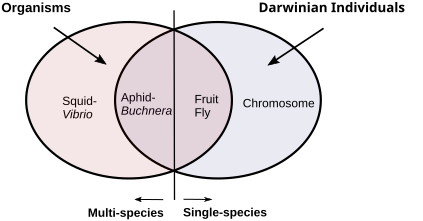
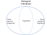
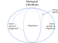
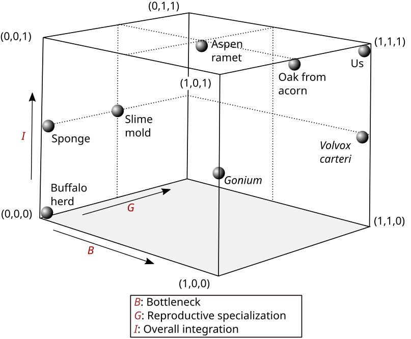
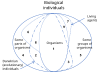
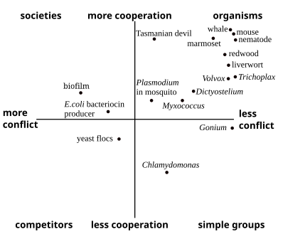
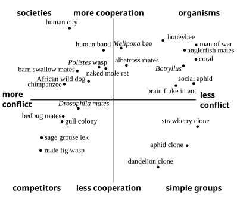

# Biological Individuals
**First published Thu Aug 9, 2007; substantive revision Wed Jan 17, 2024**

*Wilson, Robert A., Barker, Matthew J.*

Biological individuals are an important feature of the world we live in. To better understand this we can start with a focal question: *what are biological individuals?* As simple as that sounds, it quickly leads to puzzling but illuminating complexities and variations in the biological world. To address these, it helps to articulate the larger conceptual space surrounding the focal question. A distinction between evolutionary and physiological individuals is also useful in thinking about biological individuals, as is attention to the kinds of groups, such as superorganisms and species, that have sometimes been thought of as biological individuals. More fully understanding the conceptual space that biological individuals occupy also involves considering a range of other concepts, such as life, reproduction, and agency. There has been a focus in some recent discussions by both philosophers and biologists on how evolutionary individuals are created and regulated, as well as continuing work on the evolution of individuality.

## 1. The Focal Question: What are Biological Individuals?

The biological world contains an incredibly diverse variety of individuals. At the ground level of common sense, there are alligators, ants, beetles, marmots, moles, mushrooms, ostriches, roses, trees, and whales. At this ground level, biological individuals are physically-bounded, relatively well-integrated, autonomous agents, the ones listed as being amongst those that can be readily detected with the senses. Extending the reach of common sense through magnification allows flagella-propelled protists, tRNA molecules, prions, and bacteria of many kinds to be seen or inferred. At larger or collective scales, there are herds of zebras, sweeping and astonishing coral reefs, algae blooms, biofilms made up of many different species, and even fungus complexes several hectares in area and with masses greater than that of an elephant.

What we will call the *Focal Question*—what are biological individuals?—can be paraphrased in a number of ways:

- What constitutes being a biological individual?
- What makes something a biological individual?
- What is the nature of the category *biological individual*?
- What is the best explicative definition of the term “biological individual”?

In the rapidly expanding literature on biological individuals (cf. Hull 1992 with Guay & Pradeu 2016a, 2016b, and Lidgard & Nyhart 2017b)[^guay-2016a][^guay-2016b][^hull-1992][^lidgard-2017b][^pradeu-2016a][^pradeu-2016b], such questions take *biological individual* as a general category that may subsume several kinds of biological individual (e.g., evolutionary, developmental, genetic, metabolic; cf. Okasha forthcoming).

The psychologist Hermann Ebbinghaus’s famous quip that “psychology has a long past, but only a short history” (1908: 1, *Die Psychologie hat eine lange Vergangenheit, doch nur eine kurze Geschichte*) might well be adapted to remind us that answers to the Focal Question have a long past, one stretching back to at least the late eighteenth-century with the emergence of the life sciences. In their collection of essays *Biological Individuality*, the historians Scott Lidgard and Lynne Nyhart reviewed the literature of the past two hundred years to compile a list of twenty three criteria used to define or characterize “*individual* or its contained subset *organism*”, noting that while

> the terms are not equivalent, they have been used interchangeably in many publications, precluding a simple separation here. (2017a: 18)

Addressing the Focal Question thus calls for sensitivity to this tendency in the long past.

As Derek Skillings says, the “traditional target of accounts of biological individuality is the organism” (2016: 880), a tradition reinforced in some influential contemporary discussions that simply identify biological individuals with organisms (Queller & Strassmann 2009, Clarke 2013; see section 8 below)[^clarke-2013][^queller-2009]. The present review follows Lidgard and Nyhart and others (Dupré & O’Malley 2009; Nicholson 2014; Pradeu 2016a, 2016b)[^dupré-2009][^nicholson-2014][^pradeu-2016a][^pradeu-2016b] in taking *biological individual* to name a superordinate category whose nature and relation to the category *organism* is complex and worthy of exploration. Some commentators (e.g., Okasha forthcoming) may be skeptical that there is any such superordinate category, suspecting instead that several distinct categories, including organism, are typically lumped together in unclear and misleading ways as ‘biological individuals’. By contrast, here we view answers to the Focal Question as appropriate attempts to explore and clarify various relationships between distinct sorts of biological individuals.

Philosophers of biology typically understand biological individuals to be distinct from other kinds of entities in the biosciences, such as properties, processes, and events; however, the development of a process-focused ontology by John Dupré and colleagues has challenged this (Dupré 2012, Nicholson 2018, Nicholson & Dupré 2018, Meincke 2019; Kearney and Rieppel 2023; see Morgan 2022 for a critique)[^dupré-2012][^kearney-2023][^meincke-2019][^morgan-2022][^nicholson-2018][^nicholson-2018-2]. Biological individuals have three-dimensional spatial boundaries, endure for some period of time, are composed of physical matter, bear properties, and participate in processes and events. Biological *processes* (such as photosynthesis) and biological *events* (such as speciation) lack such a suite of features. Although philosophers have explored the question of what makes anything an individual of *any* kind (e.g., Strawson 1959; van Inwagen 1990; Chauvier 2016; French 2014, 2016; Lowe 2016; Wiggins 2016)[^chauvier-2016][^french-2014][^french-2016][^lowe-2016][^strawson-1959][^inwagen-1990][^wiggins-2016], such questions are bracketed off here in order to concentrate on *biological* individuals (cf. Love & Brigandt 2017)[^love-2017].

To provide a sense of the complexities that an answer to the Focal Question must address, consider, below, two examples that take us from the ground level of common sense with which this review began to the intimate interplay between empirical data gathered by biologists and the conceptual clarification provided by philosophers that is a hallmark of thinking about biological individuals. The philosopher Jack Wilson (1999: 23–25)[^wilson-1999] introduced the first of these examples into discussions of biological individuals, while the physiologist Scott Turner (2000: ch.2) introduced the second; both were then drawn upon in an early, sustained discussion of the nature of organisms that takes up some of the complexities raised by such examples—a discussion that pre-dates the consolidation of the contemporary literature around the term “biological individuals” (R.A. Wilson 2005: ch.3–4)[^wilson-2005].

## 2. Some Complexities: A Humungous Fungus and Coral Reefs

In the early 1990s, a team of biologists reported in the journal *Nature* that they had found high levels of genetic identity in samples of a species of fungus (*Armillaris bulbosa*), which had taken over a large geographic region in Michigan’s Upper Peninsula. They used this data to make a case for viewing these samples as constituting parts of one gigantic biological individual with an estimated biomass of more than ten tons and an estimated age exceeding 1500 years. They concluded that “members of the fungal kingdom should now be recognized as among the oldest and largest organisms on earth” (Smith, Bruhn, & Anderson 1992: 431)[^smith-1992]. Some scientists have questioned whether this final claim about the organismal status of the humungous fungus is warranted, and some have argued it is mistaken to say the gigantic fungus constitutes a single biological individual. Since then, other scientists have recognized even larger funguses as biological individuals (Schmitt & Tatum 2008)[^schmitt-2008].

How does one judge such claims and disputes? Minimally, more empirical information about the example is needed. Is the fungus a continuous biological structure? Does it have a determinate growth pattern? Can it reproduce? But this empirical information alone doesn’t settle the matter. One must also draw on antecedent concepts of organism and biological individual. The empirical information, in turn, also allows one to fine-tune, amend, or challenge those antecedent concepts, better so than would common sense reflection alone. For example, if the humungous fungus is not an organism but some other sort of biological individual, which empirical considerations motivate this distinction?

Consider a more elaborately described example (Turner 2000: ch.2; see also Skillings 2016: 877–879)[^skillings-2016][^turner-2000]. Coral reefs are spectacular and beautiful parts of the living world, despite rapidly becoming a thing of the past due to the climate changes associated with global warming. At least at the ground level of common sense, they are often thought of as consisting of two chief components. The first are accretions of calcite deposits. The second are the small animals, polyps, which produce and grow on the deposits. (Coral polyps belong to the same Linnaean class as sea anemones, and to the same Linnaean phylum as jellyfish.) The polyps are indisputably biological individuals. But further, conservation biologists also often describe the coral reefs themselves, consisting of the polyps and the deposits considered together, as *living things* that can grow and die.

The reefs are at least biological individuals, typically being thought of as ecosystems; formal methods already exist for modeling them as such (e.g., Huneman 2014)[^huneman-2014]. And taking seriously their life, growth and death leads to the question of whether they too might be organisms: to a first approximation, metabolically-circumscribed entities that are relatively well-integrated and function as a whole. The dependence relations between the reefs and the polyps does not rule this out, since such dependence is common in organisms. Human beings depend on internal bacteria that outnumber our own cells by about ten to one, and yet they are organisms (Ackerman 2012)[^ackerman-2012]. Similarly, the polyps that reefs depend on are themselves dependent on single-celled algae, commonly referred to as *zooxanthellae*, for the glucose that provides the energy necessary for polyp respiration, which in turn drives the process of calcification. Moreover, it is the zooxanthellae that supply the pigments that give living corals their spectacular colors; when zooxanthellae are absent or diminished, this signals a problem for the long-term survival of a coral reef. Neither are the zooxanthellae free of dependence. By infecting the polyps they gain a feeding den crucial to their survival.

Further reflection along these lines may suggest that an integrated causal network of dependence relations is a mark of being an organism or biological individual; “causal integration, cohesion, collaboration, or agency of parts” is the criterion on Lidgard and Nyhart’s (2017a) list of criteria that they found most often cited in the literature they reviewed. If that were so, then the coral reef may come to be viewed as a better exemplar of either than are the polyps and zooxanthellae, as the reef enjoys a kind or degree of complex, functional integrity that polyps and zooxanthellae arguably lack when considered singly (see also Combes 2001)[^combes-2001]. Alternatively, perhaps the reef should be thought of as some other kind of biological individual, such as an ecosystem, that contains several distinct organisms, the polyps and the zooxanthellae, as proper parts.

Again, knowing what to say about the striking claim that the polyp-zooxanthellae-calcite deposit complex is an organism turns in part on the empirical facts, but on more than just those. Polyps, zooxanthellae and whole reef complexes do not wear placards that state which is an example of an organism, and whether all three should be viewed as biological individuals of some kind or other (and which kind). The interplay between our conceptions and empirical complexities both allows those conceptions to be unpacked and informs how they might be regimented to better capture nuances of the biological world inaccessible to commonsense reflection alone.

This interplay has recently involved philosophers and biologists attending more squarely to the *microbial* world (O’Malley, Simpson, & Roger 2013; O’Malley 2014)[^o’malley-2014][^o’malley-2013], recognizing the various tight integrative and collaborative relations between what prima facie are distinct biological individuals (Dupré & O’Malley 2009, Ereshefsky & Pedroso 2015)[^dupré-2009][^ereshefsky-2015][^o’malley-2015], and trying to make sense of the diversity one finds in the processes of reproduction, metabolism, and development (Godfrey-Smith 2016b, Griesemer 2016)[^godfrey-smith-2016b][^griesemer-2016]. The next section provides an introductory survey of this interplay via discussion of three subsidiary questions.

## 3. Conceptual Space, Distinctions, and Beyond Organisms

Responses to the Focal Question have advanced discussion of at least three closely related subsidiary questions:

1. *Beyond Organisms:* In what ways does the traditional focus on organisms hinder us in thinking about biological individuals?
2. *Distinctions:* What are the most useful distinctions between various kinds of biological individuals?
3. *Conceptual Space:* What is the most informative way to articulate the conceptual space surrounding the concept of biological individuals?

The first of these questions anchors our discussion in the short history of thinking about biological individuals while acknowledging the long past of the Focal Question.

### 3.1 Beyond Organisms: Microbialism, Eliminativism, and Holobionts

Scientists themselves—following common sense—have been drawn first and foremost to organisms when beginning their theorizing about biological individuals. For example, consider John Maynard Smith and Eörs Szathmáry’s *The Major Transitions of Life* (1995), a wide-ranging book on the origins and evolution of life that has stimulated much work on the evolution of individuality (Buss 1987)[^buss-1987] and the Darwinian dynamics (Michod 1999)[^michod-1999] that governs emerging kinds of biological entities (see Herron 2021 for recent discussion and section 9 below)[^herron-2021]. The book opens with a simple point about the living world and a characterization of the book’s chief theme:

> Living organisms are highly complex, and are composed of parts that function to ensure the survival and reproduction of the whole. This book is about how and why this complexity has increased in the course of evolution. The increase has been neither universal nor inevitable. (Maynard Smith & Szathmáry 1995: 3)[^maynard-1995]

Here organisms or biological individuals are viewed as exemplars of complex living things composed of many parts, and their complexity is taken to have increased—albeit unevenly and contingently—through evolution by natural selection.

Likewise, an early collection of essays on evolutionary developmental biology (“evo-devo”) by Gerd Müller and Stuart Newman (2003) focuses on how *organismal form* originated and on the evolutionary, developmental, and ecological processes shaping it over generations. The essays in that volume concentrate on the relationships between basic body plans of organisms over phylogenetic time, rather than the evolution of individuality as such, and do not take up The Focal Question about biological individuals at all. But like that of Maynard Smith and Szathmáry, the project of exploring these relationships is naturally expressed in terms of the concept of an organism.

This should occasion no surprise, since, as section 1 indicated, organisms have historically been regarded as prominent examples of biological individuals and *organism* and *biological individual* have often been used interchangeably. But the short quotation drawn from Maynard Smith and Szathmáry also helps to explain why simply equating biological individuals with organisms would be a mistake. The parts that compose organisms in all their complexity are, often enough, themselves biological individuals. Even if some of those parts are also organisms (e.g., the microbes that live on and in macrobes), many are not. Precisely the same is true of the populations and lineages that individual organisms in turn constitute. These may occasionally be organisms (e.g., eusocial insect colonies as “superorganisms”), but typically populations and lineages are biological individuals that are *not* organisms. If either this internal compositional complexity to organisms or their formation into populations and lineages are *necessary* features of organisms (which many philosophers and biologists at least tend to think they are; see Lidgard & Nyhart 2017a: 18–23)[^lidgard-2017a], then this would prove a stronger conclusion: given that there are organisms, there *must be* some biological individuals that are not organisms.

So one way in which the traditional focus on organisms can hinder us in thinking about biological individuals is if, by equating the two, there is too little attention focused on biological individuals that are not organisms. But hindrance here could take a different form, as some have argued. One might think that a focus on organisms, particularly those identified at the ground level of common sense, commits not just this kind of error of omission, but also proves *positively misleading* about what biological individuals are. Consider two positions that challenge the privileging of organisms in discussions of The Focal Question:

- *Microbialism*: Understanding the living world requires focusing on *collaborations* between macrobes and a variety of microbes (e.g., viruses, prions, plasmids, symbionts), taking seriously the idea that the biological individuals identified at the ground level of common sense constitute a small part of that world (Dupré & O’Malley 2007, 2009)[^dupré-2007][^dupré-2009].
- *Eliminativism:* Far from being *paradigmatic* biological individuals, organisms may be marginal or unusual special cases of biological individuals and should be eliminated from our ontology (Haber 2013, Okasha 2011)[^haber-2013][^okasha-2011].

Microbialism has been part and parcel of Dupré and O’Malley’s plaint against the *macrobist bias* in the philosophy of biology and the positive case they have made for the significance of the microbial world for reconceptualizing biological individuals (O’Malley 2014, 2015; O’Malley, Simpson, & Roger 2013; Dupré 2010)[^dupré-2010][^o’malley-2014][^o’malley-2015][^o’malley-2013]. One direction that this has been taken is Dupré’s (2012)[^dupré-2012] *promiscuous individualism* (for the relationship between this view and processualism, see Morgan 2022: 616–617)[^morgan-2022].

Promiscuous individualism is not simply the view that there are many legitimate ways to classify the world into biological individuals. It is also the corresponding ontological view that such legitimation is provided by there being multiple biological individuals there to classify. To illustrate this view, consider lichens, which are typically regarded as what have been called *corporate organisms* (R.A. Wilson 2005: 80–84)[^wilson-2005], in this case made up of a fungus and either a cyanobacterium or some other photosynthesizing agent, such as green algae. Challenging the view that there is just one biological individual (the lichen) or two (the fungus and the cyanobacterium), an advocate of promiscuous individualism can readily make the case that there are three biological individuals (the lichen, the fungus, and the cyanobacterium), pointing to the different purposes and goals one might have in opting for any of the numerical counts here.

Given that it is a population of millions of cyanobacteria inhabiting any given fungus that jointly compose a lichen, and that there are multiple ways to draw the boundary between individual fungi of a given species (Molter 2017; cf. Rayner 1997)[^molter-2017][^rayner-1997], note how rampant promiscuity can run here. Dupré himself holds that populations, including multispecies populations such as those found in microbial biofilms, can themselves be both biological individuals and organisms (2012: 89, 175–176, 194, 203). He also says that “[w]hether a group of microbes is a closely connected ecological community or an organism may be a matter of biological judgment” (2012: 153). Promiscuous individualism thus implies that there are many, many different numbers of individuals present in this paradigm case. It seems even to suggest that whether there are *any* biological individuals at all is “a matter of biological judgment”, rather than something determined by the biological facts.

The emphasis on collaborations between living things in Microbialism can undermine the focus on organisms without entering (at least directly) into these deep metaphysical waters. That emphasis can also motivate Eliminativism. One way it can do so is by embracing the idea that it is not organisms but *holobionts* that are really paradigmatic biological individuals. Introduced by Lynn Margulis (1990) to refer to cases where there was intergenerational, inherited symbiosis, such as that of the eukaryotic cell and of *Buchnera*-aphid symbiosis), “holobiont” made its way into discussions of coral reefs and a wider range of examples early in the twenty-first century by loosening Margulis’s concept (see Suárez 2020 for discussion)[^suárez-2020][^suárez-2020-2]. In the literature on biological individuals, a holobiont is, at least roughly, “the multicellular eukaryote plus its colonies of symbionts” (Gilbert & Tauber 2016: 842)[^gilbert-2016].

This concept has been attractive to some scientists (e.g., Zilber-Rosenberg & Rosenberg 2008; Bordenstein & Theis 2015; Bosch & Miller 2016)[^bordenstein-2015][^bosch-2016][^zilber-rosenberg-2008] but critiqued by others (Moran and Sloan 2015 and Douglas & Werren 2016)[^douglas-2016][^moran-2015] while also sparking ongoing philosophical work (Theis et al. 2016, Booth 2014, Doolittle & Booth 2017)[^booth-2014][^doolittle-2017][^doolittle-2017-2][^theis-2016]. For example, a special issue of the journal *Biology & Philosophy* on biological individuality (volume 31, issue 6) contains papers that focus on the significance of the holobiont for immunology (Chiu & Eberl 2016; Gilbert & Tauber 2016)[^chiu-2016][^gilbert-2016] and for the evolution of individuality and its major transitions (Queller & Strassmann 2016, Skillings 2016; cf. Bourrat & Griffiths 2018)[^bourrat-2018][^queller-2016][^skillings-2016]. In an interesting recent paper, Lloyd and Wade (2019) argue that the critics of the holobiont concept typically rely on gene-centric and conflict-focused research on multispecies interactions, suggesting that one can pursue a different set of research questions within *community* genetics that pave the way for an articulation of the co-evolutionary roles for holobionts. As part of their case, they introduce the distinction between *euholobionts* – “genuinely genetically integrated, coadapted communities of obligately mutualistic organisms” which are evolutionary and physiological individuals – and *demiholobionts*, such as the squid-vibrio complex, that are forms of mutualism with asymmetrical fitness and so adaptational relationships (Lloyd and Wade 2019: 152)[^lloyd-2019]. They argue that by viewing these cases as “lying on a continuum of fitness interactions and partner fidelities” (p.166), together with their advertised multilevel research strategy, we arrive at a model of mutualism and holobionts that better matches reality.

Like the concept of an organism that it putatively supplements or supplants, that of the holobiont encompasses a huge diversity of entities. These include macro-organisms and the microbial endosymbionts living within their cells (such as *Chlamydia* and other obligate parasites); those that live beyond their cells but in close symbiotic relations (such as cyanobacteria); and the multispecies microbiota that inhabit the human intestine (Booth 2014)[^booth-2014]. There are challenges in how to delineate individual holobionts that, as we will see in the next section, may be met by embracing particular physiological criteria for individuation (Pradeu 2012)[^pradeu-2012]. Yet those challenges have suggested to some that the take-away lesson from reflection on holobionts is that emphasis should be placed not on another kind of individual, a holobiont, but instead on the process of *holobiosis* (Doolittle & Booth 2017)[^doolittle-2017][^doolittle-2017-2]. Others have recently defended a cluster of contrasting views (Suárez and Stencel 2020; Suárez 2020)[^suárez-2020][^suárez-2020-2]. One is that biological individuals can be thought of as ecosystems, an idea that draws upon a notion of “weak individuals” defined in terms of levels of interaction (Huneman 2021)[^huneman-2021]; another is that holobionts are both biological individuals *and* ecological communities or ecosystems, which draws on the proposal that biological individuality needs to be given a *part-dependent* characterization that recognizes the perspective-dependence of questions about the ontology of holobionts (Suárez and Stencel 2020)[^suárez-2020][^suárez-2020-2]. And finally there is the idea that the hologenome should be conceptualized in terms of stability of traits, rather than fitness alignment (Suárez 2020)[^suárez-2020][^suárez-2020-2]. These ideas enrich discussions of the concept of holobionts, and whether that concept will live up to its still-early promise of revolutionizing thinking about biological individuals is likely to remain a topic of lively discussion in the immediate future.

### 3.2 Distinctions: The Evolutionary and the Physiological

Consider now our second subsidiary question, Distinctions: what are the most useful distinctions between the various kinds of biological individuals that exist? The most commonly recognized distinction here is that between *evolutionary* and *physiological* (or *metabolic*) individuals (Pradeu 2016a, 2016b)[^pradeu-2016a][^pradeu-2016b], with a corresponding discussion of the roles of evolution and metabolism in thinking about biological individuals (see Clarke 2020 and O’Malley 2020 for opposing views)[^clarke-2020][^o’malley-2020].

Prominent in contemporary thinking about evolutionary individuals is the work of Peter Godfrey-Smith on what he calls *Darwinian individuals*. On the view of evolution and natural selection he defends in *Darwinian Populations and Natural Selection* (2009), what evolves are “Darwinian populations”, collections of things in which at least three conditions hold: there is *variation* in the traits had by things in the collection, those traits are *heritable* within the collection, and some variants of the traits confer reproductive advantage on the things that bear them. In such a Darwinian population, the members are Darwinian individuals, which are both bearers and active reproducers of heritable traits (see Godfrey-Smith 2013: 19–20)[^godfrey-smith-2013].

Godfrey-Smith’s approach to evolutionary individuals is intended to contrast with the earlier replicator-based views developed by Richard Dawkins and others. Replicator views have been central to discussions of the levels and units of selection (Godfrey-Smith 2015; Sober & Wilson 1994, 1998; Okasha 2006)[^godfrey-smith-2015][^okasha-2006][^sober-1994][^sober-1998], and derivatively so to views of biological individuals. Here genes are paradigmatic replicators, being housed in *interactors*, such as organisms, and it is the survival of these replicators that matters in evolution. The replicator framework emphasizes the importance for natural selection of high-fidelity copying across generations. By contrast, what matters for natural selection in Godfrey-Smith’s view is the establishment of parent-offspring lineages that feature heritability, as well as the variety of forms that reproduction can take in the establishment and stabilization of those lineages.

This shift from replication to the process of reproduction in accounts of biological individuals has a longer history, particularly amongst those sensitive to the relationships between evolution and development. For example, James Griesemer (2000)[^griesemer-2000] has argued that biological reproduction involves fission and fusion requiring what he calls *progeneration*, a process that creates new entities through *material overlap*, and that that process is a crucial feature of how living agents evolve. Section 6 takes up this issue in more detail in discussing reproduction, life cycles, and lineages.

Whichever way evolutionary individuals are conceptualized, they do not exhaust the realm of biological individuals any more than do organisms. The general point here is that although evolution is foundational when thinking about interactors and Darwinian individuals, it does not play this role for all kinds of biological individual, as Godfrey-Smith himself recognizes. Indeed, Godfrey-Smith (2013)[^godfrey-smith-2013] strikingly (and controversially) proposes that even some *organisms*, understood from a metabolic point of view, are not Darwinian individuals at all. These are a subset of corporate organisms, multi-species organisms formed through symbiotic relationships between members of different species. Here Godfrey-Smith posits the Hawaiian bobtail squid (*Euprymna scolopes)* and the Vibrio bacteria they contain as an example (see also Nyholm & McFall-Ngai 2004; Bouchard 2010)[^bouchard-2010][^nyholm-2004]. Since the squid-Vibrio corporate organism does not itself form the right kinds of parent-offspring lineages it is not a Darwinian individual, differing in this respect with other often-discussed corporate organisms, such as aphid-*Buchnera* complexes (Andersson 2000)[^andersson-2000]:

\*Figure 1:\* Godfrey-Smith’s Different Biological Individuals. (Copied from Figure 4 of Godfrey-Smith 2013.)[^godfrey-smith-2013] [An extended description of figure 1 is in the supplement.]

Whatever one says about the intricacies of such examples, in addition to individuals delineated by evolutionary criteria there are also what Thomas Pradeu calls *physiological* individuals. These are biological individuals individuated by appeal to criteria such as having a metabolism and being governed by internal control mechanisms of various kinds. For Pradeu, each physiological individual is “a functionally integrated and cohesive metabolic whole, made of interdependent and interconnected parts” (Pradeu 2016b: 807; see also Godfrey-Smith 2009: 71)[^godfrey-smith-2009][^pradeu-2016b].

As Pradeu notes (2016b: 799–802), there is a long tradition in the physiological sciences of addressing the Focal Question by asking what it is that makes for *unity of functioning* in biological individuals:

> to ask how distinct and heterogeneous components interact and constitute a cohesive whole, functioning collectively as a regulated unit that persists through time. (2016b: 800)

Although there is typically a nod paid to physiological individuals in early influential discussions of biological individuals in the short history of the topic (e.g., Sober 1991, Hull 1992, Dawkins 1989: ch.13)[^dawkins-1989][^hull-1992][^sober-1991], the bulk of this literature has focused until very recently on evolutionary individuals. Pradeu’s reminder of the long past of the Focal Question, and the prominence of physiological individuals in it, is a welcome redress to the resulting skew of attention.

In addition to this general point, Pradeu has also defended the view that an organism is a particular kind of physiological individual, being

> a functionally integrated whole composed of heterogeneous components that are locally interconnected by strong biochemical interactions and controlled by constant systemic immune interactions of a constant average intensity. (Pradeu 2012: 244)[^pradeu-2012]

Here Pradeu builds on a particular view of immunology developed in his *The Limits of the Self* that moves beyond the theory associated with Frank Burnet, the self-nonself theory. In its place, Pradeu offers a general account of immunogenicity that applies across a wide range of phlya, ignoring the exogenous or endogenous origin of antigens in favor of a criterion that emphasizes immune-tolerance and acceptance.

Pradeu takes the boundary established and maintained by the immune system as *the* boundary of the organism. On Pradeu’s view, organisms are inherently heterogeneous, given the collaborative nature of the microbial and macrobial worlds articulated in Microbialism. To put it slightly differently, the true organisms delineated by Pradeu’s immunity criterion are holobionts constituted by a macrobial organism and all and only those microbes at least tolerated by its immune system. This criterion provides a way to individuate organisms *as holobionts*, and the resulting view constitutes one way to constructively respond to the challenges of Microbialism and Eliminativism. Whether holobionts are best thought of as organisms or evolutionary individuals at all (Skillings 2016)[^skillings-2016], or whether Pradeu’s view in particular can resolve the putative “tension in seeing symbionts as both organisms themselves and also parts of larger organisms” (Godfrey-Smith 2016c: 782)[^godfrey-smith-2016c], remain live issues.

So minimally there are evolutionary individuals and there are physiological individuals, and organisms are typically thought of as exemplars of (but not strictly identical to) both. Godfrey-Smith’s articulation of evolutionary individuals as Darwinian individuals has structured much recent and ongoing discussion, and Pradeu’s emphasis on physiological individuals and his appeal to immunology as a source for ideas about organisms and biological individuals more generally has garnered recent attention. These responses to Distinctions also facilitate rich responses to our remaining subsidiary question, Conceptual Space: What is the most informative way to articulate the conceptual space surrounding the concept of biological individuals?

### 3.3 Conceptual Space and Pluralism

Recognizing the distinction between evolutionary and physiological individuals commits one to a minimal form of pluralism about what populates that conceptual space. But there are also more radical forms that pluralism about biological individuals has taken in the literature. Section 3.1 indicated that the emphasis on the collaborative nature of the interactions between biological individuals in Microbialism motivates Dupré’s promiscuous individualism, a position that invites a very liberal form of pluralism that makes biological individuality seem, at least partly, a function of our epistemic, practical, and other proclivities, rather than of just the structure of the biological world itself.

Here Dupré can be understood as following the general intuition that if some kind K seems too diverse to characterize, it should be split into diverse sub-kinds, with each of those characterized. In early philosophical work (J. Wilson 1999, 2000)[^wilson-1999][^wilson-2000] also drew on this intuition, where *K* = biological individual, moving beyond that broad concept to characterize *genetic*, *functional*, *developmental, and evolutionary* individuals, a position more recently dubbed “kind pluralism” and defended by appeal to explanatory power and projectability (DiFrisco 2019)[^difrisco-2019]. Famously, the botanist John Harper invoked pluralism, where *K* = plant, by introducing the more particular kinds *ramet* and *genet* to replace talk of individuals. A ramet is what might be readily identified as an individual plant; a genet is a collection of ramets that propagate, as is often the case, through the clonal growth of a particular ramet (Harper 1977)[^harper-1977]. How many plants there are, in many cases, depends on whether ramets or genets are meant. For example, while each of the trees in an aspen grove that forms clonally is a ramet, collectively they typically form a single genet. A pluralist might prefer a description cast in terms of ramets and genets over any attempt to answer the question of how many plants or individuals, per se, there are in this case.

Pluralism about biological individuals has also been motivated by the general idea that particular epistemic *practices*, rather than or additional to high-level biological theory, should drive one’s ontological commitments (Kovaka 2015, Chen 2016, Love 2018; for interplay of theory and experimental practice in this connection, see Fagan 2016)[^chen-2016][^fagan-2016][^kovaka-2015][^love-2018]. Just as practices of the individuation of species might vary with the differential practices of (say) ciliatologists and ornithologists, so too might the very individuative criteria for being a (relevant) biological individual differ according to the varying epistemic practices across the biological sciences. How radical the resulting form of pluralism is will depend in part on how fine-grained one’s view of the relevant practices is and the expanse of the range of those practices. For example, are all of the practices in developmental biology clustered, or are distinctions to be drawn between those relevant to the experimental investigation of growth and those relevant to homology? Are we to include among biological individuals, as Roberta Millstein (2018)[^millstein-2018] does when discussing the *land community*, very large systems studied in ecology, which are made up of diverse organisms, other living things, and non-living things such as soil (see also Eliot 2011)[^eliot-2011]? Answers to such questions will influence whether the plausibility of what Alan Love calls *strong individuality pluralism*, the view that “for a given situation, individuality can be modeled correctly in more than one way” (2018: 187). Kaiser and Trappes (2021) have recently argued from this kind of “practice turn” perspective, to motivate questions about uniqueness and temporality that further broaden the problem agenda of appeals to biological individuality.

## 4. Structuring Conceptual Space Beyond Pluralism

So far some of the pluralistic directions that discussions of Distinctions and Conceptual Space have taken in the literature have been outlined, leading to a conceptual landscape populated by a plethora of adjectivally-modified kinds of individuals: evolutionary, physiological, developmental, functional, genetic, etc.. Although simply equating biological individuals with organisms would be a mistake, some biologists (e.g., Pepper & Herron 2008; cf. Jagers op Akkerhuis 2010)[^jagers-2010][^pepper-2008] have explored the idea that a more nuanced appeal to organisms can provide some informative structure to this landscape. Noting that

> amongst biologists, the question of what constitutes an individual is usually identical with the question of what constitutes an individual organism. (Pepper & Herron 2008: 622)[^pepper-2008]

Pepper and Herron pose the question of whether any given biological individual is an organism, a part of an organism, or a group of organisms. Consider then a framework that holds that biological individuals include exactly:

- *organisms* (such as wasps and whales)
- some *parts* of organisms (such as placentas and plasmids) and
- some *groups* of organisms (such as zebra lineages and colonies of bacteria).

Figure 2 depicts this framework visually.

\*Figure 2:\* A Framework for Structuring Conceptual Space. [An extended description of figure 2 is in the supplement.]

These three sub-categories of biological individual need not be mutually exclusive when considering any particular individual. For example, a given bacterium, such as an individual *Buchnera* bacterium, may both be an organism itself and be part of a corporate organism, such as the human whose gut it is integral to (Andersson 2000)[^andersson-2000]. Likewise, some groups, such as the colonies of eusocial insects sometimes called “superorganisms”, or highly integrated multispecies communities, may be *true* organisms. This kind of view may also capture what truth lies behind proposals to extend the term *organism* both to some parts and some groups of organisms (e.g., Queller 1997; Okasha 2011)[^okasha-2011][^queller-1997]: parts of organisms (such as symbiotic gut bacteria), as well as groups of organisms (such as colonies of ants or bees), are really organisms as well.

Directly relevant to the Focal Question is that this framework invites a more systematic treatment of the relationship between each of the primary kinds of biological individuals—evolutionary and physiological individuals—and other key features typically appealed to in characterizing them, including growth, reproduction, lineages, cohesion, metabolism, and control. Sections 6 and 7 will elaborate the initial visual summary offered by Figure 2 in ways that further fill out the conceptual space occupied by biological individuals. But first Section 5 attends to the right-hand side of Figure 2 by providing a brief overview of the idea of groups as biological individuals.

## 5. Groups as Evolutionary Individuals: Superorganisms, Trait Groups, Species, Clades

As the discussion of evolutionary individuals in section 3 indicated, responses to the question of whether natural selection has created groups that are themselves biological individuals has been important to the history of the Focal Question. Groups here might range from temporary dyads of individuals, such as two crickets sharing a ride on a leaf (Sober & Wilson 1998)[^sober-1998], through to higher-level taxonomic groups whose members are largely separated in space and time, such as planktotrophic mollusks (Jablonski 1986, 1987)[^jablonski-1986][^jablonski-1987]. One fundamental distinction that emerged with the revival of group selection, largely through the work of David Sloan Wilson (1975, 1977, 1980, 1983)[^wilson-1975][^wilson-1977][^wilson-1980][^wilson-1983] and Elliott Sober (D.S. Wilson & Sober 1989; Sober & Wilson 1994, 1998)[^sober-1994][^sober-1998][^wilson-1989], is between two sorts of groups: superorganisms and trait groups.

The term *superorganism* was introduced by the entomologist William Morton Wheeler in his 1920 essay “Termitodoxa, or Biology and Society”, although he had talked of ant colonies as organisms as early as his 1911 essay “The Ant-Colony as an Organism”. Paradigm examples of superorganisms are colonies of social insects, e.g., *Hymenoptera* such as ants, wasps, and bees, together with the taxonomically distinct termites, which are typically viewed as a special kind of biological individual arising from the specific genetics and reproductive division of labor in those colonies.

*Trait group* was introduced by D.S. Wilson, by contrast, specifically to name a type of group that he thought was pervasive in nature, one that could be a unit of selection just as individual organisms were. The intuitive idea behind a trait group is that populations can feature evolutionarily relevant structure wherein organisms belonging to one part of the population are subject to causal influences on fitness that do not extend to the population as a whole. A population of such *structured demes* would then function as a metapopulation, with natural selection operating between the trait groups that make up that metapopulation. The individuals in a trait group could thus be seen as evolutionary individuals, being the agents for evolutionary change over time.

A common two-pronged response to this distinction (e.g., Sterelny 1996)[^sterelny-1996] has been to concede the reality of superorganismic group selection (but underscore its rarity) and argue that instances of trait group selection are better described as cases of genic or individual selection *relativized to a particular environment, where part of that environment is composed of other individual organisms* (see also Okasha 2006, 2018)[^okasha-2006][^okasha-2018]. In effect, this is to allow for superorganisms as a special kind of biological individual, but to reject a more expansive conception of evolutionary individual at the group level. On this view, eusocial insects may be evolutionary (and even physiological) individuals, but trait groups are neither.

A distinct pathway taken by appeals to group selection has focused on species and clade selection, particularly in work by paleobiologists and paleontologists (Grantham 1995; see also Doolittle 2017)[^doolittle-2017][^doolittle-2017-2][^grantham-1995]. Clades are monophyletic groups of organisms or species, groups defined by an ancestor and all and only its descendants. Steven Stanley and Stephen Jay Gould have been two of the most prominent defenders of the idea that there are large-scale patterns of evolutionary change that are due to species or clade selection, and both have done so in part by explicitly developing an extended analogy between individual organisms and species (e.g., Stanley 1979: 189; Gould 2002: 703–744)[^gould-2002][^stanley-1979]. Amongst putative examples of clade selection are the evolution of planktotrophic mollusks in the late Cretaceous, being selected for greater geographic dispersal and so longevity (Jablonski 1986, 1987)[^jablonski-1986][^jablonski-1987], the evolution of larger body size in males, selected via population density and geographic range (Brown & Maurer 1987, 1989)[^brown-1987][^brown-1989], and the evolution of flowering plants, selected via vector-mediated pollen dispersal (Stanley 1981: 90–91)[^stanley-1981].

There is a similar caution in discussions of species or clades as evolutionary or physiological individuals as there is with trait groups. One of the chief threads to the debate over species and clade selection also parallels that over trait group selection: are species or clades themselves really the agents of selection, the units that are being selected, or do they simply tag along for the ride, with selection operating exclusively on organisms and genes? Elisabeth Vrba (1984, 1989; Vrba & Gould 1986)[^vrba-1986], for example, has distinguished between species *sorting* and species *selection*, arguing that while a sorting of species may be the product of evolution by natural selection (see Barker & Wilson 2010)[^barker-2010][^barker-2010-2], this outcome is typically brought about not by species selection but by individual selection. On this view, species or clades may be a *product* of natural selection, and so in some sense evolutionary individuals, but they are not themselves agents in the *process* of natural selection. Rather, they are epiphenomena of that process, lacking the kind of agency that full-blown evolutionary individuals have.

The much-discussed claim that species are individuals (Ghiselin 1974; Hull 1976, 1978)[^ghiselin-1974][^hull-1976][^hull-1978], which developed as part of a response to the perceived failure of essentialism about species (Sober 1980; Okasha 2002; Barker 2013)[^barker-2013][^okasha-2002][^sober-1980], might be viewed in this same light. The species-as-individuals thesis reflects the way in which species were treated within systematics and evolutionary biology not as kinds but instead as spatiotemporally restricted *lineages*, with individual organisms as their physical parts (Ereshefsky 1992a; R.A. Wilson 1999b)[^ereshefsky-1992a][^wilson-1999b]. The species-as-individuals thesis was originally presented and seen as making a radical break with previous views of the ontological status of species, as it implied that biologists and philosophers alike had misidentified the basic ontological category to which species belonged. But over time, both as its proponents have clarified what the thesis implied (e.g., gravitating to talk of historical entities rather than individuals) and as more sophisticated options for defenders of the view that species are kinds were developed (e.g., Boyd 1999, Griffiths 1999, R.A. Wilson 1999a)[^boyd-1999][^griffiths-1999][^wilson-1999a], this radical edge to the thesis has diminished. A now widely accepted insight clarified in the process is that in the case of many species, organisms belong to them (as parts or members) by virtue of their interactions and their extrinsic rather than intrinsic properties (Barker 2010; cf. Devitt 2008)[^barker-2010][^barker-2010-2][^devitt-2008]. Whether this combats (or instead exemplifies) what the historian James Elwick has recently called “resilient essentialisms” (Elwick 2017; cf. Hull 1965)[^elwick-2017][^hull-1965] remains contentious.

Finally here, Mariscal and Doolittle (2020) have recently suggested that all of life, i.e., the Last Universal Common Ancestor and all of its descendants, is a biological individual in the sense in which Ghiselin and Hull argued that species were (see Reydon 2021 for some scepticism about both claims)[^reydon-2021]. They take life to be “a monophyletic clade that originated with a last universal common ancestor, and includes all of its descendants” (2020: abstract). Complementing this is their adaption of Ereshefsky’s (1992b)[^ereshefsky-1992b] eliminative pluralism about living things as a kind, arguing for eliminativism about living things as a natural kind (cf. Barker 2019)[^barker-2019].

## 6. From Physiological to Evolutionary Individuals: Life, Reproduction, and Agency

Section 3 indicated that John Maynard Smith and Eörs Szathmáry drew explicitly on the concept of *living organisms* in characterizing the chief theme of their influential work on the major transitions in the history of life. However, reflection on organisms as living agents generally has been backgrounded in work concentrating on evolutionary individuals. This is perhaps for the obvious reason that many evolutionary individuals—including genes, lineages, and clades—are not themselves living things. Yet physiological individuals are paradigms of living agents and a more complete sense of the conceptual space that biological individuals occupy calls for some discussion of life, including the roles that an appeal to life cycles and agency play in characterizing physiological individuals.

### 6.1 Physiological Individuals as Living Agents

One approach here would be to attempt to define life, or living agent, or to provide necessary and sufficient conditions for these (Maynard Smith & Szathmáry 1995: 17–18; Cleland 2012)[^cleland-2012][^maynard-1995]. A recurrent property referenced in such definitions is that of *having a metabolism*, which involves both an *anabolic* dimension in the breakdown of chemical molecules to produce energy and a *catabolic* dimension in intracellular synthesis of those compounds (Pradeu 2016b: 801)[^pradeu-2016b]. But there are other properties that living agents have, some presupposed by that of having a metabolism, others existing independently. These include what might be thought of as *structural* properties—such as having heterogeneous and specialized parts, including a variety of internal mechanisms, and containing diverse organic molecules, including nucleic acids and proteins—as well as *functional* or *dispositional* properties—such as the capacity for growth or development, reproduction, and self-repair.

Cells, organs, and perhaps bodily systems, such as the respiratory system or the digestive system, are physiological individuals that have most if not all of these properties that characterize living agents. As physiological individuals, organisms also share these properties, but are distinguished by one or more further characteristics, such as possessing an immune system (as Pradeu emphasizes) or having a *life cycle*, one that is typically demarcated through reproduction, which is the focus of section 6.2 below.

Conceiving of physiological individuals as living agents, and supposing that all organisms are living agents but that there may be both parts and groups of organisms that are not, allows us to extend the visual summary introduced in Figure 2. Figure 3 depicts organisms as living agents but also contains regions for organs such as hearts and other constituent parts of organisms as living agents, as well as groups that may be living agents but not organisms (e.g., perhaps a coral reef).

\*Figure 3:\* Living Things as Biological Individuals. [An extended description of figure 3 is in the supplement.]

### 6.2 Reproduction, Life Cycles, and Lineages

One feature of organismic, physiological individuals that partially distinguishes them amongst living things is that they have *life cycles* that allow them to form reproductive lineages of a certain kind. The importance of life cycles for evolutionary change has been recognized both in the replicator-based view of evolutionary individuals (Dawkins 1989: ch.13)[^dawkins-1989] and in reproductively-centered accounts of Darwinian individuals (Godfrey-Smith 2009, 2016a)[^godfrey-smith-2009][^godfrey-smith-2016a]. And the close relationship between being an individual organism and having a life cycle is widely accepted, being manifested in an extreme form by Griffiths and Gray’s (1994) identification of biological individuals with their life cycles within developmental systems theory.

Put most generally, a life cycle is an intergenerationally replicable series of events or stages through which a living thing passes (Bonner 1993)[^bonner-1993]. These events or stages constitute a *cycle* in that they begin and end with the same event, such as the formation of a fertilized egg in sexually reproducing individuals, or the creation of a fissioned cell in clonally reproducing individuals. *Development* is the global name for the processes that causally mediate between these events or stages in a life cycle, with *reproduction* marking the transition to the creation of a new individual, the offspring of one or more parents. Although Richard Dawkins’s suspicion

> that the essential, defining feature of an individual organism *is* that it is a unit that begins and ends with a single-celled bottleneck (1989: 264)

has proven hyperbolic, the more cautious view that the “two phenomena, bottlenecked life cycles and discrete organisms, go hand in hand” (1989: 264) expresses a view that has been widely endorsed.

It has long been recognized that some biological individuals, such as flukes, have life cycles that take them literally through one or more hosts, and that many insects undergo significant metamorphic changes in bodily form through their life cycle. But such sophistications to life cycles are only the tip of the iceberg here. While the stages themselves often form standard sequences within particular species, there can be tremendous variation across species and phyla in what a given individual’s life cycle consists in, as others have emphasized (Buss 1987)[^buss-1987], including in recent discussions of complex life cycles (Godfrey-Smith 2016b, 2016d; Griesemer 2016; Herron 2016; O’Malley 2016; cf. Gerber 2018)[^gerber-2018][^godfrey-smith-2016b][^godfrey-smith-2016d][^griesemer-2016][^herron-2016][^o’malley-2016][^o’malley-2016-2].

In the life cycles that are most immediately familiar, processes that mark the end of one life cycle and the beginning of another of the same kind of individual—processes such as material bottlenecking, sexual reproduction, and multiplication—temporally coalesce. In the life cycles of other individuals, such as ferns and scyphozoan jellyfish, these processes are sometimes dispersed, function differently, or are absent (Godfrey-Smith 2016a, 2016b)[^godfrey-smith-2016a][^godfrey-smith-2016b]. Such cases call for a corresponding sophistication of accounts of reproduction and, as James Griesemer says, these complexities in life cycles may

> complicate relations between processes of development and reproduction to such an extent that even the meaning of ‘organism’ begins to break down. (Griesemer 2016: 804)[^griesemer-2016]

Maureen O’Malley (2016)[^o’malley-2016][^o’malley-2016-2] has drawn attention to other cases that pose more radical challenges to the standard ways of thinking of life cycles themselves. An example is the asexually reproducing multicellular protist *Volvox carteri* (green algae), whose “sexual phase of the life cycle is nonreproductive because there is no multiplication” (O’Malley 2016: 838)[^o’malley-2016][^o’malley-2016-2]. This kind of sexual recombination occurring between members of asexually reproducing generations takes on a striking form in ciliates, such as *Tetrahymena*, whose micronucleus provides germ-line isolation. Whether O’Malley’s concept of *multigenerational individuals* can be squared with extensions of standard views of reproduction and life cycles remains subject to further exploration.

Although there is a relationship between having a life cycle and reproducing, simply reproducing is *not* the distinctive feature here, as a number of authors have recognized (Griesemer 2014, Godfrey-Smith 2013, O’Malley 2016, R.A. Wilson 2005: 59-62)[^godfrey-smith-2013][^griesemer-2014][^griesemer-2016][^o’malley-2016][^o’malley-2016-2][^wilson-2005]. Organisms and perhaps other biological individuals typically reproduce through material overlap (Griesemer 2000)[^griesemer-2000], or via bottlenecks requiring material minimalization and mark the transition between generations (Godfrey-Smith 2009: ch.5)[^godfrey-smith-2009]. These kinds of constraints on biological reproduction go hand in hand with growth and development as part of the intergenerational life cycle of biological individuals. Intergenerational life cycles, in turn, make it possible for biological individuals to form reproductive *lineages* of living things. Reproduction structures not only such lineages, but also the lineages of *non-living* biological individuals, whether they be smaller than the individuals they are parts of (such as genes), or groups (such as populations) that feature centrally in discussions of evolutionary individuals.

Despite the fact that reproduction has sometimes been conceptualized as part of an individual’s life cycle, the general role of reproduction in intergenerational life cycles requires more careful articulation. For there are many species in which only a small minority of individuals actually get to reproduce, with reproductive skew being a widespread feature. All of these biological individuals, however much or little they reproduce, still possess a life cycle. Note that even the *capacity* to reproduce is not a universal feature of life cycles. This is not only because the capacity itself may not be replicated, but also because there are biological individuals *designed* by natural selection to be non-reproductive, with sterile castes in eusocial insects being perhaps the best-known example.

In such species, a few individuals (e.g., queens) do most if not all of the direct reproductive labor, and many others are rendered reproductively sterile throughout all or much of their life (e.g., worker castes). So there are reasons to include neither reproduction nor the capacity to reproduce as part of the generic life cycle of biological individuals. What is true, however, is that all organisms have life cycles that allow them to form reproductive lineages. They do so sometimes through the reproductive activity of members of the lineage to which they belong, even if not every member of that lineage reproduces or even can reproduce. Like viruses, individual members of sterile castes of insects rely on the reproductive machinery *of others* in order for descendant members of those castes to be reproduced in future generations.

This is an example of what Godfrey-Smith (2009: ch.5) calls *scaffolded reproducers*, “entities which get reproduced as part of the reproduction of some larger unit” and whose “reproduction is dependent on an elaborate scaffolding of some kind that is external to them” (2009: 88). These contrast with what he calls *simple reproducers*, a paradigm of which is a bacterial cell, being “the lowest-level entities that can reproduce largely ‘under their own steam’” (2009: 88). Both simple and scaffolded reproducers can be parts of what Godfrey-Smith calls *collective reproducers*, which are

> reproducing entities with parts that themselves have the capacity to reproduce … largely through their own [the parts’] resources rather than through the coordinated activity of the whole. (2009: 87)

Both groups and multicellular organisms exemplify collective reproduction, and Godfrey-Smith’s discussion of the continuous dimensional space that characterizes collective reproducers, and Darwinian individuals more generally, has been influential, and is summarily depicted in Figure 4 below.

\*Figure 4:\* Godfrey-Smith’s Dimensional Space for Collective Reproduction. (From Figure 5.1 in Godfrey-Smith 2009.)[^godfrey-smith-2009] [An extended description of figure 4 is in the supplement.]

### 6.3 Autonomous Agency

That all physiological individuals have some kind of autonomous agency is widely recognized and is the intuitive basis for the early systematic formal theorization of biological autonomy undertaken on *autopoetic systems* by Maturana and Varela (1980) and more recently by Moreno and Mossio (2015). Although such views are typically cast in terms of biological *systems* rather than individuals, they view the kind of unity of purpose that characterizes both physiological and evolutionary individuals as arising from more general principles governing biological organization, and that organization is important to biological individuality.

Physiological individuals such as organisms, however, are not simply biological systems but living agents that *have a life of their own*. They are able to exercise some sort of special degree of control over their whole selves and subsequently are relatively free with respect to other things, including other agents and environments. This might be expressed in terms of both the individual’s relative autonomy from its external environment and its control over the activity of its components or internal parts (R.A. Wilson 2005: 62–65)[^wilson-2005]. Organisms in particular have a distinctive kind of agency because of the integrity with which such autonomy and control imbues them. For Moreno and Mossio (2015: ch.6), developmental functions and constraints play an especially important role in establishing this kind of *organismic* autonomy.

The idea of biological individuals having a *locus of control* in ways that neither non-living things nor obligately-dependent living things (such as organs) have is key here. Pradeu’s (2012)[^pradeu-2012] view of immunological control as marking the boundary of the biological individual is one way of specifying this idea, as is Godfrey-Smith’s continuous dimension of *integration*, which summarizes features such as

> the extent of division of labor, the mutual dependence (loss of autonomy) of parts, and the maintenance of a boundary between a collective and what is outside of it. (2009: 93)

The high level of functional integration or cohesion possessed by *parts* of individuals imbues the *whole* organisms they constitute with both capacities to act and largely shared fates to which those capacities contribute (Collier 2004; Okasha 2011: 59; Sober 1991: 291)[^collier-2004][^okasha-2011][^sober-1991]. In some sense, this is why any organism has a life *to lead*, rather than simply being alive.

This appeal to autonomous agency has a long history in thinking about what is distinctive about the biological world, particularly when the focus has been on physiological individuals. For example, in the first volume of his *Principles of Biology* (1866), Herbert Spencer argued at length that the capacity of a biological individual to

> continuously adjust its *internal* relations to *external* relations, so as to maintain the equilibrium of its functions (1866: 207, our emphasis)

is one of the key features that sets it apart as biological. Likewise when Julian Huxley later proposed three conditions of what he called *minimal organismality*, one of these concerned integration of *internal* functions and a second concerned independence from *external* forces (Huxley 1912: 28)[^huxley-1912]. Like Spencer, Huxley saw these internal and external matters as causally linked within individuals, and as together achieving equilibria in distinctive ways. Huxley thought this was due especially to the parts of biological individuals being both more heterogeneous and functionally integrated with each other than is seen in the non-biological context external to such individuals. Two contemporary cousins of this idea in the literature focused on evolutionary individuals will be the focus of section 8 below.

Denis Walsh has articulated a general organism-centred perspective on evolution and the biological sciences that emphasizes teleological agency (Walsh 2015)[^walsh-2015]. Walsh dubs this perspective as “methodological vitalism” (Walsh 2018)[^walsh-2018] and the “agential perspective” (Walsh and Rupik 2023)[^walsh-2023] and has argued that it constitutes an alternative to the view of evolution associated with the Modern Synthesis (see Buskell and Currie 2017 for discussion)[^buskell-2017]. Walsh and colleagues give important roles to autonomy in the conception of organismal agency, with Fulda recently arguing that the notion of autonomous agency can be used to provide a general criterion for biological individuality (Fulda 2023)[^fulda-2023], one in which paradigm cases of biological individuality, like multicellular organisms, display strong autonomous agency, while what he calls “problematic cases” (Fulda 2023, section 4.4)[^fulda-2023] display weak agential dependence.

An interesting, relatively recent question is why the use of *cognitive metaphors* in describing biological agency is widespread, if not ubiquitous (R.A. Wilson 2005: ch.4)[^wilson-2005]. Explorations of this question have involved some interesting integrative thinking across the philosophy of biology, cognitive science, and the philosophy of economics (Godfrey-Smith 2009: 142–145; Dennett 2011; Nicholson 2018; Okasha 2018)[^dennett-2011][^godfrey-smith-2009][^nicholson-2018][^nicholson-2018-2][^okasha-2018]. Four responses to this question give some idea of the diverse literatures relevant to answering it.

One early hypothesis (R.A. Wilson: 2005: 74–79)[^wilson-2005] is that the function of these metaphors is to *crystallize agency*, bringing about a focus on the causal agency of biological individuals by assimilating them to our paradigm of agents, human agents. This crystallization thesis forms part of Wilson’s tripartite view of organismic living agents (R.A. Wilson 2005: ch.3)[^wilson-2005] that draws on the homeostatic property cluster view of natural kinds (Boyd 1999, R.A. Wilson, Barker, & Brigandt 2007)[^boyd-1999][^wilson-2007]. A second view is that the cognitive metaphor applies when behaviors and processes are goal-directed, behavior is flexible, and there is exhibition of adaptation, and the metaphor earns it keep through the parallels between rational choice theory and evolutionary theorizing (Okasha 2018)[^okasha-2018]. Okasha is concerned to articulate the scope and limits of the cognitive metaphor in evolutionary biology, taking organisms as his paradigm agents. A third view is that the use of psychological predication of the activities of cells, neurons, and bodily systems is not metaphorical but should be taken *literally* (Figdor 2018)[^figdor-2018]. Figdor’s literalism is a response to what she views as an anthropocentric perspective that assumes that human cognition is the standard against which other uses of psychological ascriptions should be judged. Finally, a fourth view is that appeals to the nature of subjectivity and point of view are key here (Godfrey-Smith 2019; see also Godfrey-Smith 2016c)[^godfrey-smith-2016c][^godfrey-smith-2019]. Godfrey-Smith takes understanding the evolution of subjectivity to be central to advancing responses to “explanatory gap” arguments in the philosophy of mind, implying the graduated nature of cognition itself.

## 7. Locating Biological Individuals in Conceptual Space

The discussion in section 6 has drawn out more about the conceptual space that physiological individuals occupy and their relationship to evolutionary individuals. This section offers a more complete and integrative overview of that conceptual space. Before populating the running summary diagram with examples of various kinds of biological individuals, we first simply add Darwinian or evolutionary individuals to Figure 3 and label the resulting nine regions in it to arrive at Figure 5:

\*Figure 5:\* Adding Darwinian Individuals. [An extended description of figure 5 is in the supplement.]

As simple as this modification to Figure 3 is, it allows for much more fine-grained answers to the Focal Question, both in terms of the relationship between the subsidiary categories living agents, organisms, and Darwinian individuals, and in terms of where particular individuals are located in the resulting conceptual space. It may turn out that some of these regions are unoccupied by actual biological individuals, or that some of the adjacent regions collapse into one another. But the following proceeds by indicating how the preceding discussion suggests all nine regions are exemplified by distinct kinds of biological individual, moving from less contentious to more contentious examples.

First, consider the lower half of Figure 5 and regions 1, 2 and 3. While organisms are both Darwinian individuals and living agents, there are two different types of Darwinian individuals that are not living agents: some parts of organisms, such as genes (region 2) and, perhaps more controversially, groups such as colonies of eusocial insects (region 3). For example, honey bee colonies appear to be Darwinian individuals even though they are not literally living agents. Each individual bee within a colony is alive, but as suggested by the discussion of living agency in section 6, it is only by invoking the cognitive metaphor that the whole colony itself can be said to be a living agent.

Second, consider the outermost regions to the left and right of Figure 5, regions 4 and 5. There are both some parts and some groups of organisms that are neither organisms nor Darwinian individuals nor living agents. Most parts of the cellular machinery possessed by organisms, such as lysosomes (region 4) or ribosomes, are biological individuals that, like genes, are not living agents, but unlike them, are not Darwinian individuals. Groups with this same status include higher taxa, such as species and clades discussed in section 4. Clades (region 5) are neither organisms nor living agents. And even the most optimistic of clade selectionists will probably agree that a relatively inclusive and diverse taxon such *Bryophyta*, consisting of about 10,000 moss species, is not itself a Darwinian individual. Yet if the common assumption that monophyletic clades are a type of biological individual is accepted, *Bryophyta* will nonetheless count as a biological individual (De Luna, Newton, & Mishler 2003 Other Internet Resources). *Bryophyta* thus belongs in the far right of Figure 5.

Third, consider the upper half of Figure 5 and regions 6 and 7. There are correspondingly two different types of living agents that are not Darwinian individuals: some parts of organisms such as hearts (region 6) and (again, perhaps more controversially), groups of organisms such as coral reefs (region 7). As physiological individuals, hearts are alive but they do not reproduce or relate to reproducers in the manner that Darwinian individuals do. As suggested at the end of section 6.1, a coral reef may also be an example of this kind of biological individual at the group level. Coral reefs don’t feature the type of reproduction-involving life cycles characteristic of organisms, and some of the same facts about reproduction likely disqualify them from being Darwinian individuals. Yet perhaps the reefs (in addition to their constituent individuals) have a better chance than eusocial insect colonies of counting as living agents.

Finally, what of the two remaining regions of Figure 5, regions 8 and 9? These contain, respectively, biological individuals that are parts of organisms and are both Darwinian individuals and living agents, and organisms that are living agents but not Darwinian individuals. Some viruses are at least plausible candidate examples of the former category (region 8), since they have the internal complexity and unity of function possessed by physiological individuals but employ a scaffolded form of reproduction that relies on the replicative machinery of their host. And perhaps corporate organisms that are typified by tightly integrated multispecies complexes exemplify the latter (region 9). Consider again the Hawaiian bobtail squid plus its colony of *Vibrio fischeri* bacteria that Godfrey-Smith (2013)[^godfrey-smith-2013] discusses as such an example (see Figure 1 above). Those who view this entity as an organism do so because of the intricate integration between squid and bacteria (Nyholm & McFall-Ngai 2004; Bouchard 2010)[^bouchard-2010][^nyholm-2004]. As such, it seems to be a living agent or physiological individual. But lacking a reproductive life cycle, it is not a Darwinian individual. One might well argue, by contrast, that this feature of the squid-*Vibrio* complex also disqualifies *it* as an organism, making it no different in kind from coral reefs. Resolving this issue will turn partly on how exactly different sorts of reproduction are distinguished, and which sorts are required for evolution by natural selection, topics that have recently become more intensely debated (e.g., Godfrey-Smith 2015, 2016b; Griesemer 2014, 2016; O’Malley 2016)[^godfrey-smith-2015][^godfrey-smith-2016b][^griesemer-2014][^griesemer-2016][^o’malley-2016][^o’malley-2016-2].

Figure 6 completes this running visual summary of conceptual space that biological individuals occupy, with the addition of a table that associates the regions with the examples discussed above.

*Regions with their examples*

| region | example |
| --- | --- |
| 1 | Fruit fly |
| 2 | Gene |
| 3 | Eusocial insect colony |
| 4 | Lysosome |
| 5 | Clades (such as Bryophyta) |
| 6 | Heart |
| 7 | Coral reef |
| 8 | Virus |
| 9 | Squid+*Vibrio* bacteria |

\*Figure 6:\* Biological Individuals in Conceptual Space. [An extended description of figure 6 is in the supplement.]

## 8. Regulating Evolutionary Individuals

It was noted at the outset that *organism* and *biological individual* have been simply equated by several influential contemporary authors (Queller & Strassmann 2009; Clarke 2012)[^clarke-2012][^queller-2009]. This section explores their views of the regulation of evolutionary individuals.

David Queller and Joan Strassmann have provided one agenda for the empirical study of what they call “the evolution of organismality” (Queller & Strassmann 2009, 2016; Strassmann & Queller 2010)[^queller-2009][^queller-2016][^strassmann-2010]. They begin from the claim that the definitive feature of organisms is the combination of high cooperation and low conflict between their parts (see also Folse & Roughgarden 2010 on organisms)[^folse-2010]. Queller and Strassmann note both that these things are matters of degree and that one can vary independently of the other. They use these parameters to define a two-dimensional space that represents a variety of biological individuals, as Figures 7A and 7B illustrate.

\*7a:\* Groups of cells

\*7b:\* Groups of multi-cellular individuals

\*Figure 7:\* Varying Degrees of Conflict and Cooperation (From Fig. 1 & 2, Queller & Strassmann 2009)[^queller-2009]. [An extended description of figure 7 (A and B) is in the supplement.]

To capture these ideas, it is useful to think of the feature that Queller and Strassmann believe is definitive of biological individuals as the *internal ratio*: it is the ratio of the level of cooperation between internal parts of individuals to that of the conflict between them. The higher this ratio is, the higher the degree of individuality. Figure 7A indicates that, relative to other groups of cells, a mouse will have a relatively large internal ratio, while a yeast floc will have a relatively small internal ratio.

Since the internal ratio considers only the level of internal control within a biological individual, focusing on it alone neglects the other aspect of autonomous agency that arose in section 6.3: freedom from external influence. This external dimension to individuality can also be thought of as involving a ratio between cooperation and conflict—not between the parts of the individual but between that individual and other individuals that it interacts with. Just as an individual in Figure 7B with a relatively large internal ratio has a higher level of individuality, according to Queller and Strassmann, so too would an individual with a low *external ratio*, i.e., one in which external cooperation was low and external conflict was high. To extend Queller and Strassmann’s idea along these lines, the measure of the level of individuality would be a type of *meta ratio*: the ratio between the internal and external ratios.

This extension of Queller and Strassmann’s view of individuality may prove useful in fleshing out more details of what Godfrey-Smith (borrowing a term of Huxley’s) calls the *movement of individuality* (2013: 33). This refers to the ways in which new kinds of individual evolve slowly, over geological time scales, from recurring collaborations between different types of Darwinian individuals whose graded nature might be thought puzzling (Molter 2022)[^molter-2022]. Such partnerships sometimes lead to new examples of paradigm individuals, but other times falter or stall at the mere collaboration stage with no new individuals at all. Closure of a pathway to a higher degree of individuality could be brought about by either a drop in the internal ratio (reduced individuality because of internal matters) or a rise in the external ratio (reduced individuality because of external matters). An extension of Queller and Strassman’s idea of organismality being a matter of degree has been deployed recently to tentatively explore the idea of multispecies life cycles in a sketch of some possible pathways from multispecies group configurations to multispecies organisms (Andersson, Isaksson, and Libby 2022)[^andersson-2022].

In effect, Queller and Strassmann have proposed a view of evolutionary individuals that is exclusively focused on the regulation of the parts of an evolutionary individual as a means to avoiding subversion from within. In a series of papers, Ellen Clarke has developed a more integrative view of evolutionary individuals that develops this regulative dimension to biological individuality (Clarke 2010, 2012, 2013, 2016a, 2016b)[^clarke-2010][^clarke-2012][^clarke-2013][^clarke-2016a][^clarke-2016b]. In work focused on plant individuality, Clarke emphasizes the *mechanisms* that constrain either sources of heritable variation, such as niche construction, bottlenecks, and polyploidy, or fitness differences, such as investment in root connections and the synchronization of flowering (2012: 351, 356). Clarke then argues that something is an evolutionary individual if and only if it possesses what she calls *policing* and *demarcating* mechanisms (2013: 427).

A policing mechanism “is any mechanism that inhibits the capacity of an object to undergo within-object selection” (Clarke 2013: 421)[^clarke-2013], typically by decreasing the genetic variation between *parts* of an object. This decreases the chance that the object’s parts will undergo selection that disrupts the integration of those parts. There is a sense in which demarcating mechanisms operate in just the opposite way. Rather than working to constrain or limit selective processes amongst an individual’s parts, a demarcating mechanism “increases or maintains the capacity of an object to undergo between-object selection” (2013: 424), doing so by promoting the variation (between objects) that fuels selection.

For Clarke, it is *what* these two sorts of mechanisms do that is important, not *how* the mechanisms do this in various ways (Clarke 2013: 429)[^clarke-2013]. In other words, it is only the *functions* of the mechanisms that Clarke thinks are definitive, not the various *material* ways those functions are realized. As Clarke stresses, this implies the multiple realizability of evolutionary individuals. This “thoroughgoing functionalism about individuality” (Sterner 2015: 610)[^sterner-2015] abstracts away from specific realizations of the functional roles of policing and demarcation. In this respect, Clarke’s view contrasts with many other views of evolutionary individuals that emphasize the importance of particular ways in which these mechanisms are realized. For example, Dawkins, Maynard-Smith, and Bonner imply that certain material bottlenecks—narrowings between generations exemplified by our own single-celled, zygotic bottleneck—are essential ways for policing to be realized in evolutionary individuals (Clarke 2013: 418–419)[^clarke-2013], while Ratcliffe and Kirk instead make material germ-soma separation essential (Clarke 2013: 420)[^clarke-2013].

Clarke’s functionalism thus leads her to reject “the bottleneck condition” as strictly necessary for evolutionary individuality, a condition that Marc Ereshefsky and Makmiller Pedroso also reject as part of their defense of the view that multispecies *biofilms* are evolutionary individuals (Ereshefsky & Pedroso 2013, 2015)[^ereshefsky-2013][^ereshefsky-2015]. Clarke’s functionalism thus in principle facilitates the search for alternative mechanisms—perhaps such as lateral gene transfer in the case of biofilms—that serve that function in contexts where the usual material bottlenecks are not present.

This makes all the more interesting Clarke’s own disagreement with those who have defended the idea that biofilms are evolutionary individuals (Clarke 2016a)[^clarke-2016a], wherein she argues that many of the important claims that underpin ascriptions of multicellularity to biofilms—such as that they are physiologically unified systems or contain cells that interact synergistically—are either not verifiable (e.g., they have higher-level adaptions) or are false (e.g., they display heritable variation in fitness). While Clarke’s functionalism means that she remains open to the suggestion that there may be some non-genetic form of heritability in biofilms (Doolittle 2013)[^doolittle-2013], she takes the relevant empirical evidence here to be indecisive (Clarke 2016a: 202)[^clarke-2016a].

## 9. The Evolution of Biological Individuality

Finally, the evolution of biological individuality continues to be a lively topic (Okasha 2011; Calcott & Sterelny 2011; Bourrat 2015; Clarke 2016b; O’Malley & Powell 2016; Queller & Strassmann 2016; Herron 2017, 2021; Sterner 2017)[^bourrat-2015][^calcott-2011][^clarke-2016b][^herron-2017][^herron-2021][^okasha-2011][^o’malley-2016][^o’malley-2016-2][^queller-2016][^sterner-2017]. The starting point here is the idea that the history of life is the history of the construction of more complicated biological individuals from simpler individuals, with natural selection, operating at one or more levels, facilitating the transitions between these individuals (Buss 1987; Maynard Smith and Szathmáry 1995)[^buss-1987][^maynard-1995]. Underlying these ideas is the assumption that many or all biological individuals are hierarchically organized: earlier individuals provide the material basis for later individuals. For example, prokaryotes, which are single-celled organisms without a nucleus, form the material basis for single-celled eukaryotes, which do have a nucleus; in turn, single-celled eukaryotes serve as the material basis for multicellular eukaryotes (Herron, Conlin, and Ratcliff 2022)[^herron-2022].

The evolution of biological individuals from prokaryotes to single-celled eukaryotes around 2 billion years ago, and from those to multicellular eukaryotes in the last 600–800 million years, are established facts. In addition, there appear to be no counter-examples to this evolutionary trend. Yet speculation and controversy surround almost everything else that has been said about these evolutionary transitions. Consider five such issues on which there is a sort of default position in the literature that remains subject to ongoing philosophical and empirical interrogation.

First, it has been common to think, especially in work from and influenced by Richard Michod (e.g., Michod 2005)[^michod-2005], that at the heart of an evolutionary transition is some kind of fitness transfer or decoupling, with the fitness of new, “collective” evolutionary individuals increasing relative to that of the “particles” from which they evolve until the two are decoupled. Work by Matthew Herron and colleagues on nascent life cycles (Ratcliff et al. 2017)[^ratcliff-2017] and the evolution of multicellularity (Herron, Conlin, and Ratcliff 2022)[^herron-2022] that speculates on the intermediate processes driving evolutionary transitions are anchored within this framework. This conception of evolutionary transitions and the modelling frameworks in which it operates has been challenged by Pierre Bourrat and colleagues (Black, Bourrat, and Rainey 2020; Bourrat 2019; Bourrat et al. 2022)[^black-2020][^bourrat-2019][^bourrat-2022], who look instead to trait-based tradeoff breaking as an alternative indicator of evolutionary transitions in individuality. Here ecological scaffolding and population structure play critical roles in mediating the extended process of a major evolutionary transition that is “Darwin-like”, becoming moreso with the endogenization of the processes so scaffolded (Bourrat forthcoming, 2023)[^bourrat-2023].

Second, it is typically assumed that the evolution of individuality itself is the evolution of complexity. There are, however, questions both about how complexity itself should be measured or conceived and about what empirical evidence there is for viewing the complexity of individuals as increasing over evolutionary time (McShea 1991)[^mcshea-1991]. Are the number of cell types that an individual has considered (Bonner 1988)[^bonner-1988], the types of hierarchical organization it manifests (Maynard Smith 1988)[^maynard-1988], or some more taxa-specific criterion, such as the information required to specify the diversity of limb-pair types (Cisne 1974)[^cisne-1974]? Fossils constitute a principal source for the criteria that have been proposed here. Yet different kinds of organisms leave fossils with distinct kinds of features, and some kinds of organisms are more likely to leave fossils than are others.

One natural suggestion is that there may well be different kinds of hierarchies for the evolution of individuality, since kinds of individuals can differ from one another in more than one way. Daniel McShea (2001a, 2001b; McShea & Changizi 2003)[^mcshea-2003] has proposed a structural hierarchy that is based on two components, the number of levels of nestedness and the degree to which the highest individual in the nesting is individuated or developed. McShea provides an overarching framework in which eukaryotic cells can be viewed as evolving from differentiated aggregations of prokaryotic cells that have intermediate parts; multicellular eukaryotes as evolving from differentiated aggregations of single-celled eukaryotes; and colonial eukaryotes as evolving from differentiated aggregations of multicellular eukaryotes.

By contrast, Maynard Smith and Szathmáry (1995) focus on differences in how genetic information is transmitted across generations, proposing eight major transitions in the history of life. These start with the transition from replicating molecules to compartmentalized populations of such molecules, and end with the transition from primate societies to human societies. While Maynard Smith and Szathmáry are interested in individuality and complexity, their eight transitions do not form a continuous, non-overlapping hierarchy. Their discussion is focused primarily on exploring the processes governing each of the particular transitions they propose in terms of changes in replicative control. O’Malley and Powell (2016) have recently argued that not only does this perspective omit critical events—such as the acquisition of mitochondria and plastids, in what those authors prefer to think of as turns rather than transitions in the evolution of living things—but also that what is needed is a

> supplementary perspective that is less hierarchical, less focused on multicellular events, less replication oriented, and in particular, more metabolic. (O’Malley and Powell 2016: 175)[^o’malley-2016][^o’malley-2016-2]

Third, there is the question of just what processes and events should be included as evolutionary transitions, major or otherwise. Some have argued, for example, that the origin of oxygen-generating photosynthesis should be added to the major transitions (e.g., O’Malley and Powell 2016; see Szathmáry and Fernando 2011 for a longer list of additions)[^o’malley-2016][^o’malley-2016-2][^szathmáry-2011]. Pushing back against the trend to propose a more expansive list of major evolutionary transitions, whether mediated by the loosening of existing criteria or by general pluralistic tendencies that we’ve seen emerge in the literature on biological individuals in various ways, Herron (2021)[^herron-2021] has recently argued for a narrowing of the definition of a major transition by requiring that it lead to the creation of a new population of evolutionary individuals, drawing on an analogy with what happened in 2006 with the exclusion of Pluto from the category “planet” as a motivating intuition pump. On this view, neither the origins of the genetic code nor the origin of language, both major transitions according to Maynard Smith and Szathmáry (1995), belong on the list of major evolutionary transitions, independent of their overall evolutionary significance.

Fourth, it is common to view the trend from prokaryotes to multicellular eukaryotes as resulting from some type of directional bias, one that makes the trend a tendency supported by underlying mechanisms and constraints. Perhaps the tendency is underwritten by thermodynamic, energetic considerations, by facts about the generative entrenchment of developmental systems (Griffiths & Gray 2001)[^griffiths-2001], or by evolutionary advantages of increases in size (McShea 1998)[^mcshea-1998]. But in supposing that there is some type of directional bias, each of these hypotheses might be thought committed to the sort of Panglossianism about adaptation that Gould and Lewontin (1979) are famous for critiquing, or (more subtly) to a view of evolutionary change as progressive or inevitable in some way. Gould has used his discussion of the Burgess Shale (Gould 1989)[^gould-1989] to challenge such views of evolution, arguing that the disparity of the fossils in that shale indicates that living things are significantly *less* different from one another than they once were. Gould argues that the range of biological individuals now on the planet is largely the result of highly contingent extinction events, and there should be wariness of immediately assuming that observed trends or patterns are adaptive (or other) tendencies.

Fifth, many authors have recognized that whatever trends or tendencies there are in the evolution of individuals, there have also been changes over evolutionary time in the social relations between individuals (e.g., Frank 1998)[^frank-1998], and in the sorts of shared resources that are available to the biological individuals that Douglas Erwin has discussed drawing on the economic concepts of *public goods* and *club goods* (Erwin 2015, McInerney & Erwin 2017)[^erwin-2015][^mcinerney-2017]. Yet how sociality should be integrated into a view of the evolution of biological individuals remains under-theorized (for recent exceptions, see Birch 2017, Okasha 2018, and Lloyd and Wade 2019)[^birch-2017][^lloyd-2019][^okasha-2018]. And however limited fossil evidence for individual structures and ecological niches may be, such evidence for the kinds and extent of sociality is significantly more sparse. Much of the work to be done here seems distinctly philosophical in that it concerns how sociality is conceptualized. Should one accept the simple aggregation of individuals as a basic form of sociality? Does sociality essentially involve some form of cooperation, and if not, what is the relationship between “prosocial” sociality and antagonistic forms of sociality (e.g., competition or predation)? Although the “evolution of sociality” has been taken up by animal biologists (especially by primatologists) and evolutionary anthropologists (where it is often viewed game-theoretically), this has served to reinforce a view of sociality that seems somewhat narrow, e.g., the view is not clearly applicable to structurally simpler individuals. Perhaps the idea that sociality is not a relatively recent addition to multicellular life needs to be taken seriously. Instead, sociality may be a more sweeping feature of many if not all biological individuals, with the evolution of individuality understood in tandem with the idea of changing, shared, public and club goods. This would make for a more dynamic and cyclical view of the history of life than has been assumed in past thinking about biological individuals.

## References（引用注释）

> 原文参考文献已转为脚注引用：文内“作者-年份”引用组后附 [^key] 标记，完整条目见本文末脚注定义。

## Academic Tools

> |   | [How to cite this entry](https://plato.stanford.edu/cgi-bin/encyclopedia/archinfo.cgi?entry=biology-individual). |
> | --- | --- |
> |   | [Preview the PDF version of this entry](https://leibniz.stanford.edu/friends/preview/biology-individual/) at the [Friends of the SEP Society](https://leibniz.stanford.edu/friends/). |
> |   | [Look up topics and thinkers related to this entry](https://www.inphoproject.org/entity?sep=biology-individual&redirect=True) at the Internet Philosophy Ontology Project (InPhO). |
> |   | [Enhanced bibliography for this entry](https://philpapers.org/sep/biology-individual/) at [PhilPapers](https://philpapers.org/), with links to its database. |

## Other Internet Resources

- [International Society for the History, Philosophy, and Social Studies of Biology](http://ishpssb.org/).
- [History and Philosophy of Biology Resources](http://www.rlm.net/philbio.html), by Roberta Millstein.
- [Philosophy, Theory, and Practice in Biology](https://www.ptpbio.org/), edited by Chris Elliott, Jonathan Kaplan, Joanna Masel, and Roberta Millstein.
- [Biology and Philosophy](https://link.springer.com/journal/10539), Editor-in-chief Michael Weisberg.
- [Studies in the History and Philosophy of Science Part C](https://www.journals.elsevier.com/studies-in-history-and-philosophy-of-science-part-c-studies-in-history-and-philosophy-of-biological-and-biomedical-sciences), general editor Rachel Ankeny.
- [Philosophy of Biology Graduate Programs](http://philbio.net/Main_Page), an editable wiki by Shawn Miller.

## Related Entries

altruism: biological | Aristotle, General Topics: biology | Darwinism | ecology: biodiversity | evolution | gene | genetics: ecological | immunology, philosophy of | levels of organization in biology | life | natural selection: units and levels of | replication and reproduction | scientific pluralism | sociobiology | sortals | species

### Acknowledgments

The authors would like to thank Pierrick Bourrat and Maureen O’Malley, and two anonymous reviewers for SEP for some helpful comments on a previous version of this article.

[^ackerman-2012]: Ackerman, Jennifer, 2012, “The Ultimate Social Network”, *Scientific American*, 306(6): 36–43.

[^andersson-2000]: Andersson, Jan O., 2000, “Evolutionary Genomics: Is Buchnera a Bacterium or an Organelle?”, *Current Biology*, 10(23): R866–R868. doi:10.1016/S0960-9822(00)00816-2

[^andersson-2022]: Andersson, Rebecka, Hanna Isaksson, and Eric Libby, 2022, “Multi-species Multicellular Life Cycles”, in Matthew D. Herron, Peter L. Conlin, and William C. Ratcliff (eds.), *The Evolution of Multicellularity*, Boca Raton, FL: CRC Press, 343–356.

[^barker-2010]: Barker, Matthew J., 2010, “Specious Intrinsicalism”, *Philosophy of Science*, 77(1): 73–91. doi:10.1086/650209

[^barker-2013]: –––, 2013, “Essentialism”, in *Encyclopedia of Philosophy and the Social Sciences*, Byron Kaldis (ed.), Thousand Oaks, CA: SAGE Publications, 270–275. doi:10.4135/9781452276052.n107

[^barker-2019]: –––, 2019, “Eliminative Pluralism and Integrative Alternatives: The Case of SPECIES”, *The British Journal for the Philosophy of Science*, 70(3): 657–681.

[^barker-2010-2]: Barker, Matthew J. and Robert A. Wilson, 2010, “Cohesion, Gene Flow, and the Nature of Species”, *Journal of Philosophy*, 107(2): 61–79. doi:10.5840/jphil201010721

[^birch-2017]: Birch, Jonathan, 2017, *The Philosophy of Social Evolution*, New York: Oxford University Press. doi:10.1093/oso/9780198733058.001.0001

[^black-2020]: Black, A. J., Pierrick Bourrat, P. B. Rainey, 2020, “Ecological Scaffolding and the Evolution of Individuality”, *Nature Ecology and Evolution*, 4(3): 426–436.

[^bonner-1988]: Bonner, John Tyler, 1988, *The Evolution of Complexity by Means of Natural Selection*, Princeton, NJ: Princeton University Press.

[^bonner-1993]: –––, 1993, *Life Cycles: Reflections of an Evolutionary Biologist*, Princeton, NJ: Princeton University Press.

[^booth-2014]: Booth, Austin, 2014, “Symbiosis, Selection, and Individuality”, *Biology & Philosophy*, 29(5): 657–673. doi:10.1007/s10539-014-9449-8

[^bordenstein-2015]: Bordenstein, Seth R. and Kevin R. Theis, 2015, “Host Biology in Light of the Microbiome: Ten Principles of Holobionts and Hologenomes”, *PLOS Biology*, 13(8): e1002226. doi:10.1371/journal.pbio.1002226

[^bosch-2016]: Bosch, Thomas C. G. and David J. Miller, 2016, *The Holobiont Imperative: Perspectives from Early Emerging Animals*, Vienna: Springer Vienna. doi:10.1007/978-3-7091-1896-2

[^bouchard-2010]: Bouchard, Frédéric, 2010, “Symbiosis, Lateral Function Transfer and the (Many) Saplings of Life”, *Biology & Philosophy*, 25(4): 623–641. doi:10.1007/s10539-010-9209-3

[^bouchard-2013]: Bouchard, Frédéric and Philippe Huneman (eds.), 2013, *From Groups to Individuals: Evolution and Emerging Individuality* (Vienna Series in Theoretical Biology), Cambridge, MA: The MIT Press.

[^bourrat-2015]: Bourrat, Pierrick, 2015, “Levels, Time and Fitness in Evolutionary Transitions in Individuality”, *Philosophy and Theory in Biology*, 7: 01. doi:10.3998/ptb.6959004.0007.001

[^bourrat-2019]: –––, 2019. “Evolutionary Transitions in Heritability and Individuality”, *Theory in Biosciences*, 138: 305–23.

[^bourrat-2023]: –––, 2023. “A Coarse‑graining Account of Individuality: How the Emergence of Individuals Represents a Summary of Lower‑level Evolutionary Processes”, *Biology & Philosophy*, 38: 33.

[^bourrat-nd]: –––, forthcoming. “Evolutionary Transitions in Individuality by Endogenization of Scaffolded Properties”, *British Journal for the Philosophy of Science*. [[manusscript of Bourrat forthcoming available online](https://www.journals.uchicago.edu/doi/abs/10.1086/719118)] doi:10.1086/719118

[^bourrat-2022]: Bourrat, Pierrick, G. Doulcier, CJ Rose, PB Rainey, K Hammerschmidt, 2022, “Tradeoff Breaking as a Model of Evolutionary Transitions in Individuality and Limits of the Fitness-Decoupling Metaphor”, *Elife*, 11: e73715.

[^bourrat-2018]: Bourrat, Pierrick and Paul E. Griffiths, 2018, “Multispecies Individuals”, *History and Philosophy of the Life Sciences*, 40(2): 33. doi:10.1007/s40656-018-0194-1

[^boyd-1999]: Boyd, Richard N., 1999, “Homeostasis, Species, and Higher Taxa”, in R.A. Wilson 1999: 141–185.

[^brown-1987]: Brown, James H. and Brian A. Maurer, 1987, “Evolution of Species Assemblages: Effects of Energetic Constraints and Species Dynamics on the Diversification of the North American Avifauna”, *The American Naturalist*, 130(1): 1–17. doi:10.1086/284694

[^brown-1989]: –––, 1989, “Macroecology: The Division of Food and Space Among Species on Continents”, *Science*, 243(4895): 1145–1150. doi:10.1126/science.243.4895.1145

[^bueno-2018]: Bueno, Otávio, Ruey-Lin Chen, and Melinda Bonnie Fagan (eds.), 2018, *Individuation, Process, and Scientific Practices*, New York: Oxford University Press. doi:10.1093/oso/9780190636814.001.0001

[^buskell-2017]: Buskell, Andrew and Adrian Currie, 2017. “Forces, Friction, and Fractionation: Denis Walsh’s *Organisms, Agency, and Evolution*”, *Biology & Philosophy*, 32: 1341–1353.

[^buss-1987]: Buss, Leo, 1987, *The Evolution of Individuality*, Princeton, NJ: Princeton University Press.

[^calcott-2011]: Calcott, Brett and Kim Sterelny (eds.), 2011, *The Major Transitions in Evolution Revisited*, Cambridge, MA: The MIT Press. doi:10.7551/mitpress/9780262015240.001.0001

[^chauvier-2016]: Chauvier, Stéphane, 2016, “Why Individuality Matters”, in Guay and Pradeu (eds.) *Individuals Across the Sciences*, Oxford: Oxford University Press, pp. 25–45. doi:10.1093/acprof:oso/9780199382514.003.0002

[^chen-2016]: Chen, Ruey-Lin, 2016, “Experimental Realization of Individuality”, in Guay and Pradeu (eds.) *Individuals Across the Sciences*, Oxford: Oxford University Press, pp. 348–370. doi:10.1093/acprof:oso/9780199382514.003.0018

[^chiu-2016]: Chiu, Lynn and Gérard Eberl, 2016, “Microorganisms as Scaffolds of Host Individuality: An Eco-Immunity Account of the Holobiont”, *Biology & Philosophy*, 31(6): 819–837. doi:10.1007/s10539-016-9552-0

[^cisne-1974]: Cisne, John L., 1974, “Evolution of the World Fauna of Aquatic Free-Living Arthropods”, *Evolution*, 28(3): 337–366. doi:10.1111/j.1558-5646.1974.tb00757.x

[^clarke-2010]: Clarke, Ellen, 2010, “The Problem of Biological Individuality”, *Biological Theory*, 5(4): 312–325. doi:10.1162/BIOT_a_00068

[^clarke-2012]: –––, 2012, “Plant Individuality: A Solution to the Demographer’s Dilemma”, *Biology & Philosophy*, 27(3): 321–361. doi:10.1007/s10539-012-9309-3

[^clarke-2013]: –––, 2013, “The Multiple Realizability of Biological Individuals”:, *Journal of Philosophy*, 110(8): 413–435. doi:10.5840/jphil2013110817

[^clarke-2016a]: –––, 2016a, “Levels of Selection in Biofilms: Multispecies Biofilms Are *Not* Evolutionary Individuals”, *Biology & Philosophy*, 31(2): 191–212. doi:10.1007/s10539-016-9517-3

[^clarke-2016b]: –––, 2016b, “A Levels-of-Selection Approach to Evolutionary Individuality”, *Biology & Philosophy*, 31(6): 893–911. doi:10.1007/s10539-016-9540-4

[^clarke-2020]: –––, 2020. “Is Evolution Fundamental When it Comes to Defining Biological Ontology? Yes”, In Shamik Dasgupta, Ravit Dotan, and Brad Weslake (eds.), *Current Controversies in Philosophy of Science*, New York: Routledge, pp. 104–118.

[^cleland-2012]: Cleland, Carol E., 2012, “Life without Definitions”, *Synthese*, 185(1): 125–144. doi:10.1007/s11229-011-9879-7

[^collier-2004]: Collier, John, 2004, “Self-organization, Individuation and Identity”, *Revue internationale de philosophie*, 58(228(2)): 151–172.

[^combes-2001]: Combes, Claude, 2001, *Parasitism: The Ecology and Evolution of Intimate Interactions*, Chicago: University of Chicago Press.

[^dawkins-1989]: Dawkins, Richard, 1989, *The Selfish Gene*, second edition, Oxford: Oxford University Press. First edition 1976.

[^dennett-2011]: Dennett, Daniel C., 2011, “Homunculi Rule: Reflections on *Darwinian Populations and Natural Selection* by Peter Godfrey Smith, Oxford University Press, 2009”, *Biology & Philosophy*, 26(4): 475–488. doi:10.1007/s10539-010-9242-2

[^devitt-2008]: Devitt, Michael, 2008, “Resurrecting Biological Essentialism”, *Philosophy of Science*, 75(3): 344–382. doi:10.1086/593566

[^difrisco-2019]: DiFrisco J., 2019, “Kinds of Biological Individuals: Sortals, Projectibility, and Delection”, *The British Journal for the Philosophy of Science*, 70(3): 845–875.

[^doolittle-2013]: Doolittle, W. Ford, 2013, “Microbial Neopleomorphism”, *Biology & Philosophy*, 28(2): 351–378. doi:10.1007/s10539-012-9358-7

[^doolittle-2017]: –––, 2017, “Making the Most of Clade Selection”, *Philosophy of Science*, 84(2): 275–295. doi:10.1086/690719

[^doolittle-2017-2]: Doolittle, W. Ford and Austin Booth, 2017, “It’s the Song, Not the Singer: An Exploration of Holobiosis and Evolutionary Theory”, *Biology & Philosophy*, 32(1): 5–24. doi:10.1007/s10539-016-9542-2

[^douglas-2016]: Douglas, Angela E. and John H. Werren, 2016, “Holes in the Hologenome: Why Host-Microbe Symbioses Are Not Holobionts”, *mBio*, 7(2): e02099-15. doi:10.1128/mBio.02099-15

[^dupré-2010]: Dupré, John, 2010, “The Polygenomic Organism”, *The Sociological Review*, 58(s1): 19–31. doi:10.1111/j.1467-954X.2010.01909.x

[^dupré-2012]: –––, 2012, *Processes of LifeEssays in the Philosophy of Biology*, Oxford: Oxford University Press. doi:10.1093/acprof:oso/9780199691982.001.0001

[^dupré-2007]: Dupré, John and Maureen A. O’Malley, 2007, “Metagenomics and Biological Ontology”, *Studies in History and Philosophy of Science Part C: Studies in History and Philosophy of Biological and Biomedical Sciences*, 38(4): 834–846. doi:10.1016/j.shpsc.2007.09.001

[^dupré-2009]: –––, 2009, “Varieties of Living Things: Life at the Intersection of Lineage and Metabolism”, *Philosophy and Theory in Biology*, 1: 03. doi:10.3998/ptb.6959004.0001.003

[^ebbinghaus-1908]: Ebbinghaus, Hermann, 1908, *Abriss der Psychologie*, Leipzig: Veit.

[^eliot-2011]: Eliot, Christopher, 2011, “The Legend of Order and Chaos: Communities and Early Community Ecology”, in *Philosophy of Ecology* (Handbook of the Philosophy of Science 11), Amsterdam: Elsevier, 49–107. doi:10.1016/B978-0-444-51673-2.50003-0

[^elwick-2017]: Elwick, James, 2017, “Distrust That Particular Intuition: Resilient Essentialisms and Empirical Challenges in the History of Biological Individuality”, in Lidgard and Nyhart 2017b: 277–296.

[^ereshefsky-1992a]: Ereshefsky, Marc (ed.), 1992a, *The Units of Evolution: Essays on the Nature of Species*, Cambridge, MA: MIT Press.

[^ereshefsky-1992b]: –––, 1992b, “Eliminative Pluralism”, *Philosophy of Science*, 59(4): 671—690.

[^ereshefsky-2013]: Ereshefsky, Marc and Makmiller Pedroso, 2013, “Biological Individuality: The Case of Biofilms”, *Biology & Philosophy*, 28(2): 331–349. doi:10.1007/s10539-012-9340-4

[^ereshefsky-2015]: –––, 2015, “Rethinking Evolutionary Individuality”, *Proceedings of the National Academy of Sciences*, 112(33): 10126–10132. doi:10.1073/pnas.1421377112

[^erwin-2015]: Erwin, Douglas H., 2015, “A Public Goods Approach to Major Evolutionary Innovations”, *Geobiology*, 13(4): 308–315. doi:10.1111/gbi.12137

[^fagan-2016]: Fagan, Melinda Bonnie, 2016, “Cell and Body: Individuals in Stem Cell Biology”, in Guay and Pradeu (eds.) *Individuals Across the Sciences*, Oxford: Oxford University Press, pp. 122–143. doi:10.1093/acprof:oso/9780199382514.003.0008

[^figdor-2018]: Figdor, Carrie, 2018, *Pieces of Mind: The Proper Domain of Psychological Predicates*, New York: Oxford University Press. doi:10.1093/oso/9780198809524.001.0001

[^folse-2010]: Folse III, Henri J. and Joan Roughgarden, 2010, “What Is an Individual Organism? A Multilevel Selection Perspective”, *The Quarterly Review of Biology*, 85(4): 447–472. doi:10.1086/656905

[^frank-1998]: Frank, Steven A., 1998, *The Foundations of Social Evolution*, Princeton, NJ: Princeton University Press.

[^french-2014]: French, Steven, 2014, *The Structure of the World: Metaphysics and Representation*, Oxford: Oxford University Press. doi:10.1093/acprof:oso/9780199684847.001.0001

[^french-2016]: –––, 2016, “Eliminating Objects Across the Sciences”, in Guay and Pradeu (eds.) *Individuals Across the Sciences*, Oxford: Oxford University Press, pp 371–394. doi:10.1093/acprof:oso/9780199382514.003.0019

[^fulda-2023]: Fulda, Fermin C., 2023, “Agential Autonomy and Biological Individuality”, *Evolution & Development*, first online 14 June 2023. doi:10.1111/ede.12450

[^gerber-2018]: Gerber, Sophie, 2018, “An Herbiary of Plant Individuality”, *Philosophy, Theory, and Practice in Biology*, 10(005). doi:10.3998/ptpbio.16039257.0010.005

[^ghiselin-1974]: Ghiselin, Michael T., 1974, “A Radical Solution to the Species Problem”, *Systematic Zoology*, 23(4): 536–544. Reprinted in Ereshefsky 1992a: 363–380. doi:10.2307/2412471

[^gilbert-2016]: Gilbert, Scott F. and Alfred I. Tauber, 2016, “Rethinking Individuality: The Dialectics of the Holobiont”, *Biology & Philosophy*, 31(6): 839–853. doi:10.1007/s10539-016-9541-3

[^godfrey-smith-2009]: Godfrey-Smith, Peter, 2009, *Darwinian Populations and Natural Selection*, New York. doi: Oxford University Press. doi:10.1093/acprof:osobl/9780199552047.001.0001

[^godfrey-smith-2013]: –––, 2013, “Darwinian Individuals”, in Bouchard and Huneman 2013: 17–36.

[^godfrey-smith-2015]: –––, 2015, “Reproduction, Symbiosis, and the Eukaryotic Cell”, *Proceedings of the National Academy of Sciences*, 112(33): 10120–10125. doi:10.1073/pnas.1421378112

[^godfrey-smith-2016a]: –––, 2016a, “Individuality and Life Cycles”, in Guay and Pradeu (eds.) *Individuals Across the Sciences*, Oxford: Oxford University Press, pp 85–102. doi:10.1093/acprof:oso/9780199382514.003.0006

[^godfrey-smith-2016b]: –––, 2016b, “Complex Life Cycles and the Evolutionary Process”, *Philosophy of Science*, 83(5): 816–827. doi:10.1086/687866

[^godfrey-smith-2016c]: –––, 2016c, “Individuality, Subjectivity, and Minimal Cognition”, *Biology & Philosophy*, 31(6): 775–796. doi:10.1007/s10539-016-9543-1

[^godfrey-smith-2016d]: –––, 2016d, “Individuality and Life Cycles”, in Guay and Pradeu (eds.) *Individuals Across the Sciences*, Oxford: Oxford University Press, pp 85-102. doi:10.1093/acprof:oso/9780199382514.003.0006

[^godfrey-smith-2019]: –––, 2019, “Evolving Across the Explanatory Gap”, *Philosophy, Theory, and Practice in Biology*, 11(001). doi:10.3998/ptpbio.16039257.0011.001

[^gould-1989]: Gould, Stephen Jay, 1989, *Wonderful Life: The Burgess Shale and the Nature of History*, New York: W.W. Norton.

[^gould-2002]: –––, 2002, *The Structure of Evolutionary Theory*, Cambridge, MA: Belknap Press.

[^gould-1979]: Gould, Stephen Jay and Richard C. Lewontin, 1979, “The Spandrels of San Marco and the Panglossian Paradigm: A Critique of the Adaptationist Programme”, *Proceedings of the Royal Society of London. Series B. Biological Sciences*, 205(1161): 581–598. doi:10.1098/rspb.1979.0086

[^grantham-1995]: Grantham, Todd A., 1995, “Hierarchical Approaches to Macroevolution: Recent Work on Species Selection and the ‘Effect Hypothesis’”, *Annual Review of Ecology and Systematics*, 26: 301–321. doi:10.1146/annurev.es.26.110195.001505

[^griesemer-2000]: Griesemer, James, 2000, “Reproduction and the Reduction of Genetics”, in *The Concept of the Gene in Development and Evolution: Historical and Epistemological Perspectives*, Peter Beurton, Raphael Falk, and Hans-Jorge Rheinberger (eds.), New York: Cambridge University Press.

[^griesemer-2014]: –––, 2014, “Reproduction and Scaffolded Developmental Processes: An Integrated Evolutionary Perspective”, in *Towards a Theory of Development*, Alessandro Minelli and Thomas Pradeu (eds.), Oxford: Oxford University Press, 183–202. doi:10.1093/acprof:oso/9780199671427.003.0012

[^griesemer-2016]: –––, 2016, “Reproduction in Complex Life Cycles: Toward a Developmental Reaction Norms Perspective”, *Philosophy of Science*, 83(5): 803–815. doi:10.1086/687865

[^griffiths-1999]: Griffiths, Paul E., 1999, “Squaring the Circle: Natural Kinds with Historical Essences”, in R.A. Wilson 1999: 209–228.

[^griffiths-1994]: Griffiths, Paul E. and Russell D. Gray, 1994, “Developmental Systems and Evolutionary Explanation”, *Journal of Philosophy*, 91(6): 277–304. doi:10.2307/2940982

[^griffiths-2001]: –––, 2001, “Darwinism and Developmental Systems”, in Susan Oyama, Paul E. Griffiths, and Russell D. Gray (eds.) *Cycles of Contingency: Developmental Systems and Evolution* (Life and Mind), Cambridge, MA: MIT Press, 195–218.

[^guay-2016a]: Guay, Alexandre and Thomas Pradeu, 2016a, “Introduction”, in Guay and Pradeu (eds.) *Individuals Across the Sciences*, Oxford: Oxford University Press, pp: 1–22. doi:10.1093/acprof:oso/9780199382514.003.0001

[^guay-2016b]: ––– (eds.), 2016b, *Individuals Across the Sciences*, Oxford: Oxford University Press. doi:10.1093/acprof:oso/9780199382514.001.0001

[^haber-2013]: Haber, Matt H., 2013, “Colonies are Individuals: Revisiting the Superorganism Revival”, in Bouchard and Huneman 2013: 195–218.

[^harper-1977]: Harper, John, 1977, *Population Biology of Plants*, London: Academic Press.

[^herron-2016]: Herron, Matthew D., 2016, “Fitness and Individuality in Complex Life Cycles”, *Philosophy of Science*, 83(5): 828–834. doi:10.1086/687867

[^herron-2017]: –––, 2017, “Cells, Colonies, and Clones: Individuality in the Volvocine Algae”, in Lidgard and Nyhart 2017b: 63–83.

[^herron-2021]: –––, 2021, “What are the major transitions”, *Biology & Philosophy*, 36(1): 1–19.

[^herron-2022]: Herron, Matthew D., Peter L. Conlin, and William C. Ratcliff (eds.), 2022, *The Evolution of Multicellularity*, Boca Raton, FL: CRC Press.

[^hull-1965]: Hull, David L., 1965, “The Effect of Essentialism on Taxonomy: Two Thousand Years of Stasis”, *The British Journal for the Philosophy of Science*, 15(60): 314–326. doi:10.1093/bjps/XV.60.314

[^hull-1976]: –––, 1976, “Are Species Really Individuals?”, *Systematic Zoology*, 25(2): 174. doi:10.2307/2412744

[^hull-1978]: –––, 1978, “A Matter of Individuality”, *Philosophy of Science*, 45(3): 335–360; reprinted in Ereshefsky 1992a: 293–316. doi:10.1086/288811

[^hull-1992]: –––, 1992, “Individual”, in *Keywords in Evolutionary Biology*, Evelyn F. Keller and Elisabeth A. Lloyd (eds.), Cambridge, MA: Harvard University Press, 180–187.

[^huneman-2014]: Huneman, Philippe, 2014, “Individuality as a Theoretical Scheme. I. Formal and Material Concepts of Individuality”, *Biological Theory*, 9(4): 361–373. doi:10.1007/s13752-014-0192-9

[^huneman-2021]: –––, 2021, “Biological Individuals as ‘Weak Individuals’ and Their Identity: Exploring a Radical Hypothesis in the Metaphysics of Science”, in Anne Sophie Meincke and John Dupre (eds.), *Biological Identity: Perspectives from Metaphysics and the Philosophy of Biology*, London Routledge, pp. 40–62.

[^huxley-1912]: Huxley, Julian, 1912, *The Individual in the Animal Kingdom*, London: Cambridge University Press. [[Huxley 1912 available online](https://archive.org/details/individualinanim00huxlrich/page/n3)]

[^jablonski-1986]: Jablonski, David, 1986, “Larval Ecology and Macroevolution in Marine Invertebrates”, *Bulletin of Marine Sciences*, 39(2): 565–587.

[^jablonski-1987]: –––, 1987, “Heritability at the Species Level: Analysis of Geographic Ranges of Cretaceous Mollusks”, *Science*, 238(4825): 360–363. doi:10.1126/science.238.4825.360

[^jagers-2010]: Jagers op Akkerhuis, Gerard A. J. M., 2010, “Towards a Hierarchical Definition of Life, the Organism, and Death”, *Foundations of Science*, 15(3): 245–262. doi:10.1007/s10699-010-9177-8

[^kaiser-2021]: Kaiser, Marie I. and Trappes, Rose, 2021, “Broadening the Problem Agenda of Biological Individuality: Individual Differences, Uniqueness and Temporality”, *Biology & Philosophy*, 36: 15. doi:10.1007/s10539-021-09791-5

[^kearney-2023]: Kearney, Maureen and Rieppel, Olivier, 2023, “A Process Ontology of Organisms and its Connection to Biological Individuality Concepts”, *Organisms Diversity & Evolution*, 23(1): 1–6.

[^kovaka-2015]: Kovaka, Karen, 2015, “Biological Individuality and Scientific Practice”, *Philosophy of Science*, 82(5): 1092–1103. doi:10.1086/683443

[^lidgard-2017a]: Lidgard, Scott and Lynn K. Nyhart, 2017a, “The Work of Biological Individuality: Concepts and Contexts”, in Lidgard and Nyhart 2017b: 17–62.

[^lidgard-2017b]: Lidgard, Scott and Lynn K. Nyhart (eds.), 2017b, *Biological Individuality: Integrating Scientific, Philosophical, and Historical Perspectives*, Chicago, IL: University of Chicago Press. doi:10.7208/chicago/9780226446592.001.0001

[^lloyd-2019]: Lloyd, Elisabeth A. & Michael Wade, 2019, “Criteria for Holobionts from Community Genetics”, *Biological Theory*, 14: 151–170.

[^love-2018]: Love, Alan C., 2018, “Individuation, Individuality, and Experimental Practice in Developmental Biology”, in Bueno, Chen, and Fagan 2018: 165–191. doi:10.1093/oso/9780190636814.003.0008

[^love-2017]: Love, Alan C. and Ingo Brigandt, 2017, “Philosophical Dimensions of Individuality”, in Lidgard and Nyhart 2017b: 318–348.

[^lowe-2016]: Lowe, E. J., 2016, “Non-Individuals”, in Guay and Pradeu 2016: 49–60. doi:10.1093/acprof:oso/9780199382514.003.0004

[^mariscal-2020]: Mariscal, Carlos and W. Ford Doolittle, 2020, “Life and Life Only: A Radical Alternative to Life Definitionism”, *Synthese*, 197(7): 2975–2989. doi:10.1007/s11229-018-1852-2

[^maturana-1980]: Maturana, Humberto and Francisco J. Varela, 1980, *Autopoiesis and Cognition*, Dordrecht: D. Reidel.

[^maynard-1988]: Maynard Smith, John, 1988, “Evolutionary Progress and Levels of Selection”, in *Evolutionary Progress*, Matthew H. Nitecki (ed.), Chicago: University of Chicago Press.

[^maynard-1995]: Maynard Smith, John and Eörs Szathmáry, 1995, *The Major Transitions in Evolution*, New York: Oxford University Press.

[^mcinerney-2017]: McInerney, James O. and Douglas H. Erwin, 2017, “The Role of Public Goods in Planetary Evolution”, *Philosophical Transactions of the Royal Society A: Mathematical, Physical and Engineering Sciences*, 375(2109): 20160359. doi:10.1098/rsta.2016.0359

[^mcshea-1991]: McShea, Daniel W., 1991, “Complexity and Evolution: What Everybody Knows”, *Biology & Philosophy*, 6(3): 303–324. doi:10.1007/BF00132234

[^mcshea-1998]: –––, 1998, “Possible Largest-Scale Trends in Organismal Evolution: Eight ‘Live Hypotheses’”, *Annual Review of Ecology and Systematics*, 29: 293–318. doi:10.1146/annurev.ecolsys.29.1.293

[^mcshea-2001a]: –––, 2001a, “The Hierarchical Structure of Organisms: A Scale and Documentation of a Trend in the Maximum”, *Paleobiology*, 27(2): 405–423.

[^mcshea-2001b]: –––, 2001b, “The Minor Transitions in Hierarchical Evolution and the Question of a Directional Bias”, *Journal of Evolutionary Biology*, 14(3): 502–518. doi:10.1046/j.1420-9101.2001.00283.x

[^mcshea-2003]: McShea, Daniel W. and Mark A. Changizi, 2003, “Three Puzzles in Hierarchical Evolution”, *Integrative and Comparative Biology*, 43(1): 74–81. doi:10.1093/icb/43.1.74

[^meincke-2019]: Meincke, Anne Sophie, 2019, “Autopoiesis, Biological Autonomy and the Process View of Life”, *European Journal for Philosophy of Science*, 9(1): 1–16.

[^michod-1999]: Michod, Richard, 1999, *Darwinian Dynamics: Evolutionary Transitions in Fitness and Individuality*, Princeton, NJ: Princeton University Press.

[^michod-2005]: –––, 2005, “On the transfer of fitness from the cell to the multicellular organism”, *Biology & Philosophy*, 20: 967–987.

[^millstein-2018]: Millstein, Roberta L., 2018, “Is Aldo Leopold’s ‘Land Community’ an Individual?”, in Bueno, Chen, and Fagan 2018: 279–302. doi:10.1093/oso/9780190636814.003.0013

[^molter-2017]: Molter, Dan, 2017, “On Mushroom Individuality”, *Philosophy of Science*, 84(5): 1117–1127. doi:10.1086/694011

[^molter-2022]: –––, 2022, “Bivalent selection and graded darwinian individuality”, *The British Journal for the Philosophy of Science*, 73(1): 73–84.

[^moran-2015]: Moran, Nancy A. and Daniel B. Sloan, 2015, “The Hologenome Concept: Helpful or Hollow?”, *PLoS Biol*, 13(12): e1002311. doi:10.1371/journal.pbio.1002311

[^moreno-2015]: Moreno, Alvaro and Matteo Mossio, 2015, *Biological Autonomy: A Philosophical and Theoretical Enquiry*, (History, Philosophy and Theory of the Life Sciences 12), Dordrecht: Springer. doi:10.1007/978-94-017-9837-2

[^morgan-2022]: Morgan, William, 2022, “Are Organisms Substances or Processes?”, *Australasian Journal of Philosophy*, 100(3): 605–619.

[^müller-2003]: Müller, Gerd and Stuart Newman (eds.), 2003, *Origination of Organismal Form*, Cambridge, MA: MIT Press.

[^nicholson-2014]: Nicholson, Daniel J., 2014, “The Return of the Organism as a Fundamental Explanatory Concept in Biology”, *Philosophy Compass*, 9(5): 347–359. doi:10.1111/phc3.12128

[^nicholson-2018]: –––, 2018, “Reconceptualizing the Organism: From Complex Machine to Flowing Stream”, in Nicholson and Dupré 2018: 139–165.

[^nicholson-2018-2]: Nicholson, Daniel J. and John Dupré (eds.), 2018, *Everything Flows: Towards a Processual Philosophy of Biology*, New York: Oxford University Press.

[^nyholm-2004]: Nyholm, Spencer V. and Margaret McFall-Ngai, 2004, “The Winnowing: Establishing the Squid–*Vibrio* Symbiosis”, *Nature Reviews Microbiology*, 2(8): 632–642. doi:10.1038/nrmicro957

[^okasha-2002]: Okasha, Samir, 2002, “Darwinian Metaphysics: Species and the Question of Essentialism”, *Synthese*, 131(2): 191–213.

[^okasha-2006]: –––, 2006, *Evolution and the Levels of Selection*, New York: Oxford University Press. doi:10.1093/acprof:oso/9780199267972.001.0001

[^okasha-2011]: –––, 2011, “Biological Ontology and Hierarchical Organization: A Defense of Rank Freedom”, in Calcott and Sterelny 2011: 53–63. doi:10.7551/mitpress/8775.003.0007

[^okasha-2018]: –––, 2018, *Agents and Goals in Evolution*, New York: Oxford University Press. doi:10.1093/oso/9780198815082.001.0001

[^okasha-nd]: –––, forthcoming, “On the Very Idea of Biological Individuality”, *The British Journal for the Philosophy of Science*. [[manuscript of Okasha forthcoming available online](https://www.journals.uchicago.edu/doi/pdf/10.1086/728048)] doi:10.1086/728048

[^o’malley-2014]: O’Malley, Maureen A., 2014, *Philosophy of Microbiology*, Cambridge: Cambridge University Press. doi:10.1017/CBO9781139162524

[^o’malley-2015]: –––, 2015, “Endosymbiosis and Its Implications for Evolutionary Theory”, *Proceedings of the National Academy of Sciences*, 112(33): 10270–10277. doi:10.1073/pnas.1421389112

[^o’malley-2016]: –––, 2016, “Reproduction Expanded: Multigenerational and Multilineal Units of Evolution”, *Philosophy of Science*, 83(5): 835–847. doi:10.1086/687868

[^o’malley-2020]: –––, 2020, “Is Evolution Fundamental When it Comes to Defining Biological Ontology? No.” in Shamik Dasgupta, Ravit Dotan, and Brad Weslake (eds.), *Current Controversies in Philosophy of Science*, New York: Routledge, pp. 93–103.

[^o’malley-2016-2]: O’Malley, Maureen A. and Russell Powell, 2016, “Major Problems in Evolutionary Transitions: How a Metabolic Perspective Can Enrich Our Understanding of Macroevolution”, *Biology & Philosophy*, 31(2): 159–189. doi:10.1007/s10539-015-9513-z

[^o’malley-2013]: O’Malley, Maureen A., Alastair G. B. Simpson, and Andrew J. Roger, 2013, “The Other Eukaryotes in Light of Evolutionary Protistology”, *Biology & Philosophy*, 28(2): 299–330. doi:10.1007/s10539-012-9354-y

[^pepper-2008]: Pepper, John W. and Matthew D. Herron, 2008, “Does Biology Need an Organism Concept?”, *Biological Reviews*, 83(4): 621–627. doi:10.1111/j.1469-185X.2008.00057.x

[^pradeu-2010]: Pradeu, Thomas, 2010, “What Is an Organism? An Immunological Answer”, *History and Philosophy of the Life Sciences*, 32(2–3): 247–267.

[^pradeu-2012]: –––, 2012, *The Limits of the Self: Immunology and Biological Identity*, New York: Oxford University Press. doi:10.1093/acprof:oso/9780199775286.001.0001

[^pradeu-2016a]: –––, 2016a, “The Many Faces of Biological Individuality”, *Biology & Philosophy*, 31(6): 761–773. doi:10.1007/s10539-016-9553-z

[^pradeu-2016b]: –––, 2016b, “Organisms or Biological Individuals? Combining Physiological and Evolutionary Individuality”, *Biology & Philosophy*, 31(6): 797–817. doi:10.1007/s10539-016-9551-1

[^queller-1997]: Queller, David C., 1997, “Cooperators Since Life Began” (Review of *The Major Transitions in Evolution*, John Maynard Smith, Eors Szathmáry), *The Quarterly Review of Biology*, 72(2): 184–188. doi:10.1086/419766

[^queller-2009]: Queller, David C. and Joan E. Strassmann, 2009, “Beyond Society: The Evolution of Organismality”, *Philosophical Transactions of the Royal Society B: Biological Sciences*, 364(1533): 3143–3155. doi:10.1098/rstb.2009.0095

[^queller-2016]: –––, 2016, “Problems of Multi-Species Organisms: Endosymbionts to Holobionts”, *Biology & Philosophy*, 31(6): 855–873. doi:10.1007/s10539-016-9547-x

[^ratcliff-2017]: Ratcliff, William C., Matthew Herron, Peter L. Conlin, & Eric Libby, 2017, “Nascent life cycles and the emergence of higher-level individuality”, *Philosophical Transactions of the Royal Society B*, 372: 20160420.

[^rayner-1997]: Rayner, A., 1997, *Degrees of Freedom: Living in Dynamic Boundaries*, London: Imperial College Press.

[^reydon-2021]: Reydon, Thomas, 2021, “On Radical Solutions in the Philosophy of Biology: what Does ‘Individuals Thinking’ Actually Solve?”, *Synthese*, 198(4): 3389–3411.

[^schmitt-2008]: Schmitt, Craig L. and Michael L. Tatum, 2008, “The Malheur National Forest Location of the World’s Largest Living Organism [The Humongous Fungus]”, United States Department of Agriculture, Forest Service, Pacific Northwest Region. [[Schmitt & Tatum 2008 available online](https://www.fs.usda.gov/Internet/FSE_DOCUMENTS/fsbdev3_033146.pdf)]

[^skillings-2016]: Skillings, Derek, 2016, “Holobionts and the Ecology of Organisms: Multi-Species Communities or Integrated Individuals?”, *Biology & Philosophy*, 31(6): 875–892. doi:10.1007/s10539-016-9544-0

[^smith-1992]: Smith, Myron L., Johann N. Bruhn, and James B. Anderson, 1992, “The Fungus *Armillaria Bulbosa* Is among the Largest and Oldest Living Organisms”, *Nature*, 356(6368): 428–431. doi:10.1038/356428a0

[^sober-1980]: Sober, Elliott, 1980, “Evolution, Population Thinking, and Essentialism”, *Philosophy of Science*, 47(3): 350–383. Reprinted in Ereshefsky 1992: 247–278. doi:10.1086/288942

[^sober-1991]: –––, 1991, “Organisms, Individuals, and Units of Selection”, in Alfred I. Tauber (ed.), *Organism and the Origins of Self* (Boston Studies in the Philosophy of Science 129), Dordrecht: Springer Netherlands, 275–296. doi:10.1007/978-94-011-3406-4_13

[^sober-1994]: Sober, Elliott and David Sloan Wilson, 1994, “A Critical Review of Philosophical Work on the Units of Selection Problem”, *Philosophy of Science*, 61(4): 534–555. doi:10.1086/289821

[^sober-1998]: –––, 1998, *Unto Others: The Evolution and Psychology of Unselfish Behavior*, Cambridge, MA: Harvard University Press.

[^spencer-1866]: Spencer, Herbert, 1866, *The Principles of Biology, Volume I*, New York: D. Appleton and Company. [[Spencer 1866 available online](https://archive.org/details/principlesbiolo05spengoog/page/n11)]

[^stanley-1979]: Stanley, Steve M., 1979, *Macroevolution: Pattern and Process*, San Francisco, CA: W.H. Freeman.

[^stanley-1981]: –––, 1981, *The New Evolutionary Timetable: Fossils, Genes, and the Origin of Species*, New York: Basic Books.

[^sterelny-1996]: Sterelny, Kim, 1996, “The Return of the Group”, *Philosophy of Science*, 63(4): 562–584. doi:10.1086/289977

[^sterner-2015]: Sterner, Beckett, 2015, “Pathways to Pluralism about Biological Individuality”, *Biology & Philosophy*, 30(5): 609–628. doi:10.1007/s10539-015-9494-y

[^sterner-2017]: –––, 2017, “Individuality and the Control of Life Cycles”, in Lidgard and Nyhart 2017b: 84–108.

[^strassmann-2010]: Strassmann, Joan E. and David C. Queller, 2010, “The Social Organism: Congresses, Parties, and Committees”, *Evolution*, 64(3): 605–616. doi:10.1111/j.1558-5646.2009.00929.x

[^strawson-1959]: Strawson, Peter F., 1959, *Individuals: An Essay in Descriptive Metaphysics*, London: Methuen.

[^suárez-2020]: Suárez, Javier, 2020, “The Stability of Traits Conception of the Hologenome: an Evolutionary Approach to Holobiont Individuality”, *History and Philosophy of the Life Sciences*, 42(11): 1–27.

[^suárez-2020-2]: Suárez, Javier. and Stencel, Adrian, 2020, “A Part‐Dependent Account of Biological Individuality: Why Holobionts are Individuals and Ecosystems Simultaneously”, *Biological Reviews*, 95(5): 1308–1324.

[^szathmáry-2011]: Szathmáry Eors and C. Fernando, 2011, “Concluding Remarks”, in Brett Calcott and Kim Sterelny (eds.), *The major transitions in evolution revisited*, Cambridge, MA: MIT Press, pp. 301–310.

[^theis-2016]: Theis, Kevin R., Nolwenn M. Dheilly, Jonathan L. Klassen, Robert M. Brucker, John F. Baines, Thomas C. G. Bosch, John F. Cryan, Scott F. Gilbert, Charles J. Goodnight, Elisabeth A. Lloyd, Jan Sapp, Philippe Vandenkoornhuyse, Ilana Zilber-Rosenberg, Eugene Rosenberg, and Seth R. Bordenstein, 2016, “Getting the Hologenome Concept Right: An Eco-Evolutionary Framework for Hosts and Their Microbiomes”, *mSystems*, 1(2): e00028-16, /msys/1/2/e00028-16.atom. doi:10.1128/mSystems.00028-16

[^turner-2000]: Turner, Scott J., 2000, *The Extended Organism*, Cambridge, MA: Harvard University Press.

[^inwagen-1990]: van Inwagen, Peter, 1990, *Material Beings*, Ithaca, NY: Cornell University Press.

[^vrba-1984]: Vrba, Elisabeth S., 1984, “What Is Species Selection?”, *Systematic Zoology*, 33(3): 318–328. doi:10.2307/2413077

[^vrba-1989]: –––, 1989, “Levels of Selection and Sorting with Special Reference to the Species Level”, in *Oxford Surveys in Evolutionary Biology* (Volume 6), P.H. Harvey and L. Partridge (eds.), Oxford: Oxford University Press, pp. 111–168.

[^vrba-1986]: Vrba, Elisabeth S. and Stephen Jay Gould, 1986, “The Hierarchical Expansion of Sorting and Selection: Sorting and Selection Cannot Be Equated”, *Paleobiology*, 12(2): 217–228. doi:10.1017/S0094837300013671

[^walsh-2015]: Walsh, Denis M., 2015, *Organism, Agency, and Evolution*, New York: Cambridge University Press.

[^walsh-2018]: –––, 2018, “Objectcy and Agency: Toward a Methodological Vitalism”, in Dan Nicholson, & John Dupré (eds.), *Everything flows: Towards a process biology*, New York: Oxford University Press, pp. 167–185.

[^walsh-2023]: Walsh, Dennis M. and Gregory Rupik, 2023, “The Agential Perspective: Countermapping the Modern Synthesis”, *Evolution & Development*, first online 14 June 2023. doi:10.1111/ede.12448

[^wheeler-1911]: Wheeler, William Morton, 1911, “The Ant-Colony as an Organism”, *Journal of Morphology*, 22(2): 307–325; reprinted in Wheeler 1939. doi:10.1002/jmor.1050220206

[^wheeler-1920]: –––, 1920, “The Termitodoxa, or Biology and Society”, *The Scientific Monthly*, 10(2): 113–124; reprinted in Wheeler 1939.

[^wheeler-1939]: –––, 1939, *Essays in Philosophical Biology*, G.H. Parker (ed.), Cambridge, MA: Harvard University Press.

[^wiggins-2016]: Wiggins, David, 2016, *Continuants: Their Activity, Their Being, and Their Identity*, Oxford: Oxford University Press.

[^wilson-1975]: Wilson, David Sloan, 1975, “A Theory of Group Selection.”, *Proceedings of the National Academy of Sciences*, 72(1): 143–146. doi:10.1073/pnas.72.1.143

[^wilson-1977]: –––, 1977, “Structured Demes and the Evolution of Group-Advantageous Traits”, *The American Naturalist*, 111(977): 157–185. doi:10.1086/283146

[^wilson-1980]: –––, 1980, *The Natural Selection of Populations and Communities*, Menlo Park, CA: Benjamin Cummins.

[^wilson-1983]: –––, 1983, “The Group Selection Controversy: History and Current Status”, *Annual Review of Ecology and Systematics*, 14: 159–187. doi:10.1146/annurev.es.14.110183.001111

[^wilson-1989]: Wilson, David Sloan and Elliott Sober, 1989, “Reviving the Superorganism”, *Journal of Theoretical Biology*, 136(3): 337–356. doi:10.1016/S0022-5193(89)80169-9

[^wilson-1999]: Wilson, Jack, 1999, *Biological Individuality: The Identity and Persistence of Living Entities*, Cambridge: Cambridge University Press. doi:10.1017/CBO9781139137140

[^wilson-2000]: –––, 2000, “Ontological Butchery: Organism Concepts and Biological Generalizations”, *Philosophy of Science*, 67: S301–S311. doi:10.1086/392827

[^wilson-1999a]: Wilson, Robert A., 1999a, “Realism, Essence, and Kind: Resuscitating Species Essentialism”, in R.A. Wilson 1999b: 198–207.

[^wilson-1999b]: ––– (ed.), 1999b, *Species: New Interdisciplinary Essays*, Cambridge, MA: MIT Press.

[^wilson-2005]: –––, 2005, *Genes and the Agents of Life: The Individual in the Fragile Sciences Biology*, Cambridge: Cambridge University Press. doi:10.1017/CBO9780511807381

[^wilson-2007]: Wilson, Robert A., Matthew J. Barker, and Ingo Brigandt, 2007, “When Traditional Essentialism Fails: Biological Natural Kinds”, *Philosophical Topics*, 35(1/2): 189–215. doi:10.5840/philtopics2007351/29

[^zilber-rosenberg-2008]: Zilber-Rosenberg, Ilana and Eugene Rosenberg, 2008, “Role of Microorganisms in the Evolution of Animals and Plants: The Hologenome Theory of Evolution”, *FEMS Microbiology Reviews*, 32(5): 723–735. doi:10.1111/j.1574-6976.2008.00123.x
