# Branching Time
**First published Mon Apr 7, 2025**

*Spolaore, Giuseppe, Zanardo, Alberto*

*Branching time* (BT) is a multipurpose label, which is mainly used to denote (i) a family of structures (BT representations or BT frames), possibly along with the axiomatic theories defining them, (ii) a family of semantics for temporal and modal logics (BT semantics); and (iii) a metaphysical conception concerning our universe and its temporal and modal features (branching conception of time or BT conception).

In very general terms, a *BT representation* is a complex of *histories* (or *chronicles*, or *possible worlds*) and *moments* (or *nodes*), which purports to represent all possible temporal developments of a given system. Intuitively, histories stand for temporally complete (possible) developments of the system, and moments, for their minimal temporal “slices”. Unlike non-branching modal structures, BT representations allow different histories to *overlap* or *coincide* over a certain stretch of time and then *divide* or *branch*.[^note-1] *BT frames* are mathematical structures that purport to provide BT representations, i.e., they are formally defined BT representations. In this entry, we shall primarily focus on *standard* BT frames or *trees* (see Fig. 1).

*Figure 1:*

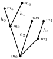

Figure 1: A tree, where $h_0$–$h_3$ are histories and $m_0$–$m_6$ are moments. [An extended description of figure 1 is in the supplement.]

Standard BT frames are formal tools that can be applied to a variety of different purposes, but two of their applications play a central role in philosophy and deserve to be called *canonical*. They are also the applications in view of which the frames were initially introduced and developed, by Saul Kripke and Arthur Prior.

The first canonical application is in defining a family of semantics for tense-modal logics, now known as *branching time semantics*, which have been independently developed in philosophical logic and computer science. BT semantics have considerable philosophical interest, for instance in the analysis of historical modality and the treatment of future contingent statements.

The second canonical application is in modeling a very special system, namely our (supposedly) indeterministic, agent-populated, universe. The *BT conception* is the view that our universe and its temporal and modal features are better represented by standard BT frames than by other, non-tree-like structures. Given that there are different ways to conceive trees and how they represent reality, the BT conception is best regarded as a family of metaphysical views, which need not share a substantive metaphysical core. Nonetheless, the BT conception is neither empty nor trivial, as whether trees are better suited to representing our universe than alternative structures is a matter of legitimate philosophical disagreement.

Section 1 introduces the main ideas behind branching time and BT representations. Section 2 covers trees and related representations of indeterministic systems. Sections 3 and 4 are devoted, respectively, to the canonical applications of BT frames in the semantics of tense-modal logics and in metaphysics.

## 1. A primer to branching time

Branching time (BT) frames are formally defined BT representations, and are endowed with both structural and representational features. From a structural viewpoint, BT frames are *branching structures*, that is, intuitively, networks of interconnected paths, where each path can be thought of as a chain of nodes. Branching structures are ubiquitous in our experience, appearing for instance in trees, in rivers, in circulatory systems, and in road systems. What makes BT frames special, with respect to other branching structures, is their representational function: BT frames aim to represent all the possible temporal developments of a given system, which in philosophy is generally identified with the whole universe. More specifically, in BT frames, paths are called *histories* and represent complete courses of events, while nodes are called *moments* and represent instantaneous or temporally minimal events. Histories are usually defined as maximal chains of moments ordered by a relation of *temporal* (or *causal*, or *temporal-modal*) *precedence* $\prec$. Histories are all connected: by moving backward and/or forward along histories, we can reach any moment in the frame from any other. Histories can branch out in both temporal direction, that is, we can have both future-directed or *forward* branching and past-directed or *backward* branching (see Fig. 2). We shall speak of *standard* BT frames or (BT) *trees*[^note-2] to indicate BT frames in which only forward branching is admitted and backward branching is not. In this entry, we shall focus on trees and devote only a few passing comments to backward-branching BT frames.

*Figure 2:*

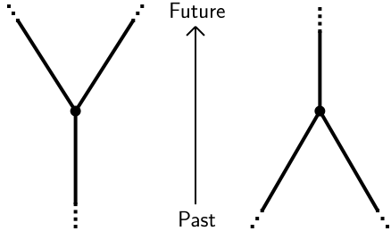

Figure 2: Forward branching and backward branching. [An extended description of figure 2 is in the supplement.]

In short, standard BT frames or trees are *abstract representations* that are understood to represent our universe (or some other system) along with all its possible developments; trees are complexes of *moments* and *histories*, where histories are maximal chains of temporally ordered moments; histories are all *connected* and *do not branch towards the past*. Let us expand on this characterization by delving a little deeper into each of these italicized notions.

- **Abstract representations.** BT frames are generally thought of as abstract representations, which need not be fully projected onto reality. The problem of making clear what precisely they represent is a major philosophical concern, which we shall discuss in §4.
- **Moments.** Moments represent events that are spatially maximal and only have an instantaneous or minimal duration. Trees are commonly defined as pairs $(M,\prec$), where $M$ is a non-empty set of moments and the temporal precedence relation $\prec$ is a strict partial order that complies with the principles of *Connection* and *No backward branching* (see below).

As Belnap, Perloff, and Xu observe,

> the concept of a moment … is a Newtonian idea. It is distant from our everyday conceptions, and it is non-relativistic. It inherits from Laplace’s demon the implausible presupposition that the fundamental terms of the causal order shall be entire instantaneous world-slices, instead of smallish local events or point events. It is, however, a worthwhile approximation to the truth. (2001: 139)

The idealization is removed in branching-spacetimes frames (BST frames, see Belnap 1992; Belnap, Müller, & Placek 2022)[^belnap-1992][^belnap-2022], where the role of moments as basic building blocks is taken by spatially smaller events (see below, §2.3, §4.1.1).

- **Histories.** Each history represents a *spatially and temporally complete, possible course of events*. Histories are usually defined as maximal sets of moments, linearly (or totally) ordered by $\prec$.
- **Connection.** For any two distinct moments in the frame, either one precedes the other or there is a moment that is $\prec$-related with both. Intuitively, this means that the whole frame forms a single, connected structure of histories.

Connection reflects the idea that BT frames model the possible evolutions of a unified system, and not a plenitude of disjoint possibilities.

- **No backward branching.** If two different moments $m,m'$ temporally precede another moment $w$, then $m$ and $m'$ are $\prec$-related, which implies that they belong to every history containing $w$. In other words, the past of every moment is a linear order.

Historically, No backward branching reflects the philosophical motivations behind the introduction of BT representations. In 1958, a very young Saul Kripke wrote a letter to Arthur Prior where he provided the first semi-formal characterization of BT frames (Kripke’s letter, dated 3 September 1958, is in the Prior Collection at Bodleian Library, Oxford, Box 4; see the entry on future contingents for more historical background). Prior took Kripke’s suggestion very seriously, and formally developed it during the 1960s (1960, 1962, 1966a,b, 1967a,b, 1968a,b). He saw BT frames as a useful tool in a variety of logico-philosophical areas: the semantics of tense-modal logics, the problem of identity across time and possible worlds, the problems of agency, free will, and future contingents. In all these areas, Prior felt that too little attention was paid, among philosophers and logicians, to the fact that possibilities change across time.

> It is always a useful exercise (and one insufficiently practiced by philosophers), when told that something was possible, i.e., could have happened, to ask “*When* was it possible?” “*When* could it have happened?” (Prior 1960: 688)[^prior-1960]

In contemporary philosophical jargon, the kind of time-sensitive modalities (possibilities, necessities, contingencies) that Prior had in mind are called *historical*. Historical modality is time asymmetrical: all past and present events are historically necessary, and only future events are historically contingent. For this reason, historically contingent events are also called *future contingents*. (With a traditional ambiguity, we use “future contingents” also to indicate assertions that predict future contingent events and the corresponding sentences.) Along with historical possibilities, which are anchored to a time, one can also conceive possibilities that are anchored to a space-time region or to certain agents. These “local” possibilities are sometimes called *real* (see, e.g., Müller 2012; Placek 2012; Rumberg 2016a; Belnap, Müller, Placek 2022)[^belnap-2022][^müller-2012][^placek-2012][^placek-2012-2][^rumberg-2016a]. BST frames are tools for formally studying real possibilities.[^note-3]

Intuitively, historical and real contingencies are the kinds of possibilities that matter to us as agents. In an abstract sense, it is now possible that you never started reading this entry. However, given that you *did* start reading this entry, that is no longer a live possibility. By contrast, it is still a genuine possibility for you to stop reading this entry. It is difficult to overestimate the role of the distinction between abstract (metaphysical, logical) modality and historical (real, “local”) modality in our self-representation as agents and in our inferential, epistemic and linguistic practices. In Prior’s view, the distinction is not just a human construction and is also rooted in mind-independent reality. Prior subscribed to indeterminism, and thought that at least some particular events were *objectively* “open”, not already present in their causes (see, e.g., Prior 1967a: Ch. 7; see also the entry on causal determinism)[^prior-1967a].

Many philosophers in the contemporary debate about branching time agree with Prior in regarding historical modality as purely objective (mind-independent) and grounded in concrete reality. They think there is a deep divide between objective and *epistemic* modality, and between particular, concrete events and *qualitative*, repeatable states.

> [N]o backward branching makes sense only for objective, concrete events. […] A given concrete situation could obviously have been preceded by any of various inconsistent predecessors, “for all one knows”. It is precisely to preclude this epistemic or doxastic use of “possible” that we so tiresomely repeat that our present concern is with “objective” possibilities. Second, No backward branching fails to apply to “states” or other repeatable carriers of partial information. There is no doubt whatsoever that a present “state” may be accessible from either of two earlier incompatible states. (Belnap, Perloff, & Xu 2001: 184)[^belnap-2001]

In short, the No backward branching condition reflects the idea that whether an event $e$ is historically possible at a moment $m$ entirely depends on whether $e$ is causally-historically accessible from $m$ (i.e., lies either in the past or in a future of $m$). Thus, the historical possibility of $e$ at $m$ does not depend on whether $e$ is compatible with the knowledge available at $m$, or whether other events similar to $e$ are accessible from $m$.

When joined with Connection, No backward branching entails *Historical connection*: for any two distinct moments in the frame, either one precedes the other or there is a moment that precedes both. The adoption of Historical connection has philosophically interesting consequences. Let us make one of these consequences explicit.

Historical possibility is a very strict notion of possibility, and within standard BT frames, we can also define more inclusive notions. For one, we can define a notion of *past historical possibility*: an event $e$ is a past historical possibility at $m$ iff $e$ is historically possible at some moment $m'$ that either precedes or is identical to $m$. And we can define also an absolute, tree-relative notion of possibility: an event $e$ is possible in a tree iff it is historically possible at some moment in the tree. Historical connection ensures us that these two notions of possibility coincide. By Historical connection, past historical possibility is the widest, most inclusive notion of possibility definable within BT frames.

It is natural to suppose that the notion of past historical possibility coincides with the notion of *physical possibility given initial conditions*, when initial conditions are set arbitrarily far in the past. Many philosophers think that physical possibility, so understood, is still restrictive as compared to *metaphysical* possibility, which is the widest notion of possibility traditionally recognized in philosophy. If that is correct, by adopting Historical connection, we make BT frames unsuitable to model metaphysical modality (on the relations between BT and metaphysical modality, see, e.g., Prior 1960; J. L. Mackie 1974; Lewis 1986: 4; P. Mackie 2006; MacFarlane 2008)[^lewis-1986][^macfarlane-2008][^mackie-1974][^mackie-2006][^prior-1960].

## 2. Representations of branching time

### 2.1 Trees. Bundled trees.

As observed above, trees are the most common representations of branching time. These structures are formally defined as pairs ${\mathcal{T}}= (T, \prec )$ in which $T$ is a set (of *moments*) and $\prec$ is the *temporal precedence* relation with the following properties (the expression $m \prec m'$ reads $m$ *temporally precedes* $m'$; $\preceq$, $\succ$, and $\succeq$ are defined in the obvious way; two moments $m,m'$ are said to be *comparable* when either $m\preceq m'$ or $m'\prec m$):

- **Irreflexivitiy.** For no $m$, $m \prec m$;
- **Transitivity.** If $m \prec m'$ and $m' \prec m''$, then $m \prec m''$;
- **Connection.** For any two moments, there exists a moment that is comparable with both;
- **No backward branching (or Linearity towards the past).** If $m' \prec m$ and $m'' \prec m$, then either $m' \preceq m''$ or $m'' \prec m'$.

No backward branching and Connection jointly entail the following:

- **Historical connection (or left-connectedness).** For all $m$ and $m'$, there exists an $m''$ such that $m'' \preceq m$ and $m''\preceq m'$.

A *history* in the tree ${\mathcal{T}}= (T, \prec )$ is a set $h \subseteq T$, which is linearly ordered by $\prec$ and maximal for inclusion, that is, if $h'$ is a linearly ordered subset of $T$ and $h \subseteq h'$, then $h' = h$. It can be proved (with the Axiom of Choice) that every linearly ordered subset of $T$ can be extended to a history. The *Future* of $m$ is defined as $\{m' \in T : m \prec m'\}$. A *future* of $m$ (or an $m$-*branch*) is the intersection of the Future of $m$ and a history containing $m$. The symmetrical notion of the *past* of $m$ (or $m$-*trunk*) is defined as $\{m' \in T : m' \prec m\}$.

Connection entails that we can get from any moment to any other at most in two (backward or forward) steps. If Connection is given up, we get structures consisting of disjoint trees, which are sometimes called *forests* (see, e.g., Goranko, Kellerman, & Zanardo 2023)[^goranko-2023].

If No backward branching is omitted, then the only condition imposed on the relation $\prec$ is that it is an irreflexive connected partial order. Thus, at any moment, time may branch out also in the past and a BT structure can be viewed as a set of crossroads (see Fig. 3). So conceived, crossroads are temporally directed, as we can divide them into a forward-branching fork and a backward branching one. The forward-branching fork departing from $m$ is naturally understood to represent the historical possibilities open at $m$, and the backward-branching fork, the *epistemic* possibilities open at $m$, i.e., the possibilities consistent with the knowledge available at $m$. However, other interpretations are also possible (e.g., we can understand both forks as representing epistemic possibilities). Backward branching structures have potential applications that are largely unexplored to date, for instance, concerning the treatment of knowledge and other propositional attitudes in a branching reality.[^note-4] We expect that in future iterations of this entry they will receive a widest share of attention.

*Figure 3:*

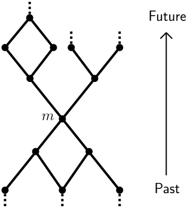

Figure 3: A temporally directed crossroad centered at moment $m$. [An extended description of figure 3 is in the supplement.]

In many applications of BT frames, it is of crucial importance that some kind of synchronism is imposed between moments belonging to different histories. For instance, counterfactual assertions seem to involve a trans-history identification of moments: “Were I in London *now*, I would go straight to the British Museum” (see, e.g., Thomason & Gupta 1980; Di Maio & Zanardo 1994)[^thomason-1980]. But it must be noticed that not every tree can be endowed with synchronisms. The definition of tree does not impose any topological structure on histories. We can have histories that are dense in some parts and discrete in others. In particular, two different histories may have different topological structures in the parts where they do not overlap.

When trees are viewed as representations of an indeterministic universe, it is natural to assume that all histories are isomorphic to the set $\mathbb R$ of real numbers. In this case, given two distinct histories $h$ and $h'$, also their set-theoretical differences $h \setminus h'$ and $h' \setminus h$ are isomorphic and any order-preserving bijection $\sigma$ between these two sets can be thought of as a *synchronism* between them. So we can say that the tree is synchronizable. In other words, for any $m \in h\setminus h'$, $\sigma(m)$ can be viewed as “the same moment as $m$” in $h' \setminus h$. It is important to observe that $h \setminus h'$ and $h' \setminus h$ can be synchronized in infinitely many ways. So, in general, in order to have a synchronized tree, we must also explicitly provide a set of bijections between histories.

Formally, we say that the tree ${\mathcal{T}}$ is *synchronizable* if there exists a set $\Sigma$ of functions $\sigma_{h,h'}$, where $h$ and $h'$ range over the set of histories in ${\mathcal{T}}$, such that, for all $h, h', h''$: (1) $\sigma_{h,h'}$ is an order-preserving bijection from $h$ onto $h'$, (2) $\sigma_{h,h'}$ is the identity on $h \cap h'$, (3) $\sigma_{h',h}$ is identical to $\sigma^{-1}_{h,h'}$ (i.e., to the inverse of $\sigma_{h,h'}$), and (4) the composition $\sigma_{h,h'}\circ\sigma_{h',h''}$ is identical to $\sigma_{h,h''}$. Pairs $({\mathcal{T}}, \Sigma)$ are called *synchronized* trees.[^note-5]

In a synchronized tree, the set $\Sigma$ of bijections determines a relation on $T$: we can write $m \leftrightarrow_\Sigma m'$ iff $m' = \sigma_{h,h'}(m)$ for some $h, h'$. It can be readily verified that, by the properties of the functions in $\Sigma$, the relation $\leftrightarrow_\Sigma$ is well defined and is an equivalence relation (see Di Maio & Zanardo 1994), which is naturally understood as a kind of simultaneity. The trees considered in Belnap’s Logic of Agency (in particular for achievement stit) are synchronized trees, but the synchronism is determined by means of the primitive notion of *instant* (Belnap, Perloff, & Xu 2001: 7A.5)[^belnap-2001]. The set of moments in a tree is “horizontally” partitioned into instants. Every instant is also assumed to have a unique intersection with each history, and instants preserve the temporal relations between moments (see Fig. 4). It turns out that the equivalence relation determined by the partition into instants has the same properties as $\leftrightarrow_\Sigma$. So, considering instants is the same as considering a synchronism.

*Figure 4:*

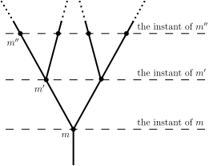

Figure 4: Instants. [An extended description of figure 4 is in the supplement.]

Another way for defining synchronisms is to consider metric trees (Burgess 1979: 577)[^burgess-1979]. That is, to assume that there exists a function $d$ from $T \times T$ into $\mathbb{R}$ such that $d(m,m')$ can be viewed as the *distance* between $m$ and $m'$. If a reference moment $m_0$ is given, the function $d$ can be seen as a clock: $d(m_0,m)$ is the (possibly negative) time of $m$ with respect to $m_0$. Of course, some further technicalities are needed in order to have a satisfactory definition of “the time of the moment $m$”. For instance, we have to define this notion for moments that are not comparable with $m_0$. But eventually we can reach a reasonable definition of synchronism.

The existence of instants, as well as the existence of a synchronism, in a tree-like representation of the universe is a strong ontological assumption. This is actually recognized in Belnap, Perloff, and Xu:

> the doctrine of instants harkens back to the Newtonian doctrine of absolute time—and therefore is suspect. We use it, but we don’t trust it. (2001: 194)

Improving on that is indeed one key motivation for Belnap’s theory of Branching Space-Times (see below, §2.3).

The notion of a tree is often generalized by considering *bundled trees*, that is, pairs $({\mathcal{T}}, {\mathcal{B}})$ in which a *bundle* ${\mathcal{B}}$ is set of histories such that, for each moment $m$, some history in ${\mathcal{B}}$ includes $m$. Thus, trees can also be seen as *trivial* bundled trees $({\mathcal{T}}, {\mathcal{B}})$, in which ${\mathcal{B}}$ is the set of all histories. Using non-trivial bundled trees as BT representations amounts to holding that not every history represents a possible course of events. In this sense, the set ${\mathcal{B}}$ can be thought of as the set of *admissible* histories.

There are two different attitudes one can have towards bundles and the restriction to admissible histories. One can think, following van Benthem (1996: 206–208), that since sets (histories) are generally considered in a particular situation and with specific purposes in mind, there is no reason to take *all* possible sets (histories) into account; it is preferable to circumscribe the range of the quantification over sets that is relevant to the purposes at stake. An example of this way of proceeding can be found in Stirling (1992), where interesting (first-order and second-order) closure properties are identified for the set of branches (or paths, or runs, or histories) in temporal logic for computer science.

The opposite attitude, based on descriptive adequacy, is instead advocated by Thomason (1984: 151–152) and Belnap, Perloff, and Xu (2001: 200–203). These authors argue that bundled trees lead to contradictory assertions when certain specific indeterministic scenarios are considered. For a reply to their arguments, see Øhrstrøm and Hasle (1995: 268–269), and the entry on future contingents, §5.2, which discuss structures (“Leibnizian systems”) very similar to Kamp frames or Ockhamist frames (see below, §2.2).

A further kind of BT representations is the one that van Benthem (1999) calls *geometrical*. In the geometrical approach, both moments and histories are regarded as primitive entities, with no set-theoretical and ontological dependence of the latter on the former, in the same way as points and lines are regarded in many presentations of geometry. In this approach, histories are *reified*. Then, unlike in standard, moment-based perspectives, geometrical representations treat moments and histories on a par.[^note-6] A *geometrical structure* is a 4-tuple $\mathcal{G} = (T,H, \prec, E)$ in which $T$ and $H$ are sets, $\prec$ is a tree relation on $T$, and $E$ is a binary relation between $T$ and $H$. The elements of $H$ are meant to represent histories and $E(m,h)$ can be read as “the moment $m$ lies on $h$”. The (first-order) properties of these structures given in Zanardo (2006b: Def. 6.1) have the effect that the elements of $H$ actually represent histories: it turns out that, for every $h \in H$, the set $\bar h = \{m \in T : E(m,h)\}$ is a history in $(T, \prec)$. Moreover, the set of all $\bar h$, for $h$ ranging over $H$, is a bundle in that tree.

### 2.2 Non-branching representations

Other modal structures for representing indeterministic systems can be found in the literature. These can be termed *non-branching representations*, as they are naturally thought to represent disjoint worlds rather than overlapping courses of events. As we shall see below, there is a strict connection between these structures and bundled trees. This allows, for example, to use either the former or the latter interchangeably in the semantics for branching time logics (see §3). However, even if equivalent to bundled trees for many logical and mathematical purposes, non-branching structures seem to reflect different philosophical conceptions of historical modality and future indeterminacy (see, e.g., Belnap, Müller, & Placek 2022; 6–8, 13–22; Restall 2011: 228–231)[^belnap-2022][^restall-2011].

A **Kamp frame** (Thomason 1984)[^thomason-1984] is a triple $\mathcal{K} = ({\mathsf{K}}, W, \approx)$ in which $W$ is a set of *worlds* and ${\mathsf{K}}$ is a function assigning a linear order ${\mathsf{K}}_w = (T_w, \lt_w)$ to each element of $W$. Thus, every ${\mathsf{K}}_w$ can be regarded as a history. This implies that the elements of each $T_w$ can be viewed as moments in a temporal structure. The branching aspect of time is represented by $\approx$, which is a function that assigns to each moment $t \in \bigcup_{w \in W}T_w$ an equivalence relation $\approx_t$ on the set of all worlds $w$ such that $t \in T_w$. The intended meaning of $w \approx_t w'$ is that the histories ${\mathsf{K}}_w$ and ${\mathsf{K}}_{w'}$ coincide up to $t$. Then, it is also required that: (1) if $w \approx_t w'$, then $\{t' \in T_w : t' \lt_w t \} = \{t' \in T_{w'} : t' \lt_{w'} t \}$ and (2) if $w \approx_t w'$ and $t' \lt_w t$, then $w \approx_{t'} w'$.

The definition of Kamp frame makes evident the relationship between these structures and trees. Given a Kamp frame $\mathcal{K} = ({\mathsf{K}}, W, \approx)$, the set of equivalence classes $[(w,t)] = \{(w',t) : w \approx_t w'\}$ can be endowed with a binary relation $\prec_{\mathcal{K}}$ defined by

$$[(w,t)] \prec_{\mathcal{K}} [(w',t')] \hbox{ iff } w \approx_{t'} w' \hbox{ and } t \lt_{w'} t'$$

(cf. Zanardo 2006b: 4)[^zanardo-2006b]. It can be easily verified that $\prec_{\mathcal{K}}$ is well-defined and is a tree relation. Then, the classes $[(w,t)]$ can be viewed as moments in a tree ${\mathcal{T}}_{\mathcal{K}}$. Moreover, for any $w$ in $W$, the set $\{ [(w,t)] : t \in T_w \}$ turns out to be a history $h_w$ in ${\mathcal{T}}_{\mathcal{K}}$.

Trees generate Kamp frames in a natural way. Given a tree ${\mathcal{T}}$, we let $W_{\mathcal{T}}$ be the set of all histories in ${\mathcal{T}}$ and let $\approx_{\mathcal{T}}$ be the identity function (Fig. 5). For all histories $h, h'\in W_{\mathcal{T}}$ and all moments $m \in T$, we set $h \approx_{{\mathcal{T}}m} h'$ iff $m \in h \cap h'$. The proof that $\mathcal{K}_{\mathcal{T}}= ({\mathsf{K}}_{\mathcal{T}}, W_{\mathcal{T}}, \approx_{\mathcal{T}})$ is a Kamp frame is straightforward.

*Figure 5:*

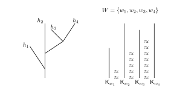

Figure 5: A tree with the corresponding Kamp frame. [An extended description of figure 5 is in the supplement.]

Despite the close relationship between trees and Kamp frames, the correspondences $\mathcal{K} \to {\mathcal{T}}_{\mathcal{K}}$ and ${\mathcal{T}}\to \mathcal{K}_{\mathcal{T}}$ are not the inverse (modulo isomorphisms) of each other. In general, the structure $\mathcal{K}_{({\mathcal{T}}_{\mathcal{K}})}$ is not isomorphic to $\mathcal{K}$ because ${\mathcal{T}}_{\mathcal{K}}$ might have histories that do not correspond to any world in $\mathcal{K}$ (cf. Zanardo 2006b)[^zanardo-2006b]. The set of histories of the form $h_w$ in ${\mathcal{T}}_{\mathcal{K}}$ constitute a possibly proper bundle in this tree. It is true, instead, that ${\mathcal{T}}_{(\mathcal{K}_{\mathcal{T}})}$ is isomorphic to ${\mathcal{T}}$.

**$\mathbf{T\times W}$ frames** can be defined as Kamp frames in which ${\mathsf{K}}_w = {\mathsf{K}}_{w'}$ for all $w, w' \in W$. Thus, what we said above about the correspondence between Kamp frames and trees also holds for $\mathrm{T\times W}$ frames. It must be noted that the trees generated by these frames are synchronized trees. Given a $\mathrm{T\times W}$ frame $\mathcal{K}$, for any two histories $h_w$ and $h_{w'}$ in ${\mathcal{T}}_{\mathcal{K}}$, we define the function $\sigma_{w,w'}$ by $\sigma_{w,w'}([(w,t)]) = [(w',t)]$. It is readily verified that the set of all $\sigma_{w,w'}$ is a synchronism.

The **Ockhamist frames** have been introduced in Zanardo (1985) and further investigated in Zanardo (1996). Intuitively, Ockhamist frames can be viewed as deriving from a tree by considering the histories in it as disjoint sets, each one linearly ordered by a relation $\lt$, and by representing the sameness of moments by an equivalence relation $\sim$. Formally, an Ockhamist frame is a triple $\mathcal{O} =(W, \lt, \sim)$ in which $W$ is a non-empty set and $\lt$ and $\sim$ are binary relations on $W$ with the following properties: (1) $\lt$ and $\sim$ are disjoint ($w \lt w' \Rightarrow w \not\sim w'$); (2) $\lt$ is a union of disjoint linear orders; (3) $\sim$ is an equivalence relation; (4) if $w \sim w'$, then the restriction of $\sim$ to $\{ w'' : w'' \lt w\} \times \{ w'' : w'' \lt w'\}$ is an order-preserving bijection.

The set of pairs $(m,h)$ with $m \in h$ in a tree ${\mathcal{T}}$ can be given an Ockhamist frame structure by setting $(m,h) \lt (m', h')$ if $h=h'$ and $m \prec m'$, and $(m,h) \sim (m', h')$ if $m=m'$. The frame defined in this way will be denoted by $\mathcal{O}_{\mathcal{T}}$ (Fig. 6).

*Figure 6:*

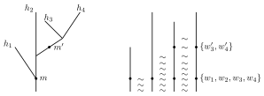

Figure 6: A tree with the corresponding Ockhamist frame. [An extended description of figure 6 is in the supplement.]

Conversely, given an Ockhamist frame $\mathcal{O} =(W, \lt, \sim)$ we can define a tree ${\mathcal{T}}_{\mathcal{O}}$ in a natural way. The moments in this tree are equivalence classes $[w]_\sim$ and the tree relation $\prec$ is defined by: $[w]_\sim\prec [w']_\sim$ if $w'' \lt w'$ for some $w'' \in [w] _\sim$. Property (4) above guarantees that $\prec$ is (well defined and) a tree relation. Every $\lt$-connected component $C$ of $W$, that is, every maximal subset $C$ of $W$ such that, for all $w, w' \in C$, $w \leq w'$ or $w' \leq w$, determines a history $h_C = \{ [w]_\sim : w \in C\}$. Like in the case of Kamp frames, the set of all $h_C$ is a bundle ${\mathcal{B}}$ in ${\mathcal{T}}_{\mathcal{O}}$, so that, in general, $\mathcal{O}_{{\mathcal{T}}_{\mathcal{O}}}$ and $\mathcal{O}$ are not isomorphic structures (while ${\mathcal{T}}_{\mathcal{O}_{\mathcal{T}}}$ and ${\mathcal{T}}$ are).

### 2.3 Representations of Branching Space-Times

In Belnap (1992), Nuel Belnap set up the ambitious project of combining relativity and indeterminism in a rigorous framework. Various publications on the subject followed and developed that work, including Belnap, Müller, and Placek (2022), which summarizes those developments in the form of a monograph. In this section, we outline the main aspects of this innovative approach, also in connection with the representations of branching time considered above.

The main goal of Branching Space-Times (BST) theory is to represent possibilities in the context of relativity. Then, the basic notions in the theory are those of (possible) *point event* and of *causal order* relation ($\lt$), which are the BST counterparts of moments and of the temporal order in BT. As clearly pointed out in Belnap (2012), BST theory aims to move away from a Newtonian framework in two different directions: from determinism to indeterminism and from classical physics to relativity. This includes paying attention to the relativistic notion of causal independence as space-like separation (see below).

A BST structure (*Our World*, in Belnap’s terminology) is then a pair $\mathcal{W} = (W, \lt)$ in which $W$ is a non-empty set (of point events) and $\lt$ is a strict partial order on $W$ ($\leqslant$, $\gt$, and $\geqslant$ are defined in the obvious way). If $e_1 \leqslant e_2$ or $e_2 \leqslant e_1$, we say that $e_1$ and $e_2$ are *comparable*. The axioms for BST do not include the linearity towards the past (while they imply density and continuity of the causal order relation). Thus, unlike in BT, three point events may constitute a *causal confluence* diagram: $e_1 \lt e_2 \gt e_3$ with $e_1 \not\leqslant e_3$ and $e_3 \not\leqslant e_1$. A consequence of this is that we can consider two different kinds of *up-forks* $e'_1 \gt e'_2 \lt e'_3$, according to whether $e'_1$ and $e'_3$ are followed by causal confluence or not.

*Figure 7:*

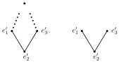

Figure 7: Causal dispersion and branching dispersion. [An extended description of figure 7 is in the supplement.]

The branching of possibilities represented via BT does not allow for backward branching, while relativistic space-time does. Then, in the diagrams of the first kind (that Belnap calls *causal dispersion*) the point events $e'_1 , e'_2$ and $e'_3$ must belong to the same space-time, while the forks of the second kind (*branching dispersion*) are given a strictly modal meaning.

These considerations directly lead to the notion of *history*, which has a crucial role also in BST. Like in BT, a structure consisting of just one history can be viewed as a representation of a deterministic universe. Then, taking relativity into account, any two point events $e_1$ and $e_2$ in a history $h$ must have a *later witness* in $h$, that is, $e_1 \leqslant e_3 \geqslant e_2$ must hold for some $e_3 \in h$. Subsets of $W$ with this property are called *directed subsets*. Thus, histories in BST are directed subsets of $W$. They are also required to be maximal, which implies that every history is downward closed and (upward) closed for causal confluence. $d$-dimensional Minkowski space-times with $d \geq 2$ are examples of histories. Two point events are said to be *compatible* if there is a history that contains them.

In general, histories in BST are not linearly ordered sets, but they share many of the properties of histories in BT. In particular, every directed subset of $W$ can be extended to a history. Moreover, since Historical connection is assumed in BST, any two histories have non-empty intersection. The original axioms for BST in Belnap (1992) imply also that the intersection of any two histories has a maximal element, which is called *choice point*. As shown in Belnap, Müller, and Placek (2022), though, other alternatives can be considered.

Given a structure $(W,\lt)$, BST theory allows for the definition of *space-like separation* as incomparability plus compatibility. The point events $e'_1$ and $e'_3$ on the left of Figure 7 are space-like separated, while, on the right picture, $e'_1$ and $e'_3$ are with respect to each other neither causally future nor causally past nor causally contemporaneous. Within a given history, then, space-like separation is just incomparability, which agrees with the corresponding definition in relativistic space-time.

The relatively simple framework considered in this section is widely developed in Belnap, Müller, and Placek (2022) and in other works to obtain a rigorous theory that combines relativity and indeterminism (Müller 2010, 2013; Placek 2010; Belnap, Müller, & Placek 2022)[^belnap-2022][^müller-2010][^müller-2013][^placek-2010]. We only mention here that BST theory’s analysis of causation and probability allows to represent probabilistic correlation (see Belnap 2005)[^belnap-2005], and that an application to quantum correlation is given in Belnap, Müller, and Placek (2022: 8).

The representations $(W,\lt)$ for BST are susceptible to variations (or alternative presentations) similar to those that we have considered for BT, which would similarly involve discussions about the adequacy of the new structures. As an example, the passage from trees to Ockhamist frames can be adapted to BST. We can consider all the histories in a structure $(W,\lt)$ as disjoint sets and represent equality of point events in $(W,\lt)$ by an equivalence relation. We obtain structures $(W^*,\lt^*, \sim)$ in which $W^*$ is the union $\bigcup_{i \in I} W_i$ of disjoint sets, and $\lt^* = \bigcup_{i \in I} \lt_i$, where each $\lt_i$ is a partial order relation on $W_i$. Since every $(W_i, \lt_i)$ is meant to represent a history, we have also to assume that these structures are directed. Like in the case of Ockhamist frames, the relation $\sim$ mimics the equality in $(W,\lt)$. Let us note that, in this context, up-forks $e_1 \gt^* e_2 \lt^* e_3$ can only be interpreted as instances of causal dispersion. Branching dispersion is represented by diagrams of this form: $e_1 \gt^* e_2 \sim e_2' \lt^* e_3$, with $e_2 \neq e_2'$.

## 3. Branching time semantics for tense-modal logics

Trees, or the related set-theoretical structures considered above, constitute the fundamental framework for BT semantics for tense-modal logics.[^note-7] The bulk of this section (§3.1–§3.2) is devoted to BT semantics that are especially relevant to the philosophical debate on branching time. We discuss most of these approaches with reference to a simple Priorean propositional language $\mathcal{L}$ endowed with a future operator $\mathsf{F}$ (“it will sometimes be the case that”) with dual $\mathsf{G}$ (“it will always be the case that”), a past operator $\mathsf{P}$ (“it was sometimes the case that”) with dual $\mathsf{H}$ (“it was always the case that”), and a historical possibility operator $\lozenge$ (“it is still historically possible that”) with dual $\Box$ (“it is settled that”). In presenting these semantics, we presuppose a distinction between *recursive* semantics (or *semantics proper*) and *postsemantics*, in MacFarlane’s (2003, 2008, 2014) terminology. A *recursive semantics* $S$ for $\mathcal{L}$ is a standard, Tarski-style recursive definition of truth for sentences of $\mathcal{L}$ relative to certain points of evaluation. A postsemantics for $\mathcal{L}$ based on $S$ is a direct definition of *truth-in-a-context* (in a sense akin to that of Kaplan 1989)[^kaplan-1989] that is based on the notion of truth recursively defined by $S$. Intuitively, semantics proper provides each sentence in $\mathcal{L}$ with truth conditions relative to each point of evaluation, while postsemantics tells us what sentences of $\mathcal{L}$ are true relative to what contexts.

In the final subsection (§3.3), we outline a few BT semantics specifically developed for applications in computer science.

### 3.1 Recursive semantics

This section focuses on recursive semantics for BT logics. There are basically three main strands in this area, all envisaged by Prior, which are known as recursive *thin red line* (TRL) semantics, *Peircean* semantics and *Ockhamist* semantics (see the entry on temporal logic, §5 for an exhaustive definition of the language and semantics for Ockhamist and Peircean temporal logics and a discussion of technical results). The key difference between these semantics lies in the interpretation of the future operator $\mathsf{F}$. Let us start by introducing recursive TRL semantics.

The past operator $\mathsf{P}$ has the same semantic behavior in all recursive TRL semantics:

**$(\mathrm{T}_{\alpha})$**

$\mathsf{P} \alpha$ is true at $m$ iff $\alpha$ is true at some $m' \prec m$.

As for the future operator $\mathsf{F}$, the general idea is that formulae of form $\mathsf{F} \alpha$ are true iff $\alpha$ is true in the actual future (see Prior 1966: 157; Øhrstrøm 1981)[^øhrstrøm-1981], that is, in the future on the *thin red line*—i.e., “the course along which history will go” (Belnap & Green 1994: 366)[^belnap-1994]. This idea can be made precise in two different ways. In presenting them, we loosely follow the discussion in Belnap and Green (1994).

1. In *absolute* recursive TRL semantics, models specify a history $\TRL$, which represents the (unique) actual history in the tree. The future operator $\mathsf{F}$ is understood in terms of truth at future moments on the thin red line: $(\mathrm{T}_{\mathsf{F}})$ $\mathsf{F}\alpha$ is true at $m$ iff $\alpha$ is true at some $m' \in \TRL$ with $m \prec m'$. This approach gives plausible results when future-tensed statements are evaluated at actual moments but runs into problems when moments not belonging to the $\TRL$ are at stake (this may happen, for instance, when the future-tense operator is embedded under modal operators, see Belnap & Green 1994: 379)[^belnap-1994]; see also Thomason 1970: 270–271). The standard diagnosis is that a unique $\TRL$ is not sufficient, and one must provide each moment in the tree with its own $\TRL$. This requirement is satisfied in relative variants of TRL semantics.
2. In *relative* (or *Molinist*)[^note-8] recursive TRL semantics, models define a function $\TRL()$ that maps each moment $m$ to the corresponding thin red line (see McKim & Davis 1976; Thomason & Gupta 1980)[^mckim-1976][^thomason-1980]. The simplest way to specify the truth conditions of future-tensed statements in this framework is: $(\mathrm{T}_{\mathsf{F}})$ $\mathsf{F}\alpha$ is true at $m$ iff $\alpha$ is true at some $m'\succ m$ such that $m'\in \TRL(m)$. As Belnap and Green (1994) point out, however, relative recursive TRL semantics either entails that time is linear or fails to validate natural principles such as the following:
3. **Retrogradation.** $\alpha\to \mathsf{H}\mathsf{F}\alpha$ Moreover, from a philosophical viewpoint, it is unclear what the $\TRL$ should represent in this framework: why suppose that counterfactual moments have an actual future, and what should this “quasi-actual” future represent? Even though these contentions have been addressed in the literature (see Braüner, Hasle, & Øhrstrøm 1998; Braüner 2023)[^braüner-2023][^braüner-1998], recursive TRL views have fallen out of favor nowadays, and the attention has shifted to their postsemantic counterparts (see §3.2).[^note-9]

Let us turn to Peircean semantics. Peircean language is different from our standard language $\mathcal{L}$ in that it does not contain modal operators and includes a weak future operator $\mathsf{f}$, which expresses the notion of future possibility:

**$(\mathrm{P}_{\mathsf{f}})$**

$\mathsf{f}\alpha$ is (Peirce) true at $m$ iff $\alpha$ is true at some $m'\succ m$.

The Peircean reading of the past operator $\mathsf{P}$ is identical to that of recursive TRL semantics. The future operator $\mathsf{F}$ receives a very strong reading:

**$(\mathrm{P}_{\mathsf{F}})$**

$\mathsf{F}\alpha$ is true at $m$ iff all histories passing through $m$ contain a moment $m'\succ m$ where $\alpha$ is true.

This clause is meant to capture the idea that “nothing can be said to be truly ‘going-to-happen’ (*futurum*) until it is so ‘present in its causes’ as to be beyond stopping” (Prior 1962: 124)[^prior-1962]. In other words, an event is truly future only if it is inevitable. Peircean semantics is formally pleasant and allows us to combine bivalence and excluded middle with indeterminism. However, it has several drawbacks. For instance, it obliterates important semantic differences, such as the one between “will be the case” and “will be inevitably the case”, and it fails to validate a variety of plausible principles, including Retrogradation and the following:

- **Future excluded middle.** $\mathsf{F}\alpha\vee \mathsf{F}\neg \alpha$

Moreover, let us not forget that Peirceanism predicts that all future contingents are false, against strong semantic intuitions. As a result, it runs up against two very general and strictly related problems, which also affect other approaches to future contingents. First, the so-called *assertion problem*: if future contingents are all false (or untrue) at their moment of use, why are we entitled to assert them? (see, e.g., Belnap & Green 1994; MacFarlane 2014: 9; Besson & Hattiangadi 2014; Cariani 2021b: 11)[^belnap-1994][^besson-2014][^cariani-2021b][^macfarlane-2014]. Second, the problem of *future skepticism*: if no future contingent is true, then we do not have any knowledge at all about future contingent matters, for knowledge entails truth. But this skeptical conclusion is problematic both with respect to our semantic intuitions and on general philosophical grounds (see, e.g., Cariani 2021b, 2021a; Iacona 2022)[^cariani-2021a][^cariani-2021b][^iacona-2022].

For these and other reasons, nowadays most logicians and semanticists regard Peircean semantics as inadequate (see, e.g., Belnap, Perloff, & Xu 2001: 160; Cariani 2021b: 4.1; MacFarlane forthcoming)[^belnap-2001][^cariani-2021b]. It is fair to add, however, that the key motivations behind Peirceanism are metaphysical rather than logical or semantical. Prior favored it as especially well suited to *no futurist* approaches in the ontology of time (see below, §4.1), and variants of Peirceanism have been recently defended on similar grounds (see Todd 2016a, 2021)[^todd-2016a][^todd-2021]. Furthermore, there are attempts in the recent literature to defend Peirceanism, or related semantics, against logical and semantical objections (see, e.g., Iacona 2013; Todd 2021: 3–4; De Florio & Frigerio 2024; Iacona & Iaquinto 2023)[^iacona-2013][^iacona-2023][^todd-2021]. For instance, Todd (2021) has argued that principles like Retrogradation are philosophically contentious, and their invalidity is actually a benefit of Peirceanism (see also Andreoletti & Spolaore 2021)[^andreoletti-2021].

Ockhamist semantics is different from both the recursive TRL semantics and Peirceanism, in that formulae are evaluated not just relative to a given moment $m$ but also to a history passing through $m$. If, as is standard, we write “$m/h$” to indicate a moment-history pair such that $m\in h$, the truth conditions of formulae of form $\mathsf{F}\alpha$ and $\mathsf{P}\alpha$ and can be written as:

**$(\mathrm{O}_{\mathsf{F}})$**

$\mathsf{F}\alpha$ is (Ockham) true at $m/h$ iff $\alpha$ is true at some $m'/h$ with $m \prec m'$.

**$(\mathrm{O}_{\mathsf{P}})$**

$\mathsf{P} \alpha$ is true at $m/h$ iff $\alpha$ is true at some $m'/h$ with $m' \prec m$.

Then, in Ockhamist logic, the future and past operators have the same behavior as in linear temporal logic. The historical possibility operator $\Diamond$ expresses an existential quantification over the set of histories passing through the moment of evaluation:

**$(\mathrm{O}_{\Diamond})$**

$\Diamond \alpha$ is true at $m/h$ iff $\alpha$ is true at $m/h'$ for some history $h'$ passing through $m$.[^note-10]

Like Peirceanism, Ockhamism is an indeterminism-friendly semantics in which both bivalence and the excluded middle hold. In addition, like linear time logics, it validates many plausible principles, including Future excluded middle and Retrogradation. Its main downside is that it is unclear how to apply it to future-tensed utterances (see Belnap, Perloff, & Xu 2001: 231–233; MacFarlane 2014: 9.4)[^belnap-2001][^macfarlane-2014]. To see where the problem lies, suppose you assert the following future contingent:

**(1)**

Tomorrow there will be a sea battle.

In order to apply Ockhamist semantics to your utterance, one must select both a moment of evaluation $m$ and a history of evaluation $h$. It is natural to identify $m$ with the moment of (the context of) use. But what about $h$? In general, $m$ may belong to different histories, and Ockhamist semantics, as such, is silent on what the history parameter represents and how it has to be selected. But when assessing future contingents, choosing one history over another can make a very big difference—the same difference as there is between truth and falsity.

There are two general approaches to this problem in the literature:

1. Stick to Ockhamist semantics and make explicit what the history parameter stands for (Belnap, Perloff, & Xu 2001; Iacona 2014)[^belnap-2001][^iacona-2014];
2. Use Ockham truth postsemantically, to define other, non-history-relative notions of truth.

Approach (b) is the most common today and we shall discuss it in the next subsection.

We conclude this subsection by observing that all the recursive semantics for trees introduced here can be extended to *bundled trees* in a natural way, by replacing the quantification over histories with a quantification over the histories belonging to the bundle ${\mathcal{B}}$. Thus, the second-order quantification over the set of all histories in the tree is replaced by a first-order quantification over *elements* of ${\mathcal{B}}$. Given the correspondence between bundled trees and other set-theoretical structures considered above, the TRL, Peircean and Ockhamist truth conditions can easily be turned into truth conditions relative, e.g., to Kamp frames or Ockhamist frames. In this context, it is worth observing that Ockhamist frames are genuine Kripke frames for a modal logic with three modal operators: $\mathsf{F}, \mathsf{P}$, and $\Diamond$.

### 3.2 Postsemantic proposals

As seen in the previous subsection, it is unclear how to apply Ockhamism to ordinary statements, for their moment of use may belong to more than one history. Postsemantic proposals tackle this problem by defining non-history-relative notions of truth in terms of Ockham truth.

Let us start with what was historically the first proposal to go in this direction, namely, Thomason’s (branching time) *supervaluationism* (1970, 1984), which is based on van Fraassen (1966). At the core of Thomason’s approach lies a supervaluationist, moment-relative notion of truth (super-truth). For our purposes, we can define super-truth relative to a moment of the context $m_c$, which represents the moment of use (Lewis 1970; Kaplan 1989)[^kaplan-1989][^lewis-1970]:

**(Sup)**

$\alpha$ is super-true (super-false) at $m_c$ iff $\alpha$ is Ockham true (false) at $m_c/h$ for all histories $h$ passing through $m_c$.

Like the other postsemantic proposals we shall discuss, supervaluationism inherits all Ockhamist validities, such as the excluded middle, the Future excluded middle and Retrogradation. However, unlike Ockhamism, supervaluationism is not bivalent: there are sentences that are neither super-true nor super-false at their moment of use, namely, future contingents. Thus, on the one hand, supervaluationism agrees with the common philosophical view that future contingents are neither true nor false at their moment of use, but on the other hand, it faces both the assertion problem and the problem of future skepticism (see §3.1). Unlike Peircean semantics, supervaluationism does not go as far as to collapse “will be the case” into “will be inevitably the case” but, still, it collapses (super-) truth into inevitable truth. Partly because of such “modal nature” of super-truth, supervaluationism requires us to accept important departures from standard logical practice (see, e.g., Fine 1975; Williamson 1994; Asher, Dever, & Pappas 2009)[^asher-2009][^fine-1975][^williamson-1994]. For instance, one can doubt that super-truth is disquotational (i.e., that “$\alpha$ is super-true” is equivalent to $\alpha$) and so, that it is a legitimate notion of truth at all. Moreover, if supervaluationist consequence is defined in the most straightforward way, based on (super-) truth-at-a-moment, we must give up pleasant metavalidities such as the deduction theorem.

*Relativism* (MacFarlane 2003, 2008, 2014; see also Belnap, Perloff, & Xu 2001: 175)[^belnap-2001][^macfarlane-2003][^macfarlane-2008][^macfarlane-2014] can be thought of as a generalization of supervaluationism. For this reason, virtually all we have said about supervaluationism also applies to relativism. The key motivation behind relativism is to reconcile two contrasting intuitions concerning future contingents (MacFarlane 2003: 323–325)[^macfarlane-2003]. Consider again (1) (“Tomorrow there will be a sea battle”) and suppose you assert it today. On the one hand, MacFarlane says, we have the (‘indeterminacy’) intuition that the truth-value of your utterance is undetermined in its context of use, which MacFarlane calls *context of utterance*. On the other hand, if tomorrow we find ourself in the middle of a sea battle, we will have the (‘determinacy’) intuition that your claim was definitely true in the context of utterance. If we stick with the view that truth is only sensitive to the context of utterance, MacFarlane argues, the determinacy intuition and the indeterminacy intuition are inconsistent with one another and at best, we can only save one of them. MacFarlane concludes that, since we want to save both intuitions, we must give up the view that truth is only relative to the context of utterance, and recognize that truth is also sensitive to the context from which an utterance is assessed (*context of assessment*). If we accept this new form of context-sensitivity (*assessment-sensitivity*), we can reconcile our prima facie conflicting intuitions by saying that (1) is neither true nor false in its content of utterance relative to a context of assessment located at the present moment, but it is true relative to a context of assessment located tomorrow, in the middle of a sea battle.[^note-11] For our purposes, we can identify the context of utterance and the context of assessment, respectively, with two moments $m_u$ and $m_a$ such that $m_u\preceq m_a$. Now relativistic truth can be defined as follows:

**(Rel)**

$\alpha$ is relativistically true (false) at a context of utterance $m_u$ and a context of assessment $m_a$ iff $\alpha$ is Ockham true (false) at $m_u/h$ for all $h$ passing through $m_a$.

Intuitively, a sentence is relativistically true at $m_u,m_a$ if its content in context $m_u$ is historically necessary at moment $m_a$. Clearly, relativistic truth collapses into super-truth when $m_u=m_a$. Relativism can be regarded as an improvement over supervaluationism: among other things, it is more flexible, and it can be smoothly combined with a wider variety of philosophical views (see below, §4.1). Relativism has also been regarded as a generalization of Ockhamism; in this view, Ockhamism is an extreme version of relativism, where every sentence is evaluated as if it were being assessed from the perspective of the end of time (Wawer 2020)[^wawer-2020][^wawer-2020-2]. Relativism has been applied, more or less successfully, to a number of semantical and philosophical problems, and has given rise to a vast debate, which we cannot address here (see the entry on relativism, §5 for an overview).

Above, we have introduced two variants of recursive TRL views, one relative (or Molinist) and the other absolute. Exactly the same distinction applies to TRL postsemantic views. In *absolute* TRL postsemantics, models specify a history TRL representing the unique actual history in the tree (Iacona 2014; Wawer 2016; Wawer & Malpass 2020)[^iacona-2014][^wawer-2016][^wawer-2020][^wawer-2020-2]. The relevant notion of truth is defined as follows.

**(AbsTRL)**

$\alpha$ is absolutely TRL true at the moment of the context $m_c$ iff $\alpha$ is Ockham truth at $m_c/\TRL$.

This semantics preserves bivalence, but is silent on how to assess statements made at moments that lie outside the thin red line. This feature has appeared intolerable to some philosophers; e.g., according to Belnap, Perloff, and Xu (2001: 162), it is a “logical” defect that makes the theory useless. Absolute TRL theorists have reacted to this contention in two different ways: (i) arguing that it is ill-conceived; (ii) providing an absolute TRL semantics that accounts for utterances made outside of the $\TRL$. According to (i), the contention is based on a controversial piece of metaphysics, i.e., the view that actual and merely possible moments all exist (see below, §4.1). Philosophers who reject this view, and subscribe to actualism (the view that only actual things exist, see again §4.1), have a principled reason to restrict their semantic account to speech acts performed at actual moments. After all, these are all the speech acts that there are (Wawer 2014, 2016; Wawer & Malpass 2020)[^wawer-2014][^wawer-2016][^wawer-2020][^wawer-2020-2]. An account that goes in direction (ii) is the *supervaluational* TRL postsemantics proposed in Malpass and Wawer 2012 and Malpass 2013. This approach is based on the idea that, from an actualist perspective, the utterance of a sentence $\alpha$ made at a moment $m$ outside of the $\TRL$ can be equated with a counterfactual of form “$\alpha$ would be true if uttered at $m$”. If we assume that counterfactuals of this form are true (false) when $\alpha$ is true (false) on all histories passing through $m$, we get the following, disjunctive semantic definition:

**(SupTRL)**

$\alpha$ is super TRL true (false) at $m_c$ iff either $\alpha$ is Ockham true (false) at $m_c/\TRL$, or $\alpha$ is Ockham true (false) at $m_c/h$ for all histories passing through $m_c$.

This definition allows one to overcome the limitations of (unamended) absolute TRL postsemantics without giving up the idea that there exists a unique actual history. It does so, however, at the expense of giving up bivalence for assertions made outside of the $\TRL$ and of inheriting, at least in part, the non-standard logical behavior of supervaluationism.

In *relative* (or *Molinist*) TRL postsemantic views, like in relative recursive TRL semantics (see above, §3.1), models define a function $\TRL()$ that maps each moment $m$ to the corresponding thin red line. Truth at the moment of context $m_c$ is defined in the obvious way:

**(RelTRL)**

$\alpha$ is relatively TRL true at the moment of the context $m_c$ iff $\alpha$ is Ockham truth at $m_c/\TRL(m_c)$.

This semantics does not share the limitations of its absolute counterpart, preserves bivalence and is formally very well-behaved, but is not beyond criticism. For instance, according to MacFarlane (2014), it makes it difficult to accommodate counterfactual assessments. Let us to suppose that today, in context $m_{c}$, Jack asserts:

**(2)**

Berkeley will be sunny tomorrow.

MacFarlane invites us to consider two alternative moments $m\in \TRL(m_c)$ and $m'\notin \TRL(m_c)$, both located tomorrow. At $m$, Berkeley is sunny while at the counterfactual moment $m'$, Berkeley is rainy. Statement (2) counts as true at $m_c$ according to relative TRL postsemantics, for “Berkeley is sunny” is true on the day following $m_c$ on $\TRL(m_c)$. But now let us consider an assessor that is located at the counterfactual moment $m'$. Based on the definition of relative TRL truth, the assessor should regard (2) as true at $m_c$. But, MacFarlane concludes, “that seems wrong; the assessor has only to feel the rain on her skin to know that Jake’s assertion was inaccurate” (2014: 210). In MacFarlane’s view, TRL theorists cannot address this problem by making TRL truth sensitive to contexts of assessment without collapsing their view into a form of relativism (see Wawer & Malpass 2020: 7.1, for a discussion)[^wawer-2020][^wawer-2020-2]. Convincing or not as this objection may be, it highlights the complexity of the notion of actuality inherent in Molinist positions.

### 3.3 Branching time semantics in computer science

The execution of a computer program consists of a sequence of states, and this sequence occurs in a temporal order. Thus, in the context of computer science (CS), time itself can be conceived as a set of successive states, which play the role of moments. These basic observations lie at the foundation of the pioneering work Pnueli (1977), where a temporal logic is defined with the goal of describing and verifying properties of programs.

Many variants and extensions of Pnueli (1977)’s logic were subsequently defined. A common aspect of these logics is that they are propositional logics and that the semantical structures for them are based on pairs $(S,R)$, where $S$ is a set (of states) and $R$ is a binary relation on $S$. The intended reading of $s R s'$ is that $s'$ is a successor state of $s$, or that the program under consideration transforms state $s$ into $s'$. A further element of this semantics is a labeling function $L$, which assigns to each state the set of propositional variables that are assumed to be true at that state.

In this framework, a (possibly endless) execution of a program is represented by an $R$-sequence, that is, a sequence $s_0, s_1, \dots$ in which, for every $i$, $s_i R s_{i+1}$ holds. This means that $R$-sequences play the role that histories have in synchronized BT frames. The controversy “tree vs bundled tree” can also be transferred to structures $(S,R,L)$: one may consider the set of *all* $R$-sequences or just a set $\Sigma$ of sequences with suitable closure properties (see, e.g., Stirling 1992)[^stirling-1992]. Thus, the most general structures have the form $(S,R, L , \Sigma)$.

There is a natural ordering between the elements of $\Sigma$, which, according to the observations above, can be thought as a temporal ordering. Given the sequences $\sigma = s_0, s_1, \dots$ and $\sigma' = s'_0, s'_1, \dots$, we write $\sigma \lhd \sigma'$ if there exists $i \gt 0$ such that, for all $n$, $s'_n = s_{n+i}$. That is, $\sigma'$ can be obtained from $\sigma$ by deleting the first $i$ states. The relation $\lhd$ is trivially transitive. Other possible properties of $\lhd$ depend on the relation $R$ and on the sequences in $\Sigma$.

Also the languages for temporal logics of programs have many variants in the literature. The most common language is apparently a propositional language with the binary operator $\mathsf{U}$ (*Until*). Write $\mathcal{L}_{\mathsf{U}}$ for this language. In ordinary (Priorean) temporal logic, the formula $\alpha\, \mathsf{U} \, \beta$ is true at the moment $m$ whenever, for some moment $m' \succ m$, $\beta$ is true at $m'$, and $\alpha$ is true at every $m''$ such that $m \prec m'' \prec m'$.[^note-12]

Given a structure $(S, R, L, \Sigma)$, the formulas of $\mathcal{L}_{\mathsf{U}}$ are recursively evaluated at elements of $\Sigma$. A propositional variable is true or false at $\sigma = s_0, \dots$ according to whether it belongs to $L(s_0)$ or not. Boolean connectives are interpreted in the usual way. The truth value of $\alpha\, \mathsf{U} \beta$ at $\sigma$ is determined on the basis of the semantics for $\mathsf{U}$ considered in the previous paragraph, with the relation $\prec$ replaced by $\lhd$. Thus, in order to make sense of this, an obvious closure property for $\Sigma$ is that: if $\sigma, \sigma' \in \Sigma$ and $\sigma \lhd \sigma'' \lhd \sigma'$, then $\sigma'' \in \Sigma$. The logic based on this or similar semantics is known as *Linear Temporal Logic* (LTL). In fact, the truth value of a formula at a given $\sigma$ depends only on the truth values of other formulas at subsequences of $\sigma$, which are linearly ordered by $\lhd$. LTL has proven useful for describing and verifying properties of programs (Emerson 1990)[^emerson-1990].

In order to deal with different computations simultaneously, other temporal logics have been defined, which are also based on structures $(S, R, L, \Sigma)$. Among these, the most popular ones are the *Computational Tree Logics* CTL and CTL$^*$ (Emerson & Clarke 1982)[^emerson-1982], which can be viewed as the computer science counterparts of Peircean and Ockhamist logics. In particular, the language for CTL$^*$ includes a unary operator, denoted by $E$ or $\exists$, corresponding to the Ockhamist $\Diamond$ discussed above. Both LTL and CTL turn out to be fragments of CTL$^*$. There is, instead, no inclusion relation between LTL and CTL. There are properties of programs that can be expressed in LTL but not in CTL, and, conversely, there are CTL-expressible properties that cannot be expressed in LTL.

## 4. Philosophical views on branching time

This section deals with philosophical debates concerning branching time and the BT conception. In §4.1, we classify versions of the BT conception depending on their assumptions about time, modality, and the future; moreover, we briefly discuss the connections between these positions and the semantic views outlined in §3. In §4.2, we introduce some general challenges to the BT conception.

### 4.1 Varieties of the branching time conception

The philosophical debate on branching time is strictly connected to traditional debates on the nature of time and modality (see the entries on time and possible worlds for further information). The debate about time is traditionally framed in terms of *times* and not of *moments*. However, when a specific history is at stake, times can be identified with moments. In this way, different views in the philosophy of time can be made to correspond to different interpretations of BT frames.

There are two main positions in the debate, known as (standard) *A-theory* (or *tense realism*), and *B-theory*. For our purposes, we may represent their disagreement as concerning the following principles:

- **Temporal orientation.** the present time is either metaphysically privileged over all the other times (past or future times) or it is the only time that exists.
- **Temporal neutrality.** all times, present, past and future, are metaphysically on a par (i.e., they are entities of the same kind and none of them plays an objectively prominent role).

A-theorists subscribe to temporal orientation.[^note-13] As a consequence, they hold that tensed notions such as *present*, *past* and *future* can be used to denote objective, non-perspectival (and non-indexical) features of reality. When we say that an event is present in this sense, we are attributing to it an objective feature, just as when we say that it is temporally extended. The present time is not just the temporal coordinate where we are located but it is also the correct vantage point on the whole of reality: what is the case from our present perspective is what is *absolutely* the case.

In some philosophical quarters, the A-theory is also indicated as “presentism”. In contemporary philosophy of time, however, *presentism* is an ontological position: the view that only what is present exists (see the entry on presentism). The main ontological alternatives to presentism are *eternalism*, the view that past, present and future things all exist (see Williamson 2013; Cameron 2015; Deasy 2015)[^cameron-2015][^deasy-2015][^williamson-2013], and the *growing-block* theory, the view that only past and present things exist (see Broad 1923; Tooley 1997; Briggs & Forbes 2012; Correia & Rosenkranz 2018)[^briggs-2012][^broad-1923][^correia-2018][^tooley-1997]. Presentism and the growing block theory are different forms of *no-futurism*, the view that future things do not exist.

B-theorists are temporally neutral. As a consequence, they regard tensed notions as purely perspectival: there is nothing like being absolutely present, or future, for the same reason that there is nothing like being absolutely here, or three miles ahead. When we say that an event is present, we are just saying that it is (roughly) simultaneous with our utterance. There is no privileged vantage point within the timeline, and reality is best represented from a tenseless viewpoint, blind to the distinction between (absolute) present, past and future. Temporal neutrality is only consistent with an eternalist ontology.

The debate about modality can be characterized in a similar way. It includes two main positions, which are traditionally characterized in terms of (possible) *worlds* (and not histories):

- **Modal orientation.** the actual world is either metaphysically privileged over all the others or it is the only one that exists.
- **Modal neutrality.** all worlds are metaphysically on a par.

The distinction between modal orientation and modal neutrality, unlike its temporal counterpart, cannot be immediately applied to the debate about BT, for it is not obvious how worlds relate to histories. More precisely, while B-theorists can safely equate worlds with histories, many A-theorists would resist the identification. For instance, presentists think of the actual world as consisting of (what we have called) a moment and not a whole history. Thus, it is best to integrate the distinction between modal orientation and modal neutrality with a further distinction, which is specific to the debate on BT:

- **Forward orientation.** the actual future is either metaphysically privileged over all the others or it is the only one that exists.
- **Forward neutrality.** all futures are metaphysically on a par.

Most philosophers subscribe to modal orientation. As a consequence, they think that modal words like “actual” are not just indexical expressions and can also be used to indicate objective, non-perspectival features of reality. Modally oriented philosophers who subscribe to temporal neutrality (B-theory) are also committed to forward orientation, for the (tenseless) existence of a unique, complete actual history entails the existence of a unique actual future. Conversely, in the debate on BT, modally oriented philosophers who subscribe to temporal orientation (A-theory) generally subscribe to forward neutrality (although their view is also consistent with forward orientation, see §4.1.2 below).

A few philosophers—most famously, David Lewis—are modally neutral and regard modal notions such as *actual* and *possible* as purely perspectival in nature. Among BT theorists, the most prominent modally neutral philosopher is Nuel Belnap.

From an ontological viewpoint, modal orientation is consistent with two views: *actualism* (only actual things/worlds exist) and *possibilism* (all possible things exist). Modal neutrality is only consistent with a possibilist ontology. Similar ontological considerations apply to forward orientation and forward neutrality.

To summarize, there are two opposite stances concerning time, modality, and possible futures in the debate on branching time: oriented and neutral approaches. In general, oriented approaches can be further classified on the basis of their ontology. To illustrate these distinctions, consider the contrast between the two tree diagrams in Fig. 8.

*Figure 8:*

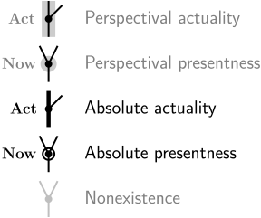

Legend

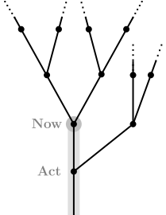

(a) left tree

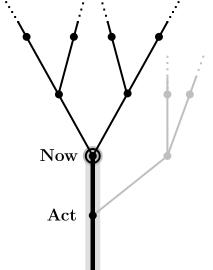

(b) right tree

Figure 8: Two possible views (modal BT realism and “pruning”). [An extended description of figure 8 is in the supplement.]

The diagram on the left represents a view consistent with temporal, modal and forward neutrality: all moments in the tree are metaphysically on a par, and what we can call present, or actual, entirely depends on our “local” experiential perspective. The diagram on the right represents a view consistent with modal orientation, temporal orientation, and forward neutrality, in which past actuality and presentness are absolute (not only perspectival), and all future branches exist and are on a par, but past branches go out of existence as time goes by. We shall discuss both views in a few lines.

#### 4.1.1 Branching time realism and Branching Space-Times realism

We shall speak of *branching time realism* (BT realism) to indicate modally neutral variants of the BT conception. BT realism is consistent with the idea that all futures departing from the present moment obtain (i.e., are absolutely actual) and each single thing, including ourselves, is constantly splitting into countless duplicates of itself. Conceptions of this sort are popularly associated with the Everettian or *many-worlds* interpretation of quantum mechanics (on Everettian quantum mechanics, see the entries on Everettian quantum mechanics and the many-worlds interpretation of quantum mechanics). We collectively refer to them as *strong* BT realisms. Strong BT realisms have never been rigorously developed or seriously defended by analytic philosophers. In the literature on BT, strong BT realism is generally discussed in connection with the B-theory, under different labels: *B-theoretic branching* (Barnes & Cameron 2011: 10)[^barnes-2011][^barnes-2011-2]; *‘block multiverse’* (Pooley 2013: 339)[^pooley-2013]; *realism about many futures* (Meyer 2016: 206)[^meyer-2016]; *naïve BT realism* (Wawer 2016: 8)[^wawer-2016]; *many worlds view* (Spolaore & Gallina 2020: 108)[^spolaore-2020]; *actual branching* (Ninan 2023: 478)[^ninan-2023]. However, strong BT realism can also be joined with temporal orientation (A-theory), resulting in a tensed variant of strong BT realism (this is, arguably, the position outlined in Abruzzese 2001)[^abruzzese-2001]. In strong tensed BT realism, each history is actual and is endowed with a privileged, “locally present” moment. If we think of all these “locally present” moments as lying on the same instant (see above, §2.1), we can illustrate this view as in Fig. 9.

*Figure 9:*

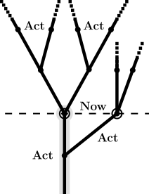

(a) first moment

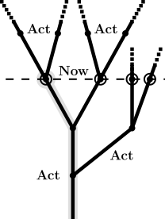

(b) next moment

Figure 9: Strong tensed BT realism (at successive moments). [An extended description of figure 9 is in the supplement.]

The only version of BT realism that has been clearly defined and defended so far in the literature is due to Belnap and his co-authors. We may call it *modal* BT realism (Fig. 8, left diagram). One of its key assumptions is the Aristotelian notion that “talk of possibilities only makes sense before a contrast between possibility and actuality” (Belnap, Müller, & Placek 2022: 3)[^belnap-2022]. By modal neutrality, this means that we can only speak of possibility and actuality in a *perspectival* sense, that is, from a perspective internal to the tree. More precisely, talk of (historical) possibility only makes sense when a *moment* is fixed, and talk of actuality, when both a moment *and* a history are fixed. What is possible is *temporally* local (it is relative to a moment) and what is actual is also *historically* local (it is relative to a moment/history pair). If we identify actuality with the realm of what *obtains* (as opposed to what *can possibly* obtain), we can also say that there is no absolute obtainment: facts and events obtain only relative to moment-history pairs. From a global or “external” perspective, it makes no sense to distinguish actuality and possibility, that is, the things that *do* obtain from those that *can* obtain. Again from a global perspective, we can also say that all moments in the tree are equally concrete, for all play similar causal roles and there is no intrinsic difference between those that are (perspectivally) actual and those that are merely possible.

As seen before (§2.3), in a series of works spanning from Belnap (1992) to Belnap, Müller, and Placek (2022), Belnap and his coauthors have developed Branching Space-Times (BST) frames. Just like BT frames, BST frames allow for different interpretations, including a realist conception akin to BT realism (“BST realism”). The only variant of BST realism discussed in the literature is due to Belnap and his coauthors, and we shall call it *modal* BST realism. In this view, all that BT realists say about moments also holds for point events (and other spatially limited events). From a global perspective, again, it makes no sense to distinguish what point events are actual and what are merely possible, and all point events can be regarded as equally concrete.

> In what follows I will try to avoid indexical language. In particular, I will not draw a distinction (inevitably indexical when not relational) between the actual and the possible except in motivating or giving examples. ‘Possible point events’ are thus just ‘point events’. These point events are to be taken not as mere spatiotemporal positions open for alternate concrete fillings, but as themselves concrete particulars. (Belnap 1992: 388)[^belnap-1992]

There are several objections to (some versions of) BT realism in the literature. Some of these objections point to conflicts between BT realism and common sense presuppositions. Here is David Lewis:

> The trouble with branching […] is that it conflicts with our ordinary presupposition that we have a single future. If two futures are equally mine, one with a sea fight tomorrow and one without, it is nonsense to wonder which way it will be—it will be both ways—and yet I do wonder. (Lewis 1986: 207–208)[^lewis-1986]

Lewis’ objection has different bite against strong BT realism and against Belnap’s modal BT realism. Strong BT realists have no reason to worry about the objection: they can simply agree that the future will be both ways, although only one of them will be part of our experience. On the other hand, Belnap and other modal BT realists replied to Lewis’s objection that it rests on a misguided understanding of their position. They grant that, if tomorrow’s sea fight is contingent, the present situation will evolve in one way *in some history* and in the other *in some different history*, but deny that we can simply drop the relativization to histories and conclude that “it will be both ways”.

> Lewis misdescribes the theory of branching time in saying of such a situation that “it will be both ways.” Branching time is entirely clear that “Tomorrow there will be a sea fight and tomorrow there will not be a sea fight” is a contradiction. […] *Given indeterminism, it does not suffice to think of truth (or denotation, etc.) as relative only to moments.* […] One must relativize truth to the history parameter as well. (Belnap, Perloff, & Xu 2001: 225)[^belnap-2001][^note-14]

This reply is technically correct: modal BT realism does not entail that there will both be and will not be a sea fight tomorrow. However, Lewis has a point when he contends that BT realism clashes with ordinary presuppositions. Consider again the issue whether tomorrow there will be a sea fight. We commonly presuppose that as of tomorrow, this issue will be settled in a *single* and *absolute* way, not just in different ways relative to different futures. However, this is a presupposition BT realists are bound to reject (but see Belnap, Perloff, & Xu 2001: 205–206)[^belnap-2001]. For discussions of other putative counter-intuitive consequences of BT realism, see Belnap, Perloff, and Xu (2001: 7B.2A), and Cameron (2015: 5.2).

According to another family of objections, BT realism entails that our universe is (in some metaphysical sense) entirely determinate, or deterministic. For instance, Barnes and Cameron (2009) argue that, in B-theoretical BT realism, “it’s perfectly settled how things will be, you just don’t know whereabouts you’ll be within reality”. In the same vein, Benovsky (2013) contends that, in BT realism, “the futures are all there, they are all fixed because they ‘already’ exist”. Something similar to what just said about Lewis’s objection also holds here. These objections have no bite against strong BT realists inspired by the Everettian interpretation, which is fundamentally deterministic (see below, §4.2). As for *modal* BT realists, they would reply that there is no sense of “settled” or “already” in which, in their view, the future is *settled* or all futures *already* exist.

For other objections against BT and BST realism see Earman (2008) and the replies in Placek and Belnap (2012).

#### 4.1.2 Actual futurism

Let us speak of *actual futurism* to indicate modally and forwardly oriented variants of the BT conception.

Actual futurism is the most common B-theoretical position (see Fig. 10). B-theoretical actual futurism is usually combined with actualism: only the course of events corresponding to the actual history exists (Wawer 2014; Wawer & Malpass 2020)[^wawer-2014][^wawer-2020][^wawer-2020-2]. Actual futurists who subscribe to actualism regard BT frames as useful tools for representing the modal properties of actual individuals and events, but do not regard them as literal representations of reality. In their view, thinking of the actual history and merely possible histories as entities of the same kind is a little like taking Sherlock Holmes for a real person. Alternatively, one can subscribe to a possibilist version of actual futurism, modeled on Bricker (2006)’s position in the metaphysics of modality: all courses of events represented in the tree exist, but some of them, those corresponding to the actual history, are metaphysically privileged (Borghini & Torrengo 2013)[^borghini-2013]. Let us emphasize that all these actual futurists regard the actual history as unique or privileged only from a tenseless, “end of time” perspective, and they agree that, *as of the present time*, many futures are possible and are all on a par. B-theoretical actual futurism is by far the most debated variant of actual futurism. Its critics from both the A-theoretical and the BT realist camp often content that it does not capture a deeper, metaphysical sense in which the future is indeterminate or “open” (see, e.g., Barnes & Williams 2011; Barnes & Cameron 2011; Cameron 2015; and Belnap, Perloff, & Xu 2001: 6)[^barnes-2011][^barnes-2011-2][^belnap-2001][^cameron-2015].

*Figure 10:*

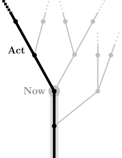

(a) actualist

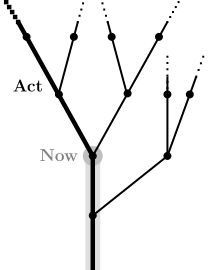

(b) possibilist

Figure 10: B-theoretical actual futurism: actualist (left) and possibilist (right) variants. [An extended description of figure 10 is in the supplement.]

Forward orientation can also be joined with temporal orientation, resulting in a *tensed* version of actual futurism. According to tensed actual futurism, one history (the actual one) is *presently* privileged over all the others, or it is the only one that exists. This view is internally consistent, but is in tension with indeterminism, and it has never been extensively defended in the literature (see De Florio & Frigerio 2022 for a discussion). Tensed actual futurism also admits of a “dynamic” variant, known as *mutable futurism*, in which the privileged future can *change* across time. Mutable futurism is clearly consistent with indeterminism, but it requires us to make sense of the puzzling idea of a changing future (for discussions, see Todd 2016b and Andreoletti & Spolaore 2021)[^andreoletti-2021][^todd-2016b][^todd-2021].

#### 4.1.3 Asymmetry views

Let us speak of *asymmetry views* to indicate the variants of the BT conception that combine forward neutrality with modal orientation. In asymmetry views, there exists a unique, absolutely actual past, but no actual future. All asymmetry views are A-theoretical in character, and can be distinguished on the basis of their ontology.

In *no-futurist* asymmetry views, possible futures are conceived as abstract or general entities (e.g., Briggs & Forbes 2012; Todd 2021; Rosenkranz 2012; Rumberg 2016b)[^briggs-2012][^rosenkranz-2012][^rumberg-2016b][^todd-2021]. This was arguably Prior’s (1967a) own position (see, e.g., Hasle & Øhrstrøm 2016: 3411)[^hasle-2016]. Like actual futurists, no-futurists tend not to regard BT frames as literal representations of reality. A growing-block variant of this view is represented in Fig. 11.

*Figure 11:*

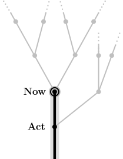

(a) first moment

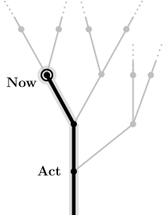

(b) next moment

Figure 11: A growing-block asymmetry view (at successive moments). [An extended description of figure 11 is in the supplement.]

In *eternalist* asymmetry views, futures are concrete courses of events. The most debated eternalist asymmetry view is the so-called *pruning* conception of branching time (McCall 1994, see Fig. 12)[^mccall-1994]. In the pruning conception, the only moments representing existing events are the unique present moment and those that are $\prec$-connected with it. Intuitively, the idea is that the whole tree changes over time: as presentness “moves” towards the future, all the moments that do not lie on its path go out of existence:

> Of all the possible futures […] one and only one becomes “actual”, i.e. becomes part of the past. The other branches vanish. The universe model is a tree that “grows” or ages by losing branches. (McCall 1994: 3)[^mccall-1994]

*Figure 12:*

(a) first moment

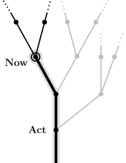

(a) next moment

Figure 12: Pruning (at successive moments). [An extended description of figure 12 is in the supplement.]

In *possibilist* asymmetry views, all possible moments exist, all past moments are actual, but only the unique present moment and its past are absolutely actual. Intuitively, the idea is that of a ‘moving dot’ of presentness that travels along the tree towards the future, leaving a trace of actuality (for discussions, see Barnes & Cameron 2011; MacFarlane 2014: 212)[^barnes-2011][^barnes-2011-2][^macfarlane-2014]; Wawer 2016: 170–172).

The main objections to asymmetry views essentially coincide with the main objections to the A-theory of time: both would introduce postulates, such as the existence of an absolute present and of very strong temporal asymmetries, which lack scientific justification in light of present-day physics. On their side, the advocates of asymmetry have a variety of traditional A-theoretical replies to these objections at their disposal, spanning from strong rebuttals (e.g., insist that the first-person evidence for their view that comes from our conscious experience outweighs any scientific and methodological consideration one may label against it) to more modest defenses (e.g., suggest that for all we know, future developments in physics could ultimately favor the A-theory). For overviews of the debate on the physical respectability of the A-theory, see the entries on presentism (§8) and time (§11).

*Table 1: Metaphysical views about branching time, with selected references*

|   | **Temporal neutrality** | **Temporal orientation** |
| --- | --- | --- |
| **Forward neutrality** | **BT (BST) realism**: *strong* (see Wawer 2014; Barnes & Cameron 2011 for discussions)[^barnes-2011][^barnes-2011-2][^wawer-2014], *modal version* (Belnap, Perloff, & Xu 2001; Belnap, Müller, & Placek 2022)[^belnap-2022][^belnap-2001] | **Tensed BT realism** (Abruzzese 2001; see also Belnap, Müller, & Placek 2022: 8)[^abruzzese-2001][^belnap-2022]; **asymmetry views:** *pruning* (McCall 1994)[^mccall-1994]; *no-futurism* (Briggs & Forbes 2012; Todd 2021)[^briggs-2012][^todd-2021]; “*moving dot*” (see Barnes & Cameron 2011 for discussions)[^barnes-2011][^barnes-2011-2]. |
| **Forward orientation** | **Actual futurism** (Borghini & Torrengo 2013; Iacona 2014; Torrengo & Iaquinto 2020)[^borghini-2013][^iacona-2014][^torrengo-2020] | **Tensed actual futurism:** “*static future*” *version* (see De Florio & Frigerio 2022 for discussions), *mutable futurism* (Todd 2016b)[^todd-2016b] |

#### 4.1.4 Semantics and metaphysics

Let us conclude this subsection by outlining some natural connections between the versions of the BT conception discussed so far (see Table 1) and the branching time semantics introduced in the previous section. Recognizing these connections helps to better understand and assess metaphysical or semantical choices, but natural connections should not be confused with logical entailments: the choice of a semantics does not need to determine the choice of a metaphysic, and vice versa (see Wawer 2016: 6.5, for a discussion of this point)[^wawer-2016]. Looking back at the semantics introduced in §3, we can distinguish between two general strands. On the one hand, we have semantics in which bivalence is preserved and there are true future contingents. In these semantics, we can say that one future is *alethically* privileged over all the others, i.e., the future where all true future contingents are true. The advocates of these semantics are generally called *true futurists*. Standard TRL views are true futurist semantics in this sense. Philosophers who oppose true futurism, and think that all possible futures are alethically on a par, are called *open futurists*. Paradigmatic open futurist semantics include supervaluationism, relativism and Peirceanism.

- **True futurism.** One future is alethically privileged over all the others.
- **Open futurism.** All futures are alethically on a par.

Forward neutrality, the view that no future is metaphysically privileged over all the others, tends to correlate with open futurism. If there is no unique actual future, one is naturally led to think, then there is nothing against which future contingents can be assessed as true. As just seen, forward neutrality is consistent with two kinds of positions: BT realism and asymmetry views. Let us start with the latter.

Most advocates of asymmetry views subscribe to both future neutrality and open futurism (e.g., Prior 1967a; Rhoda 2011; Todd 2016a, 2021)[^prior-1967a][^rhoda-2011][^todd-2016a][^todd-2021]. However, a few A-theorists disagree on this point and combine future neutrality with true futurism (Westphal 2006; Rosenkranz 2012; see also Baia 2012; Wawer 2016; and Correia & Rosenkranz 2018)[^baia-2012][^correia-2018][^rosenkranz-2012][^wawer-2016][^westphal-2006]. “Deviant” combinations like these, in which semantics and metaphysics seem to pull in different directions, are generally based on non-standard views concerning truth. More specifically, both Westphal and Rosenkranz give up the traditional principle that truth is grounded in (or supervenes on) reality.

BT realists tend to be open futurists, but unlike the advocates of asymmetry views, they reject the very notion of absolute actuality as meaningless, or empty. For this reason, they tend to favor different semantic approaches. From a BT realist perspective, as Belnap, Perloff, and Xu (2001: 6B.7) have stressed, future contingents are semantically similar to (contingent) open formulae: just like one cannot evaluate “$x$ is red” without specifying an assignment of value to $x$, so one cannot sensibly assess (1) relative to a moment alone. Thus, future contingents can only be sensibly assessed relative to points of evaluation where their truth-value is settled. For this reason, Belnap, Perloff, and Xu (2001) adopt Ockhamist semantics and insist that future contingents can only be evaluated when both a moment *and* a history parameter are provided. However, this is not the only choice available for BT realists—for instance, they can also subscribe to some form of relativist semantics (MacFarlane 2003, 2008)[^macfarlane-2003][^macfarlane-2008].

Generally, actual futurists adopt some form of true futurist semantics (e.g., Malpass & Wawer 2012; Wawer 2014; see also Andreoletti & Spolaore 2021)[^andreoletti-2021][^malpass-2012][^wawer-2014]. This is a natural choice: if one holds that the actual future exists, one is led to think that future-tensed statements are to be assessed against it, and vice versa. But it is not a forced one, and some actual futurist favors Ockhamist semantics instead (Iacona 2014)[^iacona-2014].

### 4.2 General challenges to the branching time conception

So far, we have discussed the main variants of the BT conception and some objections that may be labeled against each of them. In this subsection, we briefly introduce a few, very general objections, which apply to most or all variants of the BT conception. These are general challenges to the very idea that trees, however understood, are better suited to represent our indeterministic universe than alternative, non-tree-like structures. Here, we focus on challenges concerning two key tenets of the BT conception: *forward* *branching* and *No backward branching*.

*Forward branching* is the view that our indeterministic universe and its tense-modal features are best represented in terms of a plurality of possible futures following a certain specific moment/event. This conception of indeterminism has been called *Aristotelian* in Placek and Belnap (2012) (see also Müller 2012)[^müller-2012]. In the Aristotelian conception, indeterminism is a *modal* notion, having to do with future-directed possibilities. The Aristotelian conception can be contrasted with other approaches, in which indeterminism is characterized in terms of similarity and divergence between different models (see, e.g., Montague 1974; Earman 1986)[^earman-1986][^montague-1974] or different worlds (see above, §2.2; see also Lewis 1986)[^lewis-1986], or by resorting to a primitive notion of indeterminacy (see, e.g., Barnes & Cameron 2009)[^barnes-2009]. Let us note that forward branching presupposes that, in some sense, different possibilities can share certain objects or events. This view is part of the standard Kripkean (1963, 1980) approach to modality, in which the domains of different worlds may include one and the same entity. In fact, BT frames have also been used by philosophers such as Prior (1960) and J. L. Mackie (1974) to vindicate the standard approach, by offering reasonably clear sufficient conditions for an entity to participate in alternative courses of events (see P. Mackie 2006 for a discussion of these attempts; see also Placek & Belnap 2012 and the entry on transworld identity)[^belnap-2012][^mackie-2006][^placek-2012][^placek-2012-2]. The idea that different worlds may share parts (in a literal, realist sense) has been famously criticized by Lewis (1986: 4.2), who maintained that distinct possible worlds have no object or event in common, that is, are all pairwise mereologically disjoint (see mereology). This Lewisian conception of possible worlds is called *divergence*.

A metaphysical objection to forward branching is due to Barnes & Cameron (2011), who contend that, by resorting to trees, we cannot model contingent “doomsday” situations, where it is indeterminate *whether anything will happen at all*.

> The problem is that the absence of further branches from a node doesn’t represent the further open possibility that nothing will happen beyond that node, it simply represents the absence of further open possibilities. (2011: 15)

Let us call this the *doomsday* objection to branching time. From a technical viewpoint, the objection is based on the fact that histories, as standardly defined, are maximal sequences of moments (see above, §2.1), and thus no history can properly include another history. Standard as this definition may be, however, it is unclear whether is forced upon BT theorists. Arguably, the doomsday objection has weight only against BT theorists who subscribe to a *moment-based* conception of histories, in which histories are completely determined by their constituent moments (see Andreoletti 2022)[^andreoletti-2022], as opposed to views in which histories are not defined in terms of moments, such as, for instance, in van Benthem’s (1999) geometrical approach to BT (see above, §2.1). Moreover, the objection assumes that philosophers have a univocal, shared notion of what a contingent doomsday would consist in, which is contentious (see Todd forthcoming).

Many BT theorists look to quantum mechanics as a core motivation for subscribing to indeterminism and, consequently, to forward branching (see, e.g., Placek & Belnap 2012; Belnap, Müller, & Plackek 2022)[^belnap-2012][^belnap-2022][^placek-2012][^placek-2012-2]. The underlying reasoning is that quantum indeterminacy entails indeterminism, and indeterminism is best modeled by resorting to forward branching. This train of thought may be called the *quantum argument* for forward branching. Initially plausible as it may be, the quantum argument has at least three problems. Although neither of these problems is untreatable (and arguably, mature BT conceptions such as modal BT/BST realism have the resources to address them), they should be taken into account.

The first problem is that not every interpretation of quantum mechanics is indeterministic. More specifically, the many-worlds interpretation, in which the forward branching process is taken at face value, is deterministic at the fundamental level, and all the indeterminacy (if any) posited by the theory is restricted to derivative aspects of the ontology (see, e.g., Wilson 2020)[^wilson-2020]. Moreover, according to some philosophers, the ontology of the many-worlds interpretation is also consistent with a divergence (rather than branching) conception of worlds (Saunders 2010; Wilson 2012)[^saunders-2010][^wilson-2012]. Thus, in general, philosophers who subscribe to the quantum argument should be clear as to what interpretation of quantum mechanics they are presupposing and how it accounts for the branching process.

Secondly, one can doubt that quantum indeterminacy can be interpreted as unsettledness between pairs of determinate (classical) states of affairs, and some authors (e.g., Skow 2010; Darby 2010)[^darby-2010][^skow-2010] have independently argued that it cannot (but see Mariani, Michels, & Torrengo 2024 for a different view)[^mariani-2024].

Thirdly, the relation between quantum indeterminacy and dynamical indeterminism is not obvious, and most scholars tend to agree that, at least in principle, they are independent notions (see Calosi & Mariani 2021 for a recent review of the debate on quantum indeterminacy)[^calosi-2021]. Thus, the advocates of the quantum argument should be very clear as to the connections they posit between quantum indeterminacy and indeterminism.

Let us turn to the second potentially problematic aspect of the BT conception, i.e., No backward branching, according to which each moment has a unique (possible) past. As mentioned above, the main motivations for the principle are philosophical: keeping as clear and neat as possible the distinctions between (i) particular events and repeatable (qualitative or informational) states, and (ii) historical (objective) modality and epistemic modality.

Against No backward branching, one can argue that the time asymmetry it introduces lacks physical justification, for at least two reasons (see Earman 2008; Farr 2012)[^earman-2008][^farr-2012]. Firstly, because under certain natural assumptions, all known fundamental laws of physics are time-reversal invariant. Thus, in a very standard sense of indeterminism, our universe is indeterministic in both temporal directions: assuming all present events are kept fixed, it is indeterminate what events will happen in the future *and also* what events had happened in the past. Secondly, because the time asymmetries that we observe in our experience and in science are commonly explained in terms of an asymmetry in the boundary conditions of the universe and not of a fundamental asymmetry in the laws of nature (see Albert 2000; Loewer 2012; Kutach 2013; Farr 2022)[^albert-2000][^farr-2022][^kutach-2013][^loewer-2012]. If so, in the words of Farr (2012: 114):

> there is insufficient reason to think that [the observable asymmetries] constitute, or provide evidence of the existence of, a time-asymmetric modal structure of the world.

BT theorists can reply to both these objections. On the one hand, they can insist that time reversibility is relevant only when the focus is on qualitative or epistemic states as opposed to particular, non repeatable events. In their view, the very idea of two alternative particular events temporally or causally followed by a unique particular event is absurd.

> No sense can be made of two alternative possible evolutions, separate before some event and combining into a single evolution after it. (Placek & Belnap 2012: 465)[^belnap-2012][^placek-2012][^placek-2012-2]

On the other hand, BT theorists can subscribe to a primitivist conception of the direction of time, according to which observable time asymmetries depend on a fundamental asymmetry in the laws of nature (see Maudlin 2002, 2007)[^maudlin-2002][^maudlin-2007].

## References（引用注释）

> 原文参考文献已转为脚注引用：文内“作者-年份”引用组后附 [^key] 标记，完整条目见本文末脚注定义。

## Academic Tools

> |   | [How to cite this entry](https://plato.stanford.edu/cgi-bin/encyclopedia/archinfo.cgi?entry=branching-time). |
> | --- | --- |
> |   | [Preview the PDF version of this entry](https://leibniz.stanford.edu/friends/preview/branching-time/) at the [Friends of the SEP Society](https://leibniz.stanford.edu/friends/). |
> |   | [Look up topics and thinkers related to this entry](https://www.inphoproject.org/entity?sep=branching-time&redirect=True) at the Internet Philosophy Ontology Project (InPhO). |
> |   | [Enhanced bibliography for this entry](https://philpapers.org/sep/branching-time/) at [PhilPapers](https://philpapers.org/), with links to its database. |

## Other Internet Resources

- [Arthur Prior](https://iep.utm.edu/prior-an/)
- [Arthur Prior and the foundations of temporal logic](https://research.prior.aau.dk/priorstudies)
- [Time](https://iep.utm.edu/time/)
- [Future contingents](https://iep.utm.edu/fut-cont/)

## Related Entries

determinism: causal | future contingents | future contingents: medieval theories of | identity: transworld | logic: temporal | possible objects | possible worlds | relativism | time

### Acknowledgments

This entry is dedicated to the memory of Nuel Belnap.

We are grateful to an anonymous reviewer and to Giacomo Andreoletti, Fabrizio Cariani, Ciro De Florio, Andrea Iacona, Aldo Frigerio, Cristian Mariani, Angelo Montanari, Thomas Müller, Elisa Paganini, Tomasz Placek, Antje Rumberg, Patrick Todd, Giuliano Torrengo, and Jacek Wawer for useful comments and suggestions.

## Notes（原文脚注）

[^note-1]: Given that, in BT representations, branching affects histories and not time, the expression “branching time” can be misleading. Still, it is part of the established terminology and we shall stick to it in this entry.

[^note-2]: Various meanings are attributed to the word “tree” in different disciplines, often clarified by adjectives. At this stage, we prefer to resort to an intuitive characterization of the notion of tree that is relevant here. See below, in this section and §2.1, for formal definitions.

[^note-3]: Real possibilities involving agents can be also studied by resorting to suitable logics of action such as *stit* logics (for overviews on stit logics, see the entry on the logic of action, §1.2, and Belnap, Perloff, & Xu 2001: 1)[^belnap-2001].

[^note-4]: For treatments of knowledge and other attitudes in a traditional, No backward branching setting, see, e.g., Belnap 2002; Wansing 2006, 2015; Thomason 2007; Giaretta & Spolaore 2019; Todd 2021.

[^note-5]: As shown in Visser (2017), the existence of a synchronism on arbitrary trees is a rather subtle matter.

[^note-6]: In Sabbadin & Zanardo (2003) and Zanardo (2006a) it is shown that, at least from a technical point of view, the original perspective can be inverted: we can start with only a primitive notion of history and define moments as sets of histories. The result is reached by assuming either that the set of histories has a topological structure or that it is endowed with a *relative closeness* relation.

[^note-7]: For detailed introductions to BT logics and semantics, see the entries on future contingents, §§3–5, and temporal logic, §5.

[^note-8]: After Luis Molina, who thought that God knows what *would* contingently happen in any possible circumstance. See the entry on future contingents for further details.

[^note-9]: Recursive approaches based on a TRL function have been also proposed to provide semantic analysis for counterfactuals in a BT setting; see Thomason & Gupta (1980); Wawer (2022).

[^note-10]: Thus, the Peircean weak and strong future operators can be expressed in the Ockhamist language as $\Diamond\mathsf F$ and $\Box\mathsf F$, respectively. This implies that the Peircean logic can be viewed as a fragment of the Ockhamist logic. In Zanardo (1998) and in the more elaborate and comprehensive Rumberg (2016a,b) it is shown that Peircean and Ockhamist semantics can be included (as limiting cases) in a unified framework.

[^note-11]: See Rumberg (2016a: 106), for an alternative approach to assessment-sensitivity in a BT setting.

[^note-12]: In works on temporal logic, the operator $\mathsf U$ is generally accompanied by the corresponding past operator $\mathsf S$ (*Since*), whose semantics is the “mirror image” of that of $\mathsf U$. This sometimes also happens in temporal logics for CS (Gabbay, Pnueli, Shelah, & Stavi 1980)[^gabbay-1980].

[^note-13]: Hereafter, we omit to specify that reference is to *standard* A-theorists. Nonstandard A-theorists such as *fragmentalists* and *external relativists* are akin to B-theorists in subscribing to temporal neutrality (see Fine 2005)[^fine-2005].

[^note-14]: See Placek & Belnap (2012: 36), and MacFarlane (2014: 211), for similar replies.

[^abruzzese-2001]: Abruzzese, John, 2001, “On Using the Multiverse to Avoid the Paradoxes of Time Travel”, *Analysis*, 61(1): 36–38. doi:10.1093/analys/61.1.36

[^albert-2000]: Albert, David Z., 2000, *Time and Chance*, Cambridge, MA: Harvard University Press.

[^andreoletti-2022]: Andreoletti, Giacomo, 2022, “Branching Time and Doomsday”, *Ratio*, , new series 35(2): 79–90. doi:10.1111/rati.12328

[^andreoletti-2021]: Andreoletti, Giacomo and Giuseppe Spolaore, 2021, “The Future Ain’t What It Used to Be: Strengthening the Case for Mutable Futurism”, *Synthese*, 199(3–4): 10569–10585. doi:10.1007/s11229-021-03259-5

[^asher-2009]: Asher, Nicholas, Josh Dever, and Chris Pappas, 2009, “Supervaluations Debugged”, *Mind*, 118(472): 901–933. doi:10.1093/mind/fzp107

[^baia-2012]: Baia, Alex, 2012, “Presentism and the Grounding of Truth”, *Philosophical Studies*, 159(3): 341–356. doi:10.1007/s11098-011-9711-8

[^barnes-2009]: Barnes, Elizabeth and Ross P. Cameron, 2009, “The Open Future: Bivalence, Determinism and Ontology”, *Philosophical Studies*, 146(2): 291–309. doi:10.1007/s11098-008-9257-6

[^barnes-2011]: –––, 2011, “Back to the Open Future”, *Philosophical Perspectives*, 25(1): 1–26. doi:10.1111/j.1520-8583.2011.00206.x

[^barnes-2011-2]: Barnes, Elizabeth and J. Robert G. Williams, 2011, “A Theory Of Metaphysical Indeterminacy”, in *Oxford Studies in Metaphysics: Volume 6*, Karen Bennett and Dean W. Zimmerman (eds), Oxford/New York: Oxford University Press, 103–148.

[^belnap-1992]: Belnap, Nuel, 1992, “Branching Space-Time”, *Synthese*, 92(3): 385–434. doi:10.1007/BF00414289

[^belnap-2002]: –––, 2002, “Double Time References: Speech-Act Reports as Modalities in an Indeterminist Setting”, in *Advances in Modal Logic, Volume 3*, Frank Wolter, Heinrich Wansing, Maarten De Rijke, and Michael Zakharyaschev (eds), Singapore: World Scientific, 37–58. doi:10.1142/9789812776471_0003

[^belnap-2005]: –––, 2005, “A Theory of Causation: *Causae Causantes* (Originating Causes) as Inus Conditions in Branching Space-Times”, *The British Journal for the Philosophy of Science*, 56(2): 221–253. doi:10.1093/bjps/axi115

[^belnap-2012]: Belnap, Nuel, 2012, “Newtonian Determinism to Branching Space-Times Indeterminism in Two Moves”, *Synthese*, 188(1): 5–21. doi:10.1007/s11229-012-0063-5

[^belnap-1994]: Belnap, Nuel and Mitchell Green, 1994, “Indeterminism and the Thin Red Line”, *Philosophical Perspectives*, 8: 365–388. doi:10.2307/2214178

[^belnap-2022]: Belnap, Nuel, Thomas Müller, and Tomasz Placek, 2022, *Branching Space-Times: Theory and Applications*, New York: Oxford University Press. doi:10.1093/oso/9780190884314.001.0001

[^belnap-2001]: Belnap, Nuel, Michael Perloff, and Ming Xu, 2001, *Facing the Future: Agents and Choices in Our Indeterminist World*, Oxford/New York: Oxford University Press. doi:10.1093/oso/9780195138788.001.0001

[^benovsky-2013]: Benovsky, Jiri, 2013, “Branching and (In)Determinism”, *Philosophical Papers*, 42(2): 151–173. doi:10.1080/05568641.2013.806286

[^besson-2014]: Besson, Corine and Anandi Hattiangadi, 2014, “The Open Future, Bivalence and Assertion”, *Philosophical Studies*, 167(2): 251–271. doi:10.1007/s11098-012-0041-2

[^borghini-2013]: Borghini, Andrea and Giuliano Torrengo, 2013, “The Metaphysics of the Thin Red Line”, in Correia and Iacona 2013: 105–125. doi:10.1007/978-94-007-5167-5_7

[^braüner-2023]: Braüner, Torben, 2023, “The True Futures”, *Synthese*, 202(5): article 162. doi:10.1007/s11229-023-04386-x

[^braüner-1998]: Braüner, Torben, Per Hasle, and Peter Øhrstrøm, 1998, “Ockhamistic Logics and True Futures of Counterfactual Moments”, in *Proceedings of the Fifth International Workshop on Temporal Representation and Reasoning*, Lina Khatib and Robert Morris (eds), Piscataway, NJ: IEEE Press, 132–139. doi:10.1109/TIME.1998.674142

[^bricker-2006]: Bricker, Phillip, 2006, “Absolute Actuality and the Plurality of Worlds”, *Philosophical Perspectives*, 20(1): 41–76. doi:10.1111/j.1520-8583.2006.00102.x

[^briggs-2012]: Briggs, Rachael and Graeme A. Forbes, 2012, “The Real Truth about the Unreal Future”, in *Oxford Studies in Metaphysics Volume 7*, Karen Bennet and Dean Zimmerman (eds), Oxford: Oxford University Press, 257–304 (ch. 9). doi:10.1093/acprof:oso/9780199659081.003.0009

[^broad-1923]: Broad, Charlie Dunbar, 1923, *Scientific Thought*, London: Kegan Paul.

[^burgess-1979]: Burgess, John P., 1979, “Logic and Time”, *Journal of Symbolic Logic*, 44(4): 566–582. doi:10.2307/2273296

[^calosi-2021]: Calosi, Claudio and Cristian Mariani, 2021, “Quantum Indeterminacy”, *Philosophy Compass*, 16(4): e12731. doi:10.1111/phc3.12731

[^cameron-2015]: Cameron, Ross P., 2015, *The Moving Spotlight: An Essay on Time and Ontology*, Oxford: Oxford University Press. doi:10.1093/acprof:oso/9780198713296.001.0001

[^cariani-2021a]: Cariani, Fabrizio, 2021a, “Human Foreknowledge”, *Philosophical Perspectives*, 35(1): 50–69. doi:10.1111/phpe.12158

[^cariani-2021b]: –––, 2021b, *The Modal Future: A Theory of Future-Directed Thought and Talk*, Cambridge/New York: Cambridge University Press. doi:10.1017/9781108668514

[^correia-2013]: Correia, Fabrice and Andrea Iacona (eds), 2013, *Around the Tree: Semantic and Metaphysical Issues Concerning Branching and the Open Future* (Synthese Library 361), Dordrecht/New York: Springer. doi:10.1007/978-94-007-5167-5

[^correia-2018]: Correia, Fabrice and Sven Rosenkranz, 2018, *Nothing to Come: A Defence of the Growing Block Theory of Time* (Synthese Library, volume 395), Cham: Springer. doi:10.1007/978-3-319-78704-6

[^darby-2010]: Darby, George, 2010, “Quantum Mechanics and Metaphysical Indeterminacy”, *Australasian Journal of Philosophy*, 88(2): 227–245. doi:10.1080/00048400903097786

[^de-2022]: De Florio, Ciro and Aldo Frigerio, 2022, “A Too Thin True Future: The Problem of Grounding Within Presentist TRL Semantics”, in Santelli 2022: 93–115. doi:10.1007/978-3-030-90359-6_6

[^de-2024]: –––, 2024, “Future and Negation”, *Erkenntnis*, 89(5): 1781–1801. doi:10.1007/s10670-022-00603-0

[^deasy-2015]: Deasy, Daniel, 2015, “The Moving Spotlight Theory”, *Philosophical Studies*, 172(8): 2073–2089. doi:10.1007/s11098-014-0398-5

[^di-1994]: Di Maio, Maria Concetta and Alberto Zanardo, 1994, “Synchronized Histories in Prior-Thomason Representation of Branching Time”, in *First International Conference on Temporal Logic, ICTL ’94* (Lecture Notes in Computer Science 827), Dov M. Gabbay and Hans Jürgen Ohlbach (eds), Berlin/Heidelberg: Springer, 265–282. doi:10.1007/BFb0013993

[^earman-1986]: Earman, John, 1986, *A Primer on Determinism* (University of Western Ontario Series in Philosophy of Science 32), Dordrecht/Boston: D. Reidel.

[^earman-2008]: –––, 2008, “Pruning Some Branches from ‘Branching Spacetimes’”, in *Philosophy and Foundations of Physics, Volume 4: The Ontology of Spacetime II*, Dennis Dieks (ed.), Amsterdam: Elsevier, 187–205. doi:10.1016/S1871-1774(08)00010-7

[^emerson-1990]: Emerson, E. Allen, 1990, “Temporal and Modal Logic”, in *Formal Models and Semantics* (Handbook of Theoretical Computer Science, B), Jan van Leeuwen (ed.), Amsterdam/New York: Elsevier and Cambridge, MA: MIT Press, 995–1072 (ch. 16). doi:10.1016/B978-0-444-88074-1.50021-4

[^emerson-1982]: Emerson, E.Allen and Edmund M. Clarke, 1982, “Using Branching Time Temporal Logic to Synthesize Synchronization Skeletons”, *Science of Computer Programming*, 2(3): 241–266. doi:10.1016/0167-6423(83)90017-5

[^farr-2012]: Farr, Matt, 2012, “On *A*- and *B*-Theoretic Elements of Branching Spacetimes”, *Synthese*, 188(1): 85–116. doi:10.1007/s11229-011-0046-y

[^farr-2022]: –––, 2022, “What’s so Special About Initial Conditions? Understanding the Past Hypothesis in Directionless Time”, in *Rethinking the Concept of Law of Nature: Natural Order in the Light of Contemporary Science*, Yemima Ben-Menahem (ed.), Cham: Springer, 205–224. doi:10.1007/978-3-030-96775-8_8

[^fine-1975]: Fine, Kit, 1975, “Vagueness, Truth and Logic”, *Synthese*, 30(3–4): 265–300. doi:10.1007/BF00485047

[^fine-2005]: –––, 2005, *Modality and Tense: Philosophical Papers*, Oxford: Oxford University Press. doi:10.1093/0199278709.001.0001

[^gabbay-1980]: Gabbay, Dov, Amir Pnueli, Saharon Shelah, and Jonathan Stavi, 1980, “On the Temporal Analysis of Fairness”, in *Proceedings of the 7th ACM SIGPLAN-SIGACT Symposium on Principles of Programming Languages - POPL ’80*, Las Vegas: ACM Press, 163–173. doi:10.1145/567446.567462

[^giaretta-2019]: Giaretta, Pierdaniele and Giuseppe Spolaore, 2019, “Knowledge and Ockhamist Branching Time”, in *Third Pisa Colloquium in Logic, Language and Epistemology: Essays in Honour of Mauro Mariani and Carlo Marletti*, Luca Bellotti, Luca Gili, Enrico Moriconi, and Giacomo Turbanti (eds), Pisa: ETS, 181–197.

[^goranko-2023]: Goranko, Valentin, Ruaan Kellerman, and Alberto Zanardo, 2023, “Structural Theory of Trees I. Branching and Condensations of Trees”, *Contributions to Discrete Mathematics*, 18(2): 188–209. doi:10.55016/ojs/cdm.v18i2.74004

[^hasle-2016]: Hasle, Per and Peter Øhrstrøm, 2016, “Prior’s Paradigm for the Study of Time and Its Methodological Motivation”, *Synthese*, 193(11): 3401–3416. doi:10.1007/s11229-016-1161-6

[^iacona-2013]: Iacona, Andrea, 2013, “Timeless Truth”, in Correia and Iacona 2013: 29–45. doi:10.1007/978-94-007-5167-5_2

[^iacona-2014]: –––, 2014, “Ockhamism without Thin Red Lines”, *Synthese*, 191(12): 2633–2652. doi:10.1007/s11229-014-0405-6

[^iacona-2022]: –––, 2022, “Knowledge of Future Contingents”, *Philosophical Studies*, 179(2): 447–467. doi:10.1007/s11098-021-01666-5

[^iacona-2023]: Iacona, Andrea and Samuele Iaquinto, 2023, “Postsemantic Peirceanism”, *American Philosophical Quarterly*, 60(3): 249–256. doi:10.5406/21521123.60.3.03

[^kaplan-1989]: Kaplan, David, 1989, “Demonstratives. An Essay on the Semantics, Logic, Metaphysics, and Epistemology of Demonstratives and Other Indexicals”, in *Themes from Kaplan*, Joseph Almog, John Perry, and Howard Wettstein (eds), New York: Oxford University Press, 481–563.

[^kripke-1963]: Kripke, Saul A., 1963, “Semantical Considerations on Modal Logic.”, *Acta Philsophica Fennica*, 16: 83–94.

[^kripke-1980]: –––, 1980, *Naming and Necessity*, Cambridge, MA: Harvard University Press.

[^kutach-2013]: Kutach, Douglas, 2013, *Causation and Its Basis in Fundamental Physics* (Oxford Studies in Philosophy of Science), New York, NY: Oxford University Press. doi:10.1093/acprof:oso/9780199936205.001.0001

[^lewis-1970]: Lewis, David K., 1970, “How to Define Theoretical Terms”, *The Journal of Philosophy*, 67(13): 427–446. doi:10.2307/2023861

[^lewis-1986]: –––, 1986, *On the Plurality of Worlds*, Oxford/New York: B. Blackwell.

[^loewer-2012]: Loewer, Barry, 2012, “Two Accounts of Laws and Time”, *Philosophical Studies*, 160(1): 115–137. doi:10.1007/s11098-012-9911-x

[^macfarlane-2003]: MacFarlane, John, 2003, “Future Contingents and Relative Truth”, *The Philosophical Quarterly*, 53(212): 321–336. doi:10.1111/1467-9213.00315

[^macfarlane-2008]: –––, 2008, “Truth in the Garden of Forking Paths”, in *Relative Truth*, Manuel García-Carpintero and Max Kölbel (eds), Oxford: Oxford University Press, 81–102. doi:10.1093/acprof:oso/9780199234950.003.0004

[^macfarlane-2014]: –––, 2014, *Assessment Sensitivity: Relative Truth and Its Applications* (Context and Content), Oxford: Oxford University Press. doi:10.1093/acprof:oso/9780199682751.001.0001

[^macfarlane-2024]: MacFarlane, John, forthcoming, “Why Future Contingents Are Not All False”, *Analytic Philosophy*, first online: 17 January 2024. doi:10.1111/phib.12334

[^mackie-1974]: Mackie, John Leslie, 1974, “*De* What *Re* Is *De Re* Modality?”, *The Journal of Philosophy*, 71(16): 551–561. doi:10.2307/2025231

[^mackie-2006]: Mackie, Penelope, 2006, *How Things Might Have Been: Individuals, Kinds, and Essential Properties*, Oxford/New York: Clarendon Press. doi:10.1093/0199272204.001.0001

[^malpass-2013]: Malpass, Alex Peter, 2013, “Fara’s Formula and the Supervaluational Thin Red Line”, *Theoria. An International Journal for Theory, History and Foundations of Science*, 28(2): 267–282. doi:10.1387/theoria.4619

[^malpass-2012]: Malpass, Alex and Jacek Wawer, 2012, “A Future for the Thin Red Line”, *Synthese*, 188(1): 117–142. doi:10.1007/s11229-012-0064-4

[^mariani-2024]: Mariani, Cristian, Robert Michels, and Giuliano Torrengo, 2024, “Plural Metaphysical Supervaluationism”, *Inquiry*, 67(6): 2005–2042. doi:10.1080/0020174X.2021.1982404

[^maudlin-2002]: Maudlin, Tim, 2002, “Remarks on the Passing of Time”, *Proceedings of the Aristotelian Society*, 102: 259–274. doi:10.1111/1467-9264.00118

[^maudlin-2007]: –––, 2007, *The Metaphysics within Physics*, Oxford/New York: Oxford University Press. doi:10.1093/acprof:oso/9780199218219.001.0001

[^mccall-1994]: McCall, Storrs, 1994, *A Model of the Universe: Space-Time, Probability, and Decision* (Clarendon Library of Logic and Philosophy), Oxford/New York: Clarendon Press. doi:10.1093/acprof:oso/9780198236221.001.0001

[^mckim-1976]: McKim, Vaughn R. and Charles C. Davis, 1976, “Temporal Modalities and the Future”, *Notre Dame Journal of Formal Logic*, 17(2): 233–238. doi:10.1305/ndjfl/1093887526

[^meyer-2016]: Meyer, Ulrich, 2016, “Fatalism as a Metaphysical Thesis”, *Manuscrito*, 39(4): 203–223. doi:10.1590/0100-6045.2016.v39n4.um

[^montague-1974]: Montague, Richard, 1974, “Deterministic Theories”, in *Formal Philosophy: Selected Papers of Richard Montague*, Richmond H. Thomason (ed.), New Haven/London: Yale University Press, 303–359.

[^müller-2010]: Müller, Thomas, 2010, “Towards a Theory of Limited Indeterminism in Branching Space-Times”, *Journal of Philosophical Logic*, 39(4): 395–423. doi:10.1007/s10992-010-9138-2

[^müller-2012]: –––, 2012, “Branching in the Landscape of Possibilities”, *Synthese*, 188(1): 41–65. doi:10.1007/s11229-011-0059-6

[^müller-2013]: –––, 2013, “A Generalized Manifold Topology for Branching Space-Times”, *Philosophy of Science*, 80(5): 1089–1100. doi:10.1086/673895

[^ninan-2023]: Ninan, Dilip, 2023, “Relativism and Two Kinds of Branching Time”, *Pacific Philosophical Quarterly*, 104(2): 465–492. doi:10.1111/papq.12418

[^øhrstrøm-1981]: Øhrstrøm, Peter, 1981, “Problems Regarding the Future Operator in an Indeterministic Tense Logic”, *Danish Yearbook of Philosophy*, 18(1): 81–95. doi:10.1163/24689300-01801005

[^øhrstrøm-1995]: Øhrstrøm, Peter and Per F. V. Hasle, 1995, *Temporal Logic: From Ancient Ideas to Artificial Intelligence* (Studies in Linguistics and Philosophy 57), Dordrecht/Boston: Kluwer Academic Publishers. doi:10.1007/978-0-585-37463-5

[^placek-2010]: Placek, Tomasz, 2010, “Bell-Type Correlations in Branching Space-Times”, in *The Analytical Way: Proceedings of the 6th European Congress of Analytic Philosophy, Kraków, August 2008* (Studies in Logic: Logic and Cognitive Systems 25), Tadeusz Czarnecki, Katarzyna Kijania-Placek, Olga Poller, and Jan Woleński (eds), London: College Publications, 105–144.

[^placek-2012]: –––, 2012, “On Individuals in Branching Histories”, *Synthese*, 188(1): 23–39. doi:10.1007/s11229-012-0082-2

[^placek-2012-2]: Placek, Tomasz and Nuel Belnap, 2012, “Indeterminism Is a Modal Notion: Branching Spacetimes and Earman’s Pruning”, *Synthese*, 187(2): 441–469. doi:10.1007/s11229-010-9846-8

[^pnueli-1977]: Pnueli, Amir, 1977, “The Temporal Logic of Programs”, in *18th Annual Symposium on Foundations of Computer Science*, New York: IEEE, 46–57. doi:10.1109/SFCS.1977.32

[^pooley-2013]: Pooley, Oliver, 2013, “Relativity, the Open Future, and the Passage of Time”, *Proceedings of the Aristotelian Society*, 113(3): 321–363. doi:10.1111/j.1467-9264.2013.00357.x

[^prior-1960]: Prior, Arthur N., 1960, “Identifiable Individuals”, *Review of Metaphysics*, 13(4): 684–696.

[^prior-1962]: –––, 1962, “The Formalities of Omniscience”, *Philosophy*, 37(140): 114–129. doi:10.1017/S0031819100036780

[^prior-1966a]: –––, 1966a, “Postulates for Tense-Logic”, *American Philosophical Quarterly*, 3(2): 153–161.

[^prior-1966b]: –––, 1966b, “Time, Existence and Identity”, *Proceedings of the Aristotelian Society*, 66: 183–192. doi:10.1093/aristotelian/66.1.183

[^prior-1967a]: –––, 1967a, *Past, Present, and Future*, Oxford: Clarendon Press.

[^prior-1967b]: –––, 1967b, “Stratified Metric Tense Logic”, *Theoria*, 33(1): 28–38. doi:10.1111/j.1755-2567.1967.tb00607.x

[^prior-1968a]: –––, 1968a, “Tense Logic for Non-Permanent Existents”, in Prior 1968c: chap. XIX.

[^prior-1968b]: –––, 1968b, “The Logic of Ending Time”, in Prior 1968c: chap. XII.

[^prior-1968c]: –––, 1968c, *Papers on Time and Tense*, Oxford: Clarendon Press.

[^restall-2011]: Restall, Greg, 2011, “Molinism and the Thin Red Line”, in *Molinism: The Contemporary Debate*, Ken Perszyk (ed.), Oxford: Oxford University Press, 227–238 (ch. 14).

[^rhoda-2011]: Rhoda, Alan R., 2011, “The Fivefold Openness of the Future”, in *God in an Open Universe: Science, Metaphysics, and Open Theism*, William Hasker, Thomas J. Oord, and Deab Zimmerman (eds), Eugene, OR: Pickwick, 69–93.

[^rosenkranz-2012]: Rosenkranz, Sven, 2012, “In Defence of Ockhamism”, *Philosophia*, 40(3): 617–631. doi:10.1007/s11406-011-9337-2

[^rumberg-2016a]: Rumberg, Antje, 2016a, “Transition Semantics for Branching Time”, *Journal of Logic, Language and Information*, 25(1): 77–108. doi:10.1007/s10849-015-9231-6

[^rumberg-2016b]: –––, 2016b, *Transitions toward a Semantics for Real Possibility*, Doctoral thesis, Utrecht: Utrecht University. [[Rumberg 2016b available online](https://research-portal.uu.nl/en/publications/transitions-toward-a-semantics-for-real-possibility)]

[^sabbadin-2003]: Sabbadin, Michela and Alberto Zanardo, 2003, “Topological Aspects of Branching-Time Semantics”, *Studia Logica*, 75(3): 271–286. doi:10.1023/B:STUD.0000009560.90259.de

[^santelli-2022]: Santelli, Alessio (ed.), 2022, *Ockhamism and Philosophy of Time: Semantic and Metaphysical Issues Concerning Future Contingents* (Synthese Library 452), Cham: Springer. doi:10.1007/978-3-030-90359-6

[^saunders-2010]: Saunders, Simon, 2010, “Chance in the Everett Interpretation”, in *Many Worlds? Everett, Quantum Theory, and Reality*, Simon Saunders, Jonathan Barrett, Adrian Kent, and David Wallace (eds), Oxford: Oxford University Press, 181–205 (ch. 6). doi:10.1093/acprof:oso/9780199560561.003.0008

[^skow-2010]: Skow, Bradford, 2010, “Deep Metaphysical Indeterminacy”, *The Philosophical Quarterly*, 60(241): 851–858. doi:10.1111/j.1467-9213.2010.672.x

[^spolaore-2020]: Spolaore, Giuseppe and Francesco Gallina, 2020, “The Actual Future Is Open”, *Erkenntnis*, 85(1): 99–119. doi:10.1007/s10670-018-0020-x

[^stirling-1992]: Stirling, Colin, 1992, “Modal and Temporal Logics”, in *Handbook of Logic in Computer Science, Volume 2. Background: Computational Structures*, Samson Abramsky, Dov M. Gabbay, and Thomas S. E. Maibaum (eds), Oxford: Clarendon Press, 477–563. doi:10.1093/oso/9780198537618.003.0005

[^thomason-1970]: Thomason, Richmond H., 1970, “Indeterminist Time and Truth-Value Gaps”, *Theoria*, 36(3): 264–281. doi:10.1111/j.1755-2567.1970.tb00427.x

[^thomason-1984]: –––, 1984, “Combinations of Tense and Modality”, in *Handbook of Philosophical Logic, Volume II: Extensions of Classical Logic*, Dov M. Gabbay and Franz Guenthner (eds), (Synthese Library 165), Dordrecht: Reidel, Dordrecht, 135–165. doi:10.1007/978-94-009-6259-0_3

[^thomason-2007]: –––, 2007, “Three Interactions between Context and Epistemic Locutions”, in *Modeling and Using Context: 6th International and Interdisciplinary Conference* (Lecture Notes in Computer Science 4635), Boicho Kokinov, Daniel C. Richardson, Thomas R. Roth-Berghofer, and Laure Vieu (eds), Berlin/Heidelberg: Springer-Verlag, 467–481. doi:10.1007/978-3-540-74255-5_35

[^thomason-1980]: Thomason, Richmond H. and Anil Gupta, 1980, “A Theory of Conditionals in the Context of Branching Time”, *The Philosophical Review*, 89(1): 65–90. doi:10.2307/2184864

[^todd-2016a]: Todd, Patrick, 2016a, “Future Contingents Are All False! On Behalf of a Russellian Open Future”, *Mind*, 125(499): 775–798. doi:10.1093/mind/fzv170

[^todd-2016b]: –––, 2016b, “On Behalf of a Mutable Future”, *Synthese*, 193(7): 2077–2095. doi:10.1007/s11229-015-0830-1

[^todd-2021]: –––, 2021, *The Open Future: Why Future Contingents Are All False*, Oxford: Oxford University Press. doi:10.1093/oso/9780192897916.001.0001

[^todd-2024]: –––, forthcoming, “Defending The Open Future : Replies to MacFarlane , Green, Wasserman, and Bigg & Miller”, *Analytic Philosophy*, 26 June 2024. doi:10.1111/phib.12327

[^tooley-1997]: Tooley, Michael, 1997, *Time, Tense, and Causation*, Oxford: Clarendon Press. doi:10.1093/0198250746.001.0001

[^torrengo-2020]: Torrengo, Giuliano and Samuele Iaquinto, 2020, “The Invisible Thin Red Line”, *Pacific Philosophical Quarterly*, 101(3): 354–382. doi:10.1111/papq.12314

[^benthem-1996]: van Benthem, Johan, 1996, “Content versus Wrapping: An Essay in Semantic Complexity”, in *Arrow Logic and Multi-Modal Logic*, Maarten Marx, László Pólos, and Michael Masuch (eds), Stanford: CSLI Publications, 203–219.

[^benthem-1999]: van Benthem, Johan, 1999, “Temporal Patterns and Modal Structure”, *Logic Journal of the IGPL*, 7(1): 7–26. doi:10.1093/jigpal/7.1.7

[^fraassen-1966]: van Fraassen, Bas C., 1966, “Singular Terms, Truth-Value Gaps, and Free Logic”, *The Journal of Philosophy*, 63(17): 481–495. doi:10.2307/2024549

[^visser-2017]: Visser, Albert, 2017, “Sharing Time among Branches”, Logic Group Preprint Series, 340. [[Visser 2017 available online](https://dspace.library.uu.nl/handle/1874/394383)]

[^wansing-2006]: Wansing, Heinrich, 2006, “Doxastic Decisions, Epistemic Justification, and The Logic of Agency”, *Philosophical Studies*, 128(1): 201–227. doi:10.1007/s11098-005-4063-x

[^wansing-2015]: –––, 2015, “Knowability Remixed”, in *Foundations of Logical Consequence*, Colin R. Caret and Ole T. Hjortland (eds), Oxford/New York: Oxford University Press, 322–328 (ch. 12). doi:10.1093/acprof:oso/9780198715696.003.0012

[^wawer-2014]: Wawer, Jacek, 2014, “The Truth about the Future”, *Erkenntnis*, 79(S3): 365–401. doi:10.1007/s10670-013-9454-3

[^wawer-2016]: –––, 2016, “Branching Time and the Semantics of Future Contingents”, PhD Dissertation, Kraków, Poland: Jagiellonian University.

[^wawer-2020]: –––, 2020, “History Relativism as Extreme Assessment Relativism: A Note on Prior’s Ockhamism”, in *The Metaphysics of Time: Themes from Prior*, Per Hasle, David Jacobsen, and Peter Øhrstrøm (eds), Aalborg: Aalborg University Press, 387–400.

[^wawer-2022]: –––, 2022, “Ockhamism Without Molinism”, in Santelli 2022: 55–71. doi:10.1007/978-3-030-90359-6_4

[^wawer-2020-2]: Wawer, Jacek and Alex Malpass, 2020, “Back to the Actual Future”, *Synthese*, 197(5): 2193–2213. doi:10.1007/s11229-018-1802-z

[^westphal-2006]: Westphal, Jonathan, 2006, “The Future and the Truth-Value Links: A Common Sense View”, *Analysis*, 66(1): 1–9. doi:10.1093/analys/66.1.1

[^williamson-1994]: Williamson, Timothy, 1994, *Vagueness*, London/New York: Routledge. doi:10.4324/9780203014264

[^williamson-2013]: –––, 2013, *Modal Logic as Metaphysics*, Oxford: Oxford University Press. doi:10.1093/acprof:oso/9780199552078.001.0001

[^wilson-2012]: Wilson, Alastair, 2012, “Everettian Quantum Mechanics without Branching Time”, *Synthese*, 188(1): 67–84. doi:10.1007/s11229-011-0048-9

[^wilson-2020]: –––, 2020, *The Nature of Contingency: Quantum Physics as Modal Realism*, New York: Oxford University Press. doi:10.1093/oso/9780198846215.001.0001

[^zanardo-1985]: Zanardo, Alberto, 1985, “A Finite Axiomatization of the Set of Strongly Valid Ockhamist Formulas”, *Journal of Philosophical Logic*, 14(4): 447–468. doi:10.1007/BF00649485

[^zanardo-1996]: –––, 1996, “Branching-Time Logic with Quantification over Branches: The Point of View of Modal Logic”, *Journal of Symbolic Logic*, 61(1): 1–39. doi:10.2307/2275595

[^zanardo-1998]: –––, 1998, “Undivided and Indistinguishable Histories in Branching-Time Logic”, *Journal of Logic, Language and Information*, 7(3): 297–315. doi:10.1023/A:1008259000544

[^zanardo-2006a]: –––, 2006a, “Moment/History Duality in Prior’s Logics of Branching-Time”, *Synthese*, 150(3): 483–507. doi:10.1007/s11229-005-5519-4

[^zanardo-2006b]: –––, 2006b, “Quantification over Sets of Possible Worlds in Branching-Time Semantics”, *Studia Logica*, 82(3): 379–400. doi:10.1007/s11225-006-8104-z
