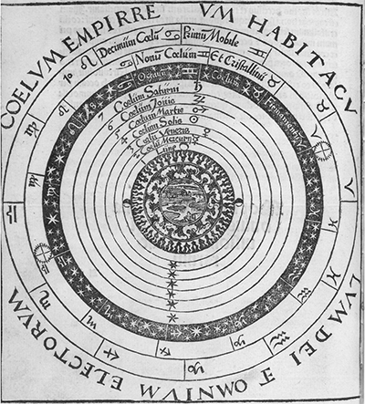
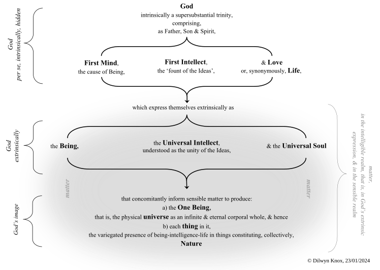
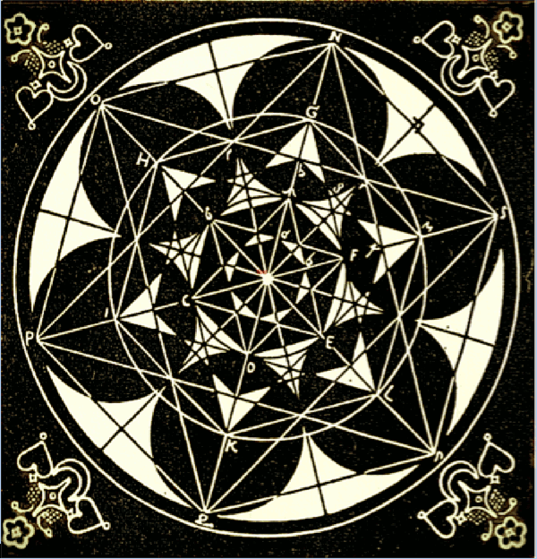

# Giordano Bruno
**First published Wed May 30, 2018; substantive revision Tue Mar 12, 2024**

*Knox, Dilwyn*

Giordano Bruno (1548–1600) was one of the most adventurous thinkers of the Renaissance. Supremely confident in his intellectual abilities, he ridiculed Aristotelianism, especially its contemporary adherents. Copernicus’s heliocentric theory provided a starting point for his exposition of what he called a “new philosophy”. It disproved the axioms of Aristotelian natural philosophy, notably the idea that sublunary elements occupied or strove to return to their natural places, that is, the elemental spheres, at the centre of the cosmos. Concomitantly, it disproved the existence of a superlunary region composed entirely of incorruptible aether circling the earth and hence disproved Aristotle’s principal argument for supposing that the universe was finite. The universe was infinite, animate and populated by numberless solar systems. It was also eternal. As such, it exhibited all possibilities at any given moment, and all parts of it assumed all possibilities over time, thereby constituting a cognizable manifestation of a timeless and absolute principle, God. In keeping with these ideas, Bruno proposed versions of metempsychosis, polygenism, panpsychism and, renouncing Christian emphases on human imperfection, advocated a morality that exhorted individuals to perfect their intellectual powers.

## 1. Life

Filippo Bruno was born in January or February 1548, son of Giovanni Bruno, a soldier of modest circumstances, and Fraulissa Savolina, at Nola, about 13 miles north-east of Naples. At the unusually late age of seventeen, beguiled perhaps by the prospect of a life dedicated to learning, he entered the Dominican convent of San Domenico Maggiore in Naples, assuming the name Giordano. In 1572 he became a priest and later that year began to study theology formally, obtaining his license as a theologian in July 1575. That year he was investigated by his Provincial for his heretical views, concerning among other things, probably the Trinity (Firpo 2000, 125)[^firpo-2000], a delicate topic in Reformation Europe. This was not the first occasion on which he had scandalized his fellow friars and, exasperated with the constraints of the religious life, he fled the convent in early 1576. He went first to Rome and then, taking off his habit, proceeded to northern Italy. He was now a fugitive from his order and excommunicate. Over the next fourteen or so years he moved from one town or city to another, first in Italy and then in France, Switzerland, England, Germany and Bohemia. In 1591 he returned, fatefully, to Venice. It was during these unsettled years that Bruno composed the forty Italian and Latin works of his that survive today, plus at least five others now lost.

Without family, connections or means of his own, Bruno relied on his wits. At Noli, a small coastal town situated between Nice and Genoa, he taught Latin to schoolboys and elementary astronomy to “certain gentlemen” (Firpo 2000: 45)[^firpo-2000]. In Geneva, he worked in a printer’s shop, correcting proofs. He aspired to greater things. His goal was to teach philosophy without the trammels of revealed truths, preferably at a university. On several occasions, a position of this kind seemed within his grasp. Two factors, however, conspired to thwart his ambitions. The first was the unsettled circumstances of Reformation Europe. At Toulouse, for instance, he taught philosophy at the university for nearly two years (1579–81), but renewed conflict between Catholics and Huguenots in the summer of 1581 forced him to leave the city. His notoriety further complicated matters. In a dispatch dated 28 March 1583, the English ambassador in Paris, Henry Cobham, alerted Queen Elizabeth’s principal secretary, Francis Walsingham, to Bruno’s impending arrival: “Doctor Jordano Bruno Nolano, a professor in philosophy, intendeth to pass into England; whose religion I cannot commend” (Aquilecchia 1995: 22, 24)[^aquilecchia-1995]. Not by chance does Bruno have the distinction of being the only known sixteenth-century philosopher to have been excommunicated from all three major confessions: Roman Catholic (Naples, 1576), Calvinist (Geneva, 1579) and Lutheran (Helmstedt, 1589). The second factor was his temperament. Intolerant of those whom he deemed fools, Bruno repeatedly caused offence. In *The Ash Wednesday Supper*, the first and best known of the six philosophical dialogues in Italian published while he was living in London, he decried the ignorance and pomposity of English men of learning and cast aspersions on the London commoner. He compared himself, “a Neapolitan born and bred under a more benign sky”, with a hapless antagonist at Oxford University, whom he described as a discourteous “pig” (BOI I, 535). Such was the offence that the work caused that he began his next dialogue, *On the Cause, the Principle and the One* with an elaborate apology in which he retracted his comments while simultaneously justifying them. It was a ploy that he would use again, ill-advisedly, during his trial.

Bruno’s wanderings came to an abrupt end shortly after he returned to Italy in late August 1591. Following a brief stay in Venice, he moved to Padua for three months or so and then returned to Venice to take up lodgings with the Venetian patrician Giovanni Mocenigo, to whom he divulged the “secrets” of his mnemotechnics and philosophy (Firpo 2000, 19, doc. 7)[^firpo-2000]. Alarmed at some of Bruno’s views, Mocenigo denounced him to the Venetian Inquisition on 22 May 1592. Events took a decided turn for the worse when, on 12 September that year, the Holy Office in Rome requested Bruno’s extradition. The Venetian authorities dilly-dallied, before acceding to the request in January 1593. At Rome, the trial proceeded slowly. Eventually, on 14 January 1599, the Congregation of the Holy Office approved a list (now lost) of eight heretical propositions assembled by Robert Bellarmine, S.J., and Alberto Tragagliolo, O.P., from the trial records and copies of Bruno’s works. Bruno was invited to consider “whether he wished to abjure the propositions as heretical” (Firpo 2000: 411, 413, doc. 55)[^firpo-2000]. Four days later, he was brought before the Congregation and ordered to abjure the propositions within six days. Bruno conceded, with qualifications, and then submitted a written defence of his views.

The trial proceeded, with Bruno abjuring the heresies of which he was accused, while at the same time taking issue, in written depositions, with aspects of the accusations. It was not, as mentioned above, the first time that Bruno had used this ploy, turning concession into a springboard for reasserting his position. On this occasion, however, the stakes were higher, as he surely knew. On 21 December 1599, the die was cast when he retorted to the Inquisitors that

> he neither needed nor wished to recant, that he did not have anything to recant, that he did not have grounds for recanting, and did not know about what he should recant. (Firpo 2000, clxxvi, 463, doc. 64)[^firpo-2000]

The Congregation made a final attempt the same day, sending the Dominican General and the Procurator, the two most senior members of the order that he had deserted almost twenty-four years previously, to plead with him, in vain. On 20 January 1600, the Congregation, with Pope Clement VIII presiding, ordered that all of Bruno’s works be placed on the Index of Prohibited Books and that he should be consigned to the secular authorities of Rome for punishment as an impenitent, pertinacious and obstinate heretic. Bruno’s final written deposition, addressed to the pope, “was opened but not read” (Firpo 2000: 471, 475, doc. 65a–b)[^firpo-2000]. At dawn on 17 February 1600, he was led out onto the Campo de’ Fiori. With a metal plate clamped over his tongue, Bruno was stripped, tied to a stake and, accompanied by the chants of the Confraternity of the Beheading of St John, burned alive.

## 2. The Wisdom of the Ancients

Bruno’s philosophy—despite its inconsistent terminology, intricacies, eclecticism and wilful contrariness—has an inner coherence. Indeed, he can claim to be the first thinker since antiquity to integrate a metaphysics, physics, psychology and ethics into an original, if unsystematically presented, philosophy, one that aspired to go beyond the re-elaborations of Platonism, Aristotelianism or scepticism within a Christian context that had hitherto prevailed. The outcome was a radical alternative to medieval and Renaissance interpretations of human nature, the cosmos and God. His philosophy remained, however, in one decisive respect a creation of the Renaissance: neither celestial nor terrestrial mechanics were reducible to mathematical abstractions. His treatment of Copernicus’s heliocentric hypothesis, discussed in the following section, exemplifies this approach.

The coherence stems from his interpretation of ancient learning. From, principally, the fifteenth-century Christian Platonist Marsilio Ficino, he learned of the gentile tradition of wisdom, the “ancient philosophy”, that had allegedly originated with sages such as Zoroaster in Persia and Hermes Trismegistus in Egypt. Orpheus, Pythagoras and other early Greek thinkers had imbibed this wisdom and transmitted it to Plato, among many others. Through innate powers of mind, divine inspiration or direct or indirect knowledge of Jewish lore, these sages and philosophers had acquired intimations of many, indeed most, of the essential tenets of Christianity. Hence, concluded Ficino, the study of ancient Greek philosophy, especially Platonism, could rightfully serve as a handmaiden to the Christian faith. Bruno denied any such notions of progress. Human knowledge, like all natural things, observed the rule of vicissitude (see Section 3), gradually oscillating from one extreme to the other. Greek philosophy from Plato onwards was a debased version of the true wisdom known to ancient sages such as Hermes Trismegistus among the Egyptians and Pythagoras, Parmenides and Empedocles among the early Greeks. The task, then, was to restore an authentic ancient philosophy by elaborating upon what could be discerned in the few surviving Egyptian and Pythagorean records of it with the help of vestigial truths preserved in Greek philosophy. Even Aristotle, “the stupidest of all philosophers” (BOL I.3, 182), who had done his best to “pervert the opinions of the ancients and oppose the truth”, sometimes included, despite himself, valuable ideas gleaned from his predecessors (BOI I, 557, 690, 730). The many other philosophical sources that Bruno eclectically pressed into service—Presocratic, Platonic, Aristotelian, Stoic, Epicurean, medieval, Arabic, scholastic and Renaissance—served the same purpose (BOI I, 690–691): the articulation of a philosophy true to the principles of an ancient wisdom all but obliterated by Aristotle and his followers.

His approach towards Scripture followed suit. Patristic, medieval and Renaissance authors, including again Ficino, held that Hermes Trismegistus had lived at the same time as or shortly after Moses. This explained the many similarities between the Old Testament and Hermes’s writings. Bruno reversed the chronology. He was not the first Renaissance author to do so, but he was the first to draw out the implications. The daughter of the Pharaoh had taken Moses into her household as “her son” (Exodus 2:10, KJV), and he had become “learned in all the wisdom of the Egyptians” (Acts 7:22, KJV; BOI II, 369). This “wisdom of the Egyptians” was the wisdom recorded in Hermes’s works. In other words, the Pentateuch, which was believed at the time to have been composed by Moses, and hence Scripture as a whole were tributaries of Egyptian lore, rather than vice versa. Bruno made this point circumspectly, as well he might. Sometimes he disguised his interpretation by referring to Scripture as the “Kabbalah”. Such wisdom, he declared, as there was in the Kabbalah of the Jews “derived from the Egyptians, by whom Moses was educated” (BOI II, 362, 369). Read literally, this statement was uncontroversial. Though purportedly Mosaic in origin, the Kabbalah was not an authoritative repository of Christian doctrine. By “Kabbalah”, however, Bruno surreptitiously meant Jewish lore as recorded not only in the originally oral tradition of the Kabbalah, but also in the parallel written tradition, that is, the Pentateuch, and hence in the Old and New Testaments generally. The crucifixion was a “Kabbalistic tragedy” (BOI II, 263).

Travesty though it therefore was for the most part, Holy Scripture, like Plato’s and Aristotle’s philosophies, had inherited some truths from pre-Mosaic wisdom. Bruno duly quoted from Scripture on many occasions—examples feature in the following sections—to support his metaphysical, cosmological and ethical views. The Book of Job was especially valuable in this respect. Job had lived in the Land of Uz and so recorded, not Jewish lore, but “profound mysteries of the Chaldeans” (BOL I.2, 390, 418, 526), ones that, like the wisdom of the Egyptians, the Magi, Orphics and Pythagoreans, constituted a strand of “the ancient philosophy” (BOI I, 460). Chaldean wisdom, like that of the Egyptians, owed nothing of value to the “Jewish Kabbala”, which had been composed by a people, the “excrement” of Egypt, who had never had a “handbreadth” of land to their name (BOI II, 377). Whether these and other aspersions (see also BOI II, 209, 365, 383, 438; and Section 10), stereotypical by his day, represent prejudices discredited by objections voiced by other interlocutors in his dialogues or ones that he, in fact, shared is a moot point. One way or the other, they served to convey his conviction that what truths there were in Scripture derived from a philosophical tradition that had originated in ancient Egypt.

Medieval and Renaissance philosophers and theologians had, disastrously, held the opposite view. Philosophically, they looked to Plato, Aristotle and Averroes as authorities, rather than to Hermes, the Chaldeans, Pythagoras and other early Greek sages. Exegetes had consequently misinterpreted those parts of Scripture that touched on philosophical matters, misreading literally passages that described nature and the universe figuratively and vice versa (BOI I, 527–528). This did not dissuade Bruno from adopting traditional ways of thinking when it suited him. He acknowledged the Dominican Thomas Aquinas as a determining influence, praised the metaphysical speculations of thirteenth-century Oxford Franciscans (e.g., Duns Scotus), extolled Averroes as a better commentator on Aristotle than any late Greek commentator, despite the Arab philosopher’s ignorance of the Greek language. The Christian Trinity, perhaps surprisingly, played a formative role in his metaphysics (Section 7). It was contemporary scholasticism that bore the brunt of Bruno’s animosity, above all for its emphasis on Latin style at the expense of intellectual substance—a vice contracted from Renaissance humanism, for which he had no patience (BOI I, 671–676; BOL I.3, 236).

## 3. Cosmology: The Universe and the Atom

How and when Bruno began to develop what he called his “new philosophy” is uncertain (Granada 1990, 346–349)[^granada-1990]. His earliest surviving philosophical work, *On the Shadows of the Ideas*, dated 1582, hints at a few of its positions, including heliocentricism (BOL II.1, 7–8) and divine immanence (Section 7). The first detailed statement, however, came in *The Ash Wednesday Supper*, an Italian dialogue published at London in 1584, in which he set out his interpretation of Copernicus’s heliocentric hypothesis, as explained in *On the Revolutions of the Heavenly Orbs* (1543). Dismissing contemporary claims that Copernicus’s hypothesis was merely a convenient computational device, Bruno announced that it disproved the traditional Aristotelian-Ptolemaic picture of the cosmos. In the first place, it disproved Aristotle’s doctrine that each sublunary element had a fixed “natural place” at the centre of the cosmos—the earth’s globe at the very centre, water in the sphere immediately surrounding it, followed by the air and fire spheres—and that particles of the elements, if displaced from these natural spheres, had an intrinsic impulse to regain them. On the contrary, since the earth, wrote Bruno, was a planet circling the sun, the elemental spheres of which it was constituted were continuously in motion. The elements did not have absolute “natural places”; and an elemental part, whether displaced from a whole or chancing to be near a whole, sought to attach itself to it because a whole was the place where it would be best preserved. Once united with a whole, elemental parts were no longer heavy or light and revolved with it naturally, that is, without resistance. This doctrine of gravity drew on Ficino’s Neoplatonic ideas of elemental motion, Copernicus’s doctrine of gravity, Lucretius’s comments on the weightlessness of parts in their wholes and scholastic notions of self-conservation (Knox 2001)[^knox-2001].

*Figure 1:* Peter Apian, *Cosmographicus liber* (1524, p. 6). The woodcut typifies the medieval and Renaissance picture of the cosmos that Bruno sought to discredit. At the centre lies the terraqueous globe, understood as a combination of the earth and water spheres. Surrounding them are the concentric spheres of the other two sublunary elements, air and fire. Beyond the fire sphere is the superlunary region, which comprises: (a) seven spheres, each of which carries a planet—the moon, Mercury, Venus, the sun, Mars, Jupiter and Saturn—around the centre of the cosmos; and (b) four outer spheres: the firmament (i.e., the sphere of fixed stars), the crystalline sphere, the *primum mobile* and the empyrean. Reproduced by permission of UCL Library, Special Collections.

Commendable though his achievement had been, Copernicus had remained unaware of the full implications of his heliocentric hypothesis. It was left to Bruno, the philosopher, to accomplish the full revolution of thought, to pass beyond the quantitative sensible realm that, indispensable stepping stone though it was, had unduly preoccupied mathematicians like Copernicus and to proceed to what could be discerned by reason alone (BOI I, 448–454). Copernicus’s most egregious shortcoming in this respect had been his failure to recognize that his heliocentric hypothesis disproved Aristotelian and scholastic arguments that the cosmos was finite and unique. If the heavens were infinite, these arguments ran, then their outermost regions would—impossibly—revolve infinitely fast around the earth at centre of the cosmos. Nor could there be more than one cosmos, because, if there were, then a displaced particle of an element would—no less impossibly—have two or more natural places to which it should return. These objections, Bruno inveighed, carried no force in a heliocentric world. The apparent daily rotation of a firmament or “sphere of fixed stars” around the earth was an illusion created by the earth’s rotation around its axis as it circled the sun. The universe was not a finite globe composed of concentric spheres, “like an onion”, to use a simile popular in his day (BOL I.2, 261), to use a common simile. Instead it was an infinite, homogeneous expanse populated by an infinite number of solar systems like our own. How far, he declared triumphantly, his achievement surpassed that of Columbus, who had discovered just one continent on one earth (BOI I, 451–452)! Lucretius, Nicholas of Cusa (1401–64) and counterfactual scholastic discussions concerning the plurality of worlds are evident influences. The authority that Bruno particularly liked to invoke, however, was Scripture. The infinite number of celestial bodies corresponded to “those so many hundreds of thousands [of angels]”—an allusion to Daniel 7:10—“that assist in the ministry and contemplation of the first, universal, infinite and eternal efficient cause” (BOI I, 455).

The celestial or, as Bruno called them, “principal” bodies glided weightlessly within an infinite “receptacle” or “expanse” of aether (BOI II, 61, 110) like specks of dust in the sunlit air (BOL I.1, 262; I.2, 91). What made them move? Their souls. They were animate and, as their orderly patterns of motion attested, also intelligent. Aristotle had suggested this among other possible explanations for celestial motion. Most patristic and scholastic authors, anxious to discourage polytheism, had rejected the idea. Ficino’s revival of Platonism, however, had given a new lease of life to the idea that the celestial bodies were animate. True to form, Bruno, though indebted to Ficino on this as on many other scores, cited the Book of Job (28:20–21), interpreted figuratively, as his authority (BOL I.1, 377). In each solar system or, in Bruno’s terminology, “synod” the suns and earths regulated their motions autonomously to their mutual advantage. From the earths, the suns absorbed vaporous exhalations. In exchange the suns produced the light and heat that the earths, as “animals”, needed in order to host living things. No part of them remained forever barren thanks to the several approximately circular revolutions that they performed. Nature, for Bruno as for Aristotle (*On the Heavens*, II.14, 271a33), did nothing in vain (BOL III, 108).

In accordance with these ideas, Bruno populated the principal bodies with life-forms of every kind. Each region of each principal body comprised matter which, circumstances permitting, became a plant or animal, even a rational one. This last category included human beings and also demons, in other words, rational beings with rarefied bodies made of pure aether or combinations of aether with air, water or earth. The latter, to judge by the demons frequenting the elemental regions of our globe, were generally, but by no means invariably, more intelligent than human beings. Within the mountains were dim-witted troglodytes jealously guarding the earth’s mineral veins (BOL I.2, 61, 282; III, 431). Long-living but of feeble intelligence, they had little commerce with human beings. Stone-throwing demons, another species of earthy demon, of the sort described by the Byzantine author Michael Psellus, had lairs in the vicinity of Nola and habitually pelted those who passed nearby at night, as Bruno knew from personal experience (BOL III, 431). Nymphs with predominantly aqueous bodies lived secluded in grottoes (BOL I.2, 282; III, 181). The variety of demonic life was such that it “far surpassed that of sensible things” (BOL III, 427, 429). A comparable diversity was evident among human beings, who differed in skin colour and stature from region to region (BOL I.2, 282, 284). The differences reflected their diverse habitats. When extinguished by a cataclysm of some kind, they regenerated spontaneously (BOL I.2, 282), in the manner that Avicenna and, if only as a philosophical possibility, some Christian authors had described. The novelty in Bruno’s interpretation was the idea that spontaneous generation accounted for the variety of life in an infinite and infinitely varied universe rather than the survival of a privileged species on this earth.

The principal bodies, human beings and demons were the three genera of rational animal inhabiting the universe. In one significant respect, however, principal bodies were unique. Like accomplished musicians—here Bruno adapted an analogy used by Plotinus and many others to illustrate how nature operated non-discursively according to a final cause—they did not think rationally, proceeding from one thought to the next as they executed their roles. Their intellects dominated their animal bodies, enabling them to move intuitively in accordance with the ends proper to them. Unlike human beings, too, the celestial “animals” were eternal and hence did not reproduce, grow or decay. Though corruptible intrinsically, they were, as the Chaldeans and Plato had taught, sustained by divine providence (for which, see Section 9). This is, at least, what Bruno tended to think even if he conceded, uncharacteristically, that he was uncertain on this point (Granada 2000)[^granada-2000]. In all other respects, the principal bodies were animals like any other. Stones and other parts of our earth, for example, might seem inanimate but, as parts of a principal body, they were, like the bones, nails and hair of an animal, alive, if only vestigially. Like animals, too, the principal bodies fed and excreted. They absorbed stray particles from the surrounding aether and in compensation emitted others, an idea inspired by Lucretius’s concept of *simulacra* (*On the Nature of Things*, IV.54–268).

This picture was incompatible with traditional doctrines of the elements. Aristotelian, Neoplatonic and scholastic cosmology distinguished neatly between the super- and sublunary regions. The superlunary region and the celestial bodies within it were composed entirely of aether. This “fifth element” or quintessence was devoid of all change other than that of perfect, unending, circular motion. The sublunary region comprised the remaining four elements, fire, air, water and earth, which by nature observed finite linear motion upwards or downwards. In addition to finite local motion, bodies composed of the sublunary elements continuously underwent generation and corruption. In these respects the superlunary region was superior to the sublunary one. Indeed, even within the sublunary region, according to many authors, the four elements were organized hierarchically, with earth as the dullest and grossest element at the centre of the cosmos and fire as the nimblest and subtlest sublunary element, akin to the neighbouring celestial region.

No such hierarchy obtained in a homogeneous universe populated by animate suns and earths of the kind that Bruno imagined. Fire, air, water and earth, as they were commonly conceived, were present in each and every celestial body, indeed all four were present in each part of every celestial body. Just as in a syllable, each letter was equally significant—an Aristotelian analogy that Bruno turned to his own purposes (BOL I.2, 118; Aristotle, *Metaphysics*, VII.17, 1041b11–33)—so too were the elements in the composition of a body. Timely support came from contemporary accounts of the 1572 supernova and theories about comets proposed by Tycho Brahe and others (Tessicini 2007, 112–150)[^tessicini-2007]. The birth of a new star proved that generation did, after all, occur in the superlunary region. As for comets, they were, as Aristotle and others held, composed of the same elements as other sublunary things but they were not, as these philosophers had concluded, sublunary phenomena peculiar to the air and fire spheres. Their trajectories proved that were superlunary objects or, more exactly, planets which, owing to the incline at which they revolved around the sun, only intermittently reflected the sun’s light towards the earth. The supposedly sublunary elements therefore occurred in the superlunary region. In short, not only reason but also observation disproved the notion of a cosmos divided into two finite regions of contrasting properties (BOL I.1, 219–221). This was a vivid example of Bruno’s constant refrain that his interpretation of the universe and of the things in it (BOI I, 454; II, 35, 727; BOL I.2, 218–219; I.3, 149; I.4, 31–32), together with the metaphysical principles underlying it (Sections 5–8), was based, not on faith (BOL I.4, 99–100; Firpo 2000, 57, doc. 11)[^firpo-2000] or on the authority of previous philosophers (BOI, 494–495; BOL II.2, 77–78), but the senses, regulated by reason.

Bruno’s alternative to traditional theories of the elements, in its several articulations (Del Prete 2023)[^del-2023], drew on Pythagoreanism, ancient atomism, medieval discussions, pro and contra, of indivisible minims and Nicholas of Cusa’s elemental doctrines (BOL III, 509–535; similarly BOL I.2, 463). Corporeal things comprised two material principles, earth and water, and two immaterial ones, spirit and soul. By “earth” Bruno meant the discrete, identical, irreducible spheres of which physical things were made. He often called them “atoms” to emphasize their indivisibility. “The minimal body or atom was the substance of all things” (BOL I.3, 140). “Apart from the minimum and indivisible, that is, the atom and point, ... nothing truly exists” (BOL I.3, 23). The circumferences and centres of these spherical atoms coincided. Hence, as some medieval authors had proposed, atoms were dimensionless bodies, unlike the atoms imagined by Democritus and other ancient atomists. They were the principles of spatial contraction, of solidity. Water, by contrast, was a continuum and, as such, the principle of corporeal extension. Two or more atoms, though dimensionless, bonded by water constituted a determinate body in space, just as two or more dimensionless points, in Bruno’s Pythagorean geometry, constituted a line. Observation confirmed this theory. Dry, dusty, earth congealed with the addition of water.

The two non-material principles, spirit and soul, related to each other analogously. Soul, the principle of motion, aggregated atoms and thereby determined the identity of a body. Spirit—the *spiritus* popularized by Ficino—was the incorporeal medium through which soul connected with body. Soul accounted for the existence of fire. In its purest form, fire was the combination of water and light, which, as others, including Ficino, had argued, was the physical analogue of the intellectual soul governing all things (for soul and light, see further Section 4). This explained why flame resembled water flashing in sunlight: in the former, soul predominated, in the latter, water. The Egyptians Hermes Trismegistus and Moses corroborated this idea. Both had understood fire to be essentially water (BOL I.1, 376; Genesis 1:6–7; Hermes Trismegistus, *Pimander*, I.5). Again, in Genesis 1:1–3 Moses had spoken of earth, the water (the “abyss”), spirit and light but ignored fire and air, precisely because they were not true elements. Air was a derivative rather than, as usually believed, an element in its own right. Heat generated by fire vaporized water to produce the air of the kind that we breath, and this vaporous air merged seamlessly into the empty, dimensionless, space beyond the atmosphere surrounding a celestial body. This space was the aether, though not the aether of conventional cosmology. It was the continuum spread throughout the universe and through the corporeal things contained in it, binding them together—not unlike the Stoic *pneuma* interpreted as *hexis*—without, however, moving them. It was, in other words, *spiritus*, the motionless immaterial medium through which soul, the principle of motion, operated. As such, *spiritus* or aether was the container—non-terminated space—in which all things were located.

Bruno’s explanation of how bodies were composed disproved outright the dominant Aristotelian view that the universe was finite but infinitely divisible. It also disproved ancient atomism. Democritus, Epicurus, Lucretius and others had, it is true, correctly surmised that the universe was infinite and comprised an infinite number of finite, indivisible, atoms. But their atoms were solids, although imperceptible ones, of various shapes, weights and sizes floating in a vacuum, a conclusion that led to a mechanistic view of the universe, which Bruno did not countenance. Correctly understood, atoms were incorporeal spheres with spatial locations. Soul, working through the intermediary of aether or spirit, joined these incorporeal, identical, spheres to make a body. Indeed, they were not so much components as analogues of the universe. Intrinsically dimensionless, their centres coincided with their circumferences. Conversely, since the universe was an infinite, indivisible (*atomus*) sphere, its centre was omnipresent. Both atoms and the universe were absolute physical monads, indivisible unities, the centres and circumferences of which coincided. They differed inasmuch as the *maximum* was the “unfolding” of the *minimum* and a *minimum* was the “enfolding” of the *maximum*.

## 4. The Universal Soul, Universal Matter and Universal Intellect

The soul that Bruno identified as one of the four principles of corporeality was the World or Universal Soul. The universe was an organism in which each principal body and the life sustained on it participated in a common animating principle, in the same way as the many parts of the human body were vivified by one and the same soul (Knox 2013)[^knox-2013]. Even supposedly inanimate things had a vestigial presence of life. Rocks, for example, were alive to the same degree as the bones or teeth of animals were. To make this point, Bruno borrowed an analogy that Plotinus had used for the same purpose (*Enneads*,VI.4.12). The Universal Soul was “all-in-all”, that is, present wholly and indivisibly in each and every thing to the degree that things were capable of receiving it, just as a single voice, however great the audience, was audible to everyone in a room diversely. Bruno, like others before him, attributed the doctrine of “all-in-all”, in a dematerialized version, to Anaxagoras. He also adduced several scriptural witnesses, notably the Book of Wisdom (1:7), thereby identifying the Universal Soul implicitly with the Holy Spirit: “For the Spirit of the Lord filleth the world: and that which containeth all things hath knowledge of the voice.” No matter that the Council of Sens (1140) had anathematized this association (Knox 2013; 2021, 283–285)[^knox-2013].

The Universal Soul combined with Universal Matter to produce the universe. The former was the active power, form, the latter its passive subject. Bruno conceived Universal Matter as indeterminate space (BOI I, 714–716, II, 16–17, 39, 59–60, BOL I.1, 294; I.3, 24; I.4, 76), that is, the receptacle of Plato’s *Timaeus* (52A–B) or more exactly Aristotle’s interpretation of it (*Physics*, IV.2, 209b6–17; IV.6, 214a11–16). In this respect, it was the motionless aether or spirit, devoid of any “specific quality” of its own (BOI II, 159–160; BOL I.2 78–79), that served as the medium through which soul acted on the two corporeal principles, water and earth atoms (Section 3). Some philosophers, noted Bruno, called this space or container “vacuum” (BOI II, 160–161). His inclusion of a third cosmological constituent “Universal Intellect” complicated this straightforward picture. Like the Neoplatonic Intellect, the Universal Intellect comprised the Ideas (see further Section 7), understood, in cosmological contexts, as the immutable, intelligible and generative principles of transient embodied things. The Ideas elicited “images” or “vestiges” of themselves in Universal Matter, that is “forms” of natural things, which, unlike the Ideas themselves, were transient. The Universal Intellect was inseparable from the Universal Soul. On one occasion Bruno went so far as to describe it as the latter’s “inner and most essential and characteristic faculty”. It operated from within Universal Matter like “an internal craftsman” (BOI I, 652–656; II, 182), articulating its effects through division: a seed of a tree became a stem, from which grew branches, from which grew twigs, from which grew buds and so on—to the point of generating a new specimen through separation or discharge of some kind. On other occasions, as discussed below (Section 7.1), Bruno described the Universal Soul and Universal Intellect as two distinct but coexistent substances. Importantly, he did not conceive of them in Neoplatonic procession, with the former as cause of the latter (Section 7.2).

The Universal Intellect was separate from the corruptible things that it engendered in that it was immutable. Spatial language—“above”, “within”, “separate” and so forth—was, as Bruno recognized, inappropriate when describing intelligible realities. By definition, something intelligible had no location or dimensions. To clarify what he meant by the immanent and transcendent roles of the Universal Soul and the Universal Intellect, Bruno appropriated a distinction formulated in Thomas Aquinas’s *On the Principles of Nature*. Principles were constituents of something. The marble of the statue and its form were constituents; hence, they were principles, the marble being the material, the form the formal principle. Causes, by contrast, were extrinsic. A sculptor was the efficient cause of a statue, and he made it with an end, a final cause, in mind. Neither the sculptor nor his purpose were constituents of the finished piece. Analogously the Universal Soul and Universal Matter were the two principles immanent in all things, whereas the Universal Intellect was the efficient cause of all things and so extrinsic to them. It also operated in accordance with a final and therefore extrinsic cause: the perfection of the universe (Knox 2013)[^knox-2013].

The Stoics, as Bruno knew, had similarly proposed that the cosmos comprised two mutually dependent principles, the World Soul or *pneuma* and matter, active and passive respectively, with the former accommodating Mind. Indeed, when introducing his account of the Universal Soul and Universal Matter in his Italian dialogue, *On the Cause, the Principle and the One* (1584), he included the Stoics among the several schools and authors who had identified the World Soul and matter as the active and passive principles of the physical world. Stoic philosophy also contributed to Bruno’s doctrine in surreptitious ways. In the *Pimander* (chaps 10–12) Hermes Trismegistus had declared that the cosmos was composed of matter and soul and that the latter included Mind. Again, Virgil (*Aeneid*, VI.724–727) had described the super- and sublunary regions as animated from within by *spiritus*, which Bruno identified in this context with the Universal Soul, and added that they were moved by a Mind diffused throughout their vast mass. Hermes Trismegistus and Virgil were, according to received wisdom, reporting the wisdom of the ancient Egyptians and the Pythagoreans respectively. As such, Bruno considered them authorities for his interpretation. Neither, however, was authentic. The comments in the *Pimander* are just one of many Stoic borrowings that reflect the eclectic intellectual ambient of Alexandrian Egypt in which Hermetic works of this kind were composed. And unbeknown to Bruno, Virgil’s lines drew on Stoic rather than Pythagorean thought (Knox 2013)[^knox-2013]. Renaissance authors such as Agrippa von Nettesheim (*De occulta philosophia* [*On Occult Philosophy*], II.55), as Bruno knew, had interpreted Virgil’s lines similarly.

Bruno’s two universal principles resembled Stoic doctrine in another respect. For the Stoics, “first matter” was an unqualified substance (*ousia*). For Bruno, too, Universal Matter was a substance and, as such, was in act (*in actu*), not a *prope nihil* (“almost nothing”) of the sort imagined by Aristotle. The similarities, however, cease at this point. For the Stoics, whatever existed, even soul and matter, was corporeal, capable of acting on or being acted upon by another corporeal entity. By contrast, neither of Bruno’s principles was corporeal. The Universal Soul was an intelligible reality; and Universal Matter was not corporeal in the Stoic sense. Inherently qualityless, dimensionless, impassive and inactive, Universal Matter was a medium that had the potentiality to become all things. To explain why Universal Matter conceived in this manner was a substance, Bruno drew on Thomas Aquinas’s commentary on Aristotle’s reportage of ideas proposed by “ancient philosophers” (*Commentary on Aristotle’s Physics*, II, *lecture* 2, §149). Wood was a substance in act because it was that from which a bed, stool or image could be made, not because it was any one of those things, and the same was true of Universal Matter. It was not so much the effects elicited from Universal Matter by the Universal Soul’s faculty, the Universal Intellect, which were in act, but rather Universal Matter itself. It was a substance in act by virtue of the unexplicated corporeal forms that the Universal Intellect—or, more exactly, the Ideas constituting the Universal Intellect—excited from within it (BOI I, 655, 715–716; BOL I.2, 312; II.3, 96–97; III, 51, 694). Nicholas of Cusa supplied the language of explication and implication.

Universal Matter was present in incorporeal as well as corporeal things. It was the genus of two types of matter, corporeal and intelligible. The former was the substrate of corporeal objects, as described above. The latter, Plotinus’s version of Plato’s Indefinite Dyad as reported by Aristotle, was instead the substrate—the principle of indeterminacy or potentiality—of intelligible realities. Bruno quoted two of Plotinus’s arguments for the existence of intelligible matter. First, the plurality of Ideas in the Intellect presupposed something common to each of them, this commonality being intelligible matter. Second, since the sensible world imitated the intelligible world and the sensible world comprised matter, so too must the intelligible. Plotinus, like other ancient Neoplatonists, considered the two matters ontologically distinct, as Bruno noted. Intelligible matter, as the matter of unchanging intelligible realities, did not change, Plotinus had explained. It “possessed” all things simultaneously. By contrast, the matter of sensible things possessed all things only inasmuch as parts of it assumed all possible forms sequentially. Bruno added a differentiation of his own, applying again Nicholas of Cusa’s distinction between explication and implication: intelligible matter was informed but unexplicated, sensible matter was informed but explicated. All the same, Bruno insisted that corporeal and intelligible matter were, ultimately, two species of the genus Universal Matter. He was not the first to do so. The eleventh-century Jewish philosopher, Ibn Gabirol or, in Latinized form, Avicebron, as Bruno mentioned, had made the same move. Just as significantly, so too had Ficino, in his adaptation of Augustine’s Plotinian exegesis of Genesis 1:1–3, though Bruno, typically, did not mention a Christian precedent of this kind. All distinctions, Bruno assevered, presupposed something indefinite: potentiality, matter. Hence the distinction between the two matters presupposed an absolute Universal Matter. No doubt he knew of Thomas Aquinas’s objections. Avicebron was wrong, Thomas had written, to say that species were the actualization of a genus’s potentialities and so attribute existence to what was a theoretical relationship between genus and species (Knox 2013)[^knox-2013].

Like Avicebron, Bruno sometimes went as far as to elevate Universal Matter above Universal Form. Nothing was “constant, fixed, eternal and worthy of being esteemed a principle apart from [Universal] Matter” (BOI I, 686). Form, that is, the Universal Soul, was “under the constant control of [Universal] Matter” (BOI I, 722). Its stability, which contrasted so favourably with the flux of form, had led the heterodox scholastic philosopher David of Dinant (d. c. 1217) “who had been poorly understood by some” to call matter “divine” (BOI I, 601, 723; BOL III, 695–696). Divine though it might be, Bruno did not identify Universal Matter with God. Indeed, he criticized Avicebron, misrepresenting him on the by, for having held that matter alone was “stable”, “eternal” and hence “divine” and for vilifying all substantial form as “corruptible” and ephemeral, and for not realizing that the passive substance, matter, was formed not, impossibly, by itself, but by an active substance, the World Soul (BOI I, 678–679, 687, 708).

## 5. The Universe as the Image of God

The universe, as the unity of these two substances, was “one thing” (BOI I, 725) and “without parts” (BOI I, 726), a perfect whole to which nothing could be added and from which nothing could be subtracted (BOI I, 725). Like a “gastropod” sprouting and retracting its horns, elongating and contracting its body, it was a single living mass continuously changing its shape, while remaining essentially the same (BOL I.2, 313; cf. Spinoza, *Ethics*, 2, lemma 7, scholium). To substantiate this conclusion philosophically he adopted, true to his commitment to restore an ancient wisdom, the monism of the three supposed representatives of Eleatic philosophy: Xenophanes, Xenophanes’s pupil Parmenides and the latter’s pupil, Melissus (BOI I, 731–733; BOL I.1, 96–98, 253, 305; II.2, 180; III, 70, 457–458). The Eleatics’ “One Being” (*ens unum*; Italian: *l’ente*) was the physical universe, not, as most classical, medieval and Renaissance authors held, a metaphysical first principle or supernatural God. It remained eternally unchanged, whereas all finite corporeal things—ignoring the possibility that the “principal bodies” endured eternally thanks to providential intervention (Section 3)—were its transitory “accidents” or contingent “modes of being” (BOI I, 604, 664–665, 728–733, 737; II, 125, 181–182). The One Being was, the Eleatics had also said (Knox 2020a, 96–98)[^knox-2020a], “immobile” (BOI I, 731–732; BOL I.1, 96–98), “the same throughout” and spherical (BOI I, 607, 730–731; BOL I.1, 98, 305; III, 39). On account of these attributes, they had concluded that the universe was an infinite sphere, the circumference of which was nowhere and centre of which was everywhere (BOL I.1, 291, 308; I.2, 342; I.3, 145). This formula, cited by many before and after Bruno, derived from the second of the twenty-four definitions of God set out in a twelfth-century compilation, sometimes attributed to Hermes Trismegistus, known as *The Book of the XXIV Philosophers* (Knox 2020a, 98–100)[^knox-2020a].

Bruno appropriated other medieval or Renaissance definitions of God to describe the universe. The infinite universe, he wrote, drawing on Nicholas of Cusa’s explanation of how an infinite God related to finite things, was a “coincidence of opposites” in which hot and cold, attraction and repulsion, minimums and maximums and all other distinctions concurred. To make the point, he drew on Nicholas’s mathematical analogies, for example, the observation that the circumference of an infinite circle coincided with an infinite straight line tangential to it (BOI I, 738–744; BOL I.1, 307; I.3, 147–148, 272–273). Given that he liked to apply these and other definitions of God to the universe, should we conclude that Bruno thought them equivalent? Would he have subscribed, as often said, to phrases such as *Deus sive natura* (“God or Nature”) and *Natura, id est Deus* (“Nature, that is to say, God”). Not in any simple sense. Unlike the universe, which, as the One Being, was defined in contrast to its accidents, God was a “plenitude” without a counterpart “non-being” (BOL III, 40). He was an absolutely simple entity in which all differentiation, even those of space, time and being and non-being, collapsed in a supreme coincidence of opposites (BOL I.3, 144–147; I.4, 87; III, 39–41). The infinite universe was no more than “a second god” (BOL I.1, 308), an “image” (BOI I, 693; BOL I.1, 308), “an infinite likeness” of “an inaccessible divine face” (BOI II, 43; cf. Exodus 33:20–23), a living, infinite, “mirror” of God (BOI I, 547, II 46; BOL I.1, 203, 241, 308), a corporeal monad proceeding from an intelligible monad (BOI II, 696). “From the One is a similar One, nor could God’s image be otherwise in corporeal form” (BOL I.1, 241–242, 308; BOI II, 42). God was not the “form” of the universe but rather the “form of the form … of the whole universe” (BOL II.2, 202). The universe was the embodiment of God, so to speak, and thus worthy of the reverence and awe that Christians, mistakenly as we shall see (Section 10), placed in Christ. Hence, Bruno, alluding both to Christian Scripture (e.g., John I.14, I.18, III.16) and Plato’s *Timaeus* (31B, 92C), called it the “image and only begotten nature” of the first principle of all things (BOI I, 693; BOL I.1, 14; Knox 2020a, 87)[^knox-2020a].

The sum of these considerations was that Bruno’s ontology had three tiers in terms of immutability vis à vis change: (1) God, understood as “superessential unity” (BOI II, 678), the “superessential” cause of being (BOL II.3, 94–95) and so beyond being, devoid of change; (2) the universe, the One Being, devoid of change; and (3) the things contained in the Universe, which, because they underwent change—or, in the case of the “principal bodies”, were, as mentioned above, by nature subject to change—were not, strictly speaking, “beings” (BOL I, 732; II, 691–692. Hence, Bruno chose the saying “There is no new thing under the sun”, which he ascribed to both Solomon (Ecclesiastes, I.9–10, KJV) and Pythagoras (Ovid, *Metamorphoses*, XV.252–258), as his motto (BOL I, 665; Firpo 2000, CXLII–CXLIII, 620n)[^firpo-2000]. (In other contexts, it should be noted, when not contrasting the universe ontologically to the things contained in it, Bruno happily spoke of things having “being”.) Alternatively, finessing the problem of the principal bodies, Bruno defined these three tiers in terms of corporeality and finitude: (1) God, incorporeal and infinite; (2) the universe, corporeal and infinite; and (3) the principal bodies, which, together with the individual things populating them, were corporeal and finite (BOL I.1, 312; Knox 2020a)[^knox-2020a].

## 6. The Limitless Universe as the Expression of Divine Omnipotence

The universe, limitless in extent and time, was the expression or image of God’s limitless power. To make this point, Bruno repurposed conventional ideas of act and potentiality (*potentia*: translatable also as “potential” or “potency”). According to Aristotelian and scholastic authors, all things other than God, who was pure act, comprised an active principle, form, and a passive principle of some kind. Forms had potentialities peculiar to them: the form fire, for example, produced heat. Its form was its “first act”; its potentiality to produce heat was its “active potentiality”. In parallel, the passive principle was a principle in its own right and had “passive potentiality”, that is, the potentiality to become the substrate of any form. Bruno adopted a different stance. Its starting point was Nicholas of Cusa’s doctrine in *De possest* (1460) that act and potentiality, together with their corresponding active and passive potentialities (*posse facere/ posse fieri*), coincided in God’s transcendent unity (BOI I, 692–698, 714; BOL I.2, 312, 344–345). Reinterpreted by Bruno, this meant that God, the unexplicated supersubstantial unity of the Universal Soul, in harness with its companion the Universal Intellect, and Universal Matter (see Figure 2), explicated himself as these two substances in act. By virtue of being in act, the two substances had, respectively, infinite “active potentiality” and infinite “passive potentiality” or, synonymously for Bruno, “possibility” (BOI I, 692). These two potentialities, both in the perceptible and intelligible realms, were in equilibrium (BOI I, 692, 712–713; II, 58–59). Infinite as they were, they combined to produce a physical universe infinite in time and extent. Both God and the universe, then, were infinite and “all that can be” (BOI I, 602, 698), albeit in different ways. In the universe, the One Being, all potentialities were at any given moment actualized somewhere in its infinite extent. In God, in whom form and matter, being and existence, act and potentialities were undifferentiated, all potentialities were actualized absolutely without distinctions of time or place (BOI I, 693–694, 698; BOL I.1, 241–247; III, 39). The infinite extent and duration of the universe were, then, a corollary of God’s exodus from his intrinsic essence. The existence of the one presupposed the existence of the other, even though the latter was ontologically prior.

*Figure 2:* Bruno: active and passive potentiality [An extended description of figure 2 is in the supplement.]

Bruno recognized that his position conflicted with Christian truth. It denied that God had created the universe in time *ex nihilo* by supernatural fiat. The Universal Soul/Intellect and Universal Matter of his philosophy, as explications of God, were eternal, feign though he might otherwise before his inquisitors (Firpo 2000, 381 [doc. 51, §252])[^firpo-2000], and hence the universe of which they were the immanent causes was eternal too. God and the universe were indissoluble. It also contradicted Christian explanations of why God had created a finite cosmos. God’s absolute and ordained power, scholastic authors reasoned, were distinct. We should distinguish, they claimed, between: (a) the unlimited possibilities, apart from self-contradiction, available to God by virtue of his absolute potential; and (b) the limited range of possibilities, that is, those of a finite cosmos, that he freely chose to entertain in his dealings with creation (Granada 1994)[^granada-1994]. Bruno’s account of act and potentiality invalidated any such distinction. In God’s absolute simplicity there was no distinction between “being, power, doing, willing, essence, potentiality, action, will” and whatever else that could be predicated of him (BOL I.1, 242–247; III, 41). The “absolute necessity” whereby he produced all things was unconstrained and so coincided with “absolute liberty” (BOL I.1, 243; BOL III, 41). Since, then, his “will is not contrary or unequal to his potential” (BOL I.1, 243), the scholastic idea—and indeed Nicholas of Cusa’s variant of it (*On Learned Ignorance*, II.1, II.8, Klibansky, 64.14–65.7, 89.3–7; Lai 1973)[^lai-1973]—that an omnipotent God chose to create a finite cosmos was incoherent. Explicated as the infinite active and infinite passive power of, respectively, the Universal Soul and Universal Matter, his infinite potential necessarily caused an infinite corporeal universe, the only fitting “image” of his primary attribute according to the Creeds, omnipotence (BOL I.1, 241–244, 307–308; Firpo 2000, 381–383, doc. 51, §253)[^firpo-2000].

## 7. “God Hidden”, His Procession, Nature as “God in Things”

### 7.1 Divine Transcendence and Immanence

Now, the universe was the expression, not just of God’s power (*potentia*), but also of his wisdom (*sapientia*) and goodness (*bonitas*) or, synonymously, love (*amor*) (BOL I.1, 14; I.2, 359; I.4, 76; BOI II, 577, 630–631). Scholastic authors and subsequently Renaissance philosophers, too, had assigned these attributes to the three persons of the Trinity—Father, Son and Holy Spirit—with the rider that they denoted aspects of God that reason, without the guidance of faith, could discern by examining the created world (Thomas Aquinas, *Summa theologiae*, Ia.39.8; *Super secundam epistolam ad Corinthios*, XII.3, §544 [1953, 561]; Dante, *Inferno*, III.5–6; Segonds 2000, 553–554; Knox 2020a, 85–86; 2021, 280)[^knox-2020a][^segonds-2000]. During his trial Bruno told his inquisitors that, as a philosopher, he defined the Trinity in this way but then promptly mentioned another formula, one that he admitted was contrary to faith (Firpo 2000, 67–71, 263–265, docs 13, 51§28)[^firpo-2000]. Father, Son and Spirit corresponded to: (a) Mind (*mens*), understood as “absolute substance” or “essence”; (b) Intellect (*intellectus*) or “First Intellect”; and (c) Love (*Amor*). This triad, with Life (*vita*) sometimes standing for Love, feature prominently in his surviving works, with minor variations (BOI, II, 357; BOL I.2, 46, 358–359, 365–366; I.4, 73, 79–80, 102–104; III, 37–62, 183, 509). It characterized God’s intrinsic nature, “God hidden” as Scripture called it (BOL I.4, 79; III, 41; Isaiah 45:15; similarly Romans 1:20), and also his procession. Bruno clarified this last point with an analogy. The sun had: (a) its own intrinsic essence, light and heat, and: (b) a “vestige” generating the existence of things, the light to illuminate things and the heat to warm them. Similarly God was (BOL I.4, 73, 102–103, 113):

| *intrinsically* | *extrinsically* |
| --- | --- |
| Mind, also called First Mind | Mind, causing all existence, i.e. the Being of the Universe |
| Intellect, also called First Intellect | the Universal Intellect |
| Love, also called Life | the Universal Soul |

The comparison, he cautioned, was inexact. The sun was a substance with two accidents, light and heat, whereas no such subject-accident distinction obtained in God’s triune supersubstantiality (BOL I.4, 79–80, 103). The First Mind, the First Intellect and Life or Love were, like the three persons of the Christian Trinity, “one and the same thing” in him (Firpo 2000, 67, 263, docs 13, 51§28)[^firpo-2000]. This intrinsic triune nature was an inference based on the evidence of Being, the Universal Intellect and the Universal Soul in all things (BOI II, 357; Firpo 2000, 69, doc. 13)[^firpo-2000]. Bruno’s identification of the extrinsic manifestation of God’s third person with the World Soul had medieval precedent (see Section 4).

The “Platonists”, said Bruno (BOL I.4, 102), had taken this analogy from “the teaching of the Egyptians”. Probably his source was a passage in Ficino’s *On the Sun* (ch. 12), in which, adhering to the Christian appropriation of the Neoplatonic triad being-life-intellect (Proclus, *Elements of Theology*, props 101–103; pseudo-Dionysius the Areopagite, *The Divine Names*, II.10, 648C-D [§69], IV.3–4, 697A [§111], V.2–3, 816C-817A [§257–259]; Thomas Aquinas, *Super De causis*, props 12–13 [1954, 77–84]), Ficino had likened: (a) the intrinsic fecundity, light and warmth of the sun and extrinsic life, light and warmth that it generated; to (b) the being-intellect-life intrinsic to the inner substance (*substantia*) of the Christian Trinity and the external manifestations (*vires*) of being-intellect-life in things. Another purportedly Egyptian source explained how the three persons were interrelated. Mind, as supersubstantial being, produced the Intellect as its first, timeless, “effect” and, enamoured of its offspring, became enflamed with Love (BOL I.2, 386; I.4, 79–80, 103; III, 44–45, 53–54; Knox 2021, 278–280)[^knox-2021]. The source for this explanation, direct or indirect (e.g., Agrippa von Nettesheim, *De occulta philosophia*, III.8), was the first definition of God set out in the pseudo-Hermetic *Book of the XXIV Philosophers* mentioned above (Section 5). Scholastic authors had cited this definition to exemplify how pagan philosophers, ignorant of revealed truth and reliant on reason alone, had attained only a partial understanding of the Trinity, one that failed to discern its true consubstantiality. During his trial Bruno exploited this stricture. His deliberations on God’s triune nature, which, he confessed, had begun shortly after becoming a friar, were merely philosophical, that is, based on “sense and reason” (see Section 3). As such, they did not challenge the Church’s true determination, which was grounded in faith (Firpo 2000, 57, 67–75, 263–269, docs 11, 13, 51 §§28–31)[^firpo-2000].

God’s extrinsic trinitarian presence was intermediate between the metaphysical realm of his intrinsic essence and the physical universe (BOL I.4, 73). It was immanent, that is to say, in the universe considered as a whole, in the One Being. Each thing in the universe, as those “wise men” of Egypt had understood, participated in its “Being, Life and Intellect” to a degree commensurate with its kind (BOI II, 357). In other contexts, too, Bruno similarly emphasized that individual things, including human beings (BOI I, 455–456), participated, even if only imperfectly, in God (BOI II, 363; BOL I.3, 146–147; I.4, 79, 81, III, 41; Firpo 2000, 69, 263–265, docs 13, 51§28)[^firpo-2000]. “God is immediately in all things but all things are not immediately in God” (BOL I.4, 81). Collectively his variegated presence in them was Nature, working, not from without, like a sculptor chiselling or carving into his material, but from within matter (BOI I, 598, 652–654, 680–682; BOL I.2, 312; Firpo 2000, 67, 303, docs 13, 51 §92; cf. Ficino, *Platonic Theology*, IV.1, for the analogy)[^firpo-2000]. Bruno summarized this idea in his oft-quoted, if frequently misunderstood, aphorism, “Nature is God in things” (BOI II, 354; BOL I.2, 151; I.3, 136; I.4, 101). The formula, though not the exact sense, probably derives from Nicholas of Cusa’s reconciliation of Plato’s World Soul with Aristotle’s concept of Nature (*The Layman*, XIII.145). Bruno, true to character, preferred to trace it, as just mentioned, back to Egypt (BOI II, 354–355). It was this conviction, he noted, that had led the ancient Egyptians to venerate vipers, scorpions, onions and garlic, among other animals and plants (BOI II, 354–355, 363). Occasionally, to emphasize that Universal Matter included the potential forms of things, he gave an alternative definition: “Nature is interior to matter, or rather it is matter itself” (BOL I.2, 312). The latter formula corresponded to Avicebron’s definition of matter or, equivalently, Nature as “God who is in all things” (BOI I, 687). This should not, however, lead us to conclude, with Avicebron (Section 4), that natural forms were elicited by something other than matter itself, by, that is, the Universal Soul.

*Figure 3:* Bruno’s Egyptian-Platonic ontology [An extended description of figure 3 is in the supplement.]

Appeal though he might to Egyptian and Platonic precedent, the formative inspiration for this account of God’s presence in the physical world was Christian immanentism. All three emanations—Being, Universal Intellect and Universal Soul—of his trinitarian God directly informed the universe. Pagan Neoplatonists, by contrast, had typically located the triad being-life-intellect in the two intelligible hypostases Intellect and Soul intervening successively between God and the world. Intermediaries of this kind were, Bruno observed on several occasions, superfluous (BOL II.2, 177–178). An egregious instance was Platonism’s central tenet: that the Ideas were transcendent, wholly “separate”, realities (BOI I, 720–721; BOL I.2, 118, 304, 309–313, 483). Abstract entities, wholly separate from Universal Matter, were “chimera”, no more than logical fictions (BOL I.2, 304, 309–310). In what sense, he asked, could such inventions be outside an infinite universe (BOL I.2, 313)? Instead, the Ideas of the Universal Intellect were, as explained more fully in Section 7, simply explications of the Idea of Ideas, the First Intellect intrinsic to God, and they produced and sustained all things directly. Latin theologians from Augustine onwards had similarly posited the Ideas as creative agencies located in the mind of God (e.g., Thomas Aquinas, *Disputed Questions on Truth*, III.1–3; *Summa theologiae*, Ia.15.1–3). “By means of the divine intellect understood as the Idea of things”, Thomas wrote, “created things” imitated, even if only imperfectly, “the divine essence” (*Disputed Questions on Truth*, III.2, response). He agreed, explicitly, with “theologians who understood God to be the immediate cause of each thing” (BOL II.1, 52–53). The theologians he had in mind were, in the first instance, Thomas (*Disputed Questions on Truth*, III.7, response; similarly, Thomas, *Super librum De Causis expositio*, prop. 13 §289 [1954, 83]) and, as reported by Thomas, pseudo-Dionysius the Areopagite (*The Divine Names*, V.8–9, 824C-825B [§§281-284]). His training as a Dominican theologian (Section 1), despite his apostasy, remained an abiding influence.

### 7.2 Two Metaphysical Inconsistencies?

Is this “Egyptian-Platonic”—nearabout Christian—procession compatible with what we may call Bruno’s Stoic-Cusanian ontology, as outlined in Sections 4 and 6? The accounts apparently conflict in two ways.

First, in the latter account, the Universal Soul and Universal Matter were two “substances” proceeding from God (BOI I, 698; BOL I.2, 53; Firpo 2000, 381, doc. 51 §252)[^firpo-2000]. Moses (Genesis, I.2–3) and Hermes Trismegistus (*Pimander*, I.4–6), explained Bruno, adapting a passage in Ficino’s *Philebus Commentary* (II.4 [1975, 415–419]), had described the universe as the outcome of a twofold procession of this kind. The “light” and “darkness” that God had produced, in the first, ontologically speaking, moment of creation referred to the “substance” Universal Soul/Intellect, the source of all other “substances”, and “that vast shadow and darkness of privation”, Universal Matter (BOL II.3, 117–118; also I.4, 76). By contrast, Bruno’s Egyptian-Platonic account of God’s procession, as presented above, ignored Universal Matter. Are we to suppose it to be implicit in the multiplicity of God’s three extrinsic modes? Infinite beings participated in the Being of the universe; the Universal Intellect was a unity of multiple Ideas; and the Universal Soul generated temporal multiplicity. Plotinus, as Bruno knew (Section 4), had explained multiplicity in the intelligible realm in terms of intelligible matter. Moreover, on one occasion, shortly before discussing the Trinity and its procession in Egyptian-Platonic terms, Bruno described the descent from God’s absolute simplicity, like Plotinus (I.8.7; II.4.16), as a falling away from goodness, evil being the ethical correlative of matter: “all things other than him partake in evil” (BOL I.4, 75). Still, a problem remains. Universal Matter, in an interpretation of this kind, is not a substance. The resolution most flattering to Bruno is to say that, when describing Universal Matter as a substance, he sought to acknowledge its role as a parhypostasis—that is, as a privation existent insofar as it occurred in combination with form (BOL I.4, 112)—more fulsomely than pagan Neoplatonists and Christian theologians had done (BOL III, 25; Plotinus, II.4.16; pseudo-Dionysius the Areopagite, *The Divine Names*, IV.2, 697A [§111]; IV.28, 729A-B [§§231-234]; Thomas Aquinas, *Summa theologiae*, Ia.15.3, ad 3m). Indicative in this respect are the opening sections of his *Lamp of Thirty Statues* (1587/1591), in which he correlated the active triad of Mind-Intellect-Spirit or Love with a counterpart triad of void-passive potentiality-matter (Granada 2020, 24, 58–59, 62–63; Knox 2021, 280–282)[^granada-2020][^granada-2020-2][^knox-2021]. All three of the latter triad of “infigurables”, as Bruno called them, were existent: chaos or void (Section 4) was “the first of all things”, the “preexisting receptacle” (BOL III, 10, 12); passive potentiality (Section 6) was “infinite yearning”, “desire that was the constant companion of privation” (BOL III, 16, 23); and matter was “a wholly stable being [*natura*]”, not “something imaginary” or “purely logical” (BOL III, 25). The discrepancy between his Egyptian-Platonic and Stoic-Cusanian meontologies would not, anyway, have troubled Bruno. A philosopher, he wrote, with the ludic proclivities of his own philosophy foremost in mind, could describe matter, its relationship to the Ideas and other issues from different conceptual standpoints without contradiction. Good conclusions proved the validity of the concepts employed in formulating them (BOL I, 688–691).

Second, the ontological status of the Universal Intellect differs in the two accounts. According to Bruno’s Egyptian-Platonic procession, the Universal Intellect was a distinct “substance” (BOL I.4, 122–127). In his Stoic-Cusanian account, on the other hand, he described it, if only on one occasion, as a “faculty” of the Universal Soul (Section 4). The inconsistency is mainly a matter of presentation. His Egyptian-Platonic accounts emphasized that the Universal Intellect, distinct substance though it was, permanently “concurred with” or was “situated in” the Universal Soul, and that both “accompanied” Mind, understood as the cause of all being (BOL I.4, 107, 123; similarly BOL I.2, 426). That is to say, as mentioned above (Section 7.1), Mind extrinsically, the Universal Intellect and the Universal Soul concomitantly, rather than in Neoplatonic causal procession, produced the universe. When, in fact, describing the Universal Intellect as a “faculty” of the Universal Soul, Bruno also presented it as concomitant with, but distinct from, it. To make his point, he took up Aristotle’s suggestion (*On the Soul*, II.1, 413a8–9), much debated over the centuries, that the individual soul might relate to its body “as a sailor to his ship”. A helmsman, in Bruno’s interpretation of the analogy, related to the motion of his ship in two ways: he moved with it as a part of the moving whole and also guided the moving whole of which he was a part. In the latter role, therefore, he was acting, not as a part of the moving whole, but separately as the cause of its direction. Similarly, the Universal Soul (the helmsman) was an intrinsic constituent of the physical universe (the ship), while at the same time its faculty, the Universal Intellect, governed it extrinsically (BOI I, 655–656). Aristotle could not object. He had acknowledged that the intellect was “an efficient cause separate in its being from matter” and that it “came as a subsistent being from outside, separate from the composite body and soul” (BOL I, 656). This was a précis of the scholastic opinion, based on two passages of *On the Soul* (II.2, 413b24–27; III.5, 430a17–23) and another in *On Generation and Corruption* (II.3, 736b27–29), that Aristotle had shown the intellectual soul to be immortal (BW III, 353–356). Bruno, it is worth recalling, had lectured on *De anima* at the university in Toulouse for two years, 1571–1581 (Firpo 2000, 49, 371, docs 11, 51 §227)[^firpo-2000].

## 8. Panpsychism

Irrespective of these complications, the Universal Intellect was, by definition, omnipresent in the universe. Bruno explored the implications of this idea to the full.

The intellect intrinsic to God, the First Intellect, was “the one supersubstantial Idea of all things” (BOL I.4, 104), “the first Idea, the fount of all the Ideas” (BOL III, 44) and “the Idea of the Ideas” (BOL III, 51; BOI II, 678). Its extrinsic expression, the Universal Intellect, was, along the lines of the Plotinus’s second hypostasis, “an ideated world” (BOL II.2, 164), the unity of the manifold Ideas. These included the Ideas from which the genera and species of things derived (BOL II.2, 164–165) and also, contrary to what Plato had believed according to Aristotle (*Metaphysics*, I.9, 990b23–34; Thomas Aquinas, *Summa theologiae*, Ia.15.3, ad 4m; *Disputed Questions about Truth*, III.7, resp.), the Ideas of “singular things” and “accidents” (BOL II.1, 51–53). Christian theologians (Section 7.1), Bruno admitted, had quite correctly concluded that there were “Ideas of all things” (BOL II.1, 53). The Ideas of the Universal Intellect elicited transient “forms” latent in Universal Matter, thereby generating the ephemeral things of the universe (Section 4). This threefold scheme—Ideas implicit in the First Intellect, explicated in the unity of the Universal Intellect and engaged with Universal Matter—mapped onto: (a) the three tiers of Bruno’s threefold “Eleatic” ontology described in Section 5, the superessential God, the universe as the One Being, and the things in it as non-beings, respectively; and (b) the triad of God unparticipated (Mind-Intellect-Love), God participated (Mind as the Being of the universe-Universal Intellect-Universal Soul) and the things participating in him variously as Nature (Section 7).

Concurrently God was the cause of all knowledge. He was, as Mind, the source or “father” of “intelligible light” (BOL III, 51, 53, 402–403; similarly II.2, 203) and, by virtue of this light, following the long established explanation of knowledge as mental seeing, intellects of all stations could apprehend objects of knowledge. The First Intellect was itself intelligent in that it was an intellect in act (BOL III, 45), “a sea of light” (BOL II.1, 45–46). It timelessly “saw” the Idea of the Ideas bathed in the intelligible light irradiating from God as Mind. In its act of knowing it was what Bruno called the “First Intelligence” (BOI II, 622; BOL I.4, 114–115). Similarly, the Universal Intellect in the act of knowing the Ideas of which it was the unity was the “Universal Intelligence” (BOI II, 455, 615, 620). The intelligible light radiating from Mind also illuminated the embodied intellects of demons and human beings, transforming them into intellects in act. The circuitous manner in which it did so, however, reflected their subordinate ontological status. From sense data the interior sense faculties composed cognitive replicas of the “forms” of natural things (BOI II, 731–732; BOL II.1, 91–92; II.3, 94). These replicas, or as Bruno variously called them “intentions”, “intelligible species” or “shadows of the Ideas” (BOL II.1, 91–92; BOI II, 732), enabled an embodied intellect, by coalescing its own weak intelligible light with the intelligible light originating from Mind (BOL III, 49), to identify Ideas corresponding to these “shadows” (BOI II, 576–577; BOL II.1, 92; Spruit 1988, 94–95)[^spruit-1988]. The theory that intellection, like sight, could only come about through the coincidence of like-with-like, one superior to the other, derived ultimately from Plato (*Republic*, VI.508B–E; BOI II, 732).

There were, then, three “worlds” (*mundi*) with three correlating kinds of “being” (*ens*): (a) the metaphysical or quasi-metaphysical realm of the First or Universal Intellect in which the Ideas were illuminated permanently by intelligible light; (b) the natural or physical realm comprising transient “forms” elicited from Universal Matter by the Ideas in the Universal Intellect; and (c) the “artificial” realm of the “shadows of the Ideas”, which, illuminated by intelligible light, enabled embodied souls to recognize the Ideas (BOL I.1, 14; II.1, 38; II.2, 164; II.3, 94–95, 101; III, 462; Spruit 1988, 28, 66–69)[^spruit-1988]. The term *species* denoted the aspect common to a triad of corresponding “beings”: e.g., the Idea “oak tree”, the “form” of a particular oak tree and its cognitive replica (BOI I, 668; II, 577; BOL II.3, 101; cf. III, 462, where “Idea” designates all three). To these in turn corresponded three categories of intellect: 1) “the divine intellect that is all”, that is, the First Intellect intrinsic to the triune God; 2) “the cosmic intellect that makes all”, that is, the Universal Intellect engaging with Universal Matter; and 3) “the other particular intellects becoming all”, that is, embodied intellects apprehending individual Ideas successively (BOI I, 654). Bruno complicated this straightforward picture by positing a plurality of intermediary intelligences in “the intelligible world” (Spruit 1988, 230–235, 256–258, 300–316; 1989)[^spruit-1988]. The Universal Intellect/Intelligence permeated all things through intermediary “secondary” or “separate intelligences” (BOL I.4, 114–115; III, 51; BOI II, 567), an Arabic and scholastic category of disembodied being that Bruno described variously. A separate intelligence known as the “agent intellect”, for instance, accommodated the Universal Intelligence to the limited, passive, intellect of human souls (BOI II, 614–615, 620–622, 671; BOL III, 49–50 §§13, 18, III, 267–268). Unlike the Universal Intellect, which contemplated all its Ideas in one undifferentiated act, separate intelligences contemplated them discretely (BOL II.1, 38). For Bruno, as for his Christian predecessors, they were purely cognitive entities, without creative powers (Augustine, *The City of God*, XII.25–26; Thomas Aquinas, *Summa theologiae*, Ia.45.5, ad 3).

The separate intelligences marked a step in a hierarchy of intelligences, which, consolidating Bruno’s various comments on the topic (BOI I, 654, 736; II, 455–456, 594–595; BOL I.4, 114–115, 119–120; II.1, 25, 38; III, 51, 154, 267–268), we can articulate as follows: (a) the intelligence of God in himself; (b) his intelligence expressed as the Universal Intellect or Intelligence informing the Universe; (c) the “separate intelligences”; (d) the intelligence peculiar to each of the infinite principal bodies, which, in accord with the privileged nature of their souls (see Section 3), remained unperturbed by their ensouled bodies (BOI I, 512, II, 595; BOL III, 497); and (e) the intelligence of ensouled bodies inhabiting the principal bodies. Of this last category, there were two kinds: first, those that lived in harmony with their ensouled bodies, such as the intellects of some demons (Section 3); and second, those that were subservient to their ensouled bodies, such as intellects of human beings (BOI II, 595). Intellects subservient to their bodies were “passive” intellects, which, like the light intrinsic to an eye coalescing with sunlight to produce sight, became active when illuminated by an “agent intellect” conceived, not as faculty of an individual rational soul as Thomas Aquinas and others supposed, but either as the Universal Intellect itself (BOI II, 456, 733; BOL III, 49, 267–268) or as a separate intelligence of the kind mentioned in the previous paragraph, analogous to the moon in its partial communication of sunlight (BOI II, 614–615, 620–622).

Thus far Bruno’s account of intellection in ensouled bodies, whatever its original flourishes, remained within what were in his day recognizable, primarily Platonic, parameters. Intelligible realities proceeded from God and intellects “saw” these realities in the intelligible light coming ultimately from him. The historical premise for this commutation was the analogy that Plato had drawn between the Idea of the Good and the sun (*Republic*, VI.508B–E, 509B; Plotinus, VI.7.16; Ficino, *Platonic Theology*, XV.14; BOI II, 732–733). The sun made things grow and also made them visible to the eye. Similarly, the Idea of the Good generated the Ideas and, by virtue of its intelligible light, made them concomitantly “visible” to the mind’s eye, that is, the intellect. The novelty of Bruno’s interpretation becomes apparent when we consider what he meant by the intellect of ensouled bodies. Most philosophers, following, ultimately, Aristotle, distinguished broadly speaking between: (a) the rational, intellective, souls of human beings and, some added, demons; (b) animal souls, which, though endowed with sense perception as well as vegetative powers, could not reason; and (c) plant or vegetative souls, devoid of both sense and reason. Bruno, conflating the first and second of these categories, proposed instead that animals were intelligent. Testimony were parrots’ speech, the migratory patterns of birds, spider webs and bee hives. Indeed, in some respects, animal intelligence surpassed that of human beings. Ants surpassed human beings in communal organization (BOI I, 550; II, 455–457; BOL I.2, 314; I.4, 118–121; II.2, 175–176; III, 328).

Instinctual behaviour of this kind was not, as scholastic authors contended (Thomas Aquinas, *Summa theologiae*, 2a2ae.95.7), instilled by providence, the celestial bodies or some other external intelligent agent (BOI I, 550). Rather, parallel to his idea that the Universal Intellect elicited corporeal forms from within matter, Bruno defined animal instincts, like human and demonic intelligence, as intrinsic but passive powers of intelligence that became actualized when “illuminated” by the Universal Intellect (BOL I.2, 114–116; I.4, 118–121) or by intermediary “separate intelligences” of the kind mentioned above (BOI II, 455–456, 614–615). Animal “instincts”, in fine, were simply types of intelligence that we do not have and so cannot comprehend (BOL I.4, 118–119). The Universal Intelligence expressed itself, in keeping with the axiom (Section 4) of “all-in-all” according to a recipient’s capacity (BOL I.4, 114), within the constraints imposed by the bodily configuration of a species (BOI II, 455–456). Thus demons (Section 3) varied in intelligence according to species because of the different elemental constitutions of their bodies (BOL I.4, 118). The intelligence that human beings enjoyed, *pace* Aristotle (*On the Parts of Animals*, IV.10, 687a7–23), was determined above all by their hands. In essence human intelligence was no different from animal intelligence. A snake, were it to acquire, *per impossibile*, hands and the other bodily attributes of a human being, would acquire human intelligence, and vice versa (BOI II, 455–456; BOL I.2, 331). Plutarch (*Beasts are Rational* [*Moralia*, 985C–992E]; *Whether Land or Sea Animals are Cleverer* [*Moralia*, 959B-992E]), Giambattista Gelli (*La Circe*, 1549) and Montaigne (*Apology for Raymond Sebond* [*Essais*, II.12]), among other classical and Renaissance apologists of animal intelligence, may have contributed to Bruno’s observations but the philosophical underpinnings were his invention.

The Universal Intellect was the cause, not just of intellection, but also of reason, imagination and sense (BOL I.4, 103–126; II.2, 175–180; II.3, 117–118; III, 52–53, 57–58, 154). All cognitive acts were instantiations of a single cognitive power, the Universal Intellect, illuminating, like the sun, all things in varying degrees (BOL I.4,122–123; III, 50, 52–53). It made no difference whether we speak of its power as sense, intellect, imagination, vision or hearing (BOL I.4, 114; II.2, 174–175). From the absolutely simple principle, God, in whom all things coincided, “a diversity of cognition flows according to the diversity of species from the Universal Intellect, which is all that is cognizable and cognizing in all things” (BOL I.4, 118, 125–126). Hence, to complement the agent intellect, there was, as Averroes and some scholastic authors had argued, a separate intelligence called the “agent sense” producing sense in animals (BOI II, 456; BOL I.2, 366). Plants and other kinds of vegetation, given that they were animate, also participated in the Universal Intelligence. This was evident in the way that they reacted to their surroundings, for example, when they turned towards the sun or shrank away from fire. Inanimate things such as stones, given that they too were animated, if only vestigially, by the Universal Soul (Section 3), cognized, as demonstrated by their innate appetite to unite themselves with a whole and thereby preserve themselves to best advantage (BOL I.4, 103–104, 107; III, 53, 328, 429. Universal Intelligence was, no less than its companion, the Universal Soul, omnipresent and so all things, even the most imperfect, participated in its intelligence to some degree (BOL I.4, 103–107, 122–123; II.1, 45–46; III, 50–53, 429). “Whatever exists in some way knows in some way” (BOL I.4, 112; similarly, I.4, 118; III, 46). Divine light spread to all things in the universe (BOL II.1, 45–46; III, 35). Even matter, given that it was a substance or parhypostasis (Section 7.2), had a residual cognitive power, one that was evident from its “appetite” for form (BOL I.4, 112; III, 154).

Bernardino Telesio had similarly proposed that sensation was the common means whereby all animate and inanimate things sought to preserve themselves (*On the Nature of Things*, 1570, I.34–35). Bruno probably knew Telesio’s account but preferred to present his panpsychism as a revival of an ancient doctrine, one that Aristotle, as was his wont, had wrongfully rejected. Empedocles and other ancient philosophers, observed Aristotle (*On the Soul*, III.3, 427a17–29, 26–27; *Metaphysics*, IV.5, 1009b12–31) and subsequently many others (e.g., Thomas Aquinas, *Contra gentiles*, III.84, §§9, 18), had held that “thought and sensation were the same”, believing as they did that “thinking was somatic like perception and that to perceive and to think is done by like unto like”. It was on these grounds, in fact, that Empedocles and Parmenides had argued that bodily attributes conditioned intellect (Aristotle, *Metaphysics*, IV.5, 1009b12–25; Thomas Aquinas, *Commentary on Aristotle’s Metaphysics*, IV.12 [§§672–679]), a conclusion that, as mentioned in the previous paragraph but one, Bruno took to heart. It made no difference, he insisted (BOL I.4, 108, 114; II.2, 174), whether we called this universal power of understanding “intellect” or “mind”, as, for example, Empedocles and the Pythagoreans (see Section 4) had done, or, following Epicurus, “sense”. Cognition of whatever kind was the means whereby each “thing”, animate or inanimate, identified and thereby desired the end proper to it, that is, to preserve and perfect itself (BOI II, 692; BOL I.4, 103–104).

The sum of these considerations was that, in combination, the Universal Intellect and Universal Soul—as explications of the second and third of God’s three intrinsic persons, Being, Intellect and Love—ensured that the One Being, the universe, was not, inappropriately, an undifferentiated and formless image of him but, rather, a coherent multiplicity of discrete, ephemeral, “things”, all of which were endowed with a drive of some kind to preserve themselves. Bruno’s panpsychism or pansensism, in short, was, as he recognized (BOL II.2, 179–180), a corollary of his cosmic interpretation of Parmenidean monism (see Section 5). “God produced the universe” and the latter was orderly because “God was known by the universe” (BOL I.4, 79). Nevertheless, the formative, if unacknowledged, inspiration for the immediacy of this rapport was the Christian idea that God directly made all things (Section 7.1) and that reciprocally all things, whether intellective, rational, sentient or inanimate, “desired” to reunite with Him by the means appropriate to their kind (pseudo-Dionysius, *The Divine Names*, IV.4, 700A-B [§122], XI.1, 936D-937A [§§385–387]; Thomas Aquinas, *Commentary on the Divine Names*, IV.3, §§3–5 [§314–318]).

## 9. The Individual Soul and its Perfection

The universe was perfect. As a bodily manifestation of God, it could not be otherwise. Nothing in it, however “mean”, was “unconducive to the integrity and perfection of what is excellent”. There was “nothing that is bad for some things in some place that is not good and optimal for something elsewhere” (BOL I.3, 272). Many philosophers and theologians had said much the same through the ages. “The death of a fly”, wrote Thomas Aquinas (*Super Sententiis*, lib. 1, d. 39, q. 2 a. 2 co.) “is sustenance for a spider”. Then Thomas added a qualification. Creatures nobler than the irrational animals, human beings for example, had a will, which, the more closely it cleaved to God, was “the more free from the necessity of natural causes” (ibid.). The cosmos provided the setting for them to prove that they merited everlasting salvation. For Bruno, however, they were, like all else, transient “modes” or “accidents” of the One Being (Section 5). They were, as for Spinoza (*Ethics*, pt IV, prop. 4), parts of nature, not collectively a privileged species for which, as Christian doctrine maintained, nature had been created. Individual human beings were no more than ephemeral corporeal instantiations of “the eternal human essence”, that is, the Idea of their species (BOI II, 691–691). As the body aged and decayed, the soul contracted its powers inwardly, eventually dissociating itself altogether from it before reuniting with the Universal Soul (BOI I, 513–514; II, 180–183). “All spirits”—‘spirit’ here being equivalent to ‘soul’—“are from the sea of one spirit and that all return to that spirit” (BOI II, 450–451; BOL I.3, 209–210; III, 60; Knox 2013, 471–472; 2021, 283–299)[^knox-2013].

Hermes Trismegistus (*Pimander*, X.7, X.15) and, according to doxographers, Pythagoras (Aëtius, *Placita*, IV.7, 899C), Heraclitus (Gianfrancesco Pico, *Examen vanitatis doctrinae gentium*, I.14 [2022, 107]) and, among other Stoics, Chrysippus (Diogenes Laertius, VII.143) were of this opinion too. Provocative as ever, Bruno preferred to invoke the authority cherished most by his adversaries. “Well it is said, too, in Holy Scripture [*Ecclesiastes* 12:7] that the body dissolves into dust, that is to say, atoms [Section 3], and that the spirit returns to its source” (BOL III, 256). Adding insult to injury, to reinforce his argument that souls were instantiations of the Universal Soul, Bruno adapted an analogy that scholastic theologians often used to explain how Christ remained present in every piece of a consecrated eucharistic host after it was broken by a priest celebrating mass. A mirror displayed the image of the sun above. If shattered, every piece, some more perfectly than others, also displayed the sun’s image. Analogously, each soul was a fragment of the one Universal Soul (BOL III, 58; Knox 2021, 283–294)[^knox-2021]. More exactly, adapting Ficino’s interpretation of how the World Soul related to other souls (*Platonic Theology*, IV.1), Bruno explained that the human soul was an instantiation of the soul vivifying the principal body that it inhabited, which was in turn an instantiation of the soul vivifying the solar system to which it belonged (Section 3), which in turn was an instantiation of the Universal Soul, which in turn was a manifestation of God (BOL I.3, 209–210). On those occasions when he drew a distinction between soul (*anima*) and spirit (*spiritus*), Bruno reached a similar conclusion (BOL III, 182–183). An individual spirit was a portion of spirit (*spiritus*) understood as the semi-corporeal, semi-incorporeal “air” mediating between the Universal Soul and its body, the physical universe (Section 3).

We might, then, surmise that the human soul forfeited individuality on the death of the body. A conclusion of this sort would align with Bruno’s monism, particularly with its corollaries: (a) that the universe was animated throughout by a single soul, the Universal Soul (Sections 4 and 7); (b) that the forms of corporeal things elicited by the Universal Intellect from Universal Matter were transient (Section 4); (c) that all things, animate and seemingly inanimate alike, participated in the cognitive power of the Universal Soul’s constant companion, the Universal Intellect (Section 7). Bruno, nonetheless, insisted that souls, or at least souls of a kind that could inhabit human bodies, were “immortal” (BOL I.3, 143). The soul was “individual”, in the sense of the Latin word *individuus*, meaning “indivisible”, and so, like an atom, indestructible (BOL I.3, 143). He realized that this position was problematic. He toyed with Plotinus’s view, as interpreted by Ficino, that “particular souls” were distinct from the Universal Soul because they and the Universal soul alike were souls, immortal ones, dependent on the hypostasis Soul (BOL III, 58–59; Knox 2021, 294–298)[^knox-2021]. He had good reason to be reluctant to concede that they were mortal. If a soul perished with its body, it could not be rewarded or punished for its conduct during its embodied existence. Morality would have no final sanction.

To overcome this impasse, Bruno turned to ancient doctrines of metempsychosis. We should await mutation serenely, not fear death, as Pythagoras, or more exactly Ovid’s ‘Pythagoras’, had observed (Ovid, *Metamorphoses*, XV.153–175; BOI I, 665; BOL I.3, 142–143). In one important respect, however, Bruno interpreted metempsychosis differently from Pythagoras, the Pythagoreans, Plato, Platonists, the Sadducees, Scripture (Psalm 36:6 [KJV]), Origen and the Druids (BOI II, 452, 598–599; BOL I.3, 142–143). The Universal Soul was inseparable from Universal Matter (Sections 8 and 7.2) and the same therefore applied to particular souls (BOI II, 183). On the death of the body, they did not endure a shadowy existence in some other world before reincarnation in the manner that the “Pythagorean” Virgil (*Aeneid*, VI.743–751) and others had described. With the extinction of one body, the soul turned its operative powers to forming a new one, the limitations of which were determined by Providence (BOI II, 183–185; BOL III, 257, 429–430; Knox 2020b, 36; 2021, 299–300)[^knox-2020b]. The One Being, as Providence or Fate, thereby ensured that, by means of the perpetual change or “vicissitude” that it imposed on natural things, retributive justice prevailed (BOI II, 180–185, 457–459). Someone who behaved like a pig had been a pig in a previous incarnation or, on account of his or her conduct, was doomed to become a pig in the next. Bruno’s patron in Venice, Giovanni Mocenigo, reported to the Inquisition —how truthfully is open to question — that Bruno had once admonished him for killing a spider. It may have been, Bruno had remarked, a reincarnation of one of his, Bruno’s, former friends (Firpo 2000, 341, doc. 51, §179)[^firpo-2000]. True to these convictions, inspired by Erasmus or perhaps Agrippa von Nettesheim, he condemned the aristocratic obsession with hunting and the customs that it nurtured (BOI II, 388–389).

How could an individual soul endowed with a human body ensure a prosperous reincarnation? Initially, by contemplating the One Being, the universe, with the help of the senses and reason (Section 3; BOL I.3, 149; BOI I, 263). Then, turning away from “the buffeting vortices of disruptive [sensible] matter” (BOL II.2, 194), it should strive to pass, as many before Bruno had urged, beyond sense data to the intelligible principles informing the universe (Spruit 1988, 226–230)[^spruit-1988]. From sensibilia it could compose intelligibilia by virtue of the intelligible light of the Universal Intellect, in which all souls, as indeed all other things to some degree (Section 8), participated. These intelligibilia were, as mentioned above (Section 8), in the first instance, “shadows of the Ideas”. The orderly variety of things, their groupings in species and genera (BOI 736–737; BOL I.1, 203; I.4, 86–87; II.2, 164), encouraged the soul, or at least the philosopher’s soul, to pass beyond these shadows to the Ideas themselves (BOL II.1, 45–46, 51–52; II.2, 164) and “to attune its thoughts and deeds to the symmetry of the law inherent in all things” (BOI II, 557). In this ascent, the two powers of the intellective soul, intellect and will —as embodiments of the First Intellect and Love (Section 7) — spurred each other on reciprocally to ever greater endeavours (BOI II, 539, 576–578, 584, 708–714; Spruit 1988, 236–251, 269–276)[^spruit-1988]. For Bruno, then, the great scholastic and Renaissance debate about about which of the two was primary in the soul’s pursuit of perfection was beside the point. The philosopher’s final step was to understand and become enrapt intellectually with the Ideas, not discretely, but as a unity. He came, in other words, to understand the Universal Intellect. Given that, in accordance with the almost universally accepted axiom, deriving ultimately from Aristotle (*De anima*, III.4–5, 429b30–430a20), that the intellect in an act of intellection was identical with its object, the philosopher at this juncture lost his individual intellectual identity. He was taken out of himself and knew himself as part of the divine presence in the things of the universe (BOI II, 578–579, 658–659, 695–696; Spruit 1988, 262–272)[^spruit-1988].

Beyond this, he could not pass, yearn though he might to reach God himself (BOI II, 678). He could discover only God’s “shadow”, an allusion to I Corinthians (13:12), that is, “the world, the universe and Nature that is in things”, the “monad” that “proceeds from the monad that is divinity” (BOI II, 564, 696). He could gaze upon this “image of him”, but not his “absolute light” (BOI II, 564–565, 694–697; Spruit 1988, 36, 221–276)[^spruit-1988]. In short, he could know him only vestigially, as philosophers and theologians of many schools had said in various ways (BOI I, 647–649; II, 575–577), and even then only imperfectly given that an individual intellect, finite as it was, could not fully comprehend the infinite universe (BOI I, 649; II, 584–586, 667–669, 708–714; Spruit 1988, 275–276)[^spruit-1988]. The few who aspired to perfection in this way were “divine”, “heroic”, “rare” men, inspired by “a superior light” (BOI I, 453, 475, 525; II, 695). These aspirations inspired Bruno’s doctrine of “love” in his prose-poem masterpiece, *The Heroic Frenzies*, and his interpretation of poetic or more generally creative genius (BOI I, 525; II, 527–528). His art of memory and Llullism, in their theoretical applications, were additional resources in this pursuit of self-fulfilment. By constructing a memory palace that mirrored the hierarchical structure of the intelligible universe, the soul could move from the accidental multiplicity of the universe to the unity of the Universal Intellect and vice versa (Sturlese 1994)[^sturlese-1994]. Gnoseological aspirations of this kind, though foreign to traditional mnemonics, which had focused on rhetorical and didactic applications, were not without precedent, Giulio Camillo’s *L’idea del teatro* being an example. With the same purpose in mind, Bruno designed and cut the wood engravings of ontological realities that feature, like proto-Jungian mandala, in several of his works.

*Figure 4:* Giordano Bruno, “Figura intellectus”, discussed in *Corpus iconographicum. Le incisioni nelle opere a stampa*, ed. M. Gabriele (Milan, 2001) 374–379; and reconstructed by Raymond Kotty at [https://www.youtube.com/watch?v=rAw8thcZsgU](https://www.youtube.com/watch?v=rAw8thcZsgU)

## 10. Religion

Marsilio Ficino, Giovanni Pico della Mirandola (in one phase of his career) and other Renaissance authors had held similarly “Pelagian” views that philosophy led to self-perfection and “deification”. Yet they had stopped well short of denying the integrity of Christianity. Philosophy and religion were, so to speak, two parallel paths, suited to different audiences. Bruno had no such scruples. Philosophy—Bruno’s philosophy of God as immanent in an infinite universe as announced in *The Ash Wednesday Supper*—was the true bread of life. It “illuminated the blind”, “loosed the tongue of the dumb”, “cured the lame”, so that the human spirit could once again “progress” (BOI I, 454). Its powers, that is, were miraculous, Christ-like, salvific. Who deserved praise the more: someone who healed a worthless cripple, or a man who liberated his homeland or who reformed, not a mere body, but a mind (BOI II, 264–267)? In other words, who was the true saviour: Christ or Bruno? By contrast, Christian practices and ideals were fraudulent (BOI II, 263–266, 658). Under a thin veil of irony, all the while denying the irony, Bruno praised the various guises under which Christianity taught that ignorance of the natural world led the soul to God. Among its many deceits were: scriptural injunctions to acknowledge our ignorance, notably, the Pauline theme of folly; the ascetic mysticism of pseudo-Dionysius the Areopagite and mystics generally; claims that the light of faith and revelation were superior to human knowledge; Augustine’s emphasis on the fallen nature of mankind, particularly the corruption of knowledge innate to it; injunctions to be childlike and meek; and the humility and obedience that the Christian clergy sought to instill among its flock (BOI II, 380–384, 415, 422–430, 443–448; BOL I.2, 316). The philosopher should ignore these “foolish dreams” (BOL I.3, 200)—in practical as well as in intellectual endeavours. To be virtuous was to strive against adversity and to aspire, even if with only partial or little success (BOI I, 475–476; II, 568), to an ever greater understanding of intelligible reality (Section 9). The unremitting nature of this quest was not the outcome of, so to speak, a Promethean or Adamic fall from divine favour, but rather part-and-parcel of the vicissitude characterizing the universe of things (Section 3). “Where opposites meet, there is order, there resides virtue” (BOI II, 549). Happiness was not so much a goal, in this or some future life, as the transient state of mind occurring as we passed from a privation to its opposite. We are happy when we eat after feeling hungry, when we go out “into the countryside” after being confined indoors, and so forth and so on (BOI, 197–198).

Simultaneously, with the same indignation that Spinoza and Nietzsche would later voice, Bruno impugned the clerical caste. Living parasitically off the labours of others (BOI II, 238–239) and affecting “a foul-smelling melancholy”, i.e., *accidia* (BOL II.2,189–190), they advocated the solitary life and renunciation of this world for the next. Such men had extinguished the divine light that had made the souls of the ancients “heroic and divine” (BOI I, 453). Of all peoples, the ancient Romans had best understood the value of “glory” for establishing and maintaining civilization. A true religion, like that of the ancients, extolled men of action, strength of body and mind and worldly glory (BOI II, 267–268). Similar comments on clerical duplicity, glory and religion occur in Machiavelli, whose works Bruno had probably read.

Nevertheless, religion had a role to play. The “uneducated populace” (BOI I, 525; II, 514–515) could not aspire to philosophical perfection. They needed laws and sanctions to keep their conduct in check. Religion, with its promises of reward and punishment in an afterlife, served this purpose. When Moses had led the Israelites from captivity, they were no more than an uneducated rabble. To govern them, he established laws and enforced them with terrifying accounts of an almighty, wrathful God who administered retribution in an afterlife. Scripture, whether Jewish, Islamic or Christian, had been composed with this practical goal in mind (BOI I, 522–528). Admittedly, Bruno conceded, Scripture did sometimes record philosophical truths. Genesis and the Book of Job were conspicuous repositories. This was only to be expected, given that Scripture was a tributary of “the ancient philosophy” (see Section 2). For the most part, however, it simplified. Several passages of Scripture (e.g., Ecclesiastes, 1:5–6; Joshua 10:12–13) implied that the sun circled the motionless earth. This was a simplification made for the benefit of the uneducated. Disquisitions based on a true, heliocentric, interpretation of celestial motion would have, at best, confused them and, at worst, led them, counterproductively, to dismiss Scripture’s tales of divine retribution (BOI I, 522–525).

To claim that Scripture made allowances for the weak understanding of most men and women was nothing new. Patristic, Catholic and Protestant theologians acknowledged that Moses had addressed an ignorant, slavish people and that Scripture spoke in a way that the uneducated could understand. All agreed, too, that it focused on moral and spiritual issues and refrained from intricate philosophical arguments. Bruno’s appeal to these positions disguised his heterodoxy. The crucial deviation was his denial of miracles, the most important of all testimonies to the Christian faith. Given that the laws of nature were, essentially, “God in things”, they were “inviolable” (BOL I.2, 316). In this respect, he went far beyond the Paduan natural philosopher Pietro Pomponazzi (1462–1525), who, disposed though he was to attribute miraculous events, Scriptural or otherwise, to natural causation, allowed that some were authentic. Repeatedly Bruno mocked, allusively, the miracles reported in the Old and New Testament, including those performed by Moses and Christ (BOI II, 380–381; BOL III, 397; Firpo 2000, 277–279, §51.41–42)[^firpo-2000]. Christ’s were *bagatelle*, “sleights of hand” (BOI II, 383). They were no more than “natural magic” (BOL II.2, 73, 199), effects produced by manipulating “occult”, that is, natural, though imperceptible, forces (BOL II.1, 348, citing II.2, 180–193). Or, indeed, they may have been the fruits of demonic magic, a comment which implied that Christ had commerce with demons. Christ began to perform miracles, Bruno noted, only “after his struggle with the devil in the desert” (BOL II.2, 181). The allusive style in which Bruno disguised his views only served to accentuate his blasphemies, mixing as they did ridicule and contempt with heresy. Handwritten annotations in copies of his works show that contemporaries or near contemporaries recognized his intentions easily enough (Sturlese 1987)[^sturlese-1987].

Philosophers, “heroes”, did not need Scripture’s bogus threats of retribution and promises of future rewards to cajole them into behaving morally. They understood the “pattern (*istoria*) of Nature inscribed within [them]” (BOI II, 24–25), that God, in other words, was with and within them (BOI I, 455–456; II, 658–659), and governed their actions accordingly. Those who considered the matter carefully, “truly religious men”, “men who are good by nature”, would see that Bruno’s philosophy, more than any other, “not only contains the truth but also favours religion” (BOI I, 528). They did not need rituals involving some “food and drink” to revere the divine (BOL I.1, 205; Knox 2020b)[^knox-2020b]. On diverse occasions, he covertly mocked the Eucharist (BOL II.2, 181–182), despising as he did the “subtleties” of scholastic accounts of transubstantiation (Spampanato 1933, 40)[^spampanato-1933]. Instead, it was the majesty of Nature, the infinite animate, panpsychic universe, that inspired the wonder and reverence of truly divine men and led them to search for its cause (see Section 5). In so doing they became themselves “greater than those gods whom blind commoners worship” (BOI II, 24). Stripped, in short, of its false claims, Christianity could be seen for what it was, a “foolish faith and blind credulity” (BOI II, 386; similarly, II, 398), “a wretched story” (BOL I.2, 172), “a worthless, pernicious fable” (BOI II, 400), a continuation of Judaism, a religion invented by that “pestilent, leprous and wholly pernicious” race, the Jews (BOI II, 314–315; for similar stereotypical anti-Jewish comments, see Section 2 and the caveat there regarding the extent to which they reflect Bruno’s views). With its threats that the world would end and its stories of a God who wrought miracles at whim, it had cowed a “stupefied” world into despising Nature—“God in things”—and, “having smashed the tables of Nature” (cf. Exodus, 32:19), looked forward joyfully to the ruin of all things (BOL I.2, 123).

Bruno’s several clashes with ecclesiastical authorities testify to his impatience with Christianity of whatever shade. The sectarian violence that plagued the sixteenth century plainly showed that it had done the very opposite of what religion should do (BOL II.2, 181). There are, however, many indications that Bruno found Protestantism the more irksome variant. Above all Protestants’ denial of the efficacy of “good works” and free will and, conversely, their emphasis on the inner spirit, predestination and justification through “faith alone”, were unconducive to civil order, political stability and material prosperity. They had purloined the churches, temples, chapels, hospices, hospitals, colleges and universities established by the labour of “others”, that is, by Catholics, while declaring that “their every concern was with things invisible” (BOI II, 238–239). The latter, although “imperfect and not as good as they should be”, had, unlike their “pernicious” Protestant counterparts, promoted the well-being of the state, encouraged philosophical pursuits and morality, and rewarded well-doers (BOI II, 238). In these respects, indeed, they were not so different to the ancient Romans (BOI II, 267). At several points Bruno’s turn of phrase suggests that his ridicule of Protestant theology was directed specifically against Luther’s *On the Bondage of the Will* (1525) and that, in formulating his riposte, he drew on Erasmus’s *On Free Will* (1524), the work that had prompted Luther to write his treatise in the first place.

## 11. Bruno’s Afterlife

Bruno’s philosophy, his views on religion and his execution earned him notoriety. “It is reasonable to denounce Bruno”, wrote the French mathematician, philosopher and theologian Marin Mersenne (1588–1648), “as one of the most evil men that the earth has ever borne” (Mersenne, *L’Impiété des déistes*, I.10). What perturbed Mersenne and many others, including Descartes, was not so much Bruno’s doctrines concerning the earth’s mobility, the elemental homogeneity of the universe, the plurality of worlds and other cosmological innovations, but rather the underlying doctrine of the World Soul and its perceived corollaries: pantheism, demonology, magic, metempsychosis, the claim that God’s absolute power necessitated an infinite product, the essential identity of human, plant and animal souls, the elimination of individual responsibility, denial of miracles—in short, “atheism” (Ricci 1996).

Demonizing Bruno lent him, however, a certain fascination. To his dismay, Mersenne observed that some of his compatriots amused themselves by reading his *On the Cause, the Principle and the One*. During the course of the seventeenth century, Bruno’s ideas continued to appeal to libertines, Rosicrucians and other unorthodox thinkers, despite, or perhaps because of, the censures of conventional theologians and philosophers. In his *Oculus sidereus* (*Starry Gaze*), published at Danzig in 1644, the Rosicrucian Abraham von Franckenberg (1593–1652), a disciple of Jacob Böhme, praised Bruno for “his profound and most thorough investigation into Nature, hidden and manifest”, and included a synopsis, the first to be printed, of the eight books of his Latin prosimetrum treatise, *De immenso* (1591), in which he related its ideas to those of ancient and Renaissance authors, among them Francesco Zorzi (1466–1540), Francesco Patrizi (1529–1597) and Tommaso Campanella (1568–1639). Bruno’s space, wrote Franckenberg, was the Kabbalists’ “God as space”, their Ensoph, the first of the ten Sephiroth (Franckenberg, *Oculus sidereus*, §§33–40; Ricci 1990, 137–152)[^ricci-1990]. In the Appendix, Franckenberg presented a list of Bruno’s Italian and Latin works and quoted at length five passages from his so-called *Frankfurt trilogy*(1591). In England and on the Continent, John Toland championed Bruno’s philosophy, incurring the disapproval of Leibniz and others. Leibniz’s early enthusiasm for Bruno had dissipated; the striking similarities between aspects of his monadology and Bruno’s doctrine of minims are probably attributable to the sources and philosophical interests that they shared in common, rather than direct influence (Brown 2002)[^brown-2002]. Among the seventeenth-century advocates of heliocentricism, Johannes Kepler, averse though he was to Bruno’s suggestion that the universe was infinite and his apparent conflation of God and matter, engaged circumspectly with his cosmological ideas on several occasions, particularly through the intermediary of the Imperial Counsellor to Rudolph II, Johannes Matthaeus Wacker von Wackenfels, an enthusiast of Bruno’s cosmology (Ricci 1990, 68–79; Granada 2008)[^granada-2008][^ricci-1990]. In private conversation, Kepler, the newly appointed Imperial Mathematician, chided Galileo Galilei for not having acknowledged the contribution that others, including Bruno and himself, had made to the novelties recorded in his *Starry Messenger*, published in 1610 (Hasdale 1610; Ricci 1990, 74n)[^hasdale-1610][^ricci-1990].

Interest in Bruno’s philosophy remained, nevertheless, sporadic. Copies of his works were hard to come by and, for the most part, the ideas in them remained curiosities, outlined in encyclopedias and histories of philosophy, such as those of Pierre Bayle and J. J. Brucker, with warnings about his extravagant, wayward, genius. More than any other philosopher, Bruno proved “that often the greater the power of intellect, the less judgement there is” (Brucker, *Historia critica philosophiae*, IV, pt 2, 30). “Gold” there was to be discovered, but it lay concealed within the “dung” of his confused thinking (ibid., 31). What changed Bruno’s fortunes decisively was the advent of “Spinozism”. The similarities between Bruno’s and Spinoza’s substance monism had long been noticed. Bayle, no admirer of Spinoza, pointed them out, as did Mathurin Veyssière de Lacroze by way of denigrating Bruno as an “atheist” (Veyssière de Lacroz, *Entretiens*, 284–325). Brucker conceded that there were some resemblances but concluded that Bruno did not merit the charge of “Spinozism” (*Historia critica philosophiae*, IV, pt 2, 52–54), arguing that, for Bruno, the universe emanated from, rather than was identical with, God (cf. Sections 5–7). Then, in the second half of the eighteenth century Bruno’s fortunes began to change spectacularly. The key moment was the publication in 1785 of Friedrich Jacobi’s *Concerning the Doctrine of Spinoza in Letters to Herr Moses Mendelssohn*, in which Jacobi, without Mendelssohn’s consent, published an exchange of letters between them concerning Lessing’s alleged “Spinozism” and Spinoza’s philosophy more generally. Jacobi, an opponent of Enlightenment rationalism, praised Spinoza’s philosophy, in the “purified” form proposed by some exponents, as an exemplary manifestation of what pure reason, left to its own devices, could achieve. Equally, however, it manifested the limitations of reason, more specifically rational theism. It led essentially to materialism, fatalism and atheism. In 1789, Jacobi issued an expanded edition of his work, which included, in a new preface, a brief discussion of Bruno and his monism (Jacobi, *Ueber die Lehre des Spinoza*, VII–XII) and, in an appendix, a German paraphrase of *On the Cause, the Principle and the One,* together with an extended quotation from the second dialogue in the original Italian (Jacobi, *Ueber die Lehre des Spinoza*, 261–307). His purpose in combining Spinoza and Bruno was to provide “a summa of the philosophy of the Ἑν καὶ Πάν”, a reference to Lessing’s “pantheist” theology as well as an allusion to Heraclitus’s monism. For all Giordano Bruno’s “impenetrability and Heraclitean darkness”, it was difficult to give “a purer or better explained outline of pantheism in the broadest sense” (Jacobi, *Ueber die Lehre des Spinoza*, IX, XI). Jacobi’s description of Bruno alluded, quite appropriately given the intricacies of Bruno’s philosophy, to the sobriquet Σκοτεινός (‘Dark’ or ‘Obscure’) by which Heraclitus, on account of his obscure, riddling, style, had been known in antiquity and thereafter (e.g. Cicero, *On Ends*, II.5.15).

In the ensuing intellectual uproar, the *Pantheismusstreit* (“Pantheism controversy”) that dominated late eighteenth- and early nineteenth-century German philosophy, Bruno emerged as the great precursor of Spinoza and a major philosopher in his own right. Spinoza and Spinozists had followed in Bruno’s footsteps, concluded F. W. J. Schelling, who wrote a dialogue, *Bruno or On the Divine and Natural Principle of Things* (1802), setting out a Platonized form of Spinozism. Goethe, writing to Schiller, while expressing reservations, confided that what “he understood or thought he understood” of the dialogue was in tune with his “innermost convictions” (McFarland 1969, 247)[^mcfarland-1969]. Many others concurred, among them Hegel, who, in his *Lectures on the History of Philosophy*, praised Bruno’s writings, fantastic and confused though they might be, for displaying “a sense of indwelling spirit” (pt 2, section 3, §B3). Coleridge was a steadfast admirer, even in later life, when his philosophical and religious views were less consonant with Bruno’s. “This man”, he wrote in 1819, “though a pantheist, was religious” (Gatti 2011, 203; Knox 2020b, 43)[^gatti-2011][^knox-2020b]. This new found enthusiasm led to the publication of editions of Bruno’s Italian and Latin works in Germany by Adolph Wagner (1830) and August Friedrich Gfrörer (1836) respectively, the first editions of his works in their original languages since the mid-seventeenth century.

This European revival was the setting for Bruno’s rehabilitation in Italy. Hegel, Jules Michelet (1798–1874) and others had portrayed the period that we now know, thanks to Michelet, as the Renaissance and Reformation as the birthplace of modernity. This was manifest above all, though not exclusively, through the artistic, literary and philosophical achievements of the period, which had broken the Roman Catholic Church’s dominance in spiritual and cultural concerns. For many, the most conspicuous being Jacob Burckhardt in *The Civilization of the Renaissance in Italy* (1860), the honour for this rupture belonged principally to the Italians, “the first born among the sons of present-day Europe” (pt 2, ch. 1). Sentiments of these kinds were welcome in Italy. Pride in its cultural achievements fed into the crescendo of nationalist fervour—the “Risorgimento”, leading eventually to the proclamation of Italy as an independent kingdom in 1861—and mounting hostility in some circles towards the Roman Catholic Church. The Church had been blamed for the peninsula’s political fragmentation and intellectual atrophy ever since the Counter-Reformation.

Circumstances could scarcely have been more propitious for heterodox Renaissance thinkers such as Telesio, Tommaso Campanella, Galileo and, above all, Bruno. For many Italians, his philosophy, heroic defiance of ecclesiastical authority and execution exemplified the long struggle to free philosophy from the trammels of revealed religion. Popular versions of Bruno’s life and death likened him to Socrates, Christ or, nearer home, martyrs of the Risorgimento. This adulation found its most visible expression in the monumental bronze statue, designed by the sculptor Ettore Ferrari, a mason and later Grand Master of the masonic lodge, the Grande Oriente d’Italia, located in Rome. In 1889, in the face of tooth-and-nail opposition from the Vatican, the statue was erected, glaring directly towards the Holy See, on the very spot in the Campo dei Fiori where Bruno was believed to have been burned at the stake. For nineteenth-century Italian intellectuals such as Vincenzo Gioberti, Bertrando Spaventa and Francesco Fiorentino, he was, as he had been for Enlightenment thinkers, a “Spinozist” in many respects or more broadly, a secular humanist, someone who had liberated the human spirit from the suffocating confines of religious orthodoxy and paved the way for modern philosophy and natural science. Catholic apologists rose to the Church’s defence, belittling this “Brunomania”, as they labelled it, and on occasion denying that Bruno had been executed. Amid the turmoil, Bertrando Spaventa, Felice Tocco, Francesco Fiorentino and other Italian scholars produced critical editions of Bruno’s Latin and Italian works or wrote studies on them, thereby laying the foundations of modern Bruno scholarship and appreciation of him as a philosopher. During the twentieth century Bruno enjoyed a reputation among orthodox historians of the Soviet Union as the first modern genius of a materialist philosophy; those who, like Lev Karsavin, presented a philosophically and historically contextualized interpretation of his thought, were persecuted for their “bourgeois” views. Comparatively recent attempts to establish magic or mnemotechnics as the key to his philosophy such as those of Frances Yates, valuable though they remain for their many incidental details and insights, obscure Bruno’s stated intention to articulate a “new philosophy”, *tout court*.

## References（引用注释）

> 原文参考文献已转为脚注引用：文内“作者-年份”引用组后附 [^key] 标记，完整条目见本文末脚注定义。

#### Abbreviations

**BOI**

Bruno, *Opere italiane*, ed. Aquilecchia, listed below.

**BOL**

Bruno, *Opere latine conscripta*, as listed below.

**BW**

Bruno, *Werke*, as listed below.

**DK**

Diels and Kranz, as listed below.

**KJV**

Bible, King James Version, as listed below.

### Primary Literature

#### Works by Bruno

##### Collections of works by Bruno

##### Individual Works by Bruno

##### English translations of Bruno’s works

#### Documents relating to Bruno’s life and trial

#### Other primary sources

### Secondary Literature

#### Studies cited in this entry and selected studies

#### Bibliographies (ordered chronologically)

#### Additional Resources

## Academic Tools

> |   | [How to cite this entry](https://plato.stanford.edu/cgi-bin/encyclopedia/archinfo.cgi?entry=bruno). |
> | --- | --- |
> |   | [Preview the PDF version of this entry](https://leibniz.stanford.edu/friends/preview/bruno/) at the [Friends of the SEP Society](https://leibniz.stanford.edu/friends/). |
> |   | [Look up topics and thinkers related to this entry](https://www.inphoproject.org/entity?sep=bruno&redirect=True) at the Internet Philosophy Ontology Project (InPhO). |
> |   | [Enhanced bibliography for this entry](https://philpapers.org/sep/bruno/) at [PhilPapers](https://philpapers.org/), with links to its database. |

## Other Internet Resources

- [*Archivio Giordano Bruno*](http://www.iliesi.cnr.it/AGB/index_bruno.php), in the [*Archivio dei filosofi italiani del Rinascimento*](http://www.iliesi.cnr.it/afr/index.shtml), principal editor Eugenio Canone, hosted by the Istituto per il Lessico Intellettuale Europeo e Storia delle Idee.
- [Giordano Bruno Download Page](https://warburg.sas.ac.uk/research-projects/archived-research-projects/giordano-bruno/download-page), Bruno's works, hosted by the Warburg Institute, including the files from the [Bibliotheca Bruniana Electronica](http://www.telesio.eu/styled-40/).
- [*Corpus corporum repositorium operum latinorum apud universitatem Turicensem*](https://mlat.uzh.ch/), hosted by the University of Zurich under the direction of Philipp Roelli. A searchable (meta–)repository of Latin texts written from antiquity onwards.
- [*Early English Books Online* (EEBO).](https://eebo.chadwyck.com/home) Digital reproductions of the 1583–85 editions of Bruno’s Italian dialogues and his *Ars reminiscendi*.

## Related Entries

Agrippa von Nettesheim, Heinrich Cornelius | Aquinas, Thomas | Aristotle | Christian theology, philosophy and | condemnation of 1277 | Copernicus, Nicolaus | Cusanus, Nicolaus [Nicolas of Cusa] | Erasmus, Desiderius | Ficino, Marsilio | Heraclitus | Ibn Gabirol, Solomon [Avicebron] | Ibn Rushd [Averroes] | Ibn Sina [Avicenna] | Jacobi, Friedrich Heinrich | Leibniz, Gottfried Wilhelm | Lucretius | Machiavelli, Niccolò | Mersenne, Marin | panpsychism | pantheism | Parmenides | Patrizi, Francesco | Plato | Plotinus | Pomponazzi, Pietro | Pseudo-Dionysius the Areopagite | Pythagoras | Pythagoreanism | Spinoza, Baruch | Stoicism | trinity

### Acknowledgments

My thanks to: Leen Spruit and Richard Blum for their comments on, and corrections to, the pre-publication version of this entry; Dario Tessicini for his advice about Bruno’s cometary theory; Hilary Gatti for her comments on Bruno’s insistence on the importance of the senses and observation; Ovanes Okopyan for the section on Soviet interpretations of Bruno; Valentina Zaffino for her various suggestions; the anonymous SEP reviewer for supplying the reference to the “dark” Heraclitus; and Ada Bronowski for her suggestion that Lucretius’s *simulacra* inspired, at least in part, Bruno’s theory that cosmic bodies emitted and absorbed stray particles.

[^opera-1879]: *Opera latine conscripta*, 3 vols in 8 pts, eds Francesco Fiorentino, Felice Tocco, Girolamo Vitelli, and others, Naples and Florence: Morano, Le Monnier, 1879–91. (Reprinted, Stuttgart, Bad-Cannstatt: Frommann–Holzboog, 1961–62.) The page numbers of this edition are indicated in the margins of many later editions and translations. In this SEP entry, a Roman number following the abbreviation BOL indicates a volume number of this edition; and an Arabic numeral immediately after a Roman numeral and full stop indicates a separately paginated part of a volume. Hence “BOL II.3, 213” designates Bruno, *Opera latine scripta*, volume II, part 3, page 213.

[^oeuvres-1993]: *Oeuvres complètes*, 7 vols, Italian texts ed. Giovanni Aquilecchia, with French translations and commentaries in French by various authors, Paris: Les Belles Lettres, 1993–99. Revised editions of vols 1, 3, 4 and 7, published 2003–16.

[^opere-2002]: *Opere italiane*, 2 vols, ed. Giovanni Aquilecchia, introd. Nuccio Ordine, with commentaries by various authors, Turin: UTET, 2002.

[^opere-2000]: *Opere magiche*, Latin texts edited and translated into Italian, with commentaries, by Simonetta Bassi, Elisabetta Scapparone and Nicoletta Tirinnanzi, introd. Michele Ciliberto, Milan: Adelphi, 2000.

[^opere-2004]: *Opere mnemotecniche*, 2 vols, general editor Michele Ciliberto, Latin texts edited and translated into Italian, with commentaries, by Marco Matteoli, Rita Sturlese and Nicoletta Tirinnanzi, introd. Nicoletta Tirinnanzi, Milan: Adelphi, 2004–09.

[^opere-2012]: *Opere lulliane*, Latin texts with Italian translations by Marco Matteoli, Rita Sturlese and Nicoletta Tirinnanzi, with an introduction by Michele Ciliberto, Milan: Alelphi, 2012.

[^corpus-2001]: *Corpus iconographicum. Le incisioni nelle opere a stampa*, ed. Mino Gabriele, Milan: Adelphi, 2001.

[^werke-2006]: *Werke*, 7 vols, general editor Thomas Leinkauf, Italian texts ed. Giovanni Aquilecchia and (vol. 7) Eugenio Canone, with German translations and commentaries by various authors, Hamburg: Felix Meiner, 2006–19.

[^la-nd]: The website *La biblioteca ideale di Giordano Bruno. Le opere e le fonti* (in the Other Internet Resources section below), includes lists of Bruno’s Italian and Latin works, with links to online versions of them.

[^la-1950]: 1950, *On the Infinite Universe and Worlds*, in Dorothea Waley Singer, *Giordano Bruno. His Life and Thought, with Annotated Translation of His Work* On the Infinite Universe and Worlds, New York: Schuman. (Translation of *De l’infinito, universo e mondi*, first published at London in 1584. Modern edition of the Italian text in BOI II, 7–167.)

[^la-1964]: 1964, *The Expulsion of The Triumphant Beast*, tr. Arthur D. Imerti, New Brunswick, NJ: Rutgers University Press. Reprint, Lincoln, NE: University of Nebraska Press, 1992. (Translation of *Spaccio de la bestia trionfante*, first published at London in 1584. Modern edition of the Italian text in BOI II, 169–404.)

[^la-1998]: 1998, *Cause, Principle and Unity,* tr. Robert de Lucca, with *Essays on Magic*, tr. Richard J. Blackwell, Cambridge: Cambridge University Press. (Translations of: 1) *De la causa, principio et uno*, originally published at London in 1584, corresponding to the modern edition in BOI I, 591–746; 2) *De magia*, published for the first time in BOL III, 395–506; and 3) *De vinculis in genere*, published for the first time in BOL III, 635–700.)

[^la-2002]: 2002, *The Cabala of Pegasus*, tr. Sidney L. Sondergard and Madison U. Sowell, New Haven, CT: Yale University Press. (Translation of *Cabala del cavallo pegaseo*, first published at London in 1585. Modern edition of the Italian text in BOI II, 405–484.)

[^la-2013]: 2013, *On the Heroic Frenzies. A Translation of* De gli eroici furori, Italian text ed. Eugenio Canone, English translation by Ingrid D. Rowland, Toronto: University of Toronto Press. (First published at London in 1585. Modern edition of the Italian text in BOI II, 485–753.)

[^la-2018]: 2018, *The Ash Wednesday Supper*, tr. Hilary Gatti, Toronto: University of Toronto Press. (Translation of *La cena de la ceneri*, first published at London in 1584. Modern edition of the Italian text in BOI I, 425–590.)

[^new-2024]: New English translations of Bruno’s Italian works are appearing in the Lorenzo Da Ponte Italian Library, a series published by the University of Toronto Press. At the time of writing (March, 2024), the series includes Rowland’s translation of *On the Heroic Frenzies* and Gatti’s translation of *The Ash Wednesday Supper*, both as listed above. A translation of the *Expulsion of the Triumphant Beast* by Gatti in the same series is due to appear in mid-2024.

[^firpo-2000]: Firpo, Luigi (ed.), 2000, *Le procès [de Giordano Bruno]*, Italian and Latin texts, together with French translations by Alain–Philippe Segonds, Paris: Les Belles Lettres. (Original Italian edition, without Segond’s supplementary notes, Rome: Salerno editrice, 1993.)

[^spampanato-1933]: Spampanato, Vincenzo, 1933, *Documenti della vita di Giordano Bruno*, Florence: Olschki.

[^apian-nd]: Apian, Peter, *Cosmographicus liber*, Landshut: Johann Weyssenburger, 1524.

[^agrippa-1992]: Agrippa von Nettesheim, Heinrich, *De occulta philosophia libri tres*, Cologne: Johannes Soter, 1533. Modern edition by Vittoria Perrone Compagni, Leiden: Brill, 1992.

[^aristotle-1933]: Aristotle, *Metaphysics*, Greek text ed. and tr. Hugh Tredennick, 2 vols, Cambridge, MA: Harvard University Press (Loeb Classical Library), 1933–35. Bruno read the *Metaphysics* in one or more of the available medieval or Renaissance Latin versions.

[^aristotle-1929]: –––, *The Physics*, Greek text ed. and tr. Philip H. Wicksteed and Francis M. Cornford, 2 vols, Cambridge, MA: Harvard University Press (Loeb Classical Library), 1929–34. Bruno read the *Physics* in one or more of the available medieval or Renaissance Latin versions.

[^aristotle-1937]: –––, *Parts of Animals*, Greek text ed. and tr. Arthur L. Peck, with Aristotle’s *Movement of Animals* and *Progression of Animals*, tr. Edward S. Forster, Cambridge, MA: Harvard University Press (Loeb Classical Library), 1937. Bruno read these two works in one or one or more of the available medieval or Renaissance Latin versions.

[^bible-nd]: Bible. Available online at the [BibleGateway (King James Version)](https://www.biblegateway.com/quicksearch/?quicksearch=genesis&version=KJV) website. English quotations in this SEP entry are taken from the King James Version. Bruno used the Vulgate, also available at the [BibleGateway (Vulgate)](https://www.biblegateway.com/quicksearch/?quicksearch=genesis&version=VULGATE) website, and possibly other Latin versions of the Bible.

[^brucker-1766]: Brucker, Jakob Johann, *Historia critica philosophiae a mundi incunabulis ad nostram usque aetatem deducta*, 6 volumes, 2nd edition, Leipzig: Wiedmann and Reichel, 1766–67. First edition, Leipzig: Breitkopf, 1742–44.

[^burckhardt-1860]: Burckhardt, Jakob, *Die Kultur der Renaissance in Italien*, Basel: Schweighauser, 1860. English translation: *The Civilization of the Renaissance in Italy*, tr. S. G. C. Middlemore, introd. Peter Burke, notes Peter Murray, London: Penguin Books, 1990.

[^copernicus-1978]: Copernicus, Nicolaus, *De revolutionibus orbium coelestium libri VI*, Nuremberg: Johannes Petrejus, 1543. Bruno read either this first edition or the second, 1566, edition published by Heinrich Petri at Nuremberg. English translation: *On the Revolutions*, tr. and commentary Edward Rosen, London: Macmillan, 1978.

[^dionysius-1987]: Dionysius the Areopagite, pseudo-, *The Divine Names.* Composed in the late fifth or early sixth century AD. Translated in pseudo-Dionysius, *The Complete Works*, tr. Colm Luibheid, London: SPCK, 1987, with contributions by other authors.

[^diels-1958]: Diels, Hermann, and Kranz, Walther (eds), *Die Fragmente der Vorsokratiker*, 3 vols, Berlin: Weidmann, 1958.

[^erasmus-2013]: Erasmus, Desiderius, *De libero arbitrio diatribe sive collatio*, Basel: Johann Froben, 1524. English translation: *Discourse on Free Will. Desiderius Erasmus and Martin Luther*, tr. Ernst F. Winter, London: Bloomsbury Academic, 2013. The volume includes an abridged translation of Luther’s *De servo arbitrio*, for which, see Luther 1525.

[^ficino-2001]: Ficino, Marsilio, *Theologia platonica*, Florence: Antonio di Bartolommeo Miscomini, 1482. English translation, with the Latin text: *Platonic Theology*, eds James Hankins and William Bowen, and tr. Michael J. B. Allen and John Warden, 6 volumes, Cambridge, MA: Harvard University Press, 2001–06.

[^ficino-1975]: –––, *Commentum in Philebum*, in Ficino, *Commentaria quinque perpetua in Platonem*, Florence: Laurentius (Francisci) de Alopa, 1496. English translation, with the Latin text: *The Philebus Commentary*, ed. and tr. Michael J. B. Allen, Berkeley: University of California Press, 1975.

[^ficino-1999]: –––, *De sole*, first published, together with Ficino’s *De lumine*, Florence: Antonio di Bartolommeo Miscomini, 1496. Italian translation: Marsilio Ficino, *Scritti sull’ astrologia*, tr. Ornella Pompeo Faracovi, Milan: Biblioteca Universale Rizzoli, 1999.

[^franckenberg-1644]: Franckenberg, Abraham von, *Oculus sidereus*, Gdansk: Georg Rheten, 1644.

[^galilei-1610]: Galilei, Galileo, *Sidereus Nuncius*, Venice: Tommaso Baglioni, 1610. English translation: *Starry Messenger*, tr. Stillman Drake, in *Discoveries and Opinions of Galileo*, together with translations of other works by Galileo Galilei, New York: Doubleday, 1957.

[^hasdale-1610]: Hasdale, Martin, [Letter to Galileo Galilei, dated 15 April, 1610], in Galileo Galilei, *Le opere*, 20 vols in 21 pts, Florence: Barbéra, 1929–39, vol. 10: 314–315.

[^hegel-1805]: Hegel, G. F. W. *Vorlesungen über die Geschichte der Philosophie*, first delivered at Jena in 1805–06 and eight times thereafter. English translation, from Karl Ludwig Michelet’s edition, revised, published at Berlin, 1840–44: *Lectures on the History of Philosophy*, tr. Elizabeth S. Haldane and Frances H. Simson, 3 vols, London: Routledge and Kegan Paul, 1892–96, [available online](https://www.gutenberg.org/ebooks/search/?query=hegel%27s+lectures+on+the+history+of+philosophy&submit_search=Go%21) at the Project Gutenberg website.

[^hermes-1992]: Hermes Trismegistus (spurious author), *Pimander*. English translation: *Hermetica. The Corpus hermeticum and the Latin Asclepius*, tr., introd. and notes by Brian Copenhaver, Cambridge: Cambridge University Press, 1992. The original Greek texts were composed sometime in Egypt between the late first- and late third-century AD. Bruno used Marsilio Ficino’s Latin translation of the *Pimander*, published for the first time at Treviso in 1471 and many times thereafter, and a Latin translation of the *Asclepius* made “before the early fifth but after the early fourth century [AD]” (Copenhaver, p. xliii).

[^jacobi-1789]: Jacobi, Friedrich Heinrich, *Ueber die Lehre des Spinoza in Briefen an den Herrn Moses Mendelsohn*, Breslau: Gottlieb Löwe, 1789. First edition: Breslau: Gottlieb Löwe, 1785. English translation of excerpts from the 1789 edition: *Concerning the Doctrine of Spinoza in Letters to Herr Moses Mendelssohn*, in Jacobi, *The Main Philosophical Writings and the Novel* Allwill, tr. George di Giovanni, Montreal and Kingston: McGill-Queen’s University Press, 1994. On pp. 359-360, Di Giovanni discusses, but does not include a translation of, Jacobi’s material concerning Bruno in the 1789 edition.

[^lucretius-1924]: Lucretius, *De rerum natura.* Composed in the mid-first century BC. Latin text with an English translation: *On the Nature of Things*, ed. and tr. W. H. D. Rouse, Cambridge, MA: Harvard University Press (Loeb Classical Library), 1924.

[^luther-nd]: Luther, Martin, *De servo arbitrio*, Cologne: Hero Fuchs, 1525. Abridged English translation: *The Bondage of the Will* in: Erasmus, *Discourse on Free Will*, as above.

[^mersenne-1624]: Mersenne, Marin, *L’Impiété des déistes*, 2 unnumbered vols, Paris: Pierre Billaine, 1624. Modern edition: ed. Dominique Descotes, Paris: H. Champion, 2005.

[^pico-2022]: Pico della Mirandola, Gianfrancesco, *Examen vanitatis doctrinae gentium, veritatis christianae disciplinae*, Mirandola: Giovanni Mazzocchi, 1520. Modern edition of the Latin text: ed. Nikolas Egel, Hamburg: Felix Meiner, 2022.

[^plato-1930]: Plato, *Republic*, Greek text ed. and tr. Paul Shorey, 2 vols, Cambridge, MA: Harvard University Press (Loeb Classical Library), 1930–35. Bruno used Marsilio Ficino’s Latin translation, which was first published in Ficino’s translation of Plato’s works, together with the latter’s commentaries, summaries and other matter related to Plato and the Platonic corpus, at Florence: Laurentius (Francisci) de Alopa, 1484–85.

[^plato-1929]: –––, *Timaeus*, together with other works by Plato, Greek texts ed. and English tr. Robert G. Bury, Cambridge, MA: Harvard University Press (Loeb Classical Library), 1929. Bruno used Marsilio Ficino’s Latin translation, as indicated in the preceding entry.

[^plotinus-1966]: Plotinus, [*Enneads*], Greek text ed. and tr. A. H. Armstrong, 7 vols, Cambridge, MA: Harvard University Press (Loeb Classical Library), 1966–88. Bruno used Marsilio Ficino’s Latin translation and commentary, first published at Florence by Antonio di Bartolommeo Miscomini in 1492, and several times in the sixteenth century.

[^proclus-1963]: Proclus, *Elements of Theology*, ed., tr. and commentary by E. R. Dodds, 2nd ed., Oxford: Oxford University Press, 1963. A late work; Proclus died in 485 AD.

[^schelling-1802]: Schelling, Friedrich Wilhelm Joseph, *Bruno oder über das göttliche und natürliche Prinzip der Dinge*, Berlin: J. F. Unger, 1802. English translation: *Bruno, or, On the Natural and the Divine Principle of Things*, tr. Michael G. Vater, Albany: State University of New York Press, 1984.

[^thomas-nd]: Thomas Aquinas; for information on works by Thomas cited in this SEP entry, with guidance on editions and translations of them, see the SEP entry for Thomas Aquinas and the website [Thomas Aquinas in English](https://aquinas-in-english.neocities.org) curated by Thérèse Bonin.

[^thomas-1882]: –––, *Opera omnia*, vol. 1–, Rome: Ex typographia polyglotta S. C. Propaganda Fide, 1882–.

[^thomas-1952]: –––, [*Disputed Questions about Truth.*] *Quaestiones disputatae de veritate*, in Thomas Aquinas, *Opera omnia* (as above), vol. 22. Composed 1256–59. English translation: *Truth*, 3 vols, tr. Robert W. Mulligan, James V. McGlynn and Robert W. Schmidt, Chicago: Henry Regnery, 1952–54. Latin text [available online (Aquinas Institute)](https://aquinas.cc/la/en/~QDeVer), with the English translation by Mulligan, MacGlynn and Schmidt, under the title*[ Disputed Questions about Truth](https://aquinas.cc/la/en/~QDeVer).*

[^thomas-1929]: –––, *Scriptum super libros Sententiarum magistri Petri Lombardi* (incomplete: up to *Super IV Sent.*, dist. 22 only), 4 vols, eds Pierre Mandonnet and M. Fabien Moos, Paris: P. Lethielleux, 1929–56. Composed 1252–1256. The Latin text of the complete work, together with an English translation by Chris Decaen, Beth Mortensen and Dylan Schrader, is [available online (Aquinas Institute)](https://aquinas.cc/la/en/~Sent.IV).

[^thomas-nd-2]: –––, *Summa theologiae*, with the commentary of Tommaso de Vio (Cardinal Cajetan), in Thomas Aquinas, *Opera omnia*, as above, vols 4–12. The *Summa* was composed between 1267 and 1273, but remained unfinished at Thomas’s death in 1274. The Latin text with an English translation by Lawrence Shapcote is [available online (Aquinas Institute)](https://aquinas.cc/la/en/~ST.I).

[^thomas-1953]: –––, *Super primum[–secundam] epistolam ad Corinthios lectura*, in: Thomas Aquinas, *Super Epistolas S. Pauli lectura*, ed. Raffaele Cai, 8th revised ed., Turin: Marietti, 1953. The Latin text with an English translation by Fabian R. Larcher and Matthew Lamb is [available online (Aquinas Institute)](https://aquinas.cc/la/en/~1Cor).

[^thomas-1954]: –––, *Super librum De causis expositio*, ed. H. D. Saffrey, Fribourg and Louvain, Société philosophique, 1954. The Latin text with an English translation (of unspecified authorship) is [available online (Aquinas Institute)](https://aquinas.cc/la/en/~LibCaus). Composed c. 1272.

[^thomas-1963]: –––, *Expositio Libri Physicorum*, in: Thomas Aquinas *Opera omnia* (as above), vol. 2. Composed 1268–1270. English translation: *Commentary on Aristotle’s Physics*, tr. Richard J. Blackwell, Richard J. Spath, W. Edmund Thirlkel and Pierre H. Conway, New Haven: Yale University Press, 1963; reprinted: Notre Dame, IN: Dumb Ox Books, 1999. The Latin text with this English translation is [available online (Aquinas Institute)](https://aquinas.cc/la/en/~Phys).

[^thomas-1998]: –––, *De principiis naturae* (*On the Principles of Nature*), in Thomas Aquinas, *Opera omnia*, vol. 43. Composed c. 1255. English translation: Joseph Bobik, Aquinas on Matter and Form and the Elements. A Translation and Interpretation of the De principiis naturae and the De mixtione elementorum of St. Thomas Aquinas, Notre Dame, IN: University of Notre Dame Press, 1998. The Latin text with an English translation by Roman A. Kocourek is [available online (Aquinas Institute)](https://aquinas.cc/la/en/~DePrinNat).

[^veyssière-1711]: Veyssière de Lacroze, Mathurin, *Entretiens sur divers sujets d’histoire, de littérature, de religion et de critique*, Cologne: Pierre Marteau, 1711.

[^virgil-1918]: Virgil, [Works, including the *Aeneid*], Latin texts ed., with English tr., by H. Ruston Fairclough, 2 vols, Cambridge, MA: Harvard University Press (Loeb Classical Library), 1918–26. Virgil died in 19 BC, before completing his revision of the *Aeneid*.

[^aquilecchia-1995]: Aquilecchia, Giovanni, 1995, “Giordano Bruno in Inghilterra (1583–1585). Documenti e testimonianze”, *Bruniana & Campanelliana*, 1: 21–42.

[^aquilecchia-2001]: –––, 2001, *Giordano Bruno*, Turin: Aragno. (A revised version of the 1971 edition, also published as an entry to the *Dizionario biografico degli italiani*, vol. 14 (1972), [available on line](http://www.treccani.it/enciclopedia/giordano-bruno_(Dizionario-Biografico)/). Based on a careful reading of the available documentation and free of the supposition that colours many biographies.)

[^blum-2012]: Blum, Paul Richard, 2012, *Giordano Bruno. An Introduction*, tr. Peter Henneveld, Amsterdam: Rodopi. (Recommended for those unfamiliar with Bruno’s life and works.)

[^brown-2002]: Brown, Stuart, 2002, “Monadology and the Reception of Bruno in the Young Leibniz”, in Gatti 2002, 381–403.

[^canone-2000]: Canone, Eugenio, and others, 2000, *Giordano Bruno 1548–1600. Mostra storico documentaria, Roma, Biblioteca Casanatense, 7 giugno–30 settembre 2000*, Florence: Olschki. (A visual tour of Bruno’s life and works.)

[^del-2023]: Del Prete, Antonella. 2023. “À la croisée de traditions différentes. Giordano Bruno et la doctrine des éléments”, in *De mundi recentioribus phænomenis. Cosmologie et science dans l’Europe des Temps modernes. XVe-XVIIe siècles. Essais en l’honneur de Miguel Ángel Granada*, eds Édouard Mehl and Isabelle Pantin, Turnhout: Brepols, 2023, 183–205.

[^gatti-2002]: Gatti, Hilary (ed.), 2002, *Giordano Bruno. Philosopher of the Renaissance*, Ashgate: Aldershot.

[^gatti-2011]: Gatti, Hilary, 2011, *Essays on Giordano Bruno*, Princeton: Princeton University Press.

[^granada-1990]: Granada, Miguel Ángel, 1990, “L’interpretazione bruniana di Copernico e la *Narratio prima* di Rheticus”, *Rinascimento*, 30: 343–365.

[^granada-1994]: ––– 1994, “Il rifiuto della distinzione fra *potentia absoluta* e *potentia ordinata* di Dio e l’affermazione dell’universo infinito in Giordano Bruno”, *Rivista di storia della filosofia*, new series, 49: 495–532.

[^granada-2000]: –––, 2000, “‘Voi siete dissolubili, ma non vi dissolverete’. Il problema della dissoluzione dei mondi in Giordano Bruno”, *Paradigmi*, 18: 261–289.

[^granada-2005]: –––, 2005, *La reivindicación de la filosofía en Giordano Bruno*. Barcelona: Herder.

[^granada-2008]: –––, 2008, “Kepler and Bruno on the Infinity of the Universe and of Solar Systems”, *Journal of the History of Astronomy*, 39: 469–495.

[^granada-2020]: –––, 2020, “Libro I. La relazione Dio/mondo e la necessità dell’universo infinito”, in Granada and Tessicini, 2020, 47–69.

[^granada-2020-2]: Granada, Miguel Ángel, and Tessicini, Dario (eds), 2020, *Giordano Bruno,* De immenso, *Letture critiche*, Pisa: Fabrizio Serra.

[^knox-2001]: Knox, Dilwyn, 2001, “Bruno’s Doctrine of Gravity, Levity and Natural Circular Motion”, *Physis*, new series, 38:171–209. (Published 2002.)

[^knox-2013]: –––, 2013. “Bruno: Immanence and Transcendence in *De la causa, principio et uno*, Dialogue II”, *Bruniana & Campanelliana*, 19: 463–482.

[^knox-2020a]: –––, 2020a, “*De immenso* II. La perfezione dell’universo”, in Granada and Tessicini, 2020, 71–102.

[^knox-2020b]: –––, 2020b, “Wonder and the Philosopher’s Perfection: Giordano Bruno”, in Francesca Bugliani Knox and Jennifer Reek (eds), *Poetry, Philosophy and Theology in Conversation. Thresholds of Wonder*, London, Routledge. Pp. 29–49.

[^knox-2021]: –––, 2021, “The World Soul and Individual Souls. Two Notes on Giordano Bruno’s *Lampas triginta statuarum*”, in: *Giordano Bruno. Law, Philosophy, and Theology in the Early Modern Era*, ed. Massimiliano Traversino Di Cristo, Paris, Garnier. Pp. 275–300.

[^lai-1973]: Lai, Tyrone, 1973, “Nicholas of Cusa and the Finite Universe”, *Journal of the History of Philosophy*, 11:161–167.

[^mcfarland-1969]: McFarland, Thomas, 1969, *Coleridge and the Pantheist Tradition*, Oxford: Clarendon.

[^michel-1962]: Michel, Paul-Henri, 1962, *La Cosmologie de Giordano Bruno*, Paris: Hermann. Translated as *The Cosmology of Giordano Bruno*, tr. R. E. W. Maddison, Paris: Hermann, 1973.

[^nelson-1958]: Nelson, John Charles, 1958, *Renaissance Theory of Love. The Context of Giordano Bruno’s* Eroici furori. New York: Columbia University Press.

[^ricci-1990]: Ricci, Saverio, 1990, *La fortuna del pensiero di Giordano Bruno, 1600–1750*, Florence: Le Lettere.

[^ricci-2000]: –––, 2000, *Giordano Bruno nell’Europa del Cinquecento*, Rome: Salerno.

[^ricci-2009]: –––, 2009, *Dal* Brunus redivivus *al Bruno degli italiani. Metamorfosi della nolana filosofia tra sette e ottocento*, Rome: Edizioni di storia e letteratura.

[^ricci-2014]: –––, 2014, “Le procès de Giordano Bruno par l’Inquisition”, *Lexicon philosophicum*, 2: 97–125. [[Ricci 2014 available online](https://lexicon.cnr.it/ojs/index.php/LP/article/view/400)]

[^rowland-2008]: Rowland, Ingrid D., 2008, *Giordano Bruno. Philosopher, Heretic*, New York: Farrar, Straus and Giroux. (Recommended for those unfamiliar with Bruno’s life and works.)

[^segonds-2000]: Segonds, Alain–Philippe, 2000, “Notes”; see Firpo 2000.

[^spruit-1988]: Spruit, Leen, 1988, *Il problema della conoscenza in Giordano Bruno*, Naples: Bibliopolis.

[^spruit-1989]: –––, 1989, “Motivi peripatetici nella gnoseologia bruniana dei dialoghi italiani”, *Verifiche*, 18: 367–399.

[^sturlese-1987]: Sturlese, Rita, 1987. “‘Et Nolanus vivat, recipiatur, adoretur’. Le note del ‘Postillatore napoletano’ al dialogo *De l’infinito* di Giordano Bruno”, in *Scritti in onore di Eugenio Garin*, Pisa: Scuola Normale Superiore, Pisa. Pp. 117–128.

[^sturlese-1994]: –––, 1994, “Le fonti del *Sigillus sigillorum* del Bruno, ossia: il confronto con Ficino a Oxford sull’anima umana”, *Nouvelles de la République des Lettres*, anno 1994, 89–167.

[^tessicini-2007]: Tessicini, Dario, 2007, *I dintorni dell’infinito. Giordano Bruno e l’astronomia del Cinquecento*, Pisa: Fabrizio Serra. (Valuable for an understanding of what Bruno did and did not understand about astronomy.)

[^yates-1964]: Yates, Frances A., 1964, *Giordano Bruno and the Hermetic Tradition*, London: Routledge adn Kegan Paul. (Readable, informative, even if the overall interpretation is no longer considered sound.)

[^salvestrini-1958]: Salvestrini, Virgilio, 1958, *Bibliografia di Giordano Bruno (1582–1950)*, second revised edition by Luigi Firpo, Florence: Sansoni.

[^severini-2002]: Severini, Maria Elena, 2002, *Bibliografia di Giordano Bruno, 1951–2000*, Sussidi eruditi, 58, Rome: Edizioni di storia e letteratura.

[^figorilli-2003]: Figorilli, Maria Cristina, 2003, *Per una bibliografia di Giordano Bruno, 1800–1999*, Paris: Les Belles lettres.

[^gatti-nd]: Gatti, Hilary, ‘Giordano Bruno’, first instantiation 2104, regularly updated thereafter, in the *Oxford Bibliographies* online resource; accessible by subscription only.

[^canone-1995]: Canone, Eugenio, and Ernst, Germana (eds), 1995–, *Bruniana & Campanelliana*, Pisa, 1–. (A journal dedicated mainly to Bruno and Campanella.)

[^canone-2006]: ––– (eds), 2006–, *Enciclopedia bruniana e campanelliana*, 1–, Pisa: Istituti editoriali e poligrafici internazionali. (Scholarly entries on concepts and persons mentioned by Bruno and Tommaso Campanella.)

[^ciliberto-2014]: Ciliberto, Michele (ed.), 2014, *Giordano Bruno. Parole, concetti, immagini*, 3 vols, Pisa: Edizioni della Normale. (Contains entries, with bibliographies, on most aspects of Bruno’s philosophy especially helpful for authors relating to its reception.)
