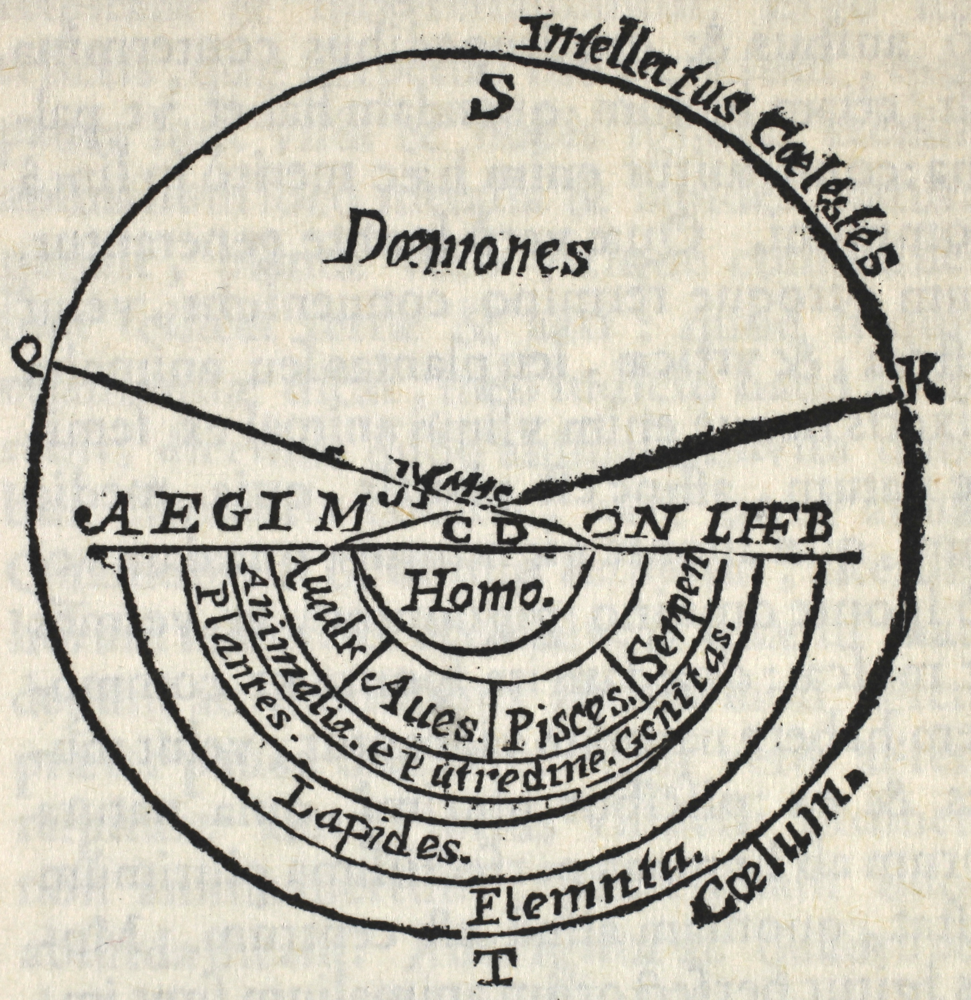

# Girolamo [Geronimo] Cardano
**First published Tue Apr 23, 2013; substantive revision Sat Oct 7, 2023**

*Giglioni, Guido, Regier, Jonathan*

In addition to being one of the most original and talented physicians, mathematicians and astrologers of his time, Girolamo Cardano (b. 1501, Pavia, d. 1576, Rome) occupies an important place in the history of Renaissance philosophy. His contributions range from a comprehensive account of order in all its various meanings (natural, human, and divine) to epistemological and methodological directions concerning the progress of knowledge, from an elaborate theory of the immortality of the soul to a sophisticated analysis of the role of practical wisdom (*prudentia*) in such diverse human activities as medicine and political action.

## 1. Life and Philosophical Works

Girolamo Cardano was born in Pavia in 1501 from Fazio and Chiara Micheri. Chiara delivered her baby in Pavia, in the house of family friends, and not in Milan, to defuse a possible scandal concerning the illegitimate birth. Fazio would marry Chiara and recognize Girolamo only later in 1524, just before his death. After a difficult childhood, saddened by frequent illnesses and the harsh upbringing by his overbearing father, Cardano enrolled at the University of Pavia to study medicine in 1520 against his father’s wish. Fazio (1445–1524), a jurist and an accomplished practitioner of mathematics and natural philosophy (in 1480 he had published an edition of John Peckham’s *Perspectiva communis* (“General Optics”), written around 1265), wanted his son to undertake studies of law, but Girolamo felt more attracted to philosophy and science. When, due to the ongoing war between France and Spain, the authorities in Pavia were forced to close the university, Cardano resumed his studies at the University of Padua, where he graduated in medicine in 1526. For about six years, he practised as a physician in Saccolungo, a village close to Padua, where he met and married Lucia Bandareni (1531). Three children were born from this marriage: Giovanni Battista (1534), Chiara (1537) and Aldo (1543). In the meantime, Cardano had been trying several times to become a member of the College of Physicians in Milan, but his applications had always been turned down, adding to his professional frustration and disappointment. Rejections notwithstanding, he moved back to Milan with his family in 1532. He divided his time between practising medicine in Gallarate, a town nearby Milan, and teaching mathematics in the Piattine schools of Milan, a charitable institution founded by the nobleman Tommaso Piatti in 1501 to improve knowledge of Greek, logic, astronomy, and mathematics among Milanese students from a poor background. Fazio, too, had previously taught in this school. In the meantime, his reputation as a successful practitioner in medicine began to spread among the important families of Milan. In 1539 his application to become a member of the College of Physicians was finally accepted. Discontinuously, from 1543 to 1551, he taught medicine at the University of Pavia, until 1552, when he went to Scotland to treat the Archbishop of Edinburgh, John Hamilton, who was suffering from a particularly severe form of asthma. Back to Milan in 1553, he resumed teaching in Pavia in 1559. In 1560 his son Giovanni Battista was executed charged with the murder of his wife, Brandona Seroni, whom, against his father’s will, he had married in 1557. This tragic event represented a turning point in Cardano’s life and intellectual career. In 1562, he decided to leave Pavia, whose academic environment had become increasingly hostile, to teach medicine in Bologna. As a result of mounting suspicions that he was actively spreading heretical views, he was arrested on 6 October 1570 and remained in prison until 22 December of the same year. In February 1571, before the Sacred Congregation led by Antonio Baldinucci, Cardano was required to acknowledge and reject his serious crimes against the faith (*abiura de vehementi*), having been declared “vehemently suspect of heresy.” He solemnly swore that he would no longer teach and publish books until his death. In 1571 he went to Rome to serve as personal physician to Pope Pius V and then Pope Gregory XIII. After having been admitted to the College of Physicians in 1575, he died in Rome, on 20 September 1576, devoting his last energies (from September 1575 to May 1576) to write his autobiography, *De vita propria*, published posthumously by Gabriel Naudé in 1643.

Cardano wrote and published a vast amount of works, in the most disparate fields of knowledge, especially medicine, mathematics, astrology and natural history. His strictly philosophical treatises include: *De arcanis aeternitatis* (“The Mysteries of Eternity”, began at the end of the 1530s and published partially in the posthumous *Opera omnia* in 1663); *De consolatione* (“On Consolation”, 1543); *De sapientia* (“On Wisdom”, 1544); *De animi immortalitate* (“On the Immortality of the Soul”, 1545); *De subtilitate* (“On Subtlety”, 1550, 1554, 1560), and its twin book *De rerum varietate* (“On the Variety of Things”, 1557); *Theonoston* (“Divine Knowledge”, written in the middle of 1550s and published posthumously in 1617 and 1663); *De utilitate ex adversis capienda* (“On Gaining Advantage from Misfortunes”, 1561); *Encomium Neronis* (“Praise of Nero”); *Dialectica* (“Dialectic”), *De uno* (“On the One”), *Tetim seu de humana conditione* (“Tetim, or On the Human Condition”), *De minimis et propinquis* (“On Those Things which are Smallest and Closest to Hand”), *De summo bono* (“On the Highest Good”), *Guglielmus*, *sive de morte* (“William, or On Death”), and *Somniorum Synesiorum*, *omnis generis insomnia explicantes, libri IV* (“Four Books of Synesian Dreams, Explaining Dreams of Every Kind”), all published in 1562; *Antigorgias dialogus sive de recta vivendi ratione* (“Anti-Gorgias, or On the Right Way to Live”), *Hyperchen* (“Being”) and *De Socratis studio* (“On the Earnestness of Socrates”), published in 1566; *Proxeneta seu de prudentia civili* (“The Mediator, or Civic Prudence”, published posthumously in 1627 and 1663); *Paralipomena* (“Supplements”, begun in 1561 and published posthumously in 1663). Other works were published posthumously in the *Opera omnia* edited by the French physician Charles Spon (1609–1684) in 1666: *Hymnus seu canticum ad Deum* (“A Hymn, or a Canticle to God”); *Mnemosynon* (“Memorial”); *Norma vitae consarcinata* (“A Patched-Up Rule of Life”); *De optimo vitae genere* (“On the Noblest Kind of Life”); *Dialogus Hieronymi Cardani et Facii Cardani ipsius patris* (“Dialogue between Girolamo Cardano and His Father Fazio”); *De natura liber unicus* (“A Single Book on Nature”).

Generally speaking, Cardano’s philosophy is heavily influenced by characteristic trends of late scholastic Aristotelianism, with a strong penchant for Averroist interpretations. Cardano shows a great interest in Averroes’ opinion that one intellect would perform intellective functions for all human beings. However, he tends to provide a historicized version of this radical view, in that he looks at the one intellect as the varying amount of learning accumulated by mankind throughout the centuries rather than simply justifying it from a purely epistemological point of view (seen as the one intellective power that actualizes the life and knowledge of the sublunary world as a whole). Cardano’s philosophy also displays clear traces of Platonic influences, absorbed through the reading of Marsilio Ficino’s recent translations and commentaries, especially Plotinus and Iamblichus. Together with his impressive knowledge of astrological and medical literature, both scholasticism and Platonism give a characteristically vitalistic slant to his cosmological views. Cardano’s philosophy has often been described as suggestive and rich in original intuitions, but cluttered and inconsistent as a whole. In fact, his philosophical work is yet another example, common during the Renaissance, of how different philosophical traditions (including not only Aristotelianism and Platonism, but also Epicureanism and Stoicism, and not only Graeco-Roman, but also Christian and Arabic views) could converge into one composite but coherent picture. Throughout his life, from his early endeavours in the 1540s (*De animi immortalitate*) to the last philosophical attempt (*Dialogus Hieronymi Cardani et Facii Cardani* and *De propria vita*), Cardano demonstrated a distinctive commitment to a certain number of philosophical issues: the relationship between oneness and multiplicity, with the notable corollaries dealing with order and disorder, determinism and chance, life and decay; the view of the intellect as the ultimate principle of reality and knowledge; a general theory of celestial heat, described as the main formative agent in nature; the interplay of nature and the soul in the organization of the universe; a general doctrine of the immortality of the soul, seen as the foundation of both cognitive clarity and moral certitude. As a whole, the originality of Cardano’s eclecticism lies in the unique way in which he characterizes the interdependence of life, knowledge and matter, in which a pronounced sense of reality and truth is constantly being questioned and jeopardized by a realistic view of human nature, mercilessly presented as prone to fear, delusion and deceit.

## 2. Life, Knowledge, and Nature

Cardano’s cosmological views belong to a long-established system of astro-biological doctrines whose origins go back to Aristotelian physics, Hippocratic vitalism, and fundamental assumptions underlying the tradition of astrological and meteorological learning, reshaped through a series of Hebrew and Arabic mediations. His account of the supralunary world combines elements from Neoplatonic philosophy and Christian theology. In line with many of his contemporaries, Cardano maintains that there is a clear division between the supralunary and sublunary world. The life of the universe is the result of varying degrees of celestial energy overflowing from the One, i.e., God. From God to matter, cohorts of the most disparate souls mediate between these two extremes. From a material point of view, the connective element between heaven and earth is celestial heat. The principal constituents of the sublunary world are matter (earth, water and air), celestial heat, and a wide variety of souls (spanning from demonic minds to substantial forms understood as specific principles of life).

In line with the principles of Greek ontology (and showing an evident interest in the Renaissance recovery of Parmenides’ philosophy), Cardano maintains that nothing comes out of nothing; rather, all things derive from something, and this something cannot be infinite (*Hyperchen*, OO, I, 284b; *De natura*, OO, II, 284a). Aristotle called this something “hyle or prime matter,” but Cardano prefers to discard this notion of an intermediate entity between being and non being, replacing it with the view of the elements (earth, water and air) as the material starting point and celestial heat as the efficient active principle, “for otherwise the elements would be completely redundant if there were prime matter” (*De natura*, OO, II, 284b). The elements, which represent the first level of organization in matter, are three (and not four as demanded by Aristotelian and scholastic physics): earth, water and air (*De arcanis aeternitatis*, OO, X, 9a). As for fire, Cardano considers this to be a product of celestial heat, which is one of the various streams of vital energy flowing from the supralunary sources of life and knowledge and which pervade the universe as one living organism. Innate heat of a celestial origin is the active element that mediates between the state of utter immobility which characterizes intelligible substances and the incessant mobility that defines the life of material beings. Through an exercise in introspective analysis, Cardano enumerates three principles that regulate both our inner life and the life of all created things: one “is moved and does not move, resulting from the heavy elements;” another “moves, and it is not moved, that is, the soul;” the third, finally, “is moved by the soul” and moves the body, i.e., the innate heat (*Theonoston*, OO, II, 304b). To the question of whether the soul can be identified with celestial heat, Cardano replies that, unlike the latter, the former is incorporeal, does not occupy any place and therefore is never in motion. Also, that which is in motion does not have that level of self-stability that is necessary for a being to be able to perceive (*sentire*) or to think (*intelligere*) (*Theonoston*, OO, II, 304b).

In Cardano’s metaphysics, matter and form are complementary, in that in nature there cannot be matter without form, and forms are always with a body. Forms represent the primordial stage in the process through which the created universe becomes one living being. The difference between souls and forms is that souls, albeit involved in the animation of bodies, remain nevertheless unaffected by corporeal reality. Up on a higher level, minds are souls that are completely independent of matter, bodies and motion. However, even within the ontological sphere of the minds, there are varying degrees of embodiment. While the highest celestial intelligences are wholly separated from the material cosmos, demonic substances, albeit incorporeal, can affect the corporeal world through forces (*vires*) and influences (*influxus*) of various kind. One of these is “that force which is connected to demons, regardless of whether this power is corporeal and depends on humours, or it is incorporeal.” Cardano maintains that it is through forces of this nature that “the parts of the universe are aroused by demons, stars or some other hidden cause” (*Paralipomena*, in OO, X, 446b–447a. See also *De subtilitate*, OO, III, 670a). The principle that in a way collects and administers all these currents of celestial energy is the soul of the world (*anima mundi*). In Cardano’s system of astro-biological determinism, the universal soul keeps the whole cosmos together and performs paramount operations in accordance with the original plan devised by God and implemented by the planetary intelligences, for “all things are influenced by the higher heaven and are moved at the command of the soul of the world.” The soul of the world, which “cannot be understood without God,” directs the work of nature, and, “in the process of generating things, produces supercelestial lives and multiplicity” (*De arcanis aeternitatis*, OO, X, 6a). In the sublunary world, the major operations of life and generation are performed by nature, understood as a source of teleological activity supervised by the intellect and the soul of the world (*De subtilitate*, OO, III, 360a; ed. Nenci, 63). The complex relationship between soul and nature, and the role played by celestial forces, is a crucial point in Cardano’s philosophy (On Cardano’s cosmological views, see Ingegno 1980, 1–78, 209–271; Maclean 1984; Grafton 1999)[^grafton-1999][^ingegno-1980][^maclean-1984].

Regarding the hierarchical arrangement of the ontological principles, there is a certain oscillation in the way Cardano distributes them along the various degrees of being, but by and large we can say that God understood as the One represents the ultimate source of order and activity in the universe, and all the rest emanates from it in the form of increasingly more plural and less integrated entities, from intellects to souls, from the soul of the world to individual souls, from the soul to nature, from celestial to earthly animals, from forms to scattered matter. In *De arcanis aeternitatis*, Cardano lists fourteen genera of beings, a number that, in his opinion, “matches the structure of the universe:” three elements (earth, water, air), celestial heat, stones, plants, living creatures generated from putrescent matter (*animantia ex putredine*), quadrupeds, birds, fish, reptiles, human beings, demons, and God (*De arcanis aeternitatis*, OO, X, 8b).

Higher animals are divided into four main classes: quadrupeds, birds, fish and reptiles. In the diagram he attaches to his discussion, “the nature of the animals is connected to the human one only in one point,” which is located in the area corresponding to the quadrupeds. See Figure 1:

\*Figure 1.\*

However, the margin of interaction between human beings and the rest of living creatures is ampler. In keeping with a number of Renaissance philosophers, Cardano maintains that man is at the centre of micro- and macro-cosmic exchanges within the universe: “since the human circle corresponds to each single part of the whole domain of living beings, all the properties and natures that can be found in living beings will also be present in human beings” (*De arcanis aeternitatis*, OO, X, 8a). In *Paralipomena*, Cardano defines the human species as an amalgam of forms (*tota humana species congeries quaedam est*), a “mass” that is in constant evolution (*succrescitat que decrescit*):

> this excellent human matter conceals the forms of all animals: the forms of the ox (although they do not feed on hay); of the snake (but they do not kill with their bite); of the lion (but they have no claw). By all means, the characteristics of the soul are exactly the same (perhaps even worse); however, since these animal forms [concealed in the human nature] lack their corresponding bodily organs, they do not really seem to be the same (*Paralipomena*, OO, X, 446a).

Human nature includes all the forms of nonhuman nature, but they lie dormant, as it were, in a state of virtual energy. Cardano always pays special attention to those aspects of human nature that seem to indicate a close link with animals and lower forms of life. Unsurprisingly, comparative analyses between humans and animals abound in his works. Among the questions dealing with the relationships between human and nonhuman animals, Cardano is particularly interested in exploring whether reason is an exclusive prerogative of human beings or it should rather be seen as the result of biological development (*De natura*, OO, II, 283b–284a).

Above nonhuman and human animals, Cardano posits a universe teeming with the most diverse kinds of incorporeal minds. He acknowledges that to count the number of celestial substances populating the supralunary world would go way beyond the power of reason; and yet Denis the Pseudo-Areopagite, “relying on Platonic arguments and the visions of St Paul” divided them into nine orders. Within these orders Cardano identifies “seven natures.” The first nature is “the infinite, or God,” eternal in itself. The second nature is “the soul of all things or lives,” which represents the first breaking up of the original unity; then comes the already mentioned soul of the world, whose loss of ontological unity and independence begins to manifest itself, being “one principle resulting out of many and eternal ones because of something else’s intervention.” The fourth nature is the soul which moves the universe, the *primum movens*, not eternal in itself, but through eternal temporal succession. The fifth nature, the souls of the various planets, derives from the combined action of this primary mover and the soul of the world. Various orders of souls emanates from the fifth nature: “heroic” souls, minds that are capable of having sense perceptions (*mentes sensiles*) and the soul that presides over all sentient lives (*communis sensilis*). This last type of soul divides itself not only into individual beings, but also into parts, “for everything is alive.” The next nature, therefore, the sixth one – the “common and vital soul” (*anima communis atque vitalis*) – belongs to plants, lower animals and the elements. The last order is “the soul conceived in matter,” which “Plato called idea,” and Cardano simply characterizes as “life.” Relying on later Platonic authors, from Iamblichus to Denis the Pseudo-Areopagite, Cardano describes the universe as one single entity, seamlessly interrelated throughout its vital expanse, placed between the two extremes of God, absolute eternity and unity, and matter, the domain of absolute transience and multiplicity (*De arcanis aeternitatis*, OO, X, 6ab).

## 3. The Soul and the Order of Nature

One of the most complex questions in Cardano’s philosophy as a whole concerns the relationship between nature and the soul. This is a point where Cardano’s multiple allegiances (scholastic Aristotelianism, Plotinian Platonism, medicine and astrology) come to the fore. Inevitably, it is also an area where not a few frictions among different traditions come to the fore. Among Cardano’s desiderata there was the plan to devote a specific philosophical treatise to the notion of nature. It is an unfinished work that in all likelihood he sketched at the beginning of the 1560s, *De natura liber unicus*. It can be seen as part of a series of treatises devoted to the exploration of the most recondite aspects of the natural, supernatural and moral worlds (*De libris propriis*, OO, I, 119; ed. Maclean, 293). *De natura* demonstrates Cardano’s lifelong engagement with notions of naturalism, universal animation, and teleology. The discussion is opaque at times because of the topic’s difficulty, the characteristic obscurity of Cardano’s disjointed and elliptical writing, and the precarious condition of the text, left unfinished, with several gaps and marks of typographical sloppiness (typos, mistakes, and missing words). On the other hand, being a monographic treatment of the meaning of nature, the treatise holds great significance, all the more so because, as Cardano explains, the investigation of nature (*inquisitio naturae*) sheds light on the very origin of things, including human beings (*De natura*, OO, II, 283a). In this sense, fragmentary as it may be, Cardano’s *De natura* is an attempt to outline the ultimate principles of reality (on the relationship between natural and supernatural phenomena in Cardano, see Siraisi 1997, 149–173)[^siraisi-1997].

Cardano’s notion of order has strong Platonic overtones. Unity is a mark of perfection, for all things rejoice in unity and they are in a better condition when they reach that level of unity that actualizes their potential nature. Unity gives structure and purpose to all the elements that make up the system of nature: “order and fate, since they are one, and exist with respect to the One, are good; disorder and luck are bad, for they do not strive towards unity” (*De uno*, OO, I, 277b; ed. García Valverde, 4). As an expression of unity and goodness, order is so pervasive that in fact accounts for even the most haphazard and disorderly aspects of reality. Cardano maintains that multiplicity and diversity can always be brought back to potentially ordered series of individual elements (*multitudo ordinata*) (*De uno*, OO, I, 281ab; ed. García Valverde, 24; *De natura*, OO, II, 283a). What we perceive as beauty (*decus*) and elegance (*ornamentum*) in nature is not due to scattered variety (*multitudo*), but to a principle of ordered unity, “the one in the many,” which produces feelings of harmony and symmetry in us (*De uno*, OO, 280a; ed. García Valverde, 20). The same principle of order and unity applies to knowledge: we can say that we really know something when we manage to relate all the aspects and properties of this thing to one cause. According to Cardano, Plotinus followed the same approach in moral philosophy, for he described his notion of happiness as a return to the One (*De uno*, OO, I, 281b; ed. García Valverde, 24).

Among the sources of unity and order in the universe, souls play a most significant role. As we have seen in the previous section, souls are at the center of Cardano’s cosmos. Being immaterial, they are “a unitary principle that is not continuous, nor contiguous, but exists of its own, not in a place, nor in a time.” Unlike life (*vita*), which is diffused everywhere and therefore cannot be said to be a real *principium*, souls have no spatial and temporal limitation and are nowhere (*nullibi*) to be found because of their incorporeal nature (*De uno*, OO, I, 279a; García Valverde, 12). While souls are one and individual everywhere (“our soul is no less here than in the sky, no less in Italy than in India”), bodies are different and manifold depending on material circumstances and vital urges, for “division of bodies is determined by the needs of life (*vitae commodum*)” (*Paralipomenon*, OO, X, 446a). Given the central role assigned to the soul, in all its forms, Cardano’s philosophy of nature is inevitably exposed to charges of animism and anthropomorphism. The issue is accentuated by the fact that the human being represents for Cardano a model of rationality and teleological activity.

For Cardano, human souls are individual principles of self-awareness. Selfhood is the principal argument in favour of their immortality. However, in defending the immortal character of human souls, Cardano also relies on proofs of a more pragmatic and theological nature. Hope in “the immortality of the soul” was implanted in human beings by God, therefore it cannot be considered as a deluded expectation. In common people God instilled this hope “through religions (*leges*),” in wise people, “through the hidden truths (*arcana*) of philosophy.” However, when God provided human beings with hope for immortal life, He decided to give them a feeble certainty, always in need of confirmation. The reason, according to Cardano, is that a firm belief in the immortality of the soul would have created too wide a gap between humans and animals, while leading man into arrogant delusions of grandeur. There has always been and – “as long as there is a world” – there always will be an alternation (*vicissitudo*) of confirmations and doubts concerning the immortality of the soul. It is a “vicissitude” of hopes and despair that is part of the providential regime of the world established by God (*De utilitate ex adversis capienda*, OO, II, 26a). Hope in the immortality of the soul is also a fundamental postulate in Cardano’s moral philosophy. As we will see in the next section, Cardano maintains that true inner tranquillity depends, among other things, on virtue, wisdom, and “hope in the gods.” Otherwise, what is passed off as tranquillity is in fact mere harshness and stiffness (*duritia*) (*Theonoston*, OO, II, 303b, 305b, 308a, 312a).

## 4. Moral Philosophy: The Two Levels of Wisdom

The One (God), the ordered variety of nature (*multitudo ordinata*), and the soul represent the main ontological coordinates in Cardano’s view of the cosmos. The universe is organized according to a plurality of orders, arranged along hierarchical levels, but harmoniously attuned to each other. It is not correct, in Cardano’s opinion, to say that everything is for the sake of everything else (*non omnia propter omnia*), but rather that everything is for the sake of one thing (*omnia propter unum*). This means that the One toward which everything else converges includes many orders, “different among each other.” Nature, art and chance produce a variety of causal sequences that often intersect and are more or less perfect depending on the extent to which the end to be actualized prevails over refractory matter. With respect to natural causes, some are universal, others specific. Among the universal causes of action, the most important are the stars, which act over the sublunary world through influences conveyed by light, heat and motion (*De uno*, OO, I, 279, 281; ed. García Valverde, 12, 26). More specific and individual sources of natural agency are demonic and human minds, which add to the complexity of moral and political action.

At its deepest, the principle of unity and order coincides with God. God is infinite, necessary, wholly undivided, therefore individual. In keeping with the principles of theological Trinitarianism, God is described by Cardano in terms of power (*potestas*), mind (*mens*), and love (*amor*), and these attributes are not “three gods, as Plotinus thinks,” but original divine attributes. The natural world is a constant reminder that God’s “threefold and undivided life” flows into each single thing, down to the smallest beings (*ad minima usque*) (*De arcanis aeternitatis*, OO, X, 6a). However, for all the layers and mediations that characterize Cardano’s universe, the distance between human beings and God remains unbridgeable. Man cannot reconcile the finite with the infinite, for “no finite thing can be transformed into an infinite nature.” Cardano rules out that “this life of ours can get close to that which truly is,” for there is no proportion and no resemblance between the two levels of being. Echoing Cusanian motifs, he argues that “everything that is understood by a finite being is finite, for the act of understanding (*comprehensio*) occurs through some proportion; but there is no proportion between the infinite and the finite.” Likewise, our eyes cannot grasp the direct light (*lux*) of the sun, but only a glimpse of its brightness (*lumen*) (*De arcanis aeternitatis*, OO, X, 4b–5a). Such a powerful and all-encompassing view of divine and natural order, in which the presence of latent Platonic and Averroist motifs contributes to strengthen the cogent organization of the whole universe, has inevitable repercussions concerning the meaning of moral action. During his life, Cardano devoted a considerable number of works to ethical inquiries, surveying almost every aspect in the field: theoretical ethics, applied ethics, prudential behaviour, consolation, education, and the role of rhetoric. However, his most important contribution to moral philosophy consists in his attempt to redefine the relationship between the universal scope of practical reason and the need for human beings to apply moral laws to the concrete circumstances of their life. This characteristic tension between knowledge and application is particularly evident in two works: *Theonoston* (which Cardano began to write around 1555) and *De utilitate ex adversis capienda* (published in 1561).

Cardano presents *De utilitate* and *Theonoston* as complementary treatises aimed at implementing two different approaches in moral philosophy, the former based on the ordinary circumstances of human life (*humanitus*), the latter assuming the existence of supernatural conditions such as immortal individual souls and the effects of divine providence (*divinitus*). They outline two different paths towards the achievement of the same end: lasting happiness. While the ethical program devised in *De utilitate* is designed to face situations of obvious emergency (*quae oculis ipsis subjacent*) concerning human affairs (*humanae res*), *Theonoston* provides an account of the immortality of the soul (*enarratio immortalitatis animi*) that has momentous ethical consequences (*De utilitate*, OO, II, 8, 39a; *Theonoston*, OO, II, 299b). The same duplicity of levels is evident in the way Cardano examines the notion of “tranquillity,” which represents the highest point in one’s virtuous behaviour: one type of tranquillity is premised on the attainment of a certain level of “honorable and moderate pleasure,” the other secures a decent degree of happiness “even in the greatest calamities” (*Theonoston*, OO, II, 310b). Here it is worth pointing out that Cardano’s pragmatic approach to questions of moral philosophy works on both levels, the rational and the empirical. In the final analysis, tranquillity is for Cardano the most useful thing that may happen to a human being, for it provides inner joy, long life, and a more robust kind of wisdom.

### 4.1 Divine Providence, Immortality of the Soul, and the Highest Good

Despite the emphasis he places on the benefits of prudent action, Cardano believes that real, lasting happiness can be possible only if we demonstrate in a persuasive way that the human soul is immortal and that God intervenes actively in the human world, sanctioning a providential regime of the world. Two principles, more than any other, underlie Cardano’s moral philosophy: that the human soul is immortal, and that universal order, being a direct emanation of the One, governs all aspects of reality. Everything that happens has been planned by God, and all that God has established can only be good. Regarding the immortality of the soul, Cardano maintains that, in order to lead a meaningful existence and act accordingly, people need to know whether there is life after death and whether the nature of their afterlife will depend on the way they behaved in this world. In his opinion, Aristotle and the Stoics took the value of virtue for granted. In actual life, human beings will never be persuaded that virtue should be pursued for its own sake, unless they are convinced that their soul is immortal (*De utilitate*, OO, II, 3). In this sense, Cardano defends the immortality of the soul on strong pragmatic grounds. Referring to Seneca’s renowned instructions on how to cope with the thought of death, he points out that meditating about death while maintaining that the soul is mortal is simply absurd. In his eyes, Seneca is a bad rhetorician and an Epicurean in disguise, who exhorts us to die serenely while claiming that there is nothing after death (*De utilitate*, OO, II, 10a; see Giglioni 2012, 187)[^giglioni-2012].

As we have seen while examining his natural philosophy, Cardano’s moral views assign a central role to the soul: “The soul is the most important thing we own; everything refers to it, for riches, honors, and health are nothing without a sound soul” (*De utilitate*, OO, II, 10a). Mental self-awareness, in particular, is the principal argument through which Cardano advocates the immortality of the soul, for a human being is the same thing as his mind (*homo animus est*) (*De utilitate*, OO, II, 12; on Cardano’s notion of the mind, see Giglioni 2005–2007; García Valverde 2013)[^cardano-2005][^garcía-2013][^giglioni-2005]. The same emphasis on mental awareness can be found in Cardano’s moral investigations, for in his opinion human beings cannot understand what the ends of their actions are if they lack a clear knowledge of themselves (*De utilitate*, OO, II, 2). The highest good for them can only lie in those attributes and activities that are part of their minds (*quae animo coniuncta sunt*) (*De utilitate*, OO, II, 27a). In this sense, the relationship between tranquillity and awareness is biunique: human beings can be peaceful only when they know what the highest good is and know that they have attained it (*Theonoston*, OO, II, 303b). According to the Hermit’s definition of tranquillity in *Theonoston*, *tranquillitas* coincides with *securitas*, that is, a condition of unbreakable inner peace, free from cares and anxiety, and it is a level of wisdom that would even suit God. In this respect, true tranquillity for human beings coincides with their being “assimilated” to God, so that, when this condition of serenity is reached, nothing is any longer felt as lacking in meaning and substance. This level of happiness is a “kind of pleasure” that derives from the awareness of “being in the possession of goods” (*Theonoston*, OO, II, 302a; *De optimo vitae genere*, OO, I, 488b). Intellectual pleasure should never be a *monstrum*, that is to say, a hybrid creature resulting from combining the goods of reason with those of the body and external luck (*Theonoston*, OO, II, 313b–314a).

By doing so, Cardano provides a definition of happiness which is inclusive of both knowledge and pleasure. Happiness consists in a “perception of pleasure” that is great (*magna*), full (*plena*), pure (*pura*), untroubled (*secura*), and safe (*tuta*) (*De utilitate*, OO, II, 37b; *Theonoston*, OO, II, 305b; *De libris propriis*, OO, I, 76b; ed. Maclean, 212–213). In *Theonoston*, happiness is said to coincide with a kind of inner composure understood not in terms of lack of sensibility (*indolentia*), but as a condition of mental vigour stemming from the contemplation of the true nature of things. If tranquillity consisted in mere refractoriness to unsettling experiences, the impassive state of a stone should then be viewed as the best condition (*Theonoston*, OO, II, 299b, 305b, 313b). By contrast, ethical peace rests on a state of cognitive tension and focus. In ways that remind us of the sea and the air, undisturbed calm (*tranquilla quies*) is always accompanied by a current of “light motion,” i.e., a state of balance between opposite conditions “which does not unsettle, but delights us.” Cardano’s *tranquillitas* is therefore not the same as absolute rest: “in its state of highest tranquillity, our soul is as it were tremulous and breathing” (*Theonoston*, OO, II, 300a, 305b). The incessant vitality of our being demonstrates that “the matter we are made of, being of a celestial origin, produced and entwined with motion, does not enjoy rest, but thrives on motion,” a motion that, in the final analysis, is no bodily activity, but an expression of knowledge and intellect (*Theonoston*, OO, II, 304a). True tranquillity results from a condition of inviolable self-fulfilment (*securitas*) based on resources that are in our power (*in nostra potestate esse*). Cardano is not convinced by the Senecan view of tranquillity as a balanced active life (*vita actuosa*), or by Socrates’s kind of ‘engaged’ tranquillity; in both cases, their behaviour is for Cardano symptomatic of ambition rather than being the indication of a truly committed philosophical life (*Theonoston*, OO, II, 306b). Finally, Cardano rejects the ideals of tranquillity championed by Plutarch, Antoninus and Cicero, viewed as models of ethical escapism devised by men who in their life never managed to reach a condition of stable serenity (*Theonoston*, OO, II, 305a).

In outlining his views about the nature of the good, Cardano is following a deliberately eclectic approach. He combines the Stoic conception of virtue with Epicurus’ emphasis on indifference (*indolentia*), Aristotle’s notion of virtuous life with Averroes’ characterization of happiness as the highest level of knowledge accessible to human beings. He justifies his eclectic position by arguing that philosophers who were so clever in their fields are likely to have come up with closely related ideas and that therefore “two or more of their opinions can converge into one” (*De utilitate*, OO, II, 24b). From Socrates, for instance, Cardano draws the principle that only wise people can be truly happy because virtue lies in knowledge (*De utilitate*, OO, II, 90b). From medical authors, he borrows the view that pleasure always follows release from a condition of tension or pain (*De utilitate*, OO, II, 28a). Following traditional argumentative patterns in moral philosophy, Cardano distinguishes among goods of the mind (virtues), goods of the body (health, longevity), and goods of fortune. Among the goods of fortune, Cardano lists finding the right wife, a lasting fame, and a painless death (*De utilitate*, OO, II, 19b). Goods of the body, such as enjoying good health and following a healthy regimen, are also part of one’s happiness (*De utilitate*, OO, II, 19a; on Cardano’s notion of health, see Siraisi, 70–90).

Strictly speaking, goods and ills are values. As such, they transcend the level of nature and therefore cannot be treated as if they were natural or against nature: “Goods and ills reside in the soul; faculties and defects in the body; helps and impediments in fortune and its occurrences” (*Theonoston*, OO, II, 314b). In general terms, Cardano defines the good as “what is longed for by the majority of human beings,” such as health, wealth, friends, glory, offspring and wisdom. In a more specific sense (*simpliciter*), good is what is everlasting (*perpetuum*), safe (*securum*), and unchangeable (*immutabile*) (*De utilitate*, OO, II, 23ab). In order to achieve a stable condition of inner peace people need to commit to a good that cannot be taken away from them. Ultimately, since only God has all the requisites to be this kind of imperishable good, the more genuine meaning of good is that which brings us closer to God or make us similar to Him (*Theonoston*, OO, II, 307b–308a, 313b). The difference between human beings and God is that in God the good (*bonum*) coincides entirely with self-preservation (*vita incolumis*), whereas in human beings these two conditions are generally separate. Human beings need to take care of their life and aim at a life that is marked by reason. There cannot be any discourse on happiness where the primary requisites for life are lacking (due to mental illness or death) (*Theonoston*, OO, II, 309b).

Goods of the mind are virtues. By virtue, Cardano means the principle that teaches human beings to behave in the best way towards God, animals and our fellow human beings. Hence the key virtues are sense of duty (*pietas*), compassion (*humanitas*), and kindness (*benignitas*) (*Theonoston*, OO, II, 312ab). Given their importance, virtues are among the foundations of human action: “by its nature, virtue is eternal and a divine good in us; all the rest rots in time and depends on circumstances” (*De utilitate*, OO, II, 21a. See ibid., 38b) . Emanating from the innermost part of our rational soul, virtues have the power to retroact on our mind, thus fortifying and safeguarding its faculties. The most prophylactic among virtues are fortitude, prudence and moderation, and they result from the combined actions of nature, habit and reason, establishing a delicate balance between control of natural impulses (*impetus naturae*), education, and the process of decision making.

As already said, Cardano’s moral philosophy rests on a series of interrelated principles which also play a key foundational role in natural philosophy: that the soul is immortal; that incorporeal lives are everlasting; and that mental awareness is the defining characteristic of the soul. Since the intellect is the only thing that humans can boast about themselves as being truly immortal, intellectual self-knowledge is regarded by Cardano as the highest good that a human being may ever attain. Inevitably, this assumption re-proposes the Averroist conundrum about whether the mind belongs to humankind as a whole or it informs the life and knowledge of each individual human being. Cardano seems to suggest that the mind transcends individual human beings (*[mens] superior est homini*), for happiness coincides with eternal life: “he who does not live long cannot be happy for long” (*De utilitate*, OO, II, 23ab; on Averroism in Cardano, see García Valverde 2013)[^cardano-2013][^garcía-2013]. There cannot be happiness in human life if there is no afterlife for the soul. On this point, Cardano follows St Paul’s argument in his Letter to the Romans (8: 20–22):

> If our soul did not survive death, we would be much unhappier than animals are. For, besides the fact that no animal, apart from the human being, knows that it is going to die, all non human animals (*bruta*) enjoy some happiness for the very fact that they exist, since they live as if they were to live forever, and therefore they participate in eternal bliss. Only human beings are separated from eternity, even in their thought, for not only do they know that they can die, but they also are aware that they will inevitably die, and die within a pre-established time (*De utilitate*, OO, II, 24a).

Cardano’s reflections on mental happiness, assimilation to God, and universal intelligibility should be read against the background of contemporary discussions about the Averroist notion of intellectual beatitude. There is no doubt that, when Cardano characterizes the highest good as the union of the soul with God, his definition is full of Aristotelian and Averroistic resonances. The *summum bonum*, he argues in *De utilitate ex adversis capienda*, is “to be assimilated to the highest good,” i.e., God. Unlike other kinds of love, love of God is “honest” and “safe,” for its object never deserts the seeking soul (*De utilitate*, OO, II, 6, 25a. 500a; *De sapientia*, OO, I, 500–501; ed. Bracali, 30–36). Elsewhere, Cardano’s definition of *summum bonum* is suppler and implies such components as wisdom (*sapientia*), virtue (especially fortitude and prudence), and progeny: wisdom is distinctively human; expressions of fortitude and prudence can also be seen in several animals; to have children, finally, is a prerogative that belongs to almost all living beings. It is a sort of pyramidal model of virtue, with fertility at the basis and wisdom at the top (only very few people can reach wisdom) (*De utilitate*, OO, II, 25b; *Theonoston*, OO, II, 302b; on Cardano’s views on virtue, see Ingegno 1980, 318–76)[^ingegno-1980].

### 4.2 Prudence and Practical Wisdom

The characteristic oscillation between intellectual good and prosperous life is particularly evident in *De utilitate ex adversis capienda*. This work is meant to provide directions on how to overcome difficult situations and lead a reasonably serene life relying only on the material conditions of one’s existence and on the information that one can get from sensible experience. Contrary to the approach followed in *Theonoston*, in *De utilitate* Cardano focuses on the kind of happiness that one can reach in this life, advancing the hypothesis – to be understood in an experimental sense – that there is no survival of the soul (*etiam sublata immortalitate*) (*De utilitate*, II, 5). In this case, the moral actor is confronted not so much with the goods attainable by the mind as with the ills that the mind needs to transform into opportunities for inner exercise or practical gain. Cardano divides ills (*mala*) into external and internal. They both can be measured according to the impact they have on our lives (*magnitudo*) and the level of constraint they impose on our actions (*necessitas*). External ills depend on the variable arrangement of external events (*fortunae arbitrium*) and on the shifting states of the body. Although, properly speaking, the body is “no part of ourselves,” nevertheless, it communicates with our mind. Internal ills are all those passions that can be hardly eradicated from our soul, such as madness, anger, fear, and envy. Since they are located within the soul (*animus*), it is exceedingly difficult to turn them into something useful and productive unless we undergo a radical transformation of our self (*De utilitate*, OO, II, 11b–12a, 13b).

Cardano claims that there can be five kinds of responses to calamities in one’s life. The first two are “paradoxical” and have nothing relevant to say about possible applications to the practical aspects of one’s life. These are the Christian and the Stoic responses: adversities are either good in themselves, or they have absolutely no incidence in someone’s happiness. The remaining three kinds of response are of a “pragmatic” nature, for they appeal to the human senses and have possible social outcomes. First, they teach us how to avoid misfortunes or mitigate the impact they have on our life; second, in case they happen, they direct our attention to ways of coping with misfortunes or escape dangerous consequences; third, they tell us how to gain “some good” out of “any kind of ill” (*De utilitate*, OO, II, 10b, 27b, 39a). For Cardano, this ethical program in three stages is an approach that suits people involved in the many activities of civic life and helps meet their social commitments. The distinctive trait of prudent people is their ability to turn difficulties into opportunities of knowledge and moral betterment (*De utilitate*, OO, II, 11a). Regarding the “paradoxical” attitudes to calamities displayed by Stoic and Christian sages, Cardano thinks that there is a great difference between the situation in which the wise man is deemed capable of “bearing calamities with fortitude” (the Stoic approach) and that in which he is supposed to look at them as part of “one’s goods” (the Christian attitude). Even more different, however, is to interpret calamities as useful and productive means of experience, as suggested by Cardano. Otherwise, to praise the ills of life remains a futile rhetorical exercise, and for this reason Cardano does not hesitate to place Erasmus’ *Laus stultitiae* (“Praise of Folly”) in this category of edifying but useless rhetoric. With the exception of irreparable losses, which can only be assuaged by resorting to a whole range of consolatory techniques, Cardano maintains that any other ill can always be turned into something useful and therefore no consolation is needed. To sum up, he identifies different levels – rhetorical, cognitive, and pragmatic – within the domain of moral philosophy: “To praise adversities is the eloquent rhetorician’s task; to bear them with fortitude belongs to a generous soul or a person who knows divine truths; to draw useful instruction from them is the mark of a prudent man” (*De utilitate*, OO, II, 11a).

As in the case of intellectual happiness, relief from emergencies is predicated on knowledge. Cardano characterizes his method (*ratio*) for avoiding misfortunes and preparing against calamities as based on a particular kind of knowledge (*scientia*) – both useful and necessary – which “teaches us to recognize and obtain known goods, and once they are obtained, it tells us how to use them and how to protect us with them against ills” (*De utilitate*, OO, II, 17a). The ambivalent role of *animus* in Cardano’s moral philosophy is particularly evident in his directions on how to draw profit from misfortunes, for both misery and happiness depend on awareness (“the fact that we know our condition”) (*De utilitate*, OO, II, 88b). Our thinking activity is a key element in turning adversities into opportunities of growth in self-awareness. Any philosophical discussion of ethical matters presupposes that the ethical subject is aware of his or her happiness or unhappiness: “the mind (*animus*) alone is the one who is happy or unhappy.” We have previously noted how closely Cardano’s notion of the *summum bonum* is connected to the principle of soul’s awareness. In the same way, all forms of external goods (riches, physical beauty, health, friends, offspring, country, honors) are no part of happiness unless they are related to the mind (*quatenus ad animum referuntur*).

The principal resources through which human beings may learn to draw advantages from adversities are fortitude, prudence, worldly knowledge (*rerum experientia*), and all sorts of helps (*auxilia*), such as material means, friends, authority, bodily strength and practical experience (*exercitatio*) (*De utilitate*, OO, II, 12a). Among the resources provided by reason, Cardano shares with Seneca the belief that meditating about one’s death (*meditatio mortis*) can trigger active and pointed responses to everyday problems: “although death is a necessary event, nevertheless, it contains in an eminent way, so to say, all the reasons that sadden our life.” Thinking about death, regardless of whether people may be sure that they are going to survive after death, “can dissolve almost any form of sorrow” (*De utilitate*, OO, II, 17b). When methodically structured, far from producing anxiety, the thought of death and of the transient nature of all human affairs injects a sense of purpose and order into our existence, making us gradually adjusted to a universe in a constant flux. Cardano’s method of drawing profit from adversities is based on the general principle that everything in nature is subject to incessant change: “I usually compare human affairs, this whole sublunary frame (*machina sublunaris*) and all that happens in it to a mass of wax in which, while it is compressed, protrusions become cavities and cavities protrude, all forms change, and now they change into similar ones, now into dissimilar ones, into charming or foul, horrible and pleasant ones.” The principle of the unremitting transformation of reality (*vicissitudo rerum*) is therefore the ontological rationale behind our belief that ills can be turned into goods (*De utilitate*, OO, II, 14b). Closely related to this principle is Cardano’s striking assumption that, when considered from the point of view of happiness, all things are on a par (*omnia aequalia sunt*): “God levelled the conditions not only for all human beings, but also for all things which are under the sky” (*De utilitate*, OO, II, 18a, 24b).

It is while examining the essence of humane misfortune that Cardano reaches the important conclusion that loss and want are the ultimate causes of one’s hardships. The ability to anticipate and feel in advance the effect of losing something or someone (*sensus amissionis*) can therefore prepare us to face calamities in our life (*De utilitate*, OO, II, 7). While Cardano insists that experience of adversities in life (*sensus calamitatum*) provides people with a richer sense of their happiness, however, he is also well aware that there are limits in the human ability to process misfortunes into material for inner transformation (*De utilitate*, OO, II, 38b). Material destitution is certainly one of these limits. Among the circumstances that affect our perception of want, penury prevents us from focusing on the improvement of our knowledge and level of awareness. When in his division of the goods (of the mind, of the body and of fortune) Cardano describes material means as a pre-condition for the exercise of virtue and happiness, he takes special care in specifying that the ethical inconvenience in being poor does not lie in not having access to the advantages of material prosperity, but in the inability to work towards one’s own happiness: “if someone does not have the means to raise his children, to look for wisdom or to practice justice, he will certainly be unhappy, not because he is poor, but because he cannot practice the works of happiness” (*De utilitate*, OO, II, 26a). Mental pain is another situation in which human ability to turn misfortunes into positive experiences is tested to the limit. The way Cardano insists on the severe reality of mental pain (*molestia animi*, *dolor animi*) is one of the most characteristic aspects of his moral philosophy: “No disease, if there is not fear of death, can equal mental pain (*dolor animi*)” (*De utilitate*, OO, II, 18a).

In promoting (whenever possible) the value of happiness in all circumstances of human life, Cardano does not intend to humour any human tendency to self-delusion. On the contrary, he sees his effort to dispel false beliefs and to curb proclivities to self-deception as his main contribution to moral philosophy, for there is no greater merit than “to free mankind from false opinions” (*De utilitate*, OO, II, 26a). Indeed, sometimes he goes so far as to criticize Averroes’ notion of mental happiness as a form of entertaining false hopes (in this case, the hope to achieve intellectual bliss). Cardano thinks that the principal task of a moral philosopher should be that of freeing the mind from misapprehensions and prejudices: “There are many people who prefer to be happy in a mistaken way rather than acknowledge the reality of their affairs and their condition” (*De utilitate*, OO, II, 24b). As already said, mental *securitas* cannot be premised on forms of self-distraction and self-delusion, which turn our mind away from the causes of our discontent. A good physician would never try to assuage the pain of the patient by recommending him to buy “paintings and precious stones” (*Theonoston*, OO, II, 307a). Cardano’s method of drawing profit from adversities is therefore an attempt to promote endurance while insisting on a courageous acceptance of the human condition.

The clash between appearance and reality, which represents the hallmark of Cardano’s ontology and theory of knowledge, has therefore its obvious counterpart in his moral philosophy, where he often associates human misery with unrealistic ambitions triggered by human desires: “Since human nature is driven to the infinite by appetites, it can never be satisfied, for it cannot contain the infinite, indeed, not even a great part of what it desires.” Therefore, he who is not capable of restraining his own appetites, be he the greatest of the kings, will certainly be the unhappiest person (*De utilitate*, OO, II, 5; *De sapientia*, OO, I, 532a, 544b–545a; ed. Bracali, 135, 174–175). To fight our propensity to cherish illusory dreams of happiness (*somnium umbrae* and *umbra somnii*), Cardano recommends us to become more aware of the precarious nature of the human condition (*humana fragilitas*) and to increase our level of self-mastery. The combined action of self-knowledge (*nosce te ipsum*) and self-control (*impera te ipsum*) contributes to narrow the otherwise unmanageable scope of our desires (*Theonoston*, OO, II, 310b; *De consolatione*, OO, I, 615a; *De utilitate*, OO, II, 89b-90a). Self-awareness and self-control contribute to create positive habits (*mores*) out of actions and passions. Unlike nonhuman animals (*belluae*), human beings are capable of disciplining themselves (*imperare sibiipsis*) and to shape their nature (*et naturam et mores sibi formare*) (*Paralipomena*, OO, X, 448a). They modify their behavior through thought (*cogitatio*), language (*sermo*), and action (*actio*). Actions are primarily directed to what is useful for us and are ruled by the criterion of interest (*utile*), by pleasure, nature, and habit. Thought concentrates on what is either useful or harmful for us. Language adjusts our actions and thought to the variable circumstances that present themselves from time to time (*De utilitate*, OO, II, 19a, 20b; *De minimis*, I, 693a). Once we manage to strike a balance between the scope of our desires and the reality in which we live, two things become most necessary (*maxime necessaria*): to obtain what we wish to have (*habere quod velis*) and to know how to use what we have (*his quae habes uti commode scire*) (*De utilitate*, OO, II, 1). To facilitate this task, Cardano distinguishes between disciplines in which the theoretical aspect is more prevalent (such as geometry and theology), disciplines which are characterized by a balanced interplay of theory (*scientia*) and practice (*usus*), such as medicine and law, and finally disciplines in which practice (*exercitatio*) is essential, like moral philosophy. Cardano enumerates five requisites that define the nature of an accomplished action (in terms of attaining the right means for the right end (*adeptio*), readiness of execution (*promptitudo*), and completion (*perfectio*)). These requisites are nature, art, diligence, practice, and familiarity with the experts in the field (*De utilitate*, OO, II, 1–2; *De sapientia*, OO, I, 494b; ed. Bracali, 15).

## 5. Divination, Fate, and the Roman Inquisition

Among the most difficult periods of Cardano’s tumultuous life was his imprisonment and trial by the Inquisition. The episode is important for a number of reasons. The Roman Inquisition had taken its modern form as a Counter-Reformation apparatus for doctrinal purity in 1542. Cardano was arguably the most significant Catholic intellectual targeted until Giordano Bruno in the 1590s and Galileo in the seventeenth century. His ordeal, then, is a key moment in the history of early modern censorship. Beyond that, censor reports reveal a number of themes central to Cardano’s divinatory and astrological thought, even if they distort his actual views. Such themes are essential to the whole of his philosophy and to an understanding of his general reception as one of the most influential astrologers of his time.

The Inquisition began to investigate Cardano in the spring and summer of 1570. On 6 October of that year, he was arrested and imprisoned by the Inquisitor of Bologna, where he lived and was a professor of medicine at the city’s university. Among the documents preserved in the Inquisition archives is Cardano’s desperate plea for release from prison, addressed to the dean of the Inquisition in Rome: “Today is the forty-third day in prison […] I eat almost nothing because eating would drive me mad, not eating would drive me to death, which I consider the lesser evil” (Baldini and Spruit, t. II, 1075). In December, he was transferred to house arrest, and, shortly thereafter, in February 1571, the Roman authorities rendered their judgment: he would abjure not as a formal heretic, but rather as vehemently suspected of heresy. Roughly sixty years later, Galileo would be forced to do the same. Unlike Galileo, Cardano was released from house arrest soon after his abjuration, but he did not escape without consequences, having lost his professorship due to pressure from the Inquisition on the Bolognese government. In October, he relocated to Rome. The following year, his non-medical works were forbidden by the Index of Prohibited Books. Censors both of the Inquisition and the Index continued to produce reports on his published writings until at least the 1590s, a testament to the enduring interest for him on the Italian peninsula well into the seventeenth century. Physicians, lawyers, ecclesiastics, and other interested parties, frequently sought permission from the Church to read his banned works (Marcus 2020, 160–163)[^marcus-2020].

Given Cardano’s heterodox views, the general freedom with which he expressed himself, and his devotion to astrology, it is perhaps surprising that he was not targeted earlier in his career. There is little doubt that his patrons and renown had provided some protection. The Inquisitor of Bologna, notable for his zealous prosecution of heretics, even expressed a measure of concern about dealing with an author of Cardano’s celebrity. Yet it also seems that Cardano, despite his international fame, lived a somewhat solitary life in Bologna, bereft of protectors capable of shielding him from local machinations (Regier 2019)[^regier-2019]. Larger forces were also at work. With the conclusion of the Council of Trent (1545–1563), the Church had become ever more intolerant of heterodox philosophies. Until the Inquisition’s archives were opened up in the 1990s, the consensus among historians had been that Cardano had offended the Church by printing a horoscope of Christ in his commentary on Ptolemy’s *Tetrabiblos*. The archival documents provide a fuller story. It was not Christ’s horoscope that led directly to Cardano’s trial but rather his *De rerum varietate* (1557), an encyclopedic treatise of natural history. Nevertheless, astrology was at the center of the Inquisition’s case from the beginning. For the Inquisition to launch an investigation, an initial accusation was needed, and here it had come in the form of a letter from the Inquisitor of Como. A focal point of the letter’s attention was a chapter of the *De rerum varietate* devoted to the effects of the celestial bodies. According to the Inquisitor, Cardano “exaggerates” the influence of celestial bodies and denies the possibility of God acting directly on sublunar nature. He also, says the Inquisitor, holds the martyrs of the Church to be nothing more than madmen, driven to extreme and foolish religious behavior by celestial influence. The Inquisitor also lists, rather vaguely, other offenses: contempt of clergy, denial of miracles and demons, and teaching of divinatory superstitions (Baldini and Spruit, t. II, 1042–1043). This cluster of accusations, with astrology at the center, would prove to be the basis for subsequent censorship of Cardano. At the heart of censorial concerns was the accusation that he naturalized what the Church believed outside the realm of nature: God and providence, free will, and miracles. Hence, Cardano was not targeted as an astrologer *per se*, but rather as an astrologizing philosopher in the vein of Pietro Pomponazzi (1462–1525). Censors seemed ready to impute to him the skepticism of miracles associated with Pomponazzi, and especially the latter’s embrace of determinism. Pomponazzi had laid out the possibility in his *De fato, de libero arbitrio, praedestinatione, providentia Dei* (1567) that free will was philosophically untenable, that it could not be reconciled with God’s nature unless we limited divine omnipotence and omniscience, and that it could not be reconciled with the Aristotelian causality.

While censor reports highlight themes in Cardano’s thought that were important at least to a subset of readers, they are of course neither balanced nor accurate portrayals (for more on Cardano’s trial and censorship, see Valente 2003 and 2017; Regier 2019 and 2021)[^cardano-2003][^cardano-2017][^regier-2019][^regier-2021][^valente-2003][^valente-2017]. We might say that his works on divination endorse the consensus opinion among Christian astrologers, both medieval and Renaissance, that celestial bodies act as instruments of providence, but that humans can resist natural forces up to a point. He is something of a moderate libertarian: free will exists, but it operates within a field of natural, social, and providential constraints. Following a long tradition with its origin in Boethius, he seems to recognize a fine distinction between providence and fate: providence is the universal order experienced in the timeless present of God’s mind, while fate is the manifestation of that order in the universe itself (*De arcanis aeternitatis*, OO, X, 43a; *Paralipomenon*, OO, X, 468b). Early in his career, he wrote a treatise specifically devoted to fate, *De fato*, which was subsequently lost, likely destroyed by Cardano himself due to fears of the Inquisition (Cardano 2004a, 53)[^cardano-2004a]. We can, however, consult *De fato*’s table of contents, which survives in editions of *De libris propriis* (*De libris propriis*, OO, I, 62a-63b and 99a-100a; Cardano 2004, 174–177 and 236–239). These chapter headings raise more questions than they answer, however. Cardano built a sweeping argument, it seems, in favor of an all-encompassing fate that subsumed even accidental events. And, like Pomponazzi, he was ready to justify such a conception of fate as a dual consequence of God’s nature and the nature of causality. At the same time, however, he devoted a chapter to the “utility” of free will.

How exactly free will was grounded in the lost *De fato* remains a mystery, as does Cardano’s reference to its utility. His writings on divination can help to answer the question, since there he endeavors at moments to clarify the relationship between fate and free will. Indeed, an entire section of the *De fato* was to deal with divination, whose viability, according to a chapter heading, was based on the orderly unfolding of fate. In his commentary on Ptolemy’s *Tetrabiblos*, as in the *Tetrabiblos* itself, medicine serves as the paradigm case for divination. In *Tetrabiblos* I.3, Ptolemy compares astrology to medicine: a physician identifies the course that nature will take if left alone and then employs counteracting forces to bring about another outcome; the astrologer does much the same. Commenting on this section, Cardano agrees with the Arabic mathematician and astrologer Ali ibn Ridwan (“Haly” in Latin) that Ptolemy here “demonstrated maximum wisdom in things divine and human” (*De astrorum iudiciis*, OO, V, 112a). What Cardano means is that astrology can estimate the force of future conditions, and so can determine which events can be deflected (*declinari possint*) and which will take place due to the divinely instituted “necessity of fate” (*fatali necessitate*) (*De astrorum iudiciis*, OO, V, 112b). He has in mind inflection points in the providential design of history—wars, great defeats and victories, catastrophes, and political transformations. Yet even under these circumstances, we are not completely powerless. Cardano turns to the analogy of shipwreck to make his point: “It is as if a person found himself in the sea during a tempest, and although he foresaw the danger he could not avoid it. The person skilled in swimming through heavy currents or practiced in handling the danger will be saved, while another hardly so. The divine can be considered similarly, because it is entirely necessary, and because whatever is accomplished by the divine mind cannot be escaped” (*De astrorum iudiciis*, OO, V, 112b). Prognostication in this sense always implies an estimation of forces, followed by a consideration of the appropriate response. Cardano proffers a two-tiered astrological system where princes of the world are more subject to astrological effects than their subjects; through astrological changes, the divine can effectively seize the hearts of kings and steer history to its determined end. This is not to say that the individual outside the ranks of power never experiences moments of unavoidable fate. In *De libris propriis*, Cardano reflects on the signs that foretold his eldest son’s execution, signs whose meaning only became clear when it was too late. Cardano asks himself why these signs presented themselves when they were to be of no use. He concludes that they function as Christian consolation, as proof of God’s existence, providential design, and so of the justice that reveals itself in the unfolding of history (*De libris propriis*, OO, I, 98a-b; Maclean 2004, 234-235).

Across a spectrum of works, Cardano depicts the course of a human life as the result of a dynamic between outward and inward inclinations, and the knowledge and force that we can muster to counter or complement them. Yet we are not dealing with a pure form of naturalism here. The divine and supernatural, as Cardano understands them, are constantly speaking about the future to humans through intermediaries, through nature itself (Regier 2023)[^regier-2023]. In his monumental treatise on dream interpretation, *Somniorum Synesiorum libri IV* or *De somniis*, he describes a universe where providential knowledge is relayed from God to the celestial intelligences, then to humans. He writes that when we sleep, we enter into a communion with God’s mind, such that the future is entirely presented to our souls, but we rarely perceive the information due to the effects of bodily imbalance, daily worries, and general overstimulation. We are like dogs given food by their master; we are oblivious to the preparation that went into it, to its significance (*De somniis*, OO, V, 672a; Cardano 2021a, 515)[^cardano-2021a]. The framework here is generally Neoplatonic: the soul has tremendous access to knowledge that stands above the sensory realm, yet it is too bogged down by incorporeal things—indeed, one of the intellectual benefits of melancholy, to which Cardano assigns a variety of powerful effects, is that it can distance the mind from daily and corporeal cares. As for the nature of dreams, the celestial influence uses our memories as if they were stones in a mosaic, assembling these memories into a composite with meaning; for this reason, dreams are usually cryptic (*De somniis*, OO, V, 598b; Cardano 2021a, 43)[^cardano-2021a].

Except in very rare cases (e.g., the dreams of perfect clarity that Cardano calls *idola*), the future must be deciphered with imperfect results. The underlying cause is the nature of the infinite. Sciences that concern the future, he writes, all run up against the same problem, the “infinite nature itself of things, that is, of the soul and of what is seen; for the things that are seen and that can be seen are infinite. How then can the infinite be contained in books, however long and numerous?” (*De somniis*, OO, V, 671a; Cardano 2021a, 513)[^cardano-2021a]. He warns his readers against philosophers like Cicero who prefer clarity to nuance. Clarity is a rhetorical cheat; only the greatest of philosophers appreciate infinity and recognize that clarity is the nemesis of accuracy. This discussion is meant to explain the difficulty of dream interpretation, but it could be extended to any other discipline. Knowledge and ignorance interact at the level of the cosmos, insofar as created beings cannot fully understand the providential knowledge that flows through them and manifests in their actions. Galen, says Cardano, does not know how he moves his finger back and forth, despite all his anatomical knowledge, but he can do it anyway because of the natural framework divinely established. The celestial intelligences possess detailed knowledge of their influence over the sublunar world, yet they neither understand how they received this knowledge from God, nor do they know how they really move that world any more than Galen knows how he moves his finger (*De somniis*, OO, V, 671b-672a; Cardano 2021a, 515)[^cardano-2021a]. Nature, in this way, is infused with knowledge—knowledge of all that has and will happen; yet even at the highest ontological level, such knowledge is accompanied by the ignorance of created beings in relation to divine understanding.

## References（引用注释）

> 原文参考文献已转为脚注引用：文内“作者-年份”引用组后附 [^key] 标记，完整条目见本文末脚注定义。

### Cardano’s *Opera omnia*

### Modern Editions of Cardano’s Works

### Secondary Literature

## Academic Tools

> |   | [How to cite this entry](https://plato.stanford.edu/cgi-bin/encyclopedia/archinfo.cgi?entry=cardano). |
> | --- | --- |
> |   | [Preview the PDF version of this entry](https://leibniz.stanford.edu/friends/preview/cardano/) at the [Friends of the SEP Society](https://leibniz.stanford.edu/friends/). |
> |   | [Look up topics and thinkers related to this entry](https://www.inphoproject.org/entity?sep=cardano&redirect=True) at the Internet Philosophy Ontology Project (InPhO). |
> |   | [Enhanced bibliography for this entry](https://philpapers.org/sep/cardano/) at [PhilPapers](https://philpapers.org/), with links to its database. |

## Other Internet Resources

- [Girolamo Cardano. Strumenti per la storia del Rinascimento lombardo](https://cardano.unimi.it/) (in Italian). This site contains archival materials, bibliographical information, and searchable PDFs of Cardano’s *Opera omnia*.

## Related Entries

causation: the metaphysics of | existence | form vs. matter | God: and other ultimates | happiness | imagination | life | soul, ancient theories of

[^cardano-1663]: Cardano, Girolamo, *Opera omnia*, ed. Charles Spon, 10 volumes, Lyon: Jean-Antoine Huguetan and Marc-Antoine Ravaud, 1663; repr. Stuttgart-Bad Cannstatt: Frommann, 1966, abbreviated in this article as ‘OO’).

[^for-1663]: For the many editions of Cardano’s work published before the 1663 *Opera omnia*, see the chronology established by Ian Maclean in Cardano 2004a, 43–111.

[^cardano-1953]: 1953, *Book on Games of Chance*, trans. Sydney Henry Gould, in Oystein Ore, Cardano: The Gambling Scholar, Princeton: Princeton University Press, 182–241.

[^cardano-1973]: 1973, *Writings on Music*, ed. and trans. Clement A. Miller, Rome: American Institute of Musicology.

[^cardano-1982]: 1982, *Della mia vita*, ed. and trans. Alfonso Ingegno, Milan: Serra e Riva.

[^cardano-1990]: 1990, *L’oroscopo di Cristo*, ed. and trans. Armando Torno, Milan: Philobiblon.

[^cardano-1992]: 1992, *Sul sonno e sul sognare*, eds. Mauro Mancia and Agnese Grieco, trans. Silvia Montiglio and Agnese Grieco, Venice: Marsilio.

[^cardano-1998]: 1998, *Aforismi astrologici*, ed. Giuseppe Bezza, trans. Renzo de Martino, Milano: Xenia.

[^cardano-1999]: 1999, *Pronostico generale dil nobile messer Hieronymo Cardano physico milanese*, ed. Germana Ernst, in Girolamo Cardano: Le opere, le fonti, la vita, eds. Marialuisa Baldi and Guido Canziani, Milan: Angeli, 461–475.

[^cardano-2001]: 2001, *Il prosseneta, ovvero della prudenza politica*, ed. and trans. Piero Cigada, Milan: Mondadori.

[^cardano-2002]: 2002 [1930], *The Book of My Life*, trans. Jean Stoner and intro. Anthony Grafton, New York: ‎ NYRB Classics.

[^cardano-2003]: 2003, *Metoposcopia: manuale per la lettura della fronte: interpretazione dei caratteri in base alle linee frontali e ai nei illustrato con ottocento immagini, con le corrispondenze astrologico-planetarie*, ed. and trans. Arecchi Albert, Milan: Mimesis.

[^cardano-2004a]: 2004a, *De libris propriis: The editions of 1544, 1550, 1557, 1562, with supplementary material*, ed. Ian Maclean, Milan: FrancoAngeli.

[^cardano-2004b]: 2004b, *De subtilitate, Tomo I, Libri I-VII*, ed. Elio Nenci, Milan: FrancoAngeli.

[^cardano-2005]: 2005, *Come si interpretano gli oroscopi*, ed. and trans. Ornella Pompeo Faracovi, Pisa and Rome: Istituti Editoriali e Poligrafici Internazionali.

[^cardano-2006a]: 2006a, *De immortalitate animorum*, ed. José Manuel García Valverde, Milan: FrancoAngeli.

[^cardano-2006b]: 2006b, *Liber de ludo aleae*, ed. Massimo Tamborini, Milan: FrancoAngeli.

[^cardano-2008a]: 2008a, *De Sapientia libri quinque*, ed. Marco Bracali, Florence: Olschki.

[^cardano-2008b]: 2008b, *Somniorum Synesiorum libri quatuor. Les quatres livres des songes de Synesios*, 2 vols., ed. and trans. Jean-Yves Boriaud, Florence: Olschki.

[^cardano-2008c]: 2008c, *Elogio di Nerone*, ed. and trans. Marco Di Branco, Rome: Salerno.

[^cardano-2008d]: 2008d, *De utilitate ex adversibus capienda praefatio*, ed. Raffaele Passarella, Milan: Angeli.

[^cardano-2009]: 2009, *De Uno. Sobre lo uno*, ed. and trans. José Manuel García Valverde, Florence: Olschki.

[^cardano-2011a]: 2011a, *Artis magnae sive de regulis algebraicis liber unus*, ed. Massimo Tamborini, Milan: Angeli.

[^cardano-2011b]: 2011b, *Guglielmo: Dialogo sulla morte*, ed. José Manuel García Valverde, trans. Paolo Raimondi Turin: Aragno.

[^cardano-2013]: 2013, *The De Subtilitate of Girolamo Cardano*, 2 vols., trans. John M. Forrester with intro. John Henry Tempe: Arizona Center for Medieval and Renaissance Studies.

[^cardano-2014]: 2014, *Carcer*, eds. Marialuisa Baldi, Guido Canziani, Eugenio Di Rienzo, Florence: Olschki.

[^cardano-2017]: 2017, *Il libro dei segreti*, ed. Davide Giavina, Milan: Mimesis.

[^cardano-2019a]: 2019a, *De consolatione*, ed. Marialuisa Baldi, Florence: Olschki.

[^cardano-2019b]: 2019b, *Le Livre de ma vie / De Vita propria*, ed. and trans. Jean-Yves Boriaud, Paris: Les Belles Lettres.

[^cardano-2021a]: 2021a, *Traité des songes. De somniis*, ed. and trans. Jean-Yves Boriaud, Paris: Les Belles Lettres.

[^cardano-2021b]: 2021b, *Sulla consolazione*, trans. Marialuisa Baldi, Florence: Olschki.

[^additional-1998]: Additional bibliographic information about studies on Cardano can be found in Schütze 1998.

[^baldi-1999]: Baldi, Marialuisa and Guido Canziani (eds.), 1999. *Girolamo Cardano: Le opere, le fonti, la vita*, Milan: FrancoAngeli.

[^baldi-2003]: –––, 2003, *Cardano e la tradizione dei saperi*, Milan: FrancoAngeli.

[^baldini-2009]: Baldini, Ugo and Leen Spruit (eds.), 2009, *Catholic Church and Modern Science: Documents from the Archives of the Roman Congregations of the Holy Office and the Index*, Vol. I: *Sixteenth-Century Documents*, 2 volumes, Rome: Libreria Editrice Vaticana.

[^bianchi-2008]: Bianchi, Lorenzo, 2008, “Machiavelli e Cardano. Note su naturalismo e fortuna,” in *Dopo Machiavelli* / *Après Machiavel*, eds. Lorenzo Bianchi and Alberto Postigliola, Naples: Liguori, 53–74.

[^bianchi-2013]: –––, 2013, “Inganni e impostura tra Cardano e Naudé,” in *I castelli di Yale online*, 1: 25–47. doi:10.15160/2282-5460/528

[^boriaud-2012]: Boriaud, Jean-Yves (ed.), 2012, *La pensée scientifique de Cardan*, Paris: Les Belles Lettres.

[^casali-2013]: Casali, Elide, 2013, “Il Pronostico del 1534 di Girolamo Cardano. L’esemplare della Collezione Campi,” *Bruniana & Campanelliana*, 19(2): 571–575.

[^corrias-2018]: Corrias, Anna, 2018, “When the Eyes Are Shut: The Strange Case of Girolamo Cardano’s *Idolum* in *Somniorum Synesiorum Libri IIII*,” *Journal of the History of Ideas*, 79: 179–197.

[^couzinet-2001]: Couzinet, Marie-Dominique, 2001, “La variété dans la philosophie de la nature: Cardan, Bodin,” in *La* varietas *à la Renaissance*, ed. Dominique de Courcelles, Paris: École des Chartes, 105–117.

[^di-1987]: Di Rienzo, Eugenio, 1987, “Dal principato civile alla tirannide: Il *Neronis encomium* di Gerolamo Cardano,” *Studi storici*, 28: 157–82.

[^ernst-2001]: Ernst, Germana, 2001, “*Veritatis amor dulcissimus*: Aspects of Cardano’s Astrology,” in *Secrets of Nature: Astrology and Alchemy in Early Modern Europe*, eds. William R. Newman and Anthony Grafton, Cambridge, MA: The MIT Press, 39–68.

[^garcía-2013]: García Valverde, José Manuel, 2013, “Averroistic Themes in Girolamo Cardano’s *De Immortalitate Animorum*,” in *Renaissance Averroism and Its Aftermath: Arabic Philosophy in Early Modern Europe*, eds. Anna Akasoy and Guido Giglioni, Dordrecht: Springer, 145–71.

[^giglioni-2005]: Giglioni, Guido, 2005–2007, “*Mens* in Girolamo Cardano,” in *Per una storia del concetto di mente*, ed. Eugenio Canone, 2 volumes, Florence: Olschki, II: 83–122.

[^giglioni-2008]: –––, 2008, “‘Bolognan Boys Are Beautiful, Tasteful, and Mostly Fine Musicians’: Cardano on Male Same-Sex Love and Music,” in *The Sciences of Homosexuality in Early Modern Europe*, eds. Kenneth Borris and George Rousseau, New York: Routledge, 201–20.

[^giglioni-2009]: –––, 2009, “Nature and Demons: Girolamo Cardano Interpreter of Pietro d’Abano,” in *Continuities and Disruptions between the Middle Ages and the Renaissance*, eds. Charles Burnett, José Meirinhos, and Jacqueline Hamesse, Louvain-la Neuve: Brepols, 89–112.

[^giglioni-2012]: –––, 2012, “The Many Rhetorical Personae of an Early Modern Physician: Girolamo Cardano on Truth and Persuasion,” in *Rhetoric and Medicine in Early Modern Europe*, eds. Stephen Pender and Nancy S. Struever, Burlington, VT: Ashgate, 173–93.

[^giglioni-2013]: –––, 2013, “Girolamo Cardano: University Student and Professor,” *Renaissance Studies*, 27(4): 517–532.

[^giglioni-2014]: –––, 2014, “Humans, Elephants, Diamonds and Gold: Patterns of Intentional Design in Girolamo Cardano’s Natural Philosophy,” *Gesnerus*, 71: 237–247.

[^giglioni-2015]: –––, 2015, “Scaliger versus Cardano versus Scaliger,” in *Forms of Conflict and Rivalries in Renaissance Europe*, eds. David A. Lines, Marc Laureys and Jill Kraye, Bonn: Bonn University Press, 109–130.

[^gliozzi-1976]: Gliozzi, Giuliano, 1976, “Cardano, Gerolamo,” in *Dizionario Biografico degli Italiani*, Rome: Istituto della Enciclopedia Italiana, 1960-, XIX, 758b–63b.

[^grafton-1999]: Grafton, Anthony, 1999, *Cardano’s Cosmos: The Worlds and Works of a Renaissance Astrologer*, Cambridge, MA, and London: Harvard University Press.

[^ingegno-1980]: Ingegno, Alfonso, 1980, *Saggio sulla filosofia di Cardano*, Florence: La Nuova Italia.

[^keßler-1994]: Keßler, Eckhard (ed.), 1994, *Girolamo Cardano: Philosoph, Naturforscher, Arzt*, Wiesbaden: Harrassowitz.

[^maclean-1984]: Maclean, Ian, 1984, “The Interpretation of Natural Signs: Cardano’s *De subtilitate* Versus Scaliger’s *Exercitationes*,” in *Occult and Scientific Mentalities in the Renaissance*, ed. Brian Vickers, Cambridge: Cambridge University Press, 231–52.

[^maclean-2007]: –––, 2007, “Girolamo Cardano: the Last Years of a Polymath,” *Renaissance Studies*, 21: 587–607.

[^maclean-2008]: –––, 2008, “Cardano’s Eclectic Psychology and its Critique by Julius Caesar Scaliger,” *Vivarium*, 46: 392–417.

[^marcus-2020]: Marcus, Hannah, 2020, *Forbidden Knowledge: Medicine, Science, and Censorship in Early Modern Italy*, Chicago: University of Chicago Press.

[^martin-2022]: Martin, Craig, 2022, “Girolamo Cardano’s Meteorological Predictions: Hippocratism, Weather Signs, Winds, and the Limits of Astrology,” *Perspectives on Science*, 30(5): 851–873.

[^ore-1953]: Ore, Øystein, 1953, *Cardano: The Gambling Scholar*, Princeton: Princeton University Press.

[^pompeo-2012]: Pompeo Faracovi, Ornella, 2012, “Girolamo Cardano e il ritorno a Tolomeo,” *Il linguaggio dei cieli. Astri e simboli nel Rinascimento*, Roma: Carocci, 125–138.

[^prins-2018]: Prins, Jacomien, 2018, “Girolamo Cardano and Julius Caesar Scaliger in Debate about Nature’s Musical Secrets,” *Journal of the History of Ideas*, 8(2): 169–189.

[^prins-2022]: –––, 2022, “Cardano and Scaliger in Debate on the Revival of Ancient Music,” *Journal of Musicology*, 39: 109–132.

[^regier-2019]: Regier, Jonathan, 2019, “Reading Cardano with the Roman Inquisition: Astrology, Celestial Physics and the Force of Heresy,” *Isis*, 110: 661–679.

[^regier-2021]: –––, 2021, “A Hot Mess: Girolamo Cardano, the Inquisition and the Soul,” *HOPOS*, 11: 547–563.

[^regier-2023]: –––, 2023, “Shadows of the Thrown Spear: Girolamo Cardano on Anxiety, Dreams, and the Divine in Nature,” *Early Science and Medicine*, 28: 95–119.

[^sakamoto-2016]: Sakamoto, Kuni, 2016, *Julius Caesar Scaliger, Renaissance Reformer of Aristotelianism: A Study of His* Exotericae Exercitationes, Leiden: Brill.

[^schütze-1998]: Schütze, Ingo, 1998, “Bibliografia degli studi su Girolamo Cardano dal 1850 al 1995,” *Bruniana & Campanelliana*, 4(2): 449–467.

[^schütze-2000]: –––, 2000, *Die Naturalphilosophie in Girolamo Cardanos* De subtilitate, Munich: Fink.

[^siraisi-1997]: Siraisi, Nancy G., 1997, *The Clock and the Mirror: Girolamo Cardano and Renaissance Medicine*, Princeton: Princeton University Press.

[^valente-2003]: Valente, Michaela, 2003, “‘Correzioni d’autore’ e censure dell’opera di Cardano,” in *Cardano e la tradizione dei saperi*, eds. Baldi and Canziani, Milan: FrancoAngeli, 437–456.

[^valente-2017]: –––, 2017, “Facing the Roman Inquisition: Cardano and Della Porta,” *Bruniana & Campanelliana*, 23: 533–540.
